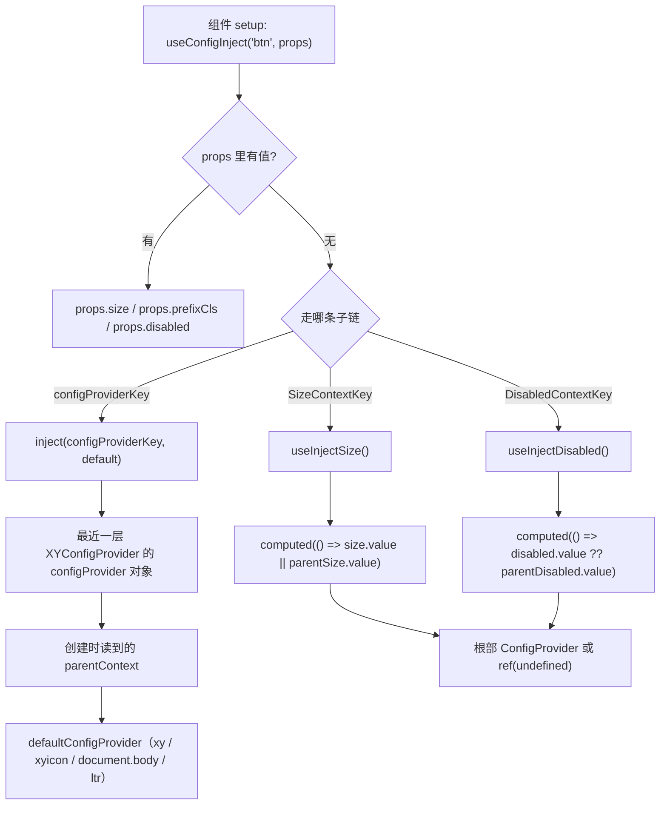
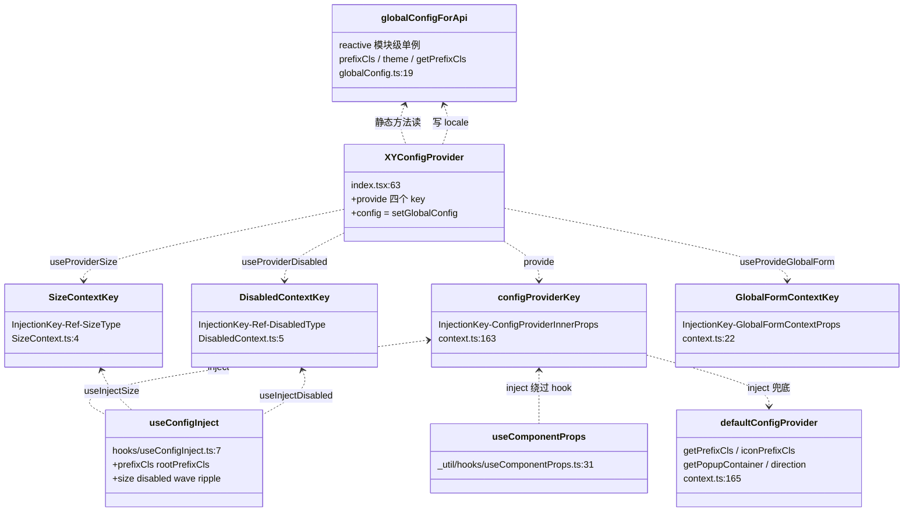
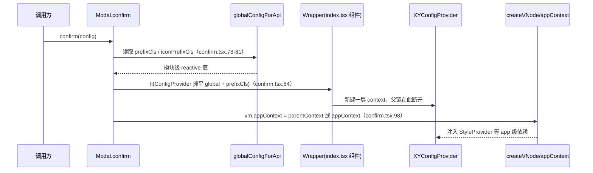

# A05 ConfigProvider 注入链与 Size/Disabled Context

> **本篇解决**：一个组件写 `size="large"`、`disabled`、`prefixCls` 时，值到底从哪一层来、被哪一层拦下；`ConfigProvider.config()` 为什么能绕开组件树生效。
> **前置**：A03 Design Token 四层体系（已审）、A04 cssinjs 样式引擎与 SSR 注水（进行中，本篇只按编号引用其主题，不展开）　**读者坐标**：`01-architecture` 第 5/8 篇

## 一、职责与边界

`config-provider` 负责的是**纵向配置传递**这一件事：把用户在应用根部声明的一次性配置（前缀、方向、尺寸、禁用、空状态渲染器、弹层容器、主题对象、组件默认 props）沿组件树向下送到每一个组件的 `setup` 里，并在组件自身 props 缺省时提供回落值。它的实现由四个 `InjectionKey` 加一个模块级响应式对象构成，本篇把这条链的每一跳落到行号。

明确**不负责**的部分：

- Token 的定义与派生（seed → map → alias → component 四层）是 A03《Design Token 四层体系》的主题；本篇只在 `useTheme` 的**父主题回落**与 `theme.inherit` 的截断语义上停留，不复述 `memoTheme` / `DesignTokenProvider` / `cssVariables` 旁路论证，那部分见 A03 §五，本篇只作一行引用。
- 样式注水、`hashId`、SSR cache 归 A04《cssinjs 样式引擎与 SSR 注水》（进行中，本篇不展开其内容）。
- locale 语言包的内容与目录组织归 I11；本篇只把 `LocaleReceiver` 当作注入链上的一环给出行号。
- 各组件如何消费这些值（例如 `Button` 的类名拼接）属于组件篇，本篇只给消费点样本。

依赖关系（读源码得到的直接 import 边）：

- 被谁依赖：`useConfigInject` 是全库最高频的内部 hook 之一，`_util/wave/index.tsx:10`、`_util/wave/index.tsx:29` 这类基础设施也依赖它；`_util/hooks/useComponentProps.ts:2` 绕过 `useConfigInject` 直接 `inject(configProviderKey)`。
- 它依赖谁：`theme/internal`（`useTheme.ts:2`、`index.tsx:30`）、`_util/cssinjs`（`index.tsx:29` 的 `createTheme`）、`locale-provider` 与 `locale`（`index.tsx:6`、`index.tsx:9`）、`_util/registerComponent`（`index.tsx:7`）、`message` / `notification`（`index.tsx:11`、`index.tsx:12` 的副作用同步）。
- 一个方向上值得注意的反向边：`config-provider/index.tsx:98-105` 会把 `locale` 写回 `globalConfigBySet`，也就是说组件树内的一条配置会污染组件树外的全局通道，见论点 5。

## 二、源码地图

| 文件 | 行数 | 职责 | 关键导出 |
| --- | --- | --- | --- |
| `packages/xiaoye-ui/src/config-provider/hooks/useConfigInject.ts` | 74 | 组件侧唯一汇合点：props → context → 默认值三级取值 | `default`（匿名箭头函数） |
| `packages/xiaoye-ui/src/config-provider/context.ts` | 181 | props 定义、内部 context 类型、`configProviderKey`、全局默认值 | `configProviderProps` `configProviderKey` `defaultConfigProvider` `defaultIconPrefixCls` |
| `packages/xiaoye-ui/src/config-provider/index.tsx` | 257 | 主实现：父 context 合并 + provide + 渲染包裹 | 默认导出 `XYConfigProvider`、`configConsumerProps` |
| `packages/xiaoye-ui/src/config-provider/SizeContext.ts` | 16 | 尺寸子链，独立 key | `useInjectSize` `useProviderSize` |
| `packages/xiaoye-ui/src/config-provider/DisabledContext.ts` | 17 | 禁用子链，独立 key | `useInjectDisabled` `useProviderDisabled` |
| `packages/xiaoye-ui/src/config-provider/globalConfig.ts` | 157 | 组件树外的第二通道与静态 API 主题换算 | `globalConfigForApi` `globalConfigBySet` `setGlobalConfig` `globalConfig` `resolveGlobalTheme` |
| `packages/xiaoye-ui/src/config-provider/hooks/useTheme.ts` | 43 | 父子主题合并与 `inherit` 截断 | `default` |
| `packages/xiaoye-ui/src/config-provider/renderEmpty.tsx` | 35 | 默认空状态渲染器 | `default` `DefaultRenderEmpty` |
| `packages/xiaoye-ui/src/config-provider/style/index.ts` | 29 | 图标前缀样式 hook（被 `index.tsx:82` 使用） | `default` |
| `packages/xiaoye-ui/src/_util/hooks/useComponentProps.ts` | 40 | 组件默认 props 的注入消费端 | `default` |
| `packages/xiaoye-ui/src/_util/registerComponent.ts` | 35 | `XYXxx` → `xy-xxx` 折算与去重注册 | `toXYTagName` `registerComponent` `registerComponents` |
| `packages/xiaoye-ui/src/index.ts` | 35 | 全量安装的入口，条件 `app.use` | `install` |
| `packages/xiaoye-ui/src/locale/LocaleReceiver.tsx` | 85 | locale 注入环（内容归 I11） | `LocaleReceiver` `useLocaleReceiver` |
| `packages/xiaoye-ui/src/locale-provider/LocaleReceiver.tsx` | 5 | 转发兼容层，`locale-provider/LocaleReceiver.tsx:1` 与 `:3` 直接 re-export 上面那份 | 同上 |
| `packages/xiaoye-ui/src/modal/confirm.tsx` | 146 | 静态方法消费全局通道的样本 | `default` |
| `packages/xiaoye-ui/src/vc-notification/Notification.tsx` | 302 | 同上，通知的静态容器样本 | — |

主实现入口是 `packages/xiaoye-ui/src/config-provider/index.tsx:63`（`defineComponent` 起始），组件侧消费入口是 `packages/xiaoye-ui/src/config-provider/hooks/useConfigInject.ts:7`。

`config-provider` 目录下有两份测试：`packages/xiaoye-ui/src/config-provider/__tests__/config-provider.test.tsx`（`describe` 见 `:13`、`:64`，只覆盖 `resolveGlobalTheme` 与 `ConfigProvider.config` 的主题注册）和 `packages/xiaoye-ui/src/config-provider/index.test.js`（55 行）。按 `packages/xiaoye-ui/vitest.config.mts:33` 的 include glob `src/**/*.test.{js,ts,jsx,tsx}`，两者都会被执行。注入链本身（嵌套覆盖、size/disabled 回落）的测试现状见第七节。

## 三、架构与数据流

### 图 1：单组件取值的完整回落链



链上有三个独立终点而不是一个：`configProviderKey` 的终点是 `context.ts:165` 的 `defaultConfigProvider`，`SizeContextKey` 与 `DisabledContextKey` 的终点是各自 `inject` 的兜底 `ref(undefined)`（`SizeContext.ts:7`、`DisabledContext.ts:8`）。这决定了「没挂 ConfigProvider 时 size 是 undefined 而不是 middle」这件事。

### 图 2：静态结构——四个 InjectionKey 与两条通道的归属



`GlobalFormContextKey` 与前三者的差别是它**只由 ConfigProvider 与 Form 提供、且不做父链回落**：`context.ts:29-31` 的 `useInjectGlobalForm` 直接返回 `inject` 结果或一个空 computed，`index.tsx:216` 的 `useProvideGlobalForm` 提供的是全新对象，因此嵌套 ConfigProvider 会**整体替换**掉 validateMessages，而不是与父层合并。

### 图 3：静态方法（`modal.confirm`）如何吃到全局配置



这张图的关键是**中间那一跳是人为补出来的**：静态方法用 `vueRender` 把 VNode 渲染到一个新 DOM 容器，天然不在原组件树里，既拿不到 `inject` 也拿不到 app 级 provide。`confirm.tsx:78-84` 的摊平和 `:98` 的手工挂载就是在补这两样东西，缺一则样式注入与前缀都会退回默认值。

## 四、核心机制精读

### 论点 1：纵向注入链有四个并行的 InjectionKey，`useConfigInject` 只是它们的汇合点

**断言**：组件的一次 `useConfigInject('btn', props)` 调用同时读取三条独立链（`configProviderKey`、`SizeContextKey`、`DisabledContextKey`），每条链的兜底终点不同，因此「组件 props > 自身声明 > 父 context > 全局默认」这个优先级不是一条统一规则，而是**逐字段手写出来的**，字段之间的回落运算符不一致。

`packages/xiaoye-ui/src/config-provider/hooks/useConfigInject.ts:7-28`：

```ts
export default (name: string, props: Record<any, any>) => {
  const sizeContext = useInjectSize();
  const disabledContext = useInjectDisabled();
  const configProvider = inject(configProviderKey, {
    ...defaultConfigProvider,
    renderEmpty: (name?: string) => h(DefaultRenderEmpty, { componentName: name }),
  });
  const prefixCls = computed(() => configProvider.getPrefixCls(name, props.prefixCls));
  const direction = computed(() => props.direction ?? configProvider.direction?.value);
  const iconPrefixCls = computed(() => props.iconPrefixCls ?? configProvider.iconPrefixCls.value);
  const rootPrefixCls = computed(() => configProvider.getPrefixCls());
  const autoInsertSpaceInButton = computed(() => configProvider.autoInsertSpaceInButton?.value);
  const renderEmpty = configProvider.renderEmpty;
  const space = configProvider.space;
  const pageHeader = configProvider.pageHeader;
  const form = configProvider.form;
  // ...
  const getPopupContainer = computed(
    () => props.getContainer ?? props.getPopupContainer ?? configProvider.getPopupContainer?.value,
  );
```

逐跳解释：

- `useConfigInject.ts:8-9` 先接两条子链，`useConfigInject.ts:10-13` 接主链。主链的 `inject` 兜底参数不是直接给 `defaultConfigProvider`，而是**每次调用现场展开一份新对象**并补一个 `renderEmpty`——这是为了让脱离 ConfigProvider 的组件也能渲染空状态。代价是 `defaultConfigProvider`（`context.ts:165-173`）与这份展开体是两个不同的对象，`useConfigContextInject()`（`context.ts:175-177`）用的却是**未扩展的** `defaultConfigProvider`，两个入口拿到的默认 `renderEmpty` 行为不一样：前者有、后者没有。
- `useConfigInject.ts:14` 的 `prefixCls` 把 props 优先级**委托给了 `getPrefixCls` 的第二参数**，而不是自己写 `??`；`useConfigInject.ts:15-16` 才是本地 `??`。同一个 hook 里两种写法并存。
- `useConfigInject.ts:18-21` 四个字段（`autoInsertSpaceInButton` 取 `.value`，`renderEmpty`/`space`/`pageHeader`/`form` 直接透传 ComputedRef）**故意不拆包**：调用方拿到的是响应式引用，可以原样传给下一层 `getPrefixCls` 或样式 hook。`space` 透传在 `useConfigInject.ts:20`，消费方需要自己 `.value`。
- `useConfigInject.ts:26-28` 的弹层容器有**两个 props 名**争同一个槽位：`getContainer` 优先于 `getPopupContainer`，两者都缺省才落到 context（`index.tsx:117-121` 提供，`context.ts:171` 全局兜底为 `document.body`）。
- `useConfigInject.ts:39` 与 `:43` 是唯一的两处跨链读取：`props.size || sizeContext.value` 用 `||`，`props.disabled ?? disabledContext.value` 用 `??`。前者意味着 `size=""` 会被当成缺省，后者意味着 `disabled=false` 是有效声明。

### 论点 2：`prefixCls` / `rootPrefixCls` / `iconPrefixCls` 是三条不同用途的派生，且父级前缀继承在 `props.prefixCls` 缺省路径上不可达

**断言**：三者的分工是「组件类名前缀 / 跨组件选择器与动效前缀 / 图标类名前缀」，它们从同一个 `getPrefixCls` 派生但取值时机不同；`ConfigProvider` 自身的前缀合并逻辑里有一条**实际不可达**的父级继承分支。

`packages/xiaoye-ui/src/config-provider/index.tsx:70-82`：

```tsx
    const parentContext = useConfigContextInject();
    const getPrefixCls = (suffixCls?: string, customizePrefixCls?: string) => {
      const { prefixCls = 'xy' } = props;
      if (customizePrefixCls) return customizePrefixCls;
      const mergedPrefixCls = prefixCls || parentContext.getPrefixCls('');
      return suffixCls ? `${mergedPrefixCls}-${suffixCls}` : mergedPrefixCls;
    };
    const iconPrefixCls = computed(
      () => props.iconPrefixCls || parentContext.iconPrefixCls.value || defaultIconPrefixCls,
    );
    const shouldWrapSSR = computed(() => iconPrefixCls.value !== parentContext.iconPrefixCls.value);
    const csp = computed(() => props.csp || parentContext.csp?.value);

    const wrapSSR = useStyle(iconPrefixCls);
```

- **`prefixCls`（组件级）**：`useConfigInject.ts:14` 传 `name` 作后缀，得到 `xy-btn` 这种形态；全局默认实现 `context.ts:166-169` 在无 ConfigProvider 时返回 `xy-${suffixCls}` 或 `xy`。
- **`rootPrefixCls`（跨组件级）**：`useConfigInject.ts:17` 调 `getPrefixCls()` **不带后缀**，于是拿到根前缀 `xy`。它的用途有两类，都能在源码里定位：一是拼动效类名，如 `upload/UploadList/ListItem.tsx:88-89` 的 `${rootPrefixCls.value}-fade`、`upload/UploadList/index.tsx:191`、`popover/index.tsx:48` 与 `:72` 的 `getTransitionName(rootPrefixCls.value, 'zoom-big', ...)`；二是作为**样式 token 注入到 CSS 选择器**，如 `form/style/index.ts:10`、`form/style/index.ts:130` 的 `&-hidden.${rootPrefixCls}-row`、`form/style/index.ts:439-440` 的 `.${rootPrefixCls}-col-24`。也就是说 rootPrefixCls 改变会让 Form 样式里对 `xy-col-*` 的选择器一起改变，而 prefixCls 不会。`select/index.tsx:170` 是个绕开 hook 的例子：它自己写 `computed(() => getPrefixCls())`，而 `getPrefixCls` 来自 `useConfigInject.ts:65` 的透传。
- **`iconPrefixCls`（图标级）**：`index.tsx:76-78` 是唯一做了三级回落的前缀（props → 父 context → `defaultIconPrefixCls`，后者在 `context.ts:14` 定为 `xyicon`）。`index.tsx:79` 的 `shouldWrapSSR` 只在**图标前缀与父层不同**时才调用 `wrapSSR`（`:82` 的 `useStyle(iconPrefixCls)`、样式文件 `config-provider/style/index.ts`），这是一个去重设计：嵌套多层 ConfigProvider 时图标样式只在新前缀出现的那层注入一次。
- **不可达分支**：`index.tsx:71` 的解构默认值 `= 'xy'` 让 `prefixCls` 在 `props.prefixCls` 为 `undefined` 时变成真值 `'xy'`，于是 `index.tsx:73` 的 `|| parentContext.getPrefixCls('')` 永远不会被执行——嵌套 ConfigProvider 想继承父级前缀而不写 `prefixCls` 是做不到的，它总会回到硬编码的 `xy`。只有显式传空串（`prefixCls=""`，此时解构默认值不生效）才走父链。对照 `useConfigInject.ts:16` 的图标前缀用的是 `??`/`||` 组合，没有这个问题。
- 同一个 `getPrefixCls` 在 `globalConfig.ts:29-34` 与 `:143-146` 还有**两份独立实现**，走的是全局通道而非组件链，见论点 5。

### 论点 3：Size/Disabled 的 provide 是「父链回落」，而 ConfigProvider context 里的 `componentSize`/`componentDisabled` 是「覆盖不回落」

**断言**：同一个「尺寸」在两处的语义相反——`SizeContext` 链上子层缺省会**继承**父层，`configProvider.componentSize` 字段上子层缺省则是 `undefined`（继承不发生）。之所以实际行为表现为继承，是因为组件读的是前者。

`packages/xiaoye-ui/src/config-provider/SizeContext.ts:1-16`：

```ts
const SizeContextKey: InjectionKey<Ref<SizeType>> = Symbol('SizeContextKey');

export const useInjectSize = () => {
  return inject(SizeContextKey, ref(undefined as SizeType));
};
export const useProviderSize = (size: Ref<SizeType>) => {
  const parentSize = useInjectSize();
  provide(
    SizeContextKey,
    computed(() => size.value || parentSize.value),
  );
  return size;
};
```

`packages/xiaoye-ui/src/config-provider/DisabledContext.ts:10-17`：

```ts
export const useProviderDisabled = (disabled: Ref<DisabledType>) => {
  const parentDisabled = useInjectDisabled();
  provide(
    DisabledContextKey,
    computed(() => disabled.value ?? parentDisabled.value),
  );
  return disabled;
};
```

- `SizeContext.ts:13` 用 `||`、`DisabledContext.ts:14` 用 `??`。差异在布尔域里是致命的：`??` 让子层显式 `componentDisabled=false` 能**解除**父层的 `true`；而尺寸域只有 `'small' | 'middle' | 'large' | undefined`（`context.ts:48`），`||` 与 `??` 等价，但语义上仍是「假值即缺省」。
- 两条链的**注入兜底是 `ref(undefined)`**（`SizeContext.ts:7`、`DisabledContext.ts:8`），不是常量。这意味着没有 ConfigProvider 时 `useInjectSize()` 返回一个稳定的 ref 对象，`useConfigInject.ts:39` 的 `props.size || sizeContext.value` 得到 `undefined`，最终由组件自身 props 默认值决定（`context.ts:85-88` 的 `componentSize`/`componentDisabled` props 也没有默认值）。
- 与子链形成对照的是主链上的两个字段：`index.tsx:137-138` 写的是 `const componentSize = computed(() => props.componentSize);`、`const componentDisabled = computed(() => props.componentDisabled);`——**完全不看 `parentContext`**，随后在 `index.tsx:175-176` 放进 `configProvider` 对象、在 `index.tsx:217-218` 交给 `useProviderSize`/`useProviderDisabled`。也就是说：继承靠的是 `useProviderSize` 内部的父链读取，而不是 context 字段的合并；任何直接读 `configProvider.componentSize` 的代码都会丢掉继承。
- 子链的 provider **不属于 ConfigProvider 专有**。`form/Form.tsx:141-142` 就是一次普通组件的重新提供：

```ts
    useProviderSize(size);
    useProviderDisabled(disabled);
```

（导入见 `form/Form.tsx:43`、`form/Form.tsx:44`。）于是 `<xy-form component-disabled>` 之下的输入项禁用来自 Form 这一层，而不是根部 ConfigProvider，`Form.tsx:143` 的 `mergedColon` 与 `Form.tsx:144-149` 的 `validateMessages` 则演示了另外两种回落写法（`??` 到 `contextForm`，以及三层展开合并）。

- 组件侧的真实消费点有两类，且**多数绕开了聚合 hook**：直接用子链的有 `button/button.tsx:50-51`（`const disabledContext = useInjectDisabled();` 后自己写 `props.disabled ?? disabledContext.value`）、`input/Input.tsx:45`、`checkbox/Checkbox.tsx:38`、`radio/Radio.tsx:57`、`select/index.tsx:165`、`switch/index.tsx:82`、`upload/Upload.tsx:46`、`cascader/index.tsx:161`、`tree-select/index.tsx:153`、`input-number/index.tsx:68`、`dark-mode-toggle/DarkModeToggle.tsx:36`；而 `button/button.tsx:47` 同时又从 `useConfigInject` 取 `size`。**同一个组件里 disabled 走直连、size 走 hook**，`useConfigInject.ts:43` 那份合并结果在 Button 上是被重复计算了一遍的。

### 论点 4：嵌套 ConfigProvider 的合并语义分三类——父链回落、就地覆盖、深合并

**断言**：`index.tsx` 里那 20 多个 computed 并不遵循统一规则；按是否读 `parentContext` 可分三类，另有两处默认值被重复定义。

`packages/xiaoye-ui/src/config-provider/index.tsx:137-153`：

```tsx
    const componentSize = computed(() => props.componentSize);
    const componentDisabled = computed(() => props.componentDisabled);
    const wave = computed(() => props.wave ?? parentContext.wave?.value);
    const ripple = computed(() => props.ripple ?? parentContext.ripple?.value ?? true);
    const componentProps = computed(() => {
      const self = props.componentProps;
      const parent = parentContext.componentProps?.value;
      if (!self && !parent) return {};
      if (!self) return parent || {};
      if (!parent) return self;
      // 父子合并：子覆盖父（同组件名时浅合并，组件内 props 深合并）
      const merged: Record<string, Record<string, any>> = { ...parent };
      for (const key of Object.keys(self)) {
        merged[key] = { ...(parent[key] || {}), ...self[key] };
      }
      return merged;
    });
```

分类与行号：

| 语义 | 字段（`index.tsx` 行号） | 子层缺省时的结果 |
| --- | --- | --- |
| 父链回落（继承） | `iconPrefixCls:76-78`、`csp:80`、`autoInsertSpaceInButton:95-97`、`locale:98`、`direction:106`、`space:107`、`virtual:108`、`dropdownMatchSelectWidth:109-111`、`getTargetContainer:112-116`、`getPopupContainer:117-121`、`pageHeader:122-124`、`input:125-127`、`pagination:128-130`、`form:131-133`、`select:134-136`、`wave:139`、`ripple:140` | 沿用父层 |
| 就地覆盖（不读父层） | `componentSize:137`、`componentDisabled:138`、`transformCellText:177` | `undefined`，父层值丢失 |
| 结构合并 | `componentProps:141-153`（唯一做合并的字段） | 按组件名逐 key 浅合并，组件内 props 再展开一次 |

- 回落组内部还有**两种不同的缺省判定**：`??`（允许 `false`/`0` 覆盖父层，如 `virtual:108`、`ripple:140`、`dropdownMatchSelectWidth:109-111`）与 `!== undefined` 三元（`pageHeader:122-124`、`input:125-127`、`pagination:128-130`、`form:131-133`、`select:134-136`、`getTargetContainer:112-116`），后者与 `??` 等价，但对对象型 props 传 `null` 时行为不同。`||`（`locale:98`、`direction:106`、`csp:80`、`iconPrefixCls:76-78`）则会把空串/空对象也当作缺省。
- **跨层累积**只发生在 `componentProps`（`index.tsx:141-153`）与 `theme`（`useTheme.ts:12-40`）。`componentProps` 的下游是 `_util/hooks/useComponentProps.ts:49`，它按组件名取 `configProvider.componentProps?.value?.[name]`，并在 `:33-37` 用 `props[key] !== undefined` 判定显式值，从而形成「组件 props > 注入默认 > 组件默认」的第三优先级表（注释在 `useComponentProps.ts:7-10`）。
- `ripple` 的默认 `true` 被写了**两遍**：提供侧 `index.tsx:140` 的 `?? parentContext.ripple?.value ?? true`，消费侧 `useConfigInject.ts:48` 的 `?? configProvider.ripple?.value ?? true`。两层都在时前者生效；没有 ConfigProvider 时靠后者兜住。同类重复还有 `getPopupContainer`：默认 `document.body` 定义在 `context.ts:171`，而 `useConfigInject.ts:26-28` 又叠了一层 props 回落。
- `theme` 的截断开关在 `useTheme.ts:9`：`themeConfig.value.inherit === false || !parentTheme?.value ? defaultConfig : parentTheme.value`，即 `theme.inherit=false` 是**唯一能让某一层显式断开父链**的 prop（props 定义见 `context.ts:59` 的 `inherit?: boolean`）。`useTheme.ts:13-15` 则规定「本层没传 theme 对象」时整块沿用父 theme，不做任何合并；`useTheme.ts:22-27` 按组件名逐个展开做二层合并。至于合并后的 token 如何进入 `DesignTokenProvider` 与 `memoTheme`，是 A03 §五 的内容，本篇不重复。

### 论点 5：`globalConfig.ts` 是第二条通道，静态方法必须靠「手工摊平 props + 手挂 appContext」才吃到全局配置

**断言**：`message` / `notification` / `modal.confirm` 这类命令式 API 用 `vueRender` 把 VNode 渲染到新生成的 DOM 容器，**不在原组件树内**，`inject` 全链路失效；因此它们读的是模块级 reactive 单例 `globalConfigForApi`，并且要人为补两件事——把全局值当 props 摊平喂给一层新的 ConfigProvider，以及把 `appContext` 手工挂到 VNode 上。

`packages/xiaoye-ui/src/config-provider/globalConfig.ts:18-44`：

```ts
export const globalConfigBySet = reactive<ConfigProviderProps>({}); // 权重最大
export const globalConfigForApi: ConfigProviderProps & {
  getRootPrefixCls?: (rootPrefixCls?: string, customizePrefixCls?: string) => string;
} = reactive({});

watchEffect(() => {
  Object.assign(globalConfigForApi, globalConfigBySet);
  // 只从 globalConfigBySet 读取，不能读 globalConfigForApi.prefixCls：
  // 那样会同时读写同一个响应式对象形成自依赖，写入值一旦与读回值不同即无限重跑
  globalConfigForApi.prefixCls = globalConfigBySet.prefixCls || defaultPrefixCls;
  globalConfigForApi.iconPrefixCls = globalConfigBySet.iconPrefixCls || defaultIconPrefixCls;
  globalConfigForApi.getPrefixCls = (suffixCls?: string, customizePrefixCls?: string) => {
    if (customizePrefixCls) return customizePrefixCls;
    return suffixCls
      ? `${globalConfigForApi.prefixCls}-${suffixCls}`
      : globalConfigForApi.prefixCls;
  };
  // ...
});
```

- **谁写**：`setGlobalConfig`（`globalConfig.ts:123-140`），对外暴露为 `ConfigProvider.config`（`index.tsx:248`，类型约束在 `index.tsx:254-257`）。它内部 `:129-134` 又开了一个 `watchEffect`，把参数同时写进两个对象：`:132` 写 `globalConfigBySet`（去掉 theme），`:133` 写 `globalConfigForApi`（含 `resolveGlobalTheme` 换算后的 theme）。`:126-128` 的 `stopWatchEffect()` 只停掉**上一次 `setGlobalConfig` 自己开的那个** effect，模块级 `:23` 的 effect 一直在跑。
- **还有一条反向写入**：`index.tsx:99-105` 在组件树里监视 `locale`，然后 `globalConfigBySet.locale = locale.value`（`index.tsx:102`，`immediate: true`）。也就是说挂在树里的 ConfigProvider 会**污染**全局通道，静态方法随后就能看到这个 locale。这是两条通道唯一的显式交叉点。
- **谁读**：`notification/index.tsx:93`（`const { getPrefixCls } = globalConfig();`）、`vc-notification/Notification.tsx:258`（`globalConfigForApi.getPrefixCls(...)`）、`:277-283`（渲染期整读并摊平）、`modal/confirm.tsx:78-81`。`dark-mode-toggle/DarkModeToggle.tsx:69` 则是通过 `setGlobalConfig` 写主题，其断言写在 `dark-mode-toggle/__tests__/dark-mode-toggle.test.tsx:181`、`:196-201`。
- **摊平证据**，`packages/xiaoye-ui/src/modal/confirm.tsx:77-95`：

```tsx
  const Wrapper = (p: ModalFuncProps) => {
    const global = globalConfigForApi;
    const rootPrefixCls = global.prefixCls;
    const prefixCls = p.prefixCls || `${rootPrefixCls}-modal`;
    const iconPrefixCls = global.iconPrefixCls;
    const runtimeLocale = getConfirmLocale();
    return (
      <ConfigProvider {...(global as any)} prefixCls={rootPrefixCls}>
        <ConfirmDialog
          {...p}
          rootPrefixCls={rootPrefixCls}
          prefixCls={prefixCls}
          iconPrefixCls={iconPrefixCls}
          locale={runtimeLocale}
          cancelText={p.cancelText || runtimeLocale.cancelText}
        ></ConfirmDialog>
      </ConfigProvider>
    );
  };
```

  `{...(global as any)}` 把 reactive 单例的**全部**字段当作 ConfigProvider 的 props 铺开（`modal/confirm.tsx:84`），`vc-notification/Notification.tsx:283` 是同一写法。这意味着 `globalConfigForApi` 上的额外字段（例如 `:20` 声明的 `getRootPrefixCls`、`:29` 赋的 `getPrefixCls`）都会作为未知 props 落到 ConfigProvider 上；由于 `index.tsx:66` 声明了 `inheritAttrs: false`，它们不会污染 DOM，也不会被消费。
- **手挂 appContext 的证据与原因**，`packages/xiaoye-ui/src/modal/confirm.tsx:96-101`：

```tsx
  function render(props: ModalFuncProps) {
    const vm = createVNode(Wrapper, { ...props });
    vm.appContext = config.parentContext || config.appContext || vm.appContext;
    vueRender(vm, container as any);
    return vm;
  }
```

  赋值优先级是 `parentContext` → `appContext` → 原生。`notification` 侧只有后两级（`vc-notification/Notification.tsx:298` 的 `vm.appContext = appContext || vm.appContext`，参数声明见 `:238`，由 `notification/index.tsx:89`、`:125` 透传，`message/index.tsx:78` 同理）。挂上它之后，孤立树里的组件才可能命中 app 级全局属性——`_util/cssinjs/StyleContext.tsx:96-103` 正是在 `instance.appContext.config.globalProperties.__XYUI_CSSINJS_CACHE__` 上读写样式缓存；不挂 `appContext` 时静态弹窗会另起一份 cssinjs 缓存，样式重复注入且无法与主树共享。`modal/confirm.tsx:22` 的 `omit(config, ['parentContext', 'appContext'])` 说明这两个字段是**通道参数**而不是组件配置。
- **静态方法里再补一层 ConfigProvider 的必要性**：`confirm.tsx:84` 新建的这层是**孤立的**——它的 `parentContext` 是 `defaultConfigProvider`（`context.ts:175-177`），因此主树里的 `direction`、`space`、`wave` 等一律看不见，只有被摊平进 props 的那几个字段生效。这解释了为什么 `notification/index.tsx:93` 要绕一圈从 `globalConfig()` 拿 `getPrefixCls`，而不是复用组件链。

### 论点 6：`registerComponent` 把 `XYXxx` 折算成 `xy-xxx` 并去重，三种 `install` 写法最终都汇到它

**断言**：全局注册的标签名不是手写字符串，而是从组件 `name` 正则推导；重复注册由一次 `app.component(tagName)` 读探测挡住；而 `install` 钩子在本库有三种互不重叠的写法，只 grep 其中一种必然低估覆盖面。

`packages/xiaoye-ui/src/_util/registerComponent.ts:6-27`：

```ts
export const toXYTagName = (name: string): string => {
  return name
    .replace(/^XY/, 'xy-')
    .replace(/([a-z0-9])([A-Z])/g, '$1-$2')
    .toLowerCase();
};

export const registerComponent = (app: App, component: Component, customName?: string): App => {
  const comp = component as any;
  const name = customName || comp.displayName || comp.name;
  if (!name) {
    return app;
  }
  const tagName = toXYTagName(name);
  if (!app.component(tagName)) {
    app.component(tagName, component);
  }
  return app;
};
```

- 名字推导两步：先把 `XY` 前缀换成 `xy-`，再把 `([a-z0-9])([A-Z])` 切成 `-` 并整体小写（`registerComponent.ts:8-10`）。`XYConfigProvider`（`index.tsx:65`）→ `xy-config-provider`；`XYInputNumber` → `xy-input-number`，切点落在 `t`/`N` 之间，数字归在 `[a-z0-9]` 一侧不会被拆开。
- `registerComponent.ts:19-21` 的早退：**没有 `name` 也没有 `displayName` 的组件静默不注册**，返回值仍是 `app`，调用方无从感知。库内组件普遍写了 `name`，但工厂产物（如 `date-picker/generatePicker/` 生成的对象）是否带 name 未逐个确认，本篇不下结论。
- 去重探测在 `registerComponent.ts:23`：`app.component(tagName)` 不带第二参即为查询，已存在则跳过。所以 `app.use(XYButton)` 调两次不会告警也不会覆盖。批量入口 `registerComponents` 在 `:32-35`。
- `install` 的三种写法：
  1. `withInstall(comp)` —— `_util/type.ts:39-46`，函数体内 `c.install = function (app: App) { registerComponent(app, c); }`（`_util/type.ts:41-43`），因此它**同时**计入「`.install =`」与「registerComponent 调用点」两类；
  2. 对象字面量里的 `install:` —— `tree/index.tsx:35`、`layout/index.ts:20`、`auto-complete/index.tsx:170`；
  3. 赋值式 `.install =` —— `config-provider/index.tsx:250-252`、`tabs/index.ts:9`、`form/index.tsx:15`。

```bash
# 三种写法分别计数 + 并集（在本目录下执行，排除 dist 与 node_modules）
cd packages/xiaoye-ui/src
{ grep -rl "withInstall" --include="*.ts" --include="*.tsx" . | grep -v "_util/type.ts";
  grep -rl "^\s*install[:(]" --include="*.ts" --include="*.tsx" .;
  grep -rl "\.install\s*=" --include="*.ts" --include="*.tsx" . | grep -v "_util/type.ts"; } | sort -u | wc -l
grep -rn "registerComponent(app," --include="*.ts" --include="*.tsx" . | wc -l
```

  本机实测（ts/tsx，未含 `.vue`）：`withInstall` 出现 63 处；`install:` 形式分布在 15 个文件；`.install =` 出现 80 处；三者的并集是 **118 个源文件**带 install 钩子；`registerComponent(app, ...)` 调用点 **178 处**（含 `registerComponent.ts:33` 循环内那一处）。作为粗略分母，`src` 下排除 `vc-*`、`_util`、`style`、`theme`、`locale*` 后的顶层目录有 116 个。**注意**：118 与 178 都大于 116，因为 `withInstall` 的引用会与 `install:` / `.install =` 落在同一文件、且 `vc-*` 与子目录里也有注册点，这几个数**不能**用来推断「有多少组件没写 install」，见第七节的坑条目。
- 与全量安装入口的配合，`packages/xiaoye-ui/src/index.ts:16-23`：

```ts
export const install = function (app: App) {
  Object.keys(components).forEach(key => {
    const component = components[key];
    if (component.install) {
      app.use(component);
    }
  });
  app.use(cssinjs.StyleProvider);
```

  `index.ts:14` 的 `if (component.install)` 是**条件安装**：没有 install 钩子的导出（函数、指令、纯类型转发）被静默跳过而不是报错。这也解释了为什么三种写法能并存——`index.ts` 只探测属性存在性，不关心它由 `withInstall` 还是手工赋值产生。`index.ts:19-26` 把 `$message`、`$confirm` 等挂到 `globalProperties`，与标签注册是两条独立路径；另有一条字符串注入 `inject('$xiaoyeUI')`（`color-picker/ColorPicker.tsx:36`）与 `globalProperties.$xiaoyeUI`（`data-table/DataTable.tsx:2084`）读取的第三条通道，在 `src/index.ts` 里没有找到写入点，详见第七节第 6 条。

## 五、对外契约如何生效

ConfigProvider 对外只有**输入**（props）与**渲染包裹**，没有事件、没有 `expose`、没有 slot 作用域参数（除 `renderEmpty` 外）。契约生效路径是「props → 合并 computed → provide → 子组件 inject → 组件自身 computed → 类名/属性」。

**props 面**。全部契约字段定义在 `context.ts:62-113` 的 `configProviderProps()`，共 24 个：前缀类 `prefixCls:70`、`iconPrefixCls:63`、`getPrefixCls:71-73`；容器类 `getTargetContainer:64-66`、`getPopupContainer:67-69`；渲染类 `renderEmpty:74-76`、`transformCellText:77-79`、`input:81`、`pagination:101-103`、`form:96-100`、`select:105-107`、`space:93`、`pageHeader:84`；行为类 `autoInsertSpaceInButton:82`、`virtual:94`、`dropdownMatchSelectWidth:95`、`wave:108-110`、`ripple:111`、`componentProps:112`；状态类 `componentSize:85-87`、`componentDisabled:88`、`direction:89-92`（注意它有 `default: 'ltr'`）；主题类 `theme:104`、`csp:80`、`locale:83`。类型面 `ConfigProviderProps` 在 `context.ts:115` 用 `Partial<ExtractPropTypes<...>>` 导出，内部契约面 `ConfigProviderInnerProps` 在 `context.ts:117-161`（两者字段一一对应但**包装层级不同**：props 是裸值，inner 是 `ComputedRef`）。

**从 props 到渲染的完整链**，以 `size` 为例（每一跳都能落到行号）：`context.ts:85-87` 声明 → `index.tsx:137` 变成 `componentSize` computed → `index.tsx:175` 装进 `configProvider` 对象 → `index.tsx:217` 交给 `useProviderSize` → `SizeContext.ts:11-14` 与父链合成后 `provide` → `useConfigInject.ts:8` 注入 → `useConfigInject.ts:39` 与组件 props 合成 → `button/button.tsx:47` 解构 → 组件类名。`disabled` 的链一样，只是最后一段被 Button 抄近路：`button/button.tsx:50-51` 直接读 `useInjectDisabled()`。

**slots 面**。`index.tsx:220-229` 的 `renderProvider` 里 `slots.default?.()` 是唯一的内容插槽；`index.tsx:90` 的 `props.renderEmpty || slots.renderEmpty || parentContext.renderEmpty || defaultRenderEmpty` 说明 `renderEmpty` 同时接受 prop 与具名插槽，且**prop 优先于插槽**（这与多数库「插槽优先」的直觉相反）。插槽产出的节点被包在 `index.tsx:225-227` 的 `LocaleProvider` 内，`iconPrefixCls` 变化时再套一层 `wrapSSR`（`index.tsx:221`），传了 `theme` 时最外层换成 `DesignTokenProvider`（`index.tsx:222-223`）。根渲染在 `index.tsx:242-244`，用 `LocaleReceiver` 的 `children` 渲染属性取到 legacy locale 后才调用 `renderProvider`；`locale-provider/LocaleReceiver.tsx:1`、`:3` 只是把 `locale/LocaleReceiver.tsx` re-export 出来，所以 `qrcode/index.tsx:5` 与 `tour/panelRender.tsx:8` 走 `locale/` 直连、其余组件走 `locale-provider/` 是**同一实现**，本篇只关心这一环在链上的位置，语言包内容归 I11。

**副作用契约**。`index.tsx:231-240` 的 `watchEffect` 会在 `direction` 有值时把 `rtl` 同步给 `message.config` 与 `notification.config`——这是组件树**主动写入外部单例**的第二处（另一处是 `index.tsx:102` 的 locale）。`index.tsx:248` 把 `setGlobalConfig` 挂成静态方法 `ConfigProvider.config`，`index.tsx:250-252` 的 `install` 走 `registerComponent`（`_util/registerComponent.ts:16-27`）注册出 `xy-config-provider` 标签。

## 六、设计取舍

**为什么把 size/disabled 拆成两个独立 InjectionKey。** 直接收益是非 ConfigProvider 组件也能只重提供这两项：`form/Form.tsx:141-142` 就是 Form 在做这件事，它不需要复制 24 个字段的 context 对象。赔上的代价是**同一个语义有两套读法**：主链上的 `componentSize`/`componentDisabled`（`index.tsx:137-138`、`context.ts:150-151`）不继承，子链上的 `useInjectSize`/`useInjectDisabled`（`SizeContext.ts:6-8`、`DisabledContext.ts:7-9`）继承，读者从 `ConfigProviderInnerProps` 的类型上看不出差别。若当初统一走主链，就需要在 `index.tsx:137-138` 补 `?? parentContext.componentSize?.value`，那 Form 这类局部提供者就必须在 context 对象里传整块配置——现在的设计选了「让子链承担继承」。

**为什么要 `globalConfig` 这条组件树外的通道。** 命令式 API 的渲染根不在树内（`modal/confirm.tsx:96-101` 的 `createVNode` + `vueRender`），纯靠 provide/inject 无法把根部配置送到弹窗；`globalConfig.ts:18-21` 用两个模块级 `reactive` 单例补上，再由 `:29-43` 现造 `getPrefixCls`/`getRootPrefixCls`，静态侧只需 `globalConfig()`（`:142-157`）。代价有三层：一是**按 app 隔离失效**，SSR 下多个请求共享同一份 `globalConfigForApi`，测试里要靠 `ConfigProvider.config({})` 复位（`__tests__/config-provider.test.tsx:10`），而 `Object.assign` 的写法（`globalConfig.ts:24`、`:132-133`）是**只增不减**的合并，清空并不彻底；二是**自依赖风险**，`:25-26` 的注释就是在解释为什么 `:27-28` 只能读 `globalConfigBySet`，这条约束是隐式的，改动者很容易把它读回 `globalConfigForApi` 而触发无限重跑；三是**双份 `getPrefixCls` 实现**（组件链 `index.tsx:70-75` 与全局链 `globalConfig.ts:29-34`），两处的回落规则不同——前者有解构默认值 `'xy'`，后者用 `getGlobalPrefixCls()`（`:10-12`）。

**为什么是 20 多个逐字段 computed，而不是一个 `mergeConfig(parent, props)`。** 好处是 provide 出去的对象身份稳定（`index.tsx:154-181` 只在 setup 里构造一次），子组件 `inject` 一次就够，字段更新粒度独立。坏处已经在前文反复出现：运算符不统一（`||` 见 `index.tsx:76-78`、`:80`、`:98`、`:106`；`??` 见 `:108`、`:139`、`:140`；`!== undefined` 三元见 `:112-136`），并且 `theme` 需要专门的合并算法（`useTheme.ts:12-40`）、`componentProps` 需要二层合并（`index.tsx:141-153`），**统一函数本来要吃掉的差异，最终变成了逐字段的手写差异**。

**遗留契约没有清理。** `configConsumerProps`（`index.tsx:51-61`）是一份 9 项字符串数组，全仓除定义处与包导出快照（`packages/xiaoye-ui/tests/__snapshots__/index.test.js.snap:233`）外未搜到消费者——它保留下来是因为已出现在公开导出面上，删除会改包 API 快照。这类「为兼容而留着」的导出在本模块不止一处，`compatConfig: { MODE: 3 }`（`index.tsx:64`）同样是为 Vue 2 兼容层留的声明。

## 七、坑与改动指南

1. **嵌套 ConfigProvider 想继承父级前缀 → 类名退回 `xy-*`。** 触发：外层 `prefixCls="my"`，内层不写 `prefixCls`，内层里的组件类名变成 `xy-btn` 而不是 `my-btn`。原因：`index.tsx:71` 的 `const { prefixCls = 'xy' } = props` 让 `index.tsx:73` 的 `prefixCls || parentContext.getPrefixCls('')` 分支不可达。定位：`packages/xiaoye-ui/src/config-provider/index.tsx:70-75`。规避：内层也显式写 `prefixCls`，或传空串。该分支无测试保护。

2. **子层缺省 `componentSize` 时，读主链的代码丢掉尺寸，读子链的代码不丢。** 触发：外层 `component-size="large"`，中间再套一层不带该 prop 的 ConfigProvider，叶子组件里若取 `configProvider.componentSize`（对应 `index.tsx:137-138`）就拿到 `undefined`；取 `useInjectSize()`（`SizeContext.ts:6-8`）仍是 `'large'`。原因：主链字段不合并、子链才回落到 `parentSize`（`SizeContext.ts:13`）。定位：`index.tsx:137-138` 与 `SizeContext.ts:9-16`、`DisabledContext.ts:10-17`。改动建议：新增消费点一律走 `useConfigInject.ts:39`、`:43` 或直接子链，不要读 `context.ts:150-151` 的两个字段。

3. **`componentDisabled=false` 能解锁，`componentSize` 不能设「无尺寸」。** 触发：父层 `component-disabled` 为 `true`，子层想关掉。症状与原因：`DisabledContext.ts:14` 用 `??`，`false` 被当作有效值，符合预期；而 `SizeContext.ts:13` 用 `||`，任何假值都会回落到父层，语义不对称。定位：`SizeContext.ts:13`、`DisabledContext.ts:14`。

4. **静态方法（`Modal.confirm` / `notification.open`）不吃组件树配置。** 触发：只在根部 `<xy-config-provider>` 上设 `direction`、`space`、`wave`、`componentProps`，然后调用 `ConfigProvider.config()` 没设这些。症状：确认框里 rtl 排版、wave 开关与主树不一致。原因：`modal/confirm.tsx:84` 新建的 ConfigProvider 层是孤立根，其 `parentContext` 落到 `defaultConfigProvider`（`context.ts:175-177`），只有被 `{...global}` 摊平的字段生效。定位：`modal/confirm.tsx:77-95`、`vc-notification/Notification.tsx:277-283`。唯一例外是 `locale`，因为 `index.tsx:99-105` 把它显式写进了 `globalConfigBySet`（`:102`）。

5. **忘记挂 `appContext` → cssinjs 缓存分裂。** 触发：仿写一个命令式 API，用 `createVNode` + render 而没设 `vm.appContext`。症状：弹层样式重复注入、SSR 注水拿不到主树缓存、`nonce` 丢失。原因：样式缓存挂在 app 全局属性上，见 `_util/cssinjs/StyleContext.tsx:96-103`。定位与范例：`modal/confirm.tsx:98`（三级优先）、`vc-notification/Notification.tsx:298`（两级优先）。

6. **`inject('$xiaoyeUI')` 恒为空。** 触发：使用 `DataTable` 的 `csp.nonce`、`zIndex.overlay`、`filterMatchModeOptions` 或 `ColorPicker` 的层级。症状：nonce 永不下发、overlay z-index 退化为 0（`color-picker/ColorPicker.tsx:359` 的 `?? 0`）、`data-table/ColumnFilter.tsx:434-447` 取不到本地化文案。原因：全仓只有读取点——`inject('$xiaoyeUI', ...)`（`color-picker/ColorPicker.tsx:36`、`data-table/ColumnFilter.tsx:71`、`data-table/RowCheckbox.tsx:19`）、`globalProperties.$xiaoyeUI`（`data-table/DataTable.tsx:2084`、`data-table/composables/useDataTableColumnResize.ts:201`）、`window.$xiaoyeUI`（`tree-table/TreeTable.tsx:743`）；**两次不同口径的 grep（限定 include 与不限定 include，均排除 `node_modules`/`dist`）都没搜到 provide 或写入点**。定位：`src/index.ts:19-26` 只写了 `$message`/`$confirm` 等，未写 `$xiaoyeUI`。这条通道与本篇两条通道并列存在但无提供方，改动前需要先确认是否为预期。

7. **`csp` 在组件侧是双层 ref。** 触发：`useConfigInject('x', props).csp.value.nonce`。症状：`nonce` 为 `undefined`。原因：`useConfigInject.ts:44` 返回 `props.csp ?? configProvider.csp`，后一个是 `ComputedRef`（`context.ts:118`、`index.tsx:80`），没有 `.value`；对比同文件 `:16`、`:18` 都做了拆包。现有唯一消费路径是 `_util/wave/index.tsx:29` 取出后在 `:41-43` 用 `csp.value` 作 expose getter，能取到值依赖 Vue 对 exposed 对象的 ref 解包，断言见 `config-provider/index.test.js:31`。**该解包行为本篇未独立复核**，改动 `useConfigInject.ts:44` 前请先跑 `pnpm --filter xiaoye-ui test:unit src/config-provider/index.test.js`。

8. **`install` 覆盖面不能用单一 grep 结论。** 触发：用 `grep -rn "\.install"` 统计有多少组件支持全局注册。症状：低估，漏掉 `_util/type.ts:39-46` 的 `withInstall` 与 `tree/index.tsx:35` 这类 `install:` 字面量。原因：三种写法互不包含。定位与口径：论点 6 的四条命令。若要精确回答「哪个组件没注册」，应按 `src/components.ts` 的导出名逐个查标签是否出现在 `app.component` 注册结果里，而不是数文件。

**测试现状。** 本目录内两份测试都在 Vitest 的 include glob 内（`packages/xiaoye-ui/vitest.config.mts:33`），实测 `pnpm exec vitest run src/config-provider` 得到 12 个用例全绿：`config-provider/__tests__/config-provider.test.tsx` 9 个，覆盖 `resolveGlobalTheme`（`:13-63`）与 `ConfigProvider.config` 的主题注册与 ref 跟随（`:64-120`）；`config-provider/index.test.js` 3 个，覆盖 csp 透传到 Wave（断言在 `:31`）。此外 `_util/static-style-extract/index.test.js` 会构造 ConfigProvider。**注入链本身——嵌套覆盖、`prefixCls` 继承、size/disabled 回落——没有任何测试**：以 `grep -rin "componentsize\|componentdisabled"` 扫 `packages/xiaoye-ui/src/**/*.test.tsx`、`src/**/*.test.js`、`packages/xiaoye-ui/tests` 均无命中。改 `index.tsx:70-153` 的任何一行，现有测试不会失败。

**安全边界。** 可以安全改的：`index.tsx` 内单个字段的回落运算符（影响面是该字段）、`globalConfig.ts:10-16` 的两个 getter。要谨慎的：`context.ts:165-173` 的 `defaultConfigProvider`（被 `useConfigInject.ts:11` 展开、被 `_util/hooks/useComponentProps.ts:33` 展开、被 `context.ts:176` 直接引用，三处行为会一起变）、`registerComponent.ts:6-11` 的名字推导（决定全部组件标签名，改动即破坏兼容）。禁止手工改的是 `typings/global.d.ts` 与 `src/components.ts`，需走 `pnpm gen:entries`。

## 附：本篇可证伪的三个检查点

1. **父前缀继承分支不可达**：`grep -n "prefixCls = 'xy'" packages/xiaoye-ui/src/config-provider/index.tsx` 应命中 `:71` 一行；结合 `sed -n '70,75p' packages/xiaoye-ui/src/config-provider/index.tsx` 可确认 `:73` 的 `parentContext.getPrefixCls('')` 只能由显式空串进入。

2. **install 三种写法互不覆盖**：

```bash
cd packages/xiaoye-ui/src
comm -13 <(grep -rl "\.install\s*=" --include="*.ts" --include="*.tsx" . | sort) \
         <(grep -rl "^\s*install[:(]" --include="*.ts" --include="*.tsx" . | sort) | head
```

   若该命令输出非空，说明存在「只有 `install:` 字面量、没有 `.install =`」的文件，即单一 grep 必然低估；输出为空才说明三种写法可退化为一种口径。

3. **注入链本身无测试保护**：

```bash
cd packages/xiaoye-ui
grep -rin "componentsize\|componentdisabled" src/config-provider/__tests__ src/config-provider/index.test.js tests | wc -l
pnpm exec vitest run src/config-provider 2>&1 | tail -10
```

   第一条命令应输出 `0`（没有任何断言触碰 `componentSize`/`componentDisabled`），第二条应显示 `src/config-provider/__tests__/config-provider.test.tsx`（9 个用例）与 `src/config-provider/index.test.js`（3 个用例）两个文件通过。两者合起来即说明：论点 3、论点 4 描述的合并语义当前完全靠人工维护，改 `index.tsx:70-153` 不会有任何测试变红。注意 vitest 4 不接受 `--reporter=basic`，加上会直接报 `ERR_LOAD_URL`。
