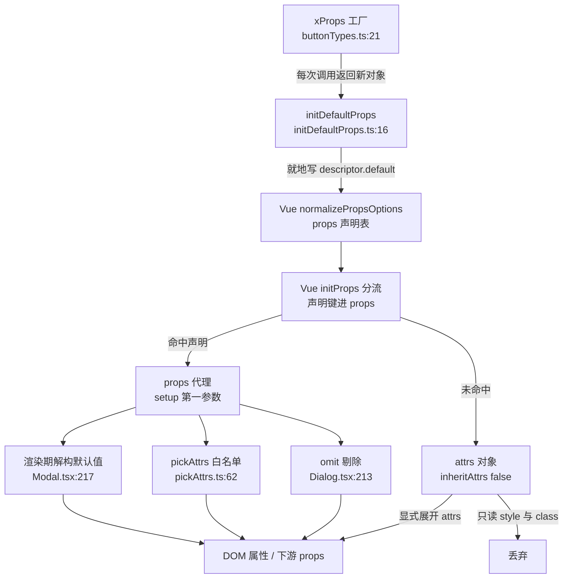
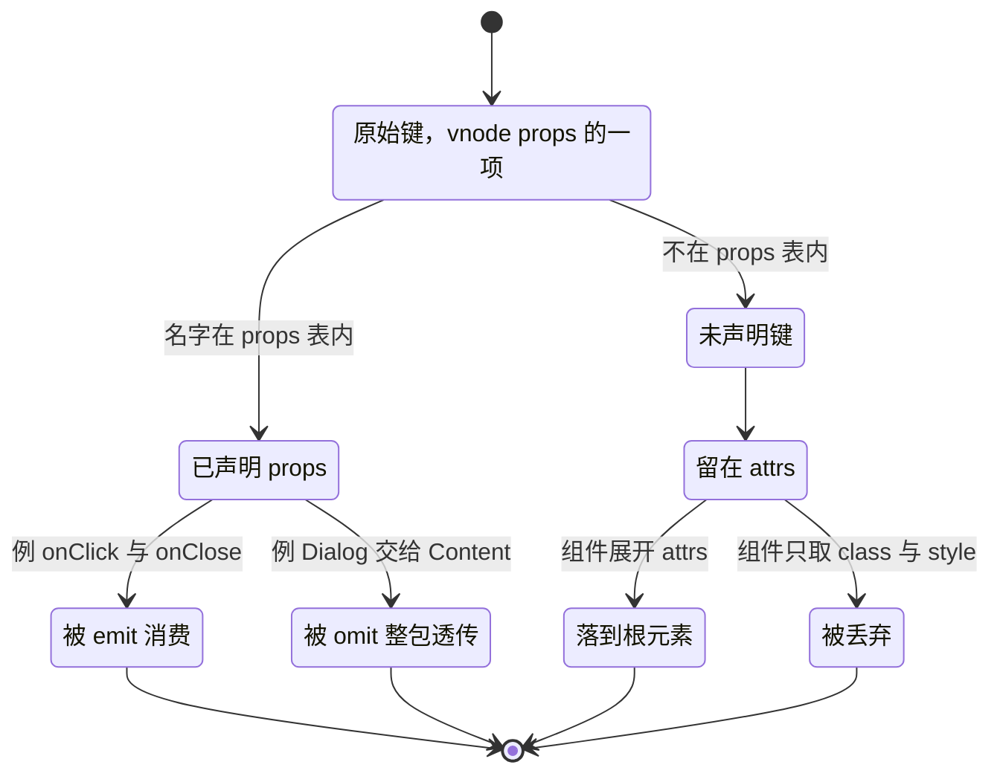
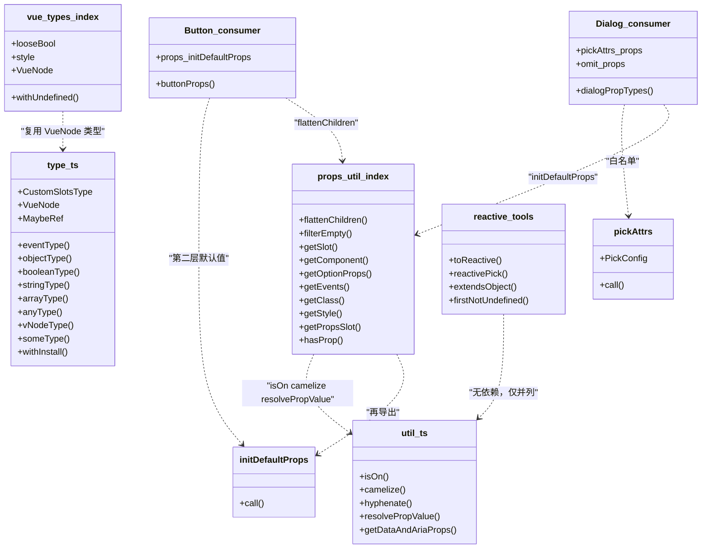
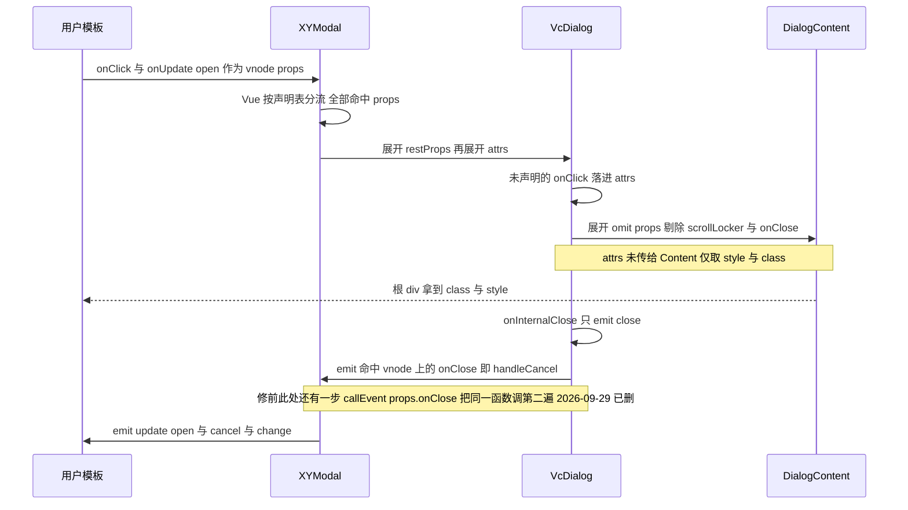

# A06 Props 体系与类型工具

> **本篇解决**：为什么这个库的 props 一律写成工厂函数 `buttonProps()` 而不是常量对象；一个键从 `xProps()` 出发到变成 DOM 属性，中间要过几道筛；`emit('close')` 和 `props.onClose` 到底谁在调用用户传的函数；`initDefaultProps` 与 Vue 自己的 `default` 是叠加还是覆盖。
> **前置**：A02（组件目录契约与 `gen:entries` 生成物链路）　**读者坐标**：`01-architecture` 第 6/8 篇
> 组件目录结构、生成物与同名导出定主归 A02（本篇只在需要时引用一行）；`prefixCls`/`size`/`disabled` 的纵向注入归 A05；`useMergedState` 等受控/非受控 hook 归 I13；`vc-trigger` 的事件穿透细节归 A07 与 I02；**各组件的 props 特例一律留在组件篇**。

---

## 一、职责与边界

`_util` 里与 props 有关的一层只做四件事，而且只做这四件：

1. **定义面**：提供写 props 的语法糖（`packages/xiaoye-ui/src/_util/type.ts` 的 `booleanType`/`stringType`/`eventType` 等，共 9 个辅助函数）与 `PropTypes`（`_util/vue-types/index.ts`，对第三方 `vue-types` 的三类扩展）。
2. **默认值面**：`initDefaultProps`（`_util/props-util/initDefaultProps.ts:4`）在组件声明处第二次改写默认值。
3. **分流面**：`pickAttrs`（`_util/pickAttrs.ts:43`）、`omit`（`_util/omit.ts:1`）、`getDataAndAriaProps`（`_util/util.ts:57`）决定一个键进 props、进 attrs、还是被丢弃。
4. **子节点面**：`flattenChildren`/`filterEmpty`/`getSlot`/`getComponent`/`getPropsSlot`（`_util/props-util/index.ts:50`、`:230`、`:75`、`:124`、`:260`）把 Vue 的 slots 返回值整理成可判定的数组。

明确**不负责**：不定义任何组件的 props 语义（各 `*Types.ts` 自己写）；不实现受控/非受控状态机（I13）；不做样式 Token 注入（A03/A04）；不生成导出面（A02）。

依赖与被依赖（实测计数口径见 §二）：

| 方向 | 对象 | 证据 |
| --- | --- | --- |
| 被依赖 | 117 处 `initDefaultProps(...)` 调用点（含 2 处非 `props:` 场景） | `packages/xiaoye-ui/src/**/*.tsx` |
| 被依赖 | 284 个 `.tsx` 文件设置 `inheritAttrs: false` | 如 `button/button.tsx:38`、`modal/Modal.tsx:155`、`vc-dialog/Dialog.tsx:48` |
| 被依赖 | grep 引用计数（含 import 行）：`flattenChildren` 59、`filterEmpty` 47、`isValidElement` 43、`getPropsSlot` 34、`findDOMNode` 29 | `_util/props-util/index.ts` 各导出 |
| 依赖 | 第三方 `vue-types`（`toType`、`VueTypes` 基类、`VueTypeValidableDef` 类型） | `_util/vue-types/index.ts:3` |
| 依赖 | Vue 运行时导出的 `isVNode`/`Fragment`/`Comment`/`Text` | `_util/props-util/index.ts:2` |
| 依赖 | 本目录内的 `isOn`/`camelize`/`hyphenate`/`resolvePropValue` | `_util/util.ts:101` |
| 平级 | `config-provider` 的 `componentProps` 注入面（第三层默认值的候选来源） | `config-provider/context.ts:112` |

一个必须点明的边界：`_util/index.ts:1-46` 是个 barrel，把 `type`、`util`、`pickAttrs`、`toReactive` 等 40 余个模块整平再 `export * from './components'`（`_util/index.ts:46`）。`_util/components/` 目录是 `_util/` 根级同名文件的机械副本（`_util/components/BaseInput.tsx` 与 `_util/BaseInput.tsx` 的 diff 只有两行 import 相对路径），直接引用为 0，但经这行 barrel 进了内部工具面。本篇按 OUTLINE 的归位要求登记此事：**它是 props 体系里唯一一处"同一组件两份实现、props 声明各写一遍"的冗余**（两份都各自声明 `disabled: PropTypes.looseBool`，见 `_util/BaseInput.tsx:27` 与 `_util/components/BaseInput.tsx:27`），删除动作应随 A02 的生成物回扫一起做，不要在组件篇里顺手处理。

---

## 二、源码地图

| 文件 | 行数 | 职责 | 关键导出 |
| --- | --- | --- | --- |
| `_util/type.ts` | 97 | props 辅助函数与类型糖 | `eventType`（`:50`）、`objectType`（`:54`）、`booleanType`（`:58`）、`anyType`（`:66`）、`vNodeType`（`:79`）、`arrayType`（`:83`）、`stringType`（`:87`）、`someType`（`:91`）、`VueNode`（`:37`）、`MaybeRef`（`:48`）、`CustomSlotsType`（`:95`）、`withInstall`（`:39`） |
| `_util/vue-types/index.ts` | 36 | 对 `vue-types` 的三处扩展 | 默认导出 `ExtendedVueTypes`（`:32`）、`looseBool`（`:7`）、`style`（`:14`）、`VueNode`（`:21`）、`withUndefined`（`:28`） |
| `_util/props-util/index.ts` | 285 | 子节点与实例取值的工具箱 | `flattenChildren`（`:50`）、`getSlot`（`:75`）、`getOptionProps`（`:97`）、`getComponent`（`:124`）、`getEvents`（`:158`）、`getClass`（`:168`）、`getStyle`（`:187`）、`filterEmpty`（`:230`）、`isEmptyElement`（`:213`）、`getPropsSlot`（`:260`） |
| `_util/props-util/initDefaultProps.ts` | 34 | 第二层默认值写入器 | 默认导出（`:4`） |
| `_util/pickAttrs.ts` | 75 | attrs 白名单筛选 | 默认导出（`:43`）、`PickConfig`（`:32`） |
| `_util/omit.ts` | 10 | 浅拷贝删键 | 默认导出（`:1`） |
| `_util/transKeys.ts` | 17 | key → index 映射表 | `groupKeysMap`（`:1`）、`groupDisabledKeysMap`（`:9`） |
| `_util/toReactive.ts` | 42 | ref/对象 → reactive | `toReactive`（`:10`） |
| `_util/reactivePick.ts` | 15 | 响应式挑键 | `reactivePick`（`:10`） |
| `_util/extendsObject.ts` | 21 | 跳过 `undefined` 的浅合并 | 默认导出（`:3`） |
| `_util/isValid.ts` / `isValidValue.ts` | 4 / 3 | 空值判定（两种口径） | 默认导出（`isValid.ts:1`、`isValidValue.ts:1`） |
| `_util/firstNotUndefined.ts` | 10 | 取第一个非 `undefined` | 默认导出（`:1`） |
| `_util/util.ts` | 101 | `isOn`/`camelize`/`hyphenate` + Vue 版 `resolvePropValue` | `:101`、`resolvePropValue`（`:36`）、`getDataAndAriaProps`（`:57`） |
| `_util/BaseMixin.ts` | 45 | Options API 遗留混入，手抄一套事件派发 | `setState`（`:6`）、`__emit`（`:27`） |
| `_util/vnode.ts` | — | 克隆与槽位兜底 | `ensureValidVNode`（`:59`）、`customRenderSlot`（`:71`）、`cloneElement`（`:9`） |
| `_util/registerComponent.ts` | 36 | `XYXxx` → `xy-xxx` 标签名映射 | `toXYTagName`（`:6`）、`registerComponent`（`:16`） |

消费侧样本（本篇只取这四个，其余组件特例不进本篇）：

| 文件 | 行数 | 看点 |
| --- | --- | --- |
| `button/buttonTypes.ts` | 47 | 工厂式 props + `Partial<ExtractPropTypes<ReturnType<...>>>` 闭环（`:21`、`:45`） |
| `button/button.tsx` | 244 | `initDefaultProps(buttonProps(), {...})`（`:40`）与 `inheritAttrs: false` + `{...attrs}`（`:38`、`:187`） |
| `modal/Modal.tsx` | 259 | prop 形式的事件声明（`:52`）、无 `emits` 选项、多处 `emit` 并发（`:174`-`:179`）、渲染期解构默认值（`:217`） |
| `vc-dialog/Dialog.tsx` | 212 | `pickAttrs(props, { data: true })`（`:169`）、`omit(props, [...])`（`:192`）、数组 handler 手工派发（`:41`-`:47`） |

主实现入口：`packages/xiaoye-ui/src/_util/props-util/index.ts:50`（子节点侧）与 `packages/xiaoye-ui/src/_util/props-util/initDefaultProps.ts:16`（默认值侧）。

---

## 三、架构与数据流

### 3.1 一个键要过的五道筛



读图要点：筛子不是"一层层过滤同一个对象"，而是**两条并行的路**。上路（props → 解构默认值 → 显式写出）由组件自己声明控制；下路（attrs）由 Vue 的分流结果和组件是否展开 `{...attrs}` 控制。`inheritAttrs: false` 把下路的默认继承关掉，于是**下路的落点只有两个**：像 `button/button.tsx:187` 那样整体展开，或者像 `vc-dialog/Dialog.tsx:195` 那样只解构 `style` 和 `class` 两个键、其余丢弃。`pickAttrs` 与 `omit` 都只作用于上路（它们的入参写着 `props`），这一点是 §七 坑 2 的根源。

### 3.2 `inheritAttrs: false` 下一个键的状态迁移



迁移表里有三条是本库实测出来的规则：其一，**声明即吸收**——只要 `props` 表里出现了 `onClose`（`vc-dialog/IDialogPropTypes.ts:43`），这个键就不再出现在 `attrs` 里，于是 `props.onClose` 与 Vue 在 `emit('close')` 时去 `vnode.props` 上取的 `onClose` 是同一个键、同一个函数（这正是 §五 骨架图与 §七 坑 3 的成因）；本轮之后仍按这条读 props 的活样本是 `popconfirm/index.tsx:123` 的 `callEvent(props.onConfirm, e)`，声明在 `:43`，该处把 props 通道留作唯一出口（为什么选这一条而不是 `emit`，见坑 3 末段）；其二，`class` 也能被声明成 prop 并被吸收（`panel/panelTypes.ts:13`、`_shared/CardLike.tsx:16`），此时 `attrs.class` 为空；其三，未声明的 `data-*`/`aria-*` 只会留在 attrs，而 `pickAttrs(props, ...)` 读的是 props（`vc-dialog/Dialog.tsx:183`）——两边对不上。

### 3.3 模块关系



`props_util_index ..> util_ts` 这条依赖解释了为什么 `_util` 里有**两份** `resolvePropValue`：一份是 Vue 源码的抄写件（`_util/util.ts:36`，带注释 `// change from vue sourcecode`），只服务于 `getOptionProps` 这种"从 VNode 反推 props"的场景；另一份是 Vue 运行时自己用的，组件感知不到。两者语义若有偏差，偏差只会出现在 `getOptionProps` 的结果上（见 §七 坑 6）。

### 3.4 一次点击的闭环：props、attrs、emit 三条线



这张图是 §五 的骨架，也是 §七 坑 3 的证据位置，**按 2026-09-29 之后的形状画**。

修前形状：`vc-dialog/Dialog.tsx` 的 `onInternalClose` 里 `emit('close', e)` 紧跟 `callEvent(props.onClose, e)`，而 `onClose` 既是声明 prop（`vc-dialog/IDialogPropTypes.ts:43`）又是 `emits` 数组（`Dialog.tsx:46` 写作 `emits: ['close', 'afterClose']`）里 `close` 的目标——两条路最终都指向同一个函数对象，于是 `modal/Modal.tsx:235` 传入的 `handleCancel` 被调用两次，`Modal.tsx:175`-`:178` 的四个 `emit` 各发两遍。当时的实测（Vue 3.5.40 + jsdom）该模式调用计数为 **2**。

修后形状：`packages/xiaoye-ui/src/vc-dialog/Dialog.tsx:99` 只剩 `emit('close', e)`（`:91` 是留下的说明注释），因为 `emit` 本身就会去 `instance.vnode.props` 上取 `onClose`，props 通道不需要再手工补一次投递。同一文件 `:84`-`:85` 那一对（`emit('afterClose')` 与 `callEvent(props.afterClose)`）**不是**双投：`emit('afterClose')` 取的是 vnode 上的 `onAfterClose` 键，而 `props.afterClose` 读的是声明在 `IDialogPropTypes.ts:8` 的 `afterClose` 键，两个键名不同、来源不同，只有调用方同时写 `:after-close` 与 `@after-close` 才会各命中一次，所以本轮有意保留（另两处同型保留见坑 3 末段）。该修复现在有回归用例钉住：`packages/xiaoye-ui/src/_util/__tests__/event-dispatch-count.test.tsx:135` 的「Dialog 点一次关闭，@close 只投递一次」，判据是 `:145` 的 `toHaveBeenCalledTimes(1)`；把 `Dialog.tsx` 退回本轮基线该断言即红。

---

## 四、核心机制精读

### 论点 1：props 工厂不是风格偏好，而是"descriptor 可被就地改写"的前提

`buttonProps` 写成返回对象的函数而不是常量对象，表面理由是"能带 `PropType` 泛型"，实际承重的是另一件事：**默认值是被就地改写的，工厂保证每次改写落在一份干净的 descriptor 上**。

```ts
// packages/xiaoye-ui/src/button/buttonTypes.ts:21
export const buttonProps = () => ({
  prefixCls: String,
  type: String as PropType<ButtonType>,
  htmlType: { type: String as PropType<ButtonHTMLType>, default: 'button' },
  shape: { type: String as PropType<ButtonShape> },
  size: {
    type: String as PropType<SizeType>,
  },
  loading: {
    type: [Boolean, Object] as PropType<boolean | { delay?: number }>,
    default: (): boolean | { delay?: number } => false,
  },
  disabled: { type: Boolean, default: undefined },
  ghost: { type: Boolean, default: undefined },
  block: { type: Boolean, default: undefined },
  danger: { type: Boolean, default: undefined },
  icon: PropTypes.any,
  href: String,
  target: String,
  title: String,
  onClick: eventType<MouseEventHandler>(),
  onMousedown: eventType<MouseEventHandler>(),
});
```

同一张表里的三种写法分别对应三条类型推导路径：`prefixCls: String`（裸构造器）、`type: String as PropType<ButtonType>`（字面量联合）、`disabled: { type: Boolean, default: undefined }`（三态）。工厂返回类型被下一行的类型别名吃掉：

```ts
// packages/xiaoye-ui/src/button/buttonTypes.ts:45
export type ButtonProps = Partial<ExtractPropTypes<ReturnType<typeof buttonProps>>>;
```

这行是整套约定的另一半，三段各有分工。`ReturnType<typeof buttonProps>` 把"函数"降回"对象字面量类型"；`ExtractPropTypes` 按 Vue 的 `RequiredKeys` 规则把 descriptor 分类——命中 `{required:true}`、`{default:any}`、`BooleanConstructor`、`{type: BooleanConstructor}` 四种形态之一的键算必填，再被一条排除规则（默认值是 `undefined` 或 `() => undefined` 时打回可选）筛一遍；`Partial<>` 最后把必填的那批强制降级为可选。为什么必须有 `Partial<>`：`htmlType`（`:24`，`default: 'button'`）和 `loading`（`:29`-`:32`，`default: () => false`）这两个键在 `ExtractPropTypes` 下是**必填**的，没有 `Partial<>` 时外部写 `const p: ButtonProps = {}` 会直接报类型错误。反过来 `disabled`/`ghost`/`block`/`danger`（`:33`-`:36`）虽然同样写了 `default` 键，却被排除规则精准地打回可选——这正是 `{ type: Boolean, default: undefined }` 这个写法在类型侧的额外收益：一次同时买到"运行时三态"和"类型上可省略"。同一份 `Partial<ExtractPropTypes<ReturnType<...>>>` 结构在 `modal/Modal.tsx:88`、`vc-dialog/IDialogPropTypes.ts:47`、`panel/panelTypes.ts:17`、`mentions/index.tsx:101` 逐字重复，是全库 props 类型的统一形状。少数文件走的是与之平行的第二形状：props 用常量对象、类型写 `Partial<ExtractPropTypes<typeof x>>`（省掉 `ReturnType`），例如 `transfer/search.tsx:8` 与 `:17` 的配对——它能工作，但正是坑 1 里"descriptor 被就地改写后跨处共享"的那类写法。

工厂形态的承重作用，在违反它的那处代码上看得最清楚。`vc-mentions` 的 props 是**模块级常量对象**：

```ts
// packages/xiaoye-ui/src/vc-mentions/src/mentionsProps.ts:38
export const vcMentionsProps = {
  ...mentionsProps,
  dropdownClassName: String,
};

export const defaultProps = {
  prefix: '@',
  split: ' ',
  rows: 1,
  validateSearch: defaultValidateSearch,
  filterOption: (() => defaultFilterOption) as any,
};

export default initDefaultProps(vcMentionsProps, defaultProps);
```

`mentionsProps`（`:14`-`:36`）也是常量对象，`:39` 的展开是**浅拷贝**：`prefix`、`split`、`rows`、`validateSearch`、`filterOption` 这五个键的值是同一批 descriptor 对象的引用。于是 `:51` 在模块求值阶段调一次 `initDefaultProps`，就把这批 descriptor 的 `default` 字段改成了 `'@'`、`' '`、`1` 与两个函数，而改动对 `mentionsProps` 同样可见。上层组件正好复用了它：

```ts
// packages/xiaoye-ui/src/mentions/index.tsx:74
export const mentionsProps = () => ({
  ...baseMentionsProps,
  loading: { type: Boolean, default: undefined },
  onFocus: {
    type: Function as PropType<(e: FocusEvent) => void>,
  },
  onBlur: {
    type: Function as PropType<(e: FocusEvent) => void>,
  },
```

`baseMentionsProps` 就是 `vc-mentions/src/mentionsProps.ts:14` 的那个常量（导入行 `mentions/index.tsx:6`）。结果是：**公开组件 `xy-mentions` 的 `prefix` 默认值 `@`、`split` 默认值空格、`rows` 默认值 1，全部来自 `vc-*` 内部组件的默认值注入**，而不是自己声明的。这条链路没有任何注释说明，`vc-mentions/src/Mentions.tsx:39` 还又调了一次 `initDefaultProps(vcMentionsProps, defaultProps)`（幂等，但说明作者并未意识到第一次调用已经改掉了共享对象）。结论：工厂式写法把"默认值注入"变成一次每组件独立发生的、不跨模块污染的操作；常量对象写法把内部层的默认值直接漏进公开 API。

类型侧的代价也要记清：`initDefaultProps` 的返回类型标注是 `: T`（`_util/props-util/initDefaultProps.ts:15`），也就是说它改的是**运行时**字段，类型层面完全不知情。`button.tsx:40` 注入的 `type: 'default'` 不会让 `props.type` 变成非可选（`buttonTypes.ts:23` 的 `type: String as PropType<ButtonType>` 无 `default` 键，属于 `OptionalKeys`），于是 `button.tsx:87` 直接解构 `const { type, shape = 'default', ghost, block, danger } = props;` 后就能把它拼进类名 `` `${pre}-${type}` ``（`:100`）而 TS 不报警——真值来源是那次注入，不是类型系统。

### 论点 2：`initDefaultProps` 是"替换"而不是"叠加"，它对 vue-types descriptor 走另一条路

```ts
// packages/xiaoye-ui/src/_util/props-util/initDefaultProps.ts:16
  const propTypes: T = { ...types };
  Object.keys(defaultProps).forEach(k => {
    const prop = propTypes[k] as VueTypeValidableDef;
    if (prop) {
      if (prop.type || prop.default) {
        prop.default = defaultProps[k];
      } else if (prop.def) {
        prop.def(defaultProps[k]);
      } else {
        propTypes[k] = { type: prop, default: defaultProps[k] };
      }
    } else {
      throw new Error(`not have ${k} prop`);
    }
  });
  return propTypes;
```

四个分支的实际语义：

- `:21` 直接赋值 `prop.default = defaultProps[k]`，**覆盖**工厂里已经写好的 `default`。所以 `Modal.tsx:156`-`:160` 的 `confirmLoading: false` 会把 `modalProps` 里 `confirmLoading: { type: Boolean, default: undefined }`（`:46`）的三态抹平为恒定 `false`。
- `:22`-`:23` 是给 vue-types descriptor 走的：`PropTypes.any` 实测没有任何可枚举自有键（`Object.keys` 为空数组），只有不可枚举的 `_vueTypes_name`/`isRequired`/`def`/`validate`，所以它既进不了第一个分支也不是 `undefined`，只能由 `.def()` 落默认值——而 `.def()` 在赋值前会做一次类型校验，校验不过就发 `[VueTypes warn]: <name> - invalid default value` 到 console。也就是说 `initDefaultProps` 顺带把 vue-types 的默认值校验跑了一遍，Vue 自己的 `validator` 只在传值时跑。
- `:25` 是兜底分支，把 descriptor 整个塞进 `type` 字段，产出一个语义错误的定义（实测会让 Vue 报 `Expected Object`），详见 §七 坑 4。
- `:28` 抛错：`defaults` 里写了工厂没有的键就是硬错误。这条把"typo 的默认值"从静默失效变成运行期崩溃，是本工具唯一的自我保护。

`{ type: Boolean, default: undefined }` 这一族的载体写法 `default: undefined` 在全库出现 501 次（含各 `*Types.ts` 与 `vc-*` 层），它不是随手写的占位，而是三态语义的实现载体。实测三种布尔声明的缺席取值：`{type: Boolean}` → `false`、`{type: Boolean, default: undefined}` → `undefined`、`{type: [Boolean, Number]}`（无 default）→ `false`，加 `default: undefined` 后 → `undefined`。组件侧靠这个 `undefined` 才能区分"用户没传"和"用户传了 false"：

```tsx
// packages/xiaoye-ui/src/button/button.tsx:47
    const { prefixCls, autoInsertSpaceInButton, direction, size } = useConfigInject('btn', props);
    const [wrapSSR, hashId] = useStyle(prefixCls);
    const groupSizeContext = GroupSizeContext.useInject();
    const disabledContext = useInjectDisabled();
    const mergedDisabled = computed(() => props.disabled ?? disabledContext.value);
    const buttonNodeRef = shallowRef<HTMLElement>(null);
    const delayTimeoutRef = shallowRef(undefined);
    let isNeedInserted = false;

    const innerLoading = shallowRef<Loading>(false);
    const hasTwoCNChar = shallowRef(false);

    const autoInsertSpace = computed(() => autoInsertSpaceInButton.value !== false);
    const { compactSize, compactItemClassnames } = useCompactItemContext(prefixCls, direction);
```

`:51` 的 `props.disabled ?? disabledContext.value` 直接依赖 `buttonTypes.ts:33` 的 `default: undefined`；如果那行写成 `default: false`，`DisabledContext` 的禁用继承就永久失效。同一个理由还解释了 `_util/vue-types/index.ts:28`-`:31` 这个只有四行的工具的存在：

```ts
// packages/xiaoye-ui/src/_util/vue-types/index.ts:28
export function withUndefined<T extends { default?: any }>(type: T): T {
  type.default = undefined;
  return type;
}
```

`vc-slider/src/Range.tsx:41` 用 `withUndefined(PropTypes.oneOfType([PropTypes.looseBool, PropTypes.number]))` 给 `pushable` 补一个 `default: undefined` 键——因为 `oneOfType` 产出的 descriptor 只有 `type` 数组和 `validator`、没有 `default`，而只要 `Boolean` 出现在类型数组里且没有 `default` 键，Vue 就把缺席值转成 `false`。这是"用工具补 Vue 语义"的直接例子，`vc-steps/Step.tsx:29` 同构。

于是第三层默认值（渲染期解构）的位置就清楚了：它不属于 props 契约，而是**唯一能读到 slots 的默认值层**。`modal/Modal.tsx:217` 的 `focusTriggerAfterClose = true` 与 `vc-dialog/Dialog.tsx:64` 的 `focusTriggerAfterClose: true` 值相同，因此常被读成冗余；但把 `{...props}` 整体透传给子组件时（`Modal.tsx:227` 的 `{...restProps}`），显式的 `undefined` 会被 Vue 视同缺席、子组件自己的 `default` 照样生效，实测确认如此（父组件把含 `focusTriggerAfterClose: undefined` 的 props 展开给一个 `foo: { type: Boolean, default: true }` 的子组件，子组件拿到 `true`）。所以解构默认值的实际作用是**限定作用域**：`props.focusTriggerAfterClose` 对外仍然是 `undefined`，只有这一次 render 里是 `true`。同层的 `Modal.tsx:216` `closeIcon = slots.closeIcon?.()` 与 `button.tsx:178` `const { icon = slots.icon?.() } = props;` 才是它不可替代的形态——Vue 的 `default` 工厂拿不到 slots，只能在这一层写。C07-01 已把"`focusTriggerAfterClose` 在两层各有一份默认值"登记为现象并给出用户可见结论，本篇只补它的机制定位，不重复其结论。

被 `initDefaultProps` 写过的键还有一个隐性后果：所有基于 `!== undefined` 的"显式传入"判定都会误判。`_util/hooks/useComponentProps.ts:58`-`:37` 合并 ConfigProvider 注入的组件级 props 时用的正是这个判定，于是 `Modal.tsx:158` 把 `confirmLoading` 定成 `false` 之后，`componentProps.Modal.confirmLoading` 的注入值永远被 `false` 顶掉。该 hook 的适用面归 I13，这里只登记它与默认值层的相互作用。

### 论点 3：`eventType<T>()` 写 `[Function, Array]` 是运行时决策，代价是派发责任转嫁给组件

```ts
// packages/xiaoye-ui/src/_util/type.ts:48
export type MaybeRef<T> = T | Ref<T>;

export function eventType<T>() {
  return { type: [Function, Array] as PropType<T | T[]> };
}

export function objectType<T = {}>(defaultVal?: T) {
  return { type: Object as PropType<T>, default: defaultVal as T };
}

// ... 同文件 booleanType / stringType / arrayType / anyType 等
```

（`// ...` 之后那行是本文省略标记，非源码内容；`anyType`/`vNodeType` 见 `:66`-`:81`。）

`[Function, Array]` 里的 `Array` 不是给 TS 用的——`PropType<T | T[]>` 已经单独表达了联合类型——它是给 Vue 的运行时类型检查用的。实测两种写法对同一个输入的差别：把 `[fn1, fn2]` 传给声明为 `{ type: Function }` 的 prop，dev 下报 `Invalid prop: type check failed for prop "onFoo". Expected Function, got Array`；传给声明为 `{ type: [Function, Array] }` 的 prop 则静默通过，并且由 `emit` 触发时**两个函数都会被调用**（实测调用顺序 A1→A2）。后者是 Vue 事件派发的既有行为，`_util/props-util/index.ts:158`-`:166` 的 `getEvents` 返回的也是这个原样值，不做归一。

本库对这个数组形态有两种应对。一种是根本不碰：`button/button.tsx:133` 的 `emit('click', event)` 把派发全权交给 Vue，所以数组天然可用。另一种是手工 fan-out，即下面这份局部 helper（它在 2026-09-29 之后仍然存在，行号未动）：

```tsx
// packages/xiaoye-ui/src/vc-dialog/Dialog.tsx:48
    const callEvent = (fn: any, ...args: any[]) => {
      if (Array.isArray(fn)) {
        fn.forEach(f => f?.(...args));
      } else {
        fn?.(...args);
      }
    };
```

问题不出在这份 helper 本身，而出在它**与 `emit` 并存**：fan-out 读的是 `props.onX`，而 `emit('x')` 读的正是 vnode 上的同一个键，于是同一函数被走两遍。以下块为**修前快照（2026-09-29 已改，源码里已不存在这个形状）**，摘自已删代码，故不挂 `path:line` 标注：

```tsx
// 修前快照：packages/xiaoye-ui/src/vc-dialog/Dialog.tsx 的 onInternalClose
const onInternalClose = (e: MouseEvent | KeyboardEvent) => {
  emit('close', e);
  callEvent(props.onClose, e);   // ← 修前多这一行，同函数第二次投递
};
```

修后该位置只剩 `emit`，fan-out 通道整个撤掉：

```tsx
// packages/xiaoye-ui/src/vc-dialog/Dialog.tsx:90
    const onInternalClose = (e: MouseEvent | KeyboardEvent) => {
      // emit 已覆盖 vnode 上的 props.onClose，再手工调一次会让调用方每次关闭收到两遍
      emit('close', e);
    };
```

保留 fan-out 的站点必须是「props 是唯一出口」或「需要 handler 返回值」那两类，全库现状 6 份 `callEvent` 定义与三处有意保留的硬约束逐条列在 §七 坑 3 的「安全改法」，此处不重复。还有一点是这两种应对都没覆盖的：**形态③**——外层 `{...props}`/`{...attrs}` 整包摊下、同一元素又显式绑 arrow，`mergeProps` 把两个同名事件键并成数组。它一行 fan-out 都不写，却同样让同一个函数被调两次，而且**每穿一层翻一倍**（Tabs 修前一次标签点击 `@change` 得 16 次就是这条），只 grep `callEvent` 照不出来，判别方法见 C03-00 §五。

`_util/BaseMixin.ts:27`-`:43` 是同一件事的 Options API 版本，而且它连 Vue 的 `emit` 都绕开了：

```js
// packages/xiaoye-ui/src/_util/BaseMixin.ts:27
    __emit() {
      // 直接调用事件，底层组件不需要vueTool记录events
      // eslint-disable-next-line prefer-rest-params
      const args = [].slice.call(arguments, 0);
      let eventName = args[0];
      eventName = `on${eventName[0].toUpperCase()}${eventName.substring(1)}`;
      const event = this.$props[eventName] || this.$attrs[eventName];
      if (args.length && event) {
        if (Array.isArray(event)) {
          for (let i = 0, l = event.length; i < l; i++) {
            event[i](...args.slice(1));
          }
        } else {
          event(...args.slice(1));
        }
      }
    },
```

`:33` 的 `this.$props[eventName] || this.$attrs[eventName]` 是本篇最有价值的一行文档：它把"事件 handler 既可能是 prop 也可能是 attr"这件事写成了显式兜底，而声明式 `emit` 做不到这种可见性。代价是 `arguments`、手写 `onXxx` 名字转换、以及绕过 Vue 的事件记录（注释里明写"不需要 vueTool 记录 events"，即 `@vue/test-utils` 的 `wrapper.emitted()` 采不到它）。

于是全库出现两种事件声明口径：`eventType<T>()`（36 处，含 `button/buttonTypes.ts:41`-`:42`、`panel-menu/panelMenuTypes.ts:79`-`:107`、`dark-mode-toggle/darkModeToggleTypes.ts:37` 的 `'onUpdate:dark'`）与 `Function as PropType<...>`（`modal/Modal.tsx:50`-`:54`、`vc-dialog/IDialogPropTypes.ts:43`）。前者允许数组，后者不允许。实测在声明为 `eventType` 的那批组件目录里没有一处直接调用 `props.onXxx(...)`（都走 `emit` 或 `callEvent`），所以数组目前是安全的；但 `Function as PropType` 声明的 handler 被直接调用的写法确实存在，例如 `vc-dialog/Content.tsx:71` 的 `props.onVisibleChanged(visible)`（声明在 `:21`，仅 `Function`），传数组就是"先告警后 TypeError"。结论：`[Function, Array]` 的收益是兼容数组形态与 `{...props}` 透传时的宽类型，赔上的是"组件必须自己保证 fan-out 或直接调 `emit`"这条隐性纪律。

### 论点 4：`pickAttrs` 是白名单筛选器，不是"前缀过滤器"；`data-*` 只有和 attrs 合流才真的能透传

```ts
// packages/xiaoye-ui/src/_util/pickAttrs.ts:43
export default function pickAttrs(props: object, ariaOnly: boolean | PickConfig = false) {
  let mergedConfig;
  if (ariaOnly === false) {
    mergedConfig = {
      aria: true,
      data: true,
      attr: true,
    };
  } else if (ariaOnly === true) {
    mergedConfig = {
      aria: true,
    };
  } else {
    mergedConfig = {
      ...ariaOnly,
    };
  }
```

```ts
// packages/xiaoye-ui/src/_util/pickAttrs.ts:61
  const attrs = {};
  Object.keys(props).forEach(key => {
    if (
      // Aria
      (mergedConfig.aria && (key === 'role' || match(key, ariaPrefix))) ||
      // Data
      (mergedConfig.data && match(key, dataPrefix)) ||
      // Attr
      (mergedConfig.attr && (propList.includes(key) || propList.includes(key.toLowerCase())))
    ) {
      attrs[key] = props[key];
    }
  });
  return attrs;
```

参数名 `ariaOnly` 与三种取值（`false` → aria+data+attr 全开、`true` → 只开 aria、对象 → 自定义）说明这函数是改名改了一半的产物：默认调用反而是"最宽"的那档。真正的筛选规则在 `:65`-`:69`：`role`、`aria-*` 前缀、`data-*` 前缀，以及一份 189 个词的静态表（`:1`-`:12` 的 HTML 属性名 + `:14`-`:20` 的 `onXxx` 事件名合并成 `propList`，`:22`）。三个具体后果值得记：

1. 表里带的是 React 时代的 `classname`（`:3`），Vue 的键名是 `class`，**`class` 不在白名单内**；`style`、`tabindex`、`autofocus`、`id`、`title`、`role` 在（`:11`、`:6`、`:10`）。所以 `pickAttrs` 不能用来"把类名带下去"。
2. `on*` 事件名是逐个列在表里的，`onClick` 在（`:15`）、`onFocusin` 不在——自定义事件名（如 `onItemSelectAll`）不会被挑中。因此 `pickAttrs` 的语义实际是"只保留能安全落到 DOM 标准属性上的键"。
3. 入参是**单个对象**，读谁就只看得见谁。`vc-tree/Tree.tsx:1142`-`:1148` 是正确用法：

```tsx
// packages/xiaoye-ui/src/vc-tree/Tree.tsx:1141
      const { class: className, style } = attrs;
      const domProps = pickAttrs(
        { ...props, ...attrs },
        {
          aria: true,
          data: true,
        },
      );
```

`data-*`/`aria-*` 在 Vue 里如果没被 `props` 声明，只会进 attrs（实测：`data-x`、`role`、未声明的 `onFocus`、`onUpdate:visible` 全部出现在 `attrs` 里），所以必须先把两个对象合并再筛。7 个调用点按入参来源可分三类：喂 attrs（`vc-table/Table.tsx:822`）、喂 `props` 与 attrs 的合并（`vc-tree/Tree.tsx:1142`）、喂单个对象（`vc-tree/TreeNode.tsx:528` 与 `vc-upload/AjaxUploader.tsx:300` 喂解构后的 `otherProps`、`vc-select/OptionList.tsx:156` 喂选项数据 `itemData`、`vc-dialog/Dialog.tsx:197` 与 `vc-select/Selector/SingleSelector.tsx:165` 喂整份 `props`）。

`vc-dialog/Dialog.tsx:197` 那一处是本篇要标红的空转：

```tsx
// packages/xiaoye-ui/src/vc-dialog/Dialog.tsx:172
        title = slots.title,
      } = props;
      const { style, class: className } = attrs;
      return (
        <div class={[`${prefixCls}-root`, rootClassName]} {...pickAttrs(props, { data: true })}>
          <Mask
            prefixCls={prefixCls}
            visible={mask && visible}
            motionName={getMotionName(prefixCls, maskTransitionName, maskAnimation)}
            style={{
              zIndex,
              ...maskStyle,
            }}
            maskProps={maskProps}
          />
```

它筛的是 `props`，而 `IDialogPropTypes.ts:4`-`:45` 声明的 35 个键里没有任何 `data-` 前缀项（最接近的是 `:37` 的 `dialogClass`），于是 `{...pickAttrs(props, { data: true })}` 恒展开为空对象；同时 `:167` 从 attrs 里只取 `style` 与 `class` 两个键，其余一律不落地。这条链路上游是 `modal/Modal.tsx:227`-`:228`：

```tsx
// packages/xiaoye-ui/src/modal/Modal.tsx:226
        <Dialog
          {...restProps}
          {...attrs}
          rootClassName={hashId.value}
          class={classNames(hashId.value, attrs.class)}
          getContainer={getContainer || getPopupContainer?.value}
```

`Modal.tsx:218` 用 `...restProps` 把未点名的 props 交给 Dialog，`:228` 又把 Modal 自己的 attrs 交给 Dialog。结果是：用户在 `<xy-modal data-testid="m" @click="f">` 上写的这两个键，先变成 Modal 的 attrs，再变成 Dialog 的 attrs，最后在 `Dialog.tsx:195` 处被丢弃（`data-testid` 与 `onClick` 都不是 Dialog 声明的 prop，也不在它读 attrs 的名单里）。`Dialog.tsx:197` 这行看着像"支持 data 透传"，实际一次都没生效——这类"筛了 props 却没并 attrs"的写法在 `pickAttrs` 的 7 个调用点里占 3 个。

`omit`（`_util/omit.ts:1`-`:9`，浅拷贝后 `delete`）和整包透传是同一枚硬币的两面。`vc-*` 之所以写 `{...omit(props, [...])}` 而不是逐个传，是因为下游组件**重新声明了同一份 props 表**：

```tsx
// packages/xiaoye-ui/src/vc-dialog/Content.tsx:17
  props: {
    ...dialogPropTypes(),
    motionName: String,
    ariaId: String,
    onVisibleChanged: Function as PropType<(visible: boolean) => void>,
    onMousedown: Function as PropType<MouseEventHandler>,
    onMouseup: Function as PropType<MouseEventHandler>,
  },
```

`Content.tsx:18` 直接展开 `dialogPropTypes()`，所以那 35 个键几乎全部同名，逐个传等于抄 35 行且和上游同步腐烂。代价是**未声明的键会溢出到 attrs，而 `Content.tsx:136` 恰恰把 attrs 整包摊到 DOM 上**（`<div {...attrs} ... style={[...]}>`，`:141`-`:142`），于是 `Dialog.tsx:213` 的 `{...omit(props, ['scrollLocker', 'onClose'])}` 里两个剔除项各有其命：`scrollLocker` 是 `ScrollLocker` 类实例（`Dialog.tsx:46` 用 `Object as PropType<ScrollLocker>` 声明），不剔掉就会被 `:136` 写成一个无法序列化的 DOM 属性；`onClose` 剔除是因为 `:203` 要换成内部函数 `onInternalClose`（此处 JSX 后置覆盖本已够用，剔除属防御写法，见 §六）。

至于 `transKeys.ts`：名字在透传链的直觉里最像"转换键名"，但 `:1`-`:17` 的两个函数产出的是 `Map<string, number>`（`groupKeysMap` 给键序、`groupDisabledKeysMap` 给禁用项索引），调用者是 `transfer/index.tsx:181`、`:184`、`:314` 与 `transfer/list.tsx:134`，全部是勾选/键盘导航的查表加速，与 props 透传无关。`_util/index.ts:31` 还把它 `export *` 进了内部工具面。把它当成透传工具是命名事故，不在本篇替它编造职责。

### 论点 5：`flattenChildren` 处理的真问题是"Vue 的 slots 会返回注释节点与空白文本节点"，`skipFlattenKey` 是它唯一的逃生门

```ts
// packages/xiaoye-ui/src/_util/props-util/index.ts:50
const flattenChildren = (children = [], filterEmpty = true) => {
  const temp = Array.isArray(children) ? children : [children];
  const res = [];
  temp.forEach(child => {
    if (Array.isArray(child)) {
      res.push(...flattenChildren(child, filterEmpty));
    } else if (child && child.type === Fragment) {
      if (child.key === skipFlattenKey) {
        res.push(child);
      } else {
        res.push(...flattenChildren(child.children, filterEmpty));
      }
    } else if (child && isVNode(child)) {
      if (filterEmpty && !isEmptyElement(child)) {
        res.push(child);
      } else if (!filterEmpty) {
        res.push(child);
      }
    } else if (isValid(child)) {
      res.push(child);
    }
  });
  return res;
};
```

四个分支对应四类"看起来是子节点、实际不是"的东西：嵌套数组（`v-for` 直接放 slot 里）、Fragment（`<>...</>` 或 `v-if` 在模板根上产生的包裹）、VNode、以及非 VNode 的原始值（`:68` 用 `isValid` 挡掉 `undefined`/`null`/`''`，见 `_util/isValid.ts:1`-`:3`）。空节点的定义在 `isEmptyElement`：

```ts
// packages/xiaoye-ui/src/_util/props-util/index.ts:213
export function isEmptyElement(c: any) {
  return (
    c &&
    (c.type === Comment ||
      (c.type === Fragment && c.children.length === 0) ||
      (c.type === Text && c.children.trim() === ''))
  );
}

export function isEmptySlot(c: any) {
  return !c || c().every(isEmptyElement);
}

export function isStringElement(c: any) {
  return c && c.type === Text;
}

export function filterEmpty(children = []) {
  const res = [];
  children.forEach(child => {
    if (Array.isArray(child)) {
      res.push(...child);
    } else if (child?.type === Fragment) {
      res.push(...filterEmpty(child.children));
    } else {
      res.push(child);
    }
  });
  return res.filter(c => !isEmptyElement(c));
}
```

`:216` 的 `Comment` 判定就是问题的核心：`v-if` 为假时 Vue 生成的正是注释 VNode，`:218` 则专门处理"只剩空白字符的文本节点"（对 `children` 做 `trim()` 后才判空）。所以 `slots.title?.()` **永不为假值**，`if (slots.title)` 这种判断在这些场景一律为真——`_util/vnode.ts:59`-`:66` 的 `ensureValidVNode` 用同一套判据（`Comment` + 空 `Fragment` 递归）解决 slot 兜底，`_util/vNode.test.js:15`-`:25` 就是给这个场景写的用例：`default: () => <></>` 时必须渲染 fallback。

调用侧的因果链在 `button/button.tsx:177`-`:197`：

```tsx
// packages/xiaoye-ui/src/button/button.tsx:177
    return () => {
      const { icon = slots.icon?.() } = props;
      const children = flattenChildren(slots.default?.());

      isNeedInserted = children.length === 1 && !icon && !isUnBorderedButtonType(props.type);

      const { type, htmlType, href, title, target } = props;

      const iconType = innerLoading.value ? 'loading' : icon;
      const buttonProps = {
        ...attrs,
        title,
        disabled: mergedDisabled.value,
        class: [
          classes.value,
          attrs.class,
          { [`${prefixCls.value}-icon-only`]: children.length === 0 && !!iconType },
        ],
        onClick: handleClick,
        onMousedown: handleMousedown,
      };
```

`children.length === 0`（`:193`）判定"只有图标没有文字"、`children.length === 1`（`:181`）判定"要不要给两个汉字插空格"，两者的正确性都直接压在 `flattenChildren` 把空白文本和注释节点剔干净这件事上；不摊平的话 `<xy-button><icon /><span>a</span></xy-button>` 外层若套了 `v-if` 分支就会多算一个 `Fragment`，两个判据同时失准。`:187` 的 `...attrs` 与 `:190`-`:193` 的 `class` 合并也值得注意：`class` 排在展开之后才不被覆盖，这是 `inheritAttrs: false` 组件的标准收口姿势（同型写法见 `modal/Modal.tsx:230`）。

`flattenChildren` 的副作用是"子节点数量与结构会变"，于是 `:49` 定义了 `skipFlattenKey = Symbol('skipFlatten')` 作为唯一逃生门，`:57`-`:58` 见到这个 key 就整块保留。目前唯一的使用者是 `vc-dropdown/Dropdown.tsx:74`：

```tsx
// packages/xiaoye-ui/src/vc-dropdown/Dropdown.tsx:73
      return (
        <Fragment key={skipFlattenKey}>
          {props.arrow && <div class={`${props.prefixCls}-arrow`} />}
          {cloneElement(overlayElement, extraOverlayProps, false)}
        </Fragment>
      );
```

它的下游是 `vc-trigger/Popup/PopupInner.tsx:168`：

```tsx
// packages/xiaoye-ui/src/vc-trigger/Popup/PopupInner.tsx:168
      let childNode: any = flattenChildren(slots.default?.({ visible: props.visible }));

      // Wrapper when multiple children
      if (childNode.length > 1) {
        childNode = <div class={`${prefixCls}-content`}>{childNode}</div>;
      }
```

`Dropdown.tsx:140` 把 `getMenuElement` 作为 `popup` 插槽交给 Trigger，`Trigger.tsx:443` 再以 `default` 插槽的名义送给 PopupInner，于是箭头 `<div>`（`Dropdown.tsx:75`）与浮层内容（`:76`）正好是摊平后的两个平级节点，`:171` 会给它们多套一层 `${prefixCls}-content` 容器，弹层 DOM 形状与宽度测量（`stretch`，`Dropdown.tsx:136`）一起走样。`key={skipFlattenKey}` 让这段内容在 `flattenChildren` 眼里算**一个**节点，从而跳过这个包装。反过来看 `filterEmpty`：它只认 `type === Fragment`（`:235`），**不看 key**，所以同一段 children 只要经过 `filterEmpty` 就会丢掉这个标记——`vc-trigger/Trigger.tsx:635` 的 `filterEmpty(getSlot(this))`（作用于触发元素而非浮层）与 `Tooltip.tsx:254` 的 `filterEmpty(slots.default?.())` 都在这条盲区上。`flattenChildren` 与 `filterEmpty` 因此不可互换：前者递归摊平数组并筛空、认 `skipFlattenKey`，后者把数组平铺但不筛（`:234`）、只在末尾统一筛空（`:241`）。同一份 slot 用不同函数会得到不同长度，这是 §七 坑 7 的来源。

slot 与 prop 同名的取值优先级由 `getPropsSlot` 固定为 **props 优先**：

```ts
// packages/xiaoye-ui/src/_util/props-util/index.ts:260
function getPropsSlot(slots: any, props: any, prop = 'default') {
  return props[prop] ?? slots[prop]?.();
}
```

34 处调用（`badge/Badge.tsx:134`、`drawer/index.tsx:298`-`:299`、`switch/index.tsx:223`、`avatar/Avatar.tsx:139` 等）都走这一条判定，因此"`title` 属性盖掉 `#title` 插槽"是全库一致的规则；与之相对的是 `getComponent`（`:124`-`:151`）在实例分支里同样先看 `instance[prop]` 再看 `instance.$slots[prop]`（`:127`-`:132`），VNode 分支先看 `instance.props[prop]` 再回落到命名 children（`:135`-`:143`），最后把数组结果收敛成单值（`:145`-`:149`，长度为 1 时解包、为 0 时返回 `undefined`）。`getSlot`（`:75`-`:88`）则同时服务两种宿主：传入 VNode 时对 Fragment 取 `children`、否则取 `children[name]`，传入组件实例时走 `$slots[name](options)`，两条路出口都是 `flattenChildren`。`options` 参数（`:75`、`:80`、`:85`）是 slot props 的注入位，只有实例分支和 children 分支会真的把它当函数参数传下去，VNode+Fragment 分支（`:78`）忽略它——这一处是三个分支里唯一不等价的细节。

### 论点 6：三个"把普通对象变响应式"的工具各有明确代价，而 `toReactive` 的 Proxy 分支在本库一次都没被走到

```ts
// packages/xiaoye-ui/src/_util/toReactive.ts:10
export function toReactive<T extends object>(objectRef: MaybeRef<T>): T {
  if (!isRef(objectRef)) return reactive(objectRef) as T;

  const proxy = new Proxy(
    {},
    {
      get(_, p, receiver) {
        return Reflect.get(objectRef.value, p, receiver);
      },
      set(_, p, value) {
        (objectRef.value as any)[p] = value;
        return true;
      },
      deleteProperty(_, p) {
        return Reflect.deleteProperty(objectRef.value, p);
      },
      has(_, p) {
        return Reflect.has(objectRef.value, p);
      },
      ownKeys() {
        return Object.keys(objectRef.value);
      },
```

本库只有 4 个调用点：`vc-select/BaseSelect.tsx:672`、`vc-select/Select.tsx:558`、`vc-tree-select/TreeSelect.tsx:651`、`vc-tree-select/TreeSelect.tsx:674`。第一个是代表：

```tsx
// packages/xiaoye-ui/src/vc-select/BaseSelect.tsx:661
    useProvideBaseSelectProps(
      toReactive({
        ...toRefs(props),
        open: mergedOpen,
        triggerOpen,
        showSearch: mergedShowSearch,
        multiple,
        toggleOpen: onToggleOpen,
      } as unknown as BaseSelectContextProps),
    );
```

传进去的是**普通对象，其值是 refs**（`toRefs(props)` 的展开 + 手写的 computed），不是 `Ref<对象>`，于是 `:11` 的 `isRef` 判假、`reactive(objectRef)` 直接返回，`:13`-`:39` 那一整套 Proxy trap（含 `ownKeys` 与 `getOwnPropertyDescriptor`）在这个代码库里是死路径。语义上这里其实不需要 Proxy：Vue 的 `reactive` 对"值是 ref 的普通对象"本身就会在读取时解包。留下的成本是每次 setup 多一层 reactive 代理，以及 `getOwnPropertyDescriptor` 这个 trap 一旦真被走到会返回**与真实属性无关的固定描述符**（`:32`-`:37`，恒定 `enumerable: true, configurable: true`），配合 `ownKeys`（`:29`，直接 `Object.keys` 而非 Reflect）会让 `Object.getOwnPropertyNames` 类操作与真对象不一致。适用面结论就一句：需要"把 `Ref<对象>` 当对象用"时才该用 `toReactive`，本库当前 4 处都不属于这种情况，写成 `reactive({...})` 语义一致且少一层间接。

`reactivePick` 是另一个形状：

```ts
// packages/xiaoye-ui/src/_util/reactivePick.ts:10
export function reactivePick<T extends object, K extends keyof T>(
  obj: T,
  ...keys: K[]
): { [S in K]: UnwrapRef<T[S]> } {
  return reactive(fromPairs(keys.map(k => [k, toRef(obj, k)]))) as any;
}
```

`toRef(obj, k)` 建立的是"指回 `obj` 的活引用"，再被 `reactive` 包一层（读取时自动解包），所以它比 `toRefs` 多一次挑键、比手写 computed 少 N 个闭包。本库唯一使用者是 `vc-table/Table.tsx:565` 与 `:586`，两处都写成 `...toRefs(reactivePick(props, ...))`：先把挑出来的键变成 reactive 对象、再整包转回 refs 塞进 `reactive({...})` 的 Context（`:563`、`:584`）。也就是说 `reactivePick` 的 reactive 外壳在这里被立刻拆掉，净效果等于"按白名单挑 props 并保持响应"，代价是两层 ref 间接加一次代理。这里还有个可验证的方向性问题：`reactivePick` 的 setter 会写回 `obj`（`toRef` 语义），当 `obj` 是 setup 的 props 代理时，向这些键赋值会命中 Vue 的只读告警而不是静默失败，因此**不要用 `reactivePick` 的结果做写入**。

`extendsObject` 与响应式无关，它是"忽略 undefined 的浅合并"：

```ts
// packages/xiaoye-ui/src/_util/extendsObject.ts:3
function extendsObject<T extends RecordType>(...list: T[]) {
  const result: RecordType = { ...list[0] };

  for (let i = 1; i < list.length; i++) {
    const obj = list[i];
    if (obj) {
      Object.keys(obj).forEach(key => {
        const val = obj[key];
        if (val !== undefined) {
          result[key] = val;
        }
      });
    }
  }

  return result;
}
```

`:11` 的 `val !== undefined` 跳过是它与 `Object.assign` 的全部区别，用途是把"用户只写了部分字段"的配置层叠起来。唯一使用者 `table/hooks/usePagination.ts:51`-`:57` 把 `innerPagination` → `pagination` → 兜底 `total` 三层合成 `mergedPagination`，顺序即优先级。同族的两个工具各有专属场景：`firstNotUndefined`（`_util/firstNotUndefined.ts:1`-`:8`）用来在 `open`/`visible` 这类"新键 + 废弃旧键"里取初值（`tooltip/Tooltip.tsx:108`，与 `:107` 的 `??` 配套；`vc-pagination/Pagination.tsx:64`-`:66` 用它做 `current`/`defaultCurrent` 的受控判定），`isValidValue`（`_util/isValidValue.ts:1`-`:3`）则是不剔除空串的 `!= null` 判定，与 `isValid`（`_util/isValid.ts:1`-`:3`，额外把 `''` 判无效）形成两套口径，混用会出现 `''` 一边算有值一边算无值——`firstNotUndefined` 用的是第三种（只认 `undefined`）。

### 论点 7：类型糖与运行时校验之间存在三处已证实的缺口

`_util/vue-types/index.ts` 只加了三个扩展点：

```ts
// packages/xiaoye-ui/src/_util/vue-types/index.ts:6
class ExtendedVueTypes extends VueTypes {
  static get looseBool() {
    return toType('looseBool', {
      type: Boolean,
      default: undefined,
    });
  }

  static get style() {
    return toType('style', {
      type: [String, Object],
      default: undefined,
    });
  }

  static get VueNode() {
    return toType('VueNode', {
      type: null,
    });
  }
}
```

缺口一：`VueNode` 不做任何校验。`type: null` 在 Vue 侧等价于"放弃类型检查"，`toType` 也没给它挂 `validator`（实测该 descriptor 的 `validator` 为 `undefined`），所以 `PropTypes.VueNode` 的运行时约束是零，它的价值只在 TS 面。全库唯一使用者是 `vc-select/Selector/Input.tsx:20`。相对地 `looseBool`（`:7`-`:12`）确实有用，但它的用是"三态"而不是"宽松布尔"：`_util/BaseInput.tsx:27`、`drawer/index.tsx:79`、`vc-steps/Steps.tsx:23` 拿它替换 `{ type: Boolean, default: undefined }`，与手写字面量完全等价；而它**并不放宽类型**——Vue 的布尔转换照样把 `''` 转成 `true`（实测），所以 `disabled=""` 在模板里仍是真。

缺口二：vue-types 自带的默认值与"未传"判定相互矛盾。实测基类 `VueTypes` 的 `defaults` 表包含 7 个键，逐个访问都返回新对象（`Vt.bool === Vt.bool` 为 `false`，这也是工厂式写法安全的基础），而 `bool`/`string`/`number`/`func`/`array`/`object` 这些 getter 会把对应默认值直接烙进 descriptor：`PropTypes.bool` 的 `default` 是 `true`、`string` 是 `''`、`number` 是 `0`、`func` 是 `() => {}`。本库现在用 `PropTypes.bool` 的只有 3 处且都显式 `.def(true)`（`_util/BaseInput.tsx:30`、`_util/components/BaseInput.tsx:30`、`vc-trigger/interface.ts:114`），所以 `.def(true)` 全是冗余；但只要有人写一个不带 `.def` 的 `PropTypes.bool`，就会得到一个默认启用的开关，且 `props.x !== undefined` 恒真。`anyType`（`_util/type.ts:66`-`:78`）和 `vNodeType`（`:79`-`:81`）则相反：它们用 `as unknown as` 硬造形状，`anyType` 产出 `{ validator: () => true, default }`——`validator: () => true` 意味着**主动放弃**校验，`:67` 那一行就是"永远合法"。同文件 `:59` 的 `booleanType` 把参数类型写成 `defaultVal?: boolean` 却返回 `default: defaultVal as boolean`，配合 `tsconfig.json:23` 的 `"strictNullChecks": false`，`props.disabled` 推导出来是 `boolean`，运行时却是 `undefined`（实测），于是 `button.tsx:51` 的 `??` 在类型上属于"多余"、在运行时却是必需。

缺口三：`initDefaultProps` 的第三分支会造出非法 descriptor。`_util/props-util/initDefaultProps.ts:25` 的 `{ type: prop, default: ... }` 里 `type` 是个普通对象，Vue 会把它当构造函数取名字，实测得到 `Invalid prop: type check failed for prop "weird". Expected Object, got Number with value 1.`。触发条件是 descriptor 既没有可枚举的 `type`/`default` 又没有 `def` 方法，`anyType(undefined)` 与 `vNodeType()` 恰好都满足（`panel/panelTypes.ts:13`-`:14` 就是这种形状）。现状：这两处 props 所在的 `initDefaultProps(panelProps(), {})`（`panel/Panel.tsx:14`）传的是空 defaults，因此暂不触发；坑的触发条件是"有人给 `class`/`style` 补一个默认值"。另外把 `class` 声明成 prop 本身就改变了分流（实测 `props.class === 'foo bar'` 且 `attrs` 里没有 `class`），`_shared/CardLike.tsx:57` 把它当对象键用（`[props.class as string]: props.class`），一旦调用方传数组或对象形态的 class，键名会被字符串化成 `[object Object]` 或逗号串——这类"声明 `class` 为 prop"的写法（`panel/panelTypes.ts:13`、`_shared/CardLike.tsx:16`）与 §七 坑 2 的 attrs 丢弃是同一个根因的两种表现。

---

## 五、对外契约如何生效

本节按五个入口把路径走完，每步给文件行号，不列属性清单（属性清单见 `apps/docs/components/button.md` 一类的手册）。

**props**：`defineComponent({ props: initDefaultProps(buttonProps(), { type: 'default' }) })`（`button/button.tsx:40`）产出的对象就是 Vue 的 `props` 选项，Vue 在组件初始化时按它做一次分流（§3.1 的 `D` 节点）。组件内三条出口：拼类名（`button.tsx:86`-`:110`）、写回 DOM 属性（`button.tsx:186`-`:197` 的 `buttonProps` 对象，其中 `:199`-`:201` 还会在假值时把 `disabled` 整个删掉，避免渲染出 `disabled="false"`）、透传给下游（`modal/Modal.tsx:227` 的 `{...restProps}`）。第二层默认值只在这里的第 1 步之前发生一次，之后没有任何机制能区分"工厂写的 default"与"`initDefaultProps` 写的 default"。

**slots**：类型面用 `slots: Object as CustomSlotsType<{ icon: any; default: any }>`（`button.tsx:41`-`:44`），而 `CustomSlotsType` 只是 `SlotsType` 的别名（`_util/type.ts:95`），**不产生任何运行时校验**。运行时读取分四档：直接调用后摊平（`button.tsx:179`）、props 同名优先（`_shared/CardLike.tsx` 一族经 `getPropsSlot`，`_util/props-util/index.ts:260`）、实例/ VNode 混合形态（`getSlot` `:75`、`getComponent` `:124`，后者是 `Trigger.tsx:443` 取 `popup` 插槽的通路）、以及带兜底内容的 `customRenderSlot`（`_util/vnode.ts:71`-`:82`）。向下游转发 slots 用 `v-slots`：`vc-dialog/Dialog.tsx:216` 原样转发，`modal/Modal.tsx:244`-`:254` 则合并后覆盖两个键（`footer: slots.footer || renderFooter`、`closeIcon: () => ...`），这是"插槽默认值"在组件层的第三种写法。

**attrs**：因为 284 个组件都写了 `inheritAttrs: false`，attrs 永远不会自动落到根元素，生效与否完全取决于组件是否显式处理。`button.tsx:187` 整体展开、`:190`-`:193` 再补 `class` 合并（`attrs.class` 排在展开之后，因此外部类名不会被内部类表覆盖）；`modal/Modal.tsx:228` 整体展开给 Dialog；`vc-dialog/Dialog.tsx:195` 只取 `style` 与 `class` 并把它们交给 Content（`:193`-`:194`），`vc-dialog/Content.tsx:136` 才真正把 attrs 摊到 DOM。三段合起来就是"外部类名能生效、外部 `data-*` 与 `@click` 不能生效"的完整解释。

**expose**：`button.tsx:172`-`:175` 的 `expose({ focus, blur })` 是公开实例 API 的唯一来源；`inheritAttrs: false` 与 `expose` 是一对——`$attrs`/`$refs` 语义被收紧后，跨层调用只能靠显式声明。`vc-dialog/Dialog.tsx:219` 通过模板 ref 拿到 `Content` 的 `expose`（`Content.tsx:29`-`:41` 的 `focus`/`changeActive`），并在 `:60`、`:122` 处使用，这条链完全绕开了 props。

**context**：props 与注入值的合成发生在组件内而不是 Vue 的分流里。`useConfigInject('btn', props)`（`button.tsx:47`）把 `props.prefixCls` 与 ConfigProvider 的值合并（细节归 A05），`useInjectDisabled()`（`:50`）给 `mergedDisabled`（`:51`）提供 `??` 的另一侧。反方向（组件 → 子树）是 props 变成 Context：`vc-select/BaseSelect.tsx:661`-`:690` 用 `toReactive({...toRefs(props), ...})` 把整份 props 连同内部状态一起 provide，`vc-table/Table.tsx:563`-`:582` 用 `reactivePick` 挑子集 provide。这两个样本是"props 表就是 Context 契约"的两处实现，也是改动 props 名时最容易漏改的地方。

**event**：两条通路并存。声明式 `emit('click', event)`（`button.tsx:133`）依赖 Vue 从 vnode props 里找回 `onClick`，实测数组 handler 会被逐个调用；prop 形式的手动调用（`vc-dialog/Dialog.tsx:113`）依赖 `props.onClose` 本身。v-model 走 prop 形式：`modal/Modal.tsx:52`-`:53` 声明 `'onUpdate:visible'`、`'onUpdate:open'` 并在 `:175`-`:176` 连发两次，`mentions/index.tsx:92` 声明 `'onUpdate:value'` 同时把它列进 `emits`（`:108`）；`Modal` 是本篇四个样本里唯一没写 `emits` 选项的组件（`defineComponent` 里没有该键；全库有 138 个文件写了 `emits: [`），因此它的 `emit('ok')`、`emit('cancel')` 只能靠"同名 prop 已声明"（`modalProps` 的 `:50`-`:54`）命中——一旦有人把某个 `onXxx` 从工厂里删掉而忘记同步 `emit` 名，事件会静默丢失且不会有任何告警。

**公开面**：`withInstall`（`_util/type.ts:39`-`:46`）与手写的 `Button.install`（`button/index.ts:15`-`:19`）是同一件事的两种写法，两者都落到 `registerComponent`（`_util/registerComponent.ts:16`）并由 `toXYTagName`（`:6`）把 `XYButton` 变成 `xy-button` 标签；32 个 `index.ts` 用前者，`button/index.ts` 用后者。这与 props 体系无关，但它是 `type.ts` 里唯一的非 props 导出，改动 `type.ts` 时会一起被影响。

**结清 `OUTLINE.md`「已知待办」第 7 条：`app.use(XiaoyeUI)` 的运行时注册覆盖面到底是多少。** 判据必须按三种形态分别检测（只 `grep '\.install'` 会漏掉 `withInstall(` 与 `install:` 两种），可复现统计脚本是对每个非 `_`/`vc-`/`style`/`locale`/`theme` 目录做全文大小写不敏感搜索：

```bash
cd packages/xiaoye-ui && node -e '
const fs=require("fs"),path=require("path");
const dirs=fs.readdirSync("src",{withFileTypes:true}).filter(d=>d.isDirectory()&&!/^_|^vc-|^style|^locale|^theme/.test(d.name)).map(d=>d.name);
const walk=p=>fs.readdirSync(p,{withFileTypes:true}).flatMap(e=>e.isDirectory()?walk(path.join(p,e.name)):[path.join(p,e.name)]);
const no=[];for(const d of dirs){const f=walk(path.join("src",d)).filter(x=>/\.(ts|tsx|js)$/.test(x));
if(!f.some(x=>/install/i.test(fs.readFileSync(x,"utf8")))) no.push(d);}
console.log(dirs.length, "个目录，其中无 install 机制", no.length, "->", no.join(", "));'
```

2026-09-29 实跑结果：**115 个目录里 107 个带 `install` 机制，8 个完全没有**——`config`、`grid`、`message`、`notification`、`resolvers`、`table-core`、`utils`、`version`。这 8 个要分开看：`message`/`notification` 是函数式 API，走的是 `index.ts:19`-`:20` 的 `globalProperties.$message`/`$notification` 注入而非 `app.use`，属**设计如此**；`version` 是版本字符串、`resolvers`/`utils`/`config`/`table-core` 是内部件，本来就不该全局注册；真正值得记一笔的是 **`grid`**——`Row`/`Col` 是有公开标签的组件（`col` 目录自己带 `withInstall`，`grid` 只是聚合出口），所以 `<xy-row>`/`<xy-col>` 能否全局可用取决于 `col`/`row` 两个目录而非 `grid`，写文档或排查"注册不上"时不要只盯 `grid/index.ts`。也就是说：**「导出面 115 个目录、注册面 107 个」这个差额里，只有 `grid` 一类是需要读者知道形状的，其余 7 个是有意不注册。**

---

## 六、设计取舍

**取舍一：工厂函数 + `initDefaultProps` 的两层默认值，换来默认值的分层复用与运行时可写性，赔类型可见性。** 备选方案是让工厂自己写完所有默认值（`htmlType` 那种，`buttonTypes.ts:24`），组件声明处不再调用 `initDefaultProps`。这样做的收益是只有一层、descriptor 不用被就地改、`mentions` 那类跨模块污染（论点 1）没有机会发生；代价是底层 `vc-*` 组件与上层组件需要不同默认值时无法复用同一份工厂——`vc-dialog/Dialog.tsx:55`-`:37` 用 9 个键把 `prefixCls` 定成 `'rc-dialog'`、`mask` 定成 `true`，而公开层希望 `prefixCls` 由 ConfigProvider 决定（`modal/Modal.tsx:232` 显式覆盖），这正是第二层存在的理由。现状是两层都保留、且不强制哪一层优先，于是"某默认值到底来自哪一层"要靠读两个文件才能确定，`confirmLoading`（`modal/Modal.tsx:46` 工厂写 `undefined`、`:158` 注入层写 `false`）就是这类需要读两处的情形。

**取舍二：`_util/type.ts` 辅助函数与 `vue-types` 长期并存，换来表达力，赔一致性。** 两套都能写"任意值"（`PropTypes.any` 出现在 208 处、`anyType()` 出现在 `panel/panelTypes.ts:13` 等处），但形状不同：前者无可枚举自有键、后者带一个恒真 `validator`（`_util/type.ts:67`）。被放弃的路是"只留 `_util/type.ts`"：`oneOfType`、`shape(...).loose`（`vc-dialog/IDialogPropTypes.ts:13`-`:16`）、`arrayOf` 这些运行时校验能力是辅助函数没有的，删掉会失去 dev 期告警。赔上的成本是 `initDefaultProps` 必须写出三个分支来同时伺候两种形状（`_util/props-util/initDefaultProps.ts:20`-`:26`），而第三个分支至今是错的（坑 4）；另一处成本是 vue-types 基类的 sensible defaults 会替每个 `PropTypes.bool`/`string`/`number` 烙上默认值（实测 `bool` → `true`），与全库依赖的"`default: undefined` 才是未传"这一约定直接冲突。

**取舍三：attrs 用白名单（`pickAttrs`）而不是黑名单（`omit`），换来"新增内部 prop 免点名"，赔可维护性。** 白名单只放行能安全落 DOM 的标准属性，因此 `getOpenCount`、`scrollLocker`、`onVisibleChanged` 这类内部键天然不会漏到 DOM 上，加新 prop 不必同步维护剔除列表；黑名单路线（`Dialog.tsx:213`）则每加一个非 DOM 键都要回来补一行。代价是那张 189 词的静态表（`_util/pickAttrs.ts:1`-`:20`）手写、含重复词项，且缺 `class`（坑 2）；表里还留着本库不会作为键名出现的 React 词项 `classname`、`htmlfor`（`:3`、`:6`），说明这张表从上游实现继承后没有再校对过。本库的两种解法并存：合并 attrs 再筛（`vc-tree/Tree.tsx:1142`）与绕开 attrs 直接声明 prop（`panel/panelTypes.ts:13`），后者把问题转移成了 `_shared/CardLike.tsx:57` 的字符串化风险，两边都不干净，属于本篇能给出的最明确的"此处需要一次统一决策"。

**取舍四：`vc-*` 层整包透传，组件层逐键透传。** 底层用 `{...omit(props, [...])}`（`vc-dialog/Dialog.tsx:213`）配合下游重新展开同一份 props 表（`Content.tsx:18`），维护成本是一份表；上层用 `{...restProps}` 加显式覆盖（`modal/Modal.tsx:227`-`:243`，两处展开之外还有 12 个显式键），公开契约稳定但每加一个 prop 都要重跑一遍"该不该显式写"的判定。被放弃的方案是"上层也整包传"：`Modal` 的 `mousePosition`（`:243`，需要在模块级全局变量与 props 间择优）与 `visible`（`:234`，`open ?? visible` 的废弃别名）都必须显式写，所以整包传在这层本来就不成立。代价落在 `onClose` 这类"看起来是普通键"上：它必须显式写（`:235`），而 `onOk`/`onCancel`/`onChange` 通过 `restProps` 进入 Dialog 后既不被声明、也不再被任何一层消费——它们只是恰好因为 Modal 自己会 `emit` 才没有暴露问题（`Modal.tsx:181`-`:183`）。

**未做权衡的一处**：`Dialog.tsx:206` 剔除 `onClose` 与 `:210` 显式覆盖做了同一件事。JSX 的后置覆盖已足以替换 handler，剔除只是防御性冗余。本篇不把它算作权衡，记为坑 3 的一半成因——正因为作者显式剔掉了 `props.onClose`，读者容易误判"`emit('close')` 不会再走到 `onClose`"，而**修前**两次调用都发生在 `Modal` 一侧（`emit` 从 vnode props 取值，与 `props` 表是同一来源）。2026-09-29 之后 `onInternalClose` 只剩 `emit` 一投，这处剔除就退回成"纯冗余"：它不再掩盖任何双投，但也不再是任何一投的出口，删掉它不会改变外部计数（`onClose` 键由 `emit` 命中、由 `:210` 换成内部函数）。

---

## 七、坑与改动指南

### 坑 1：给常量 props 对象注入默认值，会把 `vc-*` 层的默认值漏进公开 API

- 触发条件：某个 `*Props` 是模块级常量对象（不是工厂），且被 `initDefaultProps` 改写过一次；另一个组件再浅展开它。全库现状有 4 处这样写：`vc-mentions/src/Mentions.tsx:39`、`transfer/search.tsx:23`、`vc-slider/src/Range.tsx:60`、`vc-checkbox/Checkbox.tsx:26`，其中只有 `vc-mentions` 那份已经发生第二次消费。
- 症状：公开组件的默认值与它自己 `*Types.ts` 里写的不一致，且改内部层默认值会连带改公开层。现状实例：`xy-mentions` 的 `prefix` 为 `@`、`split` 为空格、`rows` 为 1，来源是 `vc-mentions/src/mentionsProps.ts:51` 的注入（descriptor 在 `:16`、`:20`、`:34`），公开层 `mentions/index.tsx:74`-`:75` 只是浅展开了 `baseMentionsProps`（导入在 `:6`）。另外三处目前是潜伏状态（各自只有一个消费者），但同样的写法一旦被他处展开就立刻复现。
- 定位位置：`packages/xiaoye-ui/src/vc-mentions/src/mentionsProps.ts:39`（浅展开）与 `:51`（注入点）。
- 测试现状：`mentions/index.test.js` 的用例是 `getMentions`/`focus`/`loading`/`notExist`（`:27`、`:41`、`:64`、`:80`），没有任何一条断言默认 `prefix`/`split`/`rows`，**该分支无测试保护**。
- 安全改法：把 `mentionsProps` 改成 `() => ({...})` 工厂，两个组件各自 `initDefaultProps(mentionsProps(), defaults)`；改签名会同时影响 `Mentions.tsx:39` 的 `props:` 位置与 `mentions/index.tsx:6` 的导入用法，属于同文件小范围改动，不动目录结构因此不需要跑生成物流程（生成物归 A02）。

### 坑 2：`pickAttrs(props, ...)` 看不见 attrs，未声明的 `data-*`、`aria-*`、`@click` 会在中间层被吞

- 触发条件：外层组件 `inheritAttrs: false` 且把 attrs 整包展开给内层（`modal/Modal.tsx:228`），内层也只读 attrs 的 `style`/`class`（`vc-dialog/Dialog.tsx:195`）。
- 症状：用户在 `<xy-modal data-testid="m" @click="f">` 上写的两个键**都不生效**——`data-testid` 不会出现在任何 DOM 上，`@click` 一次都不触发；类名却正常（因为它在 `:167` 被显式取出）。测试/E2E 选择器与埋点最常见的报告就是"属性凭空丢了"。
- 定位位置：`packages/xiaoye-ui/src/vc-dialog/Dialog.tsx:195` 与 `:169`（`pickAttrs(props, { data: true })` 恒空，因为 `IDialogPropTypes.ts:4`-`:45` 没有 `data-` 键）。正确姿势的对照样本：`vc-tree/Tree.tsx:1142`-`:1148`（`{ ...props, ...attrs }` 再筛）、`vc-table/Table.tsx:822`（直接筛 attrs）。
- 测试现状：`modal/Modal.test.js` 里没有 `attrs`/`data-` 相关断言（`grep -n "attrs" modal/Modal.test.js` 无命中），**无测试保护**。
- 安全改法：中间层加一行 `...pickAttrs({ ...props, ...attrs }, { aria: true, data: true })`，注意 `pickAttrs` 的白名单里没有 `class`（`_util/pickAttrs.ts:3`），别指望它顺手把类名带下去。

### 坑 3：`emit` 与 `props.onXxx` 双派发，同一个用户 handler 被调两次

- 触发条件：组件同时（a）把 `onClose` 声明进 props（`vc-dialog/IDialogPropTypes.ts:43`）、（b）把 `close` 写进 `emits`（`vc-dialog/Dialog.tsx:46`，写作 `emits: ['close', 'afterClose']`）、（c）在派发处既 `emit` 又手工调用。**2026-09-29 之前**的 Dialog 正好三条齐备：`onInternalClose` 里 `emit('close', e)`（当时在 `:84`）紧跟 `callEvent(props.onClose, e)`（当时在 `:85`）。本轮跨全库取证把这一族定成**三种形态**：形态① `emit('x')` 紧跟 `callEvent(props.onX)`，Dialog 的 `close` 是样本；形态② `emit('x')` 紧跟 `props.onX?.(...)` 直调（helper 名字换了一个，`callEvent` 与 `callPropEvent` 同物异名，只 grep 前者会整片漏掉），Switch 的 `click`、dark-mode-toggle 的 `change` 是样本；形态③ 根本不写第二行——外层把整包 `{...props}`/`{...attrs}` 摊到元素，同一元素又显式绑 arrow，`mergeProps` 把两个同名事件键并成数组，于是**每穿一层翻一倍**。机理三条共用：Vue 的 `emit` 本就从 `instance.vnode.props` 取 `onXxx`，声明又被"吸收"出 attrs（见 §3.2 那条规则），两条通道指向同一个用户函数。
- 症状（修前实测 → 修后实测）：形态①③在 Dialog 上是上层 `modal/Modal.tsx:235` 传入的 `handleCancel` 执行两次，于是 `Modal.tsx:175`-`:178` 的 `update:visible`/`update:open`/`cancel`/`change` 全部各发两遍；用户可见结果是 `@cancel` 里做提交、上报、埋点时出现重复动作。形态③在 Tabs 上是极端样本：真实组件树里**一次标签点击** `@change` 与 `@tabClick` 各 **16** 次、**一次加号** `@edit` **4** 次（四级转发 × 每层并一次的乘积，不是简单的两倍）。形态②叠加形态③在 InputNumber 上是第二重：一次 `focus` **6** 次、一次输入 `@change` **4** 次。三处修后都是 **1**（判据见「测试现状」）。`@afterClose` 一条不在此列，理由见下条。
- 定位位置（修后形状）：`packages/xiaoye-ui/src/vc-dialog/Dialog.tsx:99` 只剩 `emit('close', e)`，`:91` 是留下的说明注释；同文件 `:84`-`:85` 那对（`emit('afterClose')` 与 `callEvent(props.afterClose)`）**不同名**——`emit('afterClose')` 去 vnode 上取 `onAfterClose` 键，`callEvent` 读的是声明在 `IDialogPropTypes.ts:8` 的 `afterClose` 键，两个键不是同一个入口，所以不构成双投，本轮有意保留。原修前模型（Vue 3.5.40 + jsdom 复刻该三条件）调用计数为 2、去掉 `callEvent` 为 1；本篇复跑了**单点**判别力：只把 `onInternalClose` 那一处改回双投（其余一字不动），回归用例即报 `expected "vi.fn()" to be called 1 times, but got 2 times`。附带一条坑：把整份 `Dialog.tsx` 退回 HEAD 也会红，但红法是 `TypeError: getUUID is not a function`（SSR id 那条改动与它同文件、同轮生效），不是这条断言——用「整文件回退」量判别力会量到假信号。
- 测试现状：`modal/Modal.test.js`、`modal/confirm.test.js`、`modal/__tests__/use-dynamic-modal.test.js` 里仍然没有 `onCancel` 计数类断言（`grep -c "onCancel" packages/xiaoye-ui/src/modal/Modal.test.js` 得 0），Modal 那一层的四个 `emit` 依旧无人计数。拦得住的是它下面一层：`packages/xiaoye-ui/src/_util/__tests__/event-dispatch-count.test.tsx:135` 的「Dialog 点一次关闭，@close 只投递一次」以 `:145` 的 `toHaveBeenCalledTimes(1)` 为判据，同文件另 21 条用例把 Tabs 之外的形态①②站点逐个钉住（全量 23 条本篇复跑通过）。
- 安全改法：**二选一（只留 `emit` 或只留 `callEvent`）这句仍然成立，仍是本族的修法总纲**；形态③还必须同时把摊下来的事件键从 `{...props}` 里 omit 掉，只删第二行不改展开，`mergeProps` 照样并数组、次数不变。本轮实际选的几乎全是「只留 `emit`」这一条——理由就是 §3.2 那条「声明即吸收」：`emit` 已经命中同一个函数，props 通道是冗余的第二投递口。**三处选了另一条（只留 props 通道），都有硬约束，不是遗漏**：其一 `popconfirm/index.tsx:123` 的 `return callEvent(props.onConfirm, e)`——`emit` 不回传 handler 返回值，而 `:198`-`:207` 的 `<ActionButton actionFn={onConfirm} quitOnNullishReturnValue>` 要用这个返回值决定是否关闭浮层（消费点在 `packages/xiaoye-ui/src/_util/ActionButton.tsx:88`-`:92`），所以确认侧只能走 props；其二 `vc-dialog/Dialog.tsx:85` 的 `callEvent(props.afterClose)`——与 `emit('afterClose')` 不同名，删掉它就真断了 `:after-close` 这条公开写法；其三 `vc-select/BaseSelect.tsx:634` 的 `callEvent(props.onMousedown, event, ...restArgs)`——`mousedown` 写在 `:265`-`:278` 的 `emits` 里，但全文件从不 `emit('mousedown')`（`grep -n "emit('mousedown'" packages/xiaoye-ui/src/vc-select/BaseSelect.tsx` 命中 0 行），props 通道是唯一出口。另有 `vc-select/Selector/index.tsx:129`、`vc-select/Selector/Input.tsx:51`、`upload/UploadList/index.tsx:48` 三份同名 helper，所在组件根本没有 `emits` 声明，同样是唯一出口。**全库现状是 6 份 `callEvent` 定义**（`grep -rn "fn.forEach(f => f?.(" packages/xiaoye-ui/src` 数得 6 行，逐份如上），`callPropEvent` 在 `src` 下已归零（只在 `dist/` 产物里还能 grep 到，属旧构建）。改动前还要确认 `vc-drawer`、`vc-dialog/DialogWrap.tsx:32`（它把 `...attrs` 摊给 Dialog）是否也依赖"props 形式"这条源，否则改了 Dialog 会让抽屉或动态弹窗的事件断链。

### 坑 4：`initDefaultProps` 的兜底分支会造出非法 prop 定义

- 触发条件：`defaults` 覆盖的键，其 descriptor 既没有可枚举的 `type`/`default`、又没有 `def` 方法——`anyType()`（`_util/type.ts:66`-`:78`）与 `vNodeType()`（`:79`-`:81`）的返回值正好满足。
- 症状：`initDefaultProps.ts:25` 产出 `{ type: <descriptor 对象>, default: V }`，Vue 把它当构造函数读名字，实测告警为 `Invalid prop: type check failed for prop "weird". Expected Object, got Number with value 1.`，同时该键的真实校验彻底失效。
- 定位位置：`packages/xiaoye-ui/src/_util/props-util/initDefaultProps.ts:25`；现网符合形状的 descriptor 见 `panel/panelTypes.ts:13`-`:14`，目前 `panel/Panel.tsx:14` 传的 defaults 为空对象所以未触发。
- 测试现状：`initDefaultProps` 无任何直接单测（`_util/props-util/` 下没有测试文件），**该分支无测试保护**。
- 安全改法：把第三分支改成 `{ type: null, default: V }`（放弃校验但不造假 type），或在 `:20` 的判定里补 `typeof prop === 'function'` 之类分流；改完至少给三个分支各补一条 vitest 用例。

### 坑 5：给需要"未传判定"的键写 default，会同时打断受控判定与 ConfigProvider 注入

- 触发条件：同一个键既当"开关"又当"未传即继承"的判据，却在这一族位置任一处给了非 `undefined` 默认值。
- 症状：（a）`_util/hooks/useComponentProps.ts:58`-`:37` 的 `props[key] !== undefined` 恒真，`componentProps.<Xxx>.<key>` 注入被组件默认值顶掉；（b）`hasProp`（`_util/props-util/index.ts:45`-`:47`，实现就是 `instance[prop] !== undefined`）恒真，受控/非受控判定翻转——例如 `vc-pagination/Pagination.tsx:88`、`:111` 依赖 `current` 未传，而它的声明 `:37` 是 `current: Number`（无 default），与之相邻的 `:38` 则用 `PropTypes.number.def(1)` 给了 default，两者正好是"该判定的正例与反例"。
- 定位位置：`packages/xiaoye-ui/src/_util/hooks/useComponentProps.ts:34`、`_util/props-util/index.ts:46`、`modal/Modal.tsx:158`（`confirmLoading: false` 抹掉 `:46` 的三态）。
- 测试现状：`useComponentProps` 无测试；`hasProp` 的 11 处调用集中在 `vc-slider`/`vc-pagination`/`vc-trigger`，只被 `slider/index.test.js`、`pagination/index.test.js` 间接覆盖，没有针对"传 `false` 与不传"差异的用例。
- 安全改法：新增需要判"未传"的 prop 时，一律写 `{ type: X, default: undefined }` 或 `PropTypes.looseBool`（`_util/vue-types/index.ts:7`-`:12`），并且**不要**把它放进 `initDefaultProps` 的 defaults。

### 坑 6：`getOptionProps` 走的是 Vue 源码抄写件，与 Vue 的默认值解析有三点差异

- 触发条件：Options API 组件用 `getOptionProps` 从子 VNode 反推 props（`_util/BaseMixin.ts:9`、`mentions/index.tsx:194`），且子组件的 descriptor 属于差异形态。
- 症状：反推出的值与子组件真实收到的值不一致。三处差异见 `_util/util.ts:36`-`:55`：`:46` 只判 `opt.type === Boolean`（数组类型里含 `Boolean` 时不转，Vue 会转）、`:43` 调用 default 工厂时不传 `props` 参数（Vue 传）、没有 `skipFactory` 概念。
- 定位位置：`packages/xiaoye-ui/src/_util/util.ts:36`（抄写件，注释 `:35` 标明来源）与 `_util/props-util/index.ts:114`-`:119`（唯一使用它的分支）。
- 测试现状：无测试；`vc-trigger`/`vc-slider` 的 Options API 路径没有针对 `default` 工厂或空串布尔的用例。
- 安全改法：改这里前先跑 `pnpm --filter xiaoye-ui test:unit -- trigger slider`，并注意 `descriptions/Row.tsx:37`-`:44` 是绕开 `getOptionProps` 直接读 `item.props` 的另一条路（它甚至手写 `itemProps['label-style']` 来兼容短横线键），两处语义并不完全对齐。

### 坑 7：`flattenChildren` 与 `filterEmpty` 不等价，`skipFlattenKey` 只被前者认

- 触发条件：同一段 slot 在不同层分别经过这两个函数；或带 `key={skipFlattenKey}` 的 Fragment 落到 `filterEmpty` 路径。
- 症状：子节点数量与结构变化 → 首子判定、`icon-only` 类名（`button/button.tsx:193`）、两汉字插空格（`button.tsx:181`）失准；弹层侧则是 `PopupInner.tsx:171`-`:172` 多包一层容器，破坏宽度拉伸（`vc-dropdown/Dropdown.tsx:136`）。
- 定位位置：`packages/xiaoye-ui/src/_util/props-util/index.ts:57`-`:58`（认 key）对照 `:235`（不看 key）；调用侧 `vc-trigger/Trigger.tsx:635`、`tooltip/Tooltip.tsx:254` 用 `filterEmpty`，`vc-select/utils/legacyUtil.ts:31`、`breadcrumb/Breadcrumb.tsx:133` 用 `flattenChildren`。
- 测试现状：`_util/vNode.test.js:15`-`:25` 覆盖"空 Fragment 走 fallback"；`button/index.test.js:32`-`:38` 断言 `'按 钮'` 覆盖摊平后的单文本节点判定；`button/index.test.js:186`-`:204` 标题写着 `fixbug renders {0} , 0 and {false}` 但**只有 mount 没有任何断言**，防得住崩溃、防不住行为漂移。
- 安全改法：要"保留结构"就只用 `flattenChildren`；给 `filterEmpty` 加 key 判断时，记得 `flattenChildren` 的 key 分支（`:57`）要求 key 恰好等于那个 Symbol（`:49`），不是"有 key 就不摊"。

### 坑 8：`_util/components/` 是副本，props 声明各写一份

- 触发条件：改 `_util/BaseInput.tsx` 的 props 或行为，或从 `_util` barrel 取用同名导出。
- 症状：另一份 `_util/components/BaseInput.tsx` 不受影响，两份的 props 完全重复（`_util/BaseInput.tsx:27`、`:30` 与 `_util/components/BaseInput.tsx:27`、`:30` 的 `disabled: PropTypes.looseBool`、`lazy: PropTypes.bool.def(true)` 逐字一致），整目录 10 个文件（含 `index.ts`）与根级同名文件的 diff 只剩 import 路径（`_util/components/BaseInput.tsx:3`-`:6` 对照 `_util/BaseInput.tsx:3`-`:6`，`_util/components/transButton.tsx:7` 对照 `_util/transButton.tsx:7`）。
- 定位位置：`packages/xiaoye-ui/src/_util/index.ts:46`（`export * from './components'`，该目录进内部工具面的唯一入口）。
- 测试现状：源码内对 `_util/components` 的直接引用为 0（`grep -rn "_util/components" packages/xiaoye-ui/src` 无命中），`_util/index.ts` 这个 barrel 自身在 `src` 内也没有被任何文件引用（`grep -rn "from '\.\./_util'" packages/xiaoye-ui/src` 无命中），因此改坏它不会被现有用例发现。
- 安全改法：OUTLINE 已把该目录登记给本篇，处理动作应与 A02 的生成物回扫合并做一次（它牵动包根导出面与快照 `tests/__snapshots__/index.test.js.snap`），不要在任何组件任务里顺手删除或"补一份 import"。

### 坑 9：`PropTypes.bool` 自带 `default: true`

- 触发条件：写 `xxx: PropTypes.bool` 而忘了三态约定。
- 症状：属性变成"默认开启"，且 `props.x !== undefined` 恒真。实测 `PropTypes.bool.default === true`，同族的 `string` 为 `''`、`number` 为 `0`、`func` 为 `() => {}`、`array`/`object` 为返回空值的工厂。
- 定位位置：`packages/xiaoye-ui/src/_util/vue-types/index.ts:6`（`ExtendedVueTypes extends VueTypes`，默认值来自第三方基类而非本文件）。
- 测试现状：现有 3 处 `PropTypes.bool` 都显式 `.def(true)`（`_util/BaseInput.tsx:30`、`_util/components/BaseInput.tsx:30`、`vc-trigger/interface.ts:114`），因此无现役缺陷，属"新增即踩"型。
- 安全改法：布尔开关一律 `booleanType(false)`（`_util/type.ts:58`-`:60`）或 `{ type: Boolean, default: undefined }`；`toType('looseBool', ...)`（`:7`）只解决三态，不改变 `''` 被转成 `true` 的 Vue 行为（实测）。

### 测试现状与改动安全边界

本篇范围内的直接测试为零：`_util/props-util/`、`initDefaultProps.ts`、`pickAttrs.ts`、`omit.ts`、`toReactive.ts`、`reactivePick.ts`、`extendsObject.ts`、`firstNotUndefined.ts` 都没有对应测试文件（`_util/` 目录下只有 `easings.test.js`、`safeUrl.test.ts`、`scrollTo.test.js`、`unreachableException.test.js`、`vNode.test.js` 五个；对 `packages/xiaoye-ui` 包内 155 个测试文件（`src` 下 150 个）做符号名检索，没有任何一处命中 `inheritAttrs` 声明——原富文本编辑器测试里那唯一一例已随该组件于 2026-10-02 移除）。这套工具的回归只能靠组件层用例间接兜住，因此改动前后的验证要按"最小爆炸半径"来跑：

```bash
pnpm --filter xiaoye-ui test:unit -- button mentions modal drawer tooltip dropdown table tree
pnpm typecheck
grep -rn "props: initDefaultProps([A-Za-z]*Props," packages/xiaoye-ui/src --include='*.tsx'   # 找又用常量对象做默认值注入的调用
grep -rn "pickAttrs(props" packages/xiaoye-ui/src                                              # 找只筛 props、没并 attrs 的调用点
```

三条边界：其一，`_util/type.ts` 与 `_util/vue-types/index.ts` 是全库 props 的地基，改返回形状等于改所有 `*Types.ts` 的类型推导，必须先跑 `pnpm typecheck` 再跑组件用例；其二，动 `initDefaultProps` 的三个分支时，`props: initDefaultProps(...)` 有 117 个调用点，任何"分支收敛"改动都要按坑 4 补三分支各自用例；其三，本篇涉及的每个 `vc-*` 中间层（`vc-dialog`、`vc-trigger`）都处在浮层链路上，改 attrs 透传会连带影响 A07/I02 负责的定位与事件穿透，动之前先读那两篇的结论边界（各组件特例见对应组件篇，Modal 的用户可见结论见 C07-01）。

---

## 附：本篇可证伪的三个检查点

1. **默认值注入会污染共享 descriptor**：执行 `grep -n "initDefaultProps(vcMentionsProps" packages/xiaoye-ui/src/vc-mentions/src/mentionsProps.ts packages/xiaoye-ui/src/vc-mentions/src/Mentions.tsx` 应得两处命中（`:51`、`Mentions.tsx:39`），再执行 `grep -n "baseMentionsProps" packages/xiaoye-ui/src/mentions/index.tsx` 应得导入行 `:6` 与浅展开行 `:75`——三者连起来即"公开层默认值来自内部层注入"的证据链。
2. **`pickAttrs` 的白名单里没有 `class`**：执行 `grep -n "class" packages/xiaoye-ui/src/_util/pickAttrs.ts`，只应命中 `:3` 的 `classid classname`，不存在独立的 `class` 词项；据此 `pickAttrs` 不可能把类名透传到任何 DOM 节点。
3. **`vc-dialog` 的关闭事件现在是单派发**：执行 `grep -n "emit('close'" packages/xiaoye-ui/src/vc-dialog/Dialog.tsx` 只应命中 `:92` 一行，再执行 `grep -c "callEvent(props.onClose" packages/xiaoye-ui/src/vc-dialog/Dialog.tsx` 应得 `0`——修前这两条命令分别命中 `:84` 与 `:85` 各一行，2026-09-29 把两个投递口并成了一个。对照 `packages/xiaoye-ui/src/vc-dialog/IDialogPropTypes.ts:43`（`onClose` 是声明 prop）与 `Dialog.tsx:46`（`emits: ['close', 'afterClose']`）可以确认"两条通道指向同一个函数"这个前提仍然成立，只是现在只剩 `emit` 一条通道在投。整条判据可复跑：在 `packages/xiaoye-ui` 下执行 `npx vitest run src/_util/__tests__/event-dispatch-count.test.tsx`，其中 `:135` 那条「Dialog 点一次关闭，@close 只投递一次」以 `toHaveBeenCalledTimes(1)` 计数——本篇实跑得 `19 passed / 0 failed`，把 `onInternalClose` 单点改回双投则报 `expected "vi.fn()" to be called 1 times, but got 2 times`。残留 helper 的普查也可复跑：`grep -rn "fn.forEach(f => f?.(" packages/xiaoye-ui/src` 应数出 **6** 行，逐行对上坑 3 末段列的 6 份定义（`popconfirm/index.tsx:83`、`vc-dialog/Dialog.tsx:55`、`vc-select/BaseSelect.tsx:281`、`vc-select/Selector/index.tsx:129`、`vc-select/Selector/Input.tsx:51`、`upload/UploadList/index.tsx:48`）；数出第 7 份、或某份旁边重新出现 `emit(` 同名调用，就是本族复发。注意这条门只到 `vc-dialog` 层为止：`modal/Modal.test.js` 里仍然不存在能拦住 `@cancel` 重复投递的断言（`grep -c "onCancel" packages/xiaoye-ui/src/modal/Modal.test.js` 得 0）。
