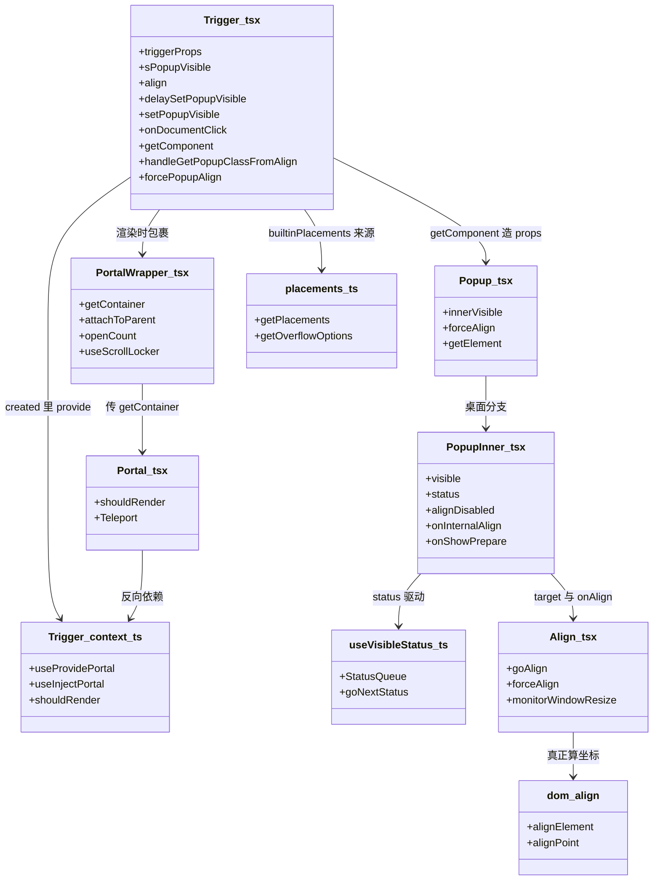
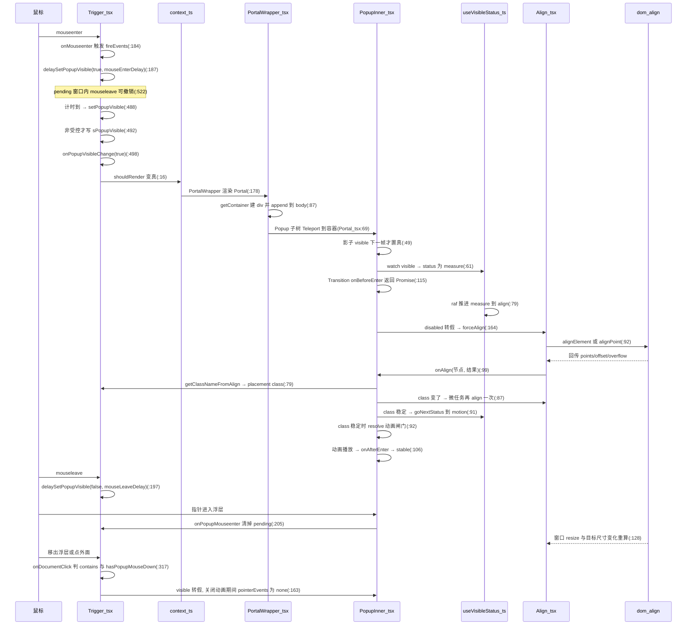
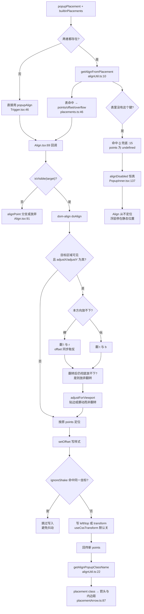

# A07 交互基础设施总览：一个浮层是怎么拼起来的

> **本篇解决**：从"鼠标移到一个按钮上"到"提示框出现在它上方并且盖住了页面其余内容"，中间依次经过哪几个文件、哪几个状态、哪几次回调？"何时显示"由谁决定、"显示在哪"由谁决定、两者之间到底传了什么？挂载点、层级、"点外面关闭"又分别归谁？
> **前置**：A05（ConfigProvider 注入链与 Size/Disabled Context）、A06（Props 体系与类型工具）　**读者坐标**：`01-architecture` 第 7/8 篇
> **主题边界**：本篇只做**横向总览与调用序列**。单模块深读归 I01（vc-align 定位求解与碰撞检测）、I02（vc-trigger 弹出时序与事件穿透）、I10（z-index 层级编排）；这三篇尚未撰写，本篇涉及其算法细节处一律只给"编号 + 标题 + 一行引用"。Modal / Drawer 是居中容器，不走 align，其焦点归还、遮罩记账、滚动锁定真源已在 C07-01（Modal 对话框）展开，本篇只引用不重述。`getPopupContainer` 的纵向注入链归 A05（ConfigProvider 注入链与 Size/Disabled Context），本篇只讲它改变了哪个 DOM 节点。

---

## 一、职责与边界

本库把"浮层"拆成四件互不隶属的事，本篇一统称为**浮层三件套 + 一个挂载器**：

| 关注点 | 归属 | 唯一问题 | 不碰什么 |
| --- | --- | --- | --- |
| 何时显示 | `vc-trigger/Trigger.tsx` | 事件 → pending → `sPopupVisible` | 不知道坐标、不知道 DOM 层级 |
| 显示在哪 | `vc-align/Align.tsx` + 外部包 `dom-align` | points/offset/overflow → `left`/`top` | 不知道是否该显示 |
| 挂到哪个节点 | `_util/PortalWrapper.tsx` + `_util/Portal.tsx` | 容器创建、`Teleport`、`shouldRender` | 不知道位置、不参与动画 |
| 盖在谁上面 | 组件 CSS-in-JS 的 `zIndexPopup` Token | 静态偏移表 | 运行时不参与（`ZIndexManager` 是另一套账本，见 §六） |

术语约定：`vc-*` 是 vendor 层（vendor = 底层实现层，把第三方控件的形态封装成本库内部底座），`vc-trigger` / `vc-align` 属于这一层；`tooltip` / `popover` / `dropdown` / `select` 是消费侧的业务组件。

明确**不负责**：

- 居中对话框与抽屉的开关时序 → `vc-dialog` / `vc-drawer`（C07-01 已说明 Modal 不走 align）
- 焦点陷阱 → `focus-trap/useFocusTrap.ts`（227 行，当前全库没有组件在用；trigger 这条链**完全没有焦点管理**，唯一的焦点动作是 `vc-align/util.ts:20` 的 `restoreFocus`，它只解决"重定位导致焦点丢失"这一件事）
- 涟漪反馈 → `_util/wave/`（消费者是 `button/button.tsx:12`、`switch/index.tsx:6`、`tag/index.tsx:6`、`dark-mode-toggle/DarkModeToggle.tsx:3`，与浮层链无交集，只在"点一下按钮"时与 Tooltip 同时出现，容易被误认为一伙）
- 定位算法本体、pending 状态机的每个分支、层级冲突的完整解法 → I01 / I02 / I10

依赖实测（方向 + 证据）：

| 方向 | 对象 | 证据 |
| --- | --- | --- |
| 被依赖（Trigger） | `vc-tooltip`、`vc-dropdown`、`vc-select`、`vc-picker`、`menu`、`vc-mentions`、`vc-tour` 共 7 个底座 | `packages/xiaoye-ui/src/vc-tooltip/src/Tooltip.tsx:2`、`vc-dropdown/Dropdown.tsx:4`、`vc-select/SelectTrigger.tsx:1`、`vc-picker/PickerTrigger.tsx:3`、`menu/src/PopupTrigger.tsx:1`、`vc-mentions/src/KeywordTrigger.tsx:1`、`vc-tour/Tour.tsx:4` |
| 被依赖（Align） | **只有 `PopupInner` 一处** | `packages/xiaoye-ui/src/vc-trigger/Popup/PopupInner.tsx:15` |
| 被依赖（Portal） | `Trigger` 经 `PortalWrapper` 使用；`vc-dialog`、`vc-drawer`、`vc-tour` 直接使用 | `packages/xiaoye-ui/src/vc-trigger/Trigger.tsx:18`、`vc-dialog/DialogWrap.tsx:4`、`vc-drawer/src/DrawerWrapper.tsx:5`、`vc-tour/Tour.tsx:24` |
| 依赖（外部包） | `dom-align@^1.12.0`、`resize-observer-polyfill@^1.5.0`、`lodash-es/isEqual` | `packages/xiaoye-ui/package.json:63`、`vc-align/util.ts:3`、`vc-align/Align.tsx:20` |
| 依赖（内部） | `vc-util/Dom/{contains,addEventListener,isVisible}`、`_util/raf`、`_util/transition`、`_util/supportsPassive` | `packages/xiaoye-ui/src/vc-trigger/Trigger.tsx:4`、`:14`、`:5`、`:21`、`vc-align/Align.tsx:13`、`:15` |
| 反向依赖 | `_util/Portal.tsx` 反过来 import `vc-trigger/context` | `packages/xiaoye-ui/src/_util/Portal.tsx:11` |

最后一行是本层最值得警惕的结构事实：**一个通用的挂载组件依赖某个具体 vendor 模块的 context**。`Portal.tsx:25` 取 `useInjectPortal()` 的 `shouldRender`，而 `shouldRender` 的定义在 `vc-trigger/context.ts:12-23`——判断依据是 Trigger 实例的 `sPopupVisible / popupRef / forceRender / autoDestroy` 四个字段。这意味着 `_util/Portal` 的渲染条件由"祖先里有没有一个 Trigger"决定，`vc-dialog`、`vc-drawer`、`vc-tour` 想摆脱这套判定，只能显式提供"我不在 trigger 上下文里"的标记（`vc-dialog/DialogWrap.tsx:18` 的 `useProvidePortal({}, { inTriggerContext: false })`）。

---

## 二、源码地图

`vc-trigger` + `vc-align` 合计 1912 行、18 个文件；加上挂载与映射表（`_util` 五个文件）约 2,470 行。

| 文件 | 行数 | 职责 | 关键导出 / 入口 |
| --- | --- | --- | --- |
| `vc-trigger/Trigger.tsx` | 710 | 事件接收、pending、受控判定、Portal 接线 | 默认导出组件声明 `packages/xiaoye-ui/src/vc-trigger/Trigger.tsx:34` |
| `vc-trigger/interface.ts` | 146 | `AlignType` 契约 + 全部 props | `triggerProps()` `:106` |
| `vc-trigger/context.ts` | 38 | Portal 的 `shouldRender` 注入 | `useProvidePortal` `:9`、`useInjectPortal` `:27` |
| `vc-trigger/utils/alignUtil.ts` | 40 | placement → align、align → placement class | `getAlignFromPlacement` `:10`、`getAlignPopupClassName` `:22` |
| `vc-trigger/utils/motionUtil.ts` | 22 | 旧 `animation` / `transitionName` 归一 | `getMotion` `:9` |
| `vc-trigger/Popup/index.tsx` | 56 | 桌面/移动分叉 + `forceAlign` 透传 | `:7` |
| `vc-trigger/Popup/PopupInner.tsx` | 228 | 状态机、动画闸门、align 回环 | `:24` |
| `vc-trigger/Popup/useVisibleStatus.ts` | 97 | `measure → align → motion → stable` | 默认导出 `:21` |
| `vc-trigger/Popup/useStretchStyle.ts` | 41 | 量触发元素宽高写进 popup style | `:10`、`:18` |
| `vc-trigger/Popup/Mask.tsx` | 37 | 遮罩（本库不可达，见 §四 论点 9） | `:14` |
| `vc-trigger/Popup/MobilePopupInner.tsx` | 59 | 移动端整屏弹层，**不做定位** | `:18` 的 `forceAlign` 是空函数 |
| `vc-align/Align.tsx` | 208 | 定位求解的唯一入口与四类监听 | `:61`；核心回调 `:69` |
| `vc-align/util.ts` | 60 | `isSamePoint` / `restoreFocus` / `monitorResize` | `:31` |
| `vc-align/hooks/useBuffer.tsx` | 39 | 前置执行 + 尾随补发的节流 | `:3` |
| `vc-align/interface.ts` | 60 | 本目录内的第二份 `AlignType`（与 vc-trigger 的那份不同） | `:4` |
| `_util/PortalWrapper.tsx` | 191 | 容器创建/挂载/移除、`openCount`、滚动锁定条件 | `:74`、`:87`、`:109` |
| `_util/Portal.tsx` | 72 | `Teleport` + `shouldRender` 闸门 | `:64` |
| `_util/placements.ts` | 111 | placement → points/offset 的唯一映射表 | `getPlacements` `:38` |
| `_util/zIndexManager.ts` | 28 | 单调递增的层级栈（**不在浮层链上**） | `:6` |
| `_util/overlayEventBus.ts` | 9 | 单例事件总线 | `:7` |
| `style/placementArrow.ts` | 257 | 箭头形状与随 placement class 翻转 | `:28` |
| `style/roundedArrow.ts` | 72 | 圆角箭头的 `clip-path` 几何 | `:4` |

主实现入口：`packages/xiaoye-ui/src/vc-trigger/Trigger.tsx:34`（组件声明）与 `packages/xiaoye-ui/src/vc-align/Align.tsx:69`（定位回调）。

消费侧样本的分工（本篇只取所需的切片）：

| 消费方 | 行数 | 它从三件套里取什么 | 它自己补什么 |
| --- | --- | --- | --- |
| `tooltip/Tooltip.tsx` | 319 | placements 表、延迟、`getPopupContainer` | `onPopupAlign` 里写 `transformOrigin` `:218` |
| `vc-tooltip/src/Tooltip.tsx` | 136 | 把 tooltip 语义翻成 trigger 语义 `:109` | `destroyTooltipOnHide.keepParent` → `autoDestroy` `:76` |
| `popover/index.tsx` | 80 | 整条链复用 Tooltip | 靠 `data-popover-inject` 关掉 Tooltip 的样式注入 `:74` |
| `dropdown/dropdown.tsx` | 220 | placements、延迟、`alignPoint` | contextmenu 时按鼠标点定位 `:185` |
| `vc-select/SelectTrigger.tsx` + `BaseSelect.tsx` | 192 + 1,000+ | 只要挂载 + 定位 | 自己接管开合与外部点击 |
| `vc-picker/PickerTrigger.tsx` | 103 | 只要挂载 + 定位（`showAction`/`hideAction` 传空数组 `:81`） | 面板与输入框自己管开合 |

---

## 三、架构与数据流

### 3.1 静态协作关系：谁持有谁、谁调用谁



读图要点有三条。第一，`Trigger.tsx` 是唯一同时认识"事件"与"Popup props"的节点：`Trigger.tsx:387-446` 的 `getComponent()` 把开合状态、align 结果、zIndex、动画名一次性打包成 Popup 的 props，这是 trigger 与 align 之间**全部的**数据交接面。第二，`PopupInner` 才是与 `Align` 握手的人（`PopupInner.tsx:192-200`），`Trigger` 只能隔着 `forceAlign()` 命令它（`Trigger.tsx:614-618`）。第三，`Portal` 依赖 `vc-trigger/context` 而不是反过来（`_util/Portal.tsx:11`），所以挂载器的"要不要渲染"这件事被 trigger 的可见性劫持了，其他使用 `Portal` 的底座必须显式解除（`vc-dialog/DialogWrap.tsx:18`）。

### 3.2 一次 hover 的完整调用序列



这条序列里有**四个不同量级的"等待"**，读代码时极易混淆，先把它们钉在这里：

1. `mouseEnterDelay` / `mouseLeaveDelay` 是**秒**为单位的 `setTimeout`，挂在 `delayTimer` 上（`Trigger.tsx:522-534`），默认分别是 0 与 0.1 秒（`vc-trigger/interface.ts:122-123`）。
2. Popup 内部的影子 `visible` 是**一个宏任务**（`PopupInner.tsx:49` 的无参 `setTimeout`），只影响动画能否被看见，不影响逻辑状态。
3. `useVisibleStatus` 的每次状态推进是**一帧** `requestAnimationFrame`（`useVisibleStatus.ts:78-84`）。
4. `Align` 的重算节流窗口是 `monitorBufferTime`，单位毫秒，但**没有任何调用方传它**（详见 §四 论点 8）。

### 3.3 placement 到坐标：决策路径



图中三个分支解释了后文的三个机制：**表里没有的 placement 会静默退化为"不定位"**（`F → G → H → I`，见 §七 坑 1）；**翻转只在"整个方向彻底放不下"时才发生，否则只是贴边挪动**（`R/S/T/V/W`，见 §四 论点 6）；**箭头和留白不是 JS 算的，是 placement class 反推的**（`AB → AC → AD`，见 §四 论点 5）。

---

## 四、核心机制精读

### 论点 1：trigger 只决定"何时显示"，它到"显示在哪"的全部发言权是一个对象

`Trigger` 里唯一与位置有关的代码是 8 行：

```tsx
// packages/xiaoye-ui/src/vc-trigger/Trigger.tsx:41
    const align = computed(() => {
      const { popupPlacement, popupAlign, builtinPlacements } = props;
      if (popupPlacement && builtinPlacements) {
        return getAlignFromPlacement(builtinPlacements, popupPlacement, popupAlign);
      }
      return popupAlign;
    });
```

它把 `popupPlacement`（用户给的语义名，如 `topLeft`）与厂商表 `builtinPlacements` 折成一个 `AlignType` 对象；折不动（任一方缺失）就原样退回 `popupAlign`。**这里不产生任何数字坐标**。

交接面只有一个地方：`getComponent()` 造的 props 对象。

```tsx
// packages/xiaoye-ui/src/vc-trigger/Trigger.tsx:416
      const popupProps = {
        prefixCls,
        arrow,
        destroyPopupOnHide,
        visible: sPopupVisible,
        point: alignPoint ? point : null,
        align: this.align,
        animation: popupAnimation,
        getClassNameFromAlign: handleGetPopupClassFromAlign,
        stretch,
        getRootDomNode,
        mask,
        zIndex,
        transitionName: popupTransitionName,
        maskAnimation,
        maskTransitionName,
        class: popupClassName,
        style: popupStyle,
        onAlign: $attrs.onPopupAlign || noop,
        ...mouseProps,
        ref: this.setPopupRef,
        mobile,
        forceRender,
      } as any;
```

去掉动画与样式字段，位置协议只剩 4 个成员，这就是 trigger 与 align 之间**全部的**数据契约：

| 成员 | 生产方 | 消费方 | 语义 |
| --- | --- | --- | --- |
| `align` | `Trigger.tsx:41` | `Align` 的 `align` prop（`PopupInner.tsx:199`） | points / offset / targetOffset / overflow |
| `getRootDomNode` | `Trigger.tsx:340` | `Align` 的 `target`（`PopupInner.tsx:67-72`） | 锚点元素；`alignPoint` 时换成鼠标点 |
| `getClassNameFromAlign` | `Trigger.tsx:360` | 每次 align 完成后回写 class（`PopupInner.tsx:79`） | **反向通道**：位置结果回灌样式 |
| `onAlign` | `$attrs.onPopupAlign`（`Trigger.tsx:434`） | 业务层继续消费（如 Tooltip 写 `transformOrigin`） | 把最终坐标暴露给组件 |

`Align` 侧对 `target` 的形态做了二选一，这是"贴着元素"和"跟着鼠标"两种浮层的分岔点：

```tsx
// packages/xiaoye-ui/src/vc-trigger/Popup/PopupInner.tsx:65
    // `target` on `rc-align` can accept as a function to get the bind element or a point.
    // ref: https://www.npmjs.com/package/rc-align
    const getAlignTarget = () => {
      if (props.point) {
        return props.point;
      }
      return props.getRootDomNode;
    };
```

`point` 来自 `alignPoint` 开关下的 `setPoint()`（`Trigger.tsx:506-516`，只存 `pageX/pageY`），由 `onMouseMove` 持续更新（`Trigger.tsx:190-193`）。右键菜单就是靠它把浮层钉在光标处：`dropdown/dropdown.tsx:185-187` 在 trigger 含 `contextmenu` 时置 `alignPoint = true`。`Align` 拿到点之后走 `alignPoint` 而不是 `alignElement`（`vc-align/Align.tsx:93-95`），两条求解路径的区别属 I01（vc-align 定位求解与碰撞检测）。

反向通道 `getClassNameFromAlign` 是这套契约里最容易被忽略、却最重要的一个：**位置结果不是终点，它要再变成一次渲染**。`Trigger.tsx:360-377` 把 align 结果交给 `getAlignPopupClassName`（`vc-trigger/utils/alignUtil.ts:22`），后者拿返回的 `points` 去表里**反查**是哪个 placement。这解释了为什么箭头能跟着翻转走（论点 5），也解释了为什么需要一轮额外的 align（论点 4）。

结论：想改"何时显示"去 `Trigger.tsx` 的事件与延迟段（`:184-266`），想改"显示在哪"去 `Align.tsx` 与表；**两边不要跨界**——`Trigger` 里没有任何 `getBoundingClientRect`，`Align` 里没有任何可见性判断。

### 论点 2："请求显示"与"提交显示"是两段，pending 期可以整体撤销

```tsx
// packages/xiaoye-ui/src/vc-trigger/Trigger.tsx:522
    delaySetPopupVisible(visible: boolean, delayS: number, event?: any) {
      const delay = delayS * 1000;
      this.clearDelayTimer();
      if (delay) {
        const point = event ? { pageX: event.pageX, pageY: event.pageY } : null;
        this.delayTimer = setTimeout(() => {
          this.setPopupVisible(visible, point);
          this.clearDelayTimer();
        }, delay);
      } else {
        this.setPopupVisible(visible, event);
      }
    },
```

```tsx
// packages/xiaoye-ui/src/vc-trigger/Trigger.tsx:488
    setPopupVisible(sPopupVisible: boolean, event?: any) {
      const { alignPoint, sPopupVisible: prevPopupVisible, onPopupVisibleChange } = this;
      this.clearDelayTimer();
      if (prevPopupVisible !== sPopupVisible) {
        if (!hasProp(this, 'popupVisible')) {
          this.setState({
            sPopupVisible,
            prevPopupVisible,
          });
        }
        onPopupVisibleChange && onPopupVisibleChange(sPopupVisible);
      }
      // Always record the point position since mouseEnterDelay will delay the show
      if (alignPoint && event && sPopupVisible) {
        this.setPoint(event);
      }
    },
```

第一段（`:522`）只做两件事：算出 `delay` 秒并登记一个可撤销的定时器；把触发事件的鼠标坐标暂存成 `point`。第二段（`:488`）才真正落地状态，并且在这里完成**受控/非受控判定**——`hasProp(this, 'popupVisible')` 为真时**只通知不改动内部状态**（`:492`），完全由调用方回灌 `popupVisible` prop（`Trigger.tsx:98-105` 的 watch 是唯一入口）。受控与非受控的分流细节属 I02（vc-trigger 弹出时序与事件穿透），本篇只标记位置。

两段式设计的原因是**撤销成本**。指针扫过一串按钮时，每次 `mouseenter` 都会先 `clearDelayTimer()` 再挂新定时器，前一个待显示的 Tooltip 就被吞掉了；而 `mouseleave` 走的是同一个函数的 false 分支（`Trigger.tsx:195-198`，用 `mouseLeaveDelay`，默认 0.1 秒，`vc-trigger/interface.ts:123`），只要指针在这 0.1 秒内进到浮层里，`onPopupMouseenter` 会再清一次定时器（`Trigger.tsx:200-206`），提示框就不会因为穿过两者之间的缝隙而消失。换句话说：**pending 定时器既是延迟，也是跨元素的取消令牌**，这两个职责共用 `delayTimer` 一个变量（`Trigger.tsx:71`）。

这条链路还藏着一个时序约束：`:501-503` 只在 `sPopupVisible` 为真时记录 `point`。注释原文写得很直白——延迟期间鼠标可能已经移动，所以要用定时器里带过来的那份坐标（`:526`），而不是提交时刻的坐标。

### 论点 3：Popup 有两个 visible，还有一个只走三格的队列

`props.visible` 为真时，Popup **不当场显示**。

```tsx
// packages/xiaoye-ui/src/vc-trigger/Popup/PopupInner.tsx:42
    const visible = shallowRef(false);
    let timeoutId: any;
    watch(
      () => props.visible,
      val => {
        clearTimeout(timeoutId);
        if (val) {
          timeoutId = setTimeout(() => {
            visible.value = props.visible;
          });
        } else {
          visible.value = false;
        }
      },
      { immediate: true },
    );
```

`visible`（本地影子）与 `props.visible`（真实请求）因此不对称：**开**要等一个宏任务，**关**立即生效。等待的目的是让"元素已在 DOM"与"动画开始"分处两个帧，否则同一个更新里插入节点又加上 enter 类，过渡不会触发（表现就是"啪"地出现、没有缩放动画）。与影子状态配套的是两道门，都在同一处：

```tsx
// packages/xiaoye-ui/src/vc-trigger/Popup/PopupInner.tsx:156
      const mergedStyle: CSSProperties[] = [
        {
          ...stretchStyle.value,
          zIndex,
          opacity:
            statusValue === 'motion' || statusValue === 'stable' || !visible.value ? null : 0,
          // pointerEvents: statusValue === 'stable' ? null : 'none',
          pointerEvents: !visible.value && statusValue !== 'stable' ? 'none' : null,
        },
        attrs.style as CSSProperties,
      ];
```

`opacity: 0` 覆盖的是"已挂载、未定位好"这段中间态——避免用户看到一个悬在左上角的答案。`pointerEvents: 'none'` 的判据是 `!visible && status !== 'stable'`：`props.visible` 已转假、动画还在退场的那段时间里，**浮层可见但点不到**；这是刻意的，防止用户在关闭过程中点中列表项。注意被注释掉的上一行（`:162`）判据更宽，会让整个打开过程都不可点，显然出过问题。

状态机本身只有三格会走：

```tsx
// packages/xiaoye-ui/src/vc-trigger/Popup/useVisibleStatus.ts:5
/**
 * Popup should follow the steps for each component work correctly:
 * measure - check for the value stretch size
 * align - let component align the position
 * aligned - re-align again in case additional className changed the size
 * afterAlign - choice next step is trigger motion or finished
 * beforeMotion - should reset motion to invisible so that CSSMotion can do normal motion
 * motion - play the motion
 * stable - everything is done
 */
type PopupStatus = null | 'measure' | 'align' | 'aligned' | 'motion' | 'stable';

type Func = () => void;

const StatusQueue: PopupStatus[] = ['measure', 'align', null, 'motion'];
```

文件头的注释描述了 7 步协议，实现里 `StatusQueue` 只有 `measure → align →（null 截断）`，`'aligned'`、`'afterAlign'`、`'beforeMotion'` 三个状态名**在代码里从不出现**（`'aligned'` 仅存在于类型 `:15` 与注释；`grep -rn "'aligned'" packages/xiaoye-ui/src` 只有这一处）。"重新对齐一次"这件事被改写进了 `onInternalAlign` 的微任务循环（论点 4），而 `motion → stable` 由 `goNextStatus` 手工推进：

```tsx
// packages/xiaoye-ui/src/vc-trigger/Popup/useVisibleStatus.ts:38
  function goNextStatus(callback?: () => void) {
    cancelRaf();
    rafRef.value = raf(() => {
      // Only align should be manually trigger
      let newStatus = status.value;
      switch (status.value) {
        case 'align':
          newStatus = 'motion';
          break;
        case 'motion':
          newStatus = 'stable';
          break;
        default:
      }
      setStatus(newStatus);

      callback?.();
    });
  }
```

`align` 之后为什么停在 `null`：队列推进靠 `StatusQueue[index + 1]`（`:79-83`），`align` 的下一格显式写成 `null`，`if (nextStatus && index !== -1)`（`:81`）于是失败，状态机在 `align` 处**故意刹车**，把方向盘交给 align 回调。这就是论点 4 存在的理由。

另外，`'measure'` 只对 `stretch` 有意义：`doMeasure()` 在非 `stretch` 时直接跳过（`PopupInner.tsx:37-41`），量到的尺寸是 `offsetWidth/offsetHeight`（`useStretchStyle.ts:10-15`）。`Dropdown` 用 `stretch="minWidth"` 让菜单不小于触发按钮（`vc-dropdown/Dropdown.tsx:136`），`Menu` 只在 horizontal 模式用它（`menu/src/PopupTrigger.tsx:96`）。

### 论点 4：动画被一个 Promise 拦住，直到 align 自认稳定

```tsx
// packages/xiaoye-ui/src/vc-trigger/Popup/PopupInner.tsx:78
    const onInternalAlign = (popupDomNode: HTMLElement, matchAlign: AlignType) => {
      const nextAlignedClassName = props.getClassNameFromAlign(matchAlign);
      const preAlignedClassName = alignedClassName.value;
      if (alignedClassName.value !== nextAlignedClassName) {
        alignedClassName.value = nextAlignedClassName;
      }
      if (status.value === 'align') {
        // Repeat until not more align needed
        if (preAlignedClassName !== nextAlignedClassName) {
          Promise.resolve().then(() => {
            forceAlign();
          });
        } else {
          goNextStatus(() => {
            prepareResolveRef.value?.();
          });
        }

        props.onAlign?.(popupDomNode, matchAlign);
      }
    };
```

```tsx
// packages/xiaoye-ui/src/vc-trigger/Popup/PopupInner.tsx:115
    const onShowPrepare = () => {
      return new Promise(resolve => {
        prepareResolveRef.value = resolve;
      });
    };
```

`onShowPrepare` 挂在 Vue `Transition` 的 `onBeforeEnter` 上（`PopupInner.tsx:188`）。Vue 在进入过渡前会等待 `beforeEnter` 返回的 Promise，于是"进场动画"被硬生生推迟到 `prepareResolveRef.value()` 被调用（`:92`）为止，而那只可能发生在 align 回调里。整套"先定位、后动画"的顺序保证就这一句话，没有别处兜底：动画本身由 `motion` 计算属性包装（`:101-113`），`onAfterEnter` / `onAfterLeave` 被覆写为"推进状态 + 强制 `stable`"（`:106-108`），因此 `status` 与过渡事件是双写的，任何一处漏掉 `goNextStatus` 都会让浮层卡在 `align`（表现为**永久 `opacity: 0`**）。

中间那个"再 align 一次"的循环解释了一件麻烦事：placement class 会改内边距（`style/placementArrow.ts:211-228` 给 `-placement-top` 系列补 `paddingBottom`），内边距改了就改了尺寸，尺寸变了 align 结果就可能变，于是必须回环。判据是 class **是否变化**（`:86`）：变了就微任务里再来一轮，不变才放行。若某次 align 让 class 在两个值之间来回跳，这个循环不会终止——源码里没有次数上限，只在 `status === 'align'` 时才跑（`:84`），而 `goNextStatus` 会把 status 挪走，等于**用状态机给回环装了个隐式保险丝**。

没有动画的分支同样必须放行，否则一样卡死：

```tsx
// packages/xiaoye-ui/src/vc-trigger/Popup/PopupInner.tsx:121
    watch(
      [motion, status],
      () => {
        if (!motion.value && status.value === 'motion') {
          goNextStatus();
        }
      },
      { immediate: true },
    );
```

`alignDisabled` 是第四道闸：只有 `align.points` 存在且状态进入 `align`/`stable` 才放开（`PopupInner.tsx:137-142`）。它同时是 §七 坑 1 的落点——**points 缺失时浮层不是"定位到 0,0"，而是"从未定位"**，因为 `Align` 的回调第一步就检查 `disabled`（`vc-align/Align.tsx:77`）。

### 论点 5：placement 表把语义名翻译成两点，箭头完全靠翻译结果的 class 反查

`_util/placements.ts` 是全库唯一的"placement → 坐标语义"表。表体是 12 个键（`:46-95`），每个键一条 `points` 加一个 `offset`：

```ts
// packages/xiaoye-ui/src/_util/placements.ts:46
  const placementMap = {
    left: {
      points: ['cr', 'cl'],
      offset: [-4, 0],
    },
    right: {
      points: ['cl', 'cr'],
      offset: [4, 0],
    },
    top: {
      points: ['bc', 'tc'],
      offset: [0, -4],
    },
    bottom: {
      points: ['tc', 'bc'],
      offset: [0, 4],
    },
    topLeft: {
      points: ['bl', 'tc'],
      offset: [-(horizontalArrowShift + arrowWidth), -4],
    },
```

`points` 的两元语义由类型注释钉死（`vc-trigger/interface.ts:5-14`）：第一个二元组是**浮层**上的锚点，第二个是**目标**上的锚点，字符取自 `t/b/c/l/r`。所以 `['bc','tc']` 读作"把浮层的 bottom-center 贴到目标的 top-center"，即正上方；`['bl','tc']` 是"浮层的 bottom-left 贴到目标的 top-center"，再横移 `-(16+4)` 像素——`horizontalArrowShift` 与 `arrowWidth` 的默认值是 16 与 4（`:40-42`），这两个数就是箭头到浮层左沿的预留距离。

真正的分支在表生成末尾：

```ts
// packages/xiaoye-ui/src/_util/placements.ts:96
  Object.keys(placementMap).forEach(key => {
    placementMap[key] = arrowPointAtCenter
      ? {
          ...placementMap[key],
          overflow: getOverflowOptions(autoAdjustOverflow),
          targetOffset,
        }
      : {
          ...placements[key],
          overflow: getOverflowOptions(autoAdjustOverflow),
        };

    placementMap[key].ignoreShake = true;
  });
```

`arrowPointAtCenter` 为真时用自己写的 points（贴到目标中心）+ `targetOffset = [0, 0]`（`:13`）；为假时**改吃另一张表** `placements[key]`（`:1`，来自 `vc-tooltip/src/placements.ts:8`，`topLeft` 是 `['bl','tl']`，即贴左沿）。最后一行给所有键统一加上 `ignoreShake: true`——它是 `setPopupVisible` 后浮层不抖的关键，也是"同一坐标不重复写样式"的唯一实现（外部包 `dom-align` 的 `setOffset` 内做 `toFixed(0)` 比较后直接 return；本库只负责打开这个开关，见 `vc-trigger/interface.ts:63` 的选项声明）。`arrowPointAtCenter` 的入口是 `arrow` 对象：`tooltip/Tooltip.tsx:147-161` 里 `arrow.pointAtCenter ?? arrowPointAtCenter`，而 `arrowPointAtCenter` 已被标 deprecated（`tooltip/abstractTooltipProps.ts:36-37`）。

**箭头不做任何 JS 计算**。`vc-trigger/Popup/PopupInner.tsx:175-180` 把反查得到的 placement class 拼进根节点类名，剩下的全是 CSS 的事：`style/placementArrow.ts:87-116` 用 `-placement-top / -placement-topLeft / -placement-topRight` 三个选择器决定箭头贴下沿还是左上、要不要 `rotate(180deg)`；`-arrow-hidden`（`PopupInner.tsx:179` 在 `arrow` 为假时挂上）会让 `:211-228` 那组 `paddingTop/Bottom` 补偿失效，从而不留下箭头的空白。反查的实现有个粗粒度规则：`alignPoint` 为真时只比 `points[0]`（`alignUtil.ts:3-8`），这符合"跟着鼠标的浮层没有目标边可言"的直觉。

写进 DOM 的是 `left`/`top`，不是 `transform`。理由有三处可查：popup 根节点自带 `position: absolute`（`tooltip/style/index.ts:41`）；`AlignType` 的三个样式开关 `useCssRight` / `useCssBottom` / `useCssTransform` 在本库所有表里都没被打开（`vc-trigger/interface.ts:50-62` 是声明处，`grep -rn "useCssTransform" packages/xiaoye-ui/src` 的命中全部落在类型定义与 `TooltipAlignConfig` 这类类型层）；`_util/placements.ts:48-94` 的 12 条里没有一条带这三个键。副作用是 `transformOrigin` 必须业务层自己算——这正是 Tooltip 在 `onPopupAlign` 里做的事（`tooltip/Tooltip.tsx:218-245`）：用回传的 `points` 反查 placement，再用 `getBoundingClientRect` 的宽高减掉 `align.offset`，把动画原点钉到箭头那一侧。

### 论点 6：翻转是有前提的，"挪动"和"翻面"是两种不同的调整

`overflow` 是唯一开关，语义写在类型注释里：

```ts
// packages/xiaoye-ui/src/vc-trigger/interface.ts:25
  /**
   * If adjustX field is true, will adjust source node in x direction if source node is invisible.
   * If adjustY field is true, will adjust source node in y direction if source node is invisible.
   */
  overflow?: {
    adjustX?: boolean | number;
    adjustY?: boolean | number;
    shiftX?: boolean | number;
    shiftY?: boolean | number;
  };
```

本库把布尔开关统一折成 0/1 数字，只有两个档位：`{adjustX:1, adjustY:1}` 与 `{adjustX:0, adjustY:0}`（`_util/placements.ts:3-11`），`getOverflowOptions` 负责翻译（`:28-36`）——传布尔取整档，传对象则**以关闭为底再覆盖**（`:32-35` 先展开 disabled 再展开用户对象），所以 `autoAdjustOverflow={{ adjustY: 1 }}` 的实际含义是"只允许纵向调整"，不是"沿用默认"。`Tooltip` 的默认是 `autoAdjustOverflow: true`（`tooltip/Tooltip.tsx:82`）。

第二个前提是**目标必须可见**，这是本库自己的闸门，不在外部包里：

```tsx
// packages/xiaoye-ui/src/vc-align/Align.tsx:87
          // IE lose focus after element realign
          // We should record activeElement and restore later
          const { activeElement } = document;
          // We only align when element is visible
          if (element && isVisible(element)) {
            result = alignElement(source, element, latestAlign);
          } else if (point) {
            result = alignPoint(source, point, latestAlign);
          }
```

`isVisible` 的判据是 `offsetParent` 非空，或 SVG `getBBox` 的宽高非零，或 `getBoundingClientRect` 的宽高非零（`vc-util/Dom/isVisible.ts:6-24`），三条都不满足就**整个放弃定位**（不返回结果，因此 `onAlign` 也不会被调用）。目标滚出可视区时 `alignElement` 内部另有"目标区域不可见则不做翻转"的约束（`dom-align` 的 `alignElement` 会先算 `isOutOfVisibleRect` 再决定是否允许 overflow 调整），算法过程归 I01（vc-align 定位求解与碰撞检测）。

第三条前提在表里，而且不同组件族的取值是**故意不同**的，这是"为什么我的 Select 不会左右翻"的答案：

```ts
// packages/xiaoye-ui/src/vc-select/SelectTrigger.tsx:10
const getBuiltInPlacements = (dropdownMatchSelectWidth: number | boolean) => {
  // Enable horizontal overflow auto-adjustment when a custom dropdown width is provided
  const adjustX = dropdownMatchSelectWidth === true ? 0 : 1;
  return {
    bottomLeft: {
      points: ['tl', 'bl'],
      offset: [0, 4],
      overflow: {
        adjustX,
        adjustY: 1,
      },
    },
```

`dropdownMatchSelectWidth` 为 `true`（默认，见 `:96`）时下拉宽度被钉成触发框宽度（`:150-154`），横向翻转没有任何意义，于是 `adjustX` 直接置 0；给了自定义宽度才放开。`DatePicker` 走另一条判断：`vc-picker/PickerTrigger.tsx:24-31` 里 `topLeft`/`topRight` 的 `adjustX` 恒为 0 而 `adjustY` 为 1——向上翻时横向不挪，避免面板在两个方向同时跳。`Dropdown`/`Tooltip` 则整族开着 `adjustX: 1`（`vc-dropdown/placements.ts:1-4`、`vc-tooltip/src/placements.ts:1-4`、`menu/src/placements.ts:1-4`）。

最后要把两个动词分清楚，这是读 §3.3 那张图的关键：

- **翻面**（flip）：把 `points` 里的 `t↔b` 或 `l↔r` 对调，同时把 `offset`/`targetOffset` 取反，且只有在"翻过去能彻底放下"时才生效；生效后**回传的 points 变了**，于是 placement class 也跟着变（箭头换边）。
- **挪动**（clamp/shift）：翻面失败或方向不受影响时，把浮层沿该轴推到可视区边缘，`points` 不变、箭头不换边。

`shiftX` / `shiftY` 这两个键在本库只存在于类型声明（`vc-trigger/interface.ts:32-33`），既没有任何表写它，`vc-align` 也不读它；`dom-align@1.12.4`（锁定的实装版本）的实现里同样没有这两个键——判别命令见 §附 检查点 3。同理 `autoArrow`（`vc-trigger/interface.ts:36`）只有 `vc-tour/placements.tsx:74` 写过一次，无人读取。**本库的箭头偏移从来不是算法算出来的**（论点 5）。

顺带一个类型层的坑：`AlignType` 在这个链上有**两份定义**——消费侧与 `Trigger` 用 `vc-trigger/interface.ts:9`（含 `htmlRegion`、`useCss*`、`ignoreShake`、`autoArrow`），`Align` 组件的 prop 类型用 `vc-align/interface.ts:4`（不含这些键）。`PopupInner` 传值时写的是 `align={align as any}`（`PopupInner.tsx:199`），两份定义的差异全靠这个 `as any` 抹平，所以**在 `vc-align/interface.ts` 里补字段不会报错，也不会生效**。

### 论点 7：浮层的层级是三套互不知情的账本，trigger 这条链用的是最静态的那套

多数人会以为有个"z-index 管理器"在管浮层。实测：`_util/zIndexManager.ts` 的消费者只有 `context-menu/ContextMenu.tsx:425`、`block-ui/BlockUI.tsx:176`、`color-picker/ColorPicker.tsx:360`——**没有一个走 `vc-trigger` 的组件**。

`Tooltip`/`Popover`/`Dropdown`/`Select`/`DatePicker` 的层级是**编译期就写进 CSS 的静态偏移**，基座是种子 `zIndexPopupBase: 1000`（`theme/themes/seed.ts:68`）：

```ts
// packages/xiaoye-ui/src/theme/themes/seed.ts:66
  // zIndex
  zIndexBase: 0,
  zIndexPopupBase: 1000,
```

各组件在自己的 style 里加一个常数，再写进自己的根类名：

| 组件 | 偏移 | 定义处 | 写入 CSS 处 |
| --- | --- | --- | --- |
| Tooltip | `+70` | `tooltip/style/index.ts:151` | `tooltip/style/index.ts:42` |
| Image 预览 | `+80` | `image/style/index.ts:313` | `image/style/index.ts:232` |
| Popconfirm | `+60` | `popconfirm/style/index.ts:86` | — |
| Popover | `+30` | `popover/style/index.ts:179` | `popover/style/index.ts:44` |
| Dropdown | `+50` | `dropdown/style/index.ts:455` | `dropdown/style/index.ts:63` |
| Select 下拉 | `+50` | `select/style/index.ts:340` | `select/style/dropdown.ts:45` |
| DatePicker 面板 | `+50` | `date-picker/style/index.ts:1444` | `date-picker/style/index.ts:1177` |
| Menu 子菜单 | `+50` | `menu/style/index.ts:539` | `menu/style/index.ts:350` |
| Message | `+10` | `message/style/index.ts:178` | — |
| Drawer | `+0` | `drawer/style/index.ts:228` | — |

于是"Select 下拉里再开 DatePicker 谁在上面"这个问题，在这套账本里的答案是：**两者都是 1050，谁都不让谁，最终由 DOM 顺序决定**。同一 `z-index` 的绝对定位元素按文档顺序绘制，而每个浮层的容器 `div` 是在**第一次打开时**才 `appendChild` 到 `parent` 的（`_util/PortalWrapper.tsx:74-86`，父节点由 `getParent` 依 `getContainer` 解析，缺省 `document.body`，`:26-42`），后打开的容器排得更靠后，因此后开的浮层压在上面。这不是设计出来的层序，是挂载时机的副产物。

第二套账本是 `ZIndexManager`，一个模块级数组上的单调栈：

```ts
// packages/xiaoye-ui/src/_util/zIndexManager.ts:10
  set(key: string, element: HTMLElement, baseZIndex?: number): void {
    const base = baseZIndex ?? 0;
    const last = zIndexRecords.length > 0 ? zIndexRecords[zIndexRecords.length - 1] : null;
    const newValue = last ? last.value + 1 : base + 1;
    zIndexRecords.push({ key, value: newValue });
    element.style.zIndex = String(newValue);
  },
```

它的 `key` 只写进记录、不参与取值（`:12-13` 永远读数组末位），所以 `'modal'`、`'menu'`、`'overlay'` 三个键共用一条递增序列；`clear` 也**不按 key 而是按当前内联值**回查数组（`:18-20`），两个元素内联值恰好相同时会删错记录。文件头的注释交代了它的出身：`// 抽取自 context-menu / color-picker / galleria / block-ui 中的重复实现`（`:1-2`）。第三套在 `packages/utils/src/zindex/index.ts`，它的 `set` 把 `autoZIndex` 硬编码为 `true`（`:46-48`），于是 `getLastZIndex` 里那句 key 过滤（`:31-33`）被短路、取到的仍是全局末位；与 `ZIndexManager` 唯一的差别是跳档规则——末位记录的 key 与自己不同就加 `baseZIndex`（缺省 999，见 `:11` 的默认参数），相同就只加 1（`:13`）。本库只有 `data-table/ColumnFilter.tsx:14` 与它的调用点 `:308` 在用这一套。**两套语义相近、行为不同的实现并存，且都直接写 `element.style.zIndex`，互不回收对方的记录。**

`Trigger` 这条链上唯一的内联层级是 `zIndex` prop（`Trigger.tsx:428` → `PopupInner.tsx:159`），而它只有一个消费者真正在用：`vc-tour/Tour.tsx:54` 声明默认 1001 并在 `:253` 传给 Trigger（`:216` 那处给的是 `<Mask>`；本轮复核发现原记 `:252` 是 `destroyPopupOnHide`，行号差一位）。也就是说 Tour 是"内联层级"路线，Tooltip 族是"CSS Token"路线，Tour 的 1001 与 `zIndexPopupBase` 之间没有任何换算关系——它甚至盖过了同一组件自己的 `tourZIndexPopup`（见 §七 坑 11）。层级编排的完整解法与冲突处理归 I10（z-index 层级编排）。

### 论点 8：点外面关闭在本库有四套实现，`overlayEventBus` 不属于其中任何一套

`Trigger` 的版本是"document 上记一笔，再判三件事"：

```tsx
// packages/xiaoye-ui/src/vc-trigger/Trigger.tsx:317
    onDocumentClick(event) {
      if (this.$props.mask && !this.$props.maskClosable) {
        return;
      }
      const target = event.target;
      const root = this.getRootDomNode();
      const popupNode = this.getPopupDomNode();
      if (
        // mousedown on the target should also close popup when action is contextMenu.
        (!contains(root, target) || this.isContextMenuOnly()) &&
        !contains(popupNode, target) &&
        !this.hasPopupMouseDown
      ) {
        // https://github.com/vuejs/core/issues/4462
        // vue 动画bug导致，改成延时解决
        this.delaySetPopupVisible(false, 0.1);
      }
    },
```

监听器不是常驻的：只在 `sPopupVisible` 为真、且 `isClickToHide()` 或 `isContextmenuToShow()` 成立时挂到 `getDocument(...)` 上（`Trigger.tsx:143-152`），用的是 `mousedown` 而不是 `click`（注释里给了两个上游 issue 链接，`:140-142`），关闭走 0.1 秒延迟以躲开 Vue 的过渡竞态（`:332`）。

嵌套浮层的归属靠 `hasPopupMouseDown` 与一条 provide 链，这是这套机制真正的部分：

```tsx
// packages/xiaoye-ui/src/vc-trigger/Trigger.tsx:304
    onPopupMouseDown(...args: any[]) {
      const { vcTriggerContext = {} } = this;
      this.hasPopupMouseDown = true;

      clearTimeout(this.mouseDownTimeout);
      this.mouseDownTimeout = setTimeout(() => {
        this.hasPopupMouseDown = false;
      }, 0);
      if (vcTriggerContext.onPopupMouseDown) {
        vcTriggerContext.onPopupMouseDown(...args);
      }
    },
```

浮层根节点上的 `onMousedown` 是**捕获阶段**绑定的（`PopupInner.tsx:207` 用 `withModifiers(..., ['capture'])`），一定早于 document 冒泡阶段的 `onDocumentClick`，于是内层浮层被按下时先把外层标记为"我刚在浮层里按过"，外层直接放弃关闭；`setTimeout(…, 0)`（`:309-311`）让标记只活一个宏任务。若内层本身也是一个 `Trigger`（例如 Dropdown 里的 Menu 子菜单），它自己的 `onPopupMouseDown` 会通过注入的父上下文继续上抛（`:312-314`，`created()` 里 provide 的键是字符串 `'vcTriggerContext'`，`:107`），形成一条链——**注意这条链的键是字符串而非 `InjectionKey`**，与 `PortalContextKey`（`vc-trigger/context.ts:8` 用 Symbol）是两套命名，后者有类型约束、前者没有。

第二套属于 Select，它**不走** Trigger 的关闭链：`SelectTrigger` 只有在调用方传了 `onPopupVisibleChange` 时才把 `showAction`/`hideAction` 设为 `['click']`（`vc-select/SelectTrigger.tsx:158-159`），而 `BaseSelect` 只在"用户自定义了原始输入元素"时才提供这个回调（`vc-select/BaseSelect.tsx:749-754`）。常规用法下 Trigger 侧的 `clickOutsideHandler` 根本不会注册（`Trigger.tsx:145` 的判据不成立），关闭完全由这段独立实现负责：

```ts
// packages/xiaoye-ui/src/vc-select/hooks/useSelectTriggerControl.ts:8
  function onGlobalMouseDown(event: MouseEvent) {
    let target = event.target as HTMLElement;

    if (target.shadowRoot && event.composed) {
      target = (event.composedPath()[0] || target) as HTMLElement;
    }
    const elements = [refs[0]?.value, refs[1]?.value?.getPopupElement()];
    if (
      open.value &&
      elements.every(element => element && !element.contains(target) && element !== target)
    ) {
      // Should trigger close
      triggerOpen(false);
    }
  }
```

它挂在 `window` 上（`:25-27`），并且**显式处理 shadow DOM**（`:11-13`）。这是 Trigger 那条链做不到的：Trigger 用的 `contains` 只是原生 `root.contains(n)` 的包装（`vc-util/Dom/contains.ts:1-12`），穿透不了 shadow boundary——同一个组件库里两种"点外面"对同一场景给出不同结论。

第三套属于 DatePicker/TimePicker，走一个模块级共享的单监听器池：

```ts
// packages/xiaoye-ui/src/vc-picker/utils/uiUtil.ts:196
type ClickEventHandler = (event: MouseEvent) => void;
let globalClickFunc: ClickEventHandler | null = null;
const clickCallbacks = new Set<ClickEventHandler>();
```

`addGlobalMousedownEvent` 第一次被调用时才在 `window` 上挂那一个 `mousedown`（`:200-208`），之后每个调用者只是往 `Set` 里加回调，最后一个回调注销时才摘掉监听（`:211-217`）。`usePickerInput` 用它做两件事：判到浮层内就把 `preventBlurRef` 顶起来一帧，防止输入框 blur 误关；判到外面才 `triggerOpen(false)`（`vc-picker/hooks/usePickerInput.ts:156-168`）。同样带 shadow DOM 处理（`uiUtil.ts:222-231` 的 `getTargetFromEvent`）。

第四套是 Modal 的 mousedown/mouseup 记账，与上面三套毫无关系——它解决的是"遮罩点击"而不是"文档点击"，机制与成因见 C07-01（Modal 对话框）论点 3，本篇不重述。**要记住的对比结论是：这四套的输入事件、注册时机、宿主对象都不同，改任何一套都不会让其他三套变好。**

至于 `_util/overlayEventBus.ts`，它容易被误当成第五套"点外面"实现，实际不是：

```ts
// packages/xiaoye-ui/src/_util/overlayEventBus.ts:1
import { EventBus } from '@xiaoye-ui/utils/eventbus';

/**
 * Overlay 组件共享事件总线单例
 * 用于 overlay 类组件（如 ColorPicker、AutoComplete）协调滚动/隐藏行为
 */
const OverlayEventBus = EventBus();

export default OverlayEventBus;
```

全库只有 `'overlay-click'` 一个事件名。发的是 `color-picker/ColorPicker.tsx:568-572` 与 `data-table/ColumnFilter.tsx:285-291`；收的是 `data-table/BodyCell.tsx:205-213`（单元格进入编辑态时注册）与 `data-table/ColumnFilter.tsx:313-321`。收方的回调体只有一句 `selfClick = !!(el && el.contains(e.target))`（`BodyCell.tsx:208-210`），即"这次点击发生在我的覆盖层里，别把它当成外部点击"。所以它做的是**覆盖层内部点击的归属通告**，服务于手写的浮层体系（`ColorPicker` 与 `ColumnFilter` 都不走 `vc-trigger`，见 `color-picker/ColorPicker.tsx:377-387` 自己调 `relativePosition`/`absolutePosition`）。注释里举的协调对象是"滚动/隐藏行为"，但总线上并没有任何滚动事件——这条注释与实现对不上（登记在 §四 论点 10）。

### 论点 9：重定位靠四种监听，其中没有 scroll，节流窗口没人设置

`Align` 一共登记了四类触发源，全在一个文件里：

```tsx
// packages/xiaoye-ui/src/vc-align/Align.tsx:120
    const goAlign = () => {
      const target = props.target;
      const element = getElement(target);
      const point = getPoint(target);

      if (nodeRef.value !== sourceResizeMonitor.value.element) {
        sourceResizeMonitor.value.cancel();
        sourceResizeMonitor.value.element = nodeRef.value;
        sourceResizeMonitor.value.cancel = monitorResize(nodeRef.value, forceAlign);
      }

      if (
        cacheRef.value.element !== element ||
        !isSamePoint(cacheRef.value.point, point) ||
        !isEqual(cacheRef.value.align, props.align)
      ) {
        forceAlign();

        // Add resize observer
        if (resizeMonitor.value.element !== element) {
          resizeMonitor.value.cancel();
          resizeMonitor.value.element = element;
          resizeMonitor.value.cancel = monitorResize(element, forceAlign);
        }
      }
    };
```

四类触发源分别是：浮层自身尺寸（`sourceResizeMonitor`，`:125-129`）、目标尺寸（`resizeMonitor`，`:139-143`）、`align` 对象或目标身份变化（`:131-134` 的三元判据，靠 `lodash-es/isEqual` 深比较，`:20`）、窗口 resize（仅当 `monitorWindowResize` 为真时挂 `window` 监听，`:175-188`）。`PopupInner` 是**唯一**打开后者的调用方（`PopupInner.tsx:197`），所以"打开的浮层会不会跟着窗口拉伸重算"这个问题，答案是只有走 `vc-trigger` 的会。

`ResizeObserver` 的实现在 `vc-align/util.ts:31-60`，用的是 `resize-observer-polyfill`（`:3`，声明在 `packages/xiaoye-ui/package.json:66`），并且只在**取整后的宽或高变化**时才回调（`:38-41`）：

```ts
// packages/xiaoye-ui/src/vc-align/util.ts:35
  function onResize([{ target }]: ResizeObserverEntry[]) {
    if (!document.documentElement.contains(target)) return;
    const { width, height } = target.getBoundingClientRect();
    const fixedWidth = Math.floor(width);
    const fixedHeight = Math.floor(height);

    if (prevWidth !== fixedWidth || prevHeight !== fixedHeight) {
      // https://webkit.org/blog/9997/resizeobserver-in-webkit/
      Promise.resolve().then(() => {
        callback({ width: fixedWidth, height: fixedHeight });
      });
    }

    prevWidth = fixedWidth;
    prevHeight = fixedHeight;
  }
```

这就是"页面滚动时浮层不跟手"的根因：**四类触发源里没有一类与位置有关**。`ResizeObserver` 只看尺寸；元素在内部滚动容器里被平移时尺寸不变，回调不会发生。浮层之所以在**页面级**滚动时看起来正常，靠的是挂载结构而不是监听：容器 `div` 被 `appendChild` 到 `body` 且浮层是 `position: absolute`（`tooltip/style/index.ts:41`），页面滚动时目标与浮层一起位移，视觉上保持贴合。一旦锚点在一个**局部滚动容器**里（`getPopupContainer` 指到某个 `overflow:auto` 的节点，`Trigger.tsx:698`），容器滚动只改变目标的视口位置而不改变其尺寸，浮层就留在原地——表现为"下拉面板跟着文档不动"。同理，目标尺寸不变、只被 CSS `transform` 平移（动画、拖拽排序）也不会触发重算。`vc-trigger` 里唯一的 scroll 监听是给右键菜单用的：`Trigger.tsx:164-171` 一旦文档滚动就直接关闭右键唤起的浮层，这是"关掉"而不是"跟着走"。

代价的第二层在节流。`useBuffer` 的实现是"首次立即执行 + 窗口内尾随补发一次"：

```ts
// packages/xiaoye-ui/src/vc-align/hooks/useBuffer.tsx:11
  function trigger(force?: boolean) {
    if (!called || force === true) {
      if (callback() === false) {
        // Not delay since callback cancelled self
        return;
      }

      called = true;
      cancelTrigger();
      timeout = setTimeout(() => {
        called = false;
      }, buffer.value);
    } else {
      cancelTrigger();
      timeout = setTimeout(() => {
        called = false;
        trigger();
      }, buffer.value);
    }
  }
```

`buffer` 来自 `computed(() => props.monitorBufferTime)`（`Align.tsx:107`），而 `monitorBufferTime` 在整个仓库里**没有任何调用方赋值**——三处命中全部在 `Align.tsx` 自身（`:28` 接口、`:37` prop 声明、`:107` 读取）。于是窗口长度是 `undefined`，`setTimeout` 退化到约 1 毫秒：同一宏任务内的重入被合并，跨帧的 resize 风暴**一次都拦不住**，每次 `ResizeObserver` 回调都会完整跑一遍 `alignElement`（含强制回流读取）。`force === true` 那条分支是 `expose` 出来的 `forceAlign()`（`Align.tsx:197`）专用，它绕开 `called` 锁，所以"手动重定位"与"自动重定位"的节流语义不同。清理路径是完整的：`disabled` 转真时 `cancelForceAlign()`（`:166`）、卸载时取消两个 observer 与窗口监听（`:189-194`）。

顺带一条常被忽略的：`Align` 每次重算都会记录并重设焦点（`Align.tsx:89` 读 `activeElement`、`:96` 调 `restoreFocus`），后者只在"焦点还在浮层内且焦点被挤走了"时 `.focus()` 回去（`vc-align/util.ts:20-29`）。这是 IE 时代留下的补丁，但它也意味着**重定位会真的移动焦点**，在 `Select` 的可搜索输入框旁边改动这段代码时要格外小心。

### 论点 10：这条链上有 8 处"声明了但没人用"，每一条都可自行复核

在 Modal 线路上已登记过 `getOpenCount` 全仓无调用方（见 C07-01 论点 5 与 附 检查点 2）。本篇对 trigger/align 线路做了同种清点，结果如下表；`grep` 命令与预期输出在 §附 检查点 3。

| 位置 | 声明的东西 | 实测状态 |
| --- | --- | --- |
| `vc-align/index.ts:1` | `export default Align` 的桶文件 | 全仓 4 处 `vc-align` 引用全是深路径，无人走这里 |
| `Trigger.tsx:474` | `getContainer()` 造容器并写死 `position:absolute/top/left/width:100%` | 无任何调用方；`attachParent`（`:448`）只被它调用 |
| `Trigger.tsx:448` | 挂载失败时按帧重试的 `attachParent` | 同上，随之失效；真正的挂载在 `_util/PortalWrapper.tsx:74-97` |
| `vc-trigger/interface.ts:36` | `autoArrow` | 只有 `vc-tour/placements.tsx:74` 写过一次，无人读取 |
| `vc-trigger/interface.ts:49`、`:32-33` | `htmlRegion`、`shiftX/shiftY` | 声明处之外零命中，锁定的 `dom-align@1.12.4` 亦不识别 |
| `vc-align/Align.tsx:28` | `monitorBufferTime` | 无调用方赋值，节流窗口恒为 `undefined`（论点 9） |
| `Popup/Mask.tsx:14` | 浮层遮罩 + `maskClosable`（`interface.ts:132`） | 无消费者传 `mask`；`vc-tour/Tour.tsx:245` 还显式传 `mask={false}` |
| `useVisibleStatus.ts:15` | `'aligned'` 状态（连同注释里的 7 步协议） | 队列里没有它，永不可达（论点 3） |

还有两处是"声明得完整、消费得半途"，不构成死代码但会误导读者：`PopupInner.tsx:29` 与 `MobilePopupInner.tsx:13` 各声明了 `emits: ['mouseenter','mouseleave','mousedown','touchstart','align']`，但两个组件的 `setup` 形参里连 `emit` 都没取（`:30`、`:14`），这些事件全部以 **prop**（`onMouseenter` 等，`Popup/interface.ts:30-33`）形式流转；`Popup/interface.ts:11` 的 `forceRender` 由 `Trigger.tsx:438` 传下去，却在 `Popup`/`PopupInner` 里无人读取——真正生效的 `forceRender` 是 Trigger 自己的 prop，被 `vc-trigger/context.ts:13-16` 用来决定 `shouldRender`。

`MobilePopupInner.tsx:18` 的 `forceAlign: () => {}` 是**有意**的空实现（移动端整屏弹层不需要定位），但它和上面这些空壳长得一样，读代码时无法靠形状区分意图，只能靠上下文。

---

## 五、对外契约如何生效

契约在这条链上走三趟：一趟命令（props → 内部状态 → DOM）、一趟回流（DOM 事件 → emit）、一趟旁路（attrs / slots / expose / context）。

**1. 开合命令的下行**。业务层统一到 `open`，`visible` 是 deprecated 别名（`tooltip/abstractTooltipProps.ts:22-24`）。`XYTooltip` 把两者归一成 `mergedOpen`（`tooltip/Tooltip.tsx:107`），再写进一个**独立的本地状态** `innerOpen`——注意两条写入口：受控时由 `watch(mergedOpen)` 经 `raf` 延迟一帧写入（`:113-118`），非受控时由 Trigger 回调写入（`:124-135`）。留一帧的原因源码没写，但后果可观测：`open` 变化的同一帧内 `innerOpen` 仍是旧值，因此 `:314` 决定"是否给触发元素加 open 类名"用的还是旧状态。下行终点是 `popupVisible` prop（`vc-tooltip/src/Tooltip.tsx:105-107` → `Trigger.tsx:98-105`）。`Dropdown` 用另一种写法做同一件事（`dropdown/dropdown.tsx:146-148`）；`Menu` 的子菜单额外插了一道 `raf` 才把 `props.visible` 抄进 `innerVisible`（`menu/src/PopupTrigger.tsx:66-72`）；`BaseSelect` 则是三层：`innerOpen` → `mergedOpen`（叠加 `disabled` 与空内容判定，`vc-select/BaseSelect.tsx:349-362`）→ `triggerOpen` → `visible`（`:859`）。**同一个 prop 在四个族里有四种落地节奏**，这是跨组件复现"开合差一帧"问题的根源。

**2. 事件的回流**。`Trigger` 只发一个 `onPopupVisibleChange`（`Trigger.tsx:498`），业务层把它炸开成四个事件（`tooltip/Tooltip.tsx:129-134`、`dropdown/dropdown.tsx:151-154`）。`afterPopupVisibleChange` 不走这条链：它由 `handlePortalUpdate`（`Trigger.tsx:517-521`）在 Portal 更新后触发，而 Portal 的 `didUpdate` 只在 `shouldRender` 为真时经 `onUpdated` + `nextTick` 回调（`Trigger.tsx:699` → `_util/Portal.tsx:52-58`）。所以**关闭动画结束回调的触发条件是"渲染过"而不是"动画过"**，与 Modal 那条线的 `afterClose` 语义不同（C07-01 论点 4）。

**3. attrs 与事件双链**。`Trigger` 声明 `inheritAttrs: false`（`Trigger.tsx:38`），渲染时只把 `class` 合进子节点（`:688-691`），其余 attrs 不落到 DOM；被接管的八个动作（`ALL_HANDLERS`，`:24-33`）通过 `cloneElement` 改写子节点 props（`:640-692`）。用户自己的同名 handler 不会被丢弃：走 `createTwoChains`（`:565-573`）或直接经 `fireEvents`（`:619-627`），顺序是**先子节点原事件、后 props/attrs 上的处理器**。有六类动作会被 Trigger 独占（`isClickToHide()` 等为真时子节点原 handler 被替换成 Trigger 的方法，`:650-659`），此时调用方的 `onClick` 仍会经 `fireEvents` 收到，但**拿不到 Trigger 处理后的结果**，也无法阻止它关闭浮层（除非自己 `preventDefault`，而 Trigger 只在特定组合下才 `preventDefault`，`:288-298`）。

**4. expose 的三层穿透**。两个对外方法各自穿六层：`forcePopupAlign` 从 `tooltip/Tooltip.tsx:144` → `vc-tooltip/src/Tooltip.tsx:71` → `Trigger.tsx:614-618` → `Popup/index.tsx:28-30` → `PopupInner.tsx:74-76` → `vc-align/Align.tsx:196-198`（那里带 `force` 参数，绕开节流锁）；`getPopupDomNode` 同理落到 `PopupInner.tsx:133-135`。**任何一层用可选链吞掉空值都会让调用方以为成功**：`Trigger.tsx:615` 只在 `sPopupVisible` 为真时转发，`Tooltip.tsx:144` 的 `tooltip.value?.` 在 ref 未就绪时静默返回。移动端整条链是空函数（`MobilePopupInner.tsx:18`）。

**5. context 两套并行**。`'vcTriggerContext'`（字符串键，provide 在 `Trigger.tsx:107`、inject 在 `:53-60`）传三个回调，用于嵌套浮层的鼠标归属；`PortalContextKey`（Symbol，`vc-trigger/context.ts:8`）传 `shouldRender`，用于挂载闸门。后者有个容易读漏的动作：`useInjectPortal` 在注入之前先 `useProvidePortal({}, { inTriggerContext: false })`（`:28`），**把下层看到的上下文重置为"不在 trigger 里"**，于是 Portal 内部的任何子组件（包括另一个内层 Trigger 之前的节点）都不会被外层 trigger 的可见性管住。`inTriggerContext` 的字段名注释也只有一句"仅处理 trigger 上下文的 portal"（`:6`）。

**6. `getPopupContainer` 改的是哪一个节点**。注入链本身归 A05（ConfigProvider 注入链与 Size/Disabled Context），本篇只讲落点：`XYTooltip` 把 ConfigProvider 的值直接当 prop 传下去（`tooltip/Tooltip.tsx:291`），`Trigger` 再把它包成无参函数交给 `PortalWrapper`（`Trigger.tsx:18`），后者用 `getParent` 解析字符串选择器 / 函数 / HTMLElement 三种形态，**任何缺省都回落到 `document.body`**（`_util/PortalWrapper.tsx:26-42`）。父节点解析不出来时不会报错，而是 `attachToParent` 返回 false、下一帧重试并 bump 一次渲染（`:153-159`）。挂载点一变，论点 9 的"滚动跟手"性质和滚动锁定的判定条件（`:109-118`）同时改变——这是 `getPopupContainer` 唯一真正的副作用面。

**7. Popover 走 attrs 借道**。`Popover` 完全复用 `Tooltip` 的浮层链（`popover/index.tsx:63-75`），只加一个裸属性 `data-popover-inject`（`:74`）；`Tooltip` 从 `attrs` 里读它并据此**关掉自己的样式注入**（`tooltip/Tooltip.tsx:247-251`）。这是一条用 attr 当开关的私有契约，不在任何 props 类型里。

---

## 六、设计取舍

**为什么把坐标求解整体外包给 `dom-align`，而不是在本库重写？**
收益很清楚：翻转、贴边、边框与滚动条补偿、`page` 与 `client` 坐标换算、IE 分支这些琐事全在库外，`vc-align` 只有 208 行、其中真正算坐标的只有 `:92` 与 `:94` 两行。赔上三点：其一，选项面失控——`AlignType` 里 `autoArrow`、`htmlRegion`、`shiftX/shiftY` 这些键来自更新的实现版本，锁定的 `dom-align` 并不认（见 §附 检查点 3），于是**类型上合法、运行时静默失效**的选项长期存在；其二，无法在单元测试里验证定位（论点 9 末尾与 §七 测试现状），jsdom 没有布局，`isVisible` 直接短路（`vc-util/Dom/isVisible.ts:6-24`、`vc-align/Align.tsx:91`）；其三，两份 `AlignType` 定义（`vc-trigger/interface.ts:9` 与 `vc-align/interface.ts:4`）的键集不一致，靠 `align as any` 抹平（`PopupInner.tsx:199`）。要换成自研算法等于把 I01 整篇重做，仓库没有这个计划。

**为什么用"影子 visible + Promise 闸门"而不是纯 CSS 解决首帧？**
纯 CSS 方案（先 `opacity:0`、动画自带 delay）省掉 `PopupInner.tsx:42-57` 与 `:115-119` 两段异步，但拿不到"定位真的完成了"这个信号——而这条链**必须**等两次：等 align 出结果、等 class 变化后二次 align（论点 4）。现在的做法换来顺序确定，赔上三处异步（宏任务、微任务、`raf`）与一个无超时的 Promise：`onBeforeEnter` 返回的 Promise 只在 align 回调里 resolve，如果 `align.points` 缺失（`alignDisabled` 恒真，`PopupInner.tsx:137-142`）或目标不可见导致 `onAlign` 从未触发，闸门永远不会开——不过这条路不显示空白，因为节点本来就 `v-show` 隐藏（`:193`），代价是"浮层再也不出现且没有任何告警"。这个权衡在源码里没有兜底超时，**属于已知缺口**（§七 坑 5）。

**为什么 `Trigger` 还是 Options API + `BaseMixin`，而 `Popup` 全家是 `setup`？**
`Trigger.tsx:37` 用 `mixins: [BaseMixin]`、`:79-97` 用 `data()`、`:493` 用 `this.setState`，同时 `:40-78` 又有一个 `setup()` 来放 `computed` 与 ref——两套响应式写法并存。合理之处是迁移成本：事件与延迟逻辑上千行（`:184-632`），一次改写风险太大。赔上的是可读性与类型：`this` 上同时有 props、data、setup 返回值，`state.sPopupVisible` 与 `props.popupVisible` 名字只差一个前缀（`:94` 与 `:135`），`hasProp(this, 'popupVisible')`（`:492`）这类 Vue 2 时代的判据还留着。新增逻辑**应该**写在 `setup` 侧，与 `Popup` 保持一致。

**为什么层级用静态 Token 偏移表，而不是统一走运行时栈？**
静态表有三个硬收益：SSR 可以直接把 `z-index` 渲进 CSS（不依赖运行时分配）、tree-shaking 时样式与组件一起摇掉、没有任何全局可变状态。运行时栈（`ZIndexManager`）做不到无副作用渲染：`_util/zIndexManager.ts:4` 是模块级数组，服务端并发请求会互相污染。赔上的代价是表达力：**同值浮层的层序只能靠 DOM 顺序**（论点 7），"Tooltip 不该盖住宿主浮层"这类相对关系无法声明，只能靠给每个组件手写一个偏移常数（`tooltip/style/index.ts:151`、`popover/style/index.ts:179` 等 12 处）。仓库同时保留三套账本（CSS Token、`ZIndexManager`、`utils/zindex`）本身就是这条取舍没收口的证据。

**为什么"点外面"不做成一处公共实现？**
四套写法（论点 8）各有不能合并的理由：`Trigger` 必须支持 `hover`/`click`/`contextmenu` 三种 action 组合并且要能上抛给嵌套 trigger，所以它挂在 `getDocument()` 上并带 `hasPopupMouseDown`；`Select` 需要穿透 shadow DOM，`contains` 不够用（`vc-select/hooks/useSelectTriggerControl.ts:11-13`），而 `vc-util/Dom/contains.ts:8-11` 只包了原生方法；`Picker` 的额外职责是"点在里面时挡住 blur"（`vc-picker/hooks/usePickerInput.ts:158-164`），这个语义跟关闭无关；Modal 判的是遮罩而不是文档（C07-01 论点 3）。合并成一条总线的收益是行为一致，代价是要在一个抽象里同时容纳 document / window / 局部容器 / 遮罩四种宿主和三类事件顺序，且 `hover` 族还得单独处理。现状是没人付这笔钱，于是**同一页面里两个浮层对同一次点击可以给出相反结论**（§七 坑 6）。

**为什么 `_util/Portal` 反过来依赖 `vc-trigger/context`？**
`_util/Portal.tsx:11` 的这条 import 让"通用挂载器"知道了 trigger 的存在。这样写的收益是一行代码就解决了"浮层未打开时不该挂载"（闸门在 `vc-trigger/context.ts:12-23`），代价是所有非 trigger 的 Portal 使用者必须显式解绑（`vc-dialog/DialogWrap.tsx:18`），并且 `_util` 无法在不带上 `vc-trigger` 的情况下被复用。更干净的边界应该是 `Portal` 只接收一个 `shouldRender` prop，把决策留给调用方——这条重构面很小（三个使用点），目前没做。

`_util/components/` 目录的副本问题（`Portal.tsx`、`PortalWrapper.tsx` 各有两份）已在 A06（Props 体系与类型工具）登记、C07-01 §六 也已引用，本篇不重述；只补一句与本篇相关的结论：`_util/Portal.tsx:11` 与 `_util/components/Portal.tsx:11` 的 import 路径不同，**改根版本不会同步到副本**，两条链上的 `shouldRender` 行为因此可能分叉。

---

## 七、坑与改动指南

1. **`<xy-dropdown placement="bottom">` 让浮层完全不定位。**
   触发：`placement` 传 `top`、`bottom`、`topCenter`、`bottomCenter` 中任意一个（`dropdown/props.ts:44-53` 的类型**允许**这四个值）。
   症状：浮层出现但停在文档流末尾的角落，与触发元素毫无关系；不报错、不告警、类名里也没有 `xy-dropdown-placement-*`。
   定位链：`dropdown/dropdown.tsx:128-144` 先把 `*Center` 剥成 `top`/`bottom`（这正是它唯一支持的两种居中形态的名字），随后 `vc-dropdown/Dropdown.tsx:127` 把 `builtinPlacements` 硬设为自己的表，而该表只有六个键 `topLeft / topCenter / topRight / bottomLeft / bottomCenter / bottomRight`（`vc-dropdown/placements.ts:8-45`）——**没有 `top` 与 `bottom`**。查不到键时 `getAlignFromPlacement` 返回 `{}` 与 `popupAlign` 的合并结果（`vc-trigger/utils/alignUtil.ts:15-19`），`points` 为空 → `alignDisabled` 恒真（`vc-trigger/Popup/PopupInner.tsx:137-142`）→ `Align` 一次都不跑（`vc-align/Align.tsx:77`）。
   最刺眼的细节：`vc-dropdown/placements.ts` 里**本来就有** `topCenter` 和 `bottomCenter`，是业务层的"去 Center 化"映射把它们绕开了；而 `*Center` 的旧写法还在被 `devWarning` 推荐迁移（`dropdown/dropdown.tsx:136-140`）。要修就两条路：给表补 `top`/`bottom`，或让映射保留 `Center`。该分支**无测试保护**（见下"测试现状"）。

2. **业务层的 `builtinPlacements` 传进 Dropdown 会被丢掉，传进 Tooltip 反过来会把默认值清成 undefined。**
   触发：给 `XYDropdown` 传自定义 `builtinPlacements`；或绕过业务层直接使用 `vc-tooltip` 且不传 `builtinPlacements`。
   症状：前者是自定义表完全不生效（等价于没传）；后者是浮层不定位（同坑 1 的后半段）。
   定位：`vc-dropdown/Dropdown.tsx:120` 先展开 `otherProps`、`:127` 才写 `builtinPlacements={placements}`，后写覆盖先写。`vc-tooltip/src/Tooltip.tsx:113` 的顺序正好相反——`builtinPlacements: placements` 写在前面，`:125` 的 `...extraProps`（来自 `:102` 解构剩下的 props，含 `builtinPlacements`，且 Vue 的 props 对象一定带这个键、值为 `undefined`）写在后面，于是**厂商默认值被一个 undefined 覆盖**。同一个 prop 在两个族里语义相反，靠读代码才能发现，是本篇认为最该统一的一处。

3. **关闭动画期间浮层"看得见但点不到"，长度 = `mouseLeaveDelay` + 退场动画。**
   触发：在 Tooltip/Popover 退场时去点它，或给单测加"移出后立刻点击"的步骤。
   原因：`props.visible` 转假是同步的（`PopupInner.tsx:52-53`），而 `pointerEvents: !visible && status !== 'stable' ? 'none' : null`（`:163`）此时成立；`:162` 被注释掉的那行判据更宽，会把打开过程也变成不可点，说明这里改过至少一次。
   定位：`vc-trigger/Popup/PopupInner.tsx:156-166`；延迟本身在 `Trigger.tsx:195-198` 与 `vc-trigger/interface.ts:123`。

4. **每次打开浮层都会在挂载点留下一个 `div`，关闭不会删。**
   触发：长会话、频繁开关 Select/Tooltip；或用 E2E 数 `body` 的子节点。
   症状：`body` 末尾堆积空 `div`，自动化测试的选择器偏移。
   原因：容器由 `_util/PortalWrapper.tsx:64` 创建、`:74-86` 挂载，只有 `getContainer` 变化（`:136-147`）或组件卸载（`:162-170`）才 `removeCurrentContainer`；`destroyPopupOnHide` 只让子树返回 `null`（`PopupInner.tsx:191`），不动容器。`autoDestroy`（`vc-trigger/interface.ts:141`，由 `vc-tooltip/src/Tooltip.tsx:74-85` 的 `destroyTooltipOnHide.keepParent === false` 映射而来）影响的是 `shouldRender`（`vc-trigger/context.ts:19-21`），同样不删容器。

5. **定位失败时闸门永不打开，且没有任何告警。**
   触发：`points` 缺失（坑 1/2）、目标不可见（`vc-align/Align.tsx:91` + `vc-util/Dom/isVisible.ts:6-24`）、或 `Align` 拿不到 `target`（`:77` 的三条件之一不成立）。
   症状：设了 `open=true` 但浮层不出现；`onPopupVisibleChange` 已发过 true，事件层看着一切正常。
   原因：`onBeforeEnter` 返回的 Promise 只在 align 回调里 resolve（`PopupInner.tsx:115-119` 与 `:91-93`），**源码没有超时兜底**。排障从 `forcePopupAlign()` 开始（`Trigger.tsx:614-618`）：手工调一次能出现就是闸门问题，仍不出现就是 `points`/`target` 问题。

6. **同一个页面上，两套"点外面"会给出相反结论。**
   触发：把 Select 放进 Tooltip（`trigger: ['hover','click']`）或 Dropdown 里嵌 Select；以及浮层内容在 shadow DOM 内。
   症状：内层 Select 的下拉被关掉，而外层本该保留的 Tooltip 也一起关了（或反向：外层没关、内层没关成）。
   原因：`Trigger` 那条链只用原生 `contains`（`vc-util/Dom/contains.ts:8-11`）判归属，穿透不了 shadow boundary；`Select` 的 `useSelectTriggerControl` 却处理了 `composedPath`（`vc-select/hooks/useSelectTriggerControl.ts:11-13`）。再加上 Select 常规路径下根本不注册 Trigger 的 `clickOutsideHandler`（`vc-select/SelectTrigger.tsx:158-159` + `BaseSelect.tsx:749-754`），两套逻辑对同一次 `mousedown` 各判各的。改动必须同时看论点 8 的四套。

7. **浮层在局部滚动容器里不跟手，且 resize 风暴没有被节流。**
   触发：`getPopupContainer` 指到 `overflow:auto` 的容器后滚动它；或窗口被连续拖拽缩放。
   症状：滚动时浮层留在原地（尺寸不变 → `ResizeObserver` 不回调，`vc-align/util.ts:38-41` 只比取整后的宽高）；拖动窗口时每次回调都完整跑一遍求解。
   原因：四类触发源里没有 scroll（`Align.tsx:120-145`、`:175-188`），`monitorBufferTime` 又无人赋值（`:28`/`:37`/`:107`）。对比手写浮层那一族：`ColorPicker` 用 `ConnectedOverlayScrollHandler` 监听所有可滚动祖先，但策略是**直接关闭**（`color-picker/ColorPicker.tsx:499-509`、`packages/core/src/utils/internal.ts:18-23`）——同一个问题在库里有两种答案，都不是"跟着走"。
   安全的补法（若要做）是在 `Align` 的 `goAlign` 里加祖先 scroll 监听并复用 `forceAlign`，节流值走 `monitorBufferTime`，不要新增第三个可见性判断。

8. **绕过业务层直接用 `vc-*` 会拿到上游前缀，样式全丢。**
   触发：直接渲染 `vc-trigger` / `vc-tooltip` / `vc-dropdown` / `vc-tour` 且没传 `prefixCls`。
   原因：默认值分别是 `'rc-trigger-popup'`（`vc-trigger/interface.ts:116`）、`'rc-tooltip'`（`vc-tooltip/src/Tooltip.tsx:24`）、`'rc-dropdown'`（`vc-dropdown/Dropdown.tsx:15`）、`'rc-tour'`（`vc-tour/Tour.tsx:49`）。CSS-in-JS 生成的是 `xy-` 系选择器，两边对不上——与 C07-01 坑 1 的 `rc-dialog` 同源，属同一条红线。

9. **`autoLock` 的容器判据是一次空判：浮层挂到局部滚动容器时背景照旧能滚，而 `body` 却被误锁。**
   触发：给 Modal / Drawer / Tour 传 `getContainer`，指到某个 `overflow:auto` 的节点；或应用本身不在 `body` 上滚（常见于 `#app { height:100vh; overflow:auto }` 的中台布局）。
   症状（两半，方向相反）：滚轮落在局部容器上时**背景仍可滚动**；与此同时 `body` 的 `overflow-y:hidden` 又确实打上了，页面其余部分被冻结——与 `autoLock` 字面含义（"挂在 body 才锁"）相反。
   原因：闸门在 `_util/PortalWrapper.tsx:109-124`，四个与项的最后一项是 `container.value === document.body || container.value === defaultContainer`。而 `container.value` 在整个文件里只有两处赋值——`:71` 置 `null`、`:92` 置 `defaultContainer`，且 `defaultContainer` 是本组件在 `:64` 自己 `document.createElement('div')` 出来的节点。它**永远不等于** `document.body`，于是第一个析取项恒假；第二个恒真（只要容器已建出），整句话的真实语义退化成"容器 div 存在"，与挂在谁下面无关。真正决定宿主的是模块内变量 `parent`（`:73` 声明、`:76` 由 `attachToParent` 赋值），父节点由 `getParent` 解析（`:26-42`，字符串走 `querySelectorAll`、函数直接调用、都不是时回落 `:41` 的 `document.body`）——**闸门没有读 `parent`**。同文件里其实有正确写法可抄：`openCount` 的累加就显式判了 `parent === document.body`（`:127-133`，卸载路径同判据 `:164-167`）。
   第二层原因在锁的实现本身：`_util/hooks/useScrollLocker.ts:35-42` 注入的选择器是硬编码的 `html body { overflow-y: hidden; ... }`，`:33` 的 `isBodyOverflowing()` 只决定要不要补 `width: calc(100% - 滚动条宽)`，不改变被锁元素。局部容器不在选择器覆盖范围内，所以照旧可滚。
   同一处还有两条死路径（OUTLINE 待办第 5 条那类"API 面存活、实现死亡"，此处只登记本篇新查到的证据）：
   - Drawer 有第二条锁路径 `props.scrollLocker?.lock()`（`vc-drawer/src/DrawerChild.tsx:55`、开合 watch 里 `:80`、关闭 `:83` 与卸载 `:95` 的 `unLock`），但提供端 `_util/PortalWrapper.tsx:180-183` 的 `childProps` 只有 `getOpenCount` 与 `getContainer` 两个键，`DrawerWrapper.tsx:75` 解构后 `:80` 原样铺给子组件，因此 `scrollLocker` 恒为 `undefined`，四处读取全部短路（声明在 `IDrawerPropTypes.ts:56`）。
   - `DrawerChild.tsx:93` 在卸载时清 `document.body.style.touchAction`，而全仓 `src` 没有任何地方写过这个内联属性（`grep -rn touchAction packages/xiaoye-ui/src` 的其余命中全是 `slider`、`carousel`、`button`、`table/resize` 的 CSS 规则）——移动端触摸锁只剩下半个清理动作。
   补法（二选一，不要都做）：把 `:115` 的子句换成 `parent === document.body`，或让 `useScrollLocker` 接收宿主元素、改写元素内联样式而非注入 `html body` 规则。注意**业务层没有任何开关可绕**：`autoLock` 只有四个调用点（`vc-dialog/DialogWrap.tsx:53`、`vc-drawer/src/DrawerWrapper.tsx:69`、`vc-tour/Tour.tsx:239`、`vc-tour/Mask.tsx:47`），全是常量真值，`_util/PortalWrapper.tsx:55` 声明的 prop 没有被任何上层再传一次。顺带一条与本坑相关的预期差：`vc-trigger` 根本不传 `autoLock`（`Trigger.tsx:18` 导入的正是这个 `PortalWrapper`，全文无 `autoLock`），所以 Select/Tooltip/DatePicker 的浮层**从不锁滚动**是默认行为，本坑只影响 Modal / Drawer / Tour 三族。

10. **同一个"点外面关闭"，三套机制对同一场景给出三种答案。**
    触发：在同一页里混用 Modal、Drawer、Tooltip，或给 Drawer 传 `:mask="false"`、给 Modal 传 `:maskClosable="false"`，或把内容溢出到遮罩之外。
    症状与不一致点，按机制对照（`vc-select` / `vc-picker` 的另外两套见 §四 论点 8，此处不重述）：

| 机制 | 输入事件 | 宿主与注册时机 | "算外面"的判据 | 穿透 shadow DOM | 关掉 `maskClosable` 之后 |
| --- | --- | --- | --- | --- | --- |
| Trigger 链（Tooltip/Popover/Dropdown/Select 面板） | `mousedown` | 常驻 document，仅 `sPopupVisible` 为真且 `isClickToHide()` 成立时挂（`Trigger.tsx:143-152`），关闭再延 0.1 秒（`:332`） | `contains(root/popupNode)` 取反 + `hasPopupMouseDown` 标记（`:326-328`） | 否，原生 `contains`（`vc-util/Dom/contains.ts:7-9`） | 不看 `maskClosable`，除非 `mask` 为真才整体早退（`Trigger.tsx:318-320`） |
| Modal | `click`（wrapper）+ `mousedown`/`mouseup`（内容区）记账 | 常驻组件实例，无 document 监听（`Dialog.tsx:205-206`、`:196-197`） | `wrapperRef.value === e.target` 严格相等（`:108`），即只有落在 wrapper 自身那一个节点上才算 | 不适用（不比 DOM 包含关系） | `maskClosable` 为假时 `onWrapperClick` 首行直接 return（`:105`） |
| Drawer | `click` | 只有遮罩元素自己的内联 `onClick`，且遮罩节点仅在 `showMask` 为真时才渲染（`DrawerChild.tsx:220`、`:224`；业务入口 `drawer/index.tsx:410`，底座默认真值 `DrawerWrapper.tsx:18`） | 无需判据——回调只可能来自遮罩节点 | 不适用 | 换成 `onClick={undefined}`，等价于"除了 ESC（`:116-121`）和关闭按钮，没有任何外部点击能关" |

    最典型的三个不一致后果：Drawer 内容超出遮罩（自定义宽度 + `placement`）时点空白处不关，Modal 同样的布局能关；Trigger 系浮层叠在 Modal 上时按下层 mousedown 与上层 popup mousedown 的先后决定结果，靠 `setTimeout(…, 0)` 的宏任务窗口（`Trigger.tsx:309-311`）兜住；Modal 的记账复位挂在 `mouseup` 的 `setTimeout` 上（`Dialog.tsx:119-123`），触控板/触屏上 mousedown-mouseup 被拆到不同宏任务时会误判成"点了内容"。改动前先看 C07-01（Modal）论点 3 与 C07-02（Drawer）§一 的对应机制篇，本篇只做这张对照表。

11. **嵌套浮层的层级没有协调者，Tour 甚至和自己的 CSS 打架。**
    触发：引导（Tour）过程中弹出 Select 下拉 / DatePicker 面板 / notification；或 Select 下拉里再开 DatePicker；或 Modal 与 Drawer 同屏。
    症状：引导浮层被自己页面上的普通下拉压住，"下一步"按钮看不见也点不到；同值那对（Select 与 DatePicker 都是 1050）则表现为"后打开的压住先打开的"，重开一次顺序就变。
    原因：基座 `zIndexPopupBase: 1000`（`theme/themes/seed.ts:68`）之上，各组件在自己的 style 里加常数（`modal/style/index.ts:70`、`:98` 用基准值、`:178` 用 `+10`；`select/style/index.ts:340` 与 `notification/style/index.ts:282` 都是 `+50`；`drawer/style/index.ts:228` 用基准值），彼此不查询对方；而 Tour 走的是内联路线——`vc-tour/Tour.tsx:54` 声明默认 1001，在 `:253` 交给 Trigger（另一处 `:216` 给的是 `<Mask>`）。关键是这两条路**打在同一个元素上**：`PopupInner` 把 `prefixCls` 与内联 `zIndex` 写到同一个节点（类名 `PopupInner.tsx:175-179`、样式 `:159`），于是 CSS 侧的 `tourZIndexPopup: zIndexPopupBase + 70` = 1070（`tour/style/index.ts:48`、`:53`、`:243`）被内联的 1001 直接覆盖。1001 低于任何 `+50` 的组件，因此"引导中弹出下拉必然压住引导"是这三行代码合出来的确定结果，而不是偶发。完整三套账本（静态 CSS 偏移 / `_util/zIndexManager.ts:10-14` 的全局单调栈 / `packages/utils/src/zindex/index.ts`）与"同值时由 DOM 顺序决定"的机制见 §四 论点 7，此处不重述；底座本来打算做的那个协调者就是 `getOpenCount`，它在 `src` 里 10 处出现、零处调用（已证于 C07-01 论点 5，`vc-dialog/DialogWrap.tsx:41` 还硬传了个假值 2）。
    安全的改法只有两条：把要叠放的浮层统一交给 `ZIndexManager`（注意它的 `key` 不参与取值，`'modal'`/`'menu'`/`'overlay'` 共用一条序列），或给 Tour 补一条 `zIndexPopupBase + 70` 换算并删掉 `:54` 的 1001。改 `_util/PortalWrapper.tsx:74-86` 的挂载时机（容器 `div` 首次打开才 `appendChild`）不算修好层级，那只是把 DOM 顺序抖了一下。

12. **只有 Modal 圈定了 Tab 焦点，Drawer 与整条 trigger 链都没有。**
    触发：键盘用户在 Drawer / Tooltip / Select 面板打开时连按 Tab。
    症状：焦点走到浮层背后的页面内容上，浮层既不关闭也没有回弹，读屏开始朗读背景内容；Modal 同样操作则正常。
    原因：库里其实有现成的能力——公开的 `XYFocusTrap`（`focus-trap/FocusTrap.tsx:19`，包根导出见 `components.ts:149`）与 `useFocusTrap` composable——但**当前全仓没有任何消费者**，浮层家族一个都没接。Modal 走的是自己手写的一条：`Dialog.tsx:126-130` 的注释 `// keep focus inside dialog` 拦 `KeyCode.TAB` 并调 `contentRef.value.changeActive(!e.shiftKey)`（接口声明 `vc-dialog/Content.tsx:11`、实现 `:33`）。Drawer 的键盘路径只有 ESC（`vc-drawer/src/DrawerChild.tsx:116-121`，绑定处 `:217` 还要求 `keyboard` 为真），`vc-trigger` 全目录连 `KeyCode.TAB` 都不出现。所以这是"两套并存的焦点方案 + 一处缺失"，补齐时优先让 Modal 也改用 `useFocusTrap`，而不是给 Drawer 再写第三份 Tab 记账。

**测试现状**（三种方法交叉核实，结论一致）：`vc-trigger`、`vc-align`、`vc-tooltip`、`vc-dropdown`、`vc-select`、`vc-picker` 六个目录下**没有任何 `*.test.*` 文件**——`ls -R` 看不到、`find packages/xiaoye-ui/src -path "*vc-*" -name "*.test*"` 为空、而 `vitest.config.mts:33` 的收录式是 `src/**/*.test.{js,ts,jsx,tsx}`（即存在就会被跑）。相关业务层测试只有 5 个文件：`tooltip/tooltip.test.js`（90 行，1 例，验 `onOpenChange` 参数与无标题抑制）、`popover/index.test.js`（46 行）、`popconfirm/index.test.js`（用到 `getPopupDomNode`）、`dropdown/dropdown-button.test.js`（58 行；**Dropdown 本体无测试**）、`select/index.test.js`。`packages/xiaoye-ui/tests/` 下也没有引用 `Trigger`/`Align` 的文件。

更关键的是**定位分支在单测里不可能被执行**：`Align.tsx:91` 要求 `isVisible(element)` 为真，而 `isVisible` 的三条判据是 `offsetParent` 非空、SVG `getBBox` 非零、`getBoundingClientRect` 非零（`vc-util/Dom/isVisible.ts:6-24`）。实测本仓库的 jsdom（`vitest.config.mts:31` 指定 environment 为 jsdom）对一个 `position:fixed` 且有显式宽高的元素返回 `offsetParent = null`、`rect = {left:0,top:0,width:0,height:0}`，三条全不成立：

```bash
node --input-type=module -e "
import { JSDOM } from 'jsdom';
const d = new JSDOM('<body><div id=a style=\"position:fixed;top:10px;left:20px;width:100px;height:50px\"></div></body>');
const el = d.window.document.getElementById('a');
console.log(el.offsetParent, JSON.stringify(el.getBoundingClientRect()));
"
```

因此：动 `Align.tsx`、`placements.ts`、`useVisibleStatus.ts` 时**不会有任何单测失败**。可执行的安全边界只有三条：`pnpm --filter xiaoye-ui test:unit src/tooltip src/popover src/popconfirm src/select` 守住事件与显隐语义；`pnpm typecheck` 守住两份 `AlignType` 的兼容性（注意 `align as any` 那处**不受**类型保护）；剩下的必须靠浏览器手工回归"打开 → 滚动局部容器 → 拖窗口 → 移出 → 再打开"这一整圈。动画相关的改动另加一条：确认 `status` 能走到 `stable`，否则 `opacity` 会永远停在 0（`PopupInner.tsx:160-161`）。

---

## 附：本篇可证伪的三个检查点

1. **容器与挂载链：`Trigger` 的容器函数是否仍是死代码，以及 `autoLock` 的容器判据是否仍是空判**（论点 1、坑 4、坑 9）。

   ```bash
   cd /Users/xiaoye/Desktop/publish/xiaoye-ui-vue
   grep -rn "attachParent" packages/xiaoye-ui/src
   grep -rn "\.getContainer(" packages/xiaoye-ui/src
   grep -n "container.value" packages/xiaoye-ui/src/_util/PortalWrapper.tsx
   grep -rn "autoLock" packages/xiaoye-ui/src | grep -v "components/"
   ```
   预期：第一条 3 行，全部在 `vc-trigger/Trigger.tsx`（定义 `:448`、内部递归 `:469`、被 `getContainer` 调用 `:484`）；第二条 4 行，只命中 `_util/Portal.tsx:29`、`:46` 与其 `components` 副本，**不出现 `vc-trigger` 内对 `this.getContainer()` 的调用**。一旦出现，说明 Trigger 恢复了自管挂载，则论点 9 里"容器无定位样式"的推论与坑 4（空容器 div）都要重写。第三条是坑 9 的核心判据：全文 4 处命中里，`container.value` 的**真赋值只有 `:71`（置 `null`）与 `:92`（置 `defaultContainer`）**，另两处（`:68`、`:115`）是比较；只要这个分布不变，`:115` 那句 `container.value === document.body` 就永远为假、整个子句退化成"容器已建出"。若哪天 `container.value` 被赋成 `getParent(...)` 的结果（React 上游的语义），坑 9 的"空判"结论作废，需改写为"确实按 body 判定"。第四条预期 6 行：prop 声明（`_util/PortalWrapper.tsx:55`）、闸门读取（`:112`）与四个调用点（`vc-dialog/DialogWrap.tsx:53`、`vc-drawer/src/DrawerWrapper.tsx:69`、`vc-tour/Tour.tsx:239`、`vc-tour/Mask.tsx:47`），全部是裸属性即真值；出现任何一处 `autoLock={...}` 形式，"业务层没有开关"这句要重写。

2. **无人引用的实现面：`vc-align/index.ts`、`mask` 属性、以及焦点圈定的实际消费者**（§一 依赖表、论点 10 第 1、7 行、坑 12）。

   ```bash
   grep -rn "vc-align" packages apps --include='*.ts' --include='*.tsx' --include='*.vue' | grep -v node_modules | grep -v '/dist/'
   grep -rn "mask=" packages/xiaoye-ui/src/vc-tooltip packages/xiaoye-ui/src/vc-dropdown packages/xiaoye-ui/src/vc-select packages/xiaoye-ui/src/vc-picker packages/xiaoye-ui/src/menu
   grep -rn "useFocusTrap" packages/xiaoye-ui/src | grep -v "packages/xiaoye-ui/src/focus-trap/"
   grep -rn "KeyCode.TAB" packages/xiaoye-ui/src/vc-dialog packages/xiaoye-ui/src/vc-drawer packages/xiaoye-ui/src/vc-trigger
   ```
   预期：第一条 4 行且全是深路径（`vc-align/Align`、`vc-align/interface`），没有一处指向目录本身；注意**必须先排掉 `dist/`**，否则 `packages/xiaoye-ui/dist/vc-picker/*.d.ts` 会多出 2 行、把计数带偏（本轮实测踩过）。第二条**零命中**（`vc-tour/Tour.tsx:245` 的 `mask={false}` 是唯一显式传值，且方向是关闭）。若第二条出现命中，则"浮层遮罩不可达"的结论作废，需要补一段 `Mask.tsx` 与 `maskClosable` 的机制说明。第三条**零命中**，即 `XYFocusTrap` 与 `useFocusTrap` 全仓（含浮层家族）零消费者；第四条恰好 1 行 `vc-dialog/Dialog.tsx:135`。这两条共同支撑坑 12：任何一条多出命中（Drawer 或 trigger 目录出现 TAB、或第二个组件接入 `useFocusTrap`），坑 12 的"只有 Modal 圈定"就要改写，届时请顺带确认它是否仍与 `Dialog.tsx:126-130` 的手写路径并存。

3. **溢出选项面是否仍与实现脱节，以及 Dropdown 的 placement 表是否仍缺 `top`/`bottom`**（论点 6、坑 1）。

   ```bash
   grep -rn "shiftX\|htmlRegion\|autoArrow" packages/xiaoye-ui/src
   grep -n "^\s*\(top\|bottom\)\(Left\|Center\|Right\)\?:" packages/xiaoye-ui/src/vc-dropdown/placements.ts
   grep -rn "monitorBufferTime" packages/xiaoye-ui/src
   ```
   预期：第一条 4 行，只在 `vc-trigger/interface.ts:32`、`:36`、`:49` 三处声明与 `vc-tour/placements.tsx:74` 的一次赋值（无读取方）；第二条恰好 6 行键名（`topLeft:9`、`topCenter:15`、`topRight:21`、`bottomLeft:27`、`bottomCenter:33`、`bottomRight:39`）且**没有裸 `top:` / `bottom:` 键**——这正是坑 1 的根因；第三条 3 行全在 `vc-align/Align.tsx`。（上一版此处的第二条用的是 `grep -n "'top'\|'bottom'\|topCenter\|bottomCenter"`，实测只回 2 行、列不出这 6 个键，已换成正则形式。）三条里任意一条对不上，论点 6 与坑 1 需要重写。补充验证外部包：`dom-align` 是否识别这些键，可用 `grep -c "htmlRegion\|shiftX" node_modules/dom-align/dist-node/index.js`（本机实装版本 1.12.4，声明见 `packages/xiaoye-ui/package.json:63`），预期 0。
