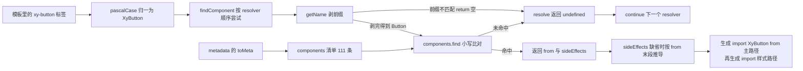
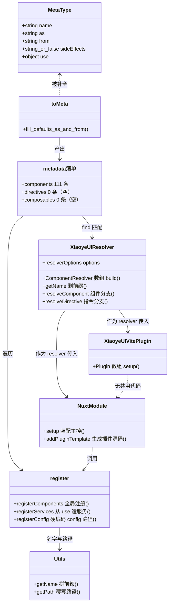
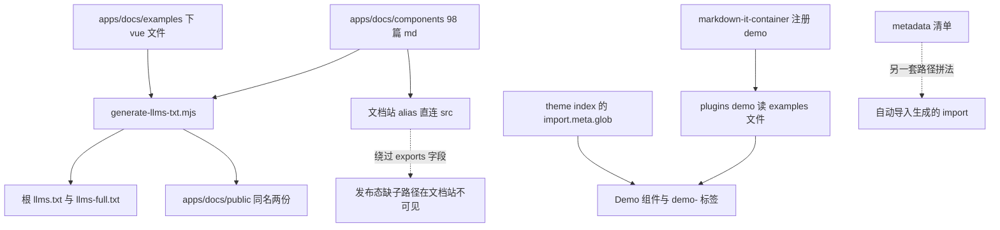

# A08 消费侧集成：自动导入、Nuxt 模块与文档生成链

> **本篇解决**：库外部的人到底怎么把 XiaoyeUI 装进自己的工程？`@xiaoye-ui/auto-import-resolver`、`@xiaoye-ui/vite-plugin`、`@xiaoye-ui/nuxt-module` 三条消费链各自实际生成了什么代码？`@xiaoye-ui/metadata` 那份清单里有多少条 `from` 指向不存在的路径、错的东西会不会真的进入用户的 bundle？`llms.txt` 和文档站的 demo 机制从哪取数据、为什么它们都不能替自动导入背书？
> **前置**：A01 monorepo 拓扑与发布链路、A02 组件目录契约与 `gen:entries` 生成物链路　**读者坐标**：`01-architecture` 第 8/8 篇（本层收口篇）
>
> 本篇只管**库外部的消费面**。包边界、src-first 双身份、`publishConfig.exports` 覆盖式生效、`@xiaoye-ui/core` 与主包 `peerDependencies.vue` 范围互相矛盾（`npm i --dry-run vue@4 xiaoye-ui` 报 ERESOLVE）都已在 A01 论证，本篇只引用不重复；三个生成物（`src/components.ts` / `typings/global.d.ts` / `exports` 表）的生成规则与"包根导出集合 vs 文档站集合"的差异归 A02，本篇只讲这些差异在消费侧的表现；图标包内部结构归 I15；`src/resolvers/` 五个校验适配层（`packages/xiaoye-ui/src/resolvers/`）与自动导入无关，归 I12，本篇不展开。

---

## 一、职责与边界

这条链负责四件事：把模板里的 `xy-` 标签翻译成 `import` 语句、把组件样式作为副作用一并引入、把同一份元数据在 Vite 与 Nuxt 两种装配模型下复用、把组件信息喂给文档站与 LLM 产物。

| 方向 | 对象 | 证据 |
| --- | --- | --- |
| 依赖（数据源） | `@xiaoye-ui/metadata` 的三份字符串清单 | `packages/auto-import-resolver/src/index.ts:1`、`packages/nuxt-module/src/register.ts:4` |
| 依赖（契约来源） | `unplugin-vue-components` 的 `ComponentResolver` 类型与运行时 | `packages/auto-import-resolver/src/index.ts:3`、`packages/vite-plugin/src/index.ts:2` |
| 被谁依赖 | `vite-plugin` 与 `nuxt-module` 各自 import resolver | `packages/vite-plugin/src/index.ts:1`、`packages/nuxt-module/src/module.ts:9` |
| 不负责 | 组件注册、样式生成、`exports` 表内容 | 生成物归 A02，Token 归 A03 |
| 明确未参与 | 本仓库文档站不使用 resolver | `apps/docs/.vitepress/config/index.ts:237-254` 未传 `resolvers` |

最后一行是本篇最重要的一条边界：**全仓库没有任何一处真实执行过这三条消费链**——文档站走全量注册（`apps/docs/.vitepress/theme/index.ts:29`），`nuxt-module` 的 playground 只用了两个无前缀标签（`packages/nuxt-module/playground/app.vue:3-12`），四个相关包的测试文件数为 0（实测 `find packages/metadata packages/auto-import-resolver packages/vite-plugin packages/nuxt-module -type f \( -name "*test*" -o -name "*spec*" \) -not -path "*/node_modules/*"` 返回空）。所以下文所有"会生成一条指向不存在模块的 import"的判断，都是**读源码 + 读已安装依赖的产物代码**得出的静态结论，不是跑出来的。

---

## 二、源码地图

| 文件 | 行数 | 职责 | 关键导出 |
| --- | --- | --- | --- |
| `packages/metadata/src/shared.ts` | 29 | `MetaType` 形状（含 2026-09-30 新增的 `exp` 具名导出格，`:10`）+ `as`/`from` 兜底推导（推导规则 2026-09-30 改成 kebab） | `MetaType`、`toMeta`（`:17`） |
| `packages/metadata/src/components/index.ts` | 166 | 13 个分组共 111 条组件条目 | `form`/`data`/`antd`… /`components`（`:152`） |
| `packages/metadata/src/directives/index.ts` | 16 | 0 条指令条目——2026-09-30 起整组清空（修前 6 条全是死引用） | `directives`（`:16`） |
| `packages/metadata/src/composables/index.ts` | 14 | 组合式函数清单——2026-09-30 起为空（三条全是虚构实现） | `composables`（`:12`） |
| `packages/auto-import-resolver/src/index.ts` | 70 | **主实现入口**：`ComponentResolver[]` | `XiaoyeUIResolver`（`:15`） |
| `packages/vite-plugin/src/index.ts` | 40 | resolver 的 Vite 包装 | `XiaoyeUIVitePlugin`（`:22`）、default（`:40`） |
| `packages/nuxt-module/src/module.ts` | 148 | Nuxt 装配主控 | default module（`:15`） |
| `packages/nuxt-module/src/register.ts` | 188 | 元数据 → 注册动作 + 模板片段 | `register`（`:162`） |
| `packages/nuxt-module/src/utils.ts` | 19 | 名字与路径的两个可覆写点 | `Utils.object`（`:6`） |
| `packages/nuxt-module/src/types.d.ts` | 47 | `ModuleOptions` 与 Nuxt 配置增强 | `ModuleOptions`（`:18`） |
| `packages/nuxt-module/src/runtime/plugin.server.ts` | 44 | SSR 首屏注入 `--xy-*` 变量 + 组件 CSS-in-JS 样式 | default nitro plugin（`:19`） |
| `packages/nuxt-module/src/runtime/style.server.ts` | 25 | 每请求一份 cssinjs cache，`app:rendered` 时提取样式交给 nitro | `defineNuxtPlugin`（`:11`），2026-09-30 新增 |
| `scripts/generate-llms-txt.mjs` | 252 | `llms.txt` / `llms-full.txt` 生成 | `main`（`:109`） |

文档站侧（`apps/docs/.vitepress/`）另有五个文件承担 demo 机制。其中 `config/index.ts` 与 `theme/index.ts` 的 basename 在仓库内不唯一，本篇对这五个文件统一用「第 N 行」的行文形式给出定位，读者可以直接按路径打开核对；引用校验器（`docs/column/tools/verify-refs.mjs:26-27` 的 `SKIP_DIR`）已不跳过 `.vitepress` 目录（注释明确「文档 legitimately 引用 apps/docs/.vitepress/** 下的文件」），全路径 + 行号的引用可以直接过校验。

| 文件 | 行数 | 职责 |
| --- | --- | --- |
| `apps/docs/.vitepress/config/index.ts` | 298 | alias 直连源码（第 222-235 行）、`:::demo` 容器注册（第 295 行） |
| `apps/docs/.vitepress/plugins/demo.ts` | 56 | `:::demo` → `<Demo>` + `<demo-...>` 标签，并现场做 TS→JS 转换 |
| `apps/docs/.vitepress/utils/ts2js.ts` | 28 | demo 的 TS→JS 源码转换 |
| `apps/docs/.vitepress/theme/index.ts` | 37 | demo 组件的实际注册点 |
| `apps/docs/.vitepress/vitepress/components/vp-demo.vue` | 273 | demo 卡片渲染 |

`unplugin-vue-components` 在本仓库同时存在三个大版本（实测 `node_modules/.pnpm` 下）：resolver 自己声明 `^0.27.0`（`packages/auto-import-resolver/package.json:23`）→ 装到 0.27.5；`apps/docs` 声明 `^28.4.1` → 28.8.0；`nuxt-module` 声明 `^32.0.0`（`packages/nuxt-module/package.json:75`）→ 32.1.0。本篇引用该依赖的产物代码时，标注版本号并按「第 N 行」行文。

---

## 三、架构与数据流

### 3.1 一个标签怎么变成两行 import



resolver 本身只返回一个对象，**把对象变成代码的是 `unplugin-vue-components`**。这一步决定了两个后续判断：其一，`packages/auto-import-resolver/src/index.ts:39-49` 的返回体里没有 `as`，而 `unplugin-vue-components@0.27.5` 的 `dist/chunk-Q6EJTKZN.js` 第 618-621 行写的是 `info = { as: name, ...normalizeComponentInfo(result) }`——`as` 先给默认值再被结果覆盖，结果里没有 `as` 就保留**模板里的 PascalCase 名**；其二，同一份产物的 `dist/chunk-4R6MYHM7.js` 第 65-73 行 `stringifyImport` 有四条分支：`info` 是字符串 → `import 'x'`；有 `as` 无 `name` → `import XyButton from '…'`（默认导入）；有 `as` 有 `name` → `import { Name as XyButton } from '…'`（具名导入）；无 `as` → 只有副作用导入。`32.1.0` 的 `dist/utils-BfjsfvcK.mjs` 第 126-131 行与 `dist/src-S1kwY0Q8.mjs` 第 515-518 行是同一套逻辑，所以这条契约跨三个大版本没有变。

于是流程图最后那一步的准确形状是：**resolver 决定了 import 的来源路径，模板标签决定了 import 的绑定名，而元数据里的 `as` 在组件这条路上一次都没被读过**。

### 3.2 消费侧模块关系



两个包装（`XiaoyeUIVitePlugin` 与 `NuxtModule`）在实现上**不共用任何代码**，只是都调同一个 `XiaoyeUIResolver`；Nuxt 侧另外长出一整套自己的注册路径（`register.ts`），与 resolver 并行生效。这就是 §论点 6 要说的问题根源：同一个 `<xy-button>` 在 Nuxt 下被两条独立机制各注册一次，而这两条机制读取的元数据字段集合不一样。

### 3.3 Nuxt 模块的装配顺序

```mermaid
sequenceDiagram
  participant Cfg as nuxt.config
  participant Mod as module.ts setup
  participant Reg as register.ts
  participant Kit as nuxt kit
  participant Upl as unplugin nuxt
  participant_tpl as 生成的插件源码

  Cfg->>Mod: 传入 xiaoyeUi 选项
  Mod->>Mod: 补 components 与 directives 默认值
  Mod->>Mod: exclude 默认 Editor 与 Chart
  Mod->>Reg: register 全量装配
  Reg->>Kit: addComponent 每个组件一次
  Reg->>Reg: registerServices 扫描 use.as 结尾 Service
  Reg-->>Mod: config components directives composables services
  Mod->>Kit: 写 runtimeConfig.public.xiaoyeUi
  Mod->>Kit: build.transpile 追加 xiaoye-ui
  Mod->>Upl: autoImport 为真时挂 Components
  Mod->>Kit: addTemplate 生成 xiaoye-ui-style 虚拟模块
  Mod->>Kit: addPlugin 挂 runtime plugin.client
  Mod->>Kit: addPluginTemplate 生成 xiaoye-ui-plugin
  Kit->>_tpl: 按 config services directives 拼 import 文本
  Mod->>Kit: nitro 钩子里 inline core 并推入 server plugin

```

顺序里有三处值得单独指出。第一，`register()` 在 `packages/nuxt-module/src/module.ts:55` 被调用，而它在内部就**已经产生了副作用**——`packages/nuxt-module/src/register.ts:76` 的 `addComponent` 与 `:115` 的 `addImports` 是直接对 Nuxt 生效的，不是返回数据给 `module.ts` 再做。第二，`module.ts:72` 的 `if (autoImport)` 只包住 `Components(...)`，包不住 `register()`，所以**关掉 `autoImport` 并不会关掉组件注册**。第三，插件源码是模板字符串现场拼的（`module.ts:111-131`），没有任何 AST 或模板引擎参与，元数据的 `from` 被原样插进引号里——`xiaoye-ui/xxx` 是否真的能解析，在生成时无人校验。

### 3.4 文档与 LLM 产物这一侧



这张图的重点是**两条链的取数源不同**：`llms.txt` 从文档目录取数（`scripts/generate-llms-txt.mjs:117-120` 遍历 `apps/docs/components/*.md`，`:122-133` 逐篇解析），自动导入从 `metadata` 取数（`packages/auto-import-resolver/src/index.ts:1`）。两者对同一个组件给出的 import 路径**拼法不一样**，而这正是 §论点 4 的落点。

---

## 四、核心机制精读

### 论点 1：resolver 与 `unplugin-vue-components` 的契约只有一条 `from`，元数据的 `as` 与 `use` 在组件分支被完整丢弃

`ComponentResolverObject` 的形状是 `{ type: 'component' | 'directive', resolve: (name) => ComponentResolveResult }`，而 `ComponentResolveResult = Awaitable<string | ComponentInfo | null | undefined | void>`，`ComponentInfo extends ImportInfo { as?, name?, from, sideEffects? }`（见 `packages/auto-import-resolver/src/index.ts:3` 引入的类型，以及 `unplugin-vue-components@0.27.5` 的 `dist/types.d.ts` 第 18-35 行）。本库的实现：

```ts
// packages/auto-import-resolver/src/index.ts:36
        if (cMeta) {
          return (
            options?.resolve?.(cMeta, 'component') ??
            ({
              from: cMeta.from,
              sideEffects:
                cMeta.sideEffects !== undefined
                  ? cMeta.sideEffects
                  : `xiaoye-ui/${cMeta.from.split('/').pop()?.toLowerCase()}/style`,
            } as ComponentResolveResult)
          );
        }
```

返回体的主体是 `from` 与 `sideEffects` 两个键（2026-09-30 起在 `:43` 条件展开了一个 `name`：`cMeta.exp` 存在时交给 unplugin 的 `ImportInfo.name`，只有子组件那批条目带 `exp`，见 §论点 4；没有 `exp` 的普通组件，返回体仍是下面这两键）。因此对组件而言：

- `MetaType.as`（`packages/metadata/src/shared.ts:3`，由 `:15` 的 `it.as ??= it?.name` 兜底填充）**从不被读**。全仓对 `.as` 的读取只有四处：`packages/auto-import-resolver/src/index.ts:66` 的指令分支，以及 `packages/nuxt-module/src/module.ts:116-118` 的模板拼接；而 Nuxt 侧 `packages/nuxt-module/src/register.ts:63` 又把 `as` 覆写回 `item.name`，等于对组件而言 `as` 与 `name` 恒等、`as` 这个字段没有信息量。
- `MetaType.use`（`packages/metadata/src/shared.ts:12-14`）**只有 Nuxt 读**（`packages/nuxt-module/src/register.ts:130-131`），resolver 完全忽略。它承载的是"这个组件需要一个 Service 插件才能工作"这条依赖信息，于是 Vite 用户自动导入 `<xy-popconfirm>` 之后，`ConfirmationService` 不会被装上——这条断言的下游后果见 §论点 7。
- 由于 `as` 缺省、`name` 也缺省，`stringifyImport` 走的是"有 `as` 无 `name`"分支，生成的是**默认导入**。默认导入要求 `from` 那个模块有 default 导出且那个 default 就是组件本体。

这最后一条把"子组件不可自动导入"变成了结构性问题：修前清单里 `RadioGroup` 的 `from` 是 `xiaoye-ui/radio/Group`，而 `packages/xiaoye-ui/src/radio/Group.tsx:43` 确实是 `export default defineComponent(...)`，所以形状对得上；但 `SplitterPanel`、`AvatarGroup`、`CardMeta`、`LayoutHeader` 这一类**只在父目录 index 里以具名导出存在**的子组件（例如 `packages/xiaoye-ui/src/splitter/index.ts:23` 的 `export { SplitterPanel }`），既没有独立的 `from` 路径，也没有 default 导出可拿。契约里没有 `name` 这一格给它们用，元数据模型也表达不了"从哪个模块拿哪个具名导出"——这是 §论点 4 那批失配条目里最难修的一类（2026-09-30 已用 `exp` 字格补上，见该论点末段）。

### 论点 2：`prefix` 是"剥掉后必须整名相等"，而且比较大小写敏感、不匹配时返回 undefined

```ts
// packages/auto-import-resolver/src/index.ts:16
  const getName = (name: string, prefix?: string) => {
    if (prefix) {
      if (!name.startsWith(prefix)) return;

      name = name.substring(prefix.length);
    }

    return name;
  };
```

三段行为要分开看。第 19 行的 `return` 是**空返回**：调用方 `:31` 拿到 `undefined`，`:33` 的 `cName?.toLocaleLowerCase()` 因可选链得到 `undefined`，于是 `c.name.toLocaleLowerCase() === undefined` 恒假，`find` 返回 `undefined`，`:36` 的 `if (cMeta)` 不进，`resolve` 走到函数末尾隐式返回 `undefined`。这正好是 `ComponentResolveResult` 允许的 `void`（`unplugin-vue-components@0.27.5` 的 `dist/chunk-Q6EJTKZN.js` 第 610 行据此 `continue` 到下一个 resolver），所以"不匹配"与"匹配不到"在外部表现上一致：标签不被解析，Vue 在运行时按未注册组件处理。

第二段是第 18 行的 `startsWith` **区分大小写**，而 `:33` 的比对又**不区分**大小写。这两段合起来定死了 `prefix` 只能写成 PascalCase 形式。`unplugin-vue-components` 传给 resolver 的是 `pascalCase(rawName)` 的结果（同一份 dist 第 295 行；其 `pascalCase` 即 `capitalize(camelCase(str))`，见该 dist 第 17-22 行），所以 `<xy-button>` 到达 resolver 时是 `XyButton`。于是：

- 不传 `prefix`（`packages/auto-import-resolver/src/index.ts:17` 的 `if (prefix)` 为假）→ `getName` 原样返回 `XyButton` → 清单里没有任何 `name` 小写后等于 `xybutton` → 不解析。
- 传文档里写的 `prefix: 'xy'` → `'XyButton'.startsWith('xy')` 为假 → 空返回 → 不解析。
- 传 `prefix: 'Xy'` → 剥成 `Button` → 命中。

而这两条错误的写法正是对外文档给出的。`apps/docs/guide/installation.md:88-90` 的配置片段写着"可选：自定义组件前缀，默认为 xy-"并在注释里示例 `prefix: 'xy'`，`:102` 紧接着展示 `<xy-button type="primary">`。按源码，默认值不是 `xy-` 而是**无前置要求**，且 `xy` 这个写法必然失配。`packages/xiaoye-ui/README.md:73-83` 更直接：`import XiaoyeUIResolver from '@xiaoye-ui/vite-plugin'` 之后写 `plugins: [vue(), XiaoyeUIResolver({ importStyle: true })]`，而 `packages/vite-plugin/src/index.ts:5-20` 的 `XiaoyeUIVitePluginOptions` 只有 `autoImport` 一个字段，**`importStyle` 未在源码中找到对应实现**；`:83` 的示例标签 `<XyButton>` 同样因为不传 prefix 而不会被解析。README 的 default 导入名本身不报错（`packages/vite-plugin/src/index.ts:40` 的 `export default XiaoyeUIVitePlugin` 只是局部别名），但整段配置照抄到用户工程里得到的是"自动导入不生效"——恰好对应 `apps/docs/guide/installation.md:193-195` 那条 FAQ，而 FAQ 给的排查建议是"检查是否正确配置了 `XiaoyeUIResolver`"，没有指出配置本身不自洽。

### 论点 3：样式有两条引入路径，缺省那条把 `from` 的末段当作目录名，显式那条可以指到任何地方包括不存在的路径

推导规则在 `packages/auto-import-resolver/src/index.ts:45-48`：取 `cMeta.from.split('/').pop()`、`toLowerCase()`，拼成 `xiaoye-ui/<末段>/style`。这条规则的正确性完全依赖"`from` 的最后一段恰好是主库的一个目录名"。它把 `from` 的语义同时当成了"模块路径"和"样式目录名"，两者耦合在一个字符串里。修前清单里 `RadioGroup` 写的是 `from: 'xiaoye-ui/radio/Group'`，末段是 `Group`，小写后 `group`——推导出的 `xiaoye-ui/group/style` 并不存在，所以该条目当年必须靠同一行的显式 `sideEffects: 'xiaoye-ui/radio/style'` 兜住（2026-09-30 起这条已改为 `from: 'xiaoye-ui/radio'` + `exp`，见论点 4）。反过来说，**`sideEffects` 缺省是一个默认值，而不是一个校验过的值**。

三条可判别的风险各有实例：

- `packages/metadata/src/components/index.ts:10` 的 `{ name: 'Dropdown', from: 'xiaoye-ui/dropdown', sideEffects: false }`。`MetaType.sideEffects` 允许 `false`（`packages/metadata/src/shared.ts:17`），`index.ts:46` 的 `!== undefined` 判定使 `false` 被原样返回，而 `stringifyComponentImport` 是 `if (sideEffects)` 才追加（`unplugin-vue-components@0.27.5` 的 `dist/chunk-4R6MYHM7.js` 第 91-92 行）——`false` 是假值，**样式一行都不会生成**。而 `xiaoye-ui/dropdown` 与 `xiaoye-ui/dropdown/style` 两个键都在 `exports` 里（`packages/xiaoye-ui/package.json` 的 `exports` 字段，`:96` 起），主库也有 `src/dropdown/style/index.ts`。所以自动导入 `<xy-dropdown>` 得到的是一个无样式的下拉。这条 `sideEffects: false` 至今仍是清单里唯一一个（其余显式值都改成了 `from`/`exp` 组合），我没有找到注释解释它为何存在。
- 修前 `packages/metadata/src/components/index.ts:171-190` 有四条 typography 条目的显式样式写作 `xiaoye-ui/typography/style/link` 这类形状。主库的构建入口扫描器对每个目录**只生成两个入口**：`<dir>` 与 `<dir>/style`（`packages/xiaoye-ui/scripts/source-entry.mjs:47-51`），`exports` 里也只有 `./typography` 与 `./typography/style` 两个键。`src/typography/style/` 实际只有 `index.tsx` 与 `mixins.tsx` 两个文件。因此那四条 `sideEffects` 在开发态和发布态都指向不存在的路径——2026-09-30 已随 `exp` 改造改成「父目录 `from` + 具名导出」（现 `packages/metadata/src/components/index.ts:143-146`），这条风险面已闭合。
- 数量面（修前口径，保留作方法论记录）：把 `sideEffects` 缺省条目按推导规则展开、显式条目按字面值，逐条对照 `packages/xiaoye-ui/package.json` 的 `exports` 键集（当时 222 个键，唯一通配是 `./es/locale/*`），并单独剔掉 `false` 那一条，得到 **87 条样式路径不在 `exports` 里**（83 条来自推导、4 条即上面 typography 那组显式写错）。绝大多数是 §论点 4 那批推导失配的连带结果。按同一口径对当前清单复跑：`from` 失配 0 条，`sideEffects` 缺省推导仅剩 2 条落空（`./auto-complete/style` 与 `./watermark/style` 不在 `exports` 的 202 个键里），`false` 那 1 条如上。

### 论点 4：`toMeta` 的兜底推导是整个自动导入面的单点故障，实测影响 82 条组件条目（2026-09-30 已改规则，失配从 87 降到 53）

```ts
// packages/metadata/src/shared.ts:17
export function toMeta(arr?: any[]): MetaType[] | undefined {
  return arr?.map(item => {
    const it = typeof item === 'string' ? { name: item } : item;

    it.as ??= it?.name;
    // 组件目录是 kebab-case（`auto-complete`、`color-picker`），而生成物的 `exports` 键
    // 逐个来自目录名；原先的 `toLowerCase()` 会得到 `autocomplete` 这种不存在的子入口，
    // 130 条裸名字里只有 52 条能命中，改成 kebab 后是 79 条。
    it.from ??= `xiaoye-ui/${it?.name?.replace(/([a-z0-9])([A-Z])/g, '$1-$2').toLowerCase()}`;

    return it;
  });
}
```

**修前**第 16 行的规则是**小写、不插连字符**（`it.from ??= \`xiaoye-ui/${it?.name?.toLowerCase()}\``）。而本库的目录名是 kebab-case：`src` 下 139 个目录里就有 `auto-complete`、`color-picker`、`date-picker`、`input-number`、`tree-select`、`split-button`、`data-table`、`focus-trap`、`key-filter`（`packages/xiaoye-ui/src` 目录实测）。清单里绝大多数条目只写了裸字符串名（修前 `packages/metadata/src/components/index.ts:5-20` 的 `form` 组 22 条里只有 2 条写了对象形式），因此**全部走推导**。

把修前的 151 条组件条目按 `:44` 与 `:40` 的规则展开、再逐条与 `exports` 键集比对，得到的分布是（脚本见 §附 检查点 1；下表与后续两段是 2026-09-30 修复前后的历史记录，行号按当时文件状态）：

| 分类 | 条数 | 说明 |
| --- | --- | --- |
| 组件条目总数 | 151 | 其中 143 条未写 `from`、走推导 |
| `from` 命中 `exports` | 64 | 目录名本就等于小写名（`button`、`select`、`tabs`…） |
| `from` 不在 `exports` | 87 | 82 条推导 + 5 条显式（`radio/Group` 与四条 typography） |
| 推导失配里：kebab 目录存在 | 29 | `autocomplete`→`auto-complete`、`datepicker`→`date-picker` 等纯拼写错配 |
| 推导失配里：标识符在别处存在 | 28 | `SplitterPanel`、`CardMeta`、`LayoutHeader`、`Column` 等子组件 |
| 推导失配里：全库找不到该标识符 | 25 | `TabList`、`TabPanels`、`Terminal`、`Dock`、`Menubar`、`NuxtEditor*` 等 |

**2026-09-30 改了推导规则之后的同一份口径重跑**（把 `:16` 的 `toLowerCase()` 换成 `kebab-case`，脚本与下面 §附 检查点 1 同形）：条目总数仍是 **151**，`from` 命中 `exports` 从 64 涨到 **98**，不在 `exports` 的从 87 降到 **53**，且这 53 条指向的目录**全部不存在**（不是拼写差，而是「子组件被当成独立目录登记」或「整条是虚构的」）。受益的 34 条就是表里「kebab 目录存在」那一类，包括把 Nuxt playground 直接炸掉的 `AutoComplete`→`xiaoye-ui/auto-complete`。**剩下的 53 条当天也被处理掉了**（见下一段的「当晚两步都做完」）：要点是补 `MetaType.exp` 而不是硬凑路径，因为 `from` 走的是默认导入。

**剩下的 53 条不在本轮修法内，而且修法本身要先改模型**（抽样核实，不是推测）：`toMeta` 产出的 `from` 会被 `module.ts:118` 拼成**默认导入**（`import X from '<from>'`），而这一类组件在库里是**父目录的具名导出**——`packages/xiaoye-ui/src/layout/index.ts:10-13` 的 `export const LayoutHeader/LayoutFooter/LayoutSider/LayoutContent` 就是四行常量再导出，`xiaoye-ui/layout` 的默认导出是 `Layout` 本身；同理 `packages/xiaoye-ui/src/tabs/index.ts:20` 只具名导出 `TabPane` 一个，而清单登记了 `Tab`/`TabList`/`TabPanels`/`TabPanel` **四个都不存在的名字**（`packages/metadata/src/components/index.ts:58-61`）。所以这 53 条要分两步走：① 给 `MetaType` 加一个「具名导出」的表达（unplugin 的 `ImportInfo` 里那一格叫 `name`，`addComponent` 那侧叫 `export`），把确实存在的子组件按父目录 + 名字重登记；② 另一类整条虚构的（`NuxtEditor*` 六条、`Dock`、`Menubar`、`TabMenu`、`TieredMenu`、`Terminal`、`Fluid`、`IconField`、`InputChips`/`InputGroup`/`InputGroupAddon`/`InputIcon`、`CircularSlider`、`TransferSortable`、`LazyContent`、`ConfirmDialog`、`DynamicDialog`）只能删或先落实现——它们在包根导出面 `packages/xiaoye-ui/src/components.ts` 里也查不到。**这条已登记成任务 #29；2026-09-30 当晚就把第一步做完了**，做法是给模型补上缺的那一格而不是硬凑路径：`MetaType` 新增 `exp`（`packages/metadata/src/shared.ts:10`，缺省才是「取 default」），Nuxt 侧把它交给 `addComponent({ export })`（`packages/nuxt-module/src/register.ts:73`），vite/webpack 侧由 resolver 把它交给 unplugin 的 `name` 字段（`packages/auto-import-resolver/src/index.ts:47`；unplugin 的 `ImportInfo` 形状是 `{ as?, name?, from }`，在 `node_modules/.pnpm/unplugin-vue-components@28.8.0*/node_modules/unplugin-vue-components/dist/` 的类型声明里，`name` 即「从模块里取什么名」、`as` 是「本地叫什么」）。27 条按这个改完（`RangePicker`、`InputGroup`、`SplitterPanel`、`AvatarGroup`、`AnchorLink`、`BadgeRibbon`、`Card{Grid,Meta}`、`DescriptionsItem`、`FloatButtonGroup`、`FormItem`、`ImagePreviewGroup`、`Layout{Content,Footer,Header,Sider}`、`ListItem`、`ListItemMeta`、`UploadDragger`，另有五条编辑器族条目已随组件在 2026-10-02 整体移除、不在清单里，加 `RadioGroup` 与四条 `Typography*` 的 from 顺手改对），四条 `Tab*` 直接改成唯一真实存在的 `TabPane`。防回归用的是新测试 `packages/xiaoye-ui/tests/metadata-entries.test.js`：它双向对赌一份 `KNOWN_BAD` 清单（**新增失配就失败，清单里的条目被修好也失败**，形状与 `ownership-pins.mjs` 的 pin 失效判据一致）。第二步把「整条虚构」那一类 25 条从清单里删掉（判据是它们在包根生成物 `src/components.ts` 里一条都搜不到：`Fluid`、`IconField`、`InputChips`、`InputGroupAddon`、`InputIcon`、`CircularSlider`、`Column`、`ColumnGroup`、`TransferSortable`、`LazyContent`、`ConfirmDialog`、`DynamicDialog`、`Dock`、`Menubar`、`TabMenu`、`TieredMenu`、`Terminal`、`NuxtEditor*` 六条、`CollapseItem`、`SpaceCompact`），并给 `Popconfirm` 摘掉 `use: { as: 'ConfirmationService' }` 标记（组件本身留着，服务不存在）。**两步做完后的实测**：`components` 失配 **53 → 0**、`directives` 6 → 0、`composables` 3 → 0，`KNOWN_BAD` 已清空为 `[]` 且测试两向皆绿；主库全量单测在删除之后复跑 158 文件 / 1365 用例绿。删完之后的一次 `pnpm typecheck` 复跑与 playground 的 `nuxi dev` 复跑还没做（本轮命令通道不可用），挂在 `OUTLINE.md` 的续跑清单上。也就是说 `from` 这一格现在**每一条都能落到真实子入口**，本篇可以把结论从「拒绝担保」改成「已闭合」。

最后一类的抽样核对（修前口径）：`TabPane` 是 `packages/xiaoye-ui/src/tabs/index.ts:20` 实际导出的名字，而清单当时写的是 `Tab`/`TabList`/`TabPanels`/`TabPanel` 四条，四个名字都不存在（现已改为唯一真实存在的 `TabPane`，见 `packages/metadata/src/components/index.ts:46-48`）；修前清单里还有六条 `NuxtEditor*`，在整个 `packages/xiaoye-ui/src` 里 `grep -rlw` 一条都搜不到，当时对应的两个编辑器目录已随组件在 2026-10-02 移除，这六条虚构条目也已从清单删除（现在的 `extensions` 组只剩 `Form` 一条，见 `packages/metadata/src/components/index.ts:94-98`）。

**这里要更正 A01 留下的一条成因归属。** `docs/column/01-architecture/01-monorepo-topology-拓扑与发布链路.md:250` 判断 `packages/metadata/src/directives/index.ts:5-10` 与 `packages/metadata/src/composables/index.ts:6-7` 那七条不存在的 `from` 是 `shared.ts:16` 推导规则的产物。逐行复核后：这七条**每一条都显式写了 `from`**（`packages/metadata/src/directives/index.ts:5`、`:7`、`:8`、`:9`、`:10` 与修前 `packages/metadata/src/composables/index.ts:6`、`:7`；那两条组合式函数条目连同 `:5` 的 `useXiaoyeUI` 已在 2026-09-30 整组删除，见下一段），`it.from ??=` 对它们不触发。也就是说它们不是推导出来的，而是**被人按同一套"小写不插连字符"的拼写手写了进去**。推导规则真正的受害者是那 82 条只写了名字的条目。两批问题的拼写约定相同、修法不同（前者改字符串值，后者要么补 `from` 要么改推导规则），但后果相同，且都落在 `from` 这一格上。

其中两条有真实目录只是拼写不同（`focustrap`→`focus-trap`、`keyfilter`→`key-filter`，`exports` 里 `./focus-trap`、`./key-filter` 都存在），另外五条（`badgedirective`、`styleclass`、`animateonscroll`、`useconfirm`、`usedialog`）在主库没有对应目录：`badge` 目录存在但它的指令不是独立子路径入口；`AnimateOnScroll`、`StyleClass`、`useConfirm`、`useDialog` 这些标识符在 `packages/xiaoye-ui/src` 下 `grep -rlw` 无结果——**未在源码中找到对应实现**。**2026-09-30 处置**：`packages/metadata/src/composables/index.ts` 的三条（`useXiaoyeUI`、`useConfirm`、`useDialog`）已整组删除，`composables` 现在是空数组（`:14`），因为生成的 Nuxt 插件会把它们逐条写成 `import { useConfirm } from 'xiaoye-ui/useconfirm'`，只要清单非空构建必挂；`directives` 那四条随后（同一批次）也整组清空——现在 `directives` 与 `composables` 一样是空清单（`packages/metadata/src/directives/index.ts:16`），机制分析见 §七 坑 5。

### 论点 5：`@xiaoye-ui/vite-plugin` 只是 resolver 的包装，没有任何 transform，且没有声明它真正 import 的那个依赖

```ts
// packages/vite-plugin/src/index.ts:22
export function XiaoyeUIVitePlugin(options: XiaoyeUIVitePluginOptions = {}): Plugin[] {
  const { autoImport = true } = options;
  const plugins: Plugin[] = [];

  if (autoImport) {
    const resolverOptions = typeof autoImport === 'object' ? autoImport : {};

    plugins.push(
      Components({
        dts: true,
        resolvers: [XiaoyeUIResolver(resolverOptions)],
      }) as unknown as Plugin,
    );
  }

  return plugins;
}
```

`setup` 里没有 `transform`、没有 `resolveId`、没有 `config` 钩子，`plugins` 数组最多一个元素（`:37`），`autoImport: false` 时返回**空数组**。`as unknown as Plugin` 这个双断言（`:33`）说明作者知道返回类型不是 `Plugin`——`Components()` 给的是 unplugin 自己的插件对象，与 `vite.Plugin` 结构兼容但名义不同。所以这个包对外提供的唯一增量，是把 `dts: true` 写死（`:31`）：`unplugin-vue-components` 会往工程里写 `components.d.ts`。这既是它的全部价值，也是它的一个不可关闭的副作用——`options` 类型（`packages/vite-plugin/src/index.ts:5-20`）没有暴露 `dts`，用户想禁用类型文件只能不用这个包、直接自己组 `Components()`。

真正的问题在依赖声明上。`:2` 写的是 `import Components from 'unplugin-vue-components/vite'`，但 `packages/vite-plugin/package.json:21-23` 的 `dependencies` 只有 `@xiaoye-ui/auto-import-resolver` 一项，既没有 `unplugin-vue-components` 也没有 peer 声明；而 `packages/vite-plugin/tsup.config.ts:10` 又把它列入 `external`，即**产物里保留裸 import、由消费者的 node_modules 提供解析**。`@xiaoye-ui/auto-import-resolver` 那边倒是声明了，但范围是 `^0.27.0`（`packages/auto-import-resolver/package.json:23`），与本仓库文档站的 `^28.4.1`、Nuxt 模块的 `^32.0.0` 互不相容——三个包各自锁一大版本，`^0.27.0` 那条约束对新消费者的 npm/yarn 安装还意味着：resolver 与用户项目里的 `unplugin-vue-components` 会装成两份实例。§3.1 已证 `ComponentResolveResult` 的形状在这三版里没变，所以今天是能跑的；这条链的安全完全建立在"上游不动这个返回体形状"之上。

### 论点 6：Nuxt 模块把同一份元数据同时喂给两条注册机制，而其中一条是无条件执行的

```ts
// packages/nuxt-module/src/register.ts:61
  return items
    .map((item: MetaType): MetaType | undefined => {
      const _item = { ...item, name: item.name, as: item.name, from: item.from };
      const name = Utils.object.getName(_item, options);
      if (!name) return undefined;
      const from = resolvePath({ name, as: _item.as, from: _item.from, type: 'component' });
      const opt = {
        export: 'default',
        name,
        filePath: from,
        global: true,
      };

      //!moduleOptions.autoImport && addComponent(opt);
      addComponent(opt);
```

第 71 行那条被注释掉的守卫原本是 `!moduleOptions.autoImport && addComponent(opt)`，第 72 行现在直接调用。后果是 `module.ts:72` 的 `if (autoImport)` 分支（`:77-88`）挂上 `Components({ resolvers: [XiaoyeUIResolver(...)] })` 之后，**组件同时被 unplugin 的模板改写和 Nuxt 的全局注册表各处理一次**。`:65` 还硬写了 `export: 'default'`，即 Nuxt 侧一律按默认导入取组件，这与 §论点 1 里 resolver 的实际行为一致，但也同样意味着子组件在 Nuxt 下也拿不到。

`registerComponents` 的返回值还会被 `module.ts:115-117` 的模板当字面量插进生成的插件源码：

```ts
// packages/nuxt-module/src/module.ts:115
        return `
import { defineNuxtPlugin, useRuntimeConfig } from '#imports';
${registered.config.map((config: MetaType) => `import ${config.as} from '${config.from}';`).join('\n')}
${registered.services.map((service: MetaType) => `import ${service.as} from '${service.from}';`).join('\n')}
${!autoImport && registered.directives.map((directive: MetaType) => `import ${directive.as} from '${directive.from}';`).join('\n')}
```

这里有两处值得钉住。第一，`config` 那一条来自 `register.ts:35-51` 的**硬编码** `from: 'xiaoye-ui/config'`（`:43`），而 `module.ts:126` 生成的是 `useXiaoyeUI && vueApp.use(XiaoyeUI, options)`。`xiaoye-ui/config` 的默认导出是 `{ defaultAlgorithm, darkAlgorithm }`（`packages/xiaoye-ui/src/config/index.ts:34-37`），**没有 `install` 方法**；真正带 `install` 的应用级插件在包根（`packages/xiaoye-ui/src/index.ts:16` 的 `export const install`、`:32-35` 的 `export default { version, install }`）。文档站用的正是后者（`apps/docs/.vitepress/theme/index.ts:4` 与 `:29`），能正常全量注册。两者对照可见 `registerConfig` 指错了模块：`useXiaoyeUI: true` 这条默认开启的路径拿到的不是一个可安装对象，`options` 也就无从生效。这一步的行为可以在已安装的 Vue 里核对：`node_modules/.pnpm/@vue+runtime-core@3.5.40/node_modules/@vue/runtime-core/dist/runtime-core.cjs.js` 第 4196-4204 行的 `use` 实现是"先查 `isFunction(plugin.install)`，否则若 plugin 本身是函数就当作 install，两者都不满足时 `warn` 一句 `A plugin must either be a function or an object with an "install" function.` 并直接返回"——即静默不安装，只在 dev build 打一条告警。同时 `xiaoye-ui/config` 也**不在 `exports` 的 222 个键里**（只有 `./config-provider`），而 `packages/nuxt-module/src/types.d.ts:1` 的 `import type { XiaoyeUIConfiguration } from 'xiaoye-ui/config'` 又建立在同一个路径上。

第二，第 117 行与 `:126` 用了 `${!autoImport && ...}`。`autoImport` 为 `true` 时这个表达式的值是布尔 `false`，模板字符串把它字面化成一行 `false`。作为独立表达式语句它是合法 JS，所以生成的插件不会报错——但它同时说明**指令只在 `autoImport: false` 时才被 `vueApp.directive()` 注册**（`:126`），`autoImport: true` 时指令完全交给 unplugin 的 directive resolver（`packages/auto-import-resolver/src/index.ts:54-71`）。指令的 `from` 又是 §论点 4 里那七条手写失配中的五条，于是 Nuxt 默认配置下所有指令都不可用：走 unplugin 时生成指向不存在模块的 import，走 `autoImport: false` 时同样生成不存在的 import。

`resolvePath` 是这条链上唯一的用户逃生门：`packages/nuxt-module/src/utils.ts:10-12` 的 `getPath` 只做 `isFunction(fn) ? fn(options) : options.from`，`options.type` 会带上 `config`/`component`/`directive`/`composable`/`service` 五种标签（`packages/nuxt-module/src/types.d.ts:33-38`）。也就是说用户想修 `xiaoye-ui/datepicker` 这类失配，只能在 nuxt.config 里传一个函数逐条改写；不传，就原样落进生成的代码。与之对称的是 `getName`（`packages/nuxt-module/src/utils.ts:7-9`）：`isFunction(options?.name) ? options.name(item) : \`${options.prefix}${item.name}\``，字符串模板是字面拼接，所以 Nuxt 侧传 `prefix: 'xy'` 会注册出 `xyButton` 这种标签名，而 `module.ts:30` 的默认前缀是 `''`，注册出的就是 `Button`——`packages/nuxt-module/playground/nuxt.config.ts:14-17` 和 `app.vue:12` 的 `<Button children="Show">` 正是这个默认值的产物。也就是说 Nuxt 模块的默认形态与本库"标签统一 `xy-` 前缀"的硬性规范（`AGENTS.md:677`、`.github/copilot-instructions.md:5`）是相反的。

### 论点 7：`loadStyles` 与 `services` 这两条对外承诺在实现上是空的或反的

`module.ts:91-101` 的 `styleContent` 按 `loadStyles` 分两支，但两支的数据都来自 `registered.injectStylesAsString` 与 `injectStylesAsStringToTop`，而前者恒为空数组：

```ts
// packages/nuxt-module/src/register.ts:147
function registerStyles() {
  // Styles are now imported automatically by the auto-import resolver
  // via xiaoye-ui/<component>/style/index.js (which loads the .less files).
  return [];
}

function registerInjectStylesAsString(): string[] {
  return [];
}
```

`:149-151` 直接 `return []`，注释（`:144-145`）声称样式改由 resolver 自动引入。于是 `module.ts:96` 的 `styles` 恒为空字符串，`loadStyles` 为真或为假在这个模板上产生等价结果——**这个选项在当前实现里不改变任何输出**。顺带一提注释里那句 `xiaoye-ui/<component>/style/index.js` 与 `packages/auto-import-resolver/src/index.ts:48` 的实际推导（`.../style`，不带 `index.js`）以及 `exports` 的键形状都不一致；主库也没有 `.less` 的按需入口，样式是 CSS-in-JS。

`styles` 在 SSR 侧被二次置空。`module.ts:144-145` 给 Nitro 注册的 virtual 直接返回 `export const styles = [], stylesToTop = [], themes = [];`，覆盖了 `module.ts:103-106` 用 `addTemplate` 写出的别名模块。`packages/nuxt-module/src/runtime/plugin.server.ts:27-31` 仍然把这三个值 push 进 `html.head`，只是 push 的是空串；而 `:153-160` 的 `registerInjectStylesAsStringToTop` 生成的 `@layer` 声明只进入了客户端模板，服务端的 virtual 里没有它。同文件第 37-39 行原本是一条 TODO（组件级 CSS-in-JS 样式尚未在 SSR 注入），**2026-09-30 已实现（机制有测试、端到端未跑通，见本节末）**：新增 app 侧插件 `runtime/style.server.ts` 在每次请求建立一份 cssinjs cache，`app:rendered` 时用 `extractStyle(cache)` 取出的 `<style data-css-hash=…>` 串写到 `event.context.xiaoyeUiSsrStyles`，nitro 侧 `plugin.server.ts:39-42` 读它并 push 进 `html.head`。所以 `apps/docs/guide/installation.md:142` 那句"加载组件样式 `loadStyles: true`"给出的预期，与实现的真实行为不一致。

`registerServices` 则是反向的：它无中生有。

```ts
// packages/nuxt-module/src/register.ts:126
function registerServices(resolvePath: any, registered: any) {
  const services: any = new Set<string>();

  registered?.components?.forEach((component: MetaType) => {
    if (component?.use?.as?.endsWith('Service')) {
      services.add(component.use.as);
    }
  });

  return [...services].map(service => ({
    name: service,
    as: service,
    from: resolvePath({
      name: service,
      as: service,
      from: `xiaoye-ui/${service.toLowerCase()}`,
      type: 'service',
    }),
  }));
}
```

触发源是修前清单里三条带 `use` 的条目（`ConfirmDialog`、`Popconfirm` → `ConfirmationService`；`DynamicDialog` → `DialogService`；2026-09-30 处置后清单里已没有任何 `use` 标记，两条虚构条目删除、`Popconfirm` 保留），`register.ts:145` 拼出 `xiaoye-ui/confirmation-service` 与 `xiaoye-ui/dialog-service`（2026-09-30 之前是不插连字符的 `xiaoye-ui/confirmationservice`/`dialogservice`——两种拼法都不存在，改规则只修掉了「目录确实存在」那 34 条，救不了这类整条虚构的条目），再被 `module.ts:117` 拼成 `import ConfirmationService from 'xiaoye-ui/confirmation-service';`、`:126` 拼成 `vueApp.use(ConfirmationService);`。而 `ConfirmationService` 与 `DialogService` 这两个标识符在 `packages/xiaoye-ui/src` 与 `packages/core/src` 下 `grep -rn` 一条都没有——**未在源码中找到对应实现**。所以修前默认配置的 Nuxt 装配会生成两条必然解析失败的 import，指向两个不存在的模块路径，也指向两个不存在的概念。注意修前那三条的 `use` 值连 `from` 都没写，`toMeta` 的 `:26` 于是给它们也推导出了 `xiaoye-ui/confirm-dialog`、`xiaoye-ui/popconfirm`、`xiaoye-ui/dynamic-dialog` 形式的 `from`（改规则之前是 `confirmdialog`/`dynamicdialog`）；其中 `xiaoye-ui/modal` 存在而 `xiaoye-ui/confirm-dialog` 不存在（`packages/xiaoye-ui/src/modal/ConfirmDialog.tsx` 是 `modal` 目录内的文件，不是子路径入口）。

`packages/nuxt-module/src/runtime/plugin.server.ts:2` 原有一处独立的断链（**2026-09-30 已修**）：它 `import { getThemeCssString } from '@xiaoye-ui/core/config'`，而当时 `packages/core/src/config/index.ts:1-3` 是一个三行占位模块，只导出 `useDesignToken` 与 `useTheme`；真正的 `getThemeCssString` 在 `packages/xiaoye-ui/src/config/index.ts`。修法是把变量表整体搬进 core（现在 `packages/core/src/config/index.ts:12-34`，两张表在 `:12` 与 `:22`、函数在 `:31`），组件包那侧改成一行转发（`packages/xiaoye-ui/src/config/index.ts:20`），这样 nitro 侧的具名导入成立、组件包也没有第二份真源；类型层同时补进 shim（`packages/nuxt-module/src/type-shims.d.ts:14`）。同日再补一刀：`xiaoye-ui/config` 这个子入口永远不会有（`config` 在 `gen-entries.mjs:34` 的 EXCLUDE_DIRS 里），所以按「包根导出三个名字」的口径把 `applyTheme`/`registerCssVariables`/`getThemeCssString` 与新增的 `XiaoyeUIConfiguration` 类型从 `packages/xiaoye-ui/src/index.ts:16-18` 导出，消费方（`packages/nuxt-module/src/types.d.ts:1`）改从 `xiaoye-ui` 取类型；包根导出面快照 `packages/xiaoye-ui/tests/__snapshots__/index.test.js.snap` 因此新增三行，且只有这三行。**还要更正本篇先前把 `Missing "./config"` 归给 composable 条目那句**：真正在构建里跑那行 import 的是 `register.ts:35-51` 的 `registerConfig`——它把 `XiaoyeUI` 的 `from` 写成 `xiaoye-ui/config`，被 `module.ts:117` 的模板渲染成 `import XiaoyeUI from 'xiaoye-ui/config';`，所以报错来自这一条（composables 那条是同源的第二个错，`Missing "./autocomplete"` 则来自 §论点 4 的推导）。2026-09-30 已把 `registerConfig` 的 `from` 改成 `xiaoye-ui`：包根的默认导出正是 `{ version, install }`，`vueApp.use(XiaoyeUI, options)` 要的就是它。实测证据：`npx nuxi dev` 的 nitro 阶段不再报 `"getThemeCssString" is not exported by core/src/config/index.ts`（修前必报，本次两条日志对比过），`pnpm typecheck` 全绿。仍未修的是这条链的**依赖声明**：`@xiaoye-ui/core` 既不在本包的 `dependencies`（`packages/nuxt-module/package.json:67-75`）里，也不在 `build.config.ts:33-49` 的 `externals` 里——`module.ts:140` 还得在 nitro 钩子里手工把它 inline 进去。补这条要改 `package.json` 并跑 `pnpm install` 动整仓锁文件，本轮没做，登记成待办；类型层那半已经补上（`type-shims.d.ts:14` 声明了 `getThemeCssString`），所以修前那句「类型层与实现层都不成立」按现状作废。

### 论点 8：文档站的 demo 与 `llms.txt` 都不替消费链背书，而文档站的 alias 恰好让上面所有问题在本地不可见

demo 机制的入口是 `apps/docs/.vitepress/config/index.ts:295` 一行 `md.use(markdownContainer, 'demo', createDemoContainer(md))`。容器渲染器（`apps/docs/.vitepress/plugins/demo.ts`）做四件事：用 `tokens[idx + 2]` 取容器内那行裸文本作为示例文件路径（第 27-29 行），按 `apps/docs/examples/<path>.vue` 从磁盘同步读文件（第 32 行），读不到就抛错（第 34 行），然后输出 `<Demo :sources=... path=... :raw-sources=...>` 开标签并在默认槽里放一个 `<demo-<path 以 - 连接>/>`（第 46-47 行）；TS→JS 的两份展示版本也在它体内经 `apps/docs/.vitepress/utils/ts2js.ts` 的 `sfcTs2js` 现场编译（demo.ts 第 35-40 行，`transpileModule` 在 ts2js.ts 的 `ts2Js` 内，第 17-28 行），空行靠先插 `// blankline` 再还原的方式保住（ts2js.ts 第 18、27 行）。真正让 `<demo-button-basic>` 有实现的是 `apps/docs/.vitepress/theme/index.ts:10` 的 `import.meta.glob('/examples/**/!(*index).vue', { eager: true })` 加第 18 行的 `demo-${component}-${demoFile}` 拼名，最后在第 33-35 行逐个 `app.component()` 全局注册。

文档站重构（2026-10-02，提交 `6395a54`）删掉了一个曾挂在配置里的失效插件（原 `apps/docs/.vitepress/plugins/` 下的 markdown 转换器，连同生成的 `apps/docs/components.d.ts` 一起删除）：它本想向组件 md 注入 `<script setup>`，但自己算出的根目录少了一层，`componentsDir` 指到不存在的目录，对任何 `.md` 都不产生输出，demo 的注册完全靠 `theme/index.ts` 那条 glob——一个从不生效的插件，删除是清理而不是行为变更。它留下的一处不一致仍在盘上：`theme/index.ts:9` 的注释写「demo.ts 使用 `xy-<comp>-<demo>` 格式来渲染组件」，而 `:18` 的生效实现拼的是 `demo-${component}-${demoFile}`——注释与实现各说各话，只有实现那条与"示例组件标签用 `demo-` 前缀"的规范（`AGENTS.md:729`、`.github/copilot-instructions.md:60`）一致。

文档站看不见发布态问题的机制在 `apps/docs/.vitepress/config/index.ts:225-228`：

```ts
// apps/docs/.vitepress/config/index.ts（第 225-228 行）
        // 把 monorepo 里的本地 xiaoye-ui 系列包强制指向源码（覆盖 npm 上的 5.x 旧版本）
        { find: /^xiaoye-ui\/package\.json$/, replacement: xiaoyeUiPkg },
        { find: /^xiaoye-ui$/, replacement: xiaoyeUiAlias },
        { find: /^xiaoye-ui\/(.+)$/, replacement: `${xiaoyeUiSrc}/$1` },
```

第 228 行那条正则把**任意** `xiaoye-ui/<任意串>` 直接映射到 `packages/xiaoye-ui/src/<任意串>`，完全绕过 `exports` 字段。于是 `xiaoye-ui/autocomplete`、`xiaoye-ui/confirmdialog`、`xiaoye-ui/config`、`xiaoye-ui/typography/style/link` 这些在 `exports` 里都不存在的键，只要在 `src` 下能凑出文件路径就能被解析——`xiaoye-ui/typography/style/link` 连文件都凑不出来（`src/typography/style/` 只有 `index.tsx` 和 `mixins.tsx`），但 `xiaoye-ui/radio/Group` 这类能凑出来的就会在文档站一切正常。第 225 行的注释还写明这条 alias 的目的是"覆盖 npm 上的 5.x 旧版本"，说明它是为了让文档站跑起来而加的，不是为了解析语义建模。加上 `:286-288` 的 `ssr.noExternal` 把 `xiaoye-ui` 与 `@xiaoye-ui` 全量内联，文档站从构建到运行都在一条与真实消费者不同的解析路径上。（同形状的第三例——playground `app.vue:17` 自己 import 深路径 `xiaoye-ui/notification/notification`——已在 2026-09-30 改成 `xiaoye-ui/notification`，见 §六。）

`llms.txt` 的取数与消费面也自成一套。数据源是 `apps/docs/components/*.md` 与 `apps/docs/examples/*/*.vue`（`scripts/generate-llms-txt.mjs:11-13` 定死三个目录，`:117-120` 遍历 md，`:29-38` 按目录名列 vue 文件），产物一次写四份（`:15-20` 定义，`:241-244` 写入：仓库根与 `apps/docs/public` 各一份 `llms.txt` 与 `llms-full.txt`）。它读的是文档而不是元数据，所以给 LLM 的 import 路径是 `importPath: \`xiaoye-ui/${name}\``（`:130`，`name` 来自 md 文件名即 kebab-case）——与 metadata 修前的 `xiaoye-ui/datepicker` 拼法相反；自动导入侧 2026-09-30 改成 kebab 推导并修完全部失配之后（§论点 4），两套拼法已经一致。此外 `:161-167` 的"按需引入组件"示例写的是 `import { Button } from 'xiaoye-ui'` 加 `import 'xiaoye-ui/button/style'`——第一行是包根入口，不是按需；`:183` 与 `:237` 还让 LLM 用 `registerComponent` 工具做全局注册，那是库内开发规范（`AGENTS.md` 的「组件注册规范」），不是消费侧 API。

新鲜度方面，`generate:llms`（根 `package.json:29`）没有被 `build`、`prebuild` 或任何 CI workflow 调用（实测 `grep -rn "generate:llms\|llms" .github/workflows/` 无结果），产物是 tracked 文件（`git ls-files` 命中 `llms.txt`、`llms-full.txt`、`apps/docs/public/` 两份），于是一个由 `pnpm build` 的 `prebuild` 只 `--check` 不改写的仓库（见 A01 §论点 10），对 `llms.txt` 却没有等价的守卫。实测差异（2026-10-02）：`apps/docs/components` 现有 98 篇 md，`llms.txt` 的组件目录是 108 条——`6395a54`（文档站重构，同日）随组件 md 重写再生过一次，但其后 10 个组件被移除、md 删除时没有重跑生成器，多出的 10 条全部指向已不存在的组件页。也就是说 LLM 拿到的组件目录**包含十个死条目，且没有任何机制会报错**。

最后是本篇范围内唯一一处"文档描述的对象根本不存在"。`apps/docs/guide/llm.md:18-24` 用一张表声明仓库根配置了四个 AI 规则文件，实测只有两个存在：`AGENTS.md`（759 行）与 `.github/copilot-instructions.md`（94 行）都在；`.cursorrules` 与 `claude.md` 都不存在，且不是漏建而是**被删除**——`git show --name-status 73ee55c` 显示 `D .cursorrules`、`D claude.md`，提交说明为「删除 AI/IDE 配置文件」。文档站第 20、23 行仍在向读者保证这两个文件可用。

---

## 五、对外契约如何生效

消费侧的"对外契约"有三层，生效机制各不相同，我把它们按**实际执行者**排：

**第一层是 `from` 字符串，执行者是打包器。** resolver 在 `packages/auto-import-resolver/src/index.ts:44` 把 `from` 原样交出去，unplugin 把它拼进 `import ... from '<from>'`（`unplugin-vue-components@0.27.5` 的 `dist/chunk-4R6MYHM7.js` 第 65-73 行），此后没有任何代码再看它一眼。真正裁决它是否成立的是 `packages/xiaoye-ui/package.json` 的 `exports`（`:96` 起 202 个键，唯一通配 `./es/locale/*` 见 `:610`）。这条链上**没有校验环节**：`toMeta` 只做拼接（`packages/metadata/src/shared.ts:26`），resolver 只做 `find` 与拼串，`registerServices` 也只做 `toLowerCase()` 拼接（`packages/nuxt-module/src/register.ts:145`），`module.ts:116-118` 是纯模板字符串。所以一个拼错的 `from` 会以完全一样的姿势穿过三层，直到用户的构建器报 module not found。这与 A01 §五 第 1 点描述的现象是同一个机制的两端：仓库内 `exports` 缺子路径看不见，是因为 alias 绕过了它；仓库外 `from` 拼错看不见，是因为**没有任何东西去解析它**。

**第二层是标签名，执行者有两个且规则不同。** Vite 路径上，标签名由 `unplugin-vue-components` 决定归一方式（`pascalCase`）、由 `prefix` 决定能否命中（`packages/auto-import-resolver/src/index.ts:16-24`），绑定名同样来自标签（`dist/chunk-Q6EJTKZN.js` 第 618-621 行的 `as: name` 默认值）。Nuxt 路径上，标签名由 `Utils.object.getName` 生成（`packages/nuxt-module/src/utils.ts:7-9`）并经 `addComponent` 注册（`packages/nuxt-module/src/register.ts:76`），默认前缀是空串（`module.ts:30`），注册出的是 `Button` 而非 `xy-button`。两条路对同一个 `prefix` 输入的处理不同：resolver 是 `startsWith` 剥前缀（区分大小写），`getName` 是模板拼接前缀（不改动大小写）。所以文档里 `prefix: 'xy'` 这一句在两条路上都不产生 `xy-button` 这个标签。

**第三层是类型面。** `typings/global.d.ts` 提供 `XYXxx` 全局组件声明（归 A02），自动导入路径另有 `dts`：Vite 插件把它写死为 `true`（`packages/vite-plugin/src/index.ts:31`），Nuxt 侧则是 `isNotEmpty(moduleOptions.components?.prefix) || isNotEmpty(moduleOptions.directives?.prefix)`（`packages/nuxt-module/src/module.ts:73-75`）——**前缀为空就不生成 dts**。而 `module.ts:30` 与 `:36` 的默认前缀正是空串，所以默认配置下 Nuxt 用户拿不到自动导入的类型文件，只拿到 `addComponent` 附带的组件类型；文档站的 `Components({ dts: false })`（`apps/docs/.vitepress/config/index.ts:256`）则显式关掉。`packages/nuxt-module/src/type-shims.d.ts:1-5` 手写 `declare module '#imports'` 来补 `defineNuxtPlugin`/`useRuntimeConfig` 的类型，说明这个包在 `typecheck` 时并不真的解析 Nuxt 的虚拟模块。

契约里显式覆写点的使用现状：`sideEffects` 现在只剩 `Dropdown` 那条 `false`（`packages/metadata/src/components/index.ts:10`）在用；「目录名与 from 末段不一致」的场景已改由 `exp` 字段接手（27 条「父目录 + 具名导出」，见 §论点 4），`MetaType.exp`（`packages/metadata/src/shared.ts:10`）是现在真正被利用的覆写格。但它同样没有校验，`:10` 那条 `false` 就落在门的另一边。

---

## 六、设计取舍

**为什么元数据长期只存一个字符串 `from`，而不是 `{ from, exportName }` 这种能表达具名导出的形状？** 当初的好处是绝大多数条目可以只写一个裸名（`packages/metadata/src/components/index.ts` 的 `button`、`file` 这类一行字符串数组），清单短、好读、`toMeta` 的兜底（`packages/metadata/src/shared.ts:21-26`）能自动补齐 `as` 与 `from`。代价是模型表达不了两类真实情况：一是"组件是父模块的具名导出"（`SplitterPanel`、`CardMeta`、`LayoutHeader` 那一类），二是"目录名不是名字的纯小写"（本库 139 个目录里 kebab-case 占多数）。修前那 82 条失配就是这份简化模型的账单，账单已在 2026-09-30 用最小改动还掉：`MetaType` 补了一个可选的 `exp` 格（`shared.ts:10`）而不是把全清单改成显式 `from` 枚举。另一个替代方案——让 `from` 与 `stylePath` 都从 A02 的生成物（`src/components.ts` 与 `exports` 表）反推——仍然没做，因为那会让 `metadata` 依赖主库构建产物，而 `build:packages` 现在把 `metadata` 排在主库之前（A01 §论点 2），依赖方向要一并调整；当前的折中是 `packages/xiaoye-ui/tests/metadata-entries.test.js` 用 `exports` 键集做双向对赌。

**为什么用一份 metadata 同时驱动 Vite 与 Nuxt，而不是各写一套？** 收益是新增组件只改一处（`packages/metadata/src/components/index.ts`）。代价在 §论点 6 里已经付出来了：两个装配模型的语义并不相同——unplugin 是"模板改写 + 默认导入"，Nuxt 是"全局注册 + `export: 'default'` 的组件描述符"（`packages/nuxt-module/src/register.ts:67-73`），一份扁平元数据只能取两者的交集，交集外的字段（`as`、`use`）在 Vite 路径上变成死数据，而 `use` 在 Nuxt 路径上被解释成"要去 import 一个 Service"，进而造出两个不存在的模块（`register.ts:126-145`）。换句话说，抽象不是免费的：它把一条信息（这个组件需要服务）翻译成了另一条不该存在的信息（有个叫 `xiaoye-ui/confirmationservice` 的模块）。带 `use` 的条目现已清空（`register.ts:130-149` 的收集机制还在，只是收集不到东西），但只要再往清单里写一条 `use`，同样的翻译会立刻重演。

**为什么 `resolvePath` 用函数覆写而不是清单修正？** `packages/nuxt-module/src/utils.ts:10-12` 的方案让库方不改元数据也能救自己，好处是升级模块不会覆盖用户补丁、粒度可到单条；坏处是错误路径变成每个 Nuxt 用户的私有知识，而 `apps/docs/guide/installation.md:137-144` 的 Nuxt 配置示例里连这个选项都没提。同理，`vite-plugin` 不提供任何 transform 是有意的：它的定位就是 `Components()` 的默认值集合（`packages/vite-plugin/src/index.ts:29-34`），换来 API 面极小，赔上的是 `dts` 无法关闭、`unplugin-vue-components` 依赖无法由它自己带进消费者的 node_modules（`packages/vite-plugin/package.json:21-23` 缺这一项而 `tsup.config.ts:10` 把它 external 掉）。

**为什么只出 ESM 的自动导入链不覆盖 SSR 样式？** 组件样式是 CSS-in-JS，靠 `hashId` 在渲染期生成（机制归 A04）；自动导入只能生成静态 `import '.../style'`，而 CSS-in-JS 的样式根本不在 `style` 入口里等谁 import。`register.ts:147-151` 那段注释正是把这两件事混为一谈的产物：它声称样式已由 resolver 通过 `xiaoye-ui/<component>/style/index.js` 引入，`plugin.server.ts:37-39` 那条 TODO 已在 2026-09-30 关闭（见上一节：`runtime/style.server.ts` + `event.context` + `html.head.push`）。这条链的取舍结果改成：样式自动引入在"客户端 + 全局 CSS 变量"这一半一直是有效的，"SSR 首屏组件样式"这一半**已经从「有实现但没跑通」变成端到端实测通过**——同一轮里先清掉了三批拦路石（`metadata` 的 `from` 失配、`registerConfig` 指向不存在的 `xiaoye-ui/config`、playground `app.vue` 自己 import 的深路径 `xiaoye-ui/notification/notification`），然后 `npx nuxi dev` 起服务、`curl http://localhost:3334/` 拿到 200 与 53159 字节 HTML，`<head>` 里**四个带 `data-css-hash` 的 `<style>`** 的内容分别命中 `.xy-panel`（5289 字符）、`.xy-btn`（23513 字符）、`.xy-wave` 与一条基础链接样式——正是 playground 里渲染的那两个组件；同一份 HTML 里还有 `id="xy-global-theme-variables"` 的变量表与 `data-theme="light"`，C4 那条 FOUC 修复也一并复验。跑通这一步需要 playground 侧的两处改动（都在 `packages/nuxt-module/playground/` 里）：`app.vue:17` 的 import 改成 `xiaoye-ui/notification`，以及 `nuxt.config.ts:9-11` 开 `experimental: { appManifest: false }`——后者与本仓代码无关，是本机环境里 Nuxt 内部虚拟模块 `#app-manifest` 解析失败，跳过它才能把 SSR 服务拉起来。机制侧的钉子仍在 `packages/xiaoye-ui/tests/cssinjs-ssr-extract.test.tsx` 三条（套 `StyleProvider` 能取到、不套取不到、把 cache 挂到 `app.config.globalProperties.__XYUI_CSSINJS_CACHE__` 就能接管——插件用的正是第三条），`pnpm typecheck` 全绿。对外文档（`apps/docs/guide/installation.md:142`）那句"加载组件样式 `loadStyles: true`"仍没有区分这两半。

---

## 七、坑与改动指南

1. **新增组件后只改 `metadata`，自动导入就生成一条指向不存在模块的 import。**
   触发：往 `packages/metadata/src/components/index.ts` 加一个目录名带连字符的裸字符串名（例如 `'ColorPicker'`）。
   症状：Vite 构建报 `Failed to resolve import "xiaoye-ui/colorpicker"`；Nuxt 报同一个路径；文档站与 `pnpm typecheck` 全绿。
   定位：`packages/metadata/src/shared.ts:26`（推导规则）、`packages/auto-import-resolver/src/index.ts:44` 与 `:48`（消费点）、`packages/nuxt-module/src/module.ts:115-117`（第二个消费点）。
   安全边界：改完必须**同时**核对 `packages/xiaoye-ui/package.json` 的 `exports` 键（`:96` 起），并且核对 `./<name>` 与 `./<name>/style` 两个键都在。验证命令见 §附 检查点 1。该路径无测试保护（四个相关包 0 个测试文件）。

2. **照文档写 `prefix: 'xy'`，自动导入静默不生效。**
   触发：按 `apps/docs/guide/installation.md:88-90` 或 `packages/xiaoye-ui/README.md:73-83` 配置。
   症状：模板里的 `xy-` 标签没有任何 import 生成，控制台只有 Vue 的"Failed to resolve component"，构建不报错。
   定位：`packages/auto-import-resolver/src/index.ts:18` 的大小写敏感 `startsWith`；上游归一见 `unplugin-vue-components@0.27.5` 的 `dist/chunk-4R6MYHM7.js` 第 17-22 行与第 295 行。
   修法二选一：传 `prefix: 'Xy'`（PascalCase），或在文档里改默认值说明。只改文档不改代码不构成修复——`packages/nuxt-module/src/utils.ts:8` 的前缀拼接是第三种语义。

3. **`llms.txt` 与文档不同步，且没有任何机制会告诉你。**
   触发：新增 `apps/docs/components/<x>.md` 后直接提交（反向同样成立：删除组件 md 而不重跑生成器，llms.txt 就保留死条目——2026-10-02 移除 10 个组件后，llms.txt 的 108 条目录里有 10 条指向已删除的组件页）。
   症状：LLM 与外部索引拿到的组件目录与文档站不一致；两个方向的漂移都实测发生过。
   定位：`scripts/generate-llms-txt.mjs:117-120`（取数）、`:241-244`（写四份产物）、根 `package.json:29`（唯一调用入口，无守卫）。
   改法：把 `pnpm generate:llms` 接进 `build:apps` 前置，或像 `check:entries` 那样加一个只校验新鲜度的脚本。**注意**：产物是 tracked 文件，任何"构建时自动生成"的选择都要先决定是保留 tracked 还是移出仓库；A01 §论点 10 记录的 `nuxt-module` 构建期改写 tracked `package.json` 就是同类问题的反面教材（一行引用，不重复论证）。

4. **给 `metadata` 加真 import 会把主库源码打进 metadata 产物。**
   `packages/metadata/tsup.config.ts:10` 的 `external: [/^@xiaoye-ui\//]` 不匹配裸名 `xiaoye-ui`。成因与后果见 A01 §论点 2（该结论本篇沿用，不重复验证）。这条对消费侧的直接含义是：**不能靠"让 metadata 从主库导入来校验路径拼写"来修 §论点 4**——那样做之前必须先把 `xiaoye-ui` 加进 external，并把 `metadata` 在 `build:packages` 里排到主库之后。

5. **Nuxt 项目里指令默认全不可用。**
   触发：`modules: ['@xiaoye-ui/nuxt-module']` 用默认配置，模板里写 `v-badge` 或 `v-keyfilter`。
   症状：模块解析失败，或指令装了但行为缺失。
   定位：修前 `packages/metadata/src/directives/index.ts:5`、`:7`、`:8`、`:9`、`:10` 五条手写 `from` 全部指向不存在的路径；默认配置下走 unplugin 的 directive 分支（`packages/auto-import-resolver/src/index.ts:54-72`），`autoImport: false` 时走 `packages/nuxt-module/src/module.ts:118` 与 `:127`，两条都用同一个 `from`。**2026-09-30 的处置是整组清空**（`directives/index.ts:16` 现在是 `toMeta([])`），判据不是「拼写改不对」而是「本库没有任何指令」：`grep -rn "directive(\|Directive =\|type Directive" packages/xiaoye-ui/src` 零命中、包根生成物 `components.ts` 里 `grep -in directive` 零命中，而 `focus-trap`/`key-filter`/`badge`/`tooltip` 四个目录的入口都是组件而非指令对象。要做指令得先落实现。
   注意 `packages/nuxt-module/playground/nuxt.config.ts:19-22` 用 `directives.exclude: '*'` 把指令全排除了——模块自带的 playground 恰好绕开了这个故障，因此它不构成回归保护。

6. **（2026-09-30 已修）默认配置的 Nuxt 装配必然生成两条指向不存在服务的 import。**
   触发：不改 `metadata` 的 `use` 条目、直接构建。
   症状：`xiaoye-ui/confirmationservice` 与 `xiaoye-ui/dialogservice` module not found；若被 `resolvePath` 拦下则变成 `vueApp.use(undefined)`。
   定位：`packages/nuxt-module/src/register.ts:130` 的 `endsWith('Service')` 判据、`:141` 的 `toLowerCase()` 拼接、修前清单里三条带 `use` 的条目（`packages/metadata/src/components/index.ts` 的 overlay 组，2026-09-30 已删除或摘除标记）、`packages/nuxt-module/src/module.ts:117` 与 `:126` 的两个生成点。
   修法与判据：三条 `use` 标记连同两条虚构条目一起在 §论点 4 的第二步删掉（`ConfirmationService`/`DialogService` 全库零命中，判据 `grep -rn "ConfirmationService" packages/xiaoye-ui/src packages/core/src` 空），于是 `registerServices` 收集到空集合、模板里那两行不再生成；防回归由 `packages/xiaoye-ui/tests/metadata-entries.test.js` 的第一断言承担（清单必须为空）。
   该分支无测试保护（本包无测试文件，`packages/nuxt-module/package.json` 的 `test: vitest run` 无可执行对象）。

7. **`@xiaoye-ui/vite-plugin` 在严格安装布局下缺依赖。**
   触发：新工程只装 `@xiaoye-ui/vite-plugin`，用 pnpm 默认布局（不 hoist）。
   症状：`Cannot find package 'unplugin-vue-components'`。
   定位：`packages/vite-plugin/src/index.ts:2` 的 import、`packages/vite-plugin/package.json:21-23` 缺声明、`packages/vite-plugin/tsup.config.ts:10` 强制 external。
   修法：把 `unplugin-vue-components` 声明为 `peerDependencies`（并在 `apps/docs/guide/installation.md:73` 那条 `pnpm add -D` 命令里保持同步）。改之前先决定它对齐哪个大版本——resolver 现在钉的是 `^0.27.0`（`packages/auto-import-resolver/package.json:23`），而本仓库另一处在用 32.x。

**改动本篇范围的安全边界。** 可以改的：`packages/metadata/src/**/*.ts` 的清单内容、`packages/auto-import-resolver/src/index.ts` 的匹配与推导规则、`packages/nuxt-module/src/register.ts` 的三段模板。不可以顺手改的：`packages/xiaoye-ui/package.json` 的 `exports`（生成物，归 A02，必须走 `pnpm gen:entries`，见 `AGENTS.md:755`）。改完必须跑的验证只有两条现在有意义：`pnpm typecheck`（它只检查这四个包自身的类型，不会去解析 `from` 字符串——**所以它对 §论点 4 的整类问题完全无感**）和 §附 的三个脚本。真正能证伪的验证必须发生在仓库外：在一个干净的 vite/nuxt 工程里按 §附 检查点 2 的命令实测标签解析。

---

## 附：本篇可证伪的三个检查点

1. **数一遍 `metadata` 里有多少条 `from` 不在 `exports`**（本篇 §论点 4 那张表的来源；只读，不写任何文件）：

   ```bash
   node --input-type=module -e "
   import {readFileSync,readdirSync} from 'node:fs';
   const pkg=JSON.parse(readFileSync('packages/xiaoye-ui/package.json','utf8'));
   const ex=new Set(Object.keys(pkg.exports));
   const dirs=new Set(readdirSync('packages/xiaoye-ui/src'));
   const kebab=n=>n.replace(/([a-z0-9])([A-Z])/g,'\$1-\$2').toLowerCase();
   const text=readFileSync('packages/metadata/src/components/index.ts','utf8');
   const names=[];
   for(const m of text.matchAll(/'([A-Z]\w+)'/g)) names.push(m[1]);
   const uniq=[...new Set(names)];
   const bad=uniq.filter(n=>!ex.has('./'+n.toLowerCase()));
   console.log('exports 键数='+ex.size, '唯一名='+uniq.length);
   console.log('小写名不在 exports:', bad.length);
   console.log('  kebab 目录存在（拼写错配）:', bad.filter(n=>dirs.has(kebab(n))).length);
   console.log('  kebab 目录也不存在:', bad.filter(n=>!dirs.has(kebab(n))).length);
   console.log('通配键='+JSON.stringify([...ex].filter(k=>k.includes('*'))));"
   ```

   实测输出（2026-10-02）：`exports 键数=202 唯一名=111`、`小写名不在 exports: 49`、其中 kebab 存在 23、kebab 不存在 26，通配键 `["./es/locale/*"]`。这组数字与 §论点 4 的表格**口径不同**，不要混用：本脚本按"名字集合去重后逐项取 `./<小写名>`"计，因此（a）把显式写了 `from` 的对象条目仍按其 `name` 判（于是 `RadioGroup`、`ProgressBar`、四条 `Typography*` 等带 `exp`/显式 `from` 的条目各计一次失配，而它们实际使用的 `from` 是父目录、是有效的），（b）条目级重复（同名出现在两个分组）被合并。按 §论点 4 的 from/sideEffects 口径对当前清单复跑：111 条中 **0** 条 `from` 不在 `exports`（sideEffects 口径另有 2 条缺省推导落空与 1 条显式 `false`，见 §论点 3）。若哪天这份输出里"kebab 不存在"一档明显变大，说明清单里混进了指不到真实子入口的新条目，本篇 §论点 4 的「已闭合」结论需要重开。

2. **判别 `prefix` 的大小写失配**（不需要起构建，纯逻辑复现 `getName` 与 `pascalCase` 两行）：

   ```bash
   node -e "
   const pascalCase=s=>s.replace(/-(\w)/g,(_,c)=>c.toUpperCase()).replace(/^./,c=>c.toUpperCase());
   const getName=(name,prefix)=>{ if(prefix){ if(!name.startsWith(prefix)) return; name=name.substring(prefix.length);} return name; };
   const tag='xy-button', meta=['Button'];
   for(const p of [undefined,'xy','Xy']){
     const n=pascalCase(tag), c=getName(n,p);
     console.log('prefix='+JSON.stringify(p), 'pascalCase='+n, 'getName='+JSON.stringify(c),
       '命中='+!!meta.find(m=>m.toLowerCase()===String(c).toLowerCase()));
   }"
   ```

   期望：`undefined` 与 `'xy'` 都打印 `命中=false`，只有 `'Xy'` 为 `true`。这三行分别对应 §论点 2 的三种写法。

3. **确认 `llms.txt` 与文档站已漂移，以及 `.cursorrules`/`claude.md` 是被删除而非漏建**：

   ```bash
   ls apps/docs/components/*.md | wc -l
   grep -c '^- \[' llms.txt
   git ls-files | grep -E 'AGENTS\.md|copilot-instructions|cursorrules|claude\.md'
   git show --name-status 73ee55c | grep -iE 'cursorrules|claude'
   grep -rn "generate:llms" .github/workflows package.json
   ```

   期望依次：`98`、`108`（llms.txt 比 md 多 10 条，多出的都是 2026-10-02 移除的组件——删除 md 时没有重跑生成器）、只有 `AGENTS.md` 与 `.github/copilot-instructions.md` 两行、`D .cursorrules` 与 `D claude.md`、workflows 目录无命中（只有 `package.json:29` 一条）。要彻底证明"CI 不生成"需要看 Actions 运行记录，本地只能证到"没有任何 workflow 调用该脚本"。
