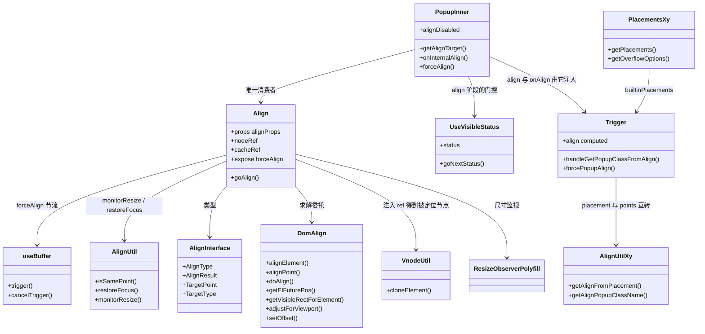
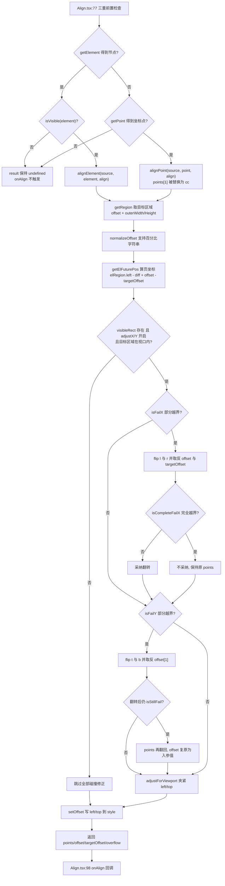
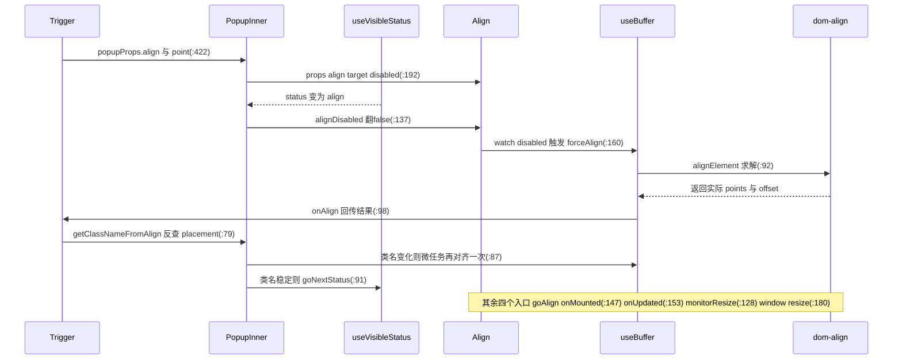
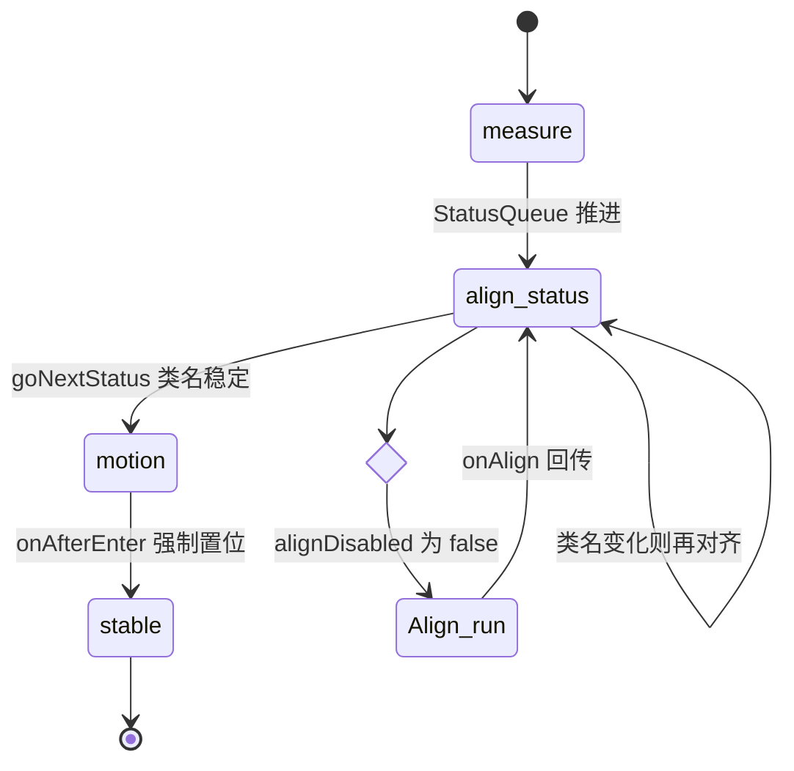

# I01 vc-align 定位求解与碰撞检测

> **本篇解决**：`points: ['tl','bl']` 这种两字符编码是怎么变成 `style.left/top` 两个数字的；浮层放不下时「先翻转还是先挪动」由哪几行决定；为什么滚动页面时浮层不跟手；以及为什么这个模块 370 行却没有一行求解算法。
> **前置**：A07（交互基础设施总览：一个浮层是怎么拼起来的）　**读者坐标**：`02-infrastructure` 第 1/16 篇
> 主题边界（按 `OUTLINE.md` I01 行）：A07 只给浮层的调用序列，本篇给**算法与坐标推导**。浮层横向链路、trigger 的受控开合与 `zIndex` 编排分别归 A07 / I02 / I10，本篇只在接缝处一行引用，不重述。

---

## 一、职责与边界

`vc-align/` 是浮层定位的**适配层**，不是定位引擎。它做且只做四件事：

1. 把「参照物」解析成两种形态之一——一个可测量的 DOM 节点，或一个 `{pageX, pageY}` / `{clientX, clientY}` 坐标点（`packages/xiaoye-ui/src/vc-align/Align.tsx:51`、`packages/xiaoye-ui/src/vc-align/Align.tsx:56`）。
2. 把这两者连同 `align` 描述对象原样交给外部求解器 `dom-align`，拿回一个「实际采用的 align 结果」（`packages/xiaoye-ui/src/vc-align/Align.tsx:92`、`packages/xiaoye-ui/src/vc-align/Align.tsx:94`）。
3. 决定**什么时候该重新求解**：挂载后、每次更新后、目标或被定位元素尺寸变化时、窗口 resize 时、`disabled` 翻转时（`packages/xiaoye-ui/src/vc-align/Align.tsx:147`、`packages/xiaoye-ui/src/vc-align/Align.tsx:153`、`packages/xiaoye-ui/src/vc-align/Align.tsx:160`、`packages/xiaoye-ui/src/vc-align/Align.tsx:175`、`packages/xiaoye-ui/src/vc-align/util.ts:31`）。
4. 把重求解做成**可节流的单入口**，并把结果回吐给调用方（`packages/xiaoye-ui/src/vc-align/hooks/useBuffer.tsx:11`、`packages/xiaoye-ui/src/vc-align/Align.tsx:98`）。

明确**不负责**：

- 坐标计算、锚点语义、翻转与挪动的判定 —— 全在 npm 包 `dom-align` 内（`packages/xiaoye-ui/package.json:63` 声明 `^1.12.0`，`packages/xiaoye-ui/src/vc-align/Align.tsx:12` 导入）。本篇凡涉及该包内部实现，一律给**函数名 + 可复现取源命令**（§附 检查点 3），不给 `file:line`，因为它不在版本控制里。
- 「谁该被定位」的业务决策（trigger 的受控/非受控开合、pending 状态机）→ I02；`zIndex` 的分配 → I10；浮层横向调用序列 → A07（交互基础设施总览：一个浮层是怎么拼起来的）。
- 箭头形状与箭头位移 —— 由 CSS 承担，见 `packages/xiaoye-ui/src/style/placementArrow.ts:87`，本篇只交代它与 `points` 的接缝。
- 自身不产生任何 CSS 类、没有 `style/index.ts`、不在包的 `exports` 面里（`packages/xiaoye-ui/package.json` 的 222 个导出键中不含 `./vc-align`），是纯内部件。

依赖清单（实测）：

| 方向 | 对象 | 证据 |
| --- | --- | --- |
| 被依赖 | `PopupInner` 是**唯一**运行时消费者（组件级），另有 2 处仅导入类型 | `packages/xiaoye-ui/src/vc-trigger/Popup/PopupInner.tsx:15`、`packages/xiaoye-ui/src/vc-picker/PickerTrigger.tsx:2` |
| 被依赖 | 间接覆盖 tooltip / popover / dropdown / menu / select / cascader / date-picker / tour 全部浮层 | `packages/xiaoye-ui/src/vc-trigger/Popup/index.tsx:45` |
| 依赖 | `dom-align` 的 `alignElement` / `alignPoint` | `packages/xiaoye-ui/src/vc-align/Align.tsx:12` |
| 依赖 | `resize-observer-polyfill`（直接用 polyfill，不用原生 `ResizeObserver`） | `packages/xiaoye-ui/src/vc-align/util.ts:3` |
| 依赖 | `vc-util/Dom` 的 `addEventListener` / `isVisible` / `contains` | `packages/xiaoye-ui/src/vc-align/Align.tsx:13`、`packages/xiaoye-ui/src/vc-align/Align.tsx:15`、`packages/xiaoye-ui/src/vc-align/util.ts:1` |
| 依赖 | `_util/vnode` 的 `cloneElement`（把 ref 注入插槽根节点） | `packages/xiaoye-ui/src/vc-align/Align.tsx:14`、`packages/xiaoye-ui/src/_util/vnode.ts:9` |
| 依赖 | `lodash-es/isEqual`（深比较 `align` 是否真的变了） | `packages/xiaoye-ui/src/vc-align/Align.tsx:20`、`packages/xiaoye-ui/src/vc-align/Align.tsx:134` |

对照一条常见误解：Modal 不走这条链路（居中容器不是 anchor 浮层），该结论在 C07-01 里已经论证，本篇不再展开。

---

## 二、源码地图

`vc-align/` 共 5 个文件、370 行。建图命令（本篇所有规模数字都出自它）：

```bash
find packages/xiaoye-ui/src/vc-align -type f | xargs wc -l | sort -n
```

| 文件 | 行数 | 职责 | 关键导出 |
| --- | --- | --- | --- |
| `vc-align/index.ts` | 3 | 默认导出透传，注释标明血统「based on rc-align 4.0.9」 | `Align`（`:2`） |
| `vc-align/interface.ts` | 60 | `AlignType` / `AlignResult` / `TargetPoint` / `TargetType` 的类型面 | `AlignType`（`:4`）、`AlignResult`（`:43`） |
| `vc-align/util.ts` | 60 | 坐标点等价判定、焦点复原、尺寸监视 | `isSamePoint`（`:5`）、`restoreFocus`（`:20`）、`monitorResize`（`:31`） |
| `vc-align/hooks/useBuffer.tsx` | 39 | 前缘执行 + 后缘补一次的节流器 | 默认导出 `[trigger, cancel]`（`:32`） |
| `vc-align/Align.tsx` | 208 | 主实现：props、求解调用、四类触发、渲染期注入 ref | 默认导出组件（`:61`）、`RefAlign`（`:47`） |

主实现入口：`packages/xiaoye-ui/src/vc-align/Align.tsx:66`（`setup`）。求解调用点：`packages/xiaoye-ui/src/vc-align/Align.tsx:92`。

外部求解器（不在仓库内，不能引 `file:line`）：

| 模块 | 位置 | 职责 |
| --- | --- | --- |
| `alignElement` | `dom-align@1.12.4` 包内 `align/alignElement.js` | 取目标区域、判目标可见、转交 `doAlign` |
| `doAlign` | 同包 `align/align.js` | 锚点解析、翻转、挪动、写样式、返回结果 |
| `getElFuturePos` / `getAlignOffset` | 同包 `getElFuturePos.js` / `getAlignOffset.js` | 两字符锚点 → 页坐标 |
| `getVisibleRectForElement` | 同包 `getVisibleRectForElement.js` | 沿 `offsetParent` 上溯求可视矩形 |
| `adjustForViewport` | 同包 `adjustForViewport.js` | 翻转后仍越界时的夹紧 |
| `utils.setOffset` | 同包 `utils.js` | `ignoreShake` / `useCssRight` / `useCssTransform` 三条落地分支 |

上游血统标注：`index.ts:1` 的注释说明本组件按 rc-align 4.0.9 的接口重写；`dom-align` 的作者与仓库地址在 `packages/xiaoye-ui/src/tooltip/Tooltip.tsx:29` 的注释里也被引用。**这些是上游实现，不是本库自研**，下文描述其行为时均指该 npm 包当前锁定的 1.12.4。

---

## 三、架构与数据流

### 3.1 模块关系：适配层与求解器的职责切分



读图要点：箭头方向就是「谁调用谁」。这张图里最重要的事实是**只有一条边通向 `DomAlign`**（`packages/xiaoye-ui/src/vc-align/Align.tsx:12`），因此本模块能被替换的前提是保持 `alignElement(source, element, align)` 与 `alignPoint(source, point, align)` 两个签名和返回结构（`packages/xiaoye-ui/src/vc-align/Align.tsx:92`、`packages/xiaoye-ui/src/vc-align/Align.tsx:94`、`packages/xiaoye-ui/src/vc-align/interface.ts:43`）。第二条关键事实：`PlacementsXy`（`packages/xiaoye-ui/src/_util/placements.ts:38`）产出的是**数据**，`AlignUtilXy`（`packages/xiaoye-ui/src/vc-trigger/utils/alignUtil.ts:10`）做的是**双向映射**（placement 名 ↔ `points`），它们都在 `Align` 之外，所以「改 placements 表」与「改求解算法」是两条互不影响的风险面。

### 3.2 一次求解的内部流程与碰撞决策



（节点超过 18 个的风险已用拆图规避：`Align.tsx` 侧的门禁与状态机在 §3.4 单独画。）

读图要点：这张图有三处「非直觉」的分支，必须在改代码前知道。

- 第一处是 `Z`：`Align.tsx:91` 的判据是 `element && isVisible(element)`，**目标存在但不可见时不会走 `alignPoint` 兜底**（`else if` 在 `packages/xiaoye-ui/src/vc-align/Align.tsx:93`），于是 `result` 为 `undefined`、`Align.tsx:98` 的 `onAlign` 不触发。这不是「定位失败」而是「定位根本没发生」，症状完全不同（§七 坑 4）。
- 第二处是 `J`：整套碰撞修正的前提是三个条件同时成立，其中「目标区域在视口内」来自 `alignElement` 里的 `isOutOfVisibleRect(target)`（本仓库无行号可引，见 §附 检查点 3），意思是**目标已经滚出可视区时，浮层不再做任何翻转与挪动**，直接按原始 `points` 落地。
- 第三处是 `Q2 → O`：X 方向「翻转后仍完全越界」时不采纳翻转，但流程**继续**进 Y 方向判定，两个轴互相独立；而 `S` 那条「翻回 + 复原 offset」的路径是求解器里最容易被误读的一段（论点 3 逐行拆）。

### 3.3 重定位触发链：五个入口，没有 scroll



读图要点：把这张图和 §3.2 对照可以看出**求解是被动的**——`Align` 从不自己轮询。五个入口的分工是：`onMounted` / `onUpdated` 负责「数据变了重算」（`packages/xiaoye-ui/src/vc-align/Align.tsx:147`、`packages/xiaoye-ui/src/vc-align/Align.tsx:153`），`monitorResize` 负责「尺寸变了重算」（`packages/xiaoye-ui/src/vc-align/Align.tsx:128`、`packages/xiaoye-ui/src/vc-align/Align.tsx:142`），`window` 的 `resize` 负责「视口变了重算」（`packages/xiaoye-ui/src/vc-align/Align.tsx:180`），`disabled` 的 watch 负责「被允许时立刻算」（`packages/xiaoye-ui/src/vc-align/Align.tsx:160`）。**没有任何一处监听 `scroll`**：整条链路里唯一的 `scroll` 监听在 `packages/xiaoye-ui/src/vc-trigger/Trigger.tsx:168`，用途是「右键菜单浮层在文档滚动时关闭」，不是重定位（复现命令见 §附 检查点 2）。这就是「滚动时浮层不跟手」的直接原因，是否算缺陷要看 §六 的取舍。

`raf` 合并**不在** align 这一侧，而在状态机：`packages/xiaoye-ui/src/vc-trigger/Popup/useVisibleStatus.ts:40` 与 `:78` 用 `raf` 推进状态；align 侧的节流是 `useBuffer` 的 `setTimeout`（`packages/xiaoye-ui/src/vc-align/hooks/useBuffer.tsx:20`），ResizeObserver 回调前还额外垫了一层微任务 `Promise.resolve().then`（`packages/xiaoye-ui/src/vc-align/util.ts:43`）以规避「在观察回调里改布局」的循环告警。

### 3.4 谁决定「现在可以定位」：状态机与 disabled 门



读图要点：`PopupStatus` 的队列只有四格 `['measure','align',null,'motion']`（`packages/xiaoye-ui/src/vc-trigger/Popup/useVisibleStatus.ts:19`），类型里却写了 `aligned`（`packages/xiaoye-ui/src/vc-trigger/Popup/useVisibleStatus.ts:15`）——那个值**永远不会出现**，因为推进逻辑只认队列里的下一格。真正的「二次对齐」不走队列，而是在 `packages/xiaoye-ui/src/vc-trigger/Popup/PopupInner.tsx:86` 用微任务递归调 `forceAlign`。`Align` 侧的门禁只有一句：`packages/xiaoye-ui/src/vc-align/Align.tsx:77` 的 `!latestDisabled && latestTarget && nodeRef.value`，其中 `disabled` 来自 `packages/xiaoye-ui/src/vc-trigger/Popup/PopupInner.tsx:137`，含义是「只有 `points` 存在且状态已进入 `align`/`stable` 才允许定位」。这条门是浮层「尺寸未定就定位会算错」的主要防线（论点 6）。

---

## 四、核心机制精读

### 论点 1：本模块不实现算法，它是「求解器适配器 + 触发器」，一切几何结论都必须以 `dom-align` 的语义为准

```tsx
// packages/xiaoye-ui/src/vc-align/Align.tsx:77
        if (!latestDisabled && latestTarget && nodeRef.value) {
          const source = nodeRef.value;

          let result: AlignResult;
          const element = getElement(latestTarget);
          const point = getPoint(latestTarget);

          cacheRef.value.element = element;
          cacheRef.value.point = point;
          cacheRef.value.align = latestAlign;
          // IE lose focus after element realign
          // We should record activeElement and restore later
          const { activeElement } = document;
          // We only align when element is visible
          if (element && isVisible(element)) {
            result = alignElement(source, element, latestAlign);
          } else if (point) {
            result = alignPoint(source, point, latestAlign);
          }
          restoreFocus(activeElement, source);
```

逐段解释：

- 第 77 行是唯一的准入门：三个条件缺一即 `return false`（`packages/xiaoye-ui/src/vc-align/Align.tsx:105`），`useBuffer` 收到 `false` 就**不启动节流窗口**（`packages/xiaoye-ui/src/vc-align/hooks/useBuffer.tsx:13`）。所以「定位没发生」的第一现场永远是这行，而不是算法。
- 第 84-86 行把本次入参写进 `cacheRef`。注意这个缓存**只在真的求解时**更新，而 `goAlign` 的比对（`packages/xiaoye-ui/src/vc-align/Align.tsx:131`）读的就是它——于是 `disabled` 期间缓存是陈旧的，解除禁用的那一瞬间必然产生一次「参数变了」的判定。
- 第 89 行取 `document.activeElement` 用的是**全局 `document`**，第 96 行的焦点复原也无条件执行（即使 `result` 为 `undefined`）。这与 vc-trigger 侧「一切文档对象都走 `getDocument` 属性」的约定不一致（`packages/xiaoye-ui/src/vc-trigger/interface.ts:128`、`packages/xiaoye-ui/src/vc-trigger/Trigger.tsx:477`），是 iframe 场景的裂缝（§七 坑 7）。
- 第 91-95 行是全模块**唯一**接触求解器的地方：`alignElement` 走「节点」分支，`alignPoint` 走「坐标点」分支。`latestAlign` 被整体传下去、没有任何字段被本模块解释过——这就是「适配器」的准确含义：本模块对 `points`/`offset`/`overflow` 的语义**零知识**，`interface.ts` 里的注释只是转述外部包的约定（`packages/xiaoye-ui/src/vc-align/interface.ts:5-27`）。
- 结论回扣：任何「改了 align 配置但行为不符合预期」的排障，第一步应该是确认求解器版本的语义，而不是在本模块找实现——本模块 370 行里没有任何一行算术。

### 论点 2：`points` 是两字符锚点的编码，坐标由「取两点、求差、加两个偏移」三步得到；`offset` 与 `targetOffset` 的符号方向不同且可被翻转取反

`AlignType` 里四个字段共同构成求解输入（`packages/xiaoye-ui/src/vc-align/interface.ts:9`、`:14`、`:19`、`:24`）。它们的落点在外部包的 `doAlign` 开头：

```js
// 外部依赖 dom-align@1.12.4 · align/align.js 的 doAlign 开头（第 58-71 行原文）
function doAlign(el, tgtRegion, align, isTgtRegionVisible) {
  var points = align.points;
  var offset = align.offset || [0, 0];
  var targetOffset = align.targetOffset || [0, 0];
  var overflow = align.overflow;
  var source = align.source || el;
  offset = [].concat(offset);
  targetOffset = [].concat(targetOffset);
  overflow = overflow || {};
  var newOverflowCfg = {};
  var fail = 0;
  var alwaysByViewport = !!(overflow && overflow.alwaysByViewport);
  // 当前节点可以被放置的显示区域
  var visibleRect = getVisibleRectForElement(source, alwaysByViewport);
```

紧接着的四行（原文第 72-78 行）是求解主体：先 `getRegion(source)` 取浮层自身区域，再 `normalizeOffset(offset, elRegion)` 与 `normalizeOffset(targetOffset, tgtRegion)` 就地换算，最后 `getElFuturePos(...)`；注释「将 offset 转换成数值，支持百分比」就是原文第 74 行。

而锚点本身是**逐字符解释**的，每个字符独立选一档：

```js
// 外部依赖 dom-align@1.12.4 · getAlignOffset.js 的函数体全文
function getAlignOffset(region, align) {
  var V = align.charAt(0);
  var H = align.charAt(1);
  var w = region.width;
  var h = region.height;
  var x = region.left;
  var y = region.top;
  if (V === 'c') {
    y += h / 2;
  } else if (V === 'b') {
    y += h;
  }
  if (H === 'c') {
    x += w / 2;
  } else if (H === 'r') {
    x += w;
  }
  return {
    left: x,
    top: y
  };
}
```

```js
// 外部依赖 dom-align@1.12.4 · getElFuturePos.js 的函数体全文
function getElFuturePos(elRegion, refNodeRegion, points, offset, targetOffset) {
  var p1 = getAlignOffset(refNodeRegion, points[1]);
  var p2 = getAlignOffset(elRegion, points[0]);
  var diff = [p2.left - p1.left, p2.top - p1.top];
  return {
    left: Math.round(elRegion.left - diff[0] + offset[0] - targetOffset[0]),
    top: Math.round(elRegion.top - diff[1] + offset[1] - targetOffset[1])
  };
}
```

逐段解释：

- 语义是「把 source 的 `points[0]` 这个点，搬到 target 的 `points[1]` 这个点上去」。第一字符管纵向（`t`/`c`/`b` → 顶边 / 中线 / 底边），第二字符管横向（`l`/`c`/`r` → 左边 / 中线 / 右边），两字符**独立**判定，所以 `'cc'` 是中心、`'tl'` 是左上角。注意 `getAlignOffset` 对 `t` 和 `l` 是「什么都不加」的兜底分支，因此非法字符（如 `'xx'`）会静默退化成左上角，不报错。
- `diff` 是「当前摆放状态下，source 锚点与 target 锚点的像素差」；`elRegion.left - diff[0]` 就是把整块平移量抵消掉，得到「两锚点重合」时的页坐标；`+ offset[0]` 再叠一次整体位移（相对 **source**），`- targetOffset[0]` 反向抵消目标的位移（相对 **target**）。这就是 `targetOffset` 为什么写 `[0, 0]` 而从不真正使用的原因（`packages/xiaoye-ui/src/_util/placements.ts:13`），也解释了它符号方向与 `offset` 相反。
- `Math.round` 只在 `getElFuturePos` 里出现一次，意味着**页坐标取整在这里做**，而后续「是否越界」的比较用的是取整后的值；`normalizeOffset` 会把百分比字符串按区域尺寸换算成数字（`convertOffset` 的 `/%$/` 分支），所以 `offset: ['50%', 0]` 是合法的。但 `vc-align/interface.ts:14` 把类型写死成 `number[]`，比实现窄；真正把它写全的是 vc-trigger 那份并行定义 `OffsetType = number | `${number}%``（`packages/xiaoye-ui/src/vc-trigger/interface.ts:8`）。
- **三点式的实际算例**。任务书提到的「三点式」在本库里其实是「两个两字符锚点」。取 `date-picker` 的 `bottomLeft`（`packages/xiaoye-ui/src/date-picker/util.ts:66-71`，`points: ['tl','bl']`、`offset: [0, 4]`）：设 target（输入框）区域 `left=100, top=200, height=32`，source（面板）当前 `left=0, top=0`、宽高任意。第一步 `p1 = getAlignOffset(target,'bl')` → 纵向 `b` → `y = 200 + 32 = 232`，横向 `l` → `x = 100`，得 `(100, 232)`；第二步 `p2 = getAlignOffset(source,'tl')` → 两个字符都走「不加」分支 → `p2 = source.left, source.top = (0, 0)`；第三步 `diff = [0-100, 0-232] = [-100, -232]`；第四步 `left = 0 - (-100) + 0 - 0 = 100`，`top = 0 - (-232) + 4 - 0 = 236`。结论：面板左上角落在页坐标 `(100, 236)`，即输入框左下角再往下 4px，与 `offset: [0, 4]` 的直觉一致。同一套算式换成 `['cr','cl']`（`packages/xiaoye-ui/src/_util/placements.ts:48`）就是「面板右边中线贴输入框左边中线」，即 `left` placement。
- `alignPoint` 分支是**降维**的：坐标点被构造成 `width: 0, height: 0` 的区域，且 `points` 被强制改写为 `[align.points[0], 'cc']`（外部包 `alignPoint.js`），第二锚点字符被丢弃。仓库侧与之配套的是 `isPointsEq` 在点模式下只比 `points[0]`（`packages/xiaoye-ui/src/vc-trigger/utils/alignUtil.ts:3`）。这个「只比一位」的设计带来一个可复现的类名错配，见 §七 坑 3。

### 论点 3：碰撞修正的优先级是「X 先于 Y、先翻转后挪动」；`adjustX/adjustY` 是该方向两套修正的**共用**总开关

```js
// 外部依赖 dom-align@1.12.4 · align/align.js 第 14-38 行原文（四个判定 + 两个翻转工具）
function isFailX(elFuturePos, elRegion, visibleRect) {
  return elFuturePos.left < visibleRect.left || elFuturePos.left + elRegion.width > visibleRect.right;
}
function isFailY(elFuturePos, elRegion, visibleRect) {
  return elFuturePos.top < visibleRect.top || elFuturePos.top + elRegion.height > visibleRect.bottom;
}
function isCompleteFailX(elFuturePos, elRegion, visibleRect) {
  return elFuturePos.left > visibleRect.right || elFuturePos.left + elRegion.width < visibleRect.left;
}
function isCompleteFailY(elFuturePos, elRegion, visibleRect) {
  return elFuturePos.top > visibleRect.bottom || elFuturePos.top + elRegion.height < visibleRect.top;
}
function flip(points, reg, map) {
  var ret = [];
  utils.each(points, function (p) {
    ret.push(p.replace(reg, function (m) {
      return map[m];
    }));
  });
  return ret;
}
function flipOffset(offset, index) {
  offset[index] = -offset[index];
  return offset;
}
```

```js
// 外部依赖 dom-align@1.12.4 · align/align.js 第 83-101 行原文（前置门 + X 方向翻转）
  if (visibleRect && (overflow.adjustX || overflow.adjustY) && isTgtRegionVisible) {
    if (overflow.adjustX) {
      // 如果横向不能放下
      if (isFailX(elFuturePos, elRegion, visibleRect)) {
        // 对齐位置反下
        var newPoints = flip(points, /[lr]/gi, {
          l: 'r',
          r: 'l'
        });
        // 偏移量也反下
        var newOffset = flipOffset(offset, 0);
        var newTargetOffset = flipOffset(targetOffset, 0);
        var newElFuturePos = getElFuturePos(elRegion, tgtRegion, newPoints, newOffset, newTargetOffset);
        if (!isCompleteFailX(newElFuturePos, elRegion, visibleRect)) {
          fail = 1;
          points = newPoints;
          offset = newOffset;
          targetOffset = newTargetOffset;
        }
      }
```

Y 方向（原文第 104-123 行）与上面完全同构，只把 `/[lr]/gi` 与 `{l:'r', r:'l'}` 换成 `/[tb]/gi` 与 `{t:'b', b:'t'}`、`flipOffset(..., 0)` 换成 `flipOffset(..., 1)`。紧接着的两步：

```js
// 外部依赖 dom-align@1.12.4 · align/align.js 第 130-156 行原文（回退与挪动前置）
    var isStillFailX = isFailX(elFuturePos, elRegion, visibleRect);
    var isStillFailY = isFailY(elFuturePos, elRegion, visibleRect);
    // 检查反下后的位置是否可以放下了，如果仍然放不下：
    // 1. 复原修改过的定位参数
    if (isStillFailX || isStillFailY) {
      var _newPoints2 = points;

      // 重置对应部分的翻转逻辑
      if (isStillFailX) {
        _newPoints2 = flip(points, /[lr]/gi, {
          l: 'r',
          r: 'l'
        });
      }
      if (isStillFailY) {
        _newPoints2 = flip(points, /[tb]/gi, {
          t: 'b',
          b: 't'
        });
      }
      points = _newPoints2;
      offset = align.offset || [0, 0];
      targetOffset = align.targetOffset || [0, 0];
    }
    // 2. 只有指定了可以调整当前方向才调整
    newOverflowCfg.adjustX = overflow.adjustX && isStillFailX;
    newOverflowCfg.adjustY = overflow.adjustY && isStillFailY;
```

逐段解释：

- **前置门（三个与）**：`visibleRect` 存在（可视矩形算不出来就整体放弃修正）、`overflow.adjustX || adjustY` 至少开一个、`isTgtRegionVisible`。第三项常被忽略，它来自 `alignElement` 对 target 的 `isOutOfVisibleRect` 判定，语义是「目标已经整个滚出去了，就别再自作聪明」。
- **判定条件**：`isFailX` 是**部分越界**（浮层左边缘在边界左侧，或右边缘越过边界右侧）；`isCompleteFailX` 是**完全越界**（整个浮层在边界之外）。翻转被采纳的条件是「翻转后的新位置不是完全越界」，也就是只要翻转后还有任意一部分能露出来就翻。这解释了常见的「短视口下 tooltip 反复翻面」现象：两个方向都「不完全越界」时，采纳顺序固定为先试当前方向的反面。
- **优先级**：代码顺序是 X 块 → Y 块 → 汇总，因此 `points` 的字符替换在两轴都失败时会**各翻一次**（例如 `['tl','bc']` → X 翻成 `['tr','bc']` → Y 再翻成 `['br','bc']`），即「同时翻两个字符」。这不是 bug 而是设计，但排障时容易看错，因为最终 `result.points` 与入参差了两个字符。
- **翻不动时怎么办**（最反直觉的一段）：`isStillFail*` 成立时，代码把 `points` 再 `flip` 一次（试图回到原方向），同时把 `offset` / `targetOffset` **无条件复原成入参值**（第 151-152 行）。注意两个细节：其一，`_newPoints2` 的两次 flip 都基于同一个 `points` 变量，所以在双轴都 still-fail 的情况下，只有**最后执行的那次**（Y 方向）生效，X 方向的回退被覆盖；其二，`offset` 被复原成 `align.offset`，而此前 `normalizeOffset` 已就地 mutate 过同一个数组（`flipOffset` 直接 `offset[index] = -offset[index]`，无拷贝），因此这里拿到的「原值」可能已经是百分比换算后的值。这两点合起来的净效果是：翻面失败时，最终落地用「原方向 + 原始偏移」，再由紧随其后的第 158-161 行 `newElRegion = adjustForViewport(elFuturePos, elRegion, visibleRect, newOverflowCfg)` 做**平移夹紧**。
- **先 flip 还是先 shift 的答案**：先 flip（改 `points` 语义），flip 失败或翻转后仍越界才 shift（`adjustForViewport` 改 `left/top`）。`adjustForViewport` 的策略是「贴边」而非「居中」：左溢出就 `pos.left = visibleRect.left`，右溢出就 `pos.left = Math.max(visibleRect.right - size.width, visibleRect.left)`——注意后者里那个 `Math.max` 是防止浮层比可视区还宽时把左边界推出边界外。
- **`adjustX/adjustY` 的真实语义**：不是「是否允许挪动」，也不是「是否允许翻转」，而是**该方向翻转与夹紧两套修正的共用开关**；值为 `boolean | number`（`packages/xiaoye-ui/src/vc-align/interface.ts:25`），但外部包只做真值判断（`overflow.adjustX && ...`），所以 `0` 等价 `false`、`1` 等价 `true`——这正是 `_util/placements.ts:3-11` 用 `1/0` 而不是布尔的原因，也让 `adjustX: 0.5` 这类值的行为等同 `true`。`autoAdjustOverflow={false}` 经 `getOverflowOptions` 映射成 `{adjustX: 0, adjustY: 0}`（`packages/xiaoye-ui/src/_util/placements.ts:28`），于是整套碰撞分支被前置门直接短路。
- **改尺寸的能力存在但够不着**：`adjustForViewport` 里还有 `overflow.resizeWidth` / `resizeHeight` 两个分支（改宽高的夹紧），以及 `overflow.alwaysByViewport`（强制按视口裁剪）。本仓库对这三个键的引用次数均为 0（复现：`grep -rn "resizeWidth\|alwaysByViewport" packages/xiaoye-ui/src`，排除 `dist` 与 `node_modules` 后为空）。因此求解器末尾那段「若计算尺寸与实际尺寸不符就写内联 `width/height`」的逻辑（外部包 `align.js` 末尾）在 XiaoyeUI 里永不触发。

### 论点 4：「边界」不是视口，是沿 `offsetParent` 上溯、对所有非 `visible` 祖先求交后再按视口或文档尺寸裁剪的结果

可视矩形是碰撞判定的唯一参照，它的算法决定了 `getPopupContainer` 的正确性，也决定了 fixed 祖先的行为差异（外部包 `getVisibleRectForElement.js`，全文 93 行）：

```js
// 外部依赖 dom-align@1.12.4 · getVisibleRectForElement.js 第 23-44 行原文（祖先收窄循环）
  while (el) {
    // clientWidth is zero for inline block elements in ie.
    if ((navigator.userAgent.indexOf('MSIE') === -1 || el.clientWidth !== 0) &&
    // body may have overflow set on it, yet we still get the entire
    // viewport. In some browsers, el.offsetParent may be
    // document.documentElement, so check for that too.
    el !== body && el !== documentElement && utils.css(el, 'overflow') !== 'visible') {
      var pos = utils.offset(el);
      // add border
      pos.left += el.clientLeft;
      pos.top += el.clientTop;
      visibleRect.top = Math.max(visibleRect.top, pos.top);
      visibleRect.right = Math.min(visibleRect.right,
      // consider area without scrollBar
      pos.left + el.clientWidth);
      visibleRect.bottom = Math.min(visibleRect.bottom, pos.top + el.clientHeight);
      visibleRect.left = Math.max(visibleRect.left, pos.left);
    } else if (el === body || el === documentElement) {
      break;
    }
    el = getOffsetParent(el);
  }
```

循环之前（原文第 9-15 行）是 `visibleRect` 的初始化 `{left: 0, right: Infinity, top: 0, bottom: Infinity}` 与起点 `var el = getOffsetParent(element);`；循环之后（原文第 46-77 行）有一段被原注释标注为对应 issue 7601 的处理——若元素自身 `position: absolute`，先临时写成 `fixed` 再读视口/文档尺寸、最后复原：

```js
// 外部依赖 dom-align@1.12.4 · getVisibleRectForElement.js 第 78-83 行原文（两种参照系）
  if (alwaysByViewport || isAncestorFixed(element)) {
    // Clip by viewport's size.
    visibleRect.left = Math.max(visibleRect.left, scrollX);
    visibleRect.top = Math.max(visibleRect.top, scrollY);
    visibleRect.right = Math.min(visibleRect.right, scrollX + viewportWidth);
    visibleRect.bottom = Math.min(visibleRect.bottom, scrollY + viewportHeight);
```

逐段解释：

- 起点是**被定位元素自己**（`doAlign` 传的是 `source`，即浮层节点），沿 `getOffsetParent` 逐级上溯。`getOffsetParent` 在本包里是自己实现的（不是原生 `offsetParent`）：`position` 为 `fixed`/`absolute` 时找最近非 `static` 祖先，否则直接取父节点（外部包 `getOffsetParent.js`，全文 42 行）。这一步决定了「哪个容器能裁剪浮层」。
- 每个 `overflow !== 'visible'` 的祖先都会收窄一次矩形，用的是 `clientWidth`/`clientHeight`（**不含滚动条**）与该祖先的页坐标加 `clientLeft`/`clientTop`（边框）。碰到 `body`/`documentElement` 就 `break`，所以窗口级的裁剪交给后面那段。
- 临时把 `absolute` 改 `fixed` 再改回来，是因为一个绝对定位元素自身的 `left/top` 会参与 `getOffsetParent` 的上溯结果；这段是历史上 issue 7601 的补丁，代价是**一次同步重排**。
- 最后一层按两种参照裁剪：`isAncestorFixed(element)`（任一祖先 `position: fixed`，外部包 `isAncestorFixed.js`）或 `alwaysByViewport` 成立时用**视口**，否则用**文档尺寸**（`documentElement.scrollWidth` 与 `scrollX + viewportWidth` 取大）。这正是 `htmlRegion: 'visible' | 'scroll' | 'visibleFirst'` 想表达的东西，但那个字段只在 `packages/xiaoye-ui/src/vc-trigger/interface.ts:49` 声明、外部包 1.12.4 里出现 0 次（复现命令见 §附 检查点 3 的第二条）——本库无法选择参照系，只能由祖先是否 fixed 被动决定。
- 与本仓库的接缝：浮层的定位上下文由 vc-trigger 造的那个容器提供——`position: absolute; top: 0; left: 0; width: 100%`（`packages/xiaoye-ui/src/vc-trigger/Trigger.tsx:480-483`），而组件样式再把浮层根节点声明成 `position: absolute`（`packages/xiaoye-ui/src/tooltip/style/index.ts:41`、`packages/xiaoye-ui/src/popover/style/index.ts:38`、`packages/xiaoye-ui/src/dropdown/style/index.ts:57`）。这两件事共同保证「页坐标」与「写进 style 的 left/top」只差一个 offsetParent 原点。**（2026-09-29 更正：前半句的前提不成立——`Trigger.tsx:474-486` 那套造容器并写死内联定位的代码在仓库里零调用方，生效容器是 `_util/PortalWrapper.tsx:64` 那个只带 `wrapperClassName` 的 div，见 I02 坑 3。所以「定位上下文由该容器提供」要改成「由生效容器的父链决定」，`offsetParent` 的落点需按 `getPopupContainer` 的实际返回值逐案重估；`left/top` 与根节点 `position: absolute` 这两件事本身不变。）**
- 测量口径：区域用 `utils.offset`（内部是 `getBoundingClientRect()` 取视口坐标，减 `documentElement.clientLeft/clientTop`，再加 `ownerDocument.defaultView` 的 `pageXOffset/pageYOffset`）配合 `outerWidth/outerHeight`；窗口滚动量优先读 `pageXOffset`，退化到 `documentElement.scrollLeft` 再退化到 `body.scrollLeft`（外部包 `utils.js` 的 `getScroll`）。`monitorResize` 侧则直接用 `getBoundingClientRect()`（`packages/xiaoye-ui/src/vc-align/util.ts:37`）。**结论：两套都在用，但都以「页坐标」为唯一坐标系**，`iframe` 分支只存在于外部包的 `el.ownerDocument`（`utils.js` 的 `getOffset` / `getDocument`），本模块没有对应实现。

### 论点 5：五个重定位触发点全部是「事件驱动」，没有 `scroll`；节流窗口恒为 0，因为它唯一的配置项无人传值

```tsx
// packages/xiaoye-ui/src/vc-align/Align.tsx:120
    const goAlign = () => {
      const target = props.target;
      const element = getElement(target);
      const point = getPoint(target);

      if (nodeRef.value !== sourceResizeMonitor.value.element) {
        sourceResizeMonitor.value.cancel();
        sourceResizeMonitor.value.element = nodeRef.value;
        sourceResizeMonitor.value.cancel = monitorResize(nodeRef.value, forceAlign);
      }

      if (
        cacheRef.value.element !== element ||
        !isSamePoint(cacheRef.value.point, point) ||
        !isEqual(cacheRef.value.align, props.align)
      ) {
        forceAlign();

        // Add resize observer
        if (resizeMonitor.value.element !== element) {
          resizeMonitor.value.cancel();
          resizeMonitor.value.element = element;
          resizeMonitor.value.cancel = monitorResize(element, forceAlign);
        }
      }
    };
```

```tsx
// packages/xiaoye-ui/src/vc-align/hooks/useBuffer.tsx:11
  function trigger(force?: boolean) {
    if (!called || force === true) {
      if (callback() === false) {
        // Not delay since callback cancelled self
        return;
      }

      called = true;
      cancelTrigger();
      timeout = setTimeout(() => {
        called = false;
      }, buffer.value);
    } else {
      cancelTrigger();
      timeout = setTimeout(() => {
        called = false;
        trigger();
      }, buffer.value);
    }
  }
```

逐段解释：

- `goAlign` 是「变化检测」而不是「每次都算」。三个比较分别管：目标节点换了（严格相等）、坐标点换了（`isSamePoint` 优先比 `pageX/pageY`，退化比 `clientX/clientY`，两者字段都不匹配时返回 `false`，`packages/xiaoye-ui/src/vc-align/util.ts:5`）、`align` 描述对象**深比较**不等（`packages/xiaoye-ui/src/vc-align/Align.tsx:134`）。第三条很关键：`Trigger` 的 `align` 是每次访问都新建的合成对象（`packages/xiaoye-ui/src/vc-trigger/Trigger.tsx:41`、`packages/xiaoye-ui/src/vc-trigger/utils/alignUtil.ts:16`），若用引用相等判定，父组件每次渲染都会触发一次无谓求解；`isEqual` 把这种抖动吃掉了，代价是每帧一次深比较。
- 目标节点的 ResizeObserver **只在 `align` 判定为「需要重算」时才挂**（第 139-143 行在 `if` 块内），而 source 自己的 observer 在首次 `goAlign` 就无条件挂（第 125-129 行）。也就是说：若某次更新的 `align` / `target` 都没变，观察器不会被重新绑定——这是正确的省功，但也意味着换了一个 `getPopupContainer` 导致 offsetParent 变化、而节点引用没变时，没有任何事件会让浮层重算。
- 节流器语义：**前缘立即执行 + 窗口内合并 + 窗口结束补一次**。`called` 为假时同步执行 `callback()`；执行完把 `called` 置真并起一个 `setTimeout(buffer)`。窗口内的再次调用走 `else` 分支：取消旧定时器、重起一个、到点后复位并**补执行一次**。`force === true` 才绕开前缘判定（`packages/xiaoye-ui/src/vc-align/Align.tsx:197` 的对外 `forceAlign` 就是这么调的）。
- **窗口恒为 0**。`buffer` 读 `props.monitorBufferTime`（`packages/xiaoye-ui/src/vc-align/Align.tsx:107`），而全仓库没有任何调用方传这个 prop：三种写法都查过——`monitorBufferTime` 作为属性名只出现在定义处（`packages/xiaoye-ui/src/vc-align/Align.tsx:28`、`:37`、`:107`），JSX 形式 `monitor-buffer-time` 与 kebab 传参 `monitorBufferTime:` 在 `packages` 与 `apps` 下均无命中（复现：`grep -rn "monitorBufferTime\|monitor-buffer-time" packages apps --include='*.ts' --include='*.tsx' --include='*.vue' --include='*.js' | grep -v node_modules | grep -v /dist/`）。`setTimeout(fn, undefined)` 的 delay 走 WebIDL 转换得到 0，于是「窗口」退化成「一个宏任务」，resize 连发时每个事件仍各自触发一次求解。要真正降频只能自己传 `monitorBufferTime`，但这条 prop 在 `PopupInner` 那层根本没接线（`packages/xiaoye-ui/src/vc-trigger/Popup/PopupInner.tsx:192`）。
- ResizeObserver 的过滤粒度是**整数值变化**：`Math.floor(width/height)` 与上次记录比较，相同就完全不调回调（`packages/xiaoye-ui/src/vc-align/util.ts:38`、`:41`）。所以「元素位移但尺寸不变」永远不会引起重定位——这是**观察器的语义**（它只报尺寸），不是 bug；也正因如此，页面滚动 / 祖先滚动导致 target 视口位置变化时，唯一能救场的只剩 `window` 的 `resize` 事件，而它也不会因滚动触发。因果链到此闭合：**滚动时浮层不跟手 = 没有 scroll 监听 + ResizeObserver 只报尺寸**。
- 观察者用的是 `resize-observer-polyfill`（`packages/xiaoye-ui/src/vc-align/util.ts:3`、`:52`），不是 `window.ResizeObserver`。polyfill 靠 `MutationObserver` + `transitionend` + 轮询实现，因此祖先元素改属性、CSS 过渡都可能带来额外回调；同时它保证在旧环境可用，代价是包体与噪声。另外 `onResize` 里第一句是 `if (!document.documentElement.contains(target)) return;`（`packages/xiaoye-ui/src/vc-align/util.ts:36`），元素被移出文档时的收尾回调会被丢掉，这行同样用的是全局 `document`。

### 论点 6：「尺寸未定就定位会算错」由 `disabled` 门 + 状态机挡住，但动画期间浮层不再跟随目标

```tsx
// packages/xiaoye-ui/src/vc-trigger/Popup/PopupInner.tsx:78
    const onInternalAlign = (popupDomNode: HTMLElement, matchAlign: AlignType) => {
      const nextAlignedClassName = props.getClassNameFromAlign(matchAlign);
      const preAlignedClassName = alignedClassName.value;
      if (alignedClassName.value !== nextAlignedClassName) {
        alignedClassName.value = nextAlignedClassName;
      }
      if (status.value === 'align') {
        // Repeat until not more align needed
        if (preAlignedClassName !== nextAlignedClassName) {
          Promise.resolve().then(() => {
            forceAlign();
          });
        } else {
          goNextStatus(() => {
            prepareResolveRef.value?.();
          });
        }

        props.onAlign?.(popupDomNode, matchAlign);
      }
    };
```

```tsx
// packages/xiaoye-ui/src/vc-trigger/Popup/PopupInner.tsx:137
    const alignDisabled = computed(() => {
      if ((props.align as any)?.points && (status.value === 'align' || status.value === 'stable')) {
        return false;
      }
      return true;
    });
```

逐段解释：

- 求解需要**稳定的尺寸**，而类名（`-placement-xxx`）本身会改尺寸（箭头、内边距、`width: max-content`）。所以设计上用了两趟：第一趟算出 `points` → 反查类名 → 类名变化 → 微任务再算一趟（`packages/xiaoye-ui/src/vc-trigger/Popup/PopupInner.tsx:86`），第二趟类名不再变才 `goNextStatus` 进 `motion`（`:91`）。队列里没有 `aligned` 这一格（`packages/xiaoye-ui/src/vc-trigger/Popup/useVisibleStatus.ts:19`），「第二趟」完全靠这个递归微任务实现。
- 在 `motion` 期间 `alignDisabled` 为真（只认 `align` / `stable`），于是 `Align` 的第 77 行准入门把**一切**触发都挡掉：window resize、ResizeObserver、`onUpdated` 都不例外。动画结束由 `onAfterEnter` 把 `status` 强置 `stable`（`packages/xiaoye-ui/src/vc-trigger/Popup/PopupInner.tsx:108`）→ `alignDisabled` 转假 → `Align` 的 `watch(disabled)` 立刻补一次求解（`packages/xiaoye-ui/src/vc-align/Align.tsx:160`）。这套门控是「动画期间尺寸未定」的正式防线，它同时也宣告了：**缩放动画期间浮层与目标的相对位置不刷新**。
- `zoom-big-fast` 这类动效靠 `transform: scale()`（不改布局盒），所以 ResizeObserver 本来也不会触发；但如果调用方给浮层写了会变高的过渡（例如菜单展开动画改变 `height`），polyfill 版 ResizeObserver 会捕捉到，然后被 `disabled` 吞掉——这是「展开动画过程中浮层短暂错位、动画结束才归位」的根因（`packages/xiaoye-ui/src/vc-align/Align.tsx:77`）。
- 还有一条兜底不可见但重要：`opacity` 在 `status` 不是 `motion`/`stable` 且 `visible` 为假时被写成 0（`packages/xiaoye-ui/src/vc-trigger/Popup/PopupInner.tsx:161`），加上 `v-show` 绑在 `Align` 上（`packages/xiaoye-ui/src/vc-trigger/Popup/PopupInner.tsx:193`），目的是让「第一帧定位还没完成」的浮层不至于闪在错误位置。这是缓解而非解决：它不阻止求解发生，只阻止用户看见。
- `stretch` 是另一条测量线，走的是 `offsetWidth/offsetHeight` 而不是 `getBoundingClientRect`（`packages/xiaoye-ui/src/vc-trigger/Popup/useStretchStyle.ts:11`），由状态机的 `measure` 阶段触发（`packages/xiaoye-ui/src/vc-trigger/Popup/useVisibleStatus.ts:72`）。也就是说：**对齐前浮层的宽高可能已被 `stretch` 改写**，这正是「先 measure 再 align」的排序理由。

### 论点 7：落地方式恒为 `left`/`top`；`ignoreShake` 是唯一真正生效的落地开关，箭头位移不在 align 里

```tsx
// packages/xiaoye-ui/src/_util/placements.ts:96
  Object.keys(placementMap).forEach(key => {
    placementMap[key] = arrowPointAtCenter
      ? {
          ...placementMap[key],
          overflow: getOverflowOptions(autoAdjustOverflow),
          targetOffset,
        }
      : {
          ...placements[key],
          overflow: getOverflowOptions(autoAdjustOverflow),
        };

    placementMap[key].ignoreShake = true;
  });
  return placementMap;
```

外部包的落地分支（`utils.js` 的 `setOffset`，全文可经 §附 检查点 3 取出）：

```js
// 外部依赖 dom-align@1.12.4 · utils.js 的 setOffset
function setOffset(elem, offset, option) {
  if (option.ignoreShake) {
    var oriOffset = getOffset(elem);
    var oLeft = oriOffset.left.toFixed(0);
    var oTop = oriOffset.top.toFixed(0);
    var tLeft = offset.left.toFixed(0);
    var tTop = offset.top.toFixed(0);
    if (oLeft === tLeft && oTop === tTop) {
      return;
    }
  }
  if (option.useCssRight || option.useCssBottom) {
    setLeftTop(elem, offset, option);
  } else if (option.useCssTransform && getTransformName() in document.body.style) {
    setTransform(elem, offset, option);
  } else {
    setLeftTop(elem, offset, option);
  }
}
```

逐段解释：

- 落地语句在外部包 `align.js` 末尾：`utils.offset(source, {left, top}, {useCssRight, useCssBottom, useCssTransform, ignoreShake})`，四个开关全部来自 `align` 对象。本库对它们的赋值情况是：`useCssRight` / `useCssBottom` / `useCssTransform` 只出现在**类型声明**里——四处声明（`packages/xiaoye-ui/src/vc-align/interface.ts:31`、`:35`、`:40`，`packages/xiaoye-ui/src/vc-trigger/interface.ts:53`、`:57`、`:62`，`packages/xiaoye-ui/src/tooltip/Tooltip.tsx:35`，`packages/xiaoye-ui/src/dropdown/props.ts:17`），**零处赋值**（复现：`grep -rn "useCssRight\|useCssBottom\|useCssTransform" packages apps --include='*.ts' --include='*.tsx' --include='*.vue' | grep -v node_modules | grep -v /dist/ | grep -v "?:"` 输出为空——10 处命中全是形如 `xxx?: boolean;` 的类型声明，无一处赋值）。于是 `setOffset` 恒走最后的 `else`，**定位永远是 `left`/`top`，永不是 `transform`**。任务书里问的 `targetAdjust` 这个参数在本仓库不存在（`grep -rn "targetAdjust" packages apps` 为空），语义上最接近的是 `targetOffset`。
- `setLeftTop` 的代价要如实写：它先把 `position: static` 的元素改成 `relative`，再把目标方向预设为 `±999px`、`forceRelayout` 读一次真实坐标、算出补偿、写第二次、再 `forceRelayout`（外部包 `utils.js` 的 `setLeftTop`）。也就是**每次落地最多两次强制同步重排**，这是浮层卡顿最常见的隐藏来源；期间它还临时把 `transition-property` 置 `none`（同函数内 `setTransitionProperty`）以免探针位移被动画化。
- `ignoreShake` 是唯一被真正赋值的开关，来源是 `_util/placements.ts:108` 那行「给 12 个内置 placement 统一打标记」。它的含义不是「消除抖动算法」，而是「当前实测页坐标与目标坐标取整相同就直接 return，不写样式」（上面代码的前 10 行）。因此 `ignoreShake: true` 省掉的是**重复写同值引发的无谓重排**，而 `setLeftTop` 的两趟探针在同值被 return 时得以免除——这就是它值得全局打开的原因。
- 这个字段的**归属**要说清：仓库内没有任何代码读取它，`grep -rn "ignoreShake" packages apps --include='*.ts' --include='*.tsx' --include='*.vue' | grep -v node_modules | grep -v /dist/` 只有两行——`packages/xiaoye-ui/src/_util/placements.ts:108`（赋值）与 `packages/xiaoye-ui/src/vc-trigger/interface.ts:63`（声明）。消费方在外部包里，`Align` 只是把 `align` 原样递刀（`packages/xiaoye-ui/src/vc-align/Align.tsx:92`）。同类「声明无实现」的还有 `shiftX` / `shiftY` / `autoArrow` / `htmlRegion`（`packages/xiaoye-ui/src/vc-trigger/interface.ts:49`、`:33`、`:36`、`:49`）；其中 `autoArrow` 甚至被 `packages/xiaoye-ui/src/vc-tour/placements.tsx:74` 认真赋了值，而外部包 1.12.4 对它出现 0 次。
- **箭头定位的接缝**：`points` 翻转后，类名靠 `getAlignPopupClassName` 反查（`packages/xiaoye-ui/src/vc-trigger/utils/alignUtil.ts:22`），箭头位置与旋转则完全由 CSS 表实现（`packages/xiaoye-ui/src/style/placementArrow.ts:87`，`&-placement-top ${componentCls}-arrow` 一类选择器）。唯一回到「坐标」的地方是 Tooltip 用求解结果设动画原点：`transformOrigin` 由 `align.offset` 推出来（`packages/xiaoye-ui/src/tooltip/Tooltip.tsx:234`）。这条链是「求解结果 → 类名 → CSS 箭头」与「求解结果 → offset → 内联 transform-origin」两条并行的下游，改 `points` 语义会同时打到两处。
- 还有一处**只在特定模式下生效的偏移**：`_util/placements.ts:65` 给 `topLeft`（箭头指中心模式）算的 `offset: [-(horizontalArrowShift + arrowWidth), -4]` 只有在 `arrowPointAtCenter` 为真时才保留；否则第 103 行的展开会用 `vc-tooltip/src/placements` 的同名条目把 `offset` 整个覆盖掉（那里是 `offset: [0, -4]`，`packages/xiaoye-ui/src/vc-tooltip/src/placements.ts:33`）。也就是说 `arrowWidth` / `horizontalArrowShift` / `verticalArrowShift` 三个入参在非中心模式下**不参与任何计算**，箭头位移改由 CSS 的 `dropdownArrowOffset` 负责（`packages/xiaoye-ui/src/style/placementArrow.ts:21`）。而仓库内三个 `getPlacements` 调用点都只传 `{arrowPointAtCenter, autoAdjustOverflow}`（`packages/xiaoye-ui/src/tooltip/Tooltip.tsx:156`、`packages/xiaoye-ui/src/dropdown/dropdown.tsx:189`、`packages/xiaoye-ui/src/tour/index.tsx:69`），于是这三个参数恒取默认值 4/16/8（`packages/xiaoye-ui/src/_util/placements.ts:40`）。

### 论点 8：同一个概念有四套并行类型定义，且 `AlignResult` 的类型比实现更严格

```ts
// packages/xiaoye-ui/src/vc-align/interface.ts:43
export interface AlignResult {
  points: AlignPoint[];
  offset: number[];
  targetOffset: number[];
  overflow: {
    adjustX: boolean | number;
    adjustY: boolean | number;
  };
}
```

逐段解释：

- 外部包的 `doAlign` 返回 `{points, offset, targetOffset, overflow: newOverflowCfg}`，而 `newOverflowCfg` 是在函数开头 `var newOverflowCfg = {}` 新建、**只有走进碰撞分支且仍越界时**才写 `adjustX`/`adjustY`（见论点 3 的 `newOverflowCfg.adjustX = ...` 那两行）。也就是说「一切正常、没发生碰撞修正」时返回的 `overflow` 是空对象 `{}`。本仓库的 `AlignResult` 却把它声明成四个字段全必填（上面第 43-51 行），于是 `result.overflow.adjustX` 的类型是 `boolean | number`，真值却是 `undefined`。
- 消费方对此没有暴露风险：`onAlign` 的两个下游都只读 `points` 与 `offset`（`packages/xiaoye-ui/src/vc-trigger/Popup/PopupInner.tsx:79`、`packages/xiaoye-ui/src/tooltip/Tooltip.tsx:223`），其中 Tooltip 对 `points` 用了可选链、对 `offset` 直接下标——`offset` 在外部包恒有值（缺省 `[0, 0]`），所以这行安全。风险在**未来**：谁按类型写 `if (result.overflow.adjustY)`，编译通过但语义与「未修正」撞车（`undefined` 与 `0` 都是假值，无法区分「没开开关」和「开了但没越界」）。
- 四套定义的分歧面：`vc-align/interface.ts:4`（`offset?: number[]`、`overflow` 只有 `adjustX/adjustY`）、`vc-trigger/interface.ts:9`（多了 `shiftX/shiftY/autoArrow/htmlRegion/ignoreShake`，`offset` 支持百分比字符串）、`tooltip/Tooltip.tsx:30`（对外暴露为 `TooltipAlignConfig`，`points?: [string, string]`、`overflow` 必填两项）、`dropdown/props.ts:9`（`Align`，`offset` 必须是 `number` 二元组）。`Align` 组件本身用第一套（`packages/xiaoye-ui/src/vc-align/Align.tsx:18`），`PopupInner` 透传的 `align` 按第二套类型（`packages/xiaoye-ui/src/vc-trigger/Popup/interface.ts:23`），因此 `align` 从 Tooltip 流到 `Align` 时**换过一次类型口径**，靠 `as any` 桥接（`packages/xiaoye-ui/src/vc-trigger/Popup/PopupInner.tsx:199`、`packages/xiaoye-ui/src/vc-trigger/Popup/PopupInner.tsx:138`）。
- `TooltipAlignConfig` 是对外契约的一部分（`packages/xiaoye-ui/src/tooltip/index.ts:8` 把它 re-export），但它与 `AlignType` 字段集不一致：用户按 `TooltipAlignConfig` 传 `{overflow: {adjustX: true, adjustY: true}}` 合法，按 `AlignType` 传 `{offset: ['50%', 0]}` 在 Tooltip 侧被类型拒绝、在 vc-trigger 侧合法。**同一份运行时数据，四个入口给出四种类型承诺**，这是本篇认为最应该收敛的一处技术债（收敛方案见 §六）。

---

## 五、对外契约如何生效

本模块没有 `props` 表可讲（属性清单属手册范畴），只讲**一条数据怎么流到求解器、一个结果怎么流回渲染**，以及暴露面在哪。

**入口层（谁把 `align` 递进来）。** 组件属性 `align` 在 Tooltip 侧声明（`packages/xiaoye-ui/src/tooltip/abstractTooltipProps.ts:49`），透传给 `VcTooltip` 的 `align`（`packages/xiaoye-ui/src/vc-tooltip/src/Tooltip.tsx:29`），再到 Trigger 的 `popupAlign`（`packages/xiaoye-ui/src/vc-tooltip/src/Tooltip.tsx:115`）。Trigger 把它与内置 placement 表合成一个 `align` 计算属性（`packages/xiaoye-ui/src/vc-trigger/Trigger.tsx:41`），合成规则是浅展开 `{...baseAlign, ...align}`（`packages/xiaoye-ui/src/vc-trigger/utils/alignUtil.ts:16`）——因此调用方传 `{offset: [0, 8]}` 是「只改间距」，传 `{points: [...]}` 是「换锚点」，而传 `{overflow: {adjustX: 1}}` 会把整个 `overflow` 对象替换掉（不是合并），`adjustY` 随之丢失。这是「明明只关了 X 却连 Y 也不翻」的成因。

**注入层（`Align` 怎么拿到被定位节点）。** `Align` 渲染时只取默认插槽的第一个子节点，并用 `cloneElement(child[0], { ref: nodeRef }, true, true)` 注入 ref（`packages/xiaoye-ui/src/vc-align/Align.tsx:203`），后两个实参是 `override = true` 与 `mergeRef = true`（`packages/xiaoye-ui/src/_util/vnode.ts:12`、`:22`）——后者保证子节点原有 ref 不被顶掉。插槽为空时**直接返回 `null`**（`packages/xiaoye-ui/src/vc-align/Align.tsx:205`），于是 `nodeRef` 永远是 `undefined`，准入门第 77 行永不通过。这就是「浮层从不定位」类问题的另一个第一现场。

**回传层（求解结果怎么变成视觉）。** 外部求解器返回结果 → `Align.tsx:98` 调 `onAlign(source, result)` → `PopupInner.onInternalAlign`（`packages/xiaoye-ui/src/vc-trigger/Popup/PopupInner.tsx:78`）做两件事：调 `getClassNameFromAlign` 反查 placement 类名（该函数由 Trigger 提供，`packages/xiaoye-ui/src/vc-trigger/Trigger.tsx:424` → `packages/xiaoye-ui/src/vc-trigger/Trigger.tsx:360`）、并在 `status === 'align'` 时推进状态机。类名最终并进 `mergedClassName`（`packages/xiaoye-ui/src/vc-trigger/Popup/PopupInner.tsx:175`），驱动 `placementArrow.ts` 那批 `-placement-*` 规则。业务侧回调走另一条：`PopupInner.tsx:96` 调 `props.onAlign`，即 Trigger 的 `$attrs.onPopupAlign`（`packages/xiaoye-ui/src/vc-trigger/Trigger.tsx:434`），最终到 Tooltip 的 `onPopupAlign`（`packages/xiaoye-ui/src/tooltip/Tooltip.tsx:218`）。**注意它只在 `status === 'align'` 时触发**——进入 `stable` 之后的任何重定位（窗口 resize、尺寸变化）都不会再调用业务 `onPopupAlign`，这是「resize 后 `transformOrigin` 不再更新」的直接解释。

**expose 层。** `Align` 只暴露 `forceAlign`（`packages/xiaoye-ui/src/vc-align/Align.tsx:196`），它以 `force === true` 绕开节流前缘。向上三级原样冒泡：`PopupInner`（`packages/xiaoye-ui/src/vc-trigger/Popup/PopupInner.tsx:131`）→ `Popup`（`packages/xiaoye-ui/src/vc-trigger/Popup/index.tsx:28`）→ `Trigger.forcePopupAlign`（`packages/xiaoye-ui/src/vc-trigger/Trigger.tsx:614`，且有 `sPopupVisible` 前置判定）→ Tooltip 的 `forcePopupAlign`（`packages/xiaoye-ui/src/tooltip/Tooltip.tsx:144`）。仓库内三个主动调用者：`packages/xiaoye-ui/src/slider/SliderTooltip.tsx:22`、`packages/xiaoye-ui/src/vc-tour/Tour.tsx:112`、`packages/xiaoye-ui/src/vc-tour/Tour.tsx:115`。移动端分支上这条链**是断的**：`MobilePopupInner` 把 `forceAlign` 实现成空函数（`packages/xiaoye-ui/src/vc-trigger/Popup/MobilePopupInner.tsx:18`），且该分支不渲染 `Align`（`packages/xiaoye-ui/src/vc-trigger/Popup/index.tsx:38`）。

**slots / context / event。** `Align` 只有一个 `default` 插槽、无具名插槽，无 `provide`/`inject`，`emits: ['align']`（`packages/xiaoye-ui/src/vc-align/Align.tsx:65`）声明了但从不 `emit`——实际通信全走 `onAlign` prop。这个空声明属于「声明了却无人使用」的一类，配套命令见下一条。

**无人使用的声明清单（全部按多种写法统计，均已排除 `node_modules` 与 `dist`）。**

| 对象 | 位置 | 状态 |
| --- | --- | --- |
| `AlignProps` 接口 | `packages/xiaoye-ui/src/vc-align/Align.tsx:24` | 导出后无任何 import（全仓仅 1 处命中即自身） |
| `alignProps` 常量 | `packages/xiaoye-ui/src/vc-align/Align.tsx:33` | 仅同文件 `:64` 自用，无外部消费者 |
| `emits: ['align']` | `packages/xiaoye-ui/src/vc-align/Align.tsx:65` | 组件内无 `emit('align')` 调用 |
| `monitorBufferTime` | `packages/xiaoye-ui/src/vc-align/Align.tsx:107` | 无调用方传值 → 节流窗口恒 0 |
| `useCssRight/Bottom/Transform` | `packages/xiaoye-ui/src/vc-align/interface.ts:31` | 仅声明，无赋值 |
| `shiftX` / `shiftY` / `htmlRegion` | `packages/xiaoye-ui/src/vc-trigger/interface.ts:32` | 仅声明，外部包 1.12.4 无实现 |
| `autoArrow` | `packages/xiaoye-ui/src/vc-trigger/interface.ts:36` | 被 `vc-tour` 赋值但无实现可读 |
| `getPopupAlign` 方法 | `packages/xiaoye-ui/src/vc-trigger/Trigger.tsx:379` | 与 `:41` 的 computed 同构，无任何调用点 |
| `AlignResult.overflow` 必填 | `packages/xiaoye-ui/src/vc-align/interface.ts:47` | 实现在未越界时返回空对象 |

`emits` 那条的复核命令（注意 `defineComponent` 里 `emit` 可能改名，两种写法一起查）：

```bash
grep -rn "emit(" packages/xiaoye-ui/src/vc-align/ | cat
grep -rn "'align'" packages/xiaoye-ui/src/vc-align/ | cat
```

第一条为空即证明「声明未用」；第二条只应命中 `Align.tsx:65` 的 `emits` 声明本身。

---

## 六、设计取舍

**取舍 1：继续委托 `dom-align`，而不是把算法收进仓库。** 换来的是零实现成本、与 rc-* 生态一致的语义（`index.ts:1` 直接标明血统），以及一个久经生产的锚点/碰撞模型；赔上是**算法不可寻址**——本仓库无法给 `getElFuturePos` 的行号，本篇只能靠 sourcemap 反出源码（§附 检查点 3），类型面也追不上实现（`htmlRegion`、`shiftX` 这类新语义在包内不存在却在仓库类型里挂着，论点 8）。更实际的影响是升级风险：该包的 `points` 语义一旦变化，Tooltip/Dropdown/Select/DatePicker/Tour 五个家族的定位同时漂移，而**没有任何单测会红**（§七 测试现状）。另一条路（把 `align.js` 那 199 行抄进 `vc-align/` 并补测试）被放弃的理由在仓库里找不到注释依据，本篇如实记为「未在源码中找到决策说明」；但按当前状态，收编的收益（可测、可裁剪 `resizeWidth`/`htmlRegion` 等死支、可换成 `transform` 落地）已明显高于成本，建议归 I01 的后续改动。

**取舍 2：`left/top` 落地而不是 `transform: translate`。** 代码上 `useCssTransform` 已经支持（外部包的 `setTransform` 分支），但仓库零处赋值（论点 7），于是恒走 `setLeftTop`。选择 `left/top` 的代价很硬：每次落地最多两次强制重排，且改的是布局属性而非合成属性。收益的一半是 `transform-origin` 已被 Tooltip 的动画逻辑占用（`packages/xiaoye-ui/src/tooltip/Tooltip.tsx:243`），若改 `transform`，缩放动画与定位平移会同台打架——这半条成立。原文列的另一半收益（「浮层容器 `width: 100%` 且 `top/left: 0`，`left` 语义与这个容器天然一致」，`packages/xiaoye-ui/src/vc-trigger/Trigger.tsx:480`）**已于 2026-09-29 作废**：那段造容器的代码在仓库里没有任何调用方，生效容器是 `_util/PortalWrapper.tsx:64` 那个只带 `wrapperClassName` 的 div，取证与后果见 I02 坑 3 与 A07 §二的容器表行。结论不变（仍应走 `left/top`），但依据只剩 `transformOrigin` 冲突这一条，容器兼容性不要再当理由引用。这是本篇认为**必须写进改动指南**的一行：想把落地改成 `transform`，先解掉 `transformOrigin` 的内联写入。

**取舍 3：用「状态机 + `disabled` 门」控制定位时机，而不是「测完尺寸再定位一次」。** 前者把 `measure → align → motion → stable` 显式排布（`packages/xiaoye-ui/src/vc-trigger/Popup/useVisibleStatus.ts:19`），好处是动画期完全不打扰求解、类名引起的尺寸变化能被二次对齐吸收（`packages/xiaoye-ui/src/vc-trigger/Popup/PopupInner.tsx:86`）；坏处是**牺牲了动画期的跟随性**——`motion` 期间 resize/RO 事件全部被吞（论点 6），并且业务 `onPopupAlign` 只在 `align` 阶段回调一次（§五）。代价的实际分布是：短动效（200ms 级）无感，长动效（可展开菜单、大面板）有明显的位置滞后。

**取舍 4：不监听 `scroll`。** 页坐标语义下，滚动不改变「浮层与目标在文档坐标系中的相对位置」，把浮层挂在 `body` 上时确实不需要跟随。但一旦 `getPopupContainer` 指向滚动容器（企业后台的表格单元、抽屉内滚动区），**可视矩形会随滚动变化**（`getVisibleRectForElement` 的祖先收窄逻辑与 `scrollY` 相关），此时不重算 = 翻转判定用过期边界。仓库选择了不监听（可能出于「滚动期高频重排」的性能顾虑，未在源码注释中找到明确说明），赔上的就是「滚动到边界附近浮层不翻面/被裁」的可观测缺陷；而 `monitorBufferTime` 这条本可用于降频的通道又没接线（论点 5），等于把「补监听」的成本推给了调用方。

**取舍 5：`points` 双锚点表达力 vs 常见的 `placement + gap`。** 保留双锚点让「箭头指中心」「面板左对齐输入框左下」这类需求能在数据层表达（`packages/xiaoye-ui/src/_util/placements.ts:63`），也留下了 `alignPoint` 这种降维用法；代价是**类名反查依赖 points 对的唯一性**（`packages/xiaoye-ui/src/vc-trigger/utils/alignUtil.ts:30`），而这个约束没有任何校验，直接产生 §七 坑 3。若改用「placement 名直传」，碰撞翻转就得由适配层自己维护映射，实现成本更高，因此当前选择可以接受，但应补一条开发期断言。

**取舍 6：直接依赖 `resize-observer-polyfill`。** 保证旧环境可测（`packages/xiaoye-ui/src/vc-align/util.ts:3`），赔上包体与噪声（polyfill 依赖 `MutationObserver` + 过渡事件，可能产生额外回调），且让测试环境里 `global.ResizeObserver` 的 mock 形同虚设（`packages/xiaoye-ui/tests/setup.ts:130`，见 §七）。

---

## 七、坑与改动指南

1. **`overflow` 被调用方的浅合并整体替换，「只关 X」变成「X/Y 全关」。**
   触发：`<xy-tooltip :align="{ overflow: { adjustX: 1 } }">`。症状：纵向也不翻面了，浮层直接被视口裁掉。
   原因：`getAlignFromPlacement` 做的是 `{...baseAlign, ...align}`（`packages/xiaoye-ui/src/vc-trigger/utils/alignUtil.ts:16`），`overflow` 是对象值、按引用整体覆盖，`_util/placements.ts:100` 生成的 `{adjustX: 1, adjustY: 1}` 被替换成 `{adjustX: 1}`，而 `undefined` 在外部包的真值判断里等价关闭。
   定位：`packages/xiaoye-ui/src/vc-trigger/utils/alignUtil.ts:16` + `packages/xiaoye-ui/src/_util/placements.ts:28`。正确写法是显式给两个字段。

2. **换 `getPopupContainer` 但不换 target 引用时，浮层不重算。**
   触发：滚动容器变了 / 容器尺寸被 CSS 改了，但 `getRootDomNode()` 返回同一节点。症状：翻转判定沿用旧可视矩形，浮层贴到容器外。
   原因：`goAlign` 的三个变化检测都不覆盖「offsetParent 变了」（`packages/xiaoye-ui/src/vc-align/Align.tsx:131`），ResizeObserver 只报尺寸不报位置（`packages/xiaoye-ui/src/vc-align/util.ts:41`）。
   定位：`packages/xiaoye-ui/src/vc-align/Align.tsx:120`。改这类代码后必须验证：容器切换后调用一次 `forceAlign`（`packages/xiaoye-ui/src/vc-align/Align.tsx:196`）或 `tooltipRef.forcePopupAlign()`（`packages/xiaoye-ui/src/tooltip/Tooltip.tsx:144`）。

3. **`alignPoint`（右键菜单）模式下 placement 类名会错配到别的方向。**
   触发：`<xy-dropdown trigger="contextmenu">`（该场景 `alignPoint` 被强制置真，`packages/xiaoye-ui/src/dropdown/dropdown.tsx:184`）。症状：浮层位置正确，但类名是 `-placement-rightTop` 之类，箭头/内边距/`transformOrigin` 跟着错。
   原因：点模式下 `result.points` 的第二项被外部包改写成 `'cc'`，仓库侧 `isPointsEq` 于是只比 `points[0]`（`packages/xiaoye-ui/src/vc-trigger/utils/alignUtil.ts:3`），而 `builtinPlacements` 的遍历按声明顺序取**首个匹配**（`packages/xiaoye-ui/src/vc-trigger/utils/alignUtil.ts:32`）：`_util/placements.ts:46` 那张表里 `points[0] === 'tl'` 的第一个键是 `rightTop`（`:75`），`bottomLeft`（`:87`）的 `points[0]` 也是 `'tl'`，于是后者被判成前者。
   定位：`packages/xiaoye-ui/src/vc-trigger/utils/alignUtil.ts:22`。修法有两条：点模式下改用「先比 `points[0]` 再按 placement 名消歧」，或给表补一份点模式专用映射。该分支**无测试保护**。

4. **target 存在但不可见时，浮层卡在 `align` 状态且永久透明。**
   触发：`getPopupContainer` 返回 `display: none` 的容器、或目标在 `visibility`/尺寸为 0 的状态下打开浮层。症状：不报错、不定位、也不显示。
   原因：`if (element && isVisible(element))` 与 `else if (point)` 互斥（`packages/xiaoye-ui/src/vc-align/Align.tsx:91`），`isVisible` 以 `offsetParent` 或盒尺寸为准（`packages/xiaoye-ui/src/vc-util/Dom/isVisible.ts:6`）；`result` 为 `undefined` → `onAlign` 不触发（`packages/xiaoye-ui/src/vc-align/Align.tsx:98`）→ `PopupInner` 既不走 `goNextStatus` 也不走递归重算（`packages/xiaoye-ui/src/vc-trigger/Popup/PopupInner.tsx:84`），同时 `opacity: 0`（`packages/xiaoye-ui/src/vc-trigger/Popup/PopupInner.tsx:161`）。
   定位：上面三行。这是状态机的**死锁支**，改动时应加超时或把「不可见」并入失败分支。

5. **ResizeObserver 回调的第一参数不是事件，`forceAlign` 收到的是尺寸对象。**
   触发：任何 `monitorResize` 引起的重定位（`packages/xiaoye-ui/src/vc-align/util.ts:44` 把 `{width, height}` 传给回调）。症状：看似「绕过节流」的行为没有出现。
   原因：`useBuffer` 的绕过节流条件是严格 `force === true`（`packages/xiaoye-ui/src/vc-align/hooks/useBuffer.tsx:12`），传对象等于不绕。这不是 bug，但极易误读为「RO 会强制立即对齐」；对外暴露的 `forceAlign` 之所以能立即生效，只因为它显式传了 `true`（`packages/xiaoye-ui/src/vc-align/Align.tsx:197`）。
   定位：`packages/xiaoye-ui/src/vc-align/hooks/useBuffer.tsx:11`。

6. **动画期与 `measure` 期的定位请求被静默丢弃，事后只补一次。**
   触发：`motion` 期间改 `align`/目标位置（窗口 resize、面板高度过渡）。症状：动效结束才归位，中途与目标脱开。
   原因：`alignDisabled` 只认 `align`/`stable`（`packages/xiaoye-ui/src/vc-trigger/Popup/PopupInner.tsx:137`），`Align` 的准入门直接返回 `false`（`packages/xiaoye-ui/src/vc-align/Align.tsx:77`），且 `useBuffer` 在 `false` 时**不起定时器**（`packages/xiaoye-ui/src/vc-align/hooks/useBuffer.tsx:13`）——丢弃的请求不会排队。补算靠 `onAfterEnter` 强置 `stable` 触发 watch（`packages/xiaoye-ui/src/vc-trigger/Popup/PopupInner.tsx:108`、`packages/xiaoye-ui/src/vc-align/Align.tsx:160`）。
   定位：同这几行。若要动效期间跟随，必须同时改 `alignDisabled` 的判定与 `onInternalAlign` 里的 `status.value === 'align'` 门禁（`packages/xiaoye-ui/src/vc-trigger/Popup/PopupInner.tsx:84`），只改一处会引入「状态永不推进」的新死锁。

7. **iframe / 多文档场景：定位可用，焦点复原与卸载判定不可用。**
   触发：在 iframe 内使用 Tooltip/Dropdown，且 iframe 内元素获得焦点。症状：重新定位后 iframe 内焦点丢失；或元素已被移除仍收到一次回调。
   原因：vc-trigger 侧的文档一律经 `getDocument` 取（`packages/xiaoye-ui/src/vc-trigger/interface.ts:97`、`packages/xiaoye-ui/src/vc-trigger/Trigger.tsx:477`），而 vc-align 三处硬用全局 `document`：取 `activeElement`（`packages/xiaoye-ui/src/vc-align/Align.tsx:89`）、`restoreFocus` 里的 `document.activeElement`（`packages/xiaoye-ui/src/vc-align/util.ts:23`）、RO 回调里的 `document.documentElement.contains`（`packages/xiaoye-ui/src/vc-align/util.ts:36`）。外部求解器自己是按 `ownerDocument` 工作的（`getOffset` / `getDocument`，见论点 4）。
   定位：上述三行。改法是把这三处统一成「`source.ownerDocument`」，属**行为变更**而非重构，需要跨 tooltip/select/dropdown 回归。

8. **移动端分支完全没有定位。**
   触发：给 Trigger 传 `mobile`（`packages/xiaoye-ui/src/vc-trigger/Popup/index.tsx:37` 会切到 `MobilePopupInner`）。症状：`forcePopupAlign()` 调用无效果、浮层靠自身 CSS 布局。
   原因：`MobilePopupInner` 不渲染 `Align`，且 `expose` 的 `forceAlign` 是空函数（`packages/xiaoye-ui/src/vc-trigger/Popup/MobilePopupInner.tsx:18`）。
   定位：`packages/xiaoye-ui/src/vc-trigger/Popup/index.tsx:28`。这条不是坑而是设计（移动端全屏容器无需锚定），但任何人排查「forceAlign 不生效」时应先看这里。

9. **`Align` 的 `emits` 与 `AlignProps` 是死声明，别把它们当扩展点。**
   触发：按 `emits: ['align']`（`packages/xiaoye-ui/src/vc-align/Align.tsx:65`）写 `@align` 监听。症状：永远不触发。
   原因：组件从不调 `emit`，结果只经 `onAlign` prop 回传（`packages/xiaoye-ui/src/vc-align/Align.tsx:98`）。
   定位：见 §五 末表。

**测试现状（务必按运行器的 glob 判断，不要按文件位置猜）。** `packages/xiaoye-ui/vitest.config.mts:33` 的 include 是 `tests/**/*.test.{js,ts,jsx,tsx}` 与 `src/**/*.test.{js,ts,jsx,tsx}`。在这个集合里：

- `vc-align/` 下没有任何测试文件（`find packages/xiaoye-ui/src/vc-align -name '*.test.*'` 为 0），也没有 `__tests__/`。
- 全仓测试文件中出现 `vc-align` 或 `<Align` 的为 0（两种扩展名分别查过 `.test.ts/.test.tsx/.test.js`）。
- Tooltip 的测试（`packages/xiaoye-ui/src/tooltip/tooltip.test.js`）里没有任何 `align`/`placement`/`getBoundingClientRect` 断言。
- `packages/xiaoye-ui/tests/setup.ts:130` 把 `global.ResizeObserver` 换成空实现，但 `vc-align/util.ts:3` 直接 import polyfill 包，**绕过这个 mock**；jsdom 又无布局，`getBoundingClientRect()` 恒为 0（`utils.js` 的 `offset` 与 `util.ts:37` 都一样），于是「翻转/夹紧」这类几何分支在单测里物理上不可验证。
- 结论：**本模块的四类触发、碰撞决策、点模式类名反查全部无测试保护**，坑 3、4、6 所在分支都是死支无死网。

**改动安全边界。** 可以动的：`Align.tsx` 的触发与门禁（`:120`-`:198`）、`useBuffer` 的节流策略（`:11`）、`_util/placements.ts` 的表与 `getOverflowOptions`（`:28`、`:38`）、`alignUtil.ts` 的映射（`:10`、`:22`）。**不能动**的：`alignElement` / `alignPoint` 的调用签名与返回结构（`packages/xiaoye-ui/src/vc-align/Align.tsx:92`，因为 `interface.ts:43` 与 PopupInner 的消费都依赖它）、`target` 的双形态约定（`packages/xiaoye-ui/src/vc-align/Align.tsx:51`、`:56`，被 `PopupInner.tsx:67` 依赖）、`disabled` 的语义（`packages/xiaoye-ui/src/vc-align/Align.tsx:160`，与状态机绑定）。跨包边界上，`dom-align` 的版本升级属**公共行为变更**，必须做视觉回归而不是只看单测绿灯。

改动后的最小验证电池：

```bash
pnpm typecheck
pnpm --filter xiaoye-ui test:unit        # 注意：不会覆盖本篇任何几何分支（见上方测试现状）
node docs/column/tools/verify-refs.mjs --excerpt docs/column/02-infrastructure/01-vc-align-定位求解与碰撞检测.md
```

几何行为的正确验证方式目前只有两种：文档站手工比对（`apps/docs` 里 tooltip / dropdown / date-picker 三页足够覆盖 `points` 翻转），或在浏览器里用 §附 检查点 3 的反解公式对拍 `result.points` 与肉眼位置。仓库没有为定位链路提供断言脚本，这是本篇认为 I01 最值得补的基建。

---

## 附：本篇可证伪的三个检查点

1. **「`Align` 只有一个运行时消费者」与「`vc-align` 不是公开入口」。** 第一条命令应只输出 `PopupInner.tsx` 的两行（一条类型导入 + 一条组件导入）；第二条应输出 `0`。若将来出现第二个运行时消费者，论点 1 的「适配层」定位需要重写，§3.1 的图也要加边。

   ```bash
   grep -rn "vc-align/Align" packages apps --include='*.ts' --include='*.tsx' --include='*.vue' --include='*.js' | grep -v node_modules | grep -v /dist/
   grep -c '"./vc-align' packages/xiaoye-ui/package.json
   ```

2. **「重定位链路没有 `scroll` 监听，唯一的 `scroll` 是右键菜单关闭」。** 第一条命令应恰好输出 `Trigger.tsx:168`（`addEventListener(currentDocument, 'scroll', this.onContextmenuClose)`）与 `interface.ts:49` 那个无人实现的 `htmlRegion` 字面量；第二条（限定 `vc-align` 目录）应为空输出。任一条出现第三个命中，论点 5 与 §六 取舍 4 的「不跟手」结论需要重写。

   ```bash
   grep -rn "'scroll'" packages/xiaoye-ui/src/vc-align packages/xiaoye-ui/src/vc-trigger
   grep -rn "scroll" packages/xiaoye-ui/src/vc-align | cat
   ```

3. **dom-align 内部实现可被任何人复现（本篇所有未给 `file:line` 的外部包断言都出自这里）。** 包只发布编译产物与 sourcemap，`sourcesContent` 里有逐文件的原始源码；下面的命令会列出文件清单，并把碰撞决策主函数与 `setOffset` 分支打印出来。预期：第一条输出 12 个 `dist-src/*.js` 名字；第二条能看到 `isFailX` / `isCompleteFailX` / `flip` / `flipOffset`；第二条末尾紧接的第三条会打印 `setOffset` 全文（三个落地分支各一行），且 `autoArrow` / `shiftX` / `htmlRegion` 的计数为 `0`（对应论点 7、8 的「声明无实现」）。若第三组计数变成非 0，说明该包升级后补上了新语义，坑 1 与论点 8 需重写。

   ```bash
   node -e "
   const fs=require('fs'),p='node_modules/.pnpm/dom-align@1.12.4/node_modules/dom-align/dist-node/index.js.map';
   const m=JSON.parse(fs.readFileSync(p,'utf8'));
   console.log(m.sources.join('\n'));
   const pick=n=>m.sourcesContent[m.sources.findIndex(s=>s.endsWith(n))];
   console.log(pick('dist-src/align/align.js').split('\n').slice(13,38).join('\n'));
   console.log(pick('dist-src/utils.js').split('\n').slice(278,297).join('\n'));
   "
   python3 - <<'PY'
   import glob, io
   f = glob.glob('node_modules/.pnpm/dom-align@1.12.4/node_modules/dom-align/dist-node/index.js')[0]
   s = io.open(f, encoding='utf8').read()
   for k in ['autoArrow', 'shiftX', 'htmlRegion', 'ignoreShake', 'resizeWidth']:
       print(k, s.count(k))
   PY
   ```

   注意 `pick` 的参数必须带 `dist-src/` 前缀：`sources` 的第一项是 `propertyUtils.js`，用裸 `'utils.js'` 做 `endsWith` 会先命中它。
