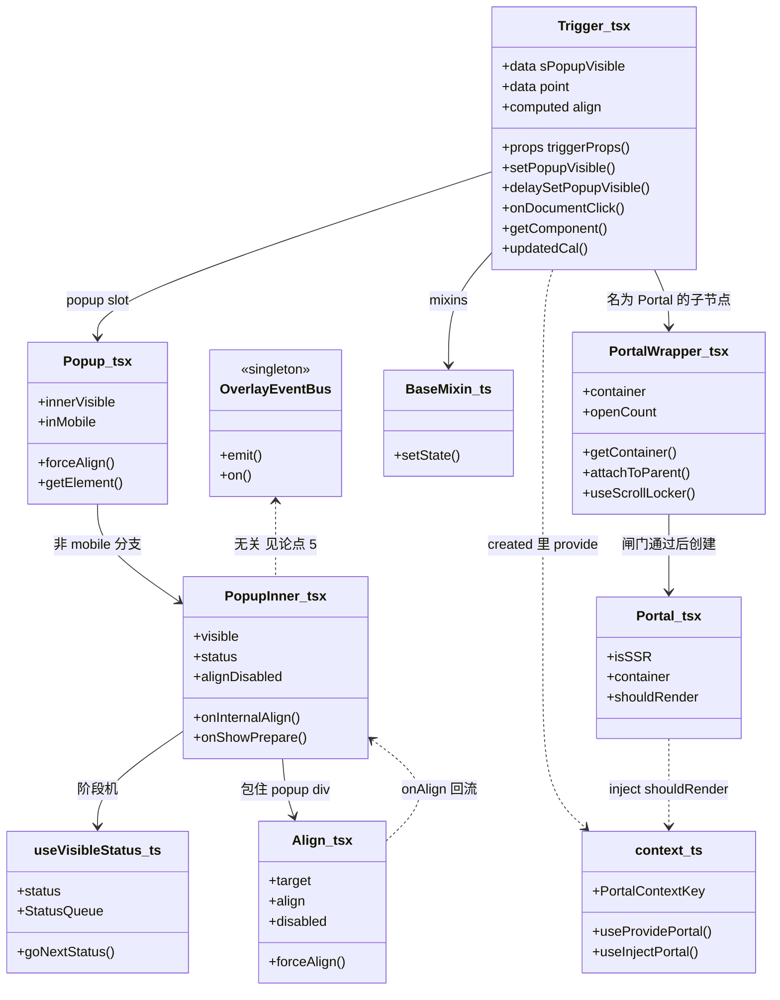
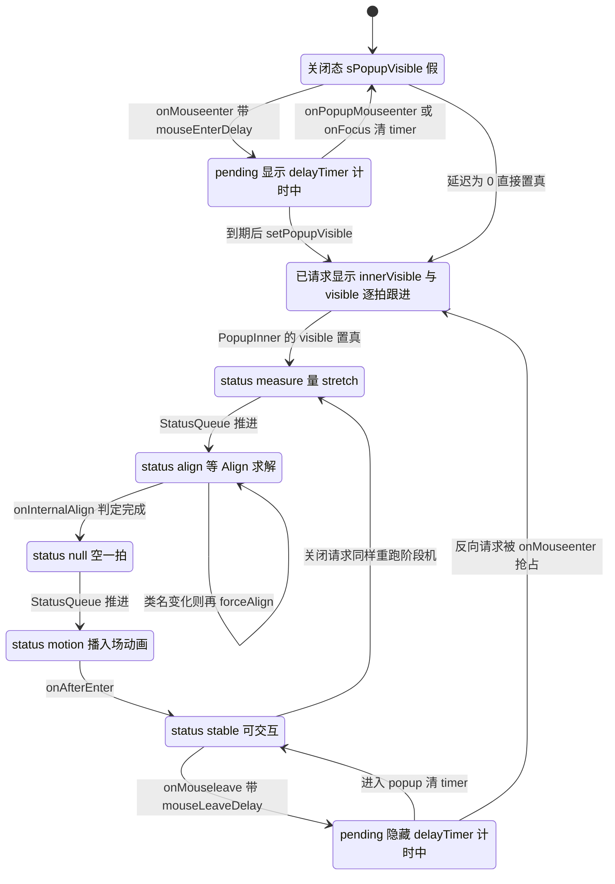
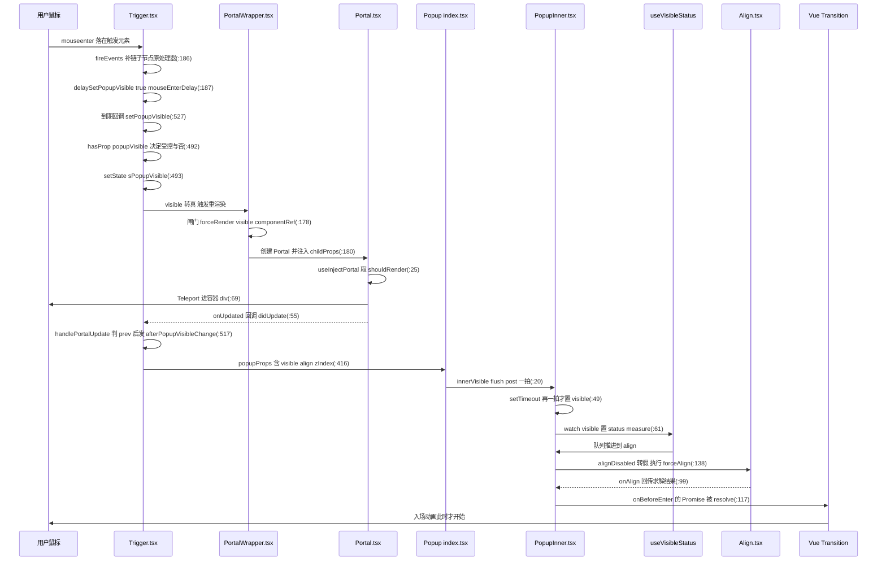
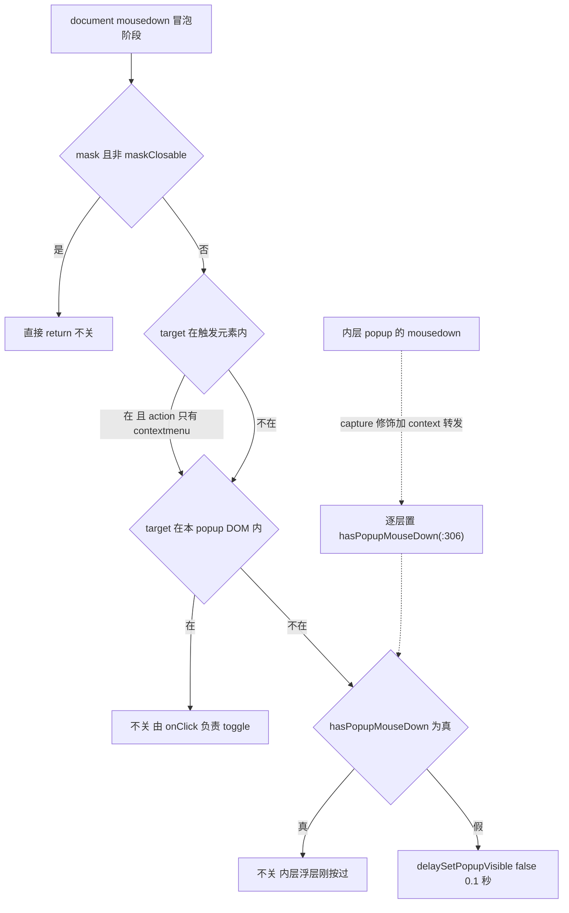
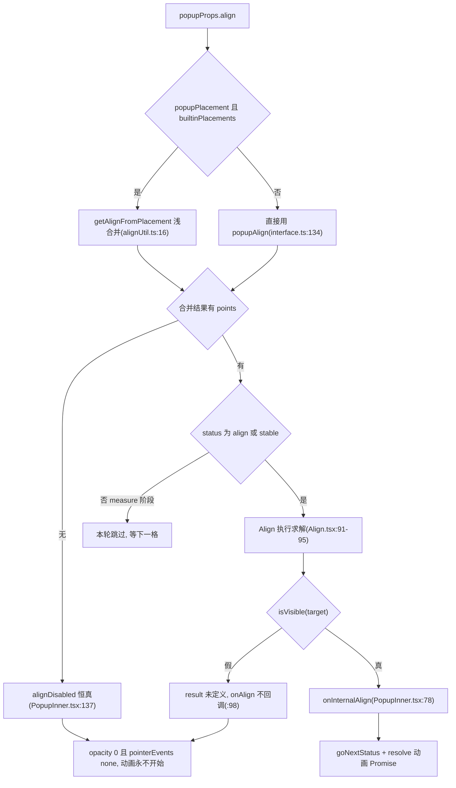

# I02 vc-trigger 弹出时序与事件穿透

> **本篇解决**：一个 tooltip 从「鼠标进入」到「带动画出现在正确位置」，中间到底经过几层状态？`hover / click / focus / contextmenu` 四种 action 各自绑了哪些 DOM 事件、状态怎么迁移？鼠标移到浮层上为什么不关闭？受控与非受控的分歧点到底落在哪一行？嵌套浮层（子菜单、面板里的面板）点外面时「该谁关」是怎么裁决的？`forceRender` / `autoDestroy` / `destroyPopupOnHide` / `popupRender` 这几个开关的真实语义与副作用是什么？
> **前置**：A07 交互基础设施总览（撰写中，本篇只给单模块深读，调用序列不重述）　**读者坐标**：`02-infrastructure` 第 2/16 篇
> 主题边界：**定位与碰撞检测算法归 I01（vc-align 定位求解与碰撞检测）**，本篇只写到 trigger 递给 align 的握手数据为止；**浮层三件套的横向调用序列归 A07**；层级数值分配归 I10（z-index 层级编排）；进出场 CSS 形状归 I09。

---

## 一、职责与边界

`vc-trigger` 是 XiaoyeUI 全部「锚定式浮层」的**唯一基座**：tooltip、popover、popconfirm、dropdown、select、cascader、tree-select、date-picker、time-picker、mentions、menu 子菜单、tour 提示框，全部经由它弹出。入口文件把自己的血统写在第一行：

```ts
// packages/xiaoye-ui/src/vc-trigger/index.ts:1
// based on rc-trigger 5.2.10
import Trigger from './Trigger';
```

这行注释同时解释了两件读代码时最容易困惑的事：`Trigger.tsx` 是 **Options API + `data()` + `setState`** 的 React 移植写法（而 `Popup/` 一侧是 Composition API），以及默认 `prefixCls` 是 `rc-trigger-popup`（`vc-trigger/interface.ts:116`）——上游默认值，本库消费方全部覆盖。

trigger 负责五件事：

1. **动作翻译**：把 `action` / `showAction` / `hideAction` 翻译成触发元素上的 DOM 事件集合（`vc-trigger/Trigger.tsx:644-687`）。
2. **开合状态与延迟**：持有 `sPopupVisible`，实现受控/非受控分流（`:488-504`）与 `mouseEnterDelay` / `mouseLeaveDelay` / `focusDelay` / `blurDelay` 两段定时（`:522-534`）。
3. **弹出时序**：把「请求显示」交给 Popup 的三段解耦状态与 `measure → align → motion → stable` 阶段机（`vc-trigger/Popup/useVisibleStatus.ts:5-19`），并用一个 Promise 让入场动画等 align 完成（`Popup/PopupInner.tsx:115-119`）。
4. **挂载位置**：把 popup DOM 交给 `_util/PortalWrapper`，并按 `getPopupContainer` 决定落点（`Trigger.tsx:694-702`）。
5. **事件穿透裁决**：用 `vcTriggerContext` 把内层浮层的 `mousedown / mouseenter / mouseleave` 向上转发（`:107-111`、`:200-224`、`:304-315`），并用 `hasPopupMouseDown` 标志决定「点外面」该谁关。

明确**不负责**：

- 坐标求解、溢出翻转、arrow 位移 → I01（vc-align 定位求解与碰撞检测）。trigger 只做「谁跟谁对齐」的声明。
- `z-index` 的数值分配 → I10。trigger 只有一个 `zIndex` prop 的中转位（`vc-trigger/interface.ts:124`）。
- 焦点管理、键盘导航、ARIA → 全部在消费方或内容组件里。trigger 只绑 `focus` / `blur` 两个开合动作。
- 内容怎么渲染：它只把 `popup` slot / `popup` prop 塞进 Popup（`Trigger.tsx:443`）。
- 遮罩语义：`mask` / `maskClosable` 是浮层自带的一层薄遮罩（`:317-334`），与 Modal 的遮罩是两套东西（Modal 侧见 C07-01 Modal 对话框）。

`vc-trigger` 是**内部目录**，不进公开产物面：`packages/xiaoye-ui/scripts/entry-generator.mjs:299` 的目录过滤器把 `vc-` 前缀整个排除，所以 `src/components.ts`（453 行）里没有它，`package.json` 也没有 `./vc-trigger` 导出。消费它的代码全部走相对路径 `../vc-trigger`。

| 方向 | 对象 | 证据 |
| --- | --- | --- |
| 依赖（align） | `Align` 组件与 `alignElement` / `alignPoint` 的宿主 | `vc-trigger/Popup/PopupInner.tsx:15` |
| 依赖（portal） | 挂载容器、`openCount`、滚动锁定 | `vc-trigger/Trigger.tsx:18` → `_util/PortalWrapper.tsx:46` |
| 依赖（事件工具） | `contains`、`addEventListener`、`raf`、`supportsPassive` | `Trigger.tsx:4-5`、`:14`、`:21` |
| 依赖（props 工具） | `getEvents` / `getComponent` / `filterEmpty` / `hasProp` / `findDOMNode` | `Trigger.tsx:6-13` |
| 依赖（setState） | React 风格 `setState` 的实现体 | `Trigger.tsx:37` → `_util/BaseMixin.ts:6` |
| 反向依赖 | `_util/Portal.tsx` 反过来 import trigger 的 context | `_util/Portal.tsx:11` → `vc-trigger/context.ts:27` |
| 消费方 | tooltip、dropdown、select、date-picker、menu、mentions、tour | `vc-tooltip/src/Tooltip.tsx:2`、`vc-dropdown/Dropdown.tsx:4`、`vc-select/SelectTrigger.tsx:1`、`vc-picker/PickerTrigger.tsx:3`、`menu/src/PopupTrigger.tsx:1`、`vc-mentions/src/KeywordTrigger.tsx:1`、`vc-tour/Tour.tsx:4` |
| 工具外流 | `getMotion` 被 message 复用 | `message/useMessage.tsx:16` |

`_util/Portal.tsx:11` 这条反向依赖值得单独指出：底层挂载工具依赖组件目录的 context 定义，意味着「portal 要不要渲染」这个决定权被**上交给了 trigger**。这条链的具体走法在论点 6。

---

## 二、源码地图

主体 1542 行，13 个文件。行数为 `find packages/xiaoye-ui/src/vc-trigger -type f | xargs wc -l | sort -n` 的实测输出。

| 文件 | 行数 | 职责 | 关键导出 / 入口 |
| --- | --- | --- | --- |
| `vc-trigger/index.ts` | 8 | 出口，标血统 | `default Trigger`、`triggerProps` |
| `vc-trigger/Trigger.tsx` | 710 | **主实现**：事件绑定、开合状态、延迟、外部监听、挂载参数 | `defineComponent` `:34`，渲染 `:633` |
| `vc-trigger/interface.ts` | 146 | props 契约、`AlignType`、`MobileConfig`、`noop` | `triggerProps()` `:106`、`noop` `:104` |
| `vc-trigger/context.ts` | 38 | 给 Portal 的「要不要渲染」判定 | `useProvidePortal` `:9`、`useInjectPortal` `:27` |
| `vc-trigger/Popup/index.tsx` | 56 | 显隐解耦 + mobile 分支 | `default Popup` `:7` |
| `vc-trigger/Popup/PopupInner.tsx` | 228 | 阶段机宿主、Transition、Align、样式与事件落点 | `:24`，渲染 `:143` |
| `vc-trigger/Popup/useVisibleStatus.ts` | 97 | 五态阶段机 | `default () => [status, goNextStatus]` `:21` |
| `vc-trigger/Popup/interface.ts` | 60 | 三层 props 表（inner / mobile / popup） | `innerProps` `:4` |
| `vc-trigger/Popup/useStretchStyle.ts` | 41 | `stretch` 量触发元素宽高 | `:5` |
| `vc-trigger/Popup/MobilePopupInner.tsx` | 59 | 移动端整屏弹层，不定位 | `:8` |
| `vc-trigger/Popup/Mask.tsx` | 37 | 薄遮罩 | 函数式组件 `:14` |
| `vc-trigger/utils/alignUtil.ts` | 40 | placement → align、align → 类名 | `:10`、`:22` |
| `vc-trigger/utils/motionUtil.ts` | 22 | animation/transitionName → motion 名 | `getMotion` `:9` |

配套基础设施（不在 `vc-trigger/` 目录内，但属于本篇范围）：

| 文件 | 行数 | 职责 | 关键点 |
| --- | --- | --- | --- |
| `_util/PortalWrapper.tsx` | 191 | 容器 div 生命周期、`openCount`、滚动锁定、渲染闸门 | 闸门 `:178`、`getParent` `:26` |
| `_util/Portal.tsx` | 72 | `Teleport` 封装 + SSR 就地渲染 | `useInjectPortal` `:25`、`isSSR` `:22` |
| `_util/__mocks__/Portal.tsx` | 13 | **测试替身**：不 Teleport、直接渲染 | `:9-12` |
| `_util/BaseMixin.ts` | 45 | `setState` / `__emit` | `:6-26` |
| `_util/overlayEventBus.ts` | 9 | 模块级单例 EventBus | `:7` |
| `_util/props-util/index.ts` | — | `hasProp` `:45`、`getEvents` `:158`、`getComponent` `:124` |
| `_util/vnode.ts` | — | `cloneElement` 覆盖式合并 | `:12-27` |
| `vc-align/Align.tsx` | 208 | 握手对端（算法归 I01） | props `:33`、回调 `:98-100` |

主实现入口：`packages/xiaoye-ui/src/vc-trigger/Trigger.tsx:34`（`defineComponent`），渲染函数在 `:633`。Popup 侧的时序入口是 `packages/xiaoye-ui/src/vc-trigger/Popup/PopupInner.tsx:44`。

真实消费方的三种典型接法（后文论点会反复回到这三处）：

| 消费方 | 接法 | `action` 来源 | 开合归谁 |
| --- | --- | --- | --- |
| tooltip / popover | `vc-tooltip/src/Tooltip.tsx:109-133` | `action: trigger`（`hover` 等） | `visible` 为 `undefined` 时非受控，第一次开合后被上层收养 |
| dropdown | `vc-dropdown/Dropdown.tsx:118-141` | `action={trigger}`，`hideAction` 由 `:97-102` 补 | 恒受控（`:135` 传的是本地 `ref`，永远是布尔） |
| select | `vc-select/SelectTrigger.tsx:156-172` | `showAction/hideAction = ['click']`（`:158-159`） | 恒受控（`:165`），另有一套独立的全局 mousedown |
| date-picker | `vc-picker/PickerTrigger.tsx:80-99` | `showAction={[]}` `hideAction={[]}`，`action` 未传 | 恒受控，trigger 只当「挂载 + 定位 + 动画」容器 |
| menu 子菜单 | `menu/src/PopupTrigger.tsx:86-112` | `action={disabled ? [] : [triggerSubMenuAction]}` `:102` | 恒受控 |

`popupVisible` 传了 `undefined` 与不传这个 key，在 trigger 里是两种语义（`_util/props-util/index.ts:45`）——这张表里「恒受控」的判定依据见论点 2。

---

## 三、架构与数据流

### 3.1 模块关系



图里三处结构值得先钉死。**其一**，`Trigger_tsx --> PortalWrapper_tsx`：`Trigger.tsx:18` 写的是 `import Portal from '../_util/PortalWrapper'`，变量名骗人——trigger 挂的是带容器管理与滚动锁定的包装层，不是裸 `Teleport`。**其二**，`Portal_tsx ..> context_ts` 这条反向虚线：底层挂载工具反过来读组件目录提供的 context（`_util/Portal.tsx:11`），于是「popup 要不要建 DOM」由 trigger 的 `sPopupVisible` / `popupRef` / `forceRender` / `autoDestroy` 四个量决定（`vc-trigger/context.ts:13-22`）。**其三**，`OverlayEventBus` 与 PopupInner 之间是**没有关系**的（图中特意标「无关」）：`_util/overlayEventBus.ts` 全仓只有三个引用方（`color-picker/ColorPicker.tsx:14`、`data-table/BodyCell.tsx:33`、`data-table/ColumnFilter.tsx:19`），一次也没被 trigger 用到，论点 5 展开。

### 3.2 开合状态机

trigger 侧只有一个布尔 `sPopupVisible`，但「请求」与「生效」之间隔着最多三个异步环节：一个 `delayTimer`（受 `mouseEnterDelay` 控制）、Popup 的 post-flush 一拍、PopupInner 的 `setTimeout` 一拍。pending 两段态就在第一环。



`StatusQueue` 的字面定义是 `['measure', 'align', null, 'motion']`（`vc-trigger/Popup/useVisibleStatus.ts:19`）——队列里**夹着一个 `null`**，`stable` 反而不在队列里。这不是笔误，但也**不是「空一拍」**：队列推进靠「取下一格」，且取到假值就停手（`:79-83` 的 `if (nextStatus && index !== -1)`），而 `'align'` 的下一格正是 `null`——所以 raf 链条走到 `align` 必须停下，唯一出路是 `onInternalAlign` 手动调 `goNextStatus()`，它的 switch 把 `align` 直接映射到 `motion`（`:44-46`），绕开队列。那个 `null` 因此是自动推进链上的**刹车片**：「没对齐完就不许开始动画」这件事由它保证；删掉它，状态机会在 raf 里一路走到 `motion`，align 与动画的契约即断。`stable` 不在队列里，只能由动画收尾回调 `goNextStatus()`（`:47-49`）或 `motion` computed 里那句 `status.value = 'stable'` 抵达（`Popup/PopupInner.tsx:105-110`），完全没有动画时走 `!motion && status === 'motion'` 那条旁路 watch（`:121-129`）。另有一处残留：`PopupStatus` 类型联合（`:15`）与文件头注释（`:5-14`）还列着 `aligned` / `afterAlign` / `beforeMotion` 三个态，队列与 switch 里都不存在——上游七态机删到四态没删干净（同类清单见论点 8）。状态机顶部还有一层保护：`setStatus` 在组件卸载后拒绝写入（`useVisibleStatus.ts:28-32` 配合 `:91-94` 的 `destroyRef`），`goNextStatus` 每次先 `cancelRaf` 再排新帧（`:38-40`）。

### 3.3 一次 hover 进场的完整链路



逐段说明这条链为什么是这个形状。

**第一段（T 内部）**：mouseenter 不直接开，先 `fireEvents` 把子节点自带的处理器补上（`:186`），再进 `delaySetPopupVisible`（`:187`）。延迟为 0 时才走同步路径；`mouseEnterDelay > 0` 时事件对象被丢弃（第三个实参传 `null`），因为位置由 `onMousemove` 持续刷新（`:190-193`、`:662-664`）。

**第二段（受控判定）**：`hasProp(this, 'popupVisible')` 只看「props 上的值是不是 `undefined`」（`_util/props-util/index.ts:45-47`）。这是整篇唯一的受控/非受控分流点，写在 `setState` 之前（`Trigger.tsx:492`）。

**第三段（两道渲染闸门）**：`PortalWrapper` 先用自己的 `forceRender || visible || componentRef` 决定要不要创建 `Portal` 组件（`_util/PortalWrapper.tsx:184`），`Portal` 再用 `shouldRender` 决定这一帧到底渲不渲（`_util/Portal.tsx:65`）。两道门的判据不同源：第一道看它自己的 props，第二道看 trigger 提供的 context。论点 6 会指出这个差异导致 trigger 的 `forceRender` 失效。

**第四段（两拍延时）**：`Popup` 的 `innerVisible` 与 `PopupInner` 的 `visible` 都是 `props.visible` 的延迟副本。没有这两拍，`v-show` 的翻转、Transition 类的挂载、`stretch` 的测量会挤在同一次 patch 里，动画会在「还没宽度、还没定位」的帧上起跑。

**第五段（握手）**：入场动画被 `onBeforeEnter` 返回的 Promise 挡住，而 resolve 这个 Promise 的唯一路径在 `onInternalAlign` 里（`Popup/PopupInner.tsx:91-93`）。也就是说：**没走完一次 align，动画不会开始**。这就是 trigger 与 align 的时序契约，坐标怎么算出来的不在本篇（I01）。

### 3.4 「点外面」归属判定



判定函数是 `onDocumentClick`（`vc-trigger/Trigger.tsx:317-334`），豁免标志是 `hasPopupMouseDown`（`:306-311`）。注意 `CLOSE` 分支也不是立刻关：`delaySetPopupVisible(false, 0.1)`（`:332`）——源码注释写明是绕开 Vue 动画时序问题。这个监听的注册条件本身还有讲究：只有 `isClickToHide() || isContextmenuToShow()` 才挂 document mousedown（`:145-152`），纯 `hover` 的 tooltip **根本没有点外面这条路径**，靠 `mouseleave` 关；而 `touchstart` 是无条件挂的（`:154-162`，注释 `always hide on mobile`）。

---

## 四、核心机制精读

### 论点 1：`action` 不产生状态，只决定「哪些 DOM 事件被 trigger 接管」，其余全部退回转发链

四个动作词在源码里不是枚举，是**四对判定函数**，每对只看两个来源（`action` 或 `showAction`/`hideAction`）：

```ts
// packages/xiaoye-ui/src/vc-trigger/Trigger.tsx:595
    isMouseEnterToShow() {
      const { action, showAction } = this.$props;
      return action.indexOf('hover') !== -1 || showAction.indexOf('mouseenter') !== -1;
    },

    isMouseLeaveToHide() {
      const { action, hideAction } = this.$props;
      return action.indexOf('hover') !== -1 || hideAction.indexOf('mouseleave') !== -1;
    },

    isFocusToShow() {
      const { action, showAction } = this.$props;
      return action.indexOf('focus') !== -1 || showAction.indexOf('focus') !== -1;
    },

    isBlurToHide() {
      const { action, hideAction } = this.$props;
      return action.indexOf('focus') !== -1 || hideAction.indexOf('blur') !== -1;
    },
```

三点必须看清。**其一**，`action` 可以是字符串也可以是数组（`vc-trigger/interface.ts:107` 用 `oneOfType([string, arrayOf(string)])`），但判定一律写成 `indexOf`——字符串和数组的 `indexOf` 都成立，所以 `action: 'hover'` 与 `action: ['hover']` 等价，`action: 'click'` 也让 `isClickToShow()` 为真。**其二**，`showAction` / `hideAction` 与 `action` 是**或**关系，且用的词不同：显示侧写 `mouseenter`，隐藏侧写 `mouseleave`，`focus` 两侧同词，`blur` 只在隐藏侧。于是 `showAction: ['mouseenter'], hideAction: ['blur']` 是合法组合，而 `action: 'hover'` 展开后同时点亮 `isMouseEnterToShow` 与 `isMouseLeaveToHide`。**其三**，`isBlurToHide` 看的是 `action` 里的 `focus`——`action: 'focus'` 隐含了 blur 关闭，`action: ['focus']` 也是。

判定结果只用在渲染函数里，形状是「接管或让路」：

```tsx
// packages/xiaoye-ui/src/vc-trigger/Trigger.tsx:650
    if (this.isClickToHide() || this.isClickToShow()) {
      newChildProps.onClick = this.onClick;
      newChildProps.onMousedown = this.onMousedown;
      newChildProps[supportsPassive ? 'onTouchstartPassive' : 'onTouchstart'] = this.onTouchstart;
    } else {
      newChildProps.onClick = this.createTwoChains('onClick');
      newChildProps.onMousedown = this.createTwoChains('onMousedown');
      newChildProps[supportsPassive ? 'onTouchstartPassive' : 'onTouchstart'] =
        this.createTwoChains('onTouchstart');
    }
    if (this.isMouseEnterToShow()) {
      newChildProps.onMouseenter = this.onMouseenter;
      if (alignPoint) {
        newChildProps.onMousemove = this.onMouseMove;
      }
    } else {
      newChildProps.onMouseenter = this.createTwoChains('onMouseenter');
    }
```

`newChildProps` 最后经 `cloneElement(child, {...newChildProps, ref: 'triggerRef'}, true, true)` 盖到子节点上（`:692`），第三个实参 `override = true` 让新 props **覆盖**同名原 props（`_util/vnode.ts:12-27`）。所以「接管」的代价是子节点自己的 `onClick` 被抹掉，补偿机制是 trigger 在 clone 之前先把原事件表抄下来：`this.childOriginEvents = getEvents(child)`（`:639`，实现见 `_util/props-util/index.ts:158-166`），之后每个被接管的处理器第一件事就是 `fireEvents(...)` 回调（`Trigger.tsx:619-627`）：

```ts
// packages/xiaoye-ui/src/vc-trigger/Trigger.tsx:619
    fireEvents(type: string, e: Event) {
      if (this.childOriginEvents[type]) {
        this.childOriginEvents[type](e);
      }
      const event = this.$props[type] || this.$attrs[type];
      if (event) {
        event(e);
      }
    },
```

即一次点击按顺序走：子节点原 `onClick` → 挂在 `<Trigger>` 上的 `onClick`（props 或 attrs 皆可，因为 trigger 没有 `emits` 声明）。而 `createTwoChains` 是「不接管」时的桥：

```ts
// packages/xiaoye-ui/src/vc-trigger/Trigger.tsx:565
    createTwoChains(event: string) {
      let fn = () => {};
      const events = getEvents(this);
      if (this.childOriginEvents[event] && events[event]) {
        return this[`fire${event}`];
      }
      fn = this.childOriginEvents[event] || events[event] || fn;
      return fn as any;
    },
```

只有「子节点有 + trigger 自己也有」时才返回 `fire${event}`，即 `data()` 里为 `ALL_HANDLERS` 那 8 个键预生成的绑定器（`:87-91`，名单在 `:24-33`）——**这里藏着一个真实缺口**：`onMousemove` 不在 `ALL_HANDLERS` 里，所以不存在 `fireonMousemove`。所幸 `onMousemove` 只在 `alignPoint` 为真时才被接管（`:662-664`），而接管后的 `onMouseMove` 自己调的是 `fireEvents('onMousemove', e)`（`:191`），走的是动态查表路径，不依赖预生成器，所以没炸。同理 `supportsPassive` 为真时写入的键是 `onTouchstartPassive`，而 `fireEvents` 查的键是 `onTouchstart`：如果**子节点自带** `onTouchstartPassive`，在 `action` 含 click 的情况下它既不会被 `createTwoChains` 命中也不会被 `fireEvents` 命中。这条没有测试保护（`grep -rn "touchstart" --include='*.test.*' packages/xiaoye-ui/src` 无 trigger 相关命中）。

`click` 这一路还有一段与状态无关的抑制逻辑：

```tsx
// packages/xiaoye-ui/src/vc-trigger/Trigger.tsx:268
    onClick(event) {
      this.fireEvents('onClick', event);
      // focus will trigger click
      if (this.focusTime) {
        let preTime;
        if (this.preClickTime && this.preTouchTime) {
          preTime = Math.min(this.preClickTime, this.preTouchTime);
        } else if (this.preClickTime) {
          preTime = this.preClickTime;
        } else if (this.preTouchTime) {
          preTime = this.preTouchTime;
        }
        if (Math.abs(preTime - this.focusTime) < 20) {
          return;
        }
        this.focusTime = 0;
      }
```

浏览器在聚焦时可能补发一次 click（移动端点 input 最常见）。`onFocus` 记 `focusTime`（`:231`），`onMousedown` / `onTouchstart` 分别记 `preClickTime` / `preTouchTime`（`:238`、`:243`），三者相差 20ms 内就认定这次 click 是 focus 的副作用、直接放弃 toggle。`action: 'focus'` 的浮层「点一下不但不关、也不误开」就是这三行时间戳换来的。

状态迁移的入口只有两个：`setPopupVisible`（`:488`）与它的定时包装 `delaySetPopupVisible`（`:522`）。`onContextmenu` 是唯一一个**不带任何延迟**的开启路径（`:256-260`，先 `e.preventDefault()` 再 `setPopupVisible(true, e)`，顺带把鼠标坐标当 point 记下）。

### 论点 2：受控与非受控的分歧点只有一行，判定依据是「值是不是 `undefined`」而不是「key 存不存在」

```ts
// packages/xiaoye-ui/src/vc-trigger/Trigger.tsx:488
    setPopupVisible(sPopupVisible: boolean, event?: any) {
      const { alignPoint, sPopupVisible: prevPopupVisible, onPopupVisibleChange } = this;
      this.clearDelayTimer();
      if (prevPopupVisible !== sPopupVisible) {
        if (!hasProp(this, 'popupVisible')) {
          this.setState({
            sPopupVisible,
            prevPopupVisible,
          });
        }
        onPopupVisibleChange && onPopupVisibleChange(sPopupVisible);
      }
      // Always record the point position since mouseEnterDelay will delay the show
      if (alignPoint && event && sPopupVisible) {
        this.setPoint(event);
      }
    },
```

三个容易被读漏的事实：

1. `hasProp` 的实现是 `instance[prop] !== undefined`（`_util/props-util/index.ts:45-47`）。而 `popupVisible` 的声明是 `{ type: Boolean, default: undefined }`（`vc-trigger/interface.ts:135`）。所以**传 `popupVisible={undefined}` 等于没传**（非受控），传 `popupVisible={false}` 就是受控。这一字之差决定了消费方的写法：`vc-dropdown/Dropdown.tsx:38` 把 `visible` 归一成本地 `ref(!!props.visible)`，再在 `:135` 无条件传给 trigger，于是 dropdown 永远是受控；`vc-select/SelectTrigger.tsx:165` 与 `menu/src/PopupTrigger.tsx:100` 同理；只有 tooltip 家族允许它是 `undefined`。
2. 受控时**不写内部状态，但一定发回调**（`:498` 在 `if (hasProp)` 之外）。所以受控方漏接 `onPopupVisibleChange` 就是「点了没反应」，而不是「自己会开」。
3. `point` 只在 `alignPoint && event && sPopupVisible` 三者齐备时记录（`:501-503`），配合 `setPoint` 只存 `pageX/pageY`（`:506-516`）。

外部值灌入内部状态走的是 options watch：

```ts
// packages/xiaoye-ui/src/vc-trigger/Trigger.tsx:98
  watch: {
    popupVisible(val) {
      if (val !== undefined) {
        this.prevPopupVisible = this.sPopupVisible;
        this.sPopupVisible = val;
      }
    },
  },
```

初值来自 `data()`：`popupVisible !== undefined ? !!props.popupVisible : !!props.defaultPopupVisible`（`:82-86`），`defaultPopupVisible` 默认 `false`（`vc-trigger/interface.ts:136`）。注意 watch 里的 `val !== undefined` 判定——受控方把值改成 `undefined` 时内部状态**保持不动**，这既是「Tooltip 从不受控切到受控」能平滑过渡的原因，也是「受控方想用 `undefined` 表示关闭」会失效的原因。

tooltip 家族展示了一种少见的混合形态：`XYTooltip` 的 `innerOpen` 初值取 `firstNotUndefined([props.open, props.visible])`（`tooltip/Tooltip.tsx:108`），若两者都没传就是 `undefined` → 渲染时 `visible: tempVisible` 为 `undefined`（`:293`）→ `vc-tooltip/src/Tooltip.tsx:105-107` 只在 `props.visible !== undefined` 时才补 `extraProps.popupVisible` → trigger 处于非受控。第一次开合回调 `handleVisibleChange`（`tooltip/Tooltip.tsx:124-128`）把 `innerOpen` 写成布尔，下一帧起 trigger 就变成受控。**同一段代码先非受控后受控**，排查「第一次能开、后面必须由外部改 `open`」类问题时要按这个顺序读。

这套 `data + watch + hasProp + setState` 与 `_util/hooks/useMergedState`（I13 响应式内核 hooks 的统一实现）是两条并行路线，trigger 一条也不共用：`grep -rn "useMergedState" packages/xiaoye-ui/src/vc-trigger` 零命中。取舍见 §六。

### 论点 3：pending 不是一段，而是三段解耦；入场动画被 align 的 Promise 挡住

「请求显示」和「显示完成」之间有三处刻意的一拍延迟，每一处都有不可替代的理由。

第一段是 `delayTimer`（`Trigger.tsx:522-534`）：

```ts
// packages/xiaoye-ui/src/vc-trigger/Trigger.tsx:522
    delaySetPopupVisible(visible: boolean, delayS: number, event?: any) {
      const delay = delayS * 1000;
      this.clearDelayTimer();
      if (delay) {
        const point = event ? { pageX: event.pageX, pageY: event.pageY } : null;
        this.delayTimer = setTimeout(() => {
          this.setPopupVisible(visible, point);
          this.clearDelayTimer();
        }, delay);
      } else {
        this.setPopupVisible(visible, event);
      }
    },
```

它给「鼠标扫过」这种误触发留了反悔窗口——反悔动作在 `onPopupMouseenter` / `onFocus` / `onBlur` / `setPopupVisible` 四处都会做（`:205`、`:229`、`:249`、`:490`），统一收敛到 `clearDelayTimer`（`:536-541`）。

第二段在 `Popup`：`innerVisible` 是 `props.visible` 的 `flush: 'post'` 副本（`vc-trigger/Popup/index.tsx:17-26`）：

```ts
// packages/xiaoye-ui/src/vc-trigger/Popup/index.tsx:17
    watch(
      [() => props.visible, () => props.mobile],
      () => {
        innerVisible.value = props.visible;
        if (props.visible && props.mobile) {
          inMobile.value = true;
        }
      },
      { immediate: true, flush: 'post' },
    );
```

`flush: 'post'` 保证 DOM 结构（包括 `Portal` 刚 Teleport 进去的那棵子树）先落定，再让 Popup 把 `visible` 往下传。同一个 watch 里还藏着 `inMobile` 的**单向锁**：只有置真的分支，没有回落。一旦以 mobile 模式打开过一次，这棵 Popup 后续永远走 `MobilePopupInner` 分支（`:37-46`），即使 `mobile` 变成 `undefined`。目前没有任何消费方传 `mobile`，所以该分支不可达（见论点 8）。

第三段在 `PopupInner`，也是三段里最关键的一段：

```ts
// packages/xiaoye-ui/src/vc-trigger/Popup/PopupInner.tsx:42
    const visible = shallowRef(false);
    let timeoutId: any;
    watch(
      () => props.visible,
      val => {
        clearTimeout(timeoutId);
        if (val) {
          timeoutId = setTimeout(() => {
            visible.value = props.visible;
          });
        } else {
          visible.value = false;
        }
      },
      { immediate: true },
    );
```

**打开延迟一个宏任务，关闭立即生效**——这个不对称是入场动画能播出来的前提。渲染里那行 `hasAnimate` 是它的另一半：

```tsx
// packages/xiaoye-ui/src/vc-trigger/Popup/PopupInner.tsx:181
      const hasAnimate = visible.value || !props.visible;
      const transitionProps = hasAnimate ? getTransitionProps(motion.value.name, motion.value) : {};
```

把两次渲染摆出来就清楚了：`props.visible` 刚转真的那一帧，`visible` 还是 `false`，于是 `hasAnimate` 为假、`transitionProps` 为空对象，`v-show` 也没翻（`:193`）——这一帧的唯一任务是让 DOM 存在、容器就位、`stretch` 可量。下一帧 `setTimeout` 兑现，`visible` 转真，同一次 patch 里 `transitionProps` 恢复且 `v-show` 翻转，Vue 的 `<Transition>` 才在**一个已经有尺寸、有位置**的元素上起跑。少了中间那一拍，动画会在「宽高为 0、left/top 未写」的元素上播放，表现就是弹层从左上角甩出来。

阶段机与动画的握手在两个函数上：

```tsx
// packages/xiaoye-ui/src/vc-trigger/Popup/PopupInner.tsx:78
    const onInternalAlign = (popupDomNode: HTMLElement, matchAlign: AlignType) => {
      const nextAlignedClassName = props.getClassNameFromAlign(matchAlign);
      const preAlignedClassName = alignedClassName.value;
      if (alignedClassName.value !== nextAlignedClassName) {
        alignedClassName.value = nextAlignedClassName;
      }
      if (status.value === 'align') {
        // Repeat until not more align needed
        if (preAlignedClassName !== nextAlignedClassName) {
          Promise.resolve().then(() => {
            forceAlign();
          });
        } else {
          goNextStatus(() => {
            prepareResolveRef.value?.();
          });
        }

        props.onAlign?.(popupDomNode, matchAlign);
      }
    };
```

`onShowPrepare` 把 `resolve` 存起来并返回一个 Promise，绑在 `<Transition onBeforeEnter>` 上（`:115-119`、接线在 `:188`）。能兑现它的只有 `onInternalAlign` 的 `else` 分支——`goNextStatus(callback)` 里那个 callback（`useVisibleStatus.ts:54`）。于是**入场动画等 align**不是一句口号，而是一条 Promise 依赖。`if (status.value === 'align')` 的外层判断同时起到「非对齐阶段的回调不改状态机」的作用：`stable` 期间窗口 resize 触发的 align 只更新类名与回调，不会重播动画。

还有一条收敛线：类名一变（例如从 `placement-top` 翻到 `placement-bottom`），弹层尺寸可能再变，于是 `preAlignedClassName !== nextAlignedClassName` 时用微任务再对一次齐（`:86-89`），不进 `goNextStatus`。这一层循环没有次数上限，靠「类名不再变化」自然停止；若两个 placement 类名的样式恰好互相翻转尺寸，就会在这里打转——这条路径没有任何测试覆盖。

收尾由 motion 回调兜住：

```tsx
// packages/xiaoye-ui/src/vc-trigger/Popup/PopupInner.tsx:101
    const motion = computed(() => {
      const m = typeof props.animation === 'object' ? props.animation : getMotion(props as any);
      ['onAfterEnter', 'onAfterLeave'].forEach(eventName => {
        const originFn = m[eventName];
        m[eventName] = node => {
          goNextStatus();
          // 结束后，强制 stable
          status.value = 'stable';
          originFn?.(node);
        };
      });
      return m;
    });
```

注意它是**就地改写 `m`**：`animation` 传对象时（`menu/src/PopupTrigger.tsx:107` 走的就是这条）`m === props.animation`，写进去的两个回调留在了消费方的对象上；`animation` 传字符串时 `getMotion` 每次新建对象（`vc-trigger/utils/motionUtil.ts:9-22`），不受影响。只要 `popupAnimation` 对象是某个浮层独享的，这个污染无害（`menu` 的 `mergedMotion` 每次 computed 重算都返回新对象，`menu/src/PopupTrigger.tsx:78-82`，正好安全）；被两个浮层共享时才会出事，推导见 §七 坑 6。另外 `!motion.value && status.value === 'motion'` 那条 watch（`PopupInner.tsx:121-129`）是「完全没有动画」时的旁路，保证阶段机不卡在 motion。

### 论点 4：「移入浮层不关闭」不是 CSS 命中区，是一次事件接力加两个判据

触发元素与 popup 在 DOM 上是两棵子树（popup 被 Teleport 到 body 下的容器里），中间通常还有几像素间隙。hover 语义要成立，必须让「离开触发元素」与「进入浮层」这两件事在同一队列里互相取消。

离开触发元素时只是排了一个关闭定时器：

```ts
// packages/xiaoye-ui/src/vc-trigger/Trigger.tsx:195
    onMouseleave(e) {
      this.fireEvents('onMouseleave', e);
      this.delaySetPopupVisible(false, this.$props.mouseLeaveDelay);
    },

    onPopupMouseenter() {
      const { vcTriggerContext = {} } = this;
      if (vcTriggerContext.onPopupMouseenter) {
        vcTriggerContext.onPopupMouseenter();
      }
      this.clearDelayTimer();
    },
```

进入 popup 时 `clearDelayTimer()` 把它取消（`:205`）。这两个函数的接线位置在 `getComponent()` 里，而且是**有条件的**：

```ts
// packages/xiaoye-ui/src/vc-trigger/Trigger.tsx:388
      const mouseProps: HTMLAttributes = {};
      if (this.isMouseEnterToShow()) {
        mouseProps.onMouseenter = this.onPopupMouseenter;
      }
      if (this.isMouseLeaveToHide()) {
        mouseProps.onMouseleave = this.onPopupMouseleave;
      }
      mouseProps.onMousedown = this.onPopupMouseDown;
      mouseProps[supportsPassive ? 'onTouchstartPassive' : 'onTouchstart'] = this.onPopupMouseDown;
```

只有 hover 语义成立时 popup 才有 mouseenter/mouseleave 处理器；`onMousedown` / `touchstart` 则是无条件绑上的（`:395-396`），因为它服务的是论点 5 的归属裁决而不是 hover 接力。这四个函数最终被 spread 进 `popupProps`（`:435`）交给 `Popup` → `PopupInner`，落在带 `mergedClassName` 的那个 div 上（`PopupInner.tsx:205-208`）。

反方向的离开判定更绕：

```ts
// packages/xiaoye-ui/src/vc-trigger/Trigger.tsx:208
    onPopupMouseleave(e) {
      if (
        e &&
        e.relatedTarget &&
        !e.relatedTarget.setTimeout &&
        contains(this.popupRef?.getElement(), e.relatedTarget)
      ) {
        return;
      }
      if (this.isMouseLeaveToHide()) {
        this.delaySetPopupVisible(false, this.$props.mouseLeaveDelay);
      }
      const { vcTriggerContext = {} } = this;
      if (vcTriggerContext.onPopupMouseleave) {
        vcTriggerContext.onPopupMouseleave(e);
      }
    },
```

`relatedTarget.setTimeout` 这个判据是在排除「relatedTarget 不是元素而是 window/document」的场景（只有 window/document 同时是 setTimeout 的宿主），这类目标不该算「进了浮层内部」；排除它之后再用 `contains` 判断是否只是浮层内部移动（`contains` 实现见 `packages/xiaoye-ui/src/vc-util/Dom/contains.ts:1-11`，非元素目标直接返回 `false` 而不是抛错）。真正离开时才重排关闭定时器，并把 leave 事件继续往外层 trigger 转。

`mouseEnterDelay` 与 `mouseLeaveDelay` 的默认值不对称是有意设计的：`0` 与 `0.1` 秒（`vc-trigger/interface.ts:122-123`），`focusDelay: 0` / `blurDelay: 0.15`（`:125-126`）。也就是**开快关慢**，给接力留出窗口。消费方会再覆盖一层：`vc-tooltip/src/Tooltip.tsx:25-26` 两侧都是 `0.1`，`vc-dropdown/Dropdown.tsx:33-34` 与 `dropdown/dropdown.tsx:26-27` 是 `0.15 / 0.1`，`menu/src/PopupTrigger.tsx:103-104` 用 `subMenuOpenDelay` / `subMenuCloseDelay`。

延迟单位是**秒**（`delaySetPopupVisible` 里 `delayS * 1000`，`:523`），所以 `mouseLeaveDelay: 0` 会走 `else` 分支变成同步关闭，而 `0.1` 是 100ms。填 `1` 就是 1 秒。

timer 泄漏防护有四个出口，都在 `Trigger.tsx`：`beforeUnmount` 里一次清三类（`:129-134`：`clearDelayTimer`、`clearOutsideHandler`、`clearTimeout(this.mouseDownTimeout)`、`raf.cancel(this.attachId)`），`clearOutsideHandler` 逐个把 `clickOutsideHandler` / `contextmenuOutsideHandler1/2` / `touchOutsideHandler` 的 `remove()` 调掉并置空（`:543-563`），`deactivated()` 在 keep-alive 失活时直接关浮层（`:114-116`），`setPopupVisible` 开头无条件清 pending（`:490`）。**唯一的例外**在 PopupInner：那个 `timeoutId` 只在每次 watch 触发时清（`:47`），组件卸载时没有 `onBeforeUnmount` 兜它（`:42-57` 附近没有任何卸载钩子，全文件的卸载清理只有 `useVisibleStatus` 内部的 raf）。后果是关闭与卸载竞态时，回调仍会在下一个宏任务里读 `props.visible` 并写一个已经没人看的 `shallowRef`；不崩，但属于计时器泄漏，改这段时顺手补。

### 论点 5：嵌套浮层的「点外面」归属靠一条字符串 context 链加一次性标志，和 overlayEventBus 完全无关

trigger 在 `created()` 里往下提供一个**非 Symbol 字符串键**的 context：

```tsx
// packages/xiaoye-ui/src/vc-trigger/Trigger.tsx:106
  created() {
    provide('vcTriggerContext', {
      onPopupMouseDown: this.onPopupMouseDown,
      onPopupMouseenter: this.onPopupMouseenter,
      onPopupMouseleave: this.onPopupMouseleave,
    });
    useProvidePortal(this);
  },
```

注入方是同一个组件的 `setup`（`:53-60`，默认值 `{}`）。全仓 `grep -rn "vcTriggerContext" packages/xiaoye-ui/src` 的命中只在 `Trigger.tsx` 内（provide 一次、inject 一次、转发三次），**没有任何第三方提供或消费这个键**。所以这条链的语义是精确的：内层 Trigger 的浮层上发生的 `mousedown / mouseenter / mouseleave`，会被逐层向上转发到祖先 Trigger 的同名方法。子菜单套子菜单（`menu/src/PopupTrigger.tsx` 每个 submenu 一个 Trigger）与「面板里再开面板」用的就是它。

裁决代码是这两段：

```ts
// packages/xiaoye-ui/src/vc-trigger/Trigger.tsx:304
    onPopupMouseDown(...args: any[]) {
      const { vcTriggerContext = {} } = this;
      this.hasPopupMouseDown = true;

      clearTimeout(this.mouseDownTimeout);
      this.mouseDownTimeout = setTimeout(() => {
        this.hasPopupMouseDown = false;
      }, 0);
      if (vcTriggerContext.onPopupMouseDown) {
        vcTriggerContext.onPopupMouseDown(...args);
      }
    },

    onDocumentClick(event) {
      if (this.$props.mask && !this.$props.maskClosable) {
        return;
      }
      const target = event.target;
      const root = this.getRootDomNode();
      const popupNode = this.getPopupDomNode();
      if (
        // mousedown on the target should also close popup when action is contextMenu.
        (!contains(root, target) || this.isContextMenuOnly()) &&
        !contains(popupNode, target) &&
        !this.hasPopupMouseDown
      ) {
        // https://github.com/vuejs/core/issues/4462
        // vue 动画bug导致，改成延时解决
        this.delaySetPopupVisible(false, 0.1);
      }
    },
```

三层判据依次是：不在触发元素里（或 action 只有 contextmenu 时连触发元素本身也算外面）、不在**本层** popup DOM 里、本层没被按下过。`hasPopupMouseDown` 用 `setTimeout(..., 0)` 复位（`:308-311`），即「一次按下只豁免一次判定」，不会永久失效。时序上能成立是因为 popup 上的 mousedown 处理器写在 `PopupInner.tsx:207`，而 document 的监听是 `packages/xiaoye-ui/src/vc-util/Dom/addEventListener.js:13` 的默认（冒泡）注册——事件先在 popup 元素触发阶段执行，再冒泡到 document，标志位已经置好。`withModifiers(onMousedown, ['capture'])` 这个写法本身有疑问（见 §七 坑 7）。

这套机制与另外三套「点外面」实现是**并行且互不相通**的，行号对照如下（Modal 侧的 mousedown/mouseup 记账已在 C07-01 Modal 对话框 论点 3 详述，此处只作定位对照，不重述其论证）：

| 机制 | 适用对象 | 判据 | 代码位置 |
| --- | --- | --- | --- |
| context 链 + `hasPopupMouseDown` | trigger 系浮层之间嵌套 | 按过即豁免，一次一跳 | `vc-trigger/Trigger.tsx:304-334` |
| trigger 自身的 DOM 归属判定 | 单层浮层 | `contains(root)` / `contains(popupNode)` | `Trigger.tsx:324-329` |
| Modal 的 mousedown/mouseup 记账 | dialog 内容飘出 wrap | 抬起后置标记，wrap 的 click 只清账 | `vc-dialog/Dialog.tsx:100-118`（详见 C07-01） |
| Select 自己挂的 window mousedown | select 面板 | 目标既不在选择器也不在面板元素内则关 | `vc-select/hooks/useSelectTriggerControl.ts:9-23` |
| `overlayEventBus` | 与 trigger 无关的浮层 | 广播 `overlay-click` 供别的浮层取消关闭 | `_util/overlayEventBus.ts:7` |

`overlayEventBus` 的实际用途需要纠正一句：它的注释写的是「用于 overlay 类组件（如 ColorPicker、AutoComplete）协调滚动/隐藏行为」（`_util/overlayEventBus.ts:3-6`），但真正的订阅方只有 `data-table`：单元格进入编辑态时 `OverlayEventBus.on('overlay-click', overlayEventListener)`（`data-table/BodyCell.tsx:213`，卸载时 `:592` 取消），列筛选面板同样订阅（`data-table/ColumnFilter.tsx:321`、`:341`、`:527`），发布方是 `color-picker/ColorPicker.tsx:569` 的 `onOverlayClick` 与 `data-table/ColumnFilter.tsx:287`。也就是说它解决的是「行内编辑时点开颜色面板，颜色面板里的点击不该让单元格退出编辑」，走的是 `portal` 组件而不是 `vc-trigger`。**「Select 内开 DatePicker 的归属由 overlayEventBus 处理」这一说法在本库源码中不成立**；那条场景真实依赖的是上面的 context 链。而且要注意：Select 除了 trigger 这条路，还独立挂着 `useSelectTriggerControl` 的 window mousedown（`vc-select/BaseSelect.tsx:660`），它的判据集合里**没有任何内层浮层豁免**（`useSelectTriggerControl.ts:16-22` 只看两个元素）——内层面板若被 Teleport 到 body，就落在 `element.contains(target)` 之外。代码路径上这会让 Select 自己关；本篇未在浏览器中实测复现，规避办法是把内层浮层的 `getPopupContainer` 指到外层面板节点内，使 `contains` 成立。

链条的覆盖面也只到 `mousedown / mouseenter / mouseleave` 三个动词，**focus 与 blur 不在转发名单里**（`:107-111`）。因此 `action: 'focus'` 的浮层里再放一个 focus 型浮层，「从内层把焦点移回外层但穿过页面空白」这种场景没有协调机制。

### 论点 6：popup DOM 建不建由两道**不同源**的闸门决定，`forceRender` 在这条链上是死键

trigger 挂载 popup 的路径上有两个渲染条件，读代码时极易当成一个。第一道在 `PortalWrapper`，判据是**它自己的 props**；第二道在 `Portal`，判据是 **trigger 通过 context 递下来的 computed**。

```tsx
// packages/xiaoye-ui/src/vc-trigger/Trigger.tsx:694
    const portal = (
      <Portal
        key="portal"
        v-slots={{ default: this.getComponent }}
        getContainer={getPopupContainer && (() => getPopupContainer(this.getRootDomNode()))}
        didUpdate={this.handlePortalUpdate}
        visible={this.$data.sPopupVisible}
      ></Portal>
    );
```

`import Portal from '../_util/PortalWrapper'`（`:18`）——变量名是 `Portal`，实体是包装层。关键在**没传什么**：`forceRender`、`autoLock`、`wrapperClassName` 三个 props 都没有转发。于是第一道闸门：

```tsx
// packages/xiaoye-ui/src/_util/PortalWrapper.tsx:173
    return () => {
      const { forceRender, visible } = props;
      let portal = null;
      const childProps = {
        getOpenCount: () => openCount,
        getContainer,
      };
      if (triggerUpdate.value && (forceRender || visible || componentRef.value)) {
```

`triggerUpdate` 恒为真（初值 `1`，只在挂载时容器附加失败被 raf 递增，`:63`、`:153-159`），所以闸门化简为 `forceRender || visible || componentRef`。前两项 trigger 都不给，`componentRef` 是 `<Portal ref={componentRef}>` 自己填的（`:182`）——**这是一只单向棘轮**：首次 `visible` 为真时 Portal 被创建，`componentRef.value` 从此非空，闸门此后再无关闭的时候（除非整个 PortalWrapper 卸载）。关闭后 popup 的 DOM 之所以还在，就是它。

第二道闸门才有 trigger 的四项判据：

```ts
// packages/xiaoye-ui/src/vc-trigger/context.ts:12
    shouldRender: computed(() => {
      const { sPopupVisible, popupRef, forceRender, autoDestroy } = instance || {};
      // if (popPortal) return true;
      let shouldRender = false;
      if (sPopupVisible || popupRef || forceRender) {
        shouldRender = true;
      }
      if (!sPopupVisible && autoDestroy) {
        shouldRender = false;
      }
      return shouldRender;
    }),
```

```tsx
// packages/xiaoye-ui/src/_util/Portal.tsx:64
    return () => {
      if (!shouldRender.value) return null;
      if (isSSR) {
        return slots.default?.();
      }
      return container ? <Teleport to={container} v-slots={slots}></Teleport> : null;
    };
```

`popupRef` 是第二只棘轮：`ref: this.setPopupRef`（`Trigger.tsx:436`）把 `popupRef.value` 填成 Popup 实例后就不再清空，所以首次打开之后 `sPopupVisible || popupRef || forceRender` 恒真，`forceRender` 那一项在这条 or 链上永远轮不到发言。**把两道闸门合起来看**：`forceRender` 唯一可能被读到的时机是「首次打开之前」，而那个时机里 Portal 组件根本还没被创建（第一道闸门挡的），第二道闸门的 computed 无人消费。结论是 `<Trigger forceRender>` 在 trigger 链上**没有任何可观察效果**——它是本库「API 面存活、实现死亡」清单里新的一条（`OUTLINE.md` 待办 5 已登记 9 条，这一条与 `scrollLocker` / `getOpenCount` 同性质：不是没人传，是传了也到不了）。公开面确实有人传：`dropdown/props.ts:56` 声明了 `forceRender`，`dropdown/dropdown.tsx:195` 用 `...props` 摊给 `RcDropdown`，而 `vc-dropdown/Dropdown.tsx` 的 `props` 里没有这个键（`:17-34` 的声明块可核对），它只能靠 attrs 透传给 `<Trigger>`，最后停在 `context.ts:16` 那行永远读不到的 or 分支里。

四个开关的真实语义因此是分层的，不是并列的：

| 开关 | 生效位置 | 关不掉的东西 |
| --- | --- | --- |
| `forceRender` | `context.ts:16`，被 `PortalWrapper.tsx:178` 挡在前面 | —— 不可观察 |
| `autoDestroy` | `context.ts:19-21`，整棵 Popup 从 `Portal` 的 render 里消失 | 容器 div（`PortalWrapper.tsx:64` 那个）仍在文档树上 |
| `destroyPopupOnHide` | `PopupInner.tsx:191`，只让 `<Align>` 子树返回 `null` | Popup 外层节点、Mask |
| `visible` | 两道闸门的共同输入 | —— |

`autoDestroy` 与 `destroyPopupOnHide` 都**不会**把容器 div 从 `getPopupContainer` 的结果里摘掉：唯一的摘除动作在 `onBeforeUnmount` 里的 `removeCurrentContainer()`（`:162-170`），而 PortalWrapper 的生命周期等于 trigger 的生命周期。所以「关掉 `autoDestroy` 会不会漏节点」这个问题问错了对象——漏的是容器 div，且它只在 trigger 卸载时回收。

`useInjectPortal` 里还藏着一个作用域技巧：它 inject 之前先 provide（`context.ts:27-32`，被 `Portal.tsx:25` 调用）。Vue 的 `inject` 查的是**父链**的 provides，所以 Portal 自己读到的仍是 trigger 递来的 `shouldRender`；但它给**自己的子树**换上了 `{ inTriggerContext: false }`，于是 `:34-36` 的 `shouldRender || inTriggerContext === false` 对任何嵌在 Portal 里的 Portal 恒为真。效果是「浮层里再挂浮层」时，内层不会被外层的可见性判定吞掉——Modal 里放 Tooltip 能显示，靠的是这一行而不是靠运气。SSR 侧同理可读：`isSSR` 是个 `let`，初值 `true`，只在 `onBeforeMount` 里翻假（`:22`、`:33-37`），服务端不跑该钩子，于是 popup 就地渲染在触发元素内部而不是 Teleport 走；但前提仍然是 `shouldRender` 已为真，所以只有首屏即打开（`defaultPopupVisible` 或受控 `popupVisible`）才会有 SSR 输出。

trigger 自己还带着一整套**从未执行**的挂载实现，这是上面两道闸门结构最直接的证据：

```bash
grep -rn "\.getContainer(" packages apps --include='*.ts' --include='*.tsx' --include='*.vue' \
  | grep -v '/dist/\|node_modules'
grep -n "attachParent\|getContainer" packages/xiaoye-ui/src/vc-trigger/Trigger.tsx
```

前者只命中 `_util/Portal.tsx:29`、`:46` 与 `_util/components/` 的两份副本（全仓无其它调用点），后者显示 `attachParent` 的定义在 `Trigger.tsx:448`、递归调用在 `:469`、唯一入口是 `getContainer` 的 `:484`——而 `getContainer`（`:474`）在仓库里无人调用。也就是说 `:448-486` 这 39 行、连同它写的 `position: absolute` / `top: 0` / `left: 0` / `width: 100%` 四行容器样式（`:480-483`）与 `beforeUnmount` 里的 `raf.cancel(this.attachId)`（`:133`），整体不可达。真实落点是 `:698` 那个内联箭头函数交给 `getParent()`（`PortalWrapper.tsx:26-42`）、再由 `attachToParent()` 把包装层自己的 `defaultContainer` 追加进去（`:76-78`），最终结构是「用户容器 → 无类名的 wrapper div → Teleport 目标」两层 div。上游给容器加定位样式的那段意图在本库没有落地；是否会造成滚动容器内弹层坐标偏移，本篇未在浏览器实测。

> ⚠️ 未在源码中找到对应实现，此处为待核实推断：`Trigger.tsx:480-483` 的四行定位样式从未执行，`getPopupContainer` 指向非 static 定位祖先时弹层是否偏移需实测确认，本篇只登记死代码事实，不下结论。

### 论点 7：trigger 与 align 的握手只有四个数据面和一次类名回流，重定位代价全部落在 align 侧且**没有真节流**

trigger 从不写坐标。它交给 align 的全部东西是「谁跟谁对齐」的声明，四个数据面在 `popupProps` 里一次组齐（`Trigger.tsx:416-439`）：

```ts
// packages/xiaoye-ui/src/vc-trigger/Trigger.tsx:41
    const align = computed(() => {
      const { popupPlacement, popupAlign, builtinPlacements } = props;
      if (popupPlacement && builtinPlacements) {
        return getAlignFromPlacement(builtinPlacements, popupPlacement, popupAlign);
      }
      return popupAlign;
    });
```

`getAlignFromPlacement` 是一次浅合并：`{...builtinPlacements[placement], ...popupAlign}`（`vc-trigger/utils/alignUtil.ts:10-20`），也就是说 `popupAlign` 的优先级高于内置档位，但 `points` 通常仍来自 `builtinPlacements`——这个先后顺序决定了论点 9 里那个「align 永久 disabled」的坑。四个数据面分别是：合并后的 `align`（`:422`）、`point`（`:421`，`alignPoint` 为假时恒 `null`）、`getRootDomNode`（`:426`）、`getClassNameFromAlign`（`:424`）。

```tsx
// packages/xiaoye-ui/src/vc-trigger/Popup/PopupInner.tsx:65
    // `target` on `rc-align` can accept as a function to get the bind element or a point.
    // ref: https://www.npmjs.com/package/rc-align
    const getAlignTarget = () => {
      if (props.point) {
        return props.point;
      }
      return props.getRootDomNode;
    };

    const forceAlign = () => {
      alignRef.value?.forceAlign();
    };
```

**接缝就是一行**：`PopupInner.tsx:192-200` 的 `<Align target={getAlignTarget()} align={align} onAlign={onInternalAlign} monitorWindowResize disabled={alignDisabled.value} ref={alignRef} v-show={visible.value}>`。`target` 有两种形态——`{pageX, pageY}` 对象或「取 DOM 的函数」——对应 `Align` 内部 `alignElement` / `alignPoint` 两条分支（`vc-align/Align.tsx:90-95`），选哪条、怎么算是 I01 的内容，本篇只到 `:192` 这一行为止。`point` 的来源是 trigger 记的鼠标坐标：`setPoint` 只存 `pageX/pageY` 两个数（`Trigger.tsx:506-516`），且只有 `alignPoint` 为真才写（`:508`）。取元素这一侧多一个逃生口：`getTriggerDOMNode`（`:340-346`），消费方可以用它把「对齐基准」换成子组件内部的某个节点，绕过 `findDOMNode`；`triggerRef.$el.nodeName === '#comment'` 的判空是给插槽为空时准备的（`:344`、`:350`）。

回流只有一条，且**回流的东西不是坐标而是类名**：

```ts
// packages/xiaoye-ui/src/vc-trigger/utils/alignUtil.ts:22
export function getAlignPopupClassName(
  builtinPlacements: BuildInPlacements,
  prefixCls: string,
  align: AlignType,
  isAlignPoint: boolean,
): string {
  const { points } = align;

  const placements = Object.keys(builtinPlacements);

  for (let i = 0; i < placements.length; i += 1) {
    const placement = placements[i];
    if (isPointsEq(builtinPlacements[placement].points, points, isAlignPoint)) {
      return `${prefixCls}-placement-${placement}`;
    }
  }

  return '';
}
```

链路是 `Align` 求解完调 `props.onAlign(source, result)`（`vc-align/Align.tsx:98-100`）→ `onInternalAlign`（`PopupInner.tsx:78-98`）→ `getClassNameFromAlign` 即 trigger 的 `handleGetPopupClassFromAlign`（`Trigger.tsx:360-377`）→ 上面这个**反查**函数，把 dom-align 算完的 `points` 再映射回 `placement` 名，最终作为一个 class 拼进 `mergedClassName`（`PopupInner.tsx:175-180`）。反查只看前两个点，`alignPoint` 时只看第一个点（`alignUtil.ts:3-8`），所以「翻转后落到哪个方位」这件事在 trigger 侧的表达能力被压成一个类名；`builtinPlacements[placement].points` 缺失时 `:34` 的 `a1[0]` 会直接抛 TypeError——内置档位表必须是**每个 key 都带 points** 的形状，这是消费方的隐式契约。至于 `align` 对象里那些 `overflow.adjustX` / `htmlRegion` / `useCssTransform`（`vc-trigger/interface.ts:62-63`），trigger 只负责原样搬运，一个都不读。

重定位是这篇里最容易被误判归属的一件事：**trigger 侧没有任何参与重定位的监听器**。`updatedCal` 挂的四个监听分别是 document mousedown（点外面，`Trigger.tsx:145-152`）、document touchstart（`:154-162`）、document scroll 与 window blur（`:163-179`），后两者的回调都是 `onContextmenuClose`，**只服务 `contextmenu` 型浮层的「一滚就关」**，与重新定位无关；`updated()` 钩子里的 `updatedCal`（`:123-127`）也只做监听的增删。真正的重定位三处全在 `Align`：

```ts
// packages/xiaoye-ui/src/vc-align/Align.tsx:120
    const goAlign = () => {
      const target = props.target;
      const element = getElement(target);
      const point = getPoint(target);

      if (nodeRef.value !== sourceResizeMonitor.value.element) {
        sourceResizeMonitor.value.cancel();
        sourceResizeMonitor.value.element = nodeRef.value;
        sourceResizeMonitor.value.cancel = monitorResize(nodeRef.value, forceAlign);
      }

      if (
        cacheRef.value.element !== element ||
        !isSamePoint(cacheRef.value.point, point) ||
        !isEqual(cacheRef.value.align, props.align)
      ) {
        forceAlign();

        // Add resize observer
        if (resizeMonitor.value.element !== element) {
          resizeMonitor.value.cancel();
          resizeMonitor.value.element = element;
          resizeMonitor.value.cancel = monitorResize(element, forceAlign);
        }
      }
    };
```

其一，`onMounted` 与 `onUpdated` 各排一次 `nextTick(goAlign)`（`Align.tsx:147-157`）——popup 每渲染一次就重跑一遍这个函数，代价是其中那个 `isEqual` 深比较（`lodash-es/isEqual`，`:20` 引入）。其二，两个 ResizeObserver，一个盯 popup 自身（`:128`），一个盯 target 元素（`:142`），实现在 `vc-align/util.ts:31-56`，**用的是 `resize-observer-polyfill` 这个 npm 包（`util.ts:3`）而不是本库自己的 `vc-resize-observer` 组件**：`grep -rn "vc-resize-observer" --include='*.tsx' packages/xiaoye-ui/src` 的 11 个命中里没有 trigger 或 align（它们分别是 tabs、vc-overflow×2、input、vc-table×2、vc-virtual-list、page-header、avatar、typography、affix）。同一个仓库里两套 ResizeObserver 并存，浮层这条链选的是 polyfill 版。其三，`monitorWindowResize` 由 `PopupInner.tsx:197` **硬编码常开**，没有任何 prop 能关掉它，注册动作是 `addEventListener(window, 'resize', forceAlign)`（`Align.tsx:180`）。

那三处共用同一个入口 `forceAlign`，而它是 `useBuffer` 的产物（`Align.tsx:69`、缓冲时长取自 `computed(() => props.monitorBufferTime)`（`:107`））。看起来有节流，实测口径下没有：

```bash
grep -rn "monitorBufferTime" packages apps --include='*.ts' --include='*.tsx' --include='*.vue' \
  | grep -v '/dist/\|node_modules'
```

命中的四处全在 `vc-align/Align.tsx` 内部（`:28` 类型、`:37` props 声明、`:107` 读取），**没有任何调用方传过这个值**。于是 `useBuffer` 里的 `setTimeout(..., buffer.value)` 退化为 `setTimeout(..., undefined)`，即 0ms（`vc-align/hooks/useBuffer.tsx:20-22`）。`useBuffer` 的真实形态是「首次立即执行、后续调用取消再延后一拍」的 leading+trailing 合并器，窗口为 0 时它只能把同一批微任务里的事件挤掉一次，挡不住连续 resize 帧。真正在省算力的是另外两处去重：ResizeObserver 回调把宽高 `Math.floor` 后与上次比，不变就直接返回（`vc-align/util.ts:36-47`），以及 `goAlign` 的三连比较（`Align.tsx:131-135`）。结论：**一次 resize = 一次同步 `alignElement` 求解 + 一次 `getBoundingClientRect`（`util.ts:37`）**，浮层开着时窗口每变一帧都跑一遍，且 `expose` 出去的 `forceAlign: () => forceAlign(true)`（`Align.tsx:196-198`）连这个 0ms 合并器都能绕过——`useBuffer` 的 `force === true` 分支直接执行回调（`hooks/useBuffer.tsx:12-18`），所以 `forcePopupAlign()` 是同步强制求解，`slider/SliderTooltip.tsx:22` 与 `vc-tour/Tour.tsx:112`、`:129` 在拖动/切步里高频调它时要自己注意。

顺带一条同类残留：`getPopupAlign()`（`Trigger.tsx:379-386`）与上面的 `align` computed 是**逐行等价的两份实现**，前者全仓零调用（`grep -rn "getPopupAlign" packages apps` 只命中定义行），是 setup 化改造时被留下的一半。

### 论点 8：`mobile` 与 `mask` 两条分支在 trigger 链上都不通，`forceRender` 在 Popup 侧是第三个「声明即终点」的键

上一条论点已经说明 `forceRender` 读不到。把它读到的地方也钉一遍，因为这条链的形状能解释「为什么这个基座里会有这么多看起来还活着的开关」：

| 声明处 | 传递处 | 读取处 | 结局 |
| --- | --- | --- | --- |
| `interface.ts:129`（triggerProps） | `Trigger.tsx:413`、`:438` | `context.ts:16` | 被 `PortalWrapper.tsx:178` 挡在门外 |
| `Popup/interface.ts:11`（innerProps） | 随 `popupProps` → `cloneProps` 展开（`Popup/index.tsx:36`） | 无 | PopupInner 从不解构它（`PopupInner.tsx:144-153` 的解构清单里没有） |
| `_util/PortalWrapper.tsx:52` | trigger 根本不传（`Trigger.tsx:694-701`） | `:178` | 只有 drawer / dialog / tour 系能用到 |

`mask` 一族更干脆。`Mask.tsx` 的第一行判断就是 `if (!mask) return null;`（`vc-trigger/Popup/Mask.tsx:17-19`），而 `mask` 的默认值是 `false`（`vc-trigger/interface.ts:131`），全仓唯一一处显式赋值是 `vc-tour/Tour.tsx:245` 的 `mask={false}`（初稿记作 `:252`，实测 `:252` 是 `destroyPopupOnHide`、`:253` 是 `zIndex={zIndex}`，C03-13 复核时补正）。也就是说 `{prefixCls}-mask` 这个 div（`Mask.tsx:33`）、`maskClosable` 的提前 return（`Trigger.tsx:317-319`）、`maskAnimation` / `maskTransitionName` 的 motion 组装（`Mask.tsx:23-29`）在**本库所有浮层里都是不可达代码**。trigger 的薄遮罩与 Modal / Drawer 的遮罩是两套东西这件事，前面已经各写过一篇（C07-01 论点 3、C07-02 §一），这里只补一句：trigger 这套从没被启用过，所以「Tooltip 有个遮罩挡住了页面」这类反馈不可能来自 `Mask.tsx`。

`mobile` 分支的不可达是双重的。第一重：`mobile` 默认值缺省（`vc-trigger/interface.ts:142` 只有 `Object` 声明，没有 `.def`），全仓没有任何一处给 `<Trigger>` 传 `mobile`（`grep -rn "mobile=\|mobile: {" --include='*.tsx' packages/xiaoye-ui/src` 在 `vc-trigger/` 之外只命中 `tabs` 的两个同名 prop，与本库浮层无关）。没有 `mobile`，`Popup` 的 watch 就永不置真 `inMobile`（`vc-trigger/Popup/index.tsx:21-23`），于是 `MobilePopupInner` 整棵子树（`Popup/index.tsx:37-43`）不可达。第二重：`MobileConfig` 里那个 `popupRender`（`vc-trigger/interface.ts:85-91`）唯一的消费点就在 `MobilePopupInner.tsx:43-44`，所以「用 `popupRender` 包一层自定义容器」这条路径同样不可达——而 `MobilePopupInner` 连 `Align` 都没有导入，暴露出去的 `forceAlign` 是一个空函数（`Popup/MobilePopupInner.tsx:18` 的 `forceAlign: () => {}`），一旦哪天有消费方真的传了 `mobile`，得到的是一个整屏、不跟随触发元素的弹层。更要紧的是那条 watch 的 `inMobile` 只有置真分支、没有回落（`:21-23`），这是个单向锁。

顺手把这一族「声明了但无人使用」的账记全，方便后续篇目直接引用而不必重新发掘。**本库浮层基座内新增 5 条**（`OUTLINE.md` 待办 5 已登记的 9 条不含以下这些）：

| 位置 | 声明的符号 | 核实命令（已排除 `dist` / `node_modules`） |
| --- | --- | --- |
| `vc-trigger/interface.ts:36` | `AlignType.autoArrow` | `grep -rn autoArrow packages apps \| grep -v '/dist/\|node_modules'` → 只有本行与 `vc-tour/placements.tsx:74` 的赋值，`vc-align/` 零命中 |
| `vc-trigger/Popup/useVisibleStatus.ts:15` | `PopupStatus` 的 `aligned` / `afterAlign` / `beforeMotion` | `grep -rn "afterAlign\|beforeMotion" packages/xiaoye-ui/src` 只命中 `:10`、`:11` 两行注释，`grep -rn "'aligned'" packages/xiaoye-ui/src` 只命中 `:15` 的类型联合本身，队列（`:19`）与 switch（`:43-51`）里没有它们 |
| `vc-trigger/Popup/interface.ts:11` | `innerProps.forceRender` | `grep -rn forceRender packages/xiaoye-ui/src/vc-trigger` → 6 处，`PopupInner.tsx` 零命中 |
| `vc-trigger/Trigger.tsx:379`、`:448`、`:474` | `getPopupAlign` / `attachParent` / `getContainer` | 见论点 6 与论点 7 末尾的两条 grep |
| `vc-trigger/interface.ts:142` | `mobile` 及其 `MobileConfig` 四个成员 | 见上一段 |

`autoArrow` 这条值得多说一句，因为它是**唯一一个「有真实赋值方、零读取方」**的：`vc-tour/placements.tsx:74` 老老实实把 `arrowPointAtCenter` 写进了 `autoArrow`，意图是让 align 自动挪 arrow 的位置（注释也这么写着：`interface.ts:35`「Auto adjust arrow position」），但 `vc-align/Align.tsx` 的求解入口只把整个 `align` 对象交给 `alignElement` / `alignPoint`（`:92`、`:94`），而 `dom-align` 并不认识 `autoArrow`。Tour 的箭头位置因此不是算出来的，是 CSS 里靠 placement 类名定死的——这解释了为什么 `xy-tour` 的箭头在自定义 `getTooltipContainer` 后容易错位。**「错位」这一句是本篇的推断，未在浏览器实测。**

> ⚠️ 未在源码中找到对应实现，此处为待核实推断：`autoArrow` 无任何读取方，Tour 箭头随 `arrowPointAtCenter` 的实际表现依赖 `style/placementArrow.ts` 的 `:not(&-arrow-hidden)` 系列规则（`src/style/placementArrow.ts:213`、`:223`、`:233`、`:246`），是否等价于上游的 autoArrow 行为需要一次真实渲染核对。

### 论点 9：`alignDisabled` 是入场动画的唯一钥匙，也是最容易被配置组合击穿的一环

`status` 卡在 `align` 时动画不会开始（论点 3 已给出 Promise 链），而 `align` 阶段能不能走到 `onInternalAlign`，取决于 `Align` 的 `disabled`。这个 `disabled` 不是「性能优化开关」，它是一个**隐式要求 `align.points` 存在**的判定：

```ts
// packages/xiaoye-ui/src/vc-trigger/Popup/PopupInner.tsx:137
    const alignDisabled = computed(() => {
      if ((props.align as any)?.points && (status.value === 'align' || status.value === 'stable')) {
        return false;
      }
      return true;
    });
```

`disabled` 为真时，`Align` 的 buffered 回调在第一个 if 就返回 `false`：

```ts
// packages/xiaoye-ui/src/vc-align/Align.tsx:76
        } = props;
        if (!latestDisabled && latestTarget && nodeRef.value) {
          const source = nodeRef.value;

          let result: AlignResult;
          const element = getElement(latestTarget);
          const point = getPoint(latestTarget);

          cacheRef.value.element = element;
          cacheRef.value.point = point;
          cacheRef.value.align = latestAlign;
```

返回 `false` 在 `useBuffer` 里的含义是「本次未执行，别置 `called`」（`vc-align/hooks/useBuffer.tsx:13-16`），所以它既不排程也不报错，**静默**。于是完整的失败链是：`align.points` 不存在 → `alignDisabled` 恒真 → `onAlign` 永不触发 → `onInternalAlign` 不被调用 → `goNextStatus(cb)` 里的 `cb` 不执行 → `prepareResolveRef.value?.()` 不执行 → `onBeforeEnter` 返回的 Promise 永挂（`PopupInner.tsx:115-119`）。同一帧里 `mergedStyle` 已经把 `opacity` 写成 `0`、`pointerEvents` 写成 `'none'`（`:160-163`），`v-show` 却是真的（`:193`）。



图上 `F` 与 `K` 两条路都通向同一个症状：**弹层占位但不可见、点击穿透、控制台无警告**。差别只在触发条件：

- `F` 需要 `align.points` 缺失。`popupAlign` 的默认值是 `{}`（`vc-trigger/interface.ts:134`），`align` computed 在 `popupPlacement` 或 `builtinPlacements` 任一为空时**原样返回 `popupAlign`**（`Trigger.tsx:45-46`），两者皆空即命中。第一方消费方无一命中，因为它们都成对传：`vc-dropdown/Dropdown.tsx:127`+`:131`、`vc-select/SelectTrigger.tsx:161`、`vc-picker/PickerTrigger.tsx:84`、`menu/src/PopupTrigger.tsx:98`、`vc-tooltip/src/Tooltip.tsx:113`（其上游 `tooltip/Tooltip.tsx:155` 保证 placements 一定有值）。风险面在**扩展方与业务侧自造浮层**：只写 `popupAlign={{ offset: [0, 10] }}` 是看上去完全合理的用法。
- `K` 只需要一个隐藏的目标元素。`isVisible(element)` 为假时 `result` 从未被赋值，`:98` 的 `if (latestOnAlign && result)` 直接把回调吞掉。典型触发是「目标在 `display:none` 的 Tab 面板里被以受控 `popupVisible` 强制打开」——`vc-tabs` 的隐藏面板确实存在这种状态，而 trigger 对此没有任何超时兜底。

反向看，这段设计也解释了 `measure` 阶段为什么必须先跑一拍：`align` 与 `stable` 之外全部 disabled，保证「 stretch 宽度还没量到、DOM 还没进容器」的那几帧不会去求坐标。**这条链没有任何超时或兜底**：`grep -rn "setTimeout\|Promise" packages/xiaoye-ui/src/vc-align` 只命中三行：`hooks/useBuffer.tsx:20`、`:25` 两个 timer，以及 `util.ts:43` 那个把 ResizeObserver 回调推到微任务的 `Promise.resolve()`；`vc-trigger/Popup/useVisibleStatus.ts` 里也只有 raf（`:40`、`:78`）；换句话说 Promise 悬挂只能靠人肉发现。该分支**无测试保护**：`find packages/xiaoye-ui/src/vc-trigger packages/xiaoye-ui/src/vc-align -name '*.test.*'` 返回空，`packages/xiaoye-ui/vitest.config.mts:33` 的 `include` 明确收 `src/**/*.test.{js,ts,jsx,tsx}`，即这些目录下放测试就会被跑，只是没人写。


## 五、对外契约如何生效

trigger 的契约面有四条通道，**没有一条是声明式的**：props 走 `triggerProps()`（`vc-trigger/interface.ts:106-144`，44 个键），事件走 `$props` / `$attrs` 双查表，内容走 slots，副作用走 `provide`。它们各自的落点如下。

**默认插槽只吃第一个子节点。**`render()` 开头是 `const children = filterEmpty(getSlot(this)); const child = children[0];`（`Trigger.tsx:635`、`:638`）——第二个及之后的节点被静默丢弃，既不渲染也不报错，事件也只可能挂到第一个上。整棵 trigger 的 DOM 结构由此固定为「一个触发元素 + 一个 Portal」的两段（`:703-708`）。

**props → DOM 事件**的翻译发生在渲染函数中段（`:640-687`），最后一次 `cloneElement(child, { ...newChildProps, ref: 'triggerRef' }, true, true)` 落地（`:692`）。`ref: 'triggerRef'` 这个字符串引用指向 `setup` 里 `shallowRef(null)` 的同名键（`:63`），它是 `getRootDomNode()` 的唯一取材处（`:348-357`），也是 `getTriggerDOMNode` 的入参来源（`:344-345`）。

**popup 内容**是另一条独立通路，与默认插槽互不相通：`getComponent()` 渲染 `<Popup v-slots={{ default: this.$slots.popup || (() => getComponent(this, 'popup')) }}>`（`:440-445`）——`popup` 具名插槽优先，其次才是 `popup` prop（`_util/props-util/index.ts:124`）。往下一层，`Popup` 把 `slots.default` 原样转给 `PopupInner`（`Popup/index.tsx:45`），最终在 `PopupInner.tsx:168` 以 `flattenChildren(slots.default?.({ visible: props.visible }))` 被调用，**插槽作用域参数只有一个 `visible`**；返回多于一个节点时会被包一层 `${prefixCls}-content` 的 div（`:171-173`），这个隐式包裹会改变 CSS 直接子选择器的命中，是 popup 内容样式莫名失效的常见原因。

**事件回流没有 `emits` 参与。**`Trigger` 组件不声明 `emits`，所以 `fireEvents` 用 `this.$props[type] || this.$attrs[type]` 兜住两种写法（`:623`）：`onPopupVisibleChange` 命中 props（`interface.ts:111`），`onClick` / `onMouseenter` 这类原生键命中 attrs。代价是**任何拼错的事件名都不会有警告**——写 `@popupVisibleChange` 与 `@popup-visible-change` 在 Vue 里等价（编译期统一驼峰），但写成 `@visibleChange` 就只是往 attrs 里塞了一个永远没人查的键。

**`zIndex` 是一条三跳的直通道**：`interface.ts:124` 声明 → `Trigger.tsx:428` 进 `popupProps` → `Popup/interface.ts:8` 再声明 → `PopupInner.tsx:159` 写进 `mergedStyle`。它与 `Popup/index.tsx:50` 的 `<Mask {...cloneProps} />` 共用同一个值（`Mask.tsx:33`），所以遮罩与弹层永远同层，无法用 `zIndex` 拉开二者关系。数值本身怎么来的归 I10。

**对外暴露的能力全靠「Options API 实例即公开面」。**`Trigger` 没有 `expose` 选项，因此 `getPopupDomNode`（`:335-338`）、`forcePopupAlign`（`:614-618`）、`close`（`:629-631`）、`setPopupVisible`（`:488`）乃至 `popupRef`、`delayTimer` 这些内部字段，任何拿到模板 ref 的消费方都能读写。真实用法已经存在：`slider/SliderTooltip.tsx:22`、`vc-tour/Tour.tsx:112`、`:129` 直接调 `forcePopupAlign()`，`vc-tooltip/src/Tooltip.tsx:65`、`:71` 转发 `getPopupDomNode` 与 `forcePopupAlign`，`tooltip/Tooltip.tsx:144`、`:144` 再往上传一层，`popconfirm/index.tsx:98`、`popover/index.tsx:43` 也各自暴露 `getPopupDomNode`。与之相对，Popup 一侧是**显式**白名单：`Popup/index.tsx:27-34` 只放 `forceAlign` 与 `getElement` 两个方法，`PopupInner.tsx:131-136` 同样只放这两个（`getElement` 还要处理 `$el` 兜底）。**同一个能力链上，一半靠反射、一半靠白名单**，改 trigger 的内部方法名会静默打断 slider 与 tour，而改 Popup 的 expose 会立刻在类型上报错。

**`provide` 有两个键，性质完全不同。**字符串键 `'vcTriggerContext'`（`:107`）承载三个动词的向上转发；Symbol 键 `PortalContextKey`（`context.ts:8`）承载 `shouldRender` 与 `inTriggerContext`。前者因为是字符串，理论上任何组件都能注入或抢先 provide 一条假链（全仓目前无此用法），后者由模块私有 Symbol 保护。**消费方要嵌套 trigger 时，唯一被支持的扩展点就是这两条 context**；`mobile`、`mask`、`autoDestroy` 等 prop 看起来是钩子，实际没有活的实现（论点 8）。

---

## 六、设计取舍

**受控判定为什么是「值 !== undefined」而不是 `useMergedState`。** 现成的统一实现就在 `_util/hooks/useMergedState`（I13 有专篇），trigger 一个也没用（`grep -rn "useMergedState" packages/xiaoye-ui/src/vc-trigger` 零命中）。它选的是上游 `rc-trigger` 的 React 移植形态：`data()` 里算初值（`Trigger.tsx:79-96`）+ options watch 灌入（`:98-104`）+ `hasProp` 判断（`_util/props-util/index.ts:45-47`）。**换来的是**「同一段代码里先非受控后受控」的过渡能力（tooltip 家族正是这么用的，论点 2 末），以及 `updated` / `didUpdate` 这条显式渲染后通知链（`Trigger.tsx:123-127` → `Portal.tsx:52-58` → `handlePortalUpdate` `:517-521`），`useMergedState` 给不出「DOM 已更新」这个时机。**赔上的是**语义分裂：同一个「是否受控」的问题，全库有 `hasProp`（比 undefined）与 `useMergedState`（比 key 是否存在）两种答案，跨模块调 `popupVisible={undefined}` 的行为在 trigger 里等于「不传」，在别的组件里可能等于「传了个 undefined」。这段是 Options API 移植期留下的最大一块异类，重写它要连带换掉 `BaseMixin.setState`（`_util/BaseMixin.ts:6-26`）与 `ALL_HANDLERS` 预生成器（`Trigger.tsx:87-91`），收益只有心智一致性，因此一直没做。

**pending 为什么拆成三段而不是一个 `nextTick`。** 三段分别是 `delayTimer`（宏任务，用户可配）、`innerVisible` 的 `flush: 'post'`（`Popup/index.tsx:25`，渲染后一拍）、`PopupInner` 的 `setTimeout`（`PopupInner.tsx:48-51`，又一个宏任务）。一次 hover 到动画开播最少跨 2 个宏任务 + 2 帧 raf（`useVisibleStatus.ts:40`、`:78`）。**换来的是**：Teleport 目标容器已附加、`stretch` 量得到宽度（`useStretchStyle.ts:10-15`）、`v-show` 与 transition class 不在同一次 patch 里。**赔上的是**：连点两次的竞态窗口变大（`clearDelayTimer` 只覆盖第一环，后两环无取消手段），以及「关闭后立刻重开」时 `visible` 的 watch 会把 `clearTimeout` 与新的 `setTimeout` 排在一起（`:47-51`），此时 `status` 可能还停在上一轮的 `motion`。更本质的问题是这三段没有统一的状态出口——第一环在 trigger，后两环在 Popup，跨环调试只能靠断点。若重做，正确方向是把三段收敛成一个 `useVisibleStatus` 的显式阶段机（它已经是七态机的骨架，只是没把 timer 纳进去）。

**两道渲染闸门而不是把 `forceRender` 透传给 `PortalWrapper`。** `PortalWrapper` 的闸门本可以一次搞定（`_util/PortalWrapper.tsx:184`），trigger 却没传 `forceRender`（`Trigger.tsx:694-701`），另外又造了 `context.ts` 这条 computed。**换来的是** Portal 层不用改签名就能被 trigger 反向控制（Modal / Drawer 系仍按自己的 `visible` 走），并且嵌套 Portal 能靠 `inTriggerContext` 解绑（`context.ts:28`、`:34-36`）。**赔上的是**一个死键与一条极难察觉的推理链：读代码的人只看 `context.ts:16` 会以为 `forceRender` 生效，只看 `PortalWrapper.tsx:178` 会以为是 wrapper 的 bug，两处合起来才能确认它无效——而公开面 `menu/src/Menu.tsx:59` 的 `forceSubMenuRender` 正踩在上面（坑 2）。按「同名 prop 必须同义」的口径，这里应该在 `Trigger.tsx:694` 补 `forceRender={forceRender}`，一行修复；不改的理由只剩「上游如此」。

**不用 `vc-resize-observer` 而用 `resize-observer-polyfill`。** `Align` 的两个观察器都来自 polyfill（`vc-align/util.ts:3`、`:52`），而仓库自己有一个组件形态的 `vc-resize-observer`，被 11 个模块使用（tabs、vc-overflow×2、input、vc-table×2、vc-virtual-list、page-header、avatar、typography、affix）。**换来的是** align 的观察器生命周期与 `goAlign` 的换元素逻辑完全可控（`Align.tsx:125-129`、`:139-143` 手工 cancel + 重新 observe），不必把 popup DOM 塞进一个组件里再拿 ref。**赔上的是**同一个包里两套 ResizeObserver 并存、polyfill 的体积进到了每个用浮层的产物里，以及「`vc-resize-observer` 的 `disableDataLimit` / 尺寸阈值」这类统一策略在浮层侧失效——align 自己实现了一份按 `Math.floor` 去重的阈值逻辑（`util.ts:36-47`）。

**为什么 `StatusQueue` 里塞 `null` 当刹车而不是一个布尔标志。** 好处是自动推进与人工推进共用同一个 `raf` 出口（`useVisibleStatus.ts:77-85`），不用为「等 align」再写一个 pending 字段；坏处是这条约束**没有任何类型或断言保护**——`PopupStatus` 里还留着三个用不上的态（论点 8 的清单），`null` 既是「未开始」又是「不许自动推进」，一个值两义，读代码时必须连同 `if (nextStatus && index !== -1)` 那行的假值分支一起看才不会误解。

---

## 七、坑与改动指南

以下每条按「触发条件 → 症状 → 定位位置」写。**本目录 0 个直接测试**（`find packages/xiaoye-ui/src/vc-trigger packages/xiaoye-ui/src/vc-align -name '*.test.*'` 为空，而 `packages/xiaoye-ui/vitest.config.mts:33` 的 `include` 收 `src/**/*.test.{js,ts,jsx,tsx}`，即放了就会被跑），所以下面每一条都要靠**消费方测试间接兜住**，或者干脆没兜。

**坑 1：触发元素只能有一个根节点。**
触发条件：`<Trigger><a /><b /></Trigger>`，或默认插槽里放了注释节点 + 元素（`filterEmpty` 会滤掉空注释与空文本，`Trigger.tsx:635`）。
症状：只有第一个子节点拿到 `onClick` / `onMouseenter`，第二个完全无响应；如果第一个恰好是 `v-if` 未命中的空插槽，`child` 为 `undefined`，`getEvents(child)`（`:639`）与 `cloneElement(child, ...)`（`:692`）拿到的是 `undefined`，报错点在 `_util/vnode.ts:12` 而不是在 trigger。
定位：`vc-trigger/Trigger.tsx:635-638`、`:692`。无测试。

**坑 2：`forceRender` 预热是假的，`forceSubMenuRender` 连带失效。**
触发条件：`<Menu :force-sub-menu-render="true">`，或任何直接给 `<Trigger forceRender>` 的写法。
症状：子菜单/浮层**首次展开仍然要从零渲染**——内容闪一下、`getPopupContainer` 里的节点第一次打开才出现；配置看上去生效了但 DOM 里没有预热节点。
定位：链路五跳，任一处断掉即全断——`menu/src/Menu.tsx:59`（公开声明）→ `menu/src/Menu.tsx:449`（进 context）→ `menu/src/PopupTrigger.tsx:106`（转成 `forceRender`）→ `vc-trigger/context.ts:16`（唯一读取处）→ `vc-trigger/Trigger.tsx:694-701`（不转发给包装层）→ `_util/PortalWrapper.tsx:184`（真正判定处读不到）。修法是在 `Trigger.tsx:700` 旁补 `forceRender={this.$props.forceRender}`，一行；**改完必须同时确认 `autoDestroy` 的优先级**（`context.ts:19-21` 在 `sPopupVisible` 为假时会把 `forceRender` 拉回 false，两者同时为真时 `autoDestroy` 赢）。

**坑 3：容器 div 只增不减，而且套了两层。**
触发条件：`getPopupContainer` 指向某个业务节点，或默认挂 `document.body`，页面里浮层组件数量多。
症状：DevTools 里容器节点下每个 trigger 永久留下「一个无类名 wrapper div + 里面的 popup」，`autoDestroy` 与 `destroyPopupOnHide` 都清不掉那个 wrapper div；用 `.xxx-popup > *` 或 `firstElementChild` 定位内容时会多出一层。
定位：`_util/PortalWrapper.tsx:64`（`defaultContainer`）、`:76-78`（append 进 `getParent()` 结果）、`:162-170`（只有卸载才 `removeCurrentContainer`）。trigger 自己那套带定位样式的容器实现（`Trigger.tsx:474-486`）从未执行，见论点 6。

**坑 4：`align.points` 缺失或目标元素隐藏时，弹层「存在但永不可见」且无任何警告。**
触发条件：自造浮层只传 `popupAlign={{ offset: [0, 10] }}`（不传 `popupPlacement` + `builtinPlacements`）；或目标在 `display:none` 的面板里被受控 `popupVisible` 强开。
症状：DOM 里有 popup、`v-show` 为真、`opacity: 0` 且 `pointerEvents: none`，动画类停在 `*-enter-from`，控制台干净。
定位：`vc-trigger/Popup/PopupInner.tsx:137-142`（`points` 是硬条件）、`:160-163`（样式结果）、`vc-align/Align.tsx:77`（disabled 早退）、`:91`+`:98`（`isVisible` 为假则 `result` 未定义、`onAlign` 不回调）、`vc-trigger/Popup/useVisibleStatus.ts:19`（队列里的 `null` 让状态机无法自愈）。**这条链没有任何超时兜底**，见论点 9。

**坑 5：`inMobile` 是单向锁。**
触发条件：有消费方开始传 `mobile`（目前全库无人传，论点 8）。
症状：一旦以 mobile 模式打开过一次，这个 Popup 之后**永远**渲染 `MobilePopupInner`，即使 `mobile` 已变回 `undefined`；而 `MobilePopupInner` 的 `forceAlign` 是空函数（`vc-trigger/Popup/MobilePopupInner.tsx:18`），popup 不再跟随触发元素。
定位：`vc-trigger/Popup/index.tsx:21-23`（只有置真分支）、`:37-43`（分支选择）。

**坑 6：`popupAnimation` 传对象会被 trigger 就地改写。**
触发条件：`popupAnimation` / `animation` 传的是一个**被多处共享**的对象（`menu/src/PopupTrigger.tsx:78-82` 的 `mergedMotion` 每次重算返回新对象，安全；把 motion 常量提到模块级复用给两个浮层则不安全）。
症状：后注册的那个浮层把自己的包装函数**覆盖**到共享对象上（`m[eventName] = ...` 是赋值），先注册的浮层再从同一个对象上读出 `originFn` 并套一层——最终两个 `transitionProps` 指向同一串包装，而闭包里各自的 `goNextStatus` 与 `status.value = 'stable'`（`:105-110`）只有最后一个被调到。表现是前一个浮层的 `status` 永远停在 `motion`（`!motion && status === 'motion'` 那条旁路 watch 在 `:121-129`，但它要求 `motion` 为假，救不了这种情况）。
定位：`vc-trigger/Popup/PopupInner.tsx:101-113`，改写发生在 `m[eventName] = ...`，`m === props.animation`。**该分支无测试保护**；改法是把包装写成 `{...m, onAfterEnter: ...}` 的派生对象。

**坑 7：`withModifiers(fn, ['capture'])` 不是捕获阶段开关。**
触发条件：popup 内容里任何组件对 `mousedown` 调了 `stopPropagation()`（富文本、可排序表头、自带按下逻辑的第三方组件）。
症状：**修前本篇写的是「外层浮层被误关——`hasPopupMouseDown` 来不及置位，`onDocumentClick` 判定为『点在外部』」，2026-09-30 实测后撤回**（见下面定位段的三条测试结论）。实测到的症状是：什么都不发生，浮层不关；`hasPopupMouseDown` 在这条路径上是冗余闸。
定位：`vc-trigger/Popup/PopupInner.tsx:207`、`:209-212`。事实依据：`withModifiers` 的守卫表只有 `stop / prevent / self / ctrl / shift / alt / meta / left / middle / right / exact`，未列出的修饰符在循环里被直接跳过，不产生任何 DOM 层效果；要让监听真的走捕获阶段，**键名必须带 `_capture` 后缀**（模板里的 `@mousedown.capture` 编译产物就是这个形状）。本库 `grep -rn "_capture" packages/xiaoye-ui/src` 零命中，说明这条链上从没有过真正的捕获监听。当前实现之所以大体可用，靠的是「popup 比 document 更深、冒泡阶段先执行」这个顺序巧合（document 侧监听是默认冒泡注册，`vc-util/Dom/addEventListener.js:13`），而不是靠 capture。**「内容 stopPropagation 导致误关」这一具体序列已于 2026-09-30 实测，结论是这条症状不成立**（`packages/xiaoye-ui/src/vc-trigger/__tests__/popup-mousedown-stop.test.js`，3 条全绿）：document 侧监听注册的正是 `mousedown` 本身（`vc-trigger/Trigger.tsx:145-151`，不是 click），内容把冒泡截掉之后 `onDocumentClick` **根本不会被调用**，所以既谈不上「置位来不及」也谈不上「判定为外部」；同文件第三条进一步显示，即使内容不截冒泡、让 `hasPopupMouseDown` 与 document 监听都正常收到，浮层也不关——挡住关闭的是 `contains(popupNode, target)` 这一项（`:327`），`hasPopupMouseDown`（`:328`）在「点在自己 popup 里」这条路径上是冗余闸。对照第二条（点 `document.body`）会发出 `onPopupVisibleChange(false)`，证明监听确实接着，第一条的「不关」不是空转。**所以坑 7 的有效内容只剩代码事实那一半**：`withModifiers(fn, ['capture'])` 不产生捕获阶段效果，本库 `_capture` 零命中；原先跟着它写的那句「靠 popup 比 document 更深、冒泡阶段先执行这个顺序巧合」仍然成立，但**它带来的不是误关风险，而是「谁先看到这次 mousedown」的顺序差**——内层 popup 先置位、document 后判定，顺序本身是安全的。判据可复跑：`cd packages/xiaoye-ui && npx vitest run src/vc-trigger`。

**坑 8：`showAction` / `hideAction` 的词表和 `action` 不是一套。**
触发条件：`showAction: ['hover']` 或 `hideAction: ['hover']`（把 `action` 的词汇抄进细分表）。
症状：配置完全不生效，浮层不弹或不关，且 `action` 为 `[]` 时 trigger 退化成「纯受控挂载容器」，看上去像 bug 实际上是词表错误。
定位：`vc-trigger/Trigger.tsx:595-613` 四对判定函数，显示侧只认 `mouseenter` / `focus` / `click` / `contextmenu`，隐藏侧只认 `mouseleave` / `blur` / `click` / `contextmenu`；`action: 'focus'` 会**隐含** blur 关闭（`:610-613`）。第一方消费方全部用对：`vc-select/SelectTrigger.tsx:158-159`、`vc-dropdown/Dropdown.tsx:97-102`。

**改动安全边界。**

| 动这块 | 必须先跑 | 原因 |
| --- | --- | --- |
| `Trigger.tsx` 渲染函数里的事件接管分支 | `pnpm --filter xiaoye-ui test:unit -- menu tooltip dropdown select` | 四个消费方测试都靠真实 DOM 事件驱动 |
| `useVisibleStatus.ts` 的 `StatusQueue` | `popconfirm`、`tooltip` 两篇测试 | 只有它们显式把 delay 设为 0（`popconfirm/index.test.js:23-24`、`tooltip/tooltip.test.js:16-17`），阶段机改动会立刻反映到快照 |
| `context.ts` 的 `shouldRender` | `tour`、`drawer`、`modal` | Portal 闸门同时服务三条链 |
| 新增/删除 `triggerProps` 的键 | `pnpm gen:entries` 不需要，但需 `pnpm typecheck` | trigger 是内部目录，`entry-generator.mjs:299` 不导出它，类型只经消费方间接暴露 |

**验证命令（改完按顺序跑）：**

```bash
pnpm --filter xiaoye-ui test:unit -- tooltip dropdown menu select popconfirm tour
pnpm --filter xiaoye-ui exec vitest run src/tooltip/tooltip.test.js   # 单文件快跑
node docs/column/tools/verify-refs.mjs --excerpt docs/column/02-infrastructure/02-vc-trigger-弹出时序与事件穿透.md
```

需要提醒的是：**延迟相关的分支目前没有任何测试覆盖**（两处显式配置都是 `0`，见上表第二行），所以 `delayTimer` / `clearDelayTimer` 的竞态改动只能靠新增测试来兜，改完跑旧测试是测不出来的。

## 附：本篇可证伪的三个检查点

1. **`forceRender` 在 trigger 链上不可观察。**跑 `grep -n "forceRender" packages/xiaoye-ui/src/vc-trigger/Trigger.tsx`，若只命中 `:413`、`:438` 两处（组装 `popupProps`）而没有出现在 `:694-701` 的 `<Portal>` 属性表里，则「第一道闸门收不到 `forceRender`」成立；再跑 `grep -rn "forceSubMenuRender" packages/xiaoye-ui/src` 确认 `menu/src/PopupTrigger.tsx:106` 仍在往这个死键上挂值。
2. **`align.points` 是动画的前置条件。**打开 `packages/xiaoye-ui/src/vc-trigger/Popup/PopupInner.tsx`，确认 `alignDisabled`（`:137-142`）的第一个判据是 `props.align?.points`，且 `onInternalAlign` 里 `goNextStatus` 只在 `status === 'align'` 分支被调用（`:84-94`）；任一不成立，论点 9 的「Promise 永挂」链条即断。
3. **浮层嵌套的归属由 context 链而非 `overlayEventBus` 决定。**跑 `grep -rn "overlayEventBus" packages/xiaoye-ui/src | head -40`，命中应只有 `_util/overlayEventBus.ts` 自身与 `color-picker`、`data-table` 三处，**不含 `vc-trigger`**；再跑 `grep -rn "vcTriggerContext" packages/xiaoye-ui/src`，命中应全部落在 `vc-trigger/Trigger.tsx` 内。第二条若出现 `vc-trigger` 之外的文件，说明已有第三方接入这条链，论点 5 的「语义精确」需要重写。
