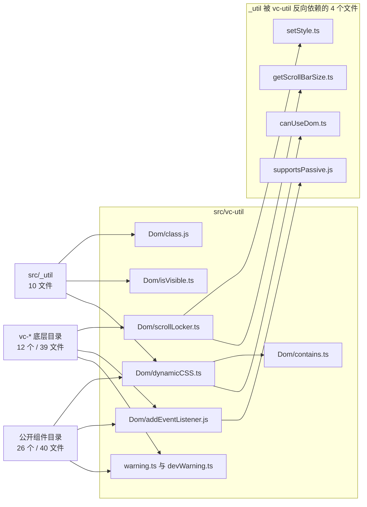
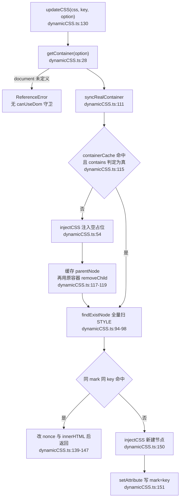
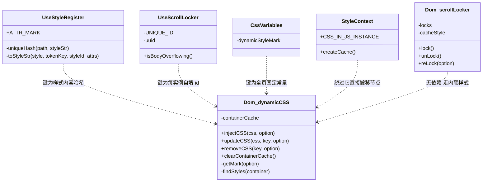
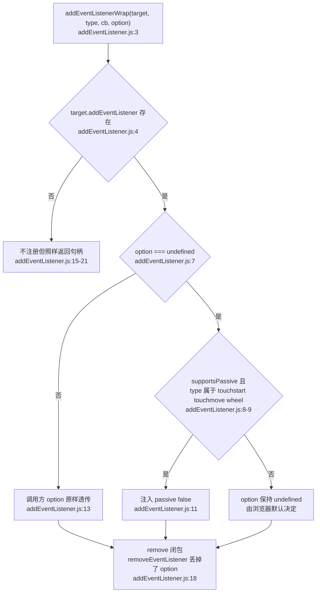

# I03 vc-util 工具层：被十几个组件复用的 DOM 底座

> **本篇解决**：`packages/xiaoye-ui/src/vc-util/` 这 14 个文件到底提供了什么能力、被谁调用、调用了几处；它和主库 `_util/` 下的同名能力是不是重复实现；改 `dynamicCSS` / `addEventListener` / `scrollLocker` 里任何一行会波及哪些组件。
> **前置**：A06（Props 体系与类型工具）　**读者坐标**：`02-infrastructure` 第 3/16 篇
> **边界**：主库 `_util/` 自身的工具面归 A06 与 I13/I14，本篇只在证明重复实现时引用其行号；`PortalWrapper` 的滚动锁定流程归 I10/A07，本篇只用一行引用（`packages/xiaoye-ui/src/_util/PortalWrapper.tsx:109`）。

---

## 一、职责与边界

`vc-util/` 是随底层控件（vendor 分层，即 `vc-*` 目录 = 第三方控件的底层实现层）一起搬进来的 DOM 底座：14 个文件、705 行，没有 `index.ts`，不进任何生成物。它管的三件事是**事件绑定的 passive 兜底**（`packages/xiaoye-ui/src/vc-util/Dom/addEventListener.js:3`）、**样式节点的注入与去重**（`packages/xiaoye-ui/src/vc-util/Dom/dynamicCSS.ts:130`）、**容器滚动锁定的引用计数**（`packages/xiaoye-ui/src/vc-util/Dom/scrollLocker.ts:22`），外加六个一次性小工具（`packages/xiaoye-ui/src/vc-util/Dom/contains.ts:1`、`packages/xiaoye-ui/src/vc-util/Dom/isVisible.ts:1`、`packages/xiaoye-ui/src/vc-util/Dom/class.js:1`、`packages/xiaoye-ui/src/vc-util/Dom/css.ts:33`、`packages/xiaoye-ui/src/vc-util/isEqual.ts:10`、`packages/xiaoye-ui/src/vc-util/isMobile.ts:1`）、四条告警与路径读写支线（`packages/xiaoye-ui/src/vc-util/warning.ts:33`、`packages/xiaoye-ui/src/vc-util/devWarning.ts:5`、`packages/xiaoye-ui/src/vc-util/get.ts:1`、`packages/xiaoye-ui/src/vc-util/set.ts:34`），以及一个 0 调用方的 `packages/xiaoye-ui/src/vc-util/Children/toArray.ts:8`。

它明确**不负责**：CSS-in-JS 的哈希与缓存（`_util/cssinjs/`，归 A04）、Token 计算（归 A03）、响应式 hooks（`_util/hooks/`，归 I13）、Props 契约（`_util/props-util/`，归 A06）、层级编排（`_util/zIndexManager.ts`，归 I10）。它也不负责 SSR：`dynamicCSS` 的四个导出里只有一个有服务端守卫，这一点在 §四 论点 2 里单独展开。

依赖方向是本篇最重要的结构性事实。**消费侧**：主库 `src` 下 89 个文件、39 个目录 import 了 `vc-util` 里的东西，其中 26 个是公开组件目录、12 个是 `vc-*` 底层目录、1 个是 `_util`（10 个文件）。**反向**：`vc-util` 自己也 import `_util`，共 5 处（`packages/xiaoye-ui/src/vc-util/Dom/dynamicCSS.ts:1`、`packages/xiaoye-ui/src/vc-util/Dom/scrollLocker.ts:2`、`packages/xiaoye-ui/src/vc-util/Dom/scrollLocker.ts:3`、`packages/xiaoye-ui/src/vc-util/Dom/addEventListener.js:1`、`packages/xiaoye-ui/src/vc-util/Children/toArray.ts:2`）。也就是说这两个「工具层」之间不存在单向依赖，它们是互相引用的对等体，`vc-` 前缀在这里没有任何分层含义。复现命令见文末检查点 1。

---

## 二、源码地图

`vc-util/` 全量 14 文件 705 行，无 `index.ts`、无 `style/`、无测试文件。行数分布：

| 文件 | 行数 | 职责 | 关键导出（行号） |
| --- | --- | --- | --- |
| `vc-util/Dom/dynamicCSS.ts` | 153 | 样式节点注入、按属性键替换、真实容器探测 | `injectCSS:54`、`updateCSS:130`、`removeCSS:100`、`clearContainerCache:126` |
| `vc-util/Dom/css.ts` | 133 | jQuery 式样式读写与文档尺寸测量 | `get:33`、`set:42`、`getOffset:100`、`getScroll:93`、`styleToString:116` |
| `vc-util/Dom/scrollLocker.ts` | 127 | 容器滚动锁定的引用计数类 | `ScrollLocker:22`（`lock:53`、`unLock:105`、`reLock:38`） |
| `vc-util/Dom/class.js` | 28 | `classList` 的字符串兜底 | `hasClass:1`、`addClass:9`、`removeClass:19` |
| `vc-util/Dom/isVisible.ts` | 25 | 三段式可见性判定 | 默认导出 `:1` |
| `vc-util/warning.ts` | 42 | 带全局去重的 error/warn | `warning:4`、`warningOnce:33`、`noteOnce:37` |
| `vc-util/Dom/addEventListener.js` | 22 | passive 兜底与解绑句柄 | 默认导出 `:3` |
| `vc-util/set.ts` | 51 | 不可变路径写入 | `set:34`、`internalSet:3` |
| `vc-util/isEqual.ts` | 52 | 深比较与循环引用告警 | `isEqual:10` |
| `vc-util/isMobile.ts` | 15 | UA 串判定 | 默认导出 `:1` |
| `vc-util/Children/toArray.ts` | 25 | Fragment 摊平（无调用方） | `toArray:8` |
| `vc-util/get.ts` | 13 | 路径读取 | `get:1` |
| `vc-util/devWarning.ts` | 7 | 加组件前缀的一次性告警 | 默认导出 `:5` |
| `vc-util/Dom/contains.ts` | 12 | 原生 `contains` 直通 | 默认导出 `:1` |

主实现入口不是某个组件而是三个函数：`packages/xiaoye-ui/src/vc-util/Dom/dynamicCSS.ts:130`、`packages/xiaoye-ui/src/vc-util/Dom/addEventListener.js:3`、`packages/xiaoye-ui/src/vc-util/Dom/scrollLocker.ts:53`。

引用热度按「多少个文件 import 了该模块」统计（含 `.js`，排除 `node_modules` 与 `dist`）：`devWarning` 32、`warning` 32、`Dom/addEventListener` 11、`Dom/css` 7、`Dom/class` 4、`Dom/dynamicCSS` 4、`Dom/isVisible` 4、`Dom/contains` 3、`isMobile` 3、`get` 1、`set` 1、`isEqual` 1、`Dom/scrollLocker` 1（且是 `import type`，见 `packages/xiaoye-ui/src/vc-dialog/Dialog.tsx:32`）、`Children/toArray` 0。被引用最广的三个工具因此是：**一次性告警族（`devWarning` 与 `warning` 的去重并集 62 个文件——`packages/xiaoye-ui/src/tree/Tree.tsx:15`、`:16` 与 `packages/xiaoye-ui/src/tree-select/index.tsx:18`、`:22` 两个文件同时引两者）**、**`Dom/addEventListener`（11 个文件）**、**`Dom/css`（7 个文件）**。命令见文末检查点 2，并集用：

```bash
grep -rl --include='*.ts' --include='*.tsx' --include='*.vue' --include='*.js' \
  --exclude-dir=node_modules --exclude-dir=dist -E "vc-util/(devWarning|warning)'" packages/xiaoye-ui/src | wc -l
```

`Dom/css` 的 7 个文件里只有 4 个函数真的被用到（`getOffset`、`getClientSize`、`styleToString`、`styleObjectToString`），10 个导出里有 6 个（`get`、`set`、`getOuterWidth`、`getOuterHeight`、`getDocSize`、`getScroll`）在库内没有任何命名导入：

```bash
grep -c "^export function" packages/xiaoye-ui/src/vc-util/Dom/css.ts
grep -rhoE "\{[^}]*\} from '[^']*vc-util/Dom/css'" \
  --include='*.ts' --include='*.tsx' --include='*.js' \
  --exclude-dir=node_modules --exclude-dir=dist packages apps \
  | grep -oE "^\{[^}]*\}" | sort -u
```

第一条给 `10`；第二条只给出去重后的 4 个名字组合（`getClientSize`、`getOffset`、`styleObjectToString`、`styleToString`），说明其余 6 个导出没有一条命名导入。

`Dom/class` 的 4 个文件里还有 1 个是 `_util/components/` 的机械副本（`packages/xiaoye-ui/src/_util/components/collapseMotion.tsx:2`），该副本自身的直接引用为 0（归属决定见 OUTLINE 已知待办 5，归 A06），所以 `Dom/class` 的有效消费方是 3 个文件。

---

## 三、架构与数据流

### 3.1 依赖拓扑：三个消费群 + 一条反向依赖带



这张图要说清三件事。第一，`_util` 既是 `vc-util` 的消费者（`UTI --> DC` 等三条边）又是它的被消费者（`DC --> CU`、`AE --> SP`、`SL --> GS`、`SL --> SS` 四条边），两个目录构成**目录级双向耦合**；文件级没有成环（`packages/xiaoye-ui/src/vc-util/warning.ts:1` 起整个文件零 import，所以它不会和以它为唯一依赖的 `packages/xiaoye-ui/src/_util/warning.ts:1` 互相引用），但这只是运气。第二，`Dom/scrollLocker.ts` 的入边只来自 `vc-*` 层的 prop 声明，没有一条来自能实例化它的调用（详见论点 7）。第三，`_util/cssinjs` 与 `config-provider` 是 `dynamicCSS` 的全部真实消费者（4 个文件：`packages/xiaoye-ui/src/_util/hooks/useScrollLocker.ts:3`、`packages/xiaoye-ui/src/_util/cssinjs/util.ts:2`、`packages/xiaoye-ui/src/_util/cssinjs/hooks/useStyleRegister/index.tsx:21`、`packages/xiaoye-ui/src/config-provider/cssVariables.ts:6`），也就是说**样式引擎的落盘动作是站在这个 vendor 目录上的**，不是站在 `_util` 上的。

### 3.2 `updateCSS` 的决策流：容器缓存失效时一次调用要做四次 DOM 变更



分支为什么都在：`getContainer`（`packages/xiaoye-ui/src/vc-util/Dom/dynamicCSS.ts:28`）支持 `attachTo`，因为样式引擎可以把节点注入 ShadowRoot 而不是 `head`；`syncRealContainer`（`:111`）存在的原因是注释里点名的 qiankun——微前端框架会劫持 `appendChild`，把节点实际插到沙箱容器里，于是「你以为的容器」和「节点真正的父级」不是同一个元素，必须插一个空 `<style>` 反查真实父级并缓存（`:116-118`）；`findExistNode`（`:94`）是幂等性的唯一保证，它按 `mark` 属性 + `key` 值在容器 children 里找同名节点，找到就就地改 `innerHTML`（`:143-145`），找不到才新建。注意这里没有任何 `key → node` 的索引，每次都是 `findStyles(container)`（`:48-52`）把容器 children 全量过滤一遍 `tagName === 'STYLE'`，所以 `updateCSS` 的复杂度是 O(head 里 style 节点数)，而不是 O(1)。标题里的「四次」沿最差路径数：占位节点插入（`:116` 调 `:61-88`）、占位节点删除（`:119`）、真实节点插入（`:150`）、去重属性写入（`:151`）。走命中分支时只剩一次 `innerHTML` 赋值（`:143-145`），而且内容相同就完全不写——这是这个模块唯一的性能护栏。

### 3.3 样式节点管理的三方对照



`classDiagram` 里三条 `..>` 边是本篇论点 1 的全部：**同一个 `updateCSS(css, key)` 被三种完全不同的键策略调用**。`packages/xiaoye-ui/src/_util/cssinjs/hooks/useStyleRegister/index.tsx:375` 用 `uniqueHash(fullPath, styleStr)` 当键（内容哈希），`packages/xiaoye-ui/src/_util/hooks/useScrollLocker.ts:24` 用 `UNIQUE_ID + uuid` 当键（每实例一个），`packages/xiaoye-ui/src/config-provider/cssVariables.ts:99` 用 `${dynamicStyleMark}-dynamic-theme` 当键（全页一个）。键选对了是就地更新，键选「撞车」了就是互相覆盖，键选「太独特」就是节点叠加——三者都在同一份 `dynamicCSS` 代码上跑，模块本身不提供任何保护。第四条边（`StyleContext ..> Dom_dynamicCSS : 绕过`）指 `packages/xiaoye-ui/src/_util/cssinjs/StyleContext.tsx:31-38`：`createCache` 在 SSR 混合场景直接 `insertBefore` 搬移 `<style>` 节点并按 `ATTR_MARK` 去重，没有走 `dynamicCSS`，这是库内第五套样式节点操作。

### 3.4 事件封装的判定分支



只有 `E3` 为「是」时封装才起作用，这决定了它的实际语义是**「不传 option 时的默认值修正器」**。`E4` 依赖的 `supportsPassive` 来自 `packages/xiaoye-ui/src/_util/supportsPassive.js:2-13`：一个模块级 `try/catch` 里用 `Object.defineProperty` 的 getter 探测浏览器是否读取 `passive` 字段。`E8` 是这张图里唯一的坑位：`removeEventListener` 的匹配规则要求 `capture` 一致，而句柄只传了 `(eventType, cb)`。

---

## 四、核心机制精读

### 论点 1：`dynamicCSS` 的去重单位是「DOM 属性键」而不是节点引用，多实例是覆盖还是叠加完全由调用方传的 `key` 决定

`packages/xiaoye-ui/src/vc-util/Dom/dynamicCSS.ts:94` 起：

```ts
// packages/xiaoye-ui/src/vc-util/Dom/dynamicCSS.ts:94
function findExistNode(key: string, option: Options = {}) {
  const container = getContainer(option);

  return findStyles(container).find(node => node.getAttribute(getMark(option)) === key);
}

export function removeCSS(key: string, option: Options = {}) {
  const existNode = findExistNode(key, option);
  if (existNode) {
    const container = getContainer(option);
    container.removeChild(existNode);
  }
}
```

配合 `:130` 的 `updateCSS`——命中就 `existNode.innerHTML = css`（`:143-145`），未命人才 `injectCSS` 并 `newNode.setAttribute(getMark(option), key)`（`:150-151`）——整套机制可以概括成一句话：**样式节点的身份由「哪个属性等于哪个字符串」定义，模块不持有任何节点引用**。属性名由 `getMark`（`:21-26`）决定：传了 `mark` 就用它（不带 `data-` 前缀会自动补），没传就用默认的 `MARK_KEY`，也就是 `data-vc-util-key`（常量定义在 `:5`，写成模板字符串但没有插值）。

这解释了三种调用方为什么会得到三种完全不同的多实例行为，而且三种都「对」：

- **内容哈希键**：`packages/xiaoye-ui/src/_util/cssinjs/hooks/useStyleRegister/index.tsx:375` 的 `styleId = uniqueHash(fullPath.value, styleStr)`，同一组件同一 Token 第二次注册命中同一节点、就地替换；Token 变了哈希变了，于是新旧节点**并存**，靠 `prepend: 'queue'`（`:380`）保证新节点插在队列尾部、由 CSS 层叠顺序决定谁赢。也就是说样式引擎的「不互相覆盖」不是 `dynamicCSS` 给的，是哈希键 + 队列插入位置共同给的。
- **每实例自增键**：`packages/xiaoye-ui/src/_util/hooks/useScrollLocker.ts:7` 定义 `UNIQUE_ID = \`vc-util-locker-${Date.now()}\``，`:9` 的 `let uuid = 0` 在 `:23` 每次调用 `useScrollLocker()` 时 `uuid += 1`，`:24` 拼出 `id`。两个 Modal 同时打开时各自 `updateCSS`（`:35-42`）注入一个 `<style>`，键不同 → **叠加两个节点**，内容是同一条 `html body { overflow-y: hidden }` 所以视觉等价；A 关闭时 `removeCSS(id)`（`:44`、`:47`）只删自己那份，B 的还在 → 滚动继续锁定。这是这段代码的核心正确性来源：**靠「唯一键 + 各删各的」实现了引用计数，而不是真的计数**。代价是 `lockCount` 之类的状态一个都不需要，但也意味着节点数量随并发弹窗线性增长，且 `Date.now()` 在模块加载时求值一次——若同一页面加载了两份不同 bundle 的库，两份的 `UNIQUE_ID` 不同，彼此不认识对方的节点，卸载时也不会互清。
- **全页固定键**：`packages/xiaoye-ui/src/config-provider/cssVariables.ts:99` 用 `${dynamicStyleMark}-dynamic-theme`，主题切换时同一节点被反复改写，永远只有 1 个 `<style>`。这是三者里唯一「覆盖」语义的调用。

对比 `vc-util` 自己那份 `scrollLocker`：它用 `locks` 数组做真引用计数（`packages/xiaoye-ui/src/vc-util/Dom/scrollLocker.ts:14`），走的是另一条路（内联样式 + class），见论点 7。两套滚动锁定里，**活下来的是靠属性键叠加的那套**。

结论回扣：`dynamicCSS` 是个「按键幂等」的极简注册表，安全性完全外包给键策略。改动它时不能只看函数签名，必须同时检查三个键策略是否还互不冲突。

### 论点 2：服务端安全只写了一半——`injectCSS` 有 `canUseDom` 早退，`updateCSS` 与 `removeCSS` 没有，SSR 不炸是因为四个调用方各自加了守卫

`packages/xiaoye-ui/src/vc-util/Dom/dynamicCSS.ts:54`：

```ts
// packages/xiaoye-ui/src/vc-util/Dom/dynamicCSS.ts:54
export function injectCSS(css: string, option: Options = {}) {
  if (!canUseDom()) {
    return null;
  }

  const { csp, prepend } = option;

  const styleNode = document.createElement('style');
  styleNode.setAttribute(APPEND_ORDER, getOrder(prepend));
```

`canUseDom` 是 `packages/xiaoye-ui/src/_util/canUseDom.ts:1` 的三条件与运算（`typeof window !== 'undefined'`、`window.document`、`document.createElement`）。而 `updateCSS`（`:130`）第一句就是 `getContainer(option)`（`:28`），后者无条件 `document.querySelector('head')`（`:33`）；`removeCSS`（`:100`）同样无条件 `findExistNode` → `getContainer`。在 Node 里 `document` 是未声明标识符，抛的是 `ReferenceError`，不是返回 `null`。更绕的是 `syncRealContainer`（`:111`）：即使 `injectCSS` 因为服务端返回了 `null`，`:117` 仍会 `const { parentNode } = placeholderStyle` 对 `null` 解构再抛一次。

现在四个调用方是怎么活下来的：`packages/xiaoye-ui/src/_util/hooks/useScrollLocker.ts:28` 在 `watchEffect` 里先 `if (!canUseDom()) return`；`packages/xiaoye-ui/src/config-provider/cssVariables.ts:98` 用 `if (canUseDom())` 包住 `updateCSS`，`else` 分支走 `:101` 的告警；`packages/xiaoye-ui/src/_util/cssinjs/util.ts:49` 在 `supportSelector` 里判 `canUseDom()` 才调 `updateCSS`（`:50`）与 `removeCSS`（`:69`）；`useStyleRegister` 用 `:34` 的模块级 `const isClientSide = canUseDom()` 加 `:377` 的 `if (isMergedClientSide)` 门控注入、`:422` 门控删除。四处全中，一个都没漏。

所以这不是「已修复的 bug」，而是**一条没有写进类型、注释或断言的隐式契约**：`updateCSS`/`removeCSS` 的调用方必须自带 `canUseDom`。`Options` 接口（`:13-19`）里没有任何环境相关字段，目录里的注释也没有一处提到服务端禁忌（`:45-47` 解释的是 `findStyles`，`:108-110` 解释的是 qiankun）。新增第五个调用方（比如给某个新组件做动态样式）时，只要忘了守卫，表现是 SSR 首屏 500，而不是类型报错。

结论回扣：本模块的服务端可用性是**分布式实现的**，`vc-util` 自己不提供保证。

### 论点 3：`syncRealContainer` 用一个空 `<style>` 反查真实容器，代价是 ShadowRoot 场景每次调用都要重探一次，且清理时用的是「原容器」

`packages/xiaoye-ui/src/vc-util/Dom/dynamicCSS.ts:111`：

```ts
// packages/xiaoye-ui/src/vc-util/Dom/dynamicCSS.ts:111
function syncRealContainer(container: ContainerType, option: Options) {
  const cachedRealContainer = containerCache.get(container);

  // Find real container when not cached or cached container removed
  if (!cachedRealContainer || !contains(document, cachedRealContainer)) {
    const placeholderStyle = injectCSS('', option);
    const { parentNode } = placeholderStyle;
    containerCache.set(container, parentNode);
    container.removeChild(placeholderStyle);
  }
}
```

`:108-110` 的注释写得很直白：qiankun 会把 `appendChild` 改写到别处。缓存 `containerCache`（`:7`）是 `Map<ContainerType, Node & ParentNode>`，键是**你请求的容器**，值是**占位节点实际的父级**。设计意图是把「代理后的真实落点」算一次、之后复用。

三处代价是可以逐行指出的。第一，`:115` 的有效性判定用 `contains(document, cachedRealContainer)`，而 `contains` 是原生 `Node.prototype.contains`（`packages/xiaoye-ui/src/vc-util/Dom/contains.ts:7-9`）——它不会跨 Shadow 边界，`document.contains(shadowRoot)` 恒为 `false`。于是只要 `attachTo` 传的是 ShadowRoot（样式引擎的 `container` 正是这个用途，见 `packages/xiaoye-ui/src/_util/cssinjs/hooks/useStyleRegister/index.tsx:364` 读到的 `container`，最终作为 `attachTo` 传进 `:381`），缓存每轮都被判定失效，每次 `updateCSS` 都要「注入占位 → 记父级 → 删占位」，额外两次 DOM 写。第二，`:119` 删除占位用的是入参 `container`，但 `:117` 记录的父级是 `placeholderStyle.parentNode`；在 qiankun 这类真的把节点挪走的环境里，这两个不是同一个元素，`container.removeChild(placeholderStyle)` 会抛 `NotFoundError`，而这段代码没有任何 `try/catch`（对比 `packages/xiaoye-ui/src/vc-image/src/Preview.tsx:302-313` 处理跨 iframe 时是写了 `try/catch` 的）。第三，`:126` 导出的 `clearContainerCache` 注释说是给单测清全局缓存用的，但库内没有任何测试或代码调用它：

```bash
grep -rn "clearContainerCache" --exclude-dir=node_modules --exclude-dir=dist --exclude-dir=.git packages apps
```

输出只有定义行 `packages/xiaoye-ui/src/vc-util/Dom/dynamicCSS.ts:126`。也就是说这个模块级缓存在生产里**永不清理**：`Map` 的键和值都是强引用，容器元素即使已被移出文档，条目仍留在 Map 中；只有当**同一个容器对象**再次传进来时，`:115` 的 `contains` 判定才会发现缓存失效并重新探测。`clearContainerCache` 本意就是切断这条全局状态（注释在 `:123-125`），但它既没被生产代码用、也没被测试用。

结论回扣：这个函数是本模块里唯一为「非标准 DOM」做适配的地方，但它同时是本模块 SSR 与 Shadow DOM 两条最脆弱的接缝。

### 论点 4：样式顺序靠 `data-vc-order` 的队列插入，`Options.priority` 是从未被读取的死参数，而 SSR 侧仍在写 `data-vc-priority`

`packages/xiaoye-ui/src/vc-util/Dom/dynamicCSS.ts:37` 与 `:72`：

```ts
// packages/xiaoye-ui/src/vc-util/Dom/dynamicCSS.ts:37
function getOrder(prepend?: Prepend): AppendType {
  if (prepend === 'queue') {
    return 'prependQueue';
  }

  return prepend ? 'prepend' : 'append';
}
```

真正决定位置的是 `injectCSS` 里的这段（`:72-89`）：`prepend === 'queue'` 时，先取现有 `STYLE` 里 `data-vc-order` 属于 `['prepend','prependQueue']` 的那批（`:75-77`），把新节点插到**最后一个的后面**（`:79`），否则一律 `insertBefore(node, firstChild)`（`:86`）或 `appendChild`（`:88`）。`APPEND_ORDER` 常量在 `:4` 定义为 `data-vc-order`。而 `Options` 里同时声明了 `priority?: number`（`:18`），`useStyleRegister` 也确实传了值——`packages/xiaoye-ui/src/_util/cssinjs/hooks/useStyleRegister/index.tsx:382` 的 `priority: order`——但整个 `vc-util` 目录里没有任何一处读取 `priority`：

```bash
grep -rn "priority" --include='*.ts' --include='*.tsx' --exclude-dir=node_modules --exclude-dir=dist packages/xiaoye-ui/src/vc-util
```

只命中 `dynamicCSS.ts:18`。更尴尬的是 SSR 那侧还在按上游语义输出属性：`packages/xiaoye-ui/src/_util/cssinjs/hooks/useStyleRegister/index.tsx:516`：

```tsx
// packages/xiaoye-ui/src/_util/cssinjs/hooks/useStyleRegister/index.tsx:516
      // Used for vc-util
      const sharedAttrs = {
        'data-vc-order': 'prependQueue',
        'data-vc-priority': `${order}`,
      };
```

`data-vc-order` 是有效的—— hydration 后 `findStyles` 会把它算进队列尾（`:76`），因此客户端新注的样式排在服务端样式之后，层叠顺序稳定。`data-vc-priority` 则是一个**写出来没人读**的属性；`order` 的排序信息在客户端只剩「是不是 prepend 队列」这一比特。这就形成一个隐蔽的顺序契约：同一队列里多个组件样式的相对顺序，在 SSR 与 CSR 两条路径上依据的是不同强度的信息——SSR 排了一次（`useStyleRegister` 的 `orderStyles`），CSR 只保证「追加到队尾」。若某个组件的 `order` 靠 priority 才压过另一个，CSR 增量注水时并没有这个保护。

结论回扣：本模块对外声称支持优先级（有字段、有传参、有 SSR 属性），实现里只有三级位置（prepend / prependQueue / append）。这是「上游 API 形状保留、语义丢失」的典型样本，改动前一定要先确认调用方是否真的依赖 `priority`。

### 论点 5：`addEventListener` 封装只解决 passive，`once` 靠原生透传，`capture` 在解绑时被丢掉——库内已经各踩中一次

`packages/xiaoye-ui/src/vc-util/Dom/addEventListener.js:1` 全文 22 行：

```js
// packages/xiaoye-ui/src/vc-util/Dom/addEventListener.js:1
import supportsPassive from '../../_util/supportsPassive';

export default function addEventListenerWrap(target, eventType, cb, option) {
  if (target && target.addEventListener) {
    let opt = option;
    if (
      opt === undefined &&
      supportsPassive &&
      (eventType === 'touchstart' || eventType === 'touchmove' || eventType === 'wheel')
    ) {
      opt = { passive: false };
    }
    target.addEventListener(eventType, cb, opt);
  }
  return {
    remove: () => {
      if (target && target.removeEventListener) {
        target.removeEventListener(eventType, cb);
      }
    },
  };
}
```

三个语义要分开看。**passive**：`:6-12` 只在 `option` 完全没给时介入，且只覆盖 `touchstart`/`touchmove`/`wheel` 三种（现代浏览器对 window/document 上的这三类事件默认 `passive: true`，导致 `preventDefault()` 失效——这就是封装存在的唯一理由）。**once**：没有任何处理，若调用方把 `{ once: true }` 放进 `option`，透传给原生即可，但 `remove()` 在已触发后解绑是无害的（`:17-19` 有存在性判断）。**capture**：`:18` 的 `removeEventListener(eventType, cb)` 不带第三个参数，等价于 `capture: false`，而注册时 `:13` 传的是 `opt`（可能是 `true`）——规范上捕获与冒泡阶段的监听器是两个不同条目，所以**用 `true` 注册的监听器无法通过这个句柄解绑**。

这两条接缝在库里各自被踩了一次，而且都是真实代码：

```tsx
// packages/xiaoye-ui/src/modal/Modal.tsx:37
if (canUseDocElement()) {
  addEventListener(document.documentElement, 'click', getClickPosition, true);
}
```

`packages/xiaoye-ui/src/modal/Modal.tsx:6` 引入的是这个封装，`:37-39` 在**模块加载副作用**里以捕获阶段注册全局 click（用途见 `:24-34`：记录鼠标位置，100ms 后清空，供 Modal 的 zoom 动画取起点），并且丢弃返回句柄。也就是说这条监听永远存在且永远删不掉；`canUseDocElement` 来自 `packages/xiaoye-ui/src/_util/styleChecker.ts:3`。另一处是 `packages/xiaoye-ui/src/affix/utils.ts:71`：

```ts
// packages/xiaoye-ui/src/affix/utils.ts:71
    TRIGGER_EVENTS.forEach(eventName => {
      entity!.eventHandlers[eventName] = addEventListener(target, eventName, () => {
        entity!.affixList.forEach(
          targetAffix => {
            const { lazyUpdatePosition } = (targetAffix as any).exposed;
            lazyUpdatePosition();
          },
          (eventName === 'touchstart' || eventName === 'touchmove') && supportsPassive
            ? ({ passive: true } as EventListenerOptions)
            : false,
        );
      });
    });
```

括号位置错了：`eventName === 'touchstart' ... ? { passive: true } : false` 是 `affixList.forEach(...)` 的**第二个实参**（`forEach` 的 thisArg，被忽略），而 `addEventListener` 只收到三个实参。后果是 `option === undefined` 成立 → 命中 `addEventListener.js:6-12` → `touchstart`/`touchmove` 被注入 `{ passive: false }`，与作者想要的 `{ passive: true }` **正好相反**。Affix 的 `TRIGGER_EVENTS`（`packages/xiaoye-ui/src/affix/utils.ts:32-40`）里同时有 `scroll`、`touchstart`、`touchmove`，所以每个被观察的容器都挂了两个非被动的触摸监听。测试也拦不住：`packages/xiaoye-ui/src/affix/index.test.js:26` 把 `addEventListener` 打桩成 `(event, cb) => {...}`，第三个及以后的参数直接不进断言。

再看封装的采纳率。同一件事在本模块之外有两条旁路：9 个文件直接 `import supportsPassive` 自己写三元（`packages/xiaoye-ui/src/vc-trigger/Trigger.tsx:160`、`packages/xiaoye-ui/src/vc-virtual-list/ScrollBar.tsx:68` 等），以及 83 处直接 `.addEventListener(`：

```bash
grep -rn --include='*.ts' --include='*.tsx' --include='*.js' \
  --exclude-dir=node_modules --exclude-dir=dist "\.addEventListener(" packages/xiaoye-ui/src \
  | grep -v '^packages/xiaoye-ui/src/vc-util/' | wc -l
grep -rl --include='*.ts' --include='*.tsx' --include='*.js' \
  --exclude-dir=node_modules --exclude-dir=dist "supportsPassive" packages/xiaoye-ui/src \
  | grep -v '^packages/xiaoye-ui/src/vc-util/' | grep -v '_util/supportsPassive.js' | wc -l
```

前者 `83`，后者 `9`（`_util/supportsPassive.js` 自身不计入）。

最耐人寻味的是 `packages/xiaoye-ui/src/vc-trigger/Trigger.tsx:14` 引入了封装、`:21` 又引入了 `supportsPassive`，然后在 `:156-161` 给 `touchstart` 显式传 `supportsPassive ? { passive: false } : false`——**手写了一遍封装在 `option` 缺省时本来就会做的事**，因为只要传了 option，封装的自动逻辑就被跳过（`:6` 的 `opt === undefined` 不成立）。这个文件是这个封装「名义上用、实际上不信」的最直接证据。`packages/xiaoye-ui/src/vc-virtual-list/ScrollBar.tsx:64-74` 则是完全绕开封装、在原生节点上重复同一表达式：

```tsx
// packages/xiaoye-ui/src/vc-virtual-list/ScrollBar.tsx:64
  mounted() {
    this.scrollbarRef.current?.addEventListener(
      'touchstart',
      this.onScrollbarTouchStart,
      supportsPassive ? ({ passive: false } as EventListenerOptions) : false,
    );
```

结论回扣：这个封装解决的问题是真实的，但它的接口形状（第四参决定一切、句柄丢 capture）让「用了它」和「用对了」不能画等号，`affix/utils.ts` 就是证据。

### 论点 6：`contains` 是 12 行原生直通，既没有 shadow DOM 也没有 iframe 处理；封装与原生调用比例 3 : 31

`packages/xiaoye-ui/src/vc-util/Dom/contains.ts:1` 全文：

```ts
// packages/xiaoye-ui/src/vc-util/Dom/contains.ts:1
export default function contains(root: Node | null | undefined, n?: Node) {
  if (!root) {
    return false;
  }

  // Use native if support
  if (root.contains) {
    return root.contains(n);
  }

  return false;
}
```

关于本篇要求的两个问题，如实回答：**shadow DOM 处理——未找到**。函数体只有空值判断、原生 `contains` 调用、以及原生不支持时返回 `false`（`:11`）；没有 `getRootNode()`、没有 `composedPath()`、没有 `ShadowRoot` 类型分支。**iframe 处理——未找到**：没有 `contentDocument` 尝试，也没有跨文档的 `try/catch`。原生 `Node.contains` 的语义就是「同一棵树内的祖先关系」，跨 Shadow 边界与跨文档都返回 `false`。这个语义对浮层判定是有缺口的：`packages/xiaoye-ui/src/vc-trigger/Trigger.tsx:326-327` 用 `contains(root, target)` 与 `contains(popupNode, target)` 决定「点击在外部→关闭」，若 popup 被挂进 ShadowRoot 而 trigger 在 light DOM，两侧判定会同时为 `false`；`packages/xiaoye-ui/src/vc-dialog/Dialog.tsx:79` 用 `contains(wrapperRef.value, document.activeElement)` 做焦点回归，同样受影子边界限制。真正的跨 iframe 需求是在调用侧手工补的：`packages/xiaoye-ui/src/vc-image/src/Preview.tsx:302-313` 对 `window.top` 重新注册 `mouseup`/`mousemove` 并裹 `try/catch` 以躲跨源异常。

第二个事实是采纳率：只有 3 个文件引入封装（`packages/xiaoye-ui/src/vc-trigger/Trigger.tsx:4`、`packages/xiaoye-ui/src/vc-align/util.ts:1`、`packages/xiaoye-ui/src/vc-dialog/Dialog.tsx:31`），而同一份 `vc-align/util.ts` 里，`:24` 用了封装、`:36` 却写原生：

```ts
// packages/xiaoye-ui/src/vc-align/util.ts:36
    if (!document.documentElement.contains(target)) return;
```

排除 `classList.contains`（那是类名判定，不是节点包含）后的原生节点包含调用：

```bash
grep -rn --include='*.ts' --include='*.tsx' --include='*.js' \
  --exclude-dir=node_modules --exclude-dir=dist "\.contains(" packages/xiaoye-ui/src \
  | grep -v '^packages/xiaoye-ui/src/vc-util/' | grep -v 'classList\.contains' | wc -l
```

得到 31 处（分布在 30 个文件）。结论回扣：`contains` 没有添加任何语义，所以它既不会被推广，也不值得存在；它唯一不可替代的用途是 `dynamicCSS.ts:115` 里那个 `contains(document, ...)`，而那恰恰是论点 3 里 ShadowRoot 判定失效的那一行。

### 论点 7：`scrollLocker` 的 lock/unlock 在纸面上成对，实现里有三处会让它们不成对；但全库 0 处实例化，它是被 `_util/hooks/useScrollLocker.ts` 取代的遗迹

先看计数机制。模块级状态有四份：`packages/xiaoye-ui/src/vc-util/Dom/scrollLocker.ts:14` 的 `let locks: Ilocks[] = []`、`:18` 的 `let uuid = 0`、`:20` 的 `const cacheStyle = new Map<Element, CSSProperties>()`、`:16` 的 `const scrollingEffectClassNameReg = new RegExp(..., 'g')`。构造函数（`:27-31`）给每个实例分配一个自增 `lockTarget`。`lock`（`:53`）的早退路径有两条：

```ts
// packages/xiaoye-ui/src/vc-util/Dom/scrollLocker.ts:53
  lock = () => {
    // If lockTarget exist return
    if (locks.some(({ target }) => target === this.lockTarget)) {
      return;
    }

    // If same container effect, return
    if (locks.some(({ options }) => options?.container === this.options?.container)) {
      locks = [...locks, { target: this.lockTarget, options: this.options }];
      return;
    }
```

`:55-57` 防重复计数，`:60-63` 表示「同容器已有锁，只登记不施加样式」——这就是引用计数的主体。施加样式那段在 `:78-95`：只有当 `locks` 里没有同容器的其他锁时，才用 `setStyle` 写 `width: calc(100% - Xpx)` 与三个 `overflow: hidden`，并把**旧值**存进 `cacheStyle`。`unLock`（`:105`）反过来：先从 `locks` 里剔除自己（`:108`），若还剩同容器的锁就返回（`:110-115`），否则回滚内联样式并删 class（`:123-125`）。配对逻辑本身是自洽的。

三处破坏配对的风险点，都能给行号：

1. **`g` 标志的共享正则有状态**。`:16` 的 `scrollingEffectClassNameReg` 带 `'g'`，`lock` 在 `:97` 调 `.test(containerClassName)`，`unLock` 在 `:121` 再调一次。带 `global` 的 `RegExp.test` 会推进并保留 `lastIndex`，于是**同一个实例上连续两次 test 同串会得到 `true` → `false`**。表现为：第二次 `lock` 会重复往 `className` 追加 `xy-scrolling-effect`（`:98-99`），而 `unLock` 可能得到 `false` 并在 `:121` 提前 `return`——此时内联样式不回滚、`:124` 的 `cacheStyle.delete(container)` 不执行，Map 里留下陈旧样式，body 永久停在 `overflow: hidden`。`:125` 的 `replace` 不受影响（`String.replace` 对全局正则会把 `lastIndex` 归零），所以这个 bug 只会「锁住」不会「漏锁」，方向上更危险。
2. **`unLock` 用的容器和登记的容器可能不是同一个**。`:112` 判定用 `findLock.options?.container`，`:118` 回滚用 `this.options?.container || document.body`。`reLock`（`:38-51`）里 `:45` 无条件 `this.options = options`，而 `:48` 的 `findLock.options = options` 只在已锁时执行；未锁状态下改 `this.options` 再走 `lock`（`:60` 按新容器比对）是安全的，但如果调用方在 `lock` 之后自行替换 `options` 对象（`scrollLockOptions` 是普通对象，`:5-7`，没有防变更），`unLock` 就会去回滚一个从未被锁的容器，真正的容器留在锁定态。
3. **`:42` 的 `reLock` 顺序**。它先 `unLock()`（此时 `locks` 已不含自己）再在 `:48` 写 `findLock.options`——那个对象已经不在数组里了（`:108` 用 `filter` 生成了新数组），所以这行赋值对状态无影响；`lock()` 在 `:49` 重新读 `this.options` 生成新条目（`:102`）。行为正确，但代码读起来像是依赖了一个已失效的引用，改动时容易误判。

然后是本篇关于它的最重要结论：**这套引用计数在本仓运行时是死代码**。

```bash
grep -rn --exclude-dir=node_modules --exclude-dir=dist --exclude-dir=.git "new ScrollLocker" packages apps; echo "exit=$?"
grep -rn --exclude-dir=node_modules --exclude-dir=dist --exclude-dir=.git "scrollLocker" packages apps
```

第一条无输出、`exit=1`。第二条的输出只有：`packages/xiaoye-ui/src/vc-util/Dom/scrollLocker.ts` 自身、`packages/xiaoye-ui/src/vc-dialog/Dialog.tsx:32`（`import type`）、`:25`（prop 声明 `Object as PropType<ScrollLocker>`）、`:139`/`:142`/`:144`（三处 `props.scrollLocker?.`）、`:192`（`omit` 掉这个 prop 不下传 DOM）、`packages/xiaoye-ui/src/vc-drawer/src/IDrawerPropTypes.ts:56`（`PropTypes.any`）与 `packages/xiaoye-ui/src/vc-drawer/src/DrawerChild.tsx:55`/`:70`/`:80`/`:83`/`:95`。**没有任何一处把 `scrollLocker` 作为 prop 传进 `vc-dialog` 或 `vc-drawer`**，所以 `?.` 链恒为 undefined。`vc-dialog/Dialog.tsx:169-174` 那段 `watchEffect` 每次执行都是空转：

```tsx
// packages/xiaoye-ui/src/vc-dialog/Dialog.tsx:148
    watchEffect(() => {
      props.scrollLocker?.unLock();
      if (animatedVisible.value) {
        props.scrollLocker?.lock();
      }
    });
```

真实的滚动锁定走的是另一条链：`packages/xiaoye-ui/src/_util/hooks/useScrollLocker.ts:21`（`PortalWrapper` 在 `packages/xiaoye-ui/src/_util/PortalWrapper.tsx:48` 调用它；细节归 I10/A07），实现方式是 `updateCSS` 注一条 `html body { overflow-y: hidden }` 而不是改内联样式——也就是论点 1 的属性键方案。附带一条：`packages/xiaoye-ui/src/vc-util/Dom/scrollLocker.ts:15` 定义的 `xy-scrolling-effect` 这个类名，全仓只有它自己那一处出现，没有任何样式规则定义它：

```bash
grep -rn --exclude-dir=node_modules --exclude-dir=dist --exclude-dir=.git "xy-scrolling-effect" packages apps
```

单行输出即 `packages/xiaoye-ui/src/vc-util/Dom/scrollLocker.ts:15`。结论回扣：`scrollLocker.ts` 127 行里，运行路径 0 行、类型路径 2 个文件。它不是「没人用的工具」，而是「被 prop 类型钉住的死实现」——删除它是破坏类型面的变更（`vc-dialog` 的公开 props 面里有它），留着它就是留着三个会被误当活代码修改的风险点。

### 论点 8：`vc-util` 与 `_util` 是双向耦合的两套 DOM 工具，第三套在 `@xiaoye-ui/utils/dom`；重复是逐函数发生的，不是逐层发生的

这是本篇最值钱的一段，因为它是**成对**的，不是一句「有重复」的抱怨。表格里每一行的三个位置都读到了具体行号：

| 能力 | `vc-util` 实现 | 主库 `_util` 实现 | `@xiaoye-ui/utils` 实现 |
| --- | --- | --- | --- |
| DOM 可用性判定 | 无自有实现，`Dom/dynamicCSS.ts:1` 引 `_util/canUseDom` | `packages/xiaoye-ui/src/_util/canUseDom.ts:1` | `packages/utils/src/dom/methods/isServer.ts:3` |
| 滚动条宽度 | 无自有实现，`Dom/scrollLocker.ts:73` 引 `_util/getScrollBarSize` | `packages/xiaoye-ui/src/_util/getScrollBarSize.ts:5`（试量 div） | `packages/utils/src/dom/methods/calculateBodyScrollbarWidth.ts:1` |
| 内联样式读写 | `Dom/css.ts:33 get` / `:42 set` | `packages/xiaoye-ui/src/_util/setStyle.ts:11` | `packages/utils/src/dom/methods/addStyle.ts:1` |
| class 增删 | `Dom/class.js:1`/`:9`/`:19` | `packages/xiaoye-ui/src/_util/component-classes.ts:13` | `packages/utils/src/dom/methods/hasClass.ts:1` |
| 文档滚动量 | `Dom/css.ts:93`（`getScroll()` 无参） | `packages/xiaoye-ui/src/_util/getScroll.ts:5`（`getScroll(target, top)`） | `packages/utils/src/dom/methods/getWindowScrollTop.ts:1` |
| 元素可见性 | `Dom/isVisible.ts:1`（三段判定） | 无 | `packages/utils/src/dom/methods/isVisible.ts:1`（仅 `offsetParent`） |
| 动态 `<style>` 节点 | `Dom/dynamicCSS.ts:54`/`:100`/`:130` | `packages/xiaoye-ui/src/_util/cssinjs/StyleContext.tsx:31-38`、`packages/xiaoye-ui/src/_util/wave/WaveEffect.tsx:155-159` | `packages/utils/src/dom/methods/createStyleElement.ts:3` |
| 事件绑定 passive | `Dom/addEventListener.js:3` | 被 `vc-util` 外的 9 个文件绕过后自行判定（`packages/xiaoye-ui/src/_util/supportsPassive.js:2` 起） | 无 |
| 一次性告警 | `warning.ts:33`、`devWarning.ts:5` | `packages/xiaoye-ui/src/_util/warning.ts:11` | 无 |
| 滚动锁定 | `Dom/scrollLocker.ts:22` | `packages/xiaoye-ui/src/_util/hooks/useScrollLocker.ts:21` | `packages/utils/src/dom/helpers/blockBodyScroll.ts:9` |

几组值得单独看的细节。**滚动条宽度**：`packages/xiaoye-ui/src/vc-util/Dom/scrollLocker.ts:70` 用 `window.innerWidth - document.documentElement.clientWidth > 0` 做「有没有滚动条」的判据，`packages/utils/src/dom/methods/calculateBodyScrollbarWidth.ts:2` 用 `window.innerWidth - document.documentElement.offsetWidth` 直接当宽度值——`clientWidth` 不含边框、`offsetWidth` 含边框，两条同族公式给出不同数值，前者只作布尔判断所以侥幸没事。**class 操作**：`vc-util/Dom/class.js:9` 的 `addClass` 在 `classList` 可用时直接 `add`（`:11`），而 `packages/utils/src/dom/methods/addClass.ts:9` 先 `hasClass` 再 `add`（`:10`），`_util/component-classes.ts:40` 的 `ClassList.add` 又是第三种（`classList` 优先、失败时 `indexOf` 去重 `:49-51`），并且它额外依赖 `lodash-es/indexOf`（`packages/xiaoye-ui/src/_util/component-classes.ts:6`）。**动态样式**：`_util/wave` 的涟漪效果完全不用 `dynamicCSS`，而是在 `packages/xiaoye-ui/src/_util/wave/WaveEffect.tsx:155` 手工 `document.createElement('div')`、`:159` `insertBefore`、`:165` `removeChild`，并且它同文件 `packages/xiaoye-ui/src/_util/wave/index.tsx:11` 又回头 import 了 `vc-util/Dom/isVisible`——`_util` 的同一个子目录里，一部分能力绕过 `vc-util`，另一部分依赖 `vc-util`。**告警**：三份实现互不兼容，`packages/xiaoye-ui/src/vc-util/warning.ts:6` 的 NODE_ENV 判定在**函数体内**（每次调用比较，`warned` 去重表在 `:2` 与 `:27-30` 无条件维护），`packages/xiaoye-ui/src/_util/warning.ts:10` 的判定在**模块顶层**，生产构建把整个函数替换成 `:9` 的 `noop`；两者消息前缀字符串完全相同（`vc-util/devWarning.ts:6` 与 `_util/warning.ts:12` 都是 `[xiaoye-ui: ${component}] `），也就是说 32 个文件用前者、31 个文件用后者，拼出来的日志无法区分来源。最耐人寻味的一处命名错位：`packages/xiaoye-ui/src/_util/cssinjs/linters/utils.ts:1` 写的是 `import devWarning from '../../../vc-util/warning'`——从 `warning.ts` 取默认导出（即 `:41` 的 `warningOnce`）却命名为 `devWarning`，绕开了 `devWarning.ts` 这个真文件，因此**这一处的告警没有组件前缀**。表里两处「无」也是查过的：`packages/utils/src` 与 `packages/core/src` 里连 `passive` 一词都不出现（`grep -rn "passive" --exclude-dir=node_modules --exclude-dir=dist packages/utils/src packages/core/src` 无输出），`_util/` 下也没有第二份可见性判定（`grep -rn "offsetParent" --exclude-dir=node_modules --exclude-dir=dist packages/xiaoye-ui/src/_util` 无输出，最接近的可见性消费是 `packages/xiaoye-ui/src/_util/wave/index.tsx:67` 直接调用 `vc-util` 那一份）。

为什么会写成这样？三个证据指向同一个原因。**其一**：`vc-util` 没有 barrel，`find packages/xiaoye-ui/src/vc-util -name 'index.*'` 无输出，所以 89 个消费文件全部深路径 import，相对层级从 `../` 到 `../../../` 不等（对比 `packages/xiaoye-ui/src/select/index.tsx:27` 与 `packages/xiaoye-ui/src/table/hooks/useFilter/FilterDropdown.tsx:28`）。没有入口就没有公开面，没有公开面就没有「该往哪加新工具」的约束。**其二**：它不在生成物里：

```bash
grep -c "vc-util" packages/xiaoye-ui/src/components.ts packages/xiaoye-ui/package.json \
  packages/xiaoye-ui/typings/global.d.ts; echo "exit=$?"
```

三个文件都是 `0`、`exit=1`，即 `pnpm gen:entries` 的三个生成物（见 A02）都不知道 `vc-util` 存在，它既不能被子路径导入（`xiaoye-ui/vc-util` 不在 `exports` 里），也不受生成器的名字冲突检查保护。**其三**：目录里留着上游痕迹——`packages/xiaoye-ui/src/vc-util/Dom/dynamicCSS.ts:46` 的注释写着「inject by rc-util」、`:109` 写着「qiankun will inject `appendChild`」，`packages/xiaoye-ui/src/vc-util/Children/toArray.ts:8` 的签名是 `toArray(children: any[])` 而它唯一的判断 `isFragment(child)` 拿到的 `child` 是单个 vnode，而 `packages/xiaoye-ui/src/_util/props-util/index.ts:205` 的 `isFragment(c)` 期望的是**数组**（`c.length === 1 && c[0].type === Fragment`），两者语义不匹配，加上 `:17` 要求 `child.props` 才有 children（Vue 的 Fragment vnode 把子节点放在 `vnode.children`，同一份 props-util 自己在 `packages/xiaoye-ui/src/_util/props-util/index.ts:217` 就是按 `c.children.length` 判空 Fragment 的），所以即便有人调用它也摊不平 Fragment；它同时是全目录唯一 0 引用的文件（`grep -rn "Children/toArray" --exclude-dir=node_modules --exclude-dir=dist packages apps` 无输出）。

结论回扣：`vc-util` 与 `_util` 的分界不是「底层 vs 上层」，而是「随 vendor 控件一起移植进来的」vs「主库自己长出来的」，第三层 `@xiaoye-ui/utils/dom` 又是另一批血统——它有正式入口（`packages/utils/package.json:28` 声明 `./dom` 子路径，`packages/utils/src/dom/index.ts:6` 把第三份 `addClass` 导出成公开 API），主库有 33 个文件从它导入。因此「该 import 哪个」在这套结构里没有可推导的答案，只能靠 grep 现网用法。

### 论点 9：`vc-util` 的纯数据工具（`get`/`set`/`isEqual`）都在处理「不可变 + 循环引用」这两件容易做错的事，而 `isEqual` 的循环引用判定本身是错的

`packages/xiaoye-ui/src/vc-util/isEqual.ts:10`：

```ts
// packages/xiaoye-ui/src/vc-util/isEqual.ts:10
function isEqual(obj1: any, obj2: any, shallow = false): boolean {
  // https://github.com/mapbox/mapbox-gl-js/pull/5979/files#diff-fde7145050c47cc3a306856efd5f9c3016e86e859de9afbd02c879be5067e58f
  const refSet = new Set<any>();
  function deepEqual(a: any, b: any, level = 1): boolean {
    const circular = refSet.has(a);
    warning(!circular, 'Warning: There may be circular references');
    if (circular) {
      return false;
    }
    if (a === b) {
      return true;
    }
    if (shallow && level > 1) {
      return false;
    }
    refSet.add(a);
```

`refSet` 是「已访问集合」而不是「当前路径栈」：`:25` 只 `add`、全文没有 `delete`。由于 `:19` 的同一性判断在 `add` 之前，只有「a 侧对象与 b 侧对象结构相等但不是同一个引用」时才会走到 `:25`——于是**菱形共享**就撞上了它：`{a: P, b: P}` 对 `{a: P1, b: P2}`（`P1`、`P2` 是 `P` 的结构副本），第一支把 `P` 放进 `refSet`，第二支在 `:14` 看到 `P` 已存在即判 `circular`，`:17` 直接 `return false`，两棵真正相等的树被报成不等，还顺带产出误导性告警（`:15` 走 `warningOnce`，同一文案全局只报一次，见 `packages/xiaoye-ui/src/vc-util/warning.ts:27-30`）。顺序上 `:19` 的 `a === b` 早于 `:22` 的 shallow 截断，所以 `shallow = true` 对「原始值数组」是正确的浅比较；数组分支 `:27-37` 与对象分支 `:38-44` 都递归传 `newLevel`。

本仓唯一消费者是表格筛选：`packages/xiaoye-ui/src/table/hooks/useFilter/FilterDropdown.tsx:29` 引入，`:265` 以 `isEqual(mergedKeys, filterState?.filteredKeys, true)` 做浅比较，`:476` 做另一处比较——两处比的都是 key 数组（原始值），碰不到对象分支，所以这个缺陷目前是**潜伏**的，不是现网故障。`get`/`set` 同样只有一个消费者：`packages/xiaoye-ui/src/form/utils/valueUtil.ts:3`/`:4` 引入，在 `:18` 与 `:28` 用作表单值路径读写。`set` 的不可变实现要注意两处：`packages/xiaoye-ui/src/vc-util/set.ts:16-22` 按「path 是数字 → 复制成数组、数组 → 浅拷贝、否则 → 对象浅拷贝」决定克隆形态；`:25-27` 的 `removeIfUndefined` 在只剩一层时 `delete clone[path][restPath[0]]`，此处假定 `clone[path]` 已存在——该前提由 `:41-48` 的入口守卫（父路径 `get` 不到就整段原样返回）保证，两处必须一起读才能确认安全，单看 `:26` 会以为能抛错。结论回扣：这三个文件是本目录里最接近「纯函数库」的部分，也确实是唯一能被单测干净覆盖的部分——而它们没有测试（见 §七 测试现状）。

---

## 五、对外契约如何生效

`vc-util` 没有 props、slots、expose、context，它的「对外契约」由三样东西承载，且都不在类型系统里。

**其一是函数签名的形状**。`Options`（`packages/xiaoye-ui/src/vc-util/Dom/dynamicCSS.ts:13-19`）的 `attachTo`、`csp`、`prepend`、`mark` 四个字段分别改变：节点落在哪个容器（`:28-35`）、`nonce` 写不写（`:64-66`、`:139-141`）、插入位置（`:37-43` 与 `:72-89`）、用哪个属性名去重（`:21-26`）。契约的强度可以用一个细节量出来：`packages/xiaoye-ui/src/_util/cssinjs/hooks/useStyleRegister/index.tsx:378` 写的是 `const mergedCSSConfig: Parameters<typeof updateCSS>[2] = {...}`——样式引擎不引用 `Options` 类型名，而是**从函数签名反推参数类型**，所以 `updateCSS` 的参数位置一旦变动，编译期就会在 cssinjs 里报错而不是在 `vc-util` 里。这是本模块唯一的强类型耦合点。

**其二是「键即身份」的约定**。调用方传给 `updateCSS` 的第二个参数就是它之后 `removeCSS` 时唯一的寻回手段（`packages/xiaoye-ui/src/vc-util/Dom/dynamicCSS.ts:100-106`），并且寻回时 `mark` 必须与注入时一致，因为 `findExistNode` 用的是 `getMark(option)`（`:97`）。`useStyleRegister` 是成对写的：注入 `:391` 用 `{ mark: ATTR_MARK }`（`:379`），删除 `:423` 也带 `{ mark: ATTR_MARK }`；`ATTR_MARK` 是 `packages/xiaoye-ui/src/_util/cssinjs/StyleContext.tsx:16` 的 `data-css-hash`。而 `useScrollLocker` 两处都不带 `mark`，于是落到默认的 `data-vc-util-key`（`packages/xiaoye-ui/src/vc-util/Dom/dynamicCSS.ts:5`）。两条路径都合法，**但混用不报错**：带 `mark` 注入、不带 `mark` 删除，`removeCSS` 静默无事发生（`:102` 的 `if (existNode)` 不成立就没有 else 分支），节点留在 DOM 里，样式继续生效。这条契约没有任何断言、日志或类型保护。

**其三是生命周期责任的位置**。`addEventListenerWrap` 返回的是 `{ remove }` 普通对象（`packages/xiaoye-ui/src/vc-util/Dom/addEventListener.js:15-21`），它不注册 `onUnmounted`、不接 `EffectScope`——解绑责任在调用方。正面样本是 `packages/xiaoye-ui/src/vc-align/Align.tsx:180` 把句柄存进 `winResizeRef`，并在 watch 关闭时 `:183` 调 `.remove()`、卸载时 `:192` 再兜一次；反面样本是 `packages/xiaoye-ui/src/modal/Modal.tsx:38` 丢弃句柄（论点 5）。`packages/xiaoye-ui/src/affix/utils.ts:72` 走的是第三条路：句柄存进 `entity.eventHandlers[eventName]`，靠模块级 `observerEntities`（`:48`）在 `removeObserveTarget`（`:87`）里遍历回收（`:100-105`）——这条路径能成对，前提是 `affixList` 清空判定正确（`:96`）。

组件的 prop 面也穿过这里：`packages/xiaoye-ui/src/vc-dialog/Dialog.tsx:46` 用 `Object as PropType<ScrollLocker>` 把 `vc-util` 的内部类放进了公开 props 类型，`packages/xiaoye-ui/src/vc-drawer/src/IDrawerPropTypes.ts:56` 用 `PropTypes.any` 表示同一个东西——同一个概念，一处强类型一处弱类型，而两处运行时都不生效（论点 7）。`packages/xiaoye-ui/src/vc-dialog/Dialog.tsx:213` 又用 `omit(props, ['scrollLocker', 'onClose'])` 阻止它落到 DOM 属性上，这是 `inheritAttrs` 之外的第二道过滤（归 A06 的 attrs 透传链路）。

---

## 六、设计取舍

**为什么保留一个与 `_util` 双向引用的 `vc-util`，而不是合并掉？** 合并的收益是消除 §四 论点 8 表里的十组重复实现，代价是三件事：一，这些文件的上游语义还在被人当参照（`packages/xiaoye-ui/src/vc-util/Dom/dynamicCSS.ts:46` 的 `rc-util` 注释、`:109` 的 `qiankun` 注释就是证据），合并后「这块代码从哪来、怎么跟着上游修」这条线索断了；二，89 个文件、39 个目录的 import 路径全要改，而 `vc-*` 目录本身是 vendor 层，重写它们会让下一次同步上游变成三方合并；三，`packages/xiaoye-ui/src/vc-dialog/Dialog.tsx:32` 的类型引用使 `ScrollLocker` 已经是公开 props 面的一部分，合并顺手改名将直接破坏 semver。现方案赔上的是**可发现性**：新人问「拿滚动条宽度该用哪个函数」时，三个答案分别位于 `packages/xiaoye-ui/src/_util/getScrollBarSize.ts:5`、`packages/utils/src/dom/methods/calculateBodyScrollbarWidth.ts:1`，以及 `packages/xiaoye-ui/src/vc-util/Dom/scrollLocker.ts:73` 这个「自己不做、转手引 `_util`」的调用点。

**`dynamicCSS` 为什么用属性键查表而不是 `Map<string, HTMLStyleElement>` 持有节点？** 因为必须处理服务端已渲染的节点：`packages/xiaoye-ui/src/_util/cssinjs/hooks/useStyleRegister/index.tsx:516-520` 输出的 `<style data-css-hash="...">` 在客户端没有任何 JS 引用可以找回，只有按属性查（`packages/xiaoye-ui/src/vc-util/Dom/dynamicCSS.ts:97`）才能就地更新；`packages/xiaoye-ui/src/_util/cssinjs/StyleContext.tsx:42-52` 的去重同样靠 `ATTR_MARK` 字符串比对。用 Map 会更快地丢掉 SSR 正确性。代价是每次注入/删除都 O(容器内 style 节点数)，并且 `removeCSS` 的静默失败面（§五 其二）。

**被放弃的另一条路：让 passive 处理回归调用方。** 现状其实是半放弃状态——封装存在（`packages/xiaoye-ui/src/vc-util/Dom/addEventListener.js:6-12`），同时 `vc-util` 之外还有 9 个文件直接 import `supportsPassive` 自行判定、83 处直接 `.addEventListener(`。与其把这 11 个文件收敛到封装上，更彻底的做法是反过来：**把封装扩展为「option 归一化 + capture 记录」，然后在 lint 层禁止裸 `.addEventListener(`**。当前代码没有走这一步，结果就是 `packages/xiaoye-ui/src/affix/utils.ts:71-83` 这种「用了封装、因为传参错位而拿到相反的默认值」的事故既不会被类型系统拦住，也不会被 `packages/xiaoye-ui/src/affix/index.test.js:26` 的桩拦住。

**SSR 守卫放在哪一层。** 现方案是「谁调用谁负责」，四个调用方各自实现（`packages/xiaoye-ui/src/_util/hooks/useScrollLocker.ts:28`、`packages/xiaoye-ui/src/config-provider/cssVariables.ts:98`、`packages/xiaoye-ui/src/_util/cssinjs/util.ts:49`、`packages/xiaoye-ui/src/_util/cssinjs/hooks/useStyleRegister/index.tsx:34`）。另一条路是把守卫下沉到 `updateCSS`/`removeCSS` 开头（`injectCSS` 已经有，`:55`），调用方简化为「随便调，服务端返回 null」。未在源码中找到把守卫下沉的否决记录，此处为待核实推断：唯一能看到的硬约束是 `syncRealContainer` 依赖「注入一个占位再读 parentNode」这个动作本身（`:116-118`），若 `updateCSS` 在开头早退就会跳过容器探测、把 qiankun 适配一起废掉。代价现在是明确的：契约靠人记，第五个调用方一定会忘。

**Tree-shaking 与模块级副作用的冲突。** `packages/xiaoye-ui/src/_util/supportsPassive.js:3-11` 在 import 时执行一次 `try/catch` DOM 探测（`window` 未定义时 `ReferenceError` 被 `:11` 的空 catch 吞掉，因此 SSR 侥幸安全），`packages/xiaoye-ui/src/_util/hooks/useScrollLocker.ts:7` 在 import 时求值 `Date.now()`，`packages/xiaoye-ui/src/vc-util/warning.ts:2` 维护模块级 `warned` 表。这些都无法被摇掉，也不适合并行/多次实例化。收益则是运行时省掉重复探测。这个取舍在文档站与单测里几乎看不见，但在同一页面加载两份库时会显形（论点 1 的 `UNIQUE_ID` 与论点 7 的 `locks` 都是模块级）。

---

## 七、坑与改动指南

以下每条都是「触发条件 → 症状 → 定位位置」。

**坑 1：给 `addEventListenerWrap` 传第四个参数，就放弃了它的默认值。** `packages/xiaoye-ui/src/affix/utils.ts:71-83` 的括号错位让 `{ passive: true }` 落进 `affixList.forEach` 的第二参，`addEventListener` 收到 `option === undefined` → 命中 `packages/xiaoye-ui/src/vc-util/Dom/addEventListener.js:6-12` → 被注入相反的 `{ passive: false }`。症状：Affix 观察的容器上 `touchstart`/`touchmove` 变为非被动，触摸滚动期间主线程同步等待监听器，掉帧。定位：读 `affix/utils.ts:73` 的 `forEach(` 与 `:81` 的 `)` 配对关系；同类表达式手写点见 `packages/xiaoye-ui/src/vc-trigger/Trigger.tsx:160` 与 `packages/xiaoye-ui/src/vc-virtual-list/ScrollBar.tsx:68`、`packages/xiaoye-ui/src/vc-virtual-list/hooks/useMobileTouchMove.ts:61`。

**坑 2：以 capture 注册的监听器无法通过返回句柄解绑。** 触发条件：`packages/xiaoye-ui/src/modal/Modal.tsx:38` 这种第四参传 `true` 的写法，再加上任何「想用 `.remove()` 撤销」的意图。症状：监听器留在 `document.documentElement` 上（`packages/xiaoye-ui/src/vc-util/Dom/addEventListener.js:18` 的 `removeEventListener(eventType, cb)` 匹配不到捕获条目）；Modal 现在是直接丢弃句柄，所以危害是「永久存在」而不是「删不掉」。定位：`addEventListener.js:13` 与 `:18` 的参数个数不一致，是修复点。

**坑 3：`removeCSS` 的 `mark` 与注入时不一致就静默失败。** 触发条件：新增调用方用 `updateCSS(css, key, { mark: 'x' })` 注、用 `removeCSS(key)` 删。症状：节点留在 `<head>`，样式一直生效，没有任何返回值或告警。定位：`packages/xiaoye-ui/src/vc-util/Dom/dynamicCSS.ts:100-106` 的 `if (existNode)` 没有 else 分支，`getMark` 的默认值在 `:5`。

**坑 4：服务端直接调 `updateCSS`/`removeCSS` 会抛 ReferenceError。** 触发条件：新组件在 setup 里做动态样式而不判环境。症状：SSR 渲染 500，报错点是 `dynamicCSS.ts:33` 的 `document.querySelector` 或 `:117` 的 `null` 解构，堆栈里看不到业务代码。定位：`packages/xiaoye-ui/src/vc-util/Dom/dynamicCSS.ts:55` 有守卫、`:130` 与 `:100` 没有；照抄 `packages/xiaoye-ui/src/config-provider/cssVariables.ts:98` 的写法即可。

**坑 5：把 `scrollLocker.ts` 当活代码修。** 触发条件：看到 `packages/xiaoye-ui/src/vc-util/Dom/scrollLocker.ts` 有引用计数，就去补 `locks` 的边界或改 `:97`/`:121` 的 class 判定。症状：改了没有任何组件受影响（0 处实例化，见论点 7 的命令），而真正的锁定问题在 `packages/xiaoye-ui/src/_util/hooks/useScrollLocker.ts:26-51`。顺带三条：`:16` 的 `g` 正则使 `test()` 交替返回 true/false（可能永久锁 body 且 `cacheStyle` 泄漏）、`:15` 的 `xy-scrolling-effect` 没有对应样式定义、`reLock` 在 `:42-51` 依赖了一个已被 `:108` 剔除的 `findLock` 引用。定位：改动前先跑 `grep -rn "new ScrollLocker" --exclude-dir=node_modules --exclude-dir=dist packages apps`。

**坑 6：`isEqual` 的循环引用检测会把「结构共享」误判成环，目前是潜伏状态。** 触发条件：把带嵌套结构的对象交给它比较，且同一个引用在 a 侧的两个兄弟分支里各与一个「结构相等但非同一」的对象比较（现在两个调用点 `packages/xiaoye-ui/src/table/hooks/useFilter/FilterDropdown.tsx:265`、`:476` 都只比 key 数组，所以碰不到）。症状：本该相等的两棵树返回 `false`，并打印 `Warning: There may be circular references`（同一文案只报一次，去重在 `packages/xiaoye-ui/src/vc-util/warning.ts:27-30`）；一旦被用于筛选状态的脏检查，表现就是「值没变也判定变了」。定位：`packages/xiaoye-ui/src/vc-util/isEqual.ts:12` 的 `refSet` 缺 `delete`，是「已见集合」而非「路径栈」；正确做法是进入对象分支前 `add`、退出时 `delete`。**该分支无测试保护。**

**坑 7：同名导出跨层撞名。** `contains` 这个名字在 `packages/utils/src/object/methods/contains.ts:3`（数组包含）与 `packages/xiaoye-ui/src/vc-util/Dom/contains.ts:1`（节点包含）语义完全不同；`isVisible` 在 `packages/xiaoye-ui/src/vc-util/Dom/isVisible.ts:1` 与 `packages/utils/src/dom/methods/isVisible.ts:1` 是两个强度不同的版本；`getScroll` 在 `packages/xiaoye-ui/src/vc-util/Dom/css.ts:93` 与 `packages/xiaoye-ui/src/_util/getScroll.ts:5` 同名不同签名（前者无参取文档滚动量，后者按 target 分流，见 §六）。症状：IDE 自动导入选错一个就能编出「行为不同但能跑」的代码，且因为 `vc-util` 无 barrel、不在生成物里（见论点 8 的命令），名字冲突检查（A02 的归属定主机制）根本不覆盖它。定位：新增工具前先把名字在三层里搜一遍——

```bash
for d in packages/xiaoye-ui/src/vc-util packages/xiaoye-ui/src/_util packages/utils/src; do
  grep -rn "function contains" "$d" --exclude-dir=node_modules --exclude-dir=dist; done
```

把 `contains` 换成待新增的名字即可。

**坑 8：统计命令没排 `dist`、没带 `.js`，数字就失真，而且失真方向不确定。** 三条实测偏差：`grep -rl "vc-util" packages/xiaoye-ui/dist | wc -l` 给出 `89`，与源码消费方一一对应，所以不排除 `dist` 就是 178，正好翻倍；`vc-util` 的 89 个消费方扩展名是 27 个 `.ts` + 62 个 `.tsx`（`grep -rl --exclude-dir=node_modules --exclude-dir=dist "vc-util" packages/xiaoye-ui/src | grep -v '^packages/xiaoye-ui/src/vc-util/' | sed -E 's|.*\.||' | sort | uniq -c`），加不加 `--include='*.js'` 都是 89，**模块计数不受影响**；但旁路计数受影响——`supportsPassive` 的消费文件带 `.js` 是 9 个、不带是 8 个（差 `packages/xiaoye-ui/src/vc-slick/utils/innerSliderUtils.js`），`.addEventListener(` 的调用点带 `.js` 是 83 处、不带是 82 处。也就是说「本模块的 `.js` 文件是 `Dom/class.js:1` 与 `Dom/addEventListener.js:3`」这件事不影响谁在调它们，但任何跨目录的旁路统计都必须显式列全扩展名并排除产物。定位：照抄本篇命令，它们的 `--include` 与 `--exclude-dir` 都已写全。

**测试现状。** `vc-util` 全目录 0 个测试文件，且没有任何测试 import 它：

```bash
grep -rn --include='*.test.ts' --include='*.test.tsx' --include='*.test.js' \
  --exclude-dir=node_modules --exclude-dir=dist "vc-util" packages apps; echo "exit=$?"
```

`exit=1`（无匹配）。`dynamicCSS`、`scrollLocker`、`contains`、`class.js`、`css.ts`、`isVisible`、`isEqual`、`isMobile`、`get`/`set` 全部无直接单测保护。`isMobile` 要单独说：没有任何测试为 `navigator.userAgent` 打桩，而 jsdom 的默认 UA 不匹配那两个正则，所以它的 mobile 分支从来没被走到过——

```bash
grep -rn "userAgent" --include='*.test.*' --exclude-dir=node_modules --exclude-dir=dist packages/xiaoye-ui/src; echo "exit=$?"
node -e "const fs=require('fs'),p=require('path'),r='node_modules/.pnpm';const d=fs.readdirSync(r).find(x=>x.startsWith('jsdom@'));const {JSDOM}=require(p.resolve(r,d,'node_modules/jsdom'));console.log(new JSDOM().window.navigator.userAgent)"
```

第一条 `exit=1`；第二条打印形如 `Mozilla/5.0 (darwin) AppleWebKit/537.36 (KHTML, like Gecko) jsdom/24.1.3` 的串，把它喂给 `packages/xiaoye-ui/src/vc-util/isMobile.ts:8` 与 `:11` 的两个正则得到 `false`。也就是说 `packages/xiaoye-ui/src/vc-select/BaseSelect.tsx:298`、`packages/xiaoye-ui/src/tabs/src/Tabs.tsx:200`、`packages/xiaoye-ui/src/input-number/src/StepHandler.tsx:61` 三处的移动端行为分支**无测试保护**。间接覆盖只有一处可确认：`packages/xiaoye-ui/src/checkbox/checkbox.test.js:4` 与 `packages/xiaoye-ui/src/descriptions/index.test.js:5` 从 `_util/warning` 取 `resetWarned` 复位去重表（`packages/xiaoye-ui/src/_util/warning.ts:3` 只是转发出 `packages/xiaoye-ui/src/vc-util/warning.ts:18` 的同一个函数），即告警去重逻辑被测试依赖，但依赖方式是「测试里手动清」而不是「断言它正确」。另外 `packages/xiaoye-ui/src/vc-util/Dom/dynamicCSS.ts:126` 的 `clearContainerCache` 本意是给单测清全局缓存，无人调用；`packages/xiaoye-ui/src/_util/hooks/useScrollLocker.ts:11` 的注释首行残留了 `/**../vc-util/Dom/dynam` 这段被截断的路径，是重构未清理的痕迹，也说明该文件是从 `vc-util` 侧复制/改写到 `_util` 侧的。

**改动安全边界。** 可以放心改的：`packages/xiaoye-ui/src/vc-util/Dom/contains.ts`（12 行直通，改成支持 shadow 的 `composedPath` 版只对 3 个消费文件生效）、`packages/xiaoye-ui/src/vc-util/Dom/isVisible.ts`（4 个消费文件，其中主库侧只有 `packages/xiaoye-ui/src/_util/wave/index.tsx:11` 一处）、`packages/xiaoye-ui/src/vc-util/isMobile.ts`。必须连带回归的：`dynamicCSS.ts` 的任何改动都要同时检查 4 个键策略（`packages/xiaoye-ui/src/_util/cssinjs/hooks/useStyleRegister/index.tsx:391`、`packages/xiaoye-ui/src/_util/cssinjs/util.ts:50`、`packages/xiaoye-ui/src/_util/hooks/useScrollLocker.ts:35`、`packages/xiaoye-ui/src/config-provider/cssVariables.ts:99`），并覆盖 SSR（`packages/xiaoye-ui/src/_util/cssinjs/StyleContext.tsx:27-38` 的搬移路径）；`addEventListener.js` 的签名变更影响 11 个文件；`warning.ts` 的默认导出被三处引用，命名与拿到的语义都不一致：`packages/xiaoye-ui/src/_util/warning.ts:1` 叫 `vcWarning`、`packages/xiaoye-ui/src/vc-util/devWarning.ts:1` 叫 `devWarning`、`packages/xiaoye-ui/src/_util/cssinjs/linters/utils.ts:1` 也叫 `devWarning` 但拿到的其实是没前缀的 `warningOnce`。禁止顺手删的：`Children/toArray.ts`（虽是 0 引用，删除属清理动作，与 A06 的 `_util/components/` 副本一并处理更合适）、`Dom/scrollLocker.ts`（类型面公开，见 §六）。

**验证命令。**

```bash
pnpm --filter xiaoye-ui test:unit            # 回归消费方：affix / modal / table / form
pnpm typecheck                               # dynamicCSS 的键策略改动主要靠这里兜（Parameters<typeof updateCSS>[2]）
pnpm build:packages                          # 确认 dist 里没有把 vc-util 泄成公开入口
node docs/column/tools/verify-refs.mjs --excerpt docs/column/02-infrastructure/03-vc-util-工具层.md
```

---

## 附：本篇可证伪的三个检查点

1. **「89 个消费文件、`_util` 占 10 个、`vc-*` 占 39 个」可复现**：

   ```bash
   base=$(grep -rl --include='*.ts' --include='*.tsx' --include='*.vue' --include='*.js' \
     --exclude-dir=node_modules --exclude-dir=dist "vc-util" packages/xiaoye-ui/src \
     | grep -v '^packages/xiaoye-ui/src/vc-util/')
   echo "$base" | wc -l                      # 89
   echo "$base" | grep -c '/_util/'          # 10
   echo "$base" | grep -c '/vc-'             # 39
   echo "$base" | sed -E 's|^packages/xiaoye-ui/src/([^/]+)/.*|\1|' | sort -u | wc -l   # 39 个顶层目录
   ```

2. **「被引用最广的三个模块」与每个的引用数可复现**（把 `warning` 与 `devWarning` 看作两个独立文件时，前三名是 `devWarning` 32、`warning` 32、`Dom/addEventListener` 11）：

   ```bash
   for m in devWarning warning get set isEqual isMobile Children/toArray \
     Dom/addEventListener Dom/class Dom/css Dom/contains Dom/dynamicCSS Dom/isVisible Dom/scrollLocker; do
     n=$(grep -rl --include='*.ts' --include='*.tsx' --include='*.vue' --include='*.js' \
       --exclude-dir=node_modules --exclude-dir=dist "vc-util/$m'" packages/xiaoye-ui/src | wc -l | tr -d ' ')
     printf '%-24s %s\n' "$m" "$n"
   done
   ```

   同一段命令里 `Children/toArray` 应为 `0`，`Dom/scrollLocker` 应为 `1` 且来自 `import type`（`packages/xiaoye-ui/src/vc-dialog/Dialog.tsx:32`）。

3. **「`scrollLocker` 从未被实例化、`xy-scrolling-effect` 无样式定义」可复现**：

   ```bash
   grep -rn --exclude-dir=node_modules --exclude-dir=dist --exclude-dir=.git "new ScrollLocker" packages apps; echo "exit=$?"
   grep -rn --exclude-dir=node_modules --exclude-dir=dist --exclude-dir=.git "xy-scrolling-effect" packages apps
   ```

   第一条 `exit=1`（零命中）；第二条只有 `packages/xiaoye-ui/src/vc-util/Dom/scrollLocker.ts:15` 一行。若要推翻论点 7，只需举出任何一个把 `scrollLocker` 作为 prop 传进 `vc-dialog`/`vc-drawer` 的调用点——按上面的命令，本仓不存在。
