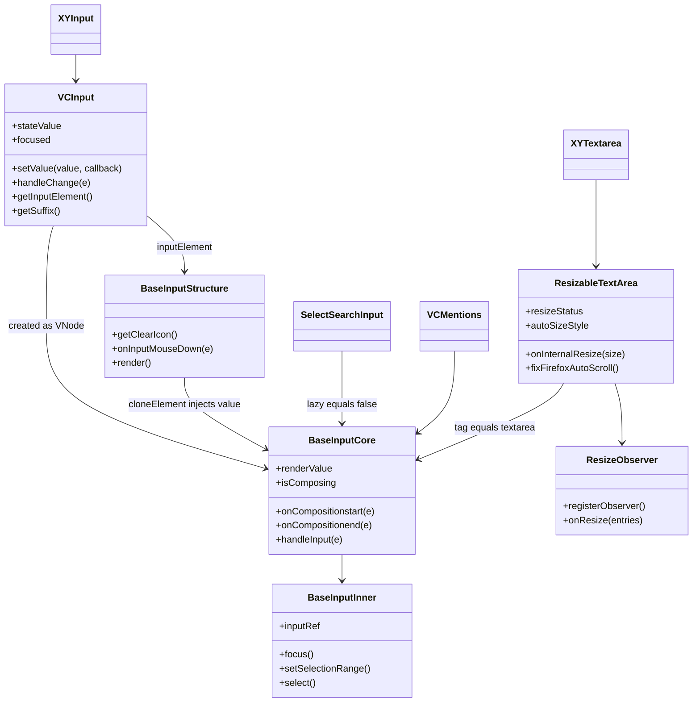
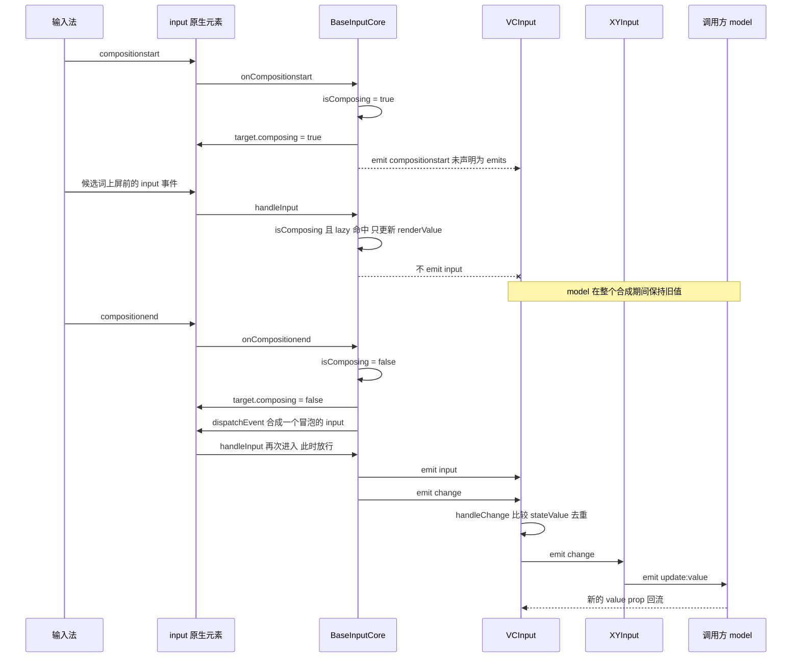
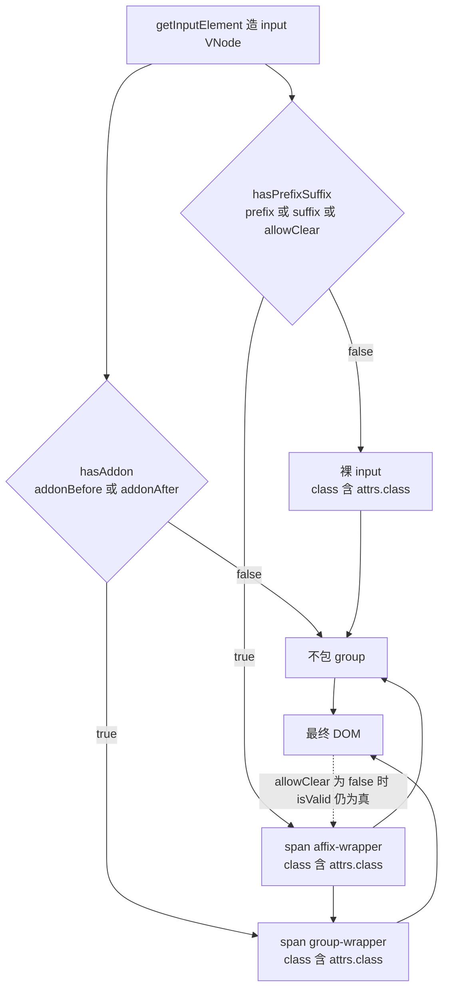
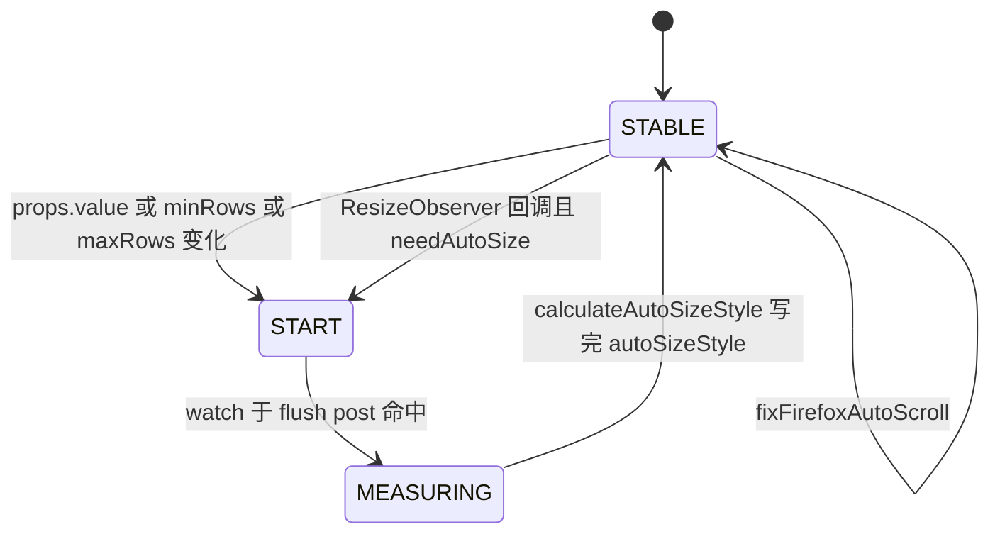

# I04 输入基座：vc-input 与 BaseInput

> **本篇解决**：`<xy-input v-model:value="x">` 里，中文拼音还没上屏时 `x` 为什么不跟着变？为什么父组件把值改回去、输入框里的字却还停在原地？自动高度的 textarea 到底在测量什么、谁在触发重测？
> **前置**：A06 Props 体系与类型工具（进行中，本篇只引用其结论「props 定义 → attrs 透传契约」，不展开其论证）　**读者坐标**：`02-infrastructure` 第 4/16 篇
> 主题边界（取自 `OUTLINE.md` I04 行）：本篇只讲 **IME 合成、光标控制、受控回退、自动高度、结构开关**这些基座机制。`input` / `input-number` 组件自身的特性（`addon` 排版、`password` 切换、`search` 加载态、`precision`/`formatter` 的数值语义）归 C04-01 / C04-02；`useMergedState` 的统一受控实现归 I13；`clearable` 在 input 层的差异按边界约定留给组件篇，本篇只交代它属于哪一层。

---

## 一、职责与边界

「输入基座」在本仓库里不是一个目录，而是**四段互不隶属的实现**，它们共同负责一件事：把一个 Vue 的受控 `value` 变成浏览器里可编辑、可合成输入法、可测高、可清空的 `<input>` / `<textarea>`，同时把用户动作折算成 `input` / `change` / `focus` / `blur` / `compositionstart` / `compositionend` 事件往回送。

四段分工（实测）：

| 段 | 文件 | 负责 | 明确不负责 |
| --- | --- | --- | --- |
| 记账层 | `packages/xiaoye-ui/src/_util/BaseInput.tsx` | 受控值镜像、`isComposing` 冻结、合成结束后重放 `input`、光标 API 转发 | 类名、结构、前缀后缀 |
| 元素层 | `packages/xiaoye-ui/src/_util/BaseInputInner.tsx` | 只渲染一个 `<input>` 或 `<textarea>` 原生标签并 `expose` DOM 方法 | 任何状态 |
| 结构层 | `packages/xiaoye-ui/src/vc-input/BaseInput.tsx` | `affix-wrapper` / `group-wrapper` 两种 DOM 升格、清除图标、鼠标按下聚焦 | 值、事件 |
| 状态层 | `packages/xiaoye-ui/src/vc-input/Input.tsx` | `stateValue` 受控/非受控判定、事件去重、`showCount` 计数文本 | ConfigProvider、样式 Token |

明确**不负责**的三件事：`prefixCls` 的生成（由组件层 `useConfigInject` 注入，见 `packages/xiaoye-ui/src/input/Input.tsx:35`）、CSS 的注册与 `hashId`（归 A04）、受控/非受控的全库统一实现（归 I13；基座自己手写了一套 `stateValue`，本篇论点 2 会说清它和 `useMergedState` 的差异）。

依赖与被依赖（实测引用面）：

| 方向 | 对象 | 证据 |
| --- | --- | --- |
| 被依赖 | `input/Input.tsx` 是 `vc-input/Input.tsx` 的**唯一**消费者 | `packages/xiaoye-ui/src/input/Input.tsx:12` |
| 被依赖 | `_util/BaseInput.tsx` 被 6 个文件直接引用：vc-input、ResizableTextArea、vc-mentions、vc-pagination（2 处）、vc-select 搜索框 | `packages/xiaoye-ui/src/vc-select/Selector/Input.tsx:14`、`packages/xiaoye-ui/src/vc-mentions/src/Mentions.tsx:29`、`packages/xiaoye-ui/src/vc-pagination/Pagination.tsx:12` |
| 依赖 | `cloneElement`（覆盖式 clone，用来把 `value`/`hidden` 塞回已建好的 VNode） | `packages/xiaoye-ui/src/_util/vnode.ts:9-28` |
| 依赖 | `hasAddon` / `hasPrefixSuffix` / `fixControlledValue` / `resolveOnChange` / `triggerFocus` | `packages/xiaoye-ui/src/vc-input/utils/commonUtils.ts:10-104` |
| 依赖 | `ResizeObserver`（自动高度的重测触发器） | `packages/xiaoye-ui/src/vc-resize-observer/index.tsx:22-139` |
| 依赖 | `styleObjectToString`（把对象 style 拍平成字符串） | `packages/xiaoye-ui/src/vc-util/Dom/css.ts:123` |
| 不依赖 | `useMergedState`：`vc-input/`、`input/`、`_util/BaseInput.tsx` 三处引用数为 0 | 复现命令见 §七 检查点 3 |

**基座的爆炸半径**：改 `_util/BaseInput.tsx` 一行，同时影响输入框、文本域、Mentions、Select 的搜索框、Pagination 的快速跳转框；改 `vc-input/Input.tsx` 只影响 `<xy-input>`。这个不对称是本篇所有「改动安全边界」结论的来源。

---

## 二、源码地图

| 文件 | 行数 | 职责 | 关键导出 |
| --- | --- | --- | --- |
| `vc-input/Input.tsx` | 254 | 状态层：`stateValue` / `focused` / 事件去重 / `showCount` 文本 | `default`（`name: 'VCInput'`，`:21`） |
| `vc-input/BaseInput.tsx` | 152 | 结构层：三段 DOM 形态分支与清除图标 | `default`（`name: 'BaseInput'`，`:10`） |
| `vc-input/inputProps.ts` | 121 | 三层 props 并集与 `ShowCountProps` / `InputRef` 类型 | `inputProps`（`:51`）、`baseInputProps`（`:30`）、`commonInputProps`（`:16`） |
| `vc-input/utils/commonUtils.ts` | 104 | 值归一、结构判定、change 伪装、光标 | `fixControlledValue`（`:22`）、`resolveOnChange`（`:29`）、`triggerFocus`（`:78`） |
| `vc-input/utils/types.ts` | 3 | 双参数 `LiteralUnion`，**无人引用**（`_util/type.ts:19` 的单参数版本才是活的那一个） | `LiteralUnion`（`:3`） |
| `_util/BaseInput.tsx` | 168 | 记账层：`renderValue` + `isComposing` + 合成重放 | `default`（`:23`）、`BaseInputExpose`（`:8`） |
| `_util/BaseInputInner.tsx` | 96 | 元素层：唯一真正写 `value` 到 DOM 的地方 | `default`（`:20`）、`BaseInputInnerExpose`（`:5`） |
| `_util/isValid.ts` | 4 | 通用「非空非空串」判定，与基座内部同名函数语义不同 | `default`（`:1`） |
| `_util/isValidValue.ts` | 3 | 只排除 `undefined`/`null` 的判定，`input-number` 用 | `default`（`:1`） |
| `_util/BaseMixin.ts` | 45 | React 式 `setState` / `__emit` 混入，**输入基座不用** | `default`（`:4`） |
| `input/ResizableTextArea.tsx` | 187 | 自动高度状态机 + Firefox 滚动位修复 | `default`（`:25`） |
| `input/calculateNodeHeight.tsx` | 171 | 影子 textarea 测量 | `default calculateAutoSizeStyle`（`:89`）、`calculateNodeStyling`（`:50`） |
| `input/ClearableLabeledInput.tsx` | 124 | textarea 侧的 affix 结构（与结构层重复实现） | `default`（`:18`） |
| `input/TextArea.tsx` | 317 | 组件层 textarea：emoji 长度、maxlength 记账 | `default`（`:52`） |
| `vc-resize-observer/index.tsx` | 139 | ResizeObserver 封装（11 个消费者，输入基座只占 1 个） | `default`（`:22`） |
| `input/Input.tsx` | 230 | 消费方：把 ConfigProvider/size/status 翻译成 4 个类名 prop | `default`（`:24`） |

主实现入口：`packages/xiaoye-ui/src/vc-input/Input.tsx:25`（`setup`）。记账主入口：`packages/xiaoye-ui/src/_util/BaseInput.tsx:51`。

两处「读之前会先撞墙」的事实：

1. **两个都叫 `BaseInput` 的文件在 6 行里被同时导入**，第二个还被起了别名：

```tsx
// packages/xiaoye-ui/src/vc-input/Input.tsx:17
import BaseInput from './BaseInput';
import BaseInputCore, { type BaseInputExpose } from '../_util/BaseInput';
```

`./BaseInput` 是结构装饰器，`../_util/BaseInput` 是原生元素加 IME 记账。`packages/xiaoye-ui/src/input/ResizableTextArea.tsx:18-19` 只导后者（`import BaseInput from '../_util/BaseInput'`），所以 textarea 这条链路**完全绕过 `vc-input/`**，两棵树的共同点只有记账层。

2. **`_util/BaseInput.tsx` 在 `_util/components/` 下有第三份机械副本**（`_util/components/index.ts:2` 把它挂进 barrel）。副本与原件的差异只有两行 import 相对路径，`diff` 实测仅第 3 行与第 6 行不同。该目录的定性归 A06，本篇只补一条输入基座特有的证据：`setScrollTop` 这个缺陷在两份副本里**逐字相同**（`_util/BaseInput.tsx:21` 声明、`:122-131` 未 expose；`_util/components/BaseInput.tsx:21` 与 `:130` 同），意味着任何「修一份」的操作都会留下第二份。

---

## 三、架构与数据流

### 3.1 静态结构：四层与两条消费链



读图要点：`cloneElement` 是这张图上唯一的**反向**边。`VCInput` 在 render 里先造好 `<BaseInputCore>` 的 VNode（`vc-input/Input.tsx:195`），把它当 prop（`inputElement`）交给结构层；结构层再把这个 VNode clone 一次、把受控 `value` 和 `hidden` 注入 clone 的 props（`vc-input/BaseInput.tsx:76-79` 与 `:111-115`）。所以 `value` 的最终写入点是**两层之外**的 `BaseInputInner`（`_util/BaseInputInner.tsx:91`），中间隔着一次 clone 与一次 `renderValue` 镜像。任何「改 value 传递」的动刀都必须同时验证这三个点。

`ResizableTextArea --> BaseInputCore` 这条边解释了为什么 textarea 没有 `vc-input` 的 `stateValue`：它的受控记账在组件层 `input/TextArea.tsx:61` 与 `:239-250` 自己做了一遍，基座只负责冻结与重放。

### 3.2 一次中文输入的完整闭环



读图要点：图里有三处「刻意不写回」。`isComposing && lazy` 让基座吞掉 `input`（`_util/BaseInput.tsx:81-84`）；`VCInput` 在受控时不写 `stateValue`（`vc-input/Input.tsx:81-89`）；`XYInput` 只在 `triggerChange` 里发 `update:value`（`input/Input.tsx:124`）。也就是说 model 的唯一提交点是 `compositionend` 之后那个**手工合成的** `input` 事件——这是整套设计的承重墙，论点 3、论点 4 分别拆它。

`emit compositionstart 未声明为 emits` 这一步是刻意的：`VCInput` 的 `emits` 列表只有 `change/input/focus/blur/keydown/keyup/pressEnter`（`vc-input/Input.tsx:24`），合成事件不在其中；调用方在 `<xy-input>` 上挂 `@compositionstart` 能不能收到，取决于 props 的穿透（见 §五）。

### 3.3 DOM 形态三分支与 `attrs.class` 的唯一落点



读图要点：三个分支互斥地决定 `attrs.class` 落在哪个元素上——裸形态落 `<input>`（`vc-input/Input.tsx:179-181`），affix 形态落 wrapper（`vc-input/BaseInput.tsx:91`），addon 形态落最外层 group wrapper（`vc-input/BaseInput.tsx:133`）。守卫条件写反一次，就会出现「用户 class 同时出现在两个元素」或「一处都没有」。虚线是这条不变量的真实破口，论点 5 展开。

### 3.4 自动高度的三态与回环



读图要点：`RESIZE_START / RESIZE_MEASURING / RESIZE_STABLE` 是三个模块级常量（`packages/xiaoye-ui/src/input/ResizableTextArea.tsx:21-23`），推进靠两个 watcher 接力：一个看输入（`:72-80`），一个看状态（`:82-102`，`flush: 'post'`）。第三条边（STABLE→START，由 ResizeObserver 触发）是唯一的风险边：高度写回 DOM 会让元素真的变高，RO 于是再次回调，若测量结果与实际高度差 ≥1px 就形成回环。`vc-resize-observer/index.tsx:70-71` 的 `Math.floor` 与 `:73-78` 的四元组比较是这个回环唯一的闸门。

---

## 四、核心机制精读

### 论点 1：受控值不是「一路 prop 传下去」，而是在结构层被 `cloneElement` 反向注入到两格之外的原生标签上

`packages/xiaoye-ui/src/vc-input/Input.tsx:195` 先造出记账层的 VNode，`packages/xiaoye-ui/src/vc-input/Input.tsx:244` 才把 `value` 交给结构层，结构层用 clone 覆盖把它塞进那个已存在的 VNode：

```tsx
// packages/xiaoye-ui/src/vc-input/BaseInput.tsx:76
      let element = cloneElement(inputElement, {
        value,
        hidden,
      });
```

`cloneElement` 的覆盖语义在 `packages/xiaoye-ui/src/_util/vnode.ts:22-27`：先 `cloneVNode`（Vue 内部是合并），再手工把 `nodeProps` 铺在 `node.props` 之上，注释就写着「cloneVNode 内部是合并属性，这里改成覆盖属性」。于是 `inputElement` 原始 props 里那份 `value`（来自 `otherProps`，即 `vc-input/Input.tsx:141` 的 `omit(props, [...])`，而 omit 清单里**没有** `value`）被结构层的 `fixControlledValue(stateValue.value)` 覆盖掉。

再往下，记账层不把 `value` 直接渲染，而是先镜像一格：

```tsx
// packages/xiaoye-ui/src/_util/BaseInput.tsx:53
    const renderValue = ref();
    const isComposing = ref(false);
    watch(
      [() => props.value, isComposing],
      () => {
        if (isComposing.value) return;
        renderValue.value = props.value;
      },
      { immediate: true },
    );
```

`renderValue` 在 `packages/xiaoye-ui/src/_util/BaseInput.tsx:155` 传给元素层，元素层是整棵树里唯一真正写 DOM 的语句：

```tsx
// packages/xiaoye-ui/src/_util/BaseInputInner.tsx:90
      const { tag: Tag, value, ...restProps } = props;
      return <Tag {...restProps} ref={inputRef} value={value} />;
```

四格路径 `VCInput → BaseInput(结构) → BaseInputCore → BaseInputInner` 里，`value` 换了三次身份：`string | number | undefined`（`vc-input/inputProps.ts:33`）→ 被 `fixControlledValue` 归一成必为字符串（`vc-input/utils/commonUtils.ts:22-27`）→ 被 `renderValue` 冻结成「合成期间的最后稳定值」→ 落到 `<input>` 的 `value` DOM property。

结论：这条链的存在不是洁癖。镜像那一格 `renderValue` 让「DOM 显示什么」与「model 是什么」在合成期间**合法地不一致**；如果记账层直接把 `props.value` 渲染到元素层，输入法候选词会在每次 `input` 事件后被覆写回旧值（浏览器上表现为拼音串消失、只能一个字母一个字母地打）。

### 论点 2：受控回退是一段「不写本地状态 + nextTick 比对 DOM + 强制重渲染」的三段式，其中最后一段的可复原能力有限

非受控与受控的分界在初始化就定了：

```tsx
// packages/xiaoye-ui/src/vc-input/Input.tsx:26
    const stateValue = shallowRef(props.value === undefined ? props.defaultValue : props.value);
    const focused = shallowRef(false);
    const inputRef = shallowRef<BaseInputExpose>();
    const rootRef = shallowRef<ComponentPublicInstance>();
    watch(
      () => props.value,
      () => {
        stateValue.value = props.value;
      },
    );
```

判定用的是 `props.value === undefined`，而不是 `useMergedState` 那套 `value.value !== undefined ? value.value : innerValue.value`（对照 `packages/xiaoye-ui/src/_util/hooks/useMergedState.ts:26`）；差异在于基座**从不**在受控时写本地值：

```tsx
// packages/xiaoye-ui/src/vc-input/Input.tsx:77
    const setValue = (value: string | number, callback?: Function) => {
      if (stateValue.value === value) {
        return;
      }
      if (props.value === undefined) {
        stateValue.value = value;
      } else {
        nextTick(() => {
          if (inputRef.value.input.value !== stateValue.value) {
            rootRef.value?.$forceUpdate();
          }
        });
      }
```

逐段读：

- `:78-80` 等值短路。因为 `e.target.value` 恒为字符串（`vc-input/Input.tsx:94-97`），当 `value` prop 是数字时这条短路**永不命中**，`:85` 的 `!==` 也同样恒成立（左边是 DOM 字符串，右边是 number）。这不是崩溃级问题，但意味着数字受控值每次输入都会多走一次 `nextTick` 判定。
- `:84-88` 是回退的全部实现：`nextTick` 给父组件一个 flush 周期回写 `value`；周期结束后拿**真实 DOM 的当前文本**（`inputRef.value.input.value`，其中 `input` 是记账层 expose 出来的 computed，见 `packages/xiaoye-ui/src/_util/BaseInput.tsx:125`）与 `stateValue` 比；不相等就说明「用户看到的」和「model 认定的」分叉了，于是强制结构层重渲染。
- 关键限制：`$forceUpdate()` 打到的是 `rootRef`，即 `vc-input/BaseInput` 实例（`ref` 挂在 `packages/xiaoye-ui/src/vc-input/Input.tsx:240`）。结构层重渲染会重新 clone 一个 props 逐项相同的 VNode，Vue 的 `shouldUpdateComponent` 在 `patchFlag & 16`（`cloneVNode` 带 `extraProps` 时会被置上）分支下走 `hasPropsChanged`，逐项 `!==` 比较；`value` 是同一个字符串，比较结果为「无变化」，记账层不会重渲染，也就不会向 `<input>` 再写一次 value。

因此本篇对「回退」的准确表述是：**父级把值改成与用户输入不同的字符串（含归一、截断、拒绝后回填旧值）时，回退靠 `watch(props.value)`→`stateValue`→新 vnode 的正常响应式链路生效；父级完全不回写时，`:86` 的强制重渲染修的是包装层的类名与结构，修不了 `<input>` 里的文本。** 后半句是从 Vue 3.5.40 的 `shouldUpdateComponent` / `hasPropsChanged` / `patchDOMProp` 三处逻辑推出的，未在源码中找到库内补偿实现（此处为待核实推断，复核命令见 §附 检查点 2）。这一分支也没有测试保护：唯一相关的用例在 `packages/xiaoye-ui/src/input/index.test.js:77-117`，整段被注释掉，且注释体里仍是 React 时代的 `form.getFieldDecorator` API，可见是从上游移植时一起带过来又废弃的。

### 论点 3：IME 期间不写回 model 由「两个内部标志 + 一个 DOM 侧信道」共同保证，`lazy` 是它们的开关

内部标志在记账层，一个都不在组件层：

```tsx
// packages/xiaoye-ui/src/_util/BaseInput.tsx:66
    const onCompositionstart = (e: CompositionEvent) => {
      isComposing.value = true;
      (e.target as any).composing = true;
      emit('compositionstart', e);
    };
    const onCompositionend = (e: CompositionEvent) => {
      isComposing.value = false;
      (e.target as any).composing = false;
      emit('compositionend', e);
      const event = document.createEvent('HTMLEvents');
      event.initEvent('input', true, true);
      e.target.dispatchEvent(event);
      handleChange(e);
    };
    const handleInput = (e: Event) => {
      if (isComposing.value && props.lazy) {
        renderValue.value = (e.target as HTMLInputElement).value;
        return;
      }
      emit('input', e);
    };
```

三个角色分工明确：

| 标志 | 位置 | 作用对象 | 语义 |
| --- | --- | --- | --- |
| `isComposing` | `packages/xiaoye-ui/src/_util/BaseInput.tsx:54` | 本组件 | 冻结 `renderValue`（`:58`）并参与 `:81` 的短路判定 |
| `props.lazy` | `packages/xiaoye-ui/src/_util/BaseInput.tsx:30`（默认 `true`） | 本组件 | 决定合成期间的 `input` 是否往上报 |
| `target.composing` | `packages/xiaoye-ui/src/_util/BaseInput.tsx:68`、`:73` | **其它组件** | 写在 DOM 元素上的 expando，跨组件读 |

`isComposing` 单独不够：它只挡住「model 变 → renderValue 变 → DOM 被覆写」这条下行路；上行路（用户敲键 → `input` 事件 → 调用方 model）必须靠 `:81-84` 的短路。短路里那句 `renderValue.value = (e.target as HTMLInputElement).value` 是记账的第二笔：**本地镜像跟着 DOM 走，但不外传**。这样合成结束时 `renderValue` 与 DOM 天然一致，不需要任何「补写」。

`props.lazy` 的来源有两处，都在上层：`vc-input/inputProps.ts:85`（`lazy` 默认 `true`）与 `vc-input/Input.tsx:187`（`lazy: props.lazy` 传进记账层）。消费方可以显式关掉它——`packages/xiaoye-ui/src/vc-select/Selector/Input.tsx:106` 在 clone 搜索框时写死 `lazy: false`，理由是搜索要「边拼边出候选」。关掉之后上行路就不再被基座拦，于是**去重责任转移到消费者**，而消费者读的就是那个 DOM 侧信道：

```tsx
// packages/xiaoye-ui/src/vc-select/Selector/SingleSelector.tsx:93
    const handleInput = (e: Event) => {
      const composing = (e.target as any).composing;
      if (!composing) {
        inputChanged.value = true;
        props.onInputChange(e);
      }
    };
```

`packages/xiaoye-ui/src/vc-select/Selector/MultipleSelector.tsx:211-216` 是同一段逻辑的多选版本（区别是它先无条件记 `targetValue`，再按 `composing` 决定是否触发搜索）；`packages/xiaoye-ui/src/vc-mentions/src/Mentions.tsx:118` 用同一个标志阻止合成期间弹候选面板。这三处共同定义了 `composing` 这个 expando 的**契约面**：它不是内部实现细节，而是被 3 个不同组件读取的跨文件约定，且没有类型保护（写入处 `packages/xiaoye-ui/src/_util/BaseInput.tsx:68` 用了 `as any`）。

结论回到分层：**「合成期间不动 model」这件事的正确位置是记账层，因为只有它同时握有 DOM 写入权（`renderValue`）与事件发射权（`emit('input')`）。** 组件层重复实现同一逻辑会立刻失守，`input/TextArea.tsx:75` 的 `compositing` 就是第二套标志位，但它管的不是 model，见论点 7。

### 论点 4：`compositionend` 用「手工重放一个冒泡 input 事件」提交，双发射靠状态层的等值短路去重

`packages/xiaoye-ui/src/_util/BaseInput.tsx:75-78` 那四行的意图是：合成结束时，让 DOM 上真实存在的那个 `<input>` 自己派发一个 `input` 事件（`document.createEvent('HTMLEvents')` + `initEvent('input', true, true)`，冒泡开启），从而走一遍**与真实键入完全相同**的上行路径；紧接着 `handleChange(e)` 又直接发一次 `change`。

状态层把这两个事件绑到了同一个处理函数：

```tsx
// packages/xiaoye-ui/src/vc-input/Input.tsx:164
      const inputProps = {
        ...otherProps,
        ...attrs,
        autocomplete,
        onChange: handleChange,
        onInput: handleChange,
        onFocus: handleFocus,
        onBlur: handleBlur,
        onKeydown: handleKeyDown,
```

于是每次合成结束，`handleChange` 被调用两次；去重发生在第一行：

```tsx
// packages/xiaoye-ui/src/vc-input/Input.tsx:94
    const handleChange = (e: ChangeEvent) => {
      const { value } = e.target as any;
      if (stateValue.value === value) return;
      const newVal = e.target.value;
      resolveOnChange(inputRef.value.input as HTMLInputElement, e, triggerChange);
      setValue(newVal);
    };
```

顺序是：重放的 `input` 先进入 `handleChange` → `stateValue` 更新（非受控）或发起回退判定（受控）→ 随后的 `change` 进入时 `stateValue.value === value` 命中 `:96` 短路。所以「调用方的 `@change` 与 `@input` 各收到一次」这个观感依赖两件事同时成立：`onChange` 与 `onInput` 指向同一函数，以及 `setValue` 是同步写入 `stateValue`（`packages/xiaoye-ui/src/vc-input/Input.tsx:82`）。

`resolveOnChange` 在这里还有第三个用途值得记：它负责把**不是由用户键入触发**的事件伪装成 change。

```ts
// packages/xiaoye-ui/src/vc-input/utils/commonUtils.ts:40
  if (e.type === 'click') {
    Object.defineProperty(event, 'target', {
      writable: true,
    });
    Object.defineProperty(event, 'currentTarget', {
      writable: true,
    });
    // click clear icon
    //event = Object.create(e);
    const currentTarget = target.cloneNode(true);

    event.target = currentTarget;
    event.currentTarget = currentTarget;
    // change target ref value cause e.target.value should be '' when clear input
    (currentTarget as any).value = '';
    onChange(event);
    return;
  }
```

点清除图标时事件类型是 `click`（`vc-input/Input.tsx:119-124` 的 `handleReset`），`e.target.value` 还是旧文本；这里克隆一个节点、把克隆体的 `value` 置空，再冒充 `target`/`currentTarget` 交给调用方，好让 `e.target.value === ''`。代价是调用方拿到的 `e.target` **不是真实 DOM 节点**——任何在 `@change` 里读 `e.target.focus()`、`e.target.selectionStart`、把 `e.target` 塞进 `FormData` 或做 `instanceof HTMLInputElement` 的代码，在清空这条路径上都会拿到一个游离的克隆体。同一函数的 `targetValue` 分支（`packages/xiaoye-ui/src/vc-input/utils/commonUtils.ts:59-71`）走的是另一种作弊：直接改真实节点的 `target.value`，这是 textarea 在 maxlength 截断时用的那条路（`packages/xiaoye-ui/src/input/TextArea.tsx:105`）。

### 论点 5：`allowClear` / `showCount` / `autocomplete` 这类「基座开关」的真正作用是把 DOM 升格成另一种形态，而形态决定 box model 归谁

三个开关的影响完全不对称，实测：

| 开关 | 影响的层 | 证据 |
| --- | --- | --- |
| `autocomplete` | 只影响原生属性，不改结构 | `vc-input/Input.tsx:167`、注入源 `config-provider/hooks/useConfigInject.ts:40-41` |
| `showCount` | 生成 `-show-count-suffix` 文本节点，从而**间接触发** affix 升格 | `vc-input/Input.tsx:198-226`、`vc-input/BaseInput.tsx:81` |
| `allowClear` | 既是 affix 判定的一项，又生成清除图标节点 | `vc-input/BaseInput.tsx:31-54`、`vc-input/utils/commonUtils.ts:14` |

结构层的分支与 `attrs.class` 的唯一落点：

```tsx
// packages/xiaoye-ui/src/vc-input/BaseInput.tsx:81
      if (hasPrefixSuffix({ prefix, suffix, allowClear })) {
        const affixWrapperPrefixCls = `${prefixCls}-affix-wrapper`;
        const affixWrapperCls = classNames(
          affixWrapperPrefixCls,
          {
            [`${affixWrapperPrefixCls}-disabled`]: disabled,
            [`${affixWrapperPrefixCls}-focused`]: focused,
            [`${affixWrapperPrefixCls}-readonly`]: readonly,
            [`${affixWrapperPrefixCls}-input-with-clear-btn`]: suffix && allowClear && value,
          },
          !hasAddon({ addonAfter, addonBefore }) && attrs.class,
          affixWrapperClassName,
        );
```

对照裸形态，状态层只在「既无 addon 又无 affix」时才把 `attrs.class` 给 `<input>`：`packages/xiaoye-ui/src/vc-input/Input.tsx:179-181`。addon 形态则把它给最外层 `xy-input-group-wrapper`（`packages/xiaoye-ui/src/vc-input/BaseInput.tsx:131-135`）。三个守卫互为排他，这是本篇认为最该被守住的一条不变量。

为什么结构差异等于样式差异，答案在样式文件里：affix wrapper 自己拿走整套盒子样式，再把内部 input 的边框与内边距清零。

```ts
// packages/xiaoye-ui/src/input/style/index.ts:619
    [`${componentCls}-affix-wrapper`]: {
      ...genBasicInputStyle(token),
      display: 'inline-flex',
      // ...
      [`> input${componentCls}`]: {
        padding: 0,
        fontSize: 'inherit',
        border: 'none',
        borderRadius: 0,
        outline: 'none',
      },
```

`genBasicInputStyle` 的定义在 `packages/xiaoye-ui/src/input/style/index.ts:138-162`（`width: 100%`、`padding`、`borderRadius`、hover/focus），同一份函数也被裸 input 使用（`packages/xiaoye-ui/src/input/style/index.ts:543`）。因此形态一换，用户的 class 与 inline style 落到了**另一个盒子**上：`border` 从 input 转移到 span，`display` 从 `inline-block` 变成 `inline-flex`，并且 wrapper 额外带一个 `content: '\a0'` 的 `::before` 占位（`packages/xiaoye-ui/src/input/style/index.ts:653-657`）用来撑住空内容时的高度。

`showCount` 的路径更绕：它不改任何守卫，而是让**后缀节点变得非空**。`vc-input/Input.tsx:247` 把 `suffix={getSuffix()}` 传给结构层，`getSuffix` 在 `showCount` 为真时返回一个 `<span class="xy-input-show-count-suffix">`（`packages/xiaoye-ui/src/vc-input/Input.tsx:212-220`），于是 `hasPrefixSuffix` 为真、affix 形态出现，计数文本再和 `suffix` 同框时用 `-show-count-has-suffix` 加间距（样式在 `packages/xiaoye-ui/src/input/style/index.ts:670-676`）。计数长度本身走的是码点切分：`packages/xiaoye-ui/src/vc-input/Input.tsx:204` 的 `[...fixControlledValue(stateValue.value)].length`，`maxlength` 也直接拼进文案（`packages/xiaoye-ui/src/vc-input/Input.tsx:208`）。

textarea 侧不共享这套机制，它另写了一份结构层：`packages/xiaoye-ui/src/input/ClearableLabeledInput.tsx:104-113` 自己包 `xy-input-affix-wrapper`，并在 `allowClear` 为假时**退化为直接 clone 元素、不加包装**（`packages/xiaoye-ui/src/input/ClearableLabeledInput.tsx:82-87`）。这就是 `allowClear` 在 input 与 textarea 上表现不一致的根源，具体特性差异留给 C04-01，本篇只登记「两套结构实现」这一事实。

### 论点 6：自动高度是「状态机 + 影子 textarea 测量」，`Math.floor` 是唯一的防回环闸门

推进状态机的是两个 watcher 与一个 ResizeObserver 回调：

```tsx
// packages/xiaoye-ui/src/input/ResizableTextArea.tsx:82
    watch(
      [resizeStatus, textAreaRef],
      () => {
        if (!textAreaRef.value) return;
        if (resizeStatus.value === RESIZE_START) {
          resizeStatus.value = RESIZE_MEASURING;
        } else if (resizeStatus.value === RESIZE_MEASURING) {
          const textareaStyles = calculateAutoSizeStyle(
            textAreaRef.value.input as HTMLTextAreaElement,
            false,
            minRows.value,
            maxRows.value,
          );
          resizeStatus.value = RESIZE_STABLE;
          autoSizeStyle.value = textareaStyles;
        } else {
          fixFirefoxAutoScroll();
        }
      },
      { immediate: true, flush: 'post' },
    );
```

`flush: 'post'` 是必须的：`RESIZE_MEASURING` 分支要读**已渲染到 DOM** 的 textarea 的计算样式，pre-flush 会读到上一轮的样式表。测量本身用一个挂到 `document.body` 的隐藏 textarea 复制真实节点的全部影响高度的属性：

```ts
// packages/xiaoye-ui/src/input/calculateNodeHeight.tsx:119
  hiddenTextarea.setAttribute('style', `${sizingStyle};${HIDDEN_TEXTAREA_STYLE}`);
  hiddenTextarea.value = uiTextNode.value || uiTextNode.placeholder || '';

  let minHeight: number | undefined = undefined;
  let maxHeight: number | undefined = undefined;
  let overflowY: any;

  let height = hiddenTextarea.scrollHeight;

  if (boxSizing === 'border-box') {
    // border-box: add border, since height = content + padding + border
    height += borderSize;
  } else if (boxSizing === 'content-box') {
    // remove padding, since height = content
    height -= paddingSize;
  }
```

`SIZING_STYLE` 清单（`packages/xiaoye-ui/src/input/calculateNodeHeight.tsx:19-38`）里包含 `line-height`、`padding-*`、`border-width`、`box-sizing`、`word-break`、`white-space`，也就是说**任何一条影响换行的 CSS 都在复制范围内**；`minRows`/`maxRows` 走第二次测量——把内容换成单个空格取 `scrollHeight - paddingSize` 当单行高（`packages/xiaoye-ui/src/input/calculateNodeHeight.tsx:136-155`）。

回环风险与它的两道闸门：写回 `autoSizeStyle` 后 textarea 真的变高，`ResizeObserver` 必然回调；回调里若 `needAutoSize` 就再 `startResize()`：

```tsx
// packages/xiaoye-ui/src/input/ResizableTextArea.tsx:108
    const onInternalResize = (size: { width: number; height: number }) => {
      if (resizeStatus.value === RESIZE_STABLE) {
        emit('resize', size);

        if (needAutoSize.value) {
          cleanRaf();
          resizeRafRef.value = raf(() => {
            startResize();
          });
        }
      }
    };
```

第一道闸门是 `resizeStatus.value === RESIZE_STABLE` 这一句（`:109`）：测量进行中时来的 resize 一律丢弃，回环因此每轮最多推进一次。第二道在观察器内部：

```ts
// packages/xiaoye-ui/src/vc-resize-observer/index.tsx:65
      /**
       * Resize observer trigger when content size changed.
       * In most case we just care about element size,
       * let's use `boundary` instead of `contentRect` here to avoid shaking.
       */
      const fixedWidth = Math.floor(width);
      const fixedHeight = Math.floor(height);
```

`state` 是个 `reactive` 的四元组（`packages/xiaoye-ui/src/vc-resize-observer/index.tsx:41-46`），真正生效的是 `:73-78` 的比较：`getBoundingClientRect()` 的宽高取整后与 `offsetWidth/offsetHeight` 一起和缓存比，四项全等就**不发**回调；`:84` 的 `Promise.resolve().then(...)` 只把回调推迟一个微任务（注释明写「defer the callback but not defer to next frame」）。这意味着亚像素级的高度抖动会被吸收；而 ≥1px 的系统性偏差（例如 `line-height` 为小数、`box-sizing` 与测量分支不符、字体在首帧后才加载完）会稳定地满足「变了」的条件，形成 `RO → startResize → 新高度 → RO` 的循环，只靠 `raf` 把它节流到每帧一次（`packages/xiaoye-ui/src/input/ResizableTextArea.tsx:114-116`，`raf` 实现见 `packages/xiaoye-ui/src/_util/raf.ts`）。

还有两个细节值得记：测量期间会把 `overflowX/overflowY` 都设成 `hidden`（`packages/xiaoye-ui/src/input/ResizableTextArea.tsx:162-167`），否则滚动条出现会改变 `scrollHeight` 让下一轮测量继续偏；`autoSize` 与 `autosize` 两种拼写都被接受（`packages/xiaoye-ui/src/input/ResizableTextArea.tsx:59`），后者触发 `warning`（`packages/xiaoye-ui/src/input/ResizableTextArea.tsx:132-136`），拼写检查归 I14。

### 论点 7：值归一按层分配得很干净，但「谁负责 trim/大小写」这一格是空的

| 归一动作 | 所在层 | 位置 |
| --- | --- | --- |
| `undefined`/`null` → `''` | 基座（工具函数） | `packages/xiaoye-ui/src/vc-input/utils/commonUtils.ts:22-27` |
| 渲染前把任意值转字符串 | 状态层 | `packages/xiaoye-ui/src/vc-input/Input.tsx:244` |
| 计数按码点而非 `length` | 状态层 / 组件层各一份 | `packages/xiaoye-ui/src/vc-input/Input.tsx:204`、`packages/xiaoye-ui/src/input/TextArea.tsx:28-30` |
| 超长截断（含光标位置判断） | 组件层 | `packages/xiaoye-ui/src/input/TextArea.tsx:32-50`、`:172-192` |
| 数字串解析与非数字剥离 | 组件的内层（非输入基座） | `packages/xiaoye-ui/src/input-number/src/InputNumber.tsx:123` |
| 空白符 trim、大小写折叠 | **两层都没有** | 见 §七 检查点 3 的复现命令 |

`inputType` 不属于值归一，它是**渲染分支开关**，而且归组件层：值在 `packages/xiaoye-ui/src/input/TextArea.tsx:258`（`inputType: 'text'`）被硬编码，消费在 `packages/xiaoye-ui/src/input/ClearableLabeledInput.tsx:116-122`，可选值定义在 `packages/xiaoye-ui/src/input/ClearableLabeledInput.tsx:16` 的 `['text', 'input']`。读代码时要注意 `:118` 只比较 `[0]`，`'input'` 分支落到 `:121` 的 `return null`——也就是说这个 prop 的第二个合法值会让整个渲染返回空。这是上游双形态组件被砍成单形态后留下的口子（组件层用 `vc-input/Input` 走 input 形态，用 `ClearableLabeledInput` 走 textarea 形态），本篇只登记事实，不在改动指南里为它辩护。

textarea 还有一套与基座**并行**的合成记账，值得单独看清，因为它解释了两套标志位为什么互不冲突：

```tsx
// packages/xiaoye-ui/src/input/TextArea.tsx:79
    const onInternalCompositionStart = (e: CompositionEvent) => {
      compositing.value = true;
      // 拼音输入前保存一份旧值
      oldCompositionValueRef.value = mergedValue.value;
      // 保存旧的光标位置
      oldSelectionStartRef.value = (e.currentTarget as any).selectionStart;
      emit('compositionstart', e);
    };
```

`compositing`（`packages/xiaoye-ui/src/input/TextArea.tsx:75`）不影响 model 提交，它只服务于 `watchEffect` 里的截断条件（`packages/xiaoye-ui/src/input/TextArea.tsx:239-250`）：合成期间禁止用 `fixEmojiLength` 去改写 `mergedValue`，否则拼音串会被按 emoji 码点规则截掉。真正的提交在 `onInternalCompositionEnd`（`packages/xiaoye-ui/src/input/TextArea.tsx:88-109`），它不复用基座的事件重放，而是先按 `selectionStart` 判断光标在不在尾部（`:92-94`），再决定是否截断或回退旧值，最后调 `resolveOnChange(..., triggerValue)` 走 `commonUtils.ts:59-71` 那个「直接改真实节点 value」的分支。结论：**文本域的 IME 记账是「基座冻结 + 组件层截断」两层叠加，input 只有基座一层**。改动时若只调基座，textarea 的 maxlength 行为不会同步变化。

---

## 五、对外契约如何生效

### 5.1 attrs 的四级接力：只有最里层允许 Vue 自动继承

四层的 `inheritAttrs` 声明是刻意的三段关闭、一段打开：

| 层 | 文件位置 | 声明 |
| --- | --- | --- |
| 组件层 | `packages/xiaoye-ui/src/input/Input.tsx:27` | `inheritAttrs: false` |
| 状态层 | `packages/xiaoye-ui/src/vc-input/Input.tsx:22` | `inheritAttrs: false` |
| 结构层 | `packages/xiaoye-ui/src/vc-input/BaseInput.tsx:11` | `inheritAttrs: false` |
| 记账层 | `packages/xiaoye-ui/src/_util/BaseInput.tsx:25` | `inheritAttrs: false` |
| 元素层 | `packages/xiaoye-ui/src/_util/BaseInputInner.tsx:22` | `// inheritAttrs: false,`（注释掉的） |

这意味着 `attrs` 必须在每一层手工接力，任何一层漏掉一次 `{...attrs}`，外部类名就止步于此。四处手工展开分别是 `packages/xiaoye-ui/src/input/Input.tsx:153`、`packages/xiaoye-ui/src/vc-input/Input.tsx:166`（进 `<input>` 的那份）、`packages/xiaoye-ui/src/vc-input/Input.tsx:239`（进结构层的那份）、`packages/xiaoye-ui/src/_util/BaseInput.tsx:148`。元素层用默认继承把最后一棒交给原生标签，所以 `id`/`name`/`maxlength`/`placeholder` 这些没被任何一层声明为 prop 的东西，最终由 Vue 的 `hostAttrs` 路径写到 `<input>` 上。

`class` 与 `style` 比 `attrs` 其它成员多走一条路，因为它们被声明成了 prop：`_util/BaseInput.tsx:36-37` 声明 `style`（`String | Object`）与 `class`（`String`），于是它们不进 `attrs`，`{...attrs}` 的展开顺序也影响不到它们。`style` 在记账层被拍平成字符串再下发：

```tsx
// packages/xiaoye-ui/src/_util/BaseInput.tsx:138
    const styleString = computed(() => {
      return props.style && typeof props.style !== 'string'
        ? styleObjectToString(props.style)
        : props.style;
    });
```

紧接着 `:144` 把 `style` 从 `restProps` 里摘掉、`:149` 用 `styleString.value` 覆盖回去。拍平的原因是元素层不声明 `style` prop，对象形式的 style 若直接进 attrs，会绕过 `cloneElement` 的覆盖（论点 1 里 `vc-input/BaseInput.tsx:112` 那句 `style: null`）——两边都是对象时 Vue 会做合并而不是覆盖。拍平成字符串后，`style: null` 才是真正清空。

结构层对 `class`/`style` 的处理见 `packages/xiaoye-ui/src/vc-input/BaseInput.tsx:105`（affix 分支把 `attrs.style` 挂到 wrapper）、`:111-115`（clone 内层时 `style: null`、`hidden: null`）、`:140`（addon 分支把 `attrs.style` 挂到最外层 group wrapper，`:143` 再对内层 `style: null`）。结论是**一次渲染里 `attrs.style` 只有一个落点**，但落点是哪个盒子由 3.3 的三分支决定，与 `class` 完全同步。textarea 链路没有这套纠结：`packages/xiaoye-ui/src/input/ResizableTextArea.tsx:155` 直接把 `[attrs.style, textareaStyles, autoSizeStyle]` 拼成数组、`:160` 把 `attrs.class` 并进 `cls`，只有一个盒子，因此不存在落点漂移。

### 5.2 事件契约：props 声明与 emits 声明双轨，`@compositionstart` 走的是透传轨

`packages/xiaoye-ui/src/vc-input/inputProps.ts:91-100` 把 `onKeydown`/`onFocus`/`onBlur`/`onChange`/`onInput`/`onCompositionstart`/`onCompositionend` 全部声明成 **prop**（`Function as PropType<...>`），而状态层的 `emits` 只有七项：

```tsx
// packages/xiaoye-ui/src/vc-input/Input.tsx:24
  emits: ['change', 'input', 'focus', 'blur', 'keydown', 'keyup', 'pressEnter'],
```

两套声明同时存在时的实际效果：`onCompositionstart` 因为已在 props 里声明，从 `<xy-input @compositionstart>` 传下来时进的是 `props`（不是 `attrs`），于是它被 `otherProps` 原样带走——`packages/xiaoye-ui/src/vc-input/Input.tsx:141-163` 的 omit 清单里没有 `onCompositionstart`/`onCompositionend`——再经 `:165` 的 `...otherProps` 进入 `<BaseInputCore>` 的 vnode props（`:195`）。记账层的 `emit('compositionstart', e)`（`packages/xiaoye-ui/src/_util/BaseInput.tsx:69`）能命中它，靠的是 Vue 的 `emit` 读 **vnode 原始 props** 而不是组件声明的 props，所以「未列进 `emits`」并不阻止调用方收到事件，只是让它不进 `attrs`、不被自动继承、也不受 emits 白名单约束。

这条通路对本篇主题的意义是具体的：**合成事件给调用方的是原生 `CompositionEvent`，`target` 是真实 DOM；而 `change` 给调用方的事件，`target` 可能已经被 `resolveOnChange` 换成克隆体或改写过 `value`（论点 4）**。同一行模板里 `@compositionend` 能安全读 `e.target.selectionStart`，`@change` 里读同一个属性在清空路径上就会拿到游离节点。排障时先看事件名再决定信不信 `e.target`。

组件层的 `emits`（`packages/xiaoye-ui/src/input/Input.tsx:29`）同样不含合成事件，也就是说 `<xy-input>` 对 `@compositionstart` **没有二次转发**，纯靠上面那条 props 透传链。一旦有人把 `inputProps.ts:99-100` 这两行删掉或改名为 `compositionstart`（Vue 也支持未声明时经 `attrs` 命中 emit，所以看起来还能过），`vc-input/Input.tsx:141` 的 omit 行为就会变，链依旧通；但反过来，若有人把 `onCompositionstart` 加进 omit 清单，它就是静默失效——没有任何断言会报错。

`lazy` 有两个互不相同的实现位点，容易读混：

```tsx
// packages/xiaoye-ui/src/vc-input/Input.tsx:189
      if (valueModifiers.lazy) {
        delete inputProps.onInput;
      }
```

`props.lazy`（`packages/xiaoye-ui/src/vc-input/inputProps.ts:85`，默认 `true`）→ 传给记账层参与 `isComposing.value && props.lazy` 的短路（`packages/xiaoye-ui/src/_util/BaseInput.tsx:81`）；而 `v-model:value.lazy` 产生的 `valueModifiers.lazy`（`packages/xiaoye-ui/src/vc-input/Input.tsx:131` 解构）走的是 `:190` 的**摘除 `onInput`**，即彻底关掉上行通道。前者是「合成期间不报」，后者是「一直不报 `input`，只报 `change`」。摘掉 `onInput` 之后，`handleChange` 仍由 `change` 驱动（`:168`），而论点 4 里那次手工重放的 `input` 事件就没人接了——所以 `value.lazy` 与 IME 冻结叠加时，提交点只剩 `compositionend` 里 `handleChange(e)` 那一直连调用（`packages/xiaoye-ui/src/_util/BaseInput.tsx:78`）。

### 5.3 expose 链：`.input` 那一格在中间层多走了一步

四段暴露各自的方法集：

```tsx
// packages/xiaoye-ui/src/vc-input/Input.tsx:66
    expose({
      focus,
      blur,
      input: computed(() => (inputRef.value.input as any)?.input),
      stateValue,
      setSelectionRange,
      select,
    });
```

`inputRef.value` 在这里已经是记账层的 exposeProxy，而 Vue 对 expose 的对象做 ref 解包——同一份写法在 `packages/xiaoye-ui/src/vc-input/Input.tsx:46` 的 `triggerFocus(inputRef.value.input, option)` 里被当作元素直接用（`triggerFocus` 第一句就读 `element.focus`，见 `packages/xiaoye-ui/src/vc-input/utils/commonUtils.ts:82-84`），说明 `.input` 到手时已经是原生元素。所以 `:69` 后面再跟一个 `.input` 取的是 `HTMLInputElement.input`，恒为 `undefined`。`InputRef` 类型却承诺它是元素（`packages/xiaoye-ui/src/vc-input/inputProps.ts:115-120`，`input: HTMLInputElement | null`）。组件层又把这一格继续外传：`packages/xiaoye-ui/src/input/Input.tsx:83` 的 `input: inputRef` 里 `inputRef` 是 `<VcInput ref>`（`packages/xiaoye-ui/src/input/Input.tsx:167`）的实例代理，即 `xyInputRef.value.input` 拿到的是 VcInput 实例而不是 DOM。

这条断链的实际代价落在两个消费点上：`packages/xiaoye-ui/src/input/Input.tsx:49-51` 的 `keyFilterTarget`（`inputRef.value?.input as HTMLElement | null` → 恒 `null`）与 `packages/xiaoye-ui/src/input/Input.tsx:93-97` 的 password 清 `value` 分支（`inputRef.value?.input &&` 短路掉，`getAttribute` 永不执行）。两处都因可选链而静默，不报错、不告警，特性归属 `input` 组件篇（C04-01），本篇只登记断点在基座的 expose 那一格，并把可复现判据放进 §附 检查点 2。

与之相对，**方法链是完好的**，因为每一段都自己调下一段而不是靠 `.input`：

| 方法 | 组件层 | 状态层 | 记账层 | 元素层 |
| --- | --- | --- | --- | --- |
| `focus(option)` | `input/Input.tsx:60-62` | `vc-input/Input.tsx:44-48`（`triggerFocus`） | `_util/BaseInput.tsx:95-99` | `BaseInputInner.tsx:58-62` |
| `setSelectionRange` | `input/Input.tsx:68-74` | `vc-input/Input.tsx:54-60` | `_util/BaseInput.tsx:111-117` | `BaseInputInner.tsx:68-74` |
| `select` | `input/Input.tsx:76-78` | `vc-input/Input.tsx:62-64` | `_util/BaseInput.tsx:119-121` | `BaseInputInner.tsx:76-78` |

`triggerFocus` 是这条链上唯一有语义的增量：它接受 `cursor: 'start' | 'end' | 'all'` 并在 focus 之后立即 `setSelectionRange`（`packages/xiaoye-ui/src/vc-input/utils/commonUtils.ts:93-102`），`default` 分支（`:100-102`）是全选。光标控制的全部能力就集中在这 27 行，textarea、Mentions、Select 搜索框共用它（`packages/xiaoye-ui/src/input/TextArea.tsx:121` 直接用 `triggerFocus(resizableTextArea.value?.textArea, option)`）。

expose 契约的第二处名实不符是 `setScrollTop`：`packages/xiaoye-ui/src/_util/BaseInput.tsx:21` 与 `packages/xiaoye-ui/src/_util/BaseInputInner.tsx:18` 都把它写进 interface，但记账层的 `expose`（`packages/xiaoye-ui/src/_util/BaseInput.tsx:122-131`）与元素层的 `expose`（`packages/xiaoye-ui/src/_util/BaseInputInner.tsx:79-88`）都没有它，全仓唯一的调用点是 `packages/xiaoye-ui/src/input/ResizableTextArea.tsx:48`，而那句正好落在 `try`（`:42`）/`catch`（`:50`）之间——`TypeError` 被吞掉，Firefox 的滚动位修复实际只执行到 `setSelectionRange` 就中止。TypeScript 之所以不报，是因为谎言写在类型里而不是调用处。详见 §七 坑 3。

### 5.4 三处消费接缝

**`input/Input.tsx` 与结构层的形态判定口径不同。** 组件层要决定「状态类该给 input 还是给 wrapper」，它自己算了一次：`packages/xiaoye-ui/src/input/Input.tsx:149` 的 `hasPrefixSuffix({ prefix, suffix }) || !!hasFeedback`；结构层用的是 `packages/xiaoye-ui/src/vc-input/BaseInput.tsx:81` 的 `hasPrefixSuffix({ prefix, suffix, allowClear })`。两个式子各缺一项：组件层不认 `allowClear`，结构层不认 `hasFeedback`。于是 `<xy-input allow-clear>`（无 prefix/suffix/feedback）时结构层升格为 affix wrapper，而组件层认为没升格，把状态类塞进 `inputClassName`（`packages/xiaoye-ui/src/input/Input.tsx:190` 的守卫通过）；`affixWrapperClassName` 那边 `:207` 是无条件加状态类的。结果同一份 `genStatusStyle`（`packages/xiaoye-ui/src/input/style/index.ts:81`）被展开到两个盒子上：`:544`（`genStatusStyle(token, componentCls)`）与 `:701`（`genStatusStyle(token, `${componentCls}-affix-wrapper`)`），规则体 `:93` 的 `&:focus` 分支带 `boxShadow`（`packages/xiaoye-ui/src/input/style/index.ts:39-44`）。源码层面能确认的是「内层 input 与外层 wrapper 同时命中同一条状态规则」，像素后果需要浏览器复核，本篇不下视觉结论。反过来 `<xy-input>` 处于 form 的 `hasFeedback` 状态且无 `allowClear` 时，两个式子又同时为真，落点一致。这类「上层猜下层」的耦合是本篇最不希望被复制的一条。

**`input-number/` 完全绕过输入基座。** 它自己渲染原生标签：

```tsx
// packages/xiaoye-ui/src/input-number/src/InputNumber.tsx:557
            <input
              autofocus={autofocus}
              autocomplete="off"
              role="spinbutton"
```

因此它拿不到 `_util/BaseInput.tsx` 的 `isComposing` 冻结与 `renderValue` 镜像，必须自带一套合成标志 `compositionRef`（声明 `packages/xiaoye-ui/src/input-number/src/InputNumber.tsx:97`，写于 `:342`/`:346`，读于 `:315`、`:419`、`:435`），并且在 `compositionend` 里用「重算而不是重放」的姿势收尾：`packages/xiaoye-ui/src/input-number/src/InputNumber.tsx:337-339` 先置标志再 `collectInputValue(inputRef.value.value)`。它与基座的共同点只剩「合成期间不动 model」这个结论本身；把基座的任何 IME 修复同步给 input-number 都要重写一遍。仓库里与输入相关的合成标志位一共四套：基座 `isComposing`（`packages/xiaoye-ui/src/_util/BaseInput.tsx:54`）、`input/TextArea.tsx:75` 的 `compositing`、这里的 `compositionRef`，以及 `packages/xiaoye-ui/src/key-filter/useKeyFilter.ts:13` 写在元素上的 expando `$_xyKeyfilterComposing`（写于 `:44`/`:48`，读于 `:98`）——第四套尤其容易被漏掉，因为它挂的是原生监听器（`packages/xiaoye-ui/src/key-filter/useKeyFilter.ts:166-167`）而不是 Vue 事件。

**`vc-mentions` 是记账层 textarea 形态的极端消费者。** 它把 `change` 显式吃掉、只认 `input`：

```tsx
// packages/xiaoye-ui/src/vc-mentions/src/Mentions.tsx:266
      const textareaProps = {
        ...inputProps,
        ...otherAttrs,
        onChange: noop,
        onSelect: noop,
        value: state.value,
        onInput: onChange,
```

配合 `packages/xiaoye-ui/src/vc-mentions/src/Mentions.tsx:281` 的 `<BaseInput {...textareaProps} ref={textarea} tag="textarea">`：合成结束时基座既派发 `input`（`packages/xiaoye-ui/src/_util/BaseInput.tsx:75-77`）又直连 `handleChange`（`:78`），Mentions 用 `onChange: noop` 让后者变成空操作，于是它的提交点是且仅点是那次重放。这与 `vc-input` 靠 `stateValue` 等值短路去重（`packages/xiaoye-ui/src/vc-input/Input.tsx:96`）是**两种不同的消重策略**，基座没有提供统一保证。Mentions 还额外读 DOM expando `target.composing`（`packages/xiaoye-ui/src/vc-mentions/src/Mentions.tsx:118-120`，在 `onKeyUp` 开头直接 `return`），并且它绕过状态层所以没有 `lazy` prop（`packages/xiaoye-ui/src/_util/BaseInput.tsx:30` 的 `def(true)` 生效）。改动记账层 `onCompositionend` 的顺序时，`vc-input` 与 `vc-mentions` 这两类消费者的破坏方式不同：前者少一次 change、后者少一次 input，症状一个是「模型不更新」一个是「候选面板不刷新」。

---


## 六、设计取舍

### 6.1 记账层单列，而不是让六个消费者都吃 `vc-input`

被放弃的路是「`vc-input` 即基座，所有输入框都走它」。代码里反对这条路的证据很硬：`vc-input` 的 props 面上**根本没有 `tag`**（`packages/xiaoye-ui/src/vc-input/inputProps.ts:30-49` 与 `:51-104` 通读无此项），它只通过 `type` 选原生 input 的子类型（`packages/xiaoye-ui/src/vc-input/Input.tsx:139` 的 `type = 'text'`），所以 textarea 形态在 `vc-input` 里是做不出来的；而 `_util/BaseInput.tsx:31-34` 有 `tag: 'input' | 'textarea'`，这正是 `packages/xiaoye-ui/src/vc-mentions/src/Mentions.tsx:281` 与 `packages/xiaoye-ui/src/input/ResizableTextArea.tsx:176` 能直接用它的原因。另一个方向也一样：`packages/xiaoye-ui/src/vc-select/Selector/Input.tsx:83` 写的是 `let inputNode: any = inputElement || <BaseInput></BaseInput>`——Select 允许外部塞入任意 element，只在没有时才退回基座，这种「可被替换的最内层」只有拆成独立一层才做得到。

换来的是爆炸半径可控：Select 搜索框、Pagination 的两个跳页输入（`packages/xiaoye-ui/src/vc-pagination/Pagination.tsx:436`、`packages/xiaoye-ui/src/vc-pagination/Options.tsx:156`）都不引入 affix wrapper 的 DOM，也不参与 `attrs.class` 落点谈判。赔上的是命名冲突与结构重复：两个 `BaseInput`（§二 事实 1）、textarea 侧另写一份 affix 结构（`packages/xiaoye-ui/src/input/ClearableLabeledInput.tsx:104-113`），以及 `value` 必须靠 `cloneElement` 反向注入这条不直观的路（论点 1）。

### 6.2 `compositionend` 派发原生事件，而不是只 emit 一次 Vue 事件

`packages/xiaoye-ui/src/_util/BaseInput.tsx:75-78` 选择了「在真实元素上 `dispatchEvent` 一个冒泡 `input` + 再直连一次 `handleChange`」。从代码可判定的收益是：挂在元素上的非 Vue 监听者（jsdom 测试、浏览器扩展、调用方自己 `addEventListener` 的度量脚本）与 Vue 的 `onInput` 会看到同一次提交，不存在「Vue 侧已提交、DOM 侧还是脏的」的分裂。代价是事件双发，而基座**没有**提供消重机制，消重责任散到消费者：`vc-input` 用等值短路（`packages/xiaoye-ui/src/vc-input/Input.tsx:96`），`vc-mentions` 用 `onChange: noop`（`packages/xiaoye-ui/src/vc-mentions/src/Mentions.tsx:269`），`vc-pagination` 的 `Options.tsx:156` 那条链路则两个都收。若改成「只 emit 一次」，`vc-input` 的 change 会丢（因为 emit 的是 `input`），`vc-mentions` 的提交会丢（它只认 `onInput`）。这类「基座不做保证、靠各消费者自保」的取舍在本篇出现了三次（消重、`composing` expando、`lazy` 关闭方式），是这一层最需要文档化的原因。

### 6.3 `renderValue` 用可变 `ref`，而不是 computed

`packages/xiaoye-ui/src/_util/BaseInput.tsx:53` 用 `ref()` 起了一格可变镜像，配合 `:55-62` 的 watcher 与 `:82` 的写入。computed 在这里做不到，因为合成期间需要「DOM 说了算、props 说了算不了」——只有可变镜像能在不动 `props.value` 的前提下接受 `e.target.value`。被放弃的替代方案是「compositionstart 时缓存旧值、compositionend 时恢复」，它的写路径更短，但需要额外记录「恢复给谁」，而且挡不住合成期间的**渲染**（父组件任何一次重渲染都会把旧 `props.value` 写回 DOM）。赔上的成本是状态来源变两条：`props.value`（经 watcher）与 `e.target.value`（经 `:82`）都能写 `renderValue`，两者只在 `isComposing` 为真时才互斥，`watch` 把 `isComposing` 放进 source 数组（`:56`）而不是只当 guard，就是为了让「合成结束」这件事本身触发一次镜像同步。

### 6.4 手写受控回退，而不是复用 `useMergedState`

`packages/xiaoye-ui/src/_util/hooks/useMergedState.ts:26` 是全库统一的受控判定，基座一处没用（复现见 §附 检查点 3）。从分层角度看这条取舍是自洽的：`useMergedState` 属组件层生态（它依赖 ConfigProvider 的 `defaultActiveFirstOption` 之类语义，归 I13），而 `_util/BaseInput.tsx` 要能被 `vc-*` 层直接引用而不把组件层依赖拖进来；`vc-input/Input.tsx:26` 的 `stateValue` 只需要「一个 undefined 判定 + 一个 watch」，用它反而引入跨层耦合。赔上的是重复实现与实现质量：`:85` 那处 `!==` 在数字受控值下恒成立（论点 2）、`:86` 的 `$forceUpdate` 修不到 DOM 文本，两个缺陷都是「统一实现里已经不会有的错」。

### 6.5 handler-as-prop 的 React 移植姿势

`packages/xiaoye-ui/src/vc-input/inputProps.ts:91-100` 把事件声明成 props，`packages/xiaoye-ui/src/vc-input/Input.tsx:24` 又写了一份 `emits`。收益是透传极简——`packages/xiaoye-ui/src/vc-input/Input.tsx:141-163` 一份 omit 清单就能决定「哪些 prop 不下沉」，`...otherProps`（`:165`）自动带走所有未点名的 handler。赔上的是 `emits` 白名单形同文档：不在清单里的事件照样能被 `emit` 命中（5.2），拼错的 handler 名不会被 devtools 警告，且 `onPressEnter` 这类既在 props 里、又需要状态层主动判断（`:103-105`）的名字必须两处同时改。`packages/xiaoye-ui/src/vc-input/utils/types.ts:3` 的 `LiteralUnion` 零引用、`packages/xiaoye-ui/src/_util/components/` 的机械副本，都是同一种「移植时整目录搬、没人做减法」的产物（该目录定性归 A06，本篇只补 §二 事实 2 的 `setScrollTop` 逐字重复证据）。

### 6.6 `prefixCls` 无默认值这一格是干净的

四层里 `prefixCls` 一律声明为无默认值的 `String`（`packages/xiaoye-ui/src/vc-input/inputProps.ts:42`），值由组件层 `useConfigInject('input', props)` 生成后下传（`packages/xiaoye-ui/src/input/Input.tsx:35`、`:168`），记账层与元素层完全不认识 `prefixCls`（`packages/xiaoye-ui/src/_util/BaseInput.tsx:26-38` 的 props 里没有它）。复现命令见 §附 检查点 1 的第二段。这一条值得单独登记，因为同一族的 `vc-dialog/Dialog.tsx:62` 还留着 `'rc-dialog'` 这种上游前缀的默认值，属于 C07-01 已经登记过的问题，本篇不重述，只确认输入基座不在此列——也就是说改 `xy-` 前缀体系时，这一族不需要动。

---

## 七、坑与改动指南

**坑 1：显式写 `:allow-clear="false"` 会让输入框白升格一层。** 触发条件——模板里出现 `:allow-clear="false"`（而不是不写这个 prop）。`packages/xiaoye-ui/src/vc-input/utils/commonUtils.ts:2-8` 的 `isValid` 只排除 `undefined`/`null`，布尔 `false` 被判为「有值」，于是 `:14` 的 `isValid(propsAndSlots.allowClear)` 返回真，`packages/xiaoye-ui/src/vc-input/BaseInput.tsx:81` 走进 affix 分支。症状——外层凭空多出一个 `xy-input-affix-wrapper` 的 `<span>`，`attrs.class` 与 `attrs.style` 从 `<input>` 搬到 span（落点规则见 3.3 与 5.1），`display` 变成 `inline-flex`（`packages/xiaoye-ui/src/input/style/index.ts:621`），依赖 `.xy-input` 直接子选择器或 `border` 的自定义样式失效，宽度也可能塌陷。定位——`commonUtils.ts:2-16`、`vc-input/BaseInput.tsx:81`、`vc-input/Input.tsx:179-181`。修法上要注意 `ClearableLabeledInput` 是另一套判定（`packages/xiaoye-ui/src/input/ClearableLabeledInput.tsx:82-87`），只改 `isValid` 会让 input 与 textarea 的行为差距变大，而 `allowClear` 的组件层语义归 C04-01。

**坑 2：`value` 传数字时，受控回退路径每次按键都白跑一轮。** 触发条件——`<xy-input :value="count">`（number）。`packages/xiaoye-ui/src/vc-input/Input.tsx:78` 的 `stateValue.value === value` 比较的是 DOM 字符串与 number，恒不等；`:85` 的 `inputRef.value.input.value !== stateValue.value` 同样恒成立（左边永远是字符串），于是 `:86` 的 `$forceUpdate()` 每次输入都会被执行。症状——不报错，但受控输入框的包装层每次按键强制重渲染一次，`hidden`/类名全部重算；若父组件此时没回写值，用户看到的仍是 DOM 里的文本（论点 2 后半句）。定位——`vc-input/Input.tsx:77-93`，归一函数在 `packages/xiaoye-ui/src/vc-input/utils/commonUtils.ts:22-27`（它只在渲染出口 `vc-input/Input.tsx:244` 用，不在比较前用）。安全改法是把 `fixControlledValue` 提到比较两侧，但那会同时改变 `:96` 的 change 去重语义，必须连 `compositionend` 双发一起验。

**坑 3：`setScrollTop` 是类型上的空头支票，Firefox 滚动位修复实际只做一半。** 触发条件——textarea 处于聚焦态且走完一次测量（`packages/xiaoye-ui/src/input/ResizableTextArea.tsx:97-99` 的 STABLE 分支会调 `fixFirefoxAutoScroll`）。`textAreaRef.value` 是记账层的 exposeProxy，其中没有 `setScrollTop`（`packages/xiaoye-ui/src/_util/BaseInput.tsx:21-131` 的 expose 清单），元素层也没实现（`packages/xiaoye-ui/src/_util/BaseInputInner.tsx:79-88`），但两份 interface 都声明了它（`_util/BaseInput.tsx:21`、`_util/BaseInputInner.tsx:18`）。症状——`packages/xiaoye-ui/src/input/ResizableTextArea.tsx:48` 抛 `TypeError` 并被 `:42`/`:50` 的 try/catch 吞掉；长文本里光标不在末尾时，输入后滚动位置不回弹。定位——`ResizableTextArea.tsx:41-55`，以及副本 `_util/components/BaseInput.tsx`（同缺陷逐字重复，见 §二 事实 2，改一处会留一处）。

**坑 4：清空图标那一次 `change`，`e.target` 不是真实节点。** 触发条件——点 `allowClear` 生成的图标。链路是 `packages/xiaoye-ui/src/vc-input/BaseInput.tsx:39` 的 `onClick={handleReset}` → `packages/xiaoye-ui/src/vc-input/Input.tsx:119-124` → `packages/xiaoye-ui/src/vc-input/utils/commonUtils.ts:40-57`，那里用 `target.cloneNode(true)` 造游离克隆体并置 `value = ''` 冒充 `target`/`currentTarget`。症状——调用方在 `@change` 里 `e.target.focus()`、读 `e.target.selectionStart`、做 `instanceof HTMLInputElement` 或塞进 `FormData` 都会作用在游离节点上（无父节点，focus 静默无效）。定位——`commonUtils.ts:49-55`；另一条作弊分支 `:59-71`（改真实节点）是 textarea 截断用的（`packages/xiaoye-ui/src/input/TextArea.tsx:105`），两条语义不同，别顺手合并。

**坑 5：`compositionend` 重放出来的那个 `input` 是裸 Event，没有 `InputEvent` 字段。** 触发条件——中文输入上屏后在 `@input` 里读事件对象。`packages/xiaoye-ui/src/_util/BaseInput.tsx:75-77` 用 `document.createEvent('HTMLEvents')` + `initEvent('input', true, true)` 合成，因此 `e.data`、`e.inputType`、`e.isComposing` 全是 `undefined`，而真实键入的 `InputEvent` 都有值。症状——依赖 `e.isComposing` 或 `e.data` 的调用方在拼音提交那一次判定结果与平时相反；`e.target.value` 反而是对的，因为读的是 DOM（`packages/xiaoye-ui/src/vc-input/Input.tsx:95`）。定位——`_util/BaseInput.tsx:71-79`。若要改成派发 `new InputEvent('input', {bubbles:true, data, inputType:'insertCompositionText', isComposing:false})`，必须同步验 6.2 里两类消费者的消重方式。

**坑 6：`@resize` 在不设 `autoSize` 时永不触发。** 触发条件——`<xy-textarea @resize="...">` 且没写 `autoSize`。`packages/xiaoye-ui/src/input/ResizableTextArea.tsx:175` 把观察器写成 `disabled={!needAutoSize.value}`，而 `packages/xiaoye-ui/src/vc-resize-observer/index.tsx:102-104` 在 `disabled` 时直接 `destroyObserver()` 并 return，回调 `onInternalResize`（`packages/xiaoye-ui/src/input/ResizableTextArea.tsx:108-118`）于是没有入口，`emit('resize', size)`（`:110`）一次都不发。症状——用户拖宽 textarea 时事件静默。定位——`ResizableTextArea.tsx:175` 与 `vc-resize-observer/index.tsx:98-118`。附带时机事实：观察器在 `onMounted`/`onUpdated` 注册（`:119-124`），且回调被 `Promise.resolve().then` 推迟一个微任务、并被 `Math.floor` 四元组比较闸门挡一次（`:70-78`、`:84`）。

**坑 7：`v-model:value.lazy` 与 `:lazy="false"` 是两个相反方向的开关，别混。** 前者在状态层摘掉 `onInput`（`packages/xiaoye-ui/src/vc-input/Input.tsx:189-191`），后者是记账层短路的条件（`packages/xiaoye-ui/src/_util/BaseInput.tsx:81`，prop 定义 `_util/BaseInput.tsx:30`、下发 `vc-input/Input.tsx:187`）。两者同时生效时，`input` 事件在基座被放行但没人接，提交只剩 `:78` 那一直连 `handleChange`。症状——`@input` 完全不触发，`@change` 仍触发；排查时容易误判为「IME 冻结失效」。定位——上面四处行号，Select 的反例是显式关掉 lazy（`packages/xiaoye-ui/src/vc-select/Selector/Input.tsx:106`）。

**测试现状（按 `packages/xiaoye-ui/vitest.config.mts:33` 的 include glob 判断哪些文件会被执行，本文未运行 vitest，因此不对通过与否下结论）。** 该 glob 是 `tests/**/*.test.{js,ts,jsx,tsx}` 与 `src/**/*.test.{js,ts,jsx,tsx}`，命中输入基座的只有 4 个文件：`src/input/index.test.js`、`src/input/Search.test.js`、`src/mentions/index.test.js`、`src/input-number/index.test.js`。`vc-input/` 与 `_util/BaseInput.tsx`、`_util/BaseInputInner.tsx`、`input/ResizableTextArea.tsx`、`input/calculateNodeHeight.tsx` 没有任何匹配文件，即**记账层、状态层、结构层、测量层都没有直接单测**，只经由组件层间接触达。已存在的用例里，保护本篇论点的部分很薄：IME 相关零命中（4 个文件里 `composition|composing` 无匹配，命令见 §附 检查点 1），自动高度唯一用例是 `it.skip`（`packages/xiaoye-ui/src/input/index.test.js:36`；skip 原因仓库内无注释，「jsdom 不实现布局、`calculateNodeHeight` 依赖 `getComputedStyle`（`packages/xiaoye-ui/src/input/calculateNodeHeight.tsx:58`）与影子节点的 `scrollHeight`（`packages/xiaoye-ui/src/input/calculateNodeHeight.tsx:126`）」属环境推断），受控回退用例整段被注释且注释体仍是 React 的 `form.getFieldDecorator`（`packages/xiaoye-ui/src/input/index.test.js:77-117`，论点 2 已登记），`maxlength` 两条用例只 mount 不断言（`:15-18`、`:62-65`）。唯一真正跑通链路的是 `packages/xiaoye-ui/tests/shared/focusTest.js:17-48` 的三个 focus/blur 用例，它们被 `Input`/`TextArea`/`Password` 各套一次（`packages/xiaoye-ui/src/input/index.test.js:11-13`），覆盖的是 5.3 的**方法链**而不是 `.input` 那一格——这正好解释断链为什么一直没被发现。

**改动安全边界。** 三条：一是 `_util/BaseInput.tsx` 属公共记账层，动它必须回归 `vc-select`（`packages/xiaoye-ui/src/vc-select/Selector/SingleSelector.tsx:93-99`、`MultipleSelector.tsx:211-216`）、`vc-pagination`（`Pagination.tsx:436`、`Options.tsx:156`）、`vc-mentions`（`packages/xiaoye-ui/src/vc-mentions/src/Mentions.tsx:118-120`）三族，并同步改机械副本 `_util/components/BaseInput.tsx`；二是 `vc-input/Input.tsx` 只影响 `<xy-input>`，但它的 `emits`/`inputProps.ts` 双轨声明（5.2）改任何一处都要同时看另一处；三是 `input-number/src/InputNumber.tsx:557` 与 `input/TextArea.tsx` 各自持有独立标志位，基座的 IME 修复不会自动传播，别用「已经修好基座」作为收工依据。验证命令（本文只列出，未执行）：

```bash
pnpm --filter xiaoye-ui exec vitest run src/input src/mentions src/input-number
node docs/column/tools/verify-refs.mjs --excerpt docs/column/02-infrastructure/04-input-base-输入基座vc-input.md
```

---

## 附：本篇可证伪的三个检查点

1. **IME 分支无测试保护，且 `prefixCls` 无上游前缀残留。** 跑 `cd packages/xiaoye-ui/src && grep -rn "composition\|composing" input/index.test.js input/Search.test.js mentions/index.test.js input-number/index.test.js | grep -v "^\s*//" | head -40` —— 本篇写作时结果为空（4 个文件零命中）；再跑 `grep -rn "prefixCls" vc-input/inputProps.ts _util/BaseInput.tsx _util/BaseInputInner.tsx | head -40` —— 只应看到无默认值的类型声明（`vc-input/inputProps.ts:42`），不该出现任何字符串默认值；对照 `grep -n "prefixCls: 'rc-dialog'" vc-dialog/Dialog.tsx` 有命中。若这三条有任何一条变化，§6.6 与上面的测试现状就需要重写。
2. **expose 的 `.input` 断链是可复现的。** 命令：`grep -n "input: computed(() => (inputRef.value.input as any)?.input)" packages/xiaoye-ui/src/vc-input/Input.tsx` 应为 1 行命中（当前 `:69`）；配套阅读 `packages/xiaoye-ui/src/vc-input/Input.tsx:46` 与 `packages/xiaoye-ui/src/vc-input/utils/commonUtils.ts:82-84`——后者的 `if (!element) return;` 紧接 `element.focus(option)`，与「`inputRef.value.input` 已是原生元素」互证；于是 `:69` 多走的那一步只能得到 `undefined`，落到消费侧是 `packages/xiaoye-ui/src/input/Input.tsx:49-51` 恒 `null`，再落到 `packages/xiaoye-ui/src/key-filter/useKeyFilter.ts:208` 的 `if (target)` 永不成立。要在浏览器里复核：给 `<xy-input>` 传 `key-filter-preset` 后观察是否拦截非法字符。若有人把 `:69` 改成 `input: computed(() => inputRef.value?.input)`，本条检查点与 §5.3 一起失效——那是好事。
3. **基座与 `useMergedState` 确实零耦合。** 命令：`grep -rn "useMergedState" packages/xiaoye-ui/src/vc-input packages/xiaoye-ui/src/input packages/xiaoye-ui/src/_util/BaseInput.tsx packages/xiaoye-ui/src/_util/BaseInputInner.tsx --include='*.ts' --include='*.tsx' | head -40`（排除 `dist` 与 `node_modules` 的路径已经由前面的目录参数保证）——应为空；对照统一实现 `packages/xiaoye-ui/src/_util/hooks/useMergedState.ts:26` 与基座自写的判定 `packages/xiaoye-ui/src/vc-input/Input.tsx:26`。若命中，说明基座已接入统一受控，论点 2 与 §6.4 的取舍叙述需要整体改写。

---