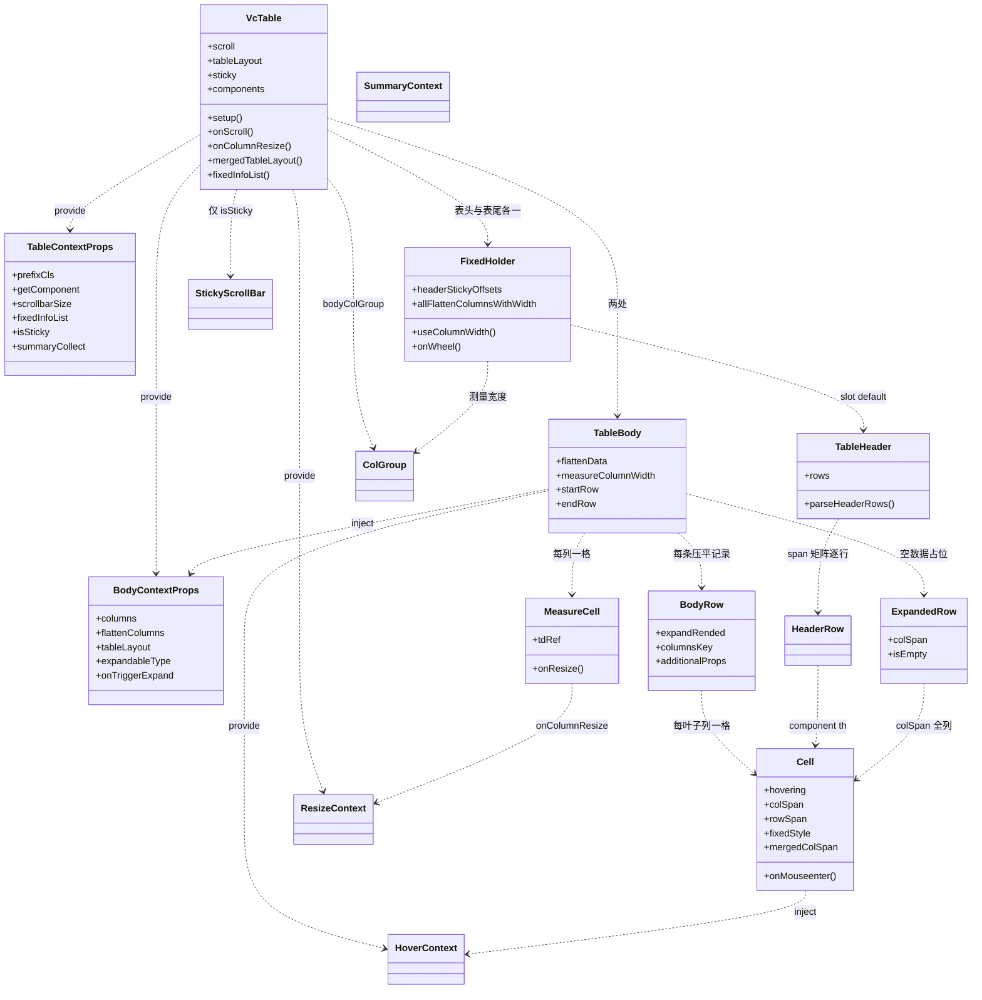
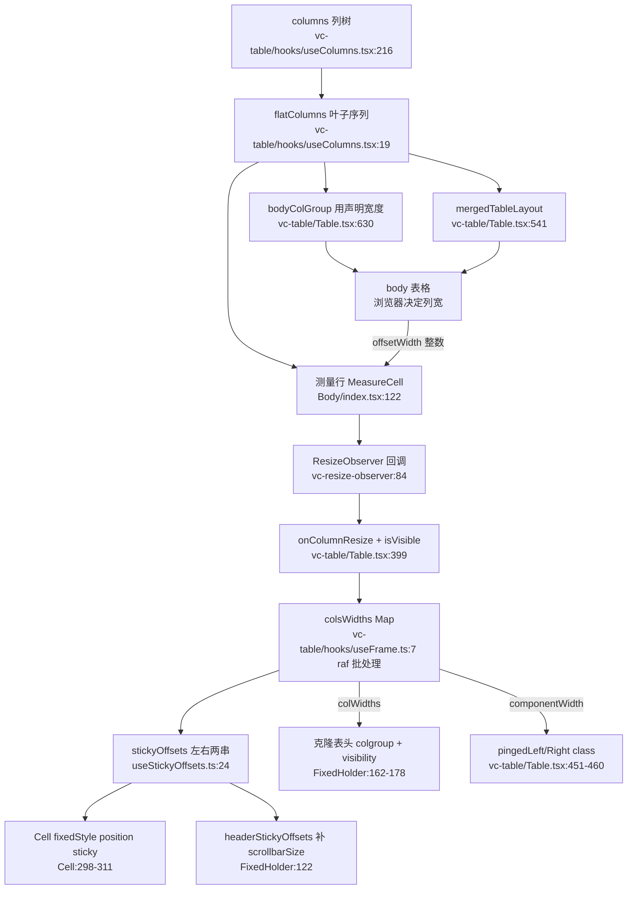
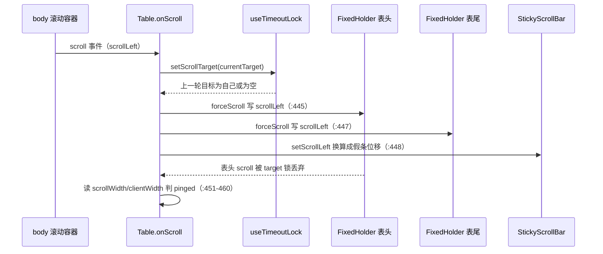
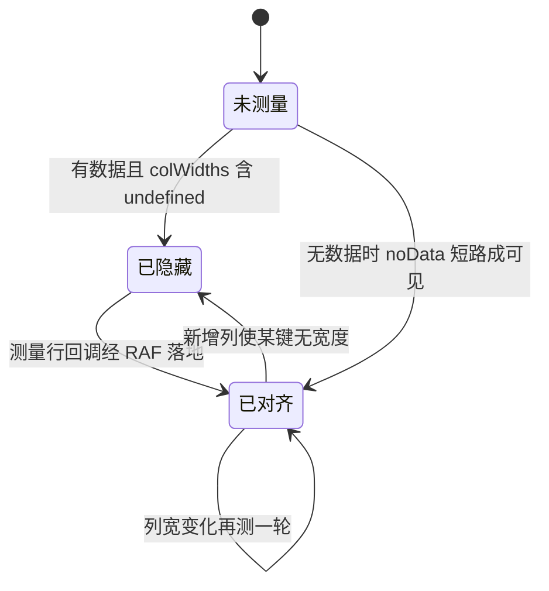

# I05 vc-table 渲染架构与固定列

> **本篇解决**：一张表格从 `columns` 数组到页面上那一到三张 `<table>` 之间，经历了哪几次量化与回流；固定列的 `offset` 究竟是谁算的、隐藏测量行为什么必须存在、量不到的时候靠什么兜底、改哪一行会让表头和表体错开半像素。
> **前置**：C08-00 类横写：table / data-table / tree-table 三代表格的分层与选型（尚未撰写，本篇不依赖其结论）　**读者坐标**：`02-infrastructure` 第 5/16 篇
> 边界：排序/筛选/选择/展开的**状态机**归 I06 table-core 状态机；`table` 组件的业务 props 归 C08-01 Table 表格；虚拟滚动本体归 I08 虚拟化双实现，本篇只给接口接缝。属性清单见用法手册 `apps/docs/components/table.md`，本篇不重复。

---

## 一、职责与边界

`vc-table/`（vendor 层 = 底层实现层，下同）是**渲染层**：输入是 `columns`（可能是带 `children` 的分组树）、`data`，以及纯布局类 props——`scroll` / `tableLayout` / `sticky` / `components` / `rowKey` / `customRow` / `customHeaderRow` / `direction`；输出是 DOM 骨架（一到三张 `<table>`、`<colgroup>`、`thead`/`tbody`/`tfoot`、单元格矩阵、一个隐藏测量行）和一组语义 class。

明确**不负责**：

- 数据到视图的变换。排序、筛选、行选择产生的额外列，是调用方通过 `transformColumns` 回调注入的（`packages/xiaoye-ui/src/vc-table/Table.tsx:319`），vc-table 只负责把拿到的列画出来。
- CSS 形状。本目录**没有** `style/`（38 个文件里零个样式文件），它只生产 class 名；`position: sticky`、`z-index`、阴影全部由 `table/style/fixed.ts:20-28` 一侧实现。类名是跨层契约，见 §六。
- 状态持久化。`expandedRowKeys` 的受控/非受控合并在 `vc-table/Table.tsx:257-275`，其语义属于 I06。

规模与可见性（命令见 §附 检查点 1）：38 个文件、3,946 行；唯一消费者是 `table/`（8 个文件引用，`packages/xiaoye-ui/src/table/Table.tsx:1`）。它**不进生成物**——`src/components.ts` 与 `package.json` 的 `exports` 都没有 `vc-table` 条目，外部深路径引用会被 exports 白名单挡住；`data-table`、`tree-table` 各有自己的渲染器，不引用本目录。

| 方向 | 对象 | 证据 |
| --- | --- | --- |
| 被依赖 | `table/Table.tsx` 渲染 `RcTable`，注入 `internalHooks` / `transformColumns` / `internalRefs` | `packages/xiaoye-ui/src/table/Table.tsx:602-633` |
| 依赖 | `vc-resize-observer`（测量行 + 整表宽度） | `Body/MeasureCell.tsx:2`、`vc-table/Table.tsx:57` |
| 依赖 | `_util/` 14 个模块、26 处 import（classNames、pickAttrs、raf、eagerComputed、getScrollBarSize、styleChecker、props-util…） | `vc-table/Table.tsx:49-63`、`Cell/index.tsx:1-27` |
| 依赖 | `vc-util/` 6 个模块（warning、Dom/isVisible、Dom/class、Dom/addEventListener、Dom/css、devWarning） | `vc-table/Table.tsx:49`、`Cell/index.tsx:27`、`FixedHolder/index.tsx:17` |
| **反向依赖**（不应存在） | `table/context` 的 SlotsContext 与 TableContext | `Cell/index.tsx:19`、`vc-table/hooks/useColumns.tsx:16`、`Header/DragHandle.tsx:15` |

那条反向依赖值得先记下：`Cell` 直接 `inject` 业务层提供的 `bodyCell` slot（`Cell/index.tsx:233-260`），`DragHandle` 直接调业务层注入的 `onResizeColumn`（`Header/DragHandle.tsx:70`）。两个 inject 都给了空默认值（`table/context.ts:29`、`:43`），所以独立挂载不会崩，但模块图已经向上连了一条边，代价见 §六。

---

## 二、源码地图

主实现入口：`packages/xiaoye-ui/src/vc-table/Table.tsx:152`（`defineComponent`），渲染函数起点 `vc-table/Table.tsx:636`。

| 文件 | 行数 | 职责 | 关键导出 / 落点 |
| --- | --- | --- | --- |
| `vc-table/Table.tsx` | 862 | 总装：列管线、滚动容器、布局判定、class 汇总 | 默认导出、`INTERNAL_HOOKS`（`:71`）、`TableProps`（`:73`） |
| `Cell/index.tsx` | 369 | 唯一的单元格渲染器（头/体/尾共用） | `:80`、fixedStyle `:298-311` |
| `Body/index.tsx` | 145 | tbody + 测量行 + 空占位 | `:24`、测量行 `:122-138` |
| `Body/BodyRow.tsx` | 223 | 一行的叶子单元格、nest 缩进、展开行挂载 | `:133-181` |
| `Body/MeasureCell.tsx` | 34 | 一个测量用 `<td>`，把宽度 emit 出去 | `:10` |
| `Body/ExpandedRow.tsx` | 67 | 展开行/占位行，含 sticky 内层 div | `:42-58` |
| `Header/Header.tsx` | 128 | `parseHeaderRows`：列树 → span 矩阵 | `:15` |
| `Header/HeaderRow.tsx` | 111 | 表头一行，逐格算 fixedInfo | `:63-106` |
| `Header/DragHandle.tsx` | 159 | 列宽拖拽把手（Vue 侧独有） | `:117`、`:103` |
| `FixedHolder/index.tsx` | 190 | **克隆表**容器：表头/表尾的第二个 `<table>` | `:19`、`:122-137`、`:162-178` |
| `ColGroup.tsx` | 38 | `<colgroup>`，倒序裁剪无信息列 | `:10` |
| `stickyScrollBar.tsx` | 245 | sticky 模式下的假横向滚动条 | `:129`、`:236-239` |
| `hooks/useColumns.tsx` | 250 | EXPAND_COLUMN 注入 + `flatColumns` + rtl 翻转 | `:19`、`:233-238` |
| `hooks/useFrame.ts` | 62 | `useLayoutState`（raf 批处理）与 `useTimeoutLock`（回环锁） | `:7`、`:33` |
| `hooks/useStickyOffsets.ts` | 55 | 叶子列宽 → 左右两串 offset | `:24-44` |
| `hooks/useFlattenRecords.ts` | 91 | 树数据按展开键压平成行序列 | `:6`、`:62-88` |
| `hooks/useSticky.ts` | 40 | `sticky` 对象 → 偏移量与容器 | `:21-39` |
| `utils/fixUtil.ts` | 69 | `getCellFixedInfo`：列索引 → 本格 sticky 参数 | `:16` |
| `utils/valueUtil.tsx` | 91 | `getColumnsKey`、`getPathValue`、`mergeObject` | `:42`、`:12` |
| `utils/legacyUtil.ts` | 61 | `INTERNAL_COL_DEFINE` 与旧 expandable 归一 | `:4`、`:6` |
| `utils/expandUtil.tsx` | 51 | 默认展开图标渲染、`findAllChildrenKeys` | `:3`、`:33` |
| `Footer/*.tsx` | 4 文件共 127 行 | tfoot 容器、Summary 自注册、SummaryCell 跨列 | `Footer/index.tsx:15`、`Footer/Summary.tsx:9` |
| `context/*.tsx` | 7 文件共 164 行 | 六条 provide/inject 通道 + sticky 能力位 | `context/TableContext.tsx:27`、`context/StickyContext.tsx:5` |
| `vc-table/interface.ts` | 261 | 列/单元格/组件替换的类型契约 | `TableLayout`（`:26`）、`StickyOffsets`（`:129`） |
| `sugar/Column.tsx`、`sugar/ColumnGroup.tsx` | 13 + 13 | 声明式列的**空壳**（`render: null`） | `sugar/Column.tsx:11` |
| `index.ts` / `constant.ts` / `Panel/index.tsx` | 19 / 1 / 7 | 出口、`EXPAND_COLUMN` 哨兵、title/footer 外壳 | `constant.ts:1` |

`Body/index.tsx:1` 写 `// base rc-table@7.17.2`，而 `vc-table/index.ts:1` 写 `// base rc-table@7.22.2`——同一目录两个版本注释，指不上到底在跟随哪个上游版本；引用上游概念时本篇一律标注「上游实现」。

---

## 三、架构与数据流

### 3.1 组件与上下文的关系



符号落点对照：`VcTable` = `vc-table/Table.tsx:152`（setup 起 `:196`、`onScroll` 在 `:430`、`onColumnResize` 在 `:399`、`mergedTableLayout` 在 `:541`、`fixedInfoList` 在 `:568`）；`TableBody` = `Body/index.tsx:24`（渲染函数 `:60`）；`BodyRow` = `Body/BodyRow.tsx:27`（渲染 `:100`）；`Cell` = `Cell/index.tsx:80`（渲染 `:172`）；`TableHeader` = `Header/Header.tsx:93`（`parseHeaderRows` 在 `:15`）；`FixedHolder` = `FixedHolder/index.tsx:49`（`useColumnWidth` 在 `:19`、`headerStickyOffsets` 在 `:122`、`onWheel` 在 `:74`）。

图里有三件事值得单独指出。第一，`Cell` 是**单一**单元格实现：表头传 `component=th`（`HeaderRow.tsx:84`）、表体传 `td`（`Body/BodyRow.tsx:166`）、表尾固定写 `td`（`Footer/Cell.tsx:39`），差别只靠 `cellType`（`Cell/index.tsx:202`）与 `rowType`（`:322`）两个开关。第二，`FixedHolder` 不是包装组件而是**另一张表**的容器，它内部重新渲染一份 `Header`/`Footer`，所以 `vc-table/Table.tsx:678` 的分支一旦成立，页面上就同时存在表头 DOM 两份。第三，测量回路是闭合的：`MeasureCell` → `ResizeContext.onColumnResize` → `vc-table/Table.tsx:338` 的 `colsWidths` → `stickyOffsets` 与 `headerProps.colWidths` → 再回到 `Cell` 的 `fixedStyle` 与 `FixedHolder` 的 `<colgroup>`。

### 3.2 测量 → 布局 → 渲染



每个分支的存在理由：`columns` 必须先变成**叶子序列**（`flatColumns`）才能定列数与列键，因为 body 每行只渲染叶子（`Body/BodyRow.tsx:133`）；`mergedTableLayout` 与 `bodyColGroup` 都只读声明宽度（`props.scroll.x`、`column.width`），此时浏览器还没决定最终像素宽度；测量行把浏览器**实际算出**的每列宽度回灌成 JS 数字（唯一的回流口，见 §四 论点 1）；`stickyOffsets` 与克隆表头的 `<colgroup>` 只能消费这个回流结果，所以它们天然比 body 晚一到两帧，这就是 `FixedHolder/index.tsx:165` 那句 `visibility` 判定的由来。`componentWidth`（`vc-table/Table.tsx:475`）走的是另一条回路：它来自 `VCResizeObserver` 对整表的观察，只喂给占位行内的 sticky div 和 pinged 判定。

### 3.3 横向滚动的同步链



关键点在锁：三个容器互相监听 `scroll`，如果不加约束就会形成「A 滚 → 写 B → B 触发 scroll → 写 A」的回路。`useTimeoutLock`（`vc-table/hooks/useFrame.ts:33-62`）把「最近一次真正发生滚动的元素」记 100ms，`vc-table/Table.tsx:442` 只允许同一目标或首次进入的目标驱动同步，其余直接忽略。表头克隆的滚轮横向滚动手工换算成 `scrollLeft + deltaX` 并 `preventDefault()`（`FixedHolder/index.tsx:74-80`），因为鼠标停在表头上时不会产生 scroll 事件。

### 3.4 克隆表头的一次生命周期



三个判定位置：进入「已隐藏」的条件在 `FixedHolder/index.tsx:165`，回落到「已对齐」要等 `MeasureCell` 的回调经 `useLayoutState` 的 RAF 落地（`vc-table/hooks/useFrame.ts:16`、`:20-22`），「无数据短路」的 `noData` 由 `vc-table/Table.tsx:734` 计算。

`useColumnWidth`（`FixedHolder/index.tsx:19-34`）是这台状态机的判定函数：只要 `colWidths` 里有一个 `undefined` 就整体返回 `null`，克隆表就退回隐藏态。注意隐藏用的是 `visibility` 而不是 `display`，占位与宽度都还在，恢复时不会二次布局跳动。

---

## 四、核心机制精读

### 论点 1：测量行是「浏览器布局结果」回流进 JS 的唯一通道，它必须先保证自己不参与布局

**断言**：固定列的 `offset` 与克隆表头的 `<colgroup>` 都只能消费浏览器算出来的像素宽度；这两处都没有 `column.width` 的声明值可用，因此必须有一行隐藏单元格专门做探测。

```tsx
// packages/xiaoye-ui/src/vc-table/Body/index.tsx:122
        <WrapperComponent class={`${prefixCls}-tbody`}>
          {/* Measure body column width with additional hidden col */}
          {measureColumnWidth && (
            <tr
              aria-hidden="true"
              class={`${prefixCls}-measure-row`}
              style={{ height: 0, fontSize: 0 }}
            >
              {columnsKey.map(columnKey => (
                <MeasureCell
                  key={columnKey}
                  columnKey={columnKey}
                  onColumnResize={onColumnResize}
                />
              ))}
            </tr>
          )}
```

```tsx
// packages/xiaoye-ui/src/vc-table/Body/MeasureCell.tsx:20
    return () => {
      return (
        <VCResizeObserver
          onResize={({ offsetWidth }) => {
            emit('columnResize', props.columnKey, offsetWidth);
          }}
        >
          <td ref={tdRef} style={{ padding: 0, border: 0, height: 0 }}>
            <div style={{ height: 0, overflow: 'hidden' }}>&nbsp;</div>
          </td>
        </VCResizeObserver>
      );
    };
```

逐段解释。**量什么**：`offsetWidth`，即每个叶子列的最终渲染宽度（整数像素，含 border 与 padding）。`columnsKey` 来自 `getColumnsKey(flattenColumns)`（`Body/index.tsx:119`），与 `vc-table/Table.tsx:341` 的 `colsKeys` 是同一个函数、同一个入参，两侧生成的键因此能对上——这个隐含契约是整条测量链的地基，任何一侧改了键生成规则都会让测量结果静默丢失（见 §七 坑 3）。

**为什么要 `fontSize: 0` + `height: 0` + 内容只有 `&nbsp;`**：测量行本身也是 `<tbody>` 里的一行，在 `table-layout: auto` 下浏览器会拿它的内容参与列宽计算。`&nbsp;` 是唯一内容，如果字号不压成 0，这个空格的advance width 就会被计入该列的 min-content，把列撑宽一点；如果 `<td>` 带 padding 或边框，同样会反向抬高列宽。**它测的是别的行决定的宽度，所以必须把自己的贡献清零**——这是对「测量行为反作用于被测对象」这个反馈环的稳定化处理。`fontSize: 0`、`height: 0` 在外层 `<tr>`（`Body/index.tsx:128`），`padding: 0, border: 0, height: 0` 在 `<td>`（`MeasureCell.tsx:27`），内层 div 再补一道 `height: 0; overflow: hidden`（`:28`），三处配合。

**行高压成 0 之后边框仍会被画出来**：无边界表的行分隔靠每行的 `borderTop`，而样式只把 `:first-child` 那行的上边框取消（`table/style/index.ts:185`）；测量行插在最前面之后，第一条数据行不再是 `:first-child`，就会在表头下面多画一条线。于是同一处规则补了第二个选择器 `&${componentCls}-measure-row + tr > td { borderTop: 'none' }`（`:186`）。也就是说：测量行在逻辑层不知道视觉补偿的存在，视觉补偿在样式层不知道为什么要多这一条——这是「vc-table 生产 class、table/style 消费」分工的直接后果（§六）。

**为什么只在需要时渲染**：`measureColumnWidth={fixHeader || horizonScroll || isSticky}`（`vc-table/Table.tsx:620`）——三者都不成立时既没有克隆表也没有固定列，测了没地方用。反过来，只要开了横向滚动就一定有一行 N 个 `ResizeObserver` 实例（`vc-resize-observer/index.tsx:114-117` 每格各建一个），这是它的固定成本。

**`columnResize` 事件怎么变成 prop**：`MeasureCell` 只声明了 `props: ['columnKey']`（`MeasureCell.tsx:12`），`onColumnResize` 是 attrs；Vue 的 `emit('columnResize', …)` 会去 attrs 里找 `onColumnResize`，所以这条通道靠命名约定缝合，没有 `emits` 声明做校验。把它改成 `onResize` 或把 `Body` 侧的 prop 改名，编译期不会报错，只有实测才发现宽度全丢。

### 论点 2：量不到时的兜底有四层，但没有一层是「按声明值猜」

**断言**：本库在测量缺失时选择**让界面短暂不可信**（隐藏表头 / offset 归零），而不是回退到 `column.width`，理由是要保持单一真源。

四层兜底，按触发顺序：

1. **写入端丢弃**：`onColumnResize` 第一件事是可见性守卫——

```tsx
// packages/xiaoye-ui/src/vc-table/Table.tsx:399
    const onColumnResize = (columnKey: Key, width: number) => {
      if (isVisible(fullTableRef.value)) {
        updateColsWidths(widths => {
          if (widths.get(columnKey) !== width) {
            const newWidths = new Map(widths);
            newWidths.set(columnKey, width);
            return newWidths;
          }
          return widths;
        });
      }
    };
```

   `isVisible`（`packages/xiaoye-ui/src/vc-util/Dom/isVisible.ts:1-25`）用 `offsetParent` 与 `getBoundingClientRect` 判定；表格在隐藏 Tab 里挂载时 `offsetWidth` 恒为 0，这个守卫把 0 挡在 Map 外，避免用 0 毒化宽度表。代价见 §七 坑 2。

2. **存储端不动**：`useLayoutState` 只在 raf 回调里整批替换 `stateRef.value`（`vc-table/hooks/useFrame.ts:13-24`），并且 `new Map(widths)` 产生新引用（`vc-table/Table.tsx:403`）以触发 `shallowRef` 更新。同一帧内的多次 resize 被压成一次更新——这是防抖，也是「测到但还没落地」的窗口期。

3. **消费端隐藏整张克隆表**：`useColumnWidth` 只要遇到一个 `undefined` 就 `return null`，渲染端据此写 `visibility: 'hidden'`。

```tsx
// packages/xiaoye-ui/src/vc-table/FixedHolder/index.tsx:162
          <table
            style={{
              tableLayout: 'fixed',
              visibility: noData || mergedColumnWidth.value ? null : 'hidden',
            }}
          >
            {(!noData || !maxContentScroll || allFlattenColumnsWithWidth.value) && (
              <ColGroup
                colWidths={
                  mergedColumnWidth.value
                    ? [...mergedColumnWidth.value, combinationScrollBarSize.value]
                    : []
                }
                columCount={columCount + 1}
                columns={flattenColumnsWithScrollbar.value}
              />
            )}
```

   `visibility: noData || mergedColumnWidth ? null : 'hidden'` 读的时候要展开：`noData` 为真 → 可见（空表没有对齐对象）；测全 → 可见；有数据但没测全 → 隐藏。`:168` 那个复合条件管的是另一件事：空表 + `scroll.x === 'max-content'` + 列宽没全声明时**连 `<colgroup>` 都不输出**（`maxContentScroll` 由 `vc-table/Table.tsx:735` 传入），因为此时任何显式宽度都会把「按内容撑开」的意图压死。

4. **offset 端归零**：`useStickyOffsets.ts:37` 写的是 `left += colWidths[start] || 0`。宽度还没测出来时，所有左固定列的 `left` 都是 0，它们会**叠在同一列位置上**，而不是散开。这不是 bug 的补救而是选择：与其按声明值算出一个「大概」的 offset（百分比宽度、`ellipsis` 自动宽度都算不准），不如在下一帧给出真值。恢复路径也在这里：元素从 `display:none` 变为可见时，`ResizeObserver` 会再次触发（`vc-resize-observer/index.tsx:114-117` 观察的是 `<td>` 本身），测量重新发生。

第五层其实是「不渲染 sticky」：`context/StickyContext.tsx:4-9` 在 `onMounted` 里才把 `supportSticky` 置为 `isStyleSupport('position','sticky')` 的结果，而 `Cell` 判固定要同时满足这个能力位——

```tsx
// packages/xiaoye-ui/src/vc-table/Cell/index.tsx:298
      // ====================== Fixed =======================
      const fixedStyle: CSSProperties = {};
      const isFixLeft = typeof fixLeft === 'number' && supportSticky.value;
      const isFixRight = typeof fixRight === 'number' && supportSticky.value;

      if (isFixLeft) {
        fixedStyle.position = 'sticky';
        fixedStyle.left = `${fixLeft}px`;
      }
      if (isFixRight) {
        fixedStyle.position = 'sticky';

        fixedStyle.right = `${fixRight}px`;
      }
```

SSR 阶段 `supportSticky` 恒为 `false`（`onMounted` 不执行，`_util/styleChecker.ts:5-13` 也要求 `canUseDom()`），所以**服务端产出的 HTML 里没有任何 `position: sticky`**，固定列在首屏是普通格子；客户端 `onMounted` 后重渲染一次才固定住。这是本篇能找到的最干净的降级路径：能力不支持 → 表格仍可用，只是列不固定。

### 论点 3：固定列与固定表头是两条实现路线，不是二选一

**断言**：列轴用 CSS `position: sticky`（不复制 DOM），表头/表尾轴用**克隆表**（复制 DOM）；两者由 `fixHeader`/`isSticky` 与 `fixColumn` 两个独立开关分别决定。

路线判定的代码在 `vc-table/Table.tsx:347-353`：`fixHeader` 只看 `scroll.y`（`validateValue(props.scroll.y)`，`:347`），`horizonScroll` 看 `scroll.x` 或 `expandFixed`（`:348-350`），`fixColumn` 要求「横向可滚 **且** 至少一列声明 fixed」（`:351-353`）。渲染分支只看 `fixHeader || isSticky`（`vc-table/Table.tsx:678`），**不看** `fixColumn`——也就是说只要开了 `scroll.y`，即便没有任何固定列，表头也是第二张表；反之只要没 `scroll.y` 也没 `sticky`，无论多少列声明 fixed，都只有一张表（`vc-table/Table.tsx:797-820` 的单表分支），固定列靠 sticky 在同一张表里生效。

克隆表路线的构成是：`FixedHolder` 提供 `<div style="overflow: hidden">` 包住第二张 `<table>`（`FixedHolder/index.tsx:152-167`），`overflow: hidden` 让它自己不产生可交互的滚动条、只等着被写入 `scrollLeft`（论点 5）；表头内容由 `vc-table/Table.tsx:752-761` 的 slot 传入同一份 `Header` 组件；表尾固定时再来第三张克隆表（`vc-table/Table.tsx:769-781`）。也就是说「双表头」不是某种优化开关，而是 `fixHeader`/`isSticky` 的必然结果。

两条路线的类名也各写各的：`vc-table/Table.tsx:835-838` 只在「第一个叶子列 fixed」时挂 `-has-fix-left`、只在「最后一个叶子列 `fixed === 'right'`」时挂 `-has-fix-right`；这两个类是给 `table/style/fixed.ts:91-127` 的 `:not(...)` 选择器准备的——横向可滚但**没有**固定列时，边缘阴影改由 `${prefixCls}-container` 的 `::before/::after` 画（`fixed.ts:70-89`），而不是画在某格单元格上。列阴影与容器阴影是两套互斥画法，只能从 class 判定反推。

列轴路线里最容易被忽略的是**占位行与展开行**：一个 `colSpan` 全宽的 `<td>` 没法用 sticky 的固定列语义，于是改用「内部 sticky 容器」——

```tsx
// packages/xiaoye-ui/src/vc-table/Body/ExpandedRow.tsx:42
                if (isEmpty ? horizonScroll.value : fixColumn.value) {
                  contentNode = (
                    <div
                      style={{
                        width: `${
                          componentWidth.value - (fixHeader.value ? tableContext.scrollbarSize : 0)
                        }px`,
                        position: 'sticky',
                        left: 0,
                        overflow: 'hidden',
                      }}
                      class={`${prefixCls}-expanded-row-fixed`}
                    >
                      {contentNode}
                    </div>
                  );
                }
```

`componentWidth` 是整表外框宽（`vc-table/Table.tsx:475`），`fixHeader` 时再减掉滚动条宽（三元式在 `Body/ExpandedRow.tsx:46-48`）。判定条件 `isEmpty ? horizonScroll : fixColumn` 值得留意：空数据占位行只要开了横向滚动就包这层，而真正的展开行必须**有固定列**才包——因为展开行本来就跨满所有列，没有固定列时它跟着表体滚没有视觉问题。

### 论点 4：左右两侧的 offset 是一次循环里两头的累加，表头侧还要再补一个滚动条宽

**断言**：`stickyOffsets.left[i]` 是第 0 到 i-1 列测量宽度之和，`right[i]` 是第 i+1 到 n-1 列之和；克隆表头消费的是同一串数值的**平移版本**（每格加 `scrollbarSize` 并追加一格）。sticky 的 px 值全部来自测量行，没有一处来自 `column.width`。

一个循环同时填两端：

```tsx
// packages/xiaoye-ui/src/vc-table/hooks/useStickyOffsets.ts:24
    for (let start = 0; start < columnCount; start += 1) {
      if (direction === 'rtl') {
        // Left offset
        rightOffsets[start] = right;
        right += colWidths[start] || 0;

        // Right offset
        const end = columnCount - start - 1;
        leftOffsets[end] = left;
        left += colWidths[end] || 0;
      } else {
        // Left offset
        leftOffsets[start] = left;
        left += colWidths[start] || 0;

        // Right offset
        const end = columnCount - start - 1;
        rightOffsets[end] = right;
        right += colWidths[end] || 0;
      }
    }
```

`left[i]` 是「第 0 到 i-1 列宽度之和」，`right[i]` 是「第 i+1 到 n-1 列宽度之和」，一个循环同时填两端（`end = columnCount - start - 1` 让右半从尾往前推）。取用点在 `getCellFixedInfo`（`utils/fixUtil.ts:16-33`）：`fixed === 'left'` 才查 `left[colStart]`，`fixed === 'right'` 才查 `right[colEnd]`，两者互斥；`:52-58` 再判断本格是不是该端的最后一格（`lastFixLeft` / `firstFixRight`），只有边界格才挂阴影类（`table/style/fixed.ts:30-46` 的 `::after`）。

克隆表头一侧还要**额外补滚动条宽度**：

```tsx
// packages/xiaoye-ui/src/vc-table/FixedHolder/index.tsx:121
    // Calculate the sticky offsets
    const headerStickyOffsets = computed(() => {
      const { stickyOffsets, direction } = props;
      const { right, left } = stickyOffsets;
      return {
        ...stickyOffsets,
        left:
          direction === 'rtl'
            ? [...left.map(width => width + combinationScrollBarSize.value), 0]
            : left,
        right:
          direction === 'rtl'
            ? right
            : [...right.map(width => width + combinationScrollBarSize.value), 0],
        isSticky: tableContext.isSticky,
      };
    });
```

`combinationScrollBarSize` 在 `fixHeader` 时等于真实滚动条宽（`FixedHolder/index.tsx:70-72`），因为 body 容器写的是 `overflowY: 'scroll'`（`vc-table/Table.tsx:381`，注意是 `scroll` 而不是 `auto`——内容够短时滚动条槽仍占据宽度，表头必须让出同样的宽度才能对齐）。表头于是被追加一列 `scrollbar: true` 的空列（`:101-119`），其 `<th class="xy-table-cell-scrollbar">` 宽度由 `ColGroup` 末位补的 `combinationScrollBarSize` 提供（`:170-174`），右固定列的 `right` 整体右移一个滚动条宽，末尾再补一个 `0` 给这列自己。表体侧的 `<td>` 不需要这个补偿——它压根不覆盖滚动条区域。

同一处 `:135` 还顺手补了 `isSticky` 字段，而 `useStickyOffsets` 从不产出它（返回只有 `left`/`right`，`:46-49`）——这直接导致 `getCellFixedInfo` 的 `isSticky` 对 body 单元格恒为 `undefined`（`utils/fixUtil.ts:67`），详见 §七 坑 5。

### 论点 5：滚动同步靠 `scroll` 事件写 `scrollLeft`，防回环靠一个 100ms 的目标锁；只有假滚动条用 transform

**断言**：克隆表之间的位置一致性由三件事保证——body 的 `scroll` 事件把 `scrollLeft` 抄给表头/表尾容器；`useTimeoutLock` 记住「本轮发起滚动的元素」以免互相回写；鼠标停在表头上时的横向滚动由 `wheel` 事件手工换算。表格自身**从不**用 `transform` 做同步。

```tsx
// packages/xiaoye-ui/src/vc-table/Table.tsx:430
    const onScroll: EventHandler = ({
      currentTarget,
      scrollLeft,
    }: {
      currentTarget: HTMLElement;
      scrollLeft?: number;
    }) => {
      const isRTL = props.direction === 'rtl';
      const mergedScrollLeft =
        typeof scrollLeft === 'number' ? scrollLeft : currentTarget.scrollLeft;

      const compareTarget = currentTarget || EMPTY_SCROLL_TARGET;
      if (!getScrollTarget() || getScrollTarget() === compareTarget) {
        setScrollTarget(compareTarget);

        forceScroll(mergedScrollLeft, scrollHeaderRef.value);
        forceScroll(mergedScrollLeft, scrollBodyRef.value);
        forceScroll(mergedScrollLeft, scrollSummaryRef.value);
        forceScroll(mergedScrollLeft, stickyRef.value?.setScrollLeft);
      }
```

四个写入对象里，`scrollHeaderRef` 与 `scrollSummaryRef` 是克隆表容器（`vc-table/Table.tsx:329`、`:335`，挂在 `:751` 与 `:774` 的 `ref` 上），`scrollBodyRef` 在单表分支里是同一个滚动容器（`:330`，双表分支挂 `:711`），`stickyRef` 是假滚动条实例。写入实现：

```tsx
// packages/xiaoye-ui/src/vc-table/Table.tsx:414
    function forceScroll(scrollLeft: number, target: HTMLDivElement | ((left: number) => void)) {
      if (!target) {
        return;
      }

      if (typeof target === 'function') {
        target(scrollLeft);
        return;
      }
      const domTarget = (target as any).$el || target;
      if (domTarget.scrollLeft !== scrollLeft) {
        // eslint-disable-next-line no-param-reassign
        domTarget.scrollLeft = scrollLeft;
      }
    }
```

`domTarget.$el || domTarget` 是给 `components.body` 传 Vue 组件时留的接缝（论点 10）；`!== scrollLeft` 的比较避免把相同值再写一次、从而少触发一轮 `scroll` 事件。

回环的根因是三个容器都监听同一个 `onScroll`：A 滚动 → 写 B.scrollLeft → B 派发 `scroll` → 又写 A。`setScrollTarget`/`getScrollTarget` 来自 `useTimeoutLock`（`vc-table/Table.tsx:412`），它的语义是「记录最近一次真正发生滚动的目标，100ms 后自动清空」：

```tsx
// packages/xiaoye-ui/src/vc-table/hooks/useFrame.ts:43
  function setState(newState: UnwrapRef<State>) {
    frameRef.value = newState;
    cleanUp();

    timeoutRef.value = setTimeout(() => {
      frameRef.value = null;
      timeoutRef.value = undefined;
    }, 100);
  }
```

于是判定 `!getScrollTarget() || getScrollTarget() === compareTarget`（`vc-table/Table.tsx:442`）的效果是：**同一批连续滚动里只认第一个发起者**；用户把鼠标移到另一张表上滚动时，因为 100ms 空档后锁已释放，新目标会重新成为发起者。这个 100ms 是经验值，不是帧数——它同时也被用来做 hover 去抖（`Body/index.tsx:54-57`）与整表尺寸变化的去抖（`vc-table/Table.tsx:484-486`），三处共用同一个数字但没有共用常量定义。

表头上没有滚动条，鼠标滚轮横向滚不动它，于是 `FixedHolder` 单独接 `wheel`：

```tsx
// packages/xiaoye-ui/src/vc-table/FixedHolder/index.tsx:74
    const onWheel = (e: WheelEvent) => {
      const { currentTarget, deltaX } = e;
      if (deltaX) {
        emit('scroll', { currentTarget, scrollLeft: (currentTarget as any).scrollLeft + deltaX });
        e.preventDefault();
      }
    };
    const wheelEvent = ref();
    onMounted(() => {
      nextTick(() => {
        wheelEvent.value = addEventListenerWrap(scrollRef.value, 'wheel', onWheel);
      });
    });
```

注意它不是直接改 DOM，而是 emit `scroll` 给 `Table.onScroll` 并**显式带上换算后的 `scrollLeft`**（`:77`），让写入仍然走同一把锁与同一个 `forceScroll`。监听器用 `addEventListenerWrap` 在 `onMounted` + `nextTick` 里挂、`onBeforeUnmount` 里解（`:82-89`），因为要挂在克隆表容器这个具体 DOM 节点上，模板 ref 在 `onMounted` 当刻还可能没落位。

`overflowX: 'auto'` 只加在 body 容器（`vc-table/Table.tsx:386-391`），且当没有 `scroll.y` 时把 `overflowY` 显式设成 `hidden`（`:390`）——否则横向容器在没有纵向滚动条时也会出现一条滚动条槽，宽度对齐立刻差一截。

`pingedLeft/pingedRight` 是这条链的副产物：`vc-table/Table.tsx:451-460` 用发起者的 `scrollWidth` 与 `clientWidth` 判断是否还能继续往左/右滚，写成 `-ping-left`/`-ping-right` 两个 class（`:828-829`），由 `table/style/fixed.ts:91-127` 决定阴影要不要出现。rtl 下两个判定都用负数比较（`:453-455`），因为 Chromium 的 rtl `scrollLeft` 是负值。`triggerOnScroll`（`:463-470`）在数据、列、`horizonScroll` 变化后重算一次（`:489-497`，`flush: 'post'`），否则列数变了而阴影状态还停在上一轮。

唯一使用 transform 的地方是假滚动条滑块：

```tsx
// packages/xiaoye-ui/src/vc-table/stickyScrollBar.tsx:230
          <div
            onMousedown={onMouseDown}
            ref={scrollBarRef}
            class={classNames(`${prefixCls}-sticky-scroll-bar`, {
              [`${prefixCls}-sticky-scroll-bar-active`]: isActive.value,
            })}
            style={{
              width: `${scrollBarWidth.value}px`,
              transform: `translate3d(${scrollState.value.scrollLeft}px, 0, 0)`,
            }}
          />
```

它的位移是把真实 `scrollLeft` 按比例换算出来的（`setScrollLeft`，`:129-136`：`(left / bodyScrollWidth) * bodyWidth`），拖动时反向换算并 emit（`:95-97`，注意分母加 2 的 `bodyScrollWidth.value + 2`，是给右端留的容差）。渲染守卫 `:213-219` 决定了它只在「内容确实超出 + 有 `clientWidth` + 未隐藏」时出现，所以 `sticky` 单独开启而没有 `scroll.x` 时页面上看不到假条（`scrollWidth === clientWidth`）。样式侧 `table/style/sticky.ts:25-52` 给了 `-sticky-scroll` 的 `position: sticky; bottom: 0` 与滑块外观，`transition` 里特意写了 `transform none`（`:45`）——假条跟手时不能带缓动，否则拖动会滞后再弹回。

### 论点 6：`columns` 到单元格矩阵是两步，且两步用的是两份数据

**断言**：`flatColumns` 把列树压成叶子序列给 body 用；`parseHeaderRows` 独立递归同一棵树生成带 `colSpan`/`rowSpan` 的矩阵给 thead 用。两张表的列数只有在 span 正确时才相等，所以表头/表体对齐的第二个前提是**矩阵的 colSpan 之和 == 叶子数**。

```tsx
// packages/xiaoye-ui/src/vc-table/hooks/useColumns.tsx:19
function flatColumns<RecordType>(columns: ColumnsType<RecordType>): ColumnType<RecordType>[] {
  return columns.reduce((list, column) => {
    const { fixed } = column;

    // Convert `fixed='true'` to `fixed='left'` instead
    const parsedFixed = fixed === true ? 'left' : fixed;

    const subColumns = (column as ColumnGroupType<RecordType>).children;
    if (subColumns && subColumns.length > 0) {
      return [
        ...list,
        ...flatColumns(subColumns).map(subColum => ({
          fixed: parsedFixed,
          ...subColum,
        })),
      ];
    }
    return [
      ...list,
      {
        ...column,
        fixed: parsedFixed,
      },
    ];
  }, []);
}
```

组列的 `fixed` 靠这里**下发**给叶子（`:30-33`），叶子因此可以参与 sticky；注意对象字面量里 `fixed` 写在 `...subColum` **之前**，所以子列若显式写了 `fixed: undefined` 会把组的继承冲掉（§七 坑 6）。`fixed === true` 被归一为 `'left'`（`:24`）。rtl 时先 flatten 再整体翻转 fixed（`:233-238`，`revertForRtl` 在 `:70-86`），翻转发生在叶子层，所以组声明的 fixed 也能被翻。

表头矩阵：

```tsx
// packages/xiaoye-ui/src/vc-table/Header/Header.tsx:38
      let colSpan = 1;

      const subColumns = (column as ColumnGroupType<RecordType>).children;
      if (subColumns && subColumns.length > 0) {
        colSpan = fillRowCells(subColumns, currentColIndex, rowIndex + 1).reduce(
          (total, count) => total + count,
          0,
        );
        cell.hasSubColumns = true;
      }

      if ('colSpan' in column) {
        ({ colSpan } = column);
      }

      if ('rowSpan' in column) {
        cell.rowSpan = column.rowSpan;
      }

      cell.colSpan = colSpan;
      cell.colEnd = cell.colStart + colSpan - 1;
      rows[rowIndex].push(cell);
```

递归返回每列占的格数，父格 `colSpan` 取子列之和（`:42-45`）；`colStart`/`colEnd` 记录该格覆盖的叶子索引区间（`:35`、`:58`），这两个字段是表头也能拿到正确 sticky offset 的原因——`HeaderRow.tsx:65-71` 用 `cell.colStart`/`cell.colEnd` 去查 `flattenColumns`，于是「一个跨三列的组标题」的固定位置按整块计算。`rowSpan` 的补齐在递归之后做一次全表扫描：

```tsx
// packages/xiaoye-ui/src/vc-table/Header/Header.tsx:72
  // Handle `rowSpan`
  const rowCount = rows.length;
  for (let rowIndex = 0; rowIndex < rowCount; rowIndex += 1) {
    rows[rowIndex].forEach(cell => {
      if (!('rowSpan' in cell) && !cell.hasSubColumns) {
        // eslint-disable-next-line no-param-reassign
        cell.rowSpan = rowCount - rowIndex;
      }
    });
  }
```

没有子列、也没显式写 `rowSpan` 的叶子标题，会向下合并到底（`rowCount - rowIndex`）——这就是为什么两行表头里第一列只出现一次 `<th>`。合并语义在 `Cell` 落回 DOM：`mergedColSpan !== 1` 才写 `colSpan` 属性（`Cell/index.tsx:334-335`），`0` 直接 `return null` 让格子消失（`:294-296`）。`colspan-rowspan` 这类手工合并的表格就是靠这个 0 语义做的。

`columnsKey` 在表头侧又算了一次，但**入参不同**：`HeaderRow.tsx:59` 传的是本行 cell 对应的 column（含组列），`vc-table/Table.tsx:341` 与 `Body/index.tsx:119` 传的是叶子序列。两次结果只在 vnode key 层面各自使用，不参与宽度匹配，但 `getColumnsKey` 的 `_next` 去重（`utils/valueUtil.tsx:49-53`）依赖列表顺序，这一点在 §七 坑 3 会成为事故源。

### 论点 7：本库没有 `shouldCellUpdate`，也没有任何 memo；性能靠「少改 DOM」而不是「少渲染」

**断言**：仓库里不存在 `shouldCellUpdate`（复现命令：`grep -rn "shouldCellUpdate" packages apps scripts | grep -v node_modules | grep -v '/dist/'`，命中 0），`vc-table` 里也没有 `memo`/`withMemo`（唯一 `memo` 词形是 `vc-table/utils/legacyUtil.ts:54` 的 reduce 累加变量名）。Vue 侧也没有等价的组件级 memo，所以渲染次数是无法省的，实现把力气花在**减少 DOM 写入**和**减少卸载**上。

三处真实手法：

**（a）hover 走命令式 class，不进渲染。** 每个 `Cell` 有一个同步的 `hovering`：

```tsx
// packages/xiaoye-ui/src/vc-table/Cell/index.tsx:125
    const hovering = eagerComputed(() => {
      const { index } = props;
      return inHoverRange(index, rowSpan.value || 1, startRow.value, endRow.value);
    });
    const supportSticky = useInjectSticky();
```

`eagerComputed`（`packages/xiaoye-ui/src/_util/eagerComputed.ts:4-16`）内部是 `flush: 'sync'` 的 `watchEffect` + `shallowRef`，即依赖一变就立刻同步求值。真正的 DOM 写入在：

```tsx
// packages/xiaoye-ui/src/vc-table/Cell/index.tsx:162
    const hoverRef = shallowRef(null);
    watch([hovering, () => props.prefixCls, hoverRef], () => {
      const cellDom = findDOMNode(hoverRef.value);
      if (!cellDom) return;
      if (hovering.value) {
        addClass(cellDom, `${props.prefixCls}-cell-row-hover`);
      } else {
        removeClass(cellDom, `${props.prefixCls}-cell-row-hover`);
      }
    });
```

配合 `inHoverRange` 的跨行支持（`:30-33`，`rowSpan` 单元格让鼠标落在它上时整段行都算命中），以及 `Body` 侧 100ms 的去抖（`Body/index.tsx:49-59`，`onHover` 里 `clearTimeout` + `setTimeout`），得到的收益是：鼠标移动不触发任何重渲染，样式命中 `table/style/index.ts:232` 的 `> td${componentCls}-cell-row-hover`。

**失效场景有两个。** 其一，`hovering` 是每格一个同步 effect，`startRow`/`endRow` 一变，**全部**单元格都同步重算一次，1000 行 × 10 列就是 1 万次函数调用（只有值真变化的格子才继续走 watch 回调写 DOM）。其二，class 是命令式加的，一旦 Vue 在同一次 patch 里重建该 `<td>`（比如该列的 `childNode` 变化导致 key 相同但元素被换），或 `Cell` 的渲染里 `class` 重新计算（`:336-352` 走 `classNames(...)`，不含 `-row-hover`），命令式加上的类会被 diff 冲掉，而 `watch` 不会重跑（`hovering` 没变）——这是本机能观察到的「鼠标还在那行、 hover 色丢了」的成因。

**（b）展开行只挂载一次，之后用 `display: none` 收起。**

```tsx
// packages/xiaoye-ui/src/vc-table/Body/BodyRow.tsx:48
    const expandRended = shallowRef(false);

    const expanded = computed(() => props.expandedKeys && props.expandedKeys.has(props.recordKey));

    watchEffect(() => {
      if (expanded.value) {
        expandRended.value = true;
      }
    });
```

挂载判定是 `rowSupportExpand && (expandRended || expanded)`（`Body/BodyRow.tsx:187`），收起时由 `ExpandedRow` 写 `display: 'none'`（`Body/ExpandedRow.tsx:28-32`）。换来的是反复展开不重跑 `expandedRowRender`（里面常嵌子表、图表、富文本），赔上的是收起行的 DOM 与内部状态常驻、且 `display:none` 的子树不参与任何宽度计算。注意 `expandRended` 是拼错的变量名（应为 `expanded`），改它要注意别处没有引用。

**（c）列宽更新按帧批处理。** `useLayoutState` 把回调压进队列，只在 raf 里连续 apply（`vc-table/hooks/useFrame.ts:13-24`），并且每次 `raf.cancel(rafId)` 重新计时（`:15`）。`_util/raf.ts:21` 的 `wrapperRaf` 默认 `times = 1`，即**至少推迟一帧**；无 `requestAnimationFrame` 时退化成 `setTimeout(cb, 16)`（`:1-6`）。这解释了一个可观察现象：拖动列宽时表头跟随体感「慢半拍」，但不会闪烁多次。

### 论点 8：`tableLayout` 只有 `auto|fixed` 两个合法值，默认值是四条规则推导出来的，而克隆表头永远是 `fixed`

**断言**：仓库不存在 `tableLayout: 'sync'`（复现：`grep -rn "tableLayout" packages apps --include='*.ts' --include='*.tsx' --include='*.md' | grep -v node_modules` 的全部命中里只有 `auto`/`fixed`/`'sync'` 零次），类型定义就是 `'auto' | 'fixed'`（`vc-table/interface.ts:26`）。用户不写时由这段决定：

```tsx
// packages/xiaoye-ui/src/vc-table/Table.tsx:541
    const mergedTableLayout = computed(() => {
      if (props.tableLayout) {
        return props.tableLayout;
      }
      // When scroll.x is max-content, no need to fix table layout
      // it's width should stretch out to fit content
      if (fixColumn.value) {
        return props.scroll.x === 'max-content' ? 'auto' : 'fixed';
      }
      if (
        fixHeader.value ||
        stickyState.value.isSticky ||
        flattenColumns.value.some(({ ellipsis }) => ellipsis)
      ) {
        return 'fixed';
      }
      return 'auto';
    });
```

规则顺序：显式值优先（`:542-544`）；有固定列时除非 `scroll.x === 'max-content'` 否则强制 `fixed`（`:547-549`）；有 `scroll.y`、有 `sticky`、或任一列 `ellipsis` 时也 `fixed`（`:550-556`）；其余 `auto`（`:557`）。三条「强制 fixed」的理由都能在代码里指出：`fixed` 让 `<col>` 宽度**可预测**，sticky offset 才有意义（`ellipsis` 需要确定宽度才能截断，`scroll.y` 需要两表列宽一致）。

差别与坑：

- `auto`：浏览器按内容决定列宽，**总宽可能大于 `scroll.x`**；此时 body 是唯一真源，测量行给出各列实际宽度，克隆表头照抄。列宽抖动最容易出现在这里——内容变化（比如某行 `customRender` 返回了一段长文本）会让所有列宽重排，而表头要等一轮「RO 微任务 + raf」才跟上。
- `fixed`：列宽由 `<colgroup>` 与 `scroll.x` 决定，内容不参与。抖动风险变成另一种：**声明宽度不足时按比例吃掉剩余空间**，`ColGroup.tsx:17-33` 的倒序裁剪会跳过尾部没有宽度的列（见下），剩余宽度均分给它们，视觉上表现为「最后一列宽度不受控」。
- 表头克隆**无视** `mergedTableLayout`，硬写 `tableLayout: 'fixed'`（`FixedHolder/index.tsx:164`）。当 `scroll.x = 'max-content'` 且有固定列时，body 被强制回 `auto`（`vc-table/Table.tsx:548`），于是「body auto + header fixed」的组合是真实存在的运行态，两者完全靠测量值对齐；`scroll.x === 'max-content'` 时 `<colgroup>` 还可能整个不输出（`FixedHolder/index.tsx:168`），此时表头列宽由 `<th>` 自身内容与 sticky offset 决定，是**最脆弱的组合**。

`<colgroup>` 的倒序裁剪值得一读，因为它是列宽抖动的一个静默来源：

```tsx
// packages/xiaoye-ui/src/vc-table/ColGroup.tsx:14
  // Only insert col with width & additional props
  // Skip if rest col do not have any useful info
  let mustInsert = false;
  for (let i = len - 1; i >= 0; i -= 1) {
    const width = colWidths[i];
    const column = columns && columns[i];
    const additionalProps = column && column[INTERNAL_COL_DEFINE];

    if (width || additionalProps || mustInsert) {
      const { columnType, ...restAdditionalProps } = additionalProps || {};
      cols.unshift(
        <col
          key={i}
          style={{ width: typeof width === 'number' ? `${width}px` : width }}
          {...restAdditionalProps}
        />,
      );
      mustInsert = true;
    }
  }
```

从尾往头遍历，一旦遇到「有宽度/有附加属性」的列就把 `mustInsert` 置真，此后**更靠前的列即使没有宽度也会输出** `<col>`。推论：若只有中间一列声明了宽度，尾部若干列**不会**有 `<col>` 元素，它们在 `fixed` 布局下平分剩余空间。给这些列加 `width` 时看起来只动了一列，实际改变了 `<col>` 的数量分布，从而改变尾部列的宽度算法。

### 论点 9：表尾固定不是 props 决定的，是 Summary 自己注册的

**断言**：`fixFooter` 是一个「从注册表里取第一个值」的派生态，`<xy-table-summary fixed>` 的开关不改变表格结构，只把同一份 summary 内容**再渲染一遍**到第三张克隆表里。

```tsx
// packages/xiaoye-ui/src/vc-table/Table.tsx:359
    const summaryFixedInfos = reactive<Record<string, boolean | string>>({});
    const fixFooter = computed(() => {
      const info = Object.values(summaryFixedInfos)[0];
      return (fixHeader.value || stickyState.value.isSticky) && info;
    });

    const summaryCollect = (uniKey: string, fixed: boolean | string) => {
      if (fixed) {
        summaryFixedInfos[uniKey] = fixed;
      } else {
        delete summaryFixedInfos[uniKey];
      }
    };
```

注册方：

```tsx
// packages/xiaoye-ui/src/vc-table/Footer/Summary.tsx:14
    const uniKey = `table-summary-uni-key-${++indexGuid}`;
    const fixed = computed(() => (props.fixed as string) === '' || props.fixed);
    watchEffect(() => {
      tableContext.summaryCollect(uniKey, fixed.value);
    });
    onBeforeUnmount(() => {
      tableContext.summaryCollect(uniKey, false);
    });
```

`props.fixed as string) === ''` 这个奇怪判断是 Vue 特有的：模板里写 `<xy-table-summary fixed>` 时，布尔属性到达组件是**空字符串**而非 `true`（`Summary.tsx:15`），不判空串就会 `fixed: ''` 而 falsy，表尾固定静默失效。`indexGuid` 是模块级自增（`:8`），保证同页多个表格的 summary 键不撞。

消费端分三种落位：`fixFooter === 'top'` 时 summary 被塞进**表头那张克隆表**里紧跟 `Header`（`vc-table/Table.tsx:756-758`），`fixFooter` 为真且非 `'top'` 时单独渲染第三张克隆表（`:769-781`），为假时 summary 就在 body 那张表里 `<tfoot>` 位置（`:722-726`）。同时 `Object.values(...)[0]` 决定了一个事实：多行 summary 只要有一行 `fixed`，整表表尾就固定；注册表也不做去重与清理校验，`onBeforeUnmount` 漏跑就会留脏值（`:19-21` 是唯一清理路径）。

`SummaryCell` 还要处理「跨到滚动条列」这件事：`Footer/index.tsx:25-29` 算出 `scrollColumnIndex`（只有最后一列带 `scrollbar: true` 时才有值），`Footer/Cell.tsx:25-26` 在被跨到的格子上把 `colSpan + 1`，这样表尾最后一格能盖住补出来的滚动条列。

### 论点 10：虚拟滚动与 vc-table 之间只有一条接缝，即 `components.body` 的渲染函数形态

**断言**：`vc-table` 内部没有任何虚拟化实现（复现：`grep -rn "virtual" packages/xiaoye-ui/src/vc-table packages/xiaoye-ui/src/table --include='*.ts' --include='*.tsx' | grep -v node_modules`，命中 0）。它提供的接缝是**类型上允许** `components.body` 是一个渲染函数而非组件（`vc-table/interface.ts:149-172` 的 `CustomizeScrollBody`），并在特定分支下把它当函数调用：

```tsx
// packages/xiaoye-ui/src/vc-table/Table.tsx:682
        if (typeof customizeScrollBody === 'function') {
          bodyContent = () =>
            customizeScrollBody(mergedData.value, {
              scrollbarSize: scrollbarSize.value,
              ref: scrollBodyRef,
              onScroll,
            });

          headerProps.colWidths = flattenColumns.value.map(({ width }, index) => {
            const colWidth =
              index === columns.value.length - 1 ? (width as number) - scrollbarSize.value : width;
            if (typeof colWidth === 'number' && !Number.isNaN(colWidth)) {
              return colWidth;
            }
            warning(
              false,
              'When use `components.body` with render props. Each column should have a fixed `width` value.',
            );

            return 0;
          }) as number[];
        } else {
```

接缝的三个硬约束都在代码里：只在 `fixHeader || isSticky` 分支生效（`vc-table/Table.tsx:678`），否则 `:670-677` 直接告警「`components.body` with render props is only work on `scroll.y`」；接管方必须自己用 `ref: scrollBodyRef`（`:686`）挂上滚动容器并调 `onScroll`，否则固定列、克隆表头、pinged 阴影全部失联；此时表头宽度**不再来自测量**，而是用声明宽度减去滚动条宽（`:690-692`），任何一列没给数字宽度就 `warning` 并返回 0（`:696-701`），表现为那一列在表头塌成 0 宽。

`scroll.y` + `scroll.x` 同时开启时，虚拟化与固定列可以共存，但 `internalRefs.body` 是外部拿到滚动容器的唯一途径（`vc-table/Table.tsx:527-538` 通过 `onUpdateInternalRefs` 在 `flush: 'post'` 时把 `scrollBodyRef` 交出去，业务层用它做翻页回顶：`table/Table.tsx:306-309`）。虚拟化本体（高度回收、`useHeights`、滚动条映射）归 I08；文档站的「大数据表格」示例目前是外链 iframe（`apps/docs/examples/table/big-data.vue:2`），仓内没有可直接参考的虚拟表格实现——这条接缝事实上无人示范过。

## 五、对外契约如何生效

### 5.1 props 的下发：只走三条 context，且只挑要用的键

`Table` 的 props 不是逐个往下传的，而是在 setup 阶段被打包成四份 context。表级那份最能说明「响应式边界在哪里」：

```tsx
// packages/xiaoye-ui/src/vc-table/Table.tsx:563
    useProvideTable(
      reactive({
        ...toRefs(reactivePick(props, 'prefixCls', 'direction', 'transformCellText')),
        getComponent,
        scrollbarSize,
        fixedInfoList: computed(() =>
          flattenColumns.value.map((_, colIndex) =>
            getCellFixedInfo(
              colIndex,
              colIndex,
              flattenColumns.value,
              stickyOffsets.value,
              props.direction,
            ),
          ),
        ),
        isSticky: computed(() => stickyState.value.isSticky),
        summaryCollect,
      }),
    );
```

三个要点。第一，`reactivePick(props, 'prefixCls', 'direction', 'transformCellText')`（`_util/reactivePick.ts:10-15`）把 props 的这三个键转成 `toRef` 再包 `reactive`，所以**只有被挑中的键**是响应式的，其余 props 想跨层用必须显式加进这里。第二，`fixedInfoList` 是 `computed`，逐列调 `getCellFixedInfo`（`utils/fixUtil.ts:16`）——它是「每列一份 sticky 参数」的预计算表，`BodyRow` 直接按 `colIndex` 取（`Body/BodyRow.tsx:137`），避免每格再算一次；代价是**测量值一变就整表重算**。第三，`colIndex, colIndex` 传同一索引两次：表体单元格永远是单列宽，只有表头才传区间（`Header/HeaderRow.tsx:65-71`）。

行级 context 在 `vc-table/Table.tsx:583-603`，挑的是 6 个 expand/className 相关 props 加 `columns`/`flattenColumns`/`tableLayout`/`expandIcon`/`expandableType`/`onTriggerExpand`；resize 通道只有 `{ onColumnResize }`（`:605-607`，消费点 `Body/index.tsx:70`）；展开行几何走 `useProvideExpandedRow`（`:609-614`，消费点 `Body/ExpandedRow.tsx:23`）。`HoverContext` 是**唯一**由 `Body` 而不是 `Table` provide 的（`Body/index.tsx:49-59`），作用域正好是那些需要 `startRow/endRow` 的单元格。

### 5.2 组件替换通道：路径式取组件，六处默认值

```tsx
// packages/xiaoye-ui/src/vc-table/Table.tsx:200
    const mergedComponents = computed(() =>
      mergeObject<TableComponents<any>>(props.components, {}),
    );

    const getComponent = (path, defaultComponent?: string) =>
      getPathValue<CustomizeComponent, TableComponents<any>>(mergedComponents.value, path) ||
      defaultComponent;
```

`mergeObject`（`utils/valueUtil.tsx:61-87`）做的是**递归合并**：`components={{ body: { row } }}` 不会把 `components.header` 丢掉。取用点共六处：`table`（`vc-table/Table.tsx:654`，双表分支 `:714`、单表分支 `:807` 都复用同一个变量）、`body.wrapper/row/cell`（`Body/index.tsx:73-75`）、`header.wrapper/row/cell`（`Header/Header.tsx:103-105`）。`getPathValue` 的 `path` 是数组，所以替换键拼错时静默回退到默认标签（`:205` 的 `|| defaultComponent`），不会告警——这是 `components` 类问题难以定位的原因。

### 5.3 attrs / slots / emit / expose

- **attrs**：`inheritAttrs: false`（`vc-table/Table.tsx:154`），`aria-*`/`data-*` 由 `pickAttrs(attrs, { aria: true, data: true })` 挑出来贴到最外层 div（`:822-824`），`class` 与 `style` 手工并入（`:839`、`:841`）。其余 attrs（例如 `role`）**不会**落到 `<table>` 元素上，落点是最外层 `div.xy-table-wrapper` 的内层容器。
- **slots**：`title`/`footer` 在渲染函数里当 props 的默认值用（`:644-645`），交给 `Panel` 包一层 div（`:845`、`:847`，`Panel/index.tsx:1-3`）；`emptyText` 经 `emptyNode` 传给 `Body`（`:560-562`、`:626`）；`summary` 每次渲染都调用并注入 `{ pageData }`（`:656`），这份节点可能被渲染**两次**（body 内 `:722`、克隆表内 `:757`/`:777`）。`Cell` 还有两个内部 slot：`appendNode`（`:187`）与 `dragHandle`（`:364`，由 `HeaderRow.tsx:93-102` 在 `column.resizable` 时提供）。跨层 slot `bodyCell` 走的是 `useInjectSlots()`（`:233-260`），不是本地 slots，见 §六。
- **emit**：声明四个（`:195`）——`expand`、`expandedRowsChange`、`update:expandedRowKeys` 全在 `onTriggerExpand`（`:277-293`）一处发出，`updateInternalRefs` 在 `watchEffect({flush:'post'})`（`:527-538`）里发。子组件的 `scroll` 事件不走 `emits`，而是以 `onScroll` 的形式放进 attrs 传下去（`:740` 给 `FixedHolder`、`:788` 给 `StickyScrollBar`、`:710`/`:804` 给 DOM）；`FixedHolder` 虽声明了 `emits: ['scroll']`（`FixedHolder/index.tsx:67`）且 `inheritAttrs: false`（`:51`），但 Vue 的 `emit` 查的是 attrs 上的 `onScroll` 处理器，与 `inheritAttrs` 无关，所以这条链成立。
- **expose**：整个渲染层只有一处 `expose`——`StickyScrollBar` 交出 `setScrollLeft`（`stickyScrollBar.tsx:138-140`），被 `vc-table/Table.tsx:448` 以函数形式喂给 `forceScroll`。`Table` 自己不 expose 任何方法，业务层要拿滚动容器只能靠 `internalRefs`。

### 5.4 内部接缝（四个常量决定了两层的耦合方式）

| 接缝 | 生效条件 | 证据 |
| --- | --- | --- |
| `internalHooks === INTERNAL_HOOKS` | 不满足则 `transformColumns` 被忽略、`internalRefs` 不回报 | `vc-table/Table.tsx:319`、`:529` |
| `transformColumns` | 业务层的五级列变换 | `table/Table.tsx:518-525` |
| `EXPAND_COLUMN` 哨兵 | 对象身份比较，允许把展开列插到任意列位置 | `constant.ts:1`、`vc-table/hooks/useColumns.tsx:139-156` |
| `INTERNAL_COL_DEFINE` | 给 `<col>` 附加属性、并让展开列豁免 `bodyCell` | `vc-table/utils/legacyUtil.ts:4`、`ColGroup.tsx:20`、`Cell/index.tsx:234` |

`EXPAND_COLUMN` 与 `SELECTION_COLUMN` 都是 `{} as const` 的**身份哨兵**（`constant.ts:1`、`table/hooks/useSelection.tsx:35`），靠 `includes`/`indexOf`/`===` 比较。业务层的选中列会去识别展开列以继承其 `fixed`（`table/hooks/useSelection.tsx:617-666`），这个识别能成立是因为 vc-table 先执行了 `withExpandColumns`、业务层的 `transformColumns` 后执行（`vc-table/hooks/useColumns.tsx:216-231` 的顺序）——顺序反过来就识别不到。`__originColumn__` 也是同一套跨层约定：业务层包住原列（`table/hooks/useColumns.tsx:15`），`Cell` 再把它取回传给 `customRender`（`Cell/index.tsx:216`）。

---

## 六、设计取舍

**固定列为什么选 sticky，而不是把整张表再克隆一份？** 克隆表路线（左右各一张表 + 中间滚动表）在 DOM 上的代价是行数乘以三：`table/style/bordered.ts`、`fixed.ts` 的所有边框与 hover 规则都要在三处保持一致，`rowSpan`/`colSpan` 手工合并（`Header/Header.tsx:72-83` 与 `Cell/index.tsx:294-296`）在跨表复制时最容易错位；屏幕阅读器还会读到三遍同样的行。sticky 路线只在原表里给格子加 `position: sticky !important` 与 `z-index`（`table/style/fixed.ts:20-28`），DOM 数量不变、语义不变。赔上的代价是：sticky 的偏移量是**像素数值**，浏览器不会替 JS 算，于是必须有测量行、必须有 `useStickyOffsets`、必须接受「测不到就没有 offset」这段窗口（论点 2）。这也解释了为什么 `fixColumn` 必须依附 `horizonScroll`（`vc-table/Table.tsx:351-353`）：不横向滚动的表里 sticky 无从生效，测了也白测。

**固定表头为什么还是克隆表，而不是 `thead { position: sticky }`？** 因为 `scroll.y` 的实现方式是给 body 一个**独立滚动容器**（`vc-table/Table.tsx:378-384`：`overflowY: 'scroll'` + `maxHeight: toPx(scroll.y)`），`thead` 与 `tbody` 同属一张表，`thead` 在容器里就必然随内容滚走；把它移出容器又必须保持列宽一致，于是只能新建第二张表。反过来，`isSticky`（页面级吸顶）这条路线就不需要新容器，只需要给克隆表容器加 `position: sticky` + `top`（`useSticky.ts:33` 给出 `-sticky-holder` 类，样式在 `table/style/sticky.ts:18-23`）——这就是为什么 `fixHeader` 与 `isSticky` 共用 `FixedHolder` 但语义不同，也是 `combinationScrollBarSize` 要在 `isSticky && !fixHeader` 时归零的原因（`FixedHolder/index.tsx:70-72`：没有内部纵向滚动条就不该让出宽度）。

**为什么不直接拿 `column.width` 算 offset，要绕一圈测 DOM？** 三个原因都能在代码里指出来：`width` 可以是百分比或 `'0px'` 这类值（`ColGroup.tsx:27` 把数字补 `px`、其余原样交给 CSS；`FixedHolder/index.tsx:92-96` 的 `allFlattenColumnsWithWidth` 就专门处理「声明值是否算宽度」）；不写 `width` 的列由浏览器决定；`tableLayout: 'auto'` 时声明值只是建议。让浏览器做决定、再读回来，是唯一不需要重写布局算法的路径。赔上的成本很具体：一列一个 `ResizeObserver` 实例（`vc-resize-observer/index.tsx:114-117`，且始终使用 `resize-observer-polyfill`，`vc-resize-observer/index.tsx:3`）、raf 一帧的可见延迟（`_util/raf.ts:21` 默认 `times = 1`）、克隆表头的一帧隐藏（`FixedHolder/index.tsx:165`）。

**为什么不做 cell 级更新短路（上游实现里叫 `shouldCellUpdate`）？** Vue 没有 React 的 `memo` 等价物（组件级 `shouldUpdate` 不在公开 API 里），要做只能自己实现「跳过渲染」，而 `Cell` 的输出依赖 `record`、`index`、`renderIndex`、`column`、`contextSlots`、`transformCellText` 六类输入（`Cell/index.tsx:173-195`），任何短路判断都要覆盖这些来源，写漏一次就是难查的脏格。现在的替代方案是「渲染照做、DOM 少动」：hover 用命令式 class（论点 7a）、展开行 `display:none` 不卸载（7b）、宽度按帧批处理（7c）。赔上的成本是 O(单元格数) 的同步 effect 计算与「命令式 class 可能被 patch 冲掉」的竞争窗口。

**为什么允许 `vc-table` 反向 import 业务层？** 具体是 `Cell` 要支持 `bodyCell` slot（`Cell/index.tsx:233-260`）、`useColumns` 要支持 `expandColumnTitle` slot（`vc-table/hooks/useColumns.tsx:183`）、`DragHandle` 要回报 `onResizeColumn`（`Header/DragHandle.tsx:70`）。这三件事的共同点是「语义属于业务层、发生位置在渲染层」。把这些逻辑上提到 `table` 需要在 `Cell` 外面再包一层、并给每个 slot 转发一次 props；现在的做法是业务层 provide、渲染层 inject 并给空默认值（`table/context.ts:29`、`:43`），改动最小。代价同样明确：`vc-table` 不再是无业务知识的底层，它 `import` 了 `table/interface` 的类型（经 `table/context.ts:3`）与 `table/context`，独立拆包、单独复用、按目录做 tree-shaking 论证时都不成立；本篇 §一 把这条边标成「不应存在」就是这个原因。

**为什么渲染层一个样式文件都不放？** 好处是「换皮不改渲染」——`position: sticky !important`（`fixed.ts:25`）、`z-index: zIndexTableFixed`（`:26`，值在 `table/style/index.ts:288`）这类决策全在业务样式层，vendor 层只保证 class 名存在。坏处是 class 契约**没有编译期保护**：`Cell/index.tsx:347-348` 产的 `-cell-fix-sticky` 在样式里没有任何消费方，`fixed.ts:48-50` 写的 `-cell-fix-left-all` 没有任何产出方，两处各自活了很久都没人发现（§七 坑 5）。

**为什么空数据时表头仍走克隆表并且可见？** `visibility: noData || mergedColumnWidth ? null : 'hidden'`（`FixedHolder/index.tsx:165`）让 `noData` 直接短路成可见，同时 `:168` 的条件在「无数据 + `max-content` + 列宽未全声明」时**不给** `<colgroup>`。这是一组刻意的不对称：空表不需要与表体对齐（没有表体），所以宁可让列宽由内容与声明值共同决定，也不要整块表头消失——否则空表看起来像加载失败。

**为什么 `fixFooter` 用自注册而不用 props？** `summary` 是 slot 内容，`Table` 在渲染前无法知道它有没有写 `fixed`（`vc-table/Table.tsx:656` 只是把节点拿出来）。自注册（`Summary.tsx:16-18`）让 `vc-table/Table.tsx:360-363` 的 `fixFooter` 成为派生态，顺带得到「summary 卸载即解除固定」的能力（`:19-21`）。赔上的成本是 `Object.values(summaryFixedInfos)[0]` 这种「取任意一个注册值」的语义（多实例顺序不保证）、以及注册表是 `reactive` 对象、清理靠 `delete`（`:365-371`）带来的键序变化。

## 七、坑与改动指南

1. **动态增删列时，整个表头消失一帧。**
   触发：切换 `columns`（含响应式列 `responsive` 过滤，`packages/xiaoye-ui/src/table/Table.tsx:214-221`）、拖拽出新一列、或 `rowSelection` 动态开关。
   症状：表头连同固定列阴影一起空白约一帧到几帧，表体不动；数据多时更明显。
   原因：`useColumnWidth` 只要有**任一**列没有测量值就整体返回 `null`（`FixedHolder/index.tsx:24-31`），渲染端据此写 `visibility: 'hidden'`（`:165`）；而新列的键在 `colsWidths` 里必然是 `undefined`（`vc-table/Table.tsx:342-344`）。
   定位：`FixedHolder/index.tsx:19-34` + `vc-table/Table.tsx:341-344`。缓解方向有两个：给所有列声明数字 `width`，或把「缺一格就整块隐藏」改成逐格降级（属公共行为变更）。**该分支无测试保护。**

2. **表格在隐藏容器里首次挂载，固定列会叠在一起。**
   触发：把表格放进 `display: none` 的 Tab 面板 / 折叠面板里初始化，之后才显示。
   症状：显示后所有左固定列 `left: 0` 重叠、右固定列错位，滚动一次或再resize 才恢复；表头少让出滚动条宽度。
   原因：`onColumnResize` 用 `isVisible(fullTableRef.value)` 丢弃隐藏期回调（`vc-table/Table.tsx:400`），`offsetWidth` 为 0 的测量不进 Map；而 `scrollbarSize` 只在挂载时测一次（`:501-510` 的 `onMounted` + `nextTick`），隐藏容器里拿到 0 且**没有重测路径**（`:511-525` 的 `onUpdated` 只更新 `scrollBodySizeInfo`，不更新 `scrollbarSize`）。
   定位：`vc-table/Table.tsx:399-410`、`vc-table/Table.tsx:499-525`、`FixedHolder/index.tsx:70-72`。

3. **列没写 `key` 也没写 `dataIndex` 时，测量宽度会串到别的列。**
   触发：多列无 `key`/`dataIndex`（常见于纯 `customRender` 列），并在运行时增删或重排这些列。
   症状：某列表头宽度和表体宽度不一致，或固定列偏移量差一整列；改后一两帧自愈。
   原因：`getColumnsKey` 对空键列退化成 `INTERNAL_KEY_PREFIX`（源码字面量 `'RC_TABLE_KEY'`，`utils/valueUtil.tsx:3`）并按顺序追加 `_next`（`:49-53`），键由**顺序**决定；`colsWidths` 这张 Map 只 set 从不 delete（`vc-table/Table.tsx:401-408`），旧键的值留在表里被新顺序读到。
   定位：`utils/valueUtil.tsx:42-59` + `vc-table/Table.tsx:338`、`:399-410`。这条链还有一处隐含契约：`vc-table/Table.tsx:341` 与 `Body/index.tsx:119` 必须对**同一个列表**调用 `getColumnsKey`，否则测量结果对不上号（表头侧 `HeaderRow.tsx:59` 用的就是另一个列表，仅作 vnode key 使用）。

4. **右固定列的偏移量天生带累计取整误差。**
   触发：列宽含小数（百分比列、`zoom`、`transform: scale`、或 100.5px 这类内容决定的宽度），列数较多。
   症状：右固定列与表体边界差 1-3px，或固定列右边露出一条缝。
   原因：测量取的是 `offsetWidth`（整数）——`MeasureCell.tsx:17` 与 `:23-25`；`useStickyOffsets.ts:37`、`:42` 直接累加取整值。`vc-resize-observer/index.tsx:70-79` 对 `getBoundingClientRect()` 也做了 `Math.floor`（注释写明是为防抖，`:65-69`）。
   定位：`MeasureCell.tsx:14-25` + `hooks/useStickyOffsets.ts:24-44`。改成小数需要同时把 `offsetWidth` 换成 `getBoundingClientRect().width`，并重新验证抖动。

5. **`-fix-sticky` 与 `-cell-fix-left-all` 是两个方向都断掉的类名契约。**
   触发：想通过 `xy-table-cell-fix-sticky` 覆盖固定列样式，或依赖 `-cell-fix-left-all` 隐藏「全列固定」时的阴影。
   症状：选择器命中不到任何元素，或样式有定义但永远不生效。
   原因：`Cell` 产 `-fix-sticky` 需要 `isSticky` 为真（`Cell/index.tsx:347-348`），而表体侧的 `isSticky` 来自 `getCellFixedInfo` 读的 `stickyOffsets.isSticky`（`utils/fixUtil.ts:67`），`useStickyOffsets` 返回的对象里没有这个字段（`:46-49`）——只有克隆表侧手工补了（`FixedHolder/index.tsx:135`）。全仓 `fix-sticky` 只有 1 处命中（就是 `Cell` 自己），`fix-left-all` 也只有 1 处（`table/style/fixed.ts:48`），一个有产无消、一个有消无产。
   定位：上面四个行号。改样式前先用 §附 检查点 3 的命令确认类名真的两头存在。

6. **子列显式写 `fixed: undefined` 会吃掉分组的固定继承。**
   触发：用工具函数生成列（例如把可选属性展开成对象），分组列设了 `fixed: 'left'`，子列对象里带了 `fixed: undefined`。
   症状：表头那一格看着是固定组里的，表体对应列却不固定；阴影位置也跟着错。
   原因：`flatColumns` 下发组 fixed 的写法是 `{ fixed: parsedFixed, ...subColum }`（`vc-table/hooks/useColumns.tsx:30-33`），展开在**后**，键存在即覆盖。
   定位：`vc-table/hooks/useColumns.tsx:26-34`。正确姿势是生成列时删掉 `undefined` 键，或把顺序改成 `{ ...subColum, fixed: subColum.fixed ?? parsedFixed }`（属行为变更，需回归 `grouping-columns` 示例）。

7. **鼠标停留时行的 hover 色可能自己消失。**
   触发：hover 期间该行内容变化（`customRender` 依赖的数据更新、`transformCellText` 生效、列宽变化导致重渲染）。
   症状：鼠标还在那一行上，背景色掉了；移开再移回才恢复。
   原因：hover 是命令式 `addClass`/`removeClass`（`Cell/index.tsx:169-171`），不在 `Cell` 渲染出的 `class` 里（`:336-352`）；元素被重建后新 DOM 没有这个类，而 `hovering` 没变、`watch` 不再触发。另有成本问题：`hovering` 用 `flush: 'sync'` 的 `eagerComputed`（`_util/eagerComputed.ts:6-13`），`startRow`/`endRow` 一变**每格**都同步算一次（`Cell/index.tsx:125-128`）。
   定位：`Cell/index.tsx:125-171` + `Body/index.tsx:49-59`（100ms 去抖）。

8. **展开行收起后不卸载，收起状态仍占 DOM。**
   触发：`expandedRowRender` 里放子表格、图表或表单，展开后再收起。
   症状：内存与 DOM 节点不回落；子组件内部状态「被记住」；隐藏的子表仍会响应自身的异步更新并写 DOM。
   原因：`expandRended` 一旦置真不再复位（`Body/BodyRow.tsx:48`、`:52-56`，变量名拼错），挂载条件是 `expandRended || expanded`（`:187`），收起靠 `display: none`（`Body/ExpandedRow.tsx:28-32`）。
   定位：上述三行。这是性能与内存的有意交换，若要改成卸载需同时确认 `componentWidth` 与 sticky 容器（`Body/ExpandedRow.tsx:42-58`）不依赖常驻节点。

9. **`showHeader = false` 会把「固定在顶部的 summary」一起干掉。**
   触发：`:show-header="false"` 且 `<xy-table-summary fixed="top">`。
   症状：表尾合计行整块消失，而不是移到表体。
   原因：`fixFooter === 'top'` 的 `<Footer>` 是渲染在**表头那张克隆表内部**的（`vc-table/Table.tsx:756-758`），而那张克隆表由 `showHeader !== false` 守卫（`:746`）。
   定位：`vc-table/Table.tsx:746-763`。把守卫条件改成 `showHeader !== false || fixFooter === 'top'` 是一行修复，但要回归 `sticky` 与 `summary` 两个示例；**该分支无测试保护**。

10. **内部参数名有拼写错误且跨三文件，改名成本比看起来大。**
    触发：想「顺手修正」`columCount`（少一个 n）。
    症状：类型不报错但克隆表 `<colgroup>` 数量算错，表头列宽整体错位一格。
    原因：`columCount` 同时是 `FixedHolder` 的 props 名（`FixedHolder/index.tsx:60`、类型 `:40`、`useColumnWidth` 入参 `:19`）、`ColGroup` 的 props 名（`ColGroup.tsx:7`、`:10`、`:12`）和 `headerProps` 的键（`vc-table/Table.tsx:663`），全仓 11 处。
    定位：`grep -rn "columCount" packages apps --exclude-dir=node_modules`。同一组里还有个语义陷阱：`headerProps.colWidths` 是**测量值**（`vc-table/Table.tsx:342`），而 `bodyColGroup` 的 `colWidths` 是**声明值**（`:632`），同名不同源；`Header` 组件不接收 `colWidths`（`Header/Header.tsx:96` 只声明 4 个 props 且 `inheritAttrs: false`），所以单表分支 `vc-table/Table.tsx:811` 传过去的那份是被丢弃的。

### 测试现状

`vc-table` 目录下测试文件 **0 个**，全仓按名引用它的测试文件也是 **0 个**（复现见 §附 检查点 3）。间接覆盖来自 `packages/xiaoye-ui/src/table/` 下 6 个 `*.test.js`（`Table.test.js`、`Table.sorter.test.js`、`Table.filter.test.js`、`Table.rowSelection.test.js`、`Table.pagination.test.js`、`table/empty.test.js`），它们挂载的是公开 `xy-table`；其中只有 `table/empty.test.js:22-60` 出现 `fixed: 'left'`/`fixed: 'right'`，且断言的是空数据占位渲染。`scroll.x`/`scroll.y`、`sticky`、`StickyScrollBar`、`FixedHolder`、测量行、`tableLayout` 判定**都没有测试**。

还有个结构性原因让单测测不出对齐问题：jsdom 不做布局，`offsetWidth` 恒为 0，测量行回调的宽度全是 0（`MeasureCell.tsx:17`），`useColumnWidth` 会因为值是 `0` 而不是 `undefined` 判定为「已测量」（`FixedHolder/index.tsx:26`），于是克隆表可见但宽度为 0——**断言 offset 或宽度的单测在 jsdom 里必然通过不了正确的期望值，只能断言 class 是否存在**。

### 改动安全边界

```bash
pnpm typecheck                                # 类型层最低门槛（interface.ts 的契约都在这里）
pnpm --filter xiaoye-ui test:unit            # 只保护公开 Table 的排序/筛选/选择/分页，不保护本篇任何机制
pnpm check:entries                           # 若新增/删除目录（生成物新鲜度，见 A02）
```

按风险从高到低排序的改动边界：`hooks/useStickyOffsets.ts` 与 `utils/fixUtil.ts` 是全表公共路径，任何改动会同时影响表体、表头、表尾三处；`FixedHolder/index.tsx` 的 `colWidths`/`scrollbar` 列逻辑改动必须同时验证 `scroll.y` 有与无两种情况；`Cell/index.tsx` 的 `fixedStyle` 与 class 产出改动要跨层核对 `table/style/fixed.ts` 的选择器；`Body/index.tsx` 的测量行**不能**挪进 `Header`（表体是唯一布局真源，`Header` 在克隆表里被渲染两次）；`utils/valueUtil.tsx:42` 的 `getColumnsKey` 是两侧对齐的隐含契约，改规则要同时改 `vc-table/Table.tsx:341` 与 `Body/index.tsx:119` 的调用方式。安全做法是把 `apps/docs/examples/table/` 下 `fixed-columns.vue`、`fixed-header.vue`、`fixed-columns-header.vue`、`sticky.vue`、`grouping-columns.vue`、`colspan-rowspan.vue`、`resizable-column.vue` 七个示例当作视觉回归清单逐个跑一遍——它们是这篇里唯一能证明渲染链仍然正确的东西。

---

## 附：本篇可证伪的三个检查点

1. **规模、唯一消费者与「不进生成物」**：以下命令应分别给出 38、3946、8 个引用文件、以及**零输出**。

   ```bash
   find packages/xiaoye-ui/src/vc-table -type f | wc -l
   find packages/xiaoye-ui/src/vc-table -type f | xargs wc -l | tail -1
   grep -rl "vc-table" packages/xiaoye-ui/src --include='*.ts' --include='*.tsx' --include='*.vue' | grep -v '/vc-table/'
   grep -n "vc-table" packages/xiaoye-ui/src/components.ts packages/xiaoye-ui/typings/global.d.ts
   ```

   第一条若不再是 38，§二 的行数表要重算；第二条若不再全是 `table/` 下的文件，说明 `data-table` 或 `tree-table` 已经接进本渲染层，§一 与 §六 的「换皮不改渲染」论证需重写；第四条一旦有输出，说明生成为它开了公开入口，「外部无法深引用」的判断作废。

2. **测量链是否仍然闭合**：两侧必须对同一列表调用同一函数，且克隆表的可见性必须只看测量结果。

   ```bash
   sed -n '338,346p' packages/xiaoye-ui/src/vc-table/Table.tsx
   sed -n '119,138p' packages/xiaoye-ui/src/vc-table/Body/index.tsx
   sed -n '19,34p;162,178p' packages/xiaoye-ui/src/vc-table/FixedHolder/index.tsx
   ```

   预期依次看到：`useLayoutState(new Map…)` 与 `colsKeys = getColumnsKey(flattenColumns.value)`；`getColumnsKey(flattenColumns)` 与 `-measure-row` 的 `<tr>`；`useColumnWidth` 里 `return null` 的分支和 `visibility: noData || mergedColumnWidth.value ? null : 'hidden'`。若 `FixedHolder` 里出现了按 `column.width` 兜底的 `??`，论点 2 的「没有一层是按声明值猜」即失效。

3. **死类与零测试**：以下四条命令的命中数应分别为 1、1、0、0（均已排除 `node_modules` 与 `dist`）。

   ```bash
   grep -rn "fix-sticky" packages apps | grep -v node_modules | grep -v '/dist/' | wc -l
   grep -rn "fix-left-all" packages apps | grep -v node_modules | grep -v '/dist/' | wc -l
   find packages/xiaoye-ui/src/vc-table -type f -name '*.test.*' | wc -l
   grep -rl "vc-table\|measure-row\|stickyOffsets\|FixedHolder" --include='*.test.*' packages apps | grep -v node_modules | grep -v '/dist/' | wc -l
   ```

   第一条若 >1，说明有人补上了 `-cell-fix-sticky` 的样式消费方，坑 5 需改写；第二条若 >1，说明 `fix-left-all` 有了产出方，§六 的「class 契约无编译期保护」要补正例；第三、四条一旦不再为 0，§七「测试现状」与安全边界的整段建议要按新覆盖面重写。另外两条与本篇论点直接相关的否定命题，也可用同样方式复核：`grep -rn "shouldCellUpdate" packages apps | grep -v node_modules | grep -v '/dist/'` 与 `grep -rn "tableLayout" packages apps | grep -v node_modules | grep -v '/dist/' | grep sync`，两者当前都为空。


