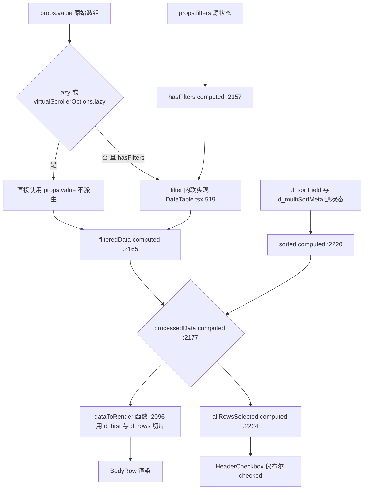
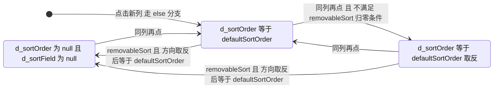
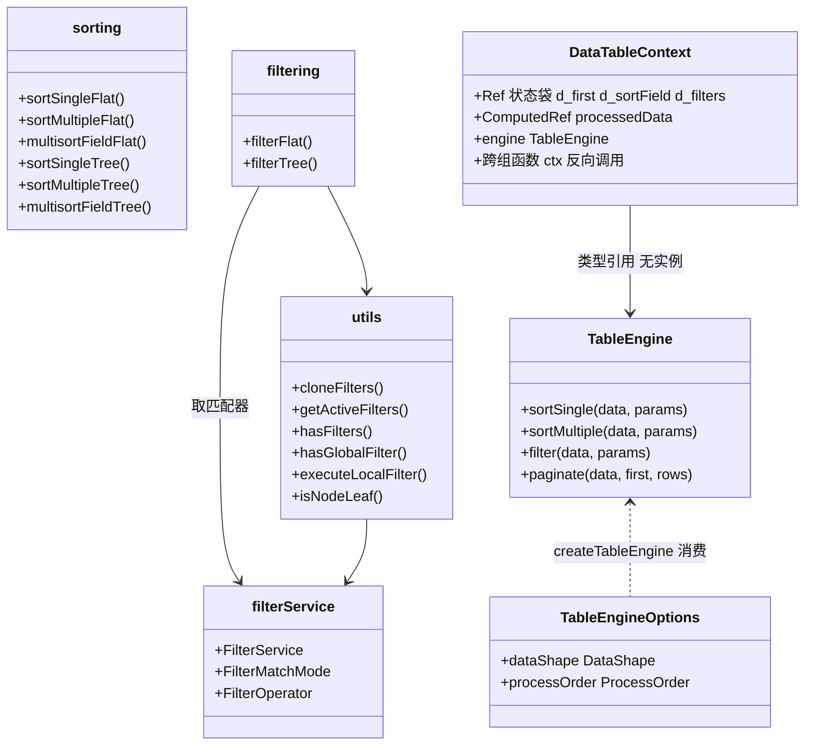
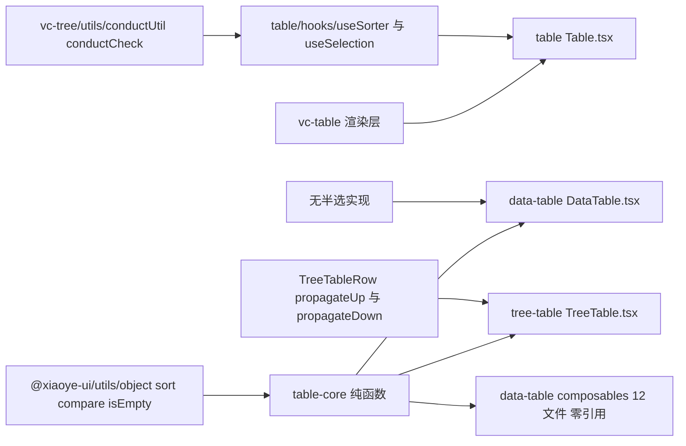

# I06 table-core 状态机：排序、筛选、选择与展开

> **本篇解决**：表格的排序/筛选/分页/选择/展开这五种能力，状态到底存在哪几个变量里、谁派生谁、`filter` 和 `sort` 谁先跑由谁决定、以及为什么「选择」和「展开」在 `table-core` 里一行都找不到。读完能回答：改 `table-core` 会影响哪几个组件，改 `data-table` 的排序会影响 `tree-table` 吗，想给 `data-table` 加半选要动哪几处。
> **前置**：I05（vc-table 渲染架构，尚未撰写，此处只按编号+标题引用）　**读者坐标**：`02-infrastructure` 第 6 篇
> 渲染层（测量行、固定列、单元格拆分）归 I05；`table` 组件的业务 props 语义归 C08-01；`data-table` / `tree-table` 的组件级行为归 C08-02 / C08-03。本篇只管 `packages/xiaoye-ui/src/table-core/` 这一层纯逻辑内核，以及它的两个真实消费者。

---

## 一、职责与边界

`table-core` 是一个 **8 个文件、1,271 行**（含测试 269 行）的纯函数目录，只导出「给定数组 + 给定参数 → 返回新数组」形态的函数。它的全部职责是三件事：排序（`sorting.ts`）、过滤（`filtering.ts` + `filterService.ts` + `utils.ts`）、分页切片（`pagination.ts`）——但要说清一层：这三件事里**只有过滤的树形分支与匹配器常量真的在线上跑**，排序的 flat 分支与分页切片目前是无人调用的规格说明（引用计数见论点 3）。

明确**不负责**：

- **行选择**。`grep -rni "select" packages/xiaoye-ui/src/table-core/` 命中 0 个非注释行，目录里没有任何 selection 相关代码。
- **行展开 / 分组**。`groupRowsBy` 的联动被显式写注释留在组件里，见 `packages/xiaoye-ui/src/table-core/sorting.ts:8` 与 `packages/xiaoye-ui/src/table-core/sorting.ts:9`。
- **状态存储**。它没有 store、没有 context、没有 reducer，`filterFlat` 甚至不返回值以外的东西，事件靠参数里的回调发出去（`packages/xiaoye-ui/src/table-core/filtering.ts:8`）。
- **DOM 与渲染**。虚拟滚动、测量、固定列一律不感知。
- **响应式**。目录内没有一处 `ref` / `computed` / `reactive`（实测 grep 命中 0 行），Vue 适配完全发生在两个消费者侧。

被谁依赖（`grep -rn "table-core" packages/xiaoye-ui/src --include='*.ts' --include='*.tsx'` 的完整结果，排除 `table-core/` 自身与 `components.ts`）：

| 方向 | 对象 | 证据 |
| --- | --- | --- |
| 被依赖 | `tree-table` 直接用 4 个函数 | `packages/xiaoye-ui/src/tree-table/TreeTable.tsx:28` |
| 被依赖 | `data-table` 主文件只用 3 个匹配器常量/服务 | `packages/xiaoye-ui/src/data-table/DataTable.tsx:48` |
| 被依赖 | `data-table` 的列过滤单元 | `packages/xiaoye-ui/src/data-table/ColumnFilter.tsx:17` |
| 被依赖 | `data-table` 孤儿 composables（零引用，见 §六） | `packages/xiaoye-ui/src/data-table/composables/useDataTableState.ts:9`、`packages/xiaoye-ui/src/data-table/composables/types.ts:2` |
| 被依赖 | 包根聚合导出 | `packages/xiaoye-ui/src/components.ts:342` |
| 依赖 | `@xiaoye-ui/utils/object` 的 `sort` / `localeComparator` / `resolveFieldData` / `equals` / `removeAccents` | `packages/xiaoye-ui/src/table-core/sorting.ts:12`、`packages/xiaoye-ui/src/table-core/utils.ts:9` |

**`table/` 组件完全不碰 `table-core`**——这是本篇最重要的边界事实，`table/` 走的是另一套内核（`packages/xiaoye-ui/src/table/hooks/useSorter.tsx`、`packages/xiaoye-ui/src/table/hooks/useSelection.tsx`），两套没有共享一行逻辑。

血统判定：`table-core` **不是 TanStack Table 血统**。判据是仓库里 `grep -rni "tanstack" packages` 命中 0 处，且 `table-core` 既没有 `feature/` 目录、也没有 `createCore()`/`initialState`/reducer 这套 TanStack 结构。反过来，`packages/xiaoye-ui/src/data-table/DataTable.d.ts:1516` 至今保留着 `primefaces.org/cdn/primevue` 的图片地址，`packages/xiaoye-ui/src/table-core/filterService.ts:6` 自称来源是「源项目 `packages/core/src/api/{FilterService,FilterMatchMode,FilterOperator}.js`」，`packages/utils/src/object/methods/resolveFieldData.ts:15` 的注释里还挂着一条 primereact issue 链接。所以 `table-core` 是 **Prime 系（上游实现）`DataTable` / `TreeTable` 的抽取移植**，`sortField`/`sortOrder`/`nullSortOrder`/`multiSortMeta`/`filterMode: lenient|strict`/`FilterMatchMode` 这些名字全部是上游术语，不是本库自创。移植程度见 §二与 §六。

---

## 二、源码地图

`table-core/` 全量文件与行数（`find packages/xiaoye-ui/src/table-core -type f | xargs wc -l`）：

| 文件 | 行数 | 职责 | 关键导出符号 |
| --- | --- | --- | --- |
| `table-core/index.ts` | 38 | 聚合入口 | `createTableEngine`（`:8`） |
| `table-core/types.ts` | 64 | 引擎契约与参数形状 | `DataShape`（`:8`）、`ProcessOrder`（`:9`）、`TableEngine`（`:59`） |
| `table-core/engine.ts` | 50 | flat/tree 三元分派 | `createTableEngine`（`:26`） |
| `table-core/pagination.ts` | 15 | 切片 | `paginate`（`:11`） |
| `table-core/utils.ts` | 102 | 过滤器克隆/激活/存在性判定 | `cloneFilters`（`:15`）、`getActiveFilters`（`:38`）、`isNodeLeaf`（`:100`） |
| `table-core/sorting.ts` | 161 | 排序：flat/tree × 单/多字段 4 个入口 + 2 个比较器助手 | `sortSingleFlat`（`:21`）、`multisortFieldTree`（`:144`） |
| `table-core/filtering.ts` | 257 | 平铺过滤 + 树递归过滤 | `filterFlat`（`:22`）、`filterTree`（`:122`） |
| `table-core/filterService.ts` | 315 | 16 个匹配器 + 匹配模式常量 | `FilterService`（`:38`）、`FilterMatchMode`（`:11`）、`FilterOperator`（`:30`） |
| `table-core/__tests__/table-core.test.ts` | 269 | 唯一测试 | 7 个 describe 块 |

真实主实现入口不在 `engine.ts`（论点 2 证明它生产零调用），也不在 `filtering.ts:22` 的 `filterFlat`（论点 3 证明它生产零引用）——线上真正跑的入口是 `packages/xiaoye-ui/src/table-core/filtering.ts:122`（`filterTree`，被 `packages/xiaoye-ui/src/tree-table/TreeTable.tsx:121` 调用）与 `packages/xiaoye-ui/src/data-table/DataTable.tsx:2180`（`processedData` computed，`data-table` 侧真正决定调用顺序的地方，它调的是组件内的 `filter`/`sortSingle` 而非内核）。

`table-core` 之外、但决定行为的两处消费者地图：

| 文件 | 行数 | 在本篇中的角色 |
| --- | --- | --- |
| `data-table/DataTable.tsx` | 2,876 | 源状态袋 `d_*` 与派生链（`:118` 起、`:2165`、`:2177`） |
| `data-table/composables/` | 12 文件 | `DataTableContext` 契约（`types.ts:4`）——**零引用**，见 §六 |
| `tree-table/TreeTable.tsx` | 966 | 反向顺序（先排序后过滤，`:103`）+ `reactive(state)` 适配 |
| `table/hooks/useSelection.tsx` | 685 | 第三套选择实现，半选在这里（`:161`），与 `table-core` 无关 |
| `packages/utils/src/object/methods/sort.ts` | 20 | 比较器最终落点，空值位置决策（`:15`） |

生成物侧：`table-core` 有包根导出 `packages/xiaoye-ui/src/components.ts:342`（`export * from './table-core'`，**没有** `export { default as }` 也没有样式副作用导入，因为目录内既无 default 导出也无 `style/`）；`packages/xiaoye-ui/package.json:524` 给它单入口 `./table-core`，而相邻的 `./tabs` 在 `packages/xiaoye-ui/package.json:532` 有 `./tabs/style` 双入口——生成器按「有无 style 目录」正确降级了。`typings/global.d.ts` 里只有 `XYDataTable`（`packages/xiaoye-ui/typings/global.d.ts:30`）和 `XYTreeTable`（`:107`），**没有 `XYTableCore`**，这是对的：它不产出组件，不该进 `GlobalComponents`。但 `apps/docs/components/` 下确实没有 `table-core.md`（实测 `ls` 无此文件），于是它落进 A01/A02 已登记的那类问题——**包根可 import、子路径可 import，却没有任何文档页**。

---

## 三、架构与数据流

### 图 1：派生链——源状态与派生态的分界线



`filteredData`（`packages/xiaoye-ui/src/data-table/DataTable.tsx:2168`）与 `processedData`（`packages/xiaoye-ui/src/data-table/DataTable.tsx:2180`）都是 `computed`，**不是存储**。喂给这条派生链的源状态只有 6 项（5 个 ref + 1 个 props）：`d_first` / `d_rows` / `d_sortField` / `d_sortOrder` / `d_multiSortMeta` / `props.filters`（注意最后一项不是 `d_filters`，`hasFilters` 读的是 props，见 `packages/xiaoye-ui/src/data-table/DataTable.tsx:2160` 与论点 5），它们在 `packages/xiaoye-ui/src/data-table/DataTable.tsx:118` 到 `:129` 这段声明里只占 5 席（整段共 12 个 ref：`d_nullSortOrder` 虽然不进 `computed` 依赖，但它作为比较器参数进排序，见 `packages/xiaoye-ui/src/data-table/DataTable.tsx:423`；剩下 6 个 `d_groupRowsSortMeta` / `d_selectionKeys` / `d_columnOrder` / `d_editingRowKeys` / `d_editingMeta` / `d_filters` 服务分组、选择、列序、编辑与过滤器的对外读取）。这条线是清楚的：数组永远不落地，落地的只有排序字段、排序方向、空值位置、分页游标、过滤器对象。

`lazy` 分支必须存在，是因为受控外置时数据由调用方提供，本地再过滤一遍会得到错误结果——`packages/xiaoye-ui/src/data-table/DataTable.tsx:2171` 和 `:2180` 两处条件各挡一次。

### 图 2：单列排序的状态迁移（`packages/xiaoye-ui/src/data-table/DataTable.tsx:361`）



迁移函数是 `packages/xiaoye-ui/src/data-table/DataTable.tsx:361` 到 `:376` 这段 if/else，「是否同一列」的判据是 `d_sortField.value === columnField`（`:362`）。归零条件写作 `d_sortOrder.value! * -1 === props.defaultSortOrder`（`:363`）——它不是「当前是不是最后一档」，而是「下一档是否恰好等于默认档」，所以 `defaultSortOrder` 传 `-1` 时整个循环方向会镜像，这是图里两条 `Unsorted` 边的真实入口条件。多列模式（`packages/xiaoye-ui/src/data-table/DataTable.tsx:377`）不在这张图上，它的迁移在 `addMultiSortField`（`:475`）：字段不在 `d_multiSortMeta` 里就 push 一条默认档，在里面就翻转，翻转结果等于默认档且开了 `removableSort` 时 `splice` 掉整条。

### 图 3：模块与契约关系



`sorting` 在图里是孤立的，因为它既不调 `filterService` 也不调 `utils.ts`，唯一依赖是外部包 `@xiaoye-ui/utils/object`（`packages/xiaoye-ui/src/table-core/sorting.ts:12`）——`sort` / `localeComparator` / `resolveFieldData` 三个函数都来自那里，空值排序位置最终落在 `packages/utils/src/object/methods/sort.ts:15`。`filtering --> filterService` 这条边是真代码（`packages/xiaoye-ui/src/table-core/filtering.ts:79`、`:143`、`:173` 三处直接取 `FilterService.filters[...]`）。

`DataTableContext --> TableEngine` 这条边是**只有类型没有实例**的：`packages/xiaoye-ui/src/data-table/composables/types.ts:38` 声明了 `engine: TableEngine` 字段，但没有任何生产代码构造过引擎实例（§四 论点 2）。

### 图 4：三张表格的内核分叉



`table` 与 `data-table` / `tree-table` 是两个世代的表格，`data-table` 和 `tree-table` 之间共享 `table-core`，但顺序相反（`packages/xiaoye-ui/src/data-table/DataTable.tsx:2168` 先过滤，`packages/xiaoye-ui/src/tree-table/TreeTable.tsx:103` 先排序）。

## 四、核心机制精读

### 论点 1：列定义 DSL 不在 `table-core`，而是一套「子组件自注册 + 非响应式 Set + 手动版本计数器」的三段拼装

先把最容易误解的一点钉死：`table-core` **没有列定义 DSL**。它对列的全部认知只有两个参数——`columns: any[]`（`packages/xiaoye-ui/src/table-core/types.ts:38`）与 `columnProp: (col, prop) => any`（`packages/xiaoye-ui/src/table-core/types.ts:39`），即「一个数组 + 一个取属性的函数」（树形侧同样一份：`packages/xiaoye-ui/src/table-core/types.ts:51`、`:52`）。内核拿列只是为了反查 `filterField`/`field`（`packages/xiaoye-ui/src/table-core/filtering.ts:36`），它不认识 `sortable`、`frozen`、`rowEditor` 这些语义。真正的列 DSL 在消费者侧：`xy-column`（`packages/xiaoye-ui/src/data-table/column/Column.tsx:5`）用 46 个 props 描述一列的全部行为（`packages/xiaoye-ui/src/data-table/column/Column.tsx:7` 到 `:53`），而它的注册逻辑只有 11 行。

```tsx
// packages/xiaoye-ui/src/data-table/column/Column.tsx:55
  setup(_props, { slots }) {
    const instance = getCurrentInstance();
    const columns = inject<Set<any>>('$columns', undefined);

    onMounted(() => {
      instance && columns?.add(instance);
    });

    onUnmounted(() => {
      instance && columns?.delete(instance);
    });

    return () => slots.default?.();
  },
```

注意三件事。第一，`XYColumn` 自己不渲染任何东西，`return () => slots.default?.()`（`packages/xiaoye-ui/src/data-table/column/Column.tsx:67`）——它是纯声明式标记，组件实例本身就是数据载体，父级通过 `instance.vnode.props` 读列配置。第二，注入的 key 是字符串 `'$columns'`，父级用 `useProvide('$columns', d_columns)`（`packages/xiaoye-ui/src/data-table/DataTable.tsx:268`）提供，而 `useProvide` 只做一件事：`provide(provideKey, expose)`（`packages/core/src/composables/index.ts:38`）——**不做任何响应式包装**。第三，被注入的对象是 `HelperSet` 实例，它的容器是裸 `Set`（`packages/core/src/utils/HelperSet.ts:13`），`add` 就是 `this.helpers.add(instance)`（`packages/core/src/utils/HelperSet.ts:21`）。

裸 `Set` 不是响应式的，`Set.add` 不会触发任何 Vue 依赖更新，于是父组件必须手工补一条通知链路。`DataTable` 的做法是把 `HelperSet` 的两个方法 monkey-patch 掉，用闭包里的一个 ref 当版本号：

```ts
// packages/xiaoye-ui/src/data-table/DataTable.tsx:142
    // Wrap HelperSet methods to trigger reactivity
    const originalAdd = d_columns.add.bind(d_columns);
    const originalDelete = d_columns.delete.bind(d_columns);
    d_columns.add = (instance: any) => {
      const size = (d_columns as any).helpers?.size;

      originalAdd(instance);

      if (size !== (d_columns as any).helpers?.size) {
        updateColumnsVersion();
      }
    };
```

消费点在 `columns` computed 的第一行：先读 `columnsVersion.value` 建立依赖（`packages/xiaoye-ui/src/data-table/DataTable.tsx:2119`），再调 `d_columns.get(proxy, ...)`（`packages/xiaoye-ui/src/data-table/DataTable.tsx:2122`）取回列实例数组。`updateColumnsVersion` 只有一行自增（`packages/xiaoye-ui/src/data-table/DataTable.tsx:138`）。

`TreeTable` 没有这套补丁，它的 `columns` computed 只靠「读插槽」建立依赖（`packages/xiaoye-ui/src/tree-table/TreeTable.tsx:98`），即调用 `slots.default?.()`（`packages/xiaoye-ui/src/tree-table/TreeTable.tsx:99`）让渲染函数副作用式地重建集合。`DataTable` 里同样有这一行（`packages/xiaoye-ui/src/data-table/DataTable.tsx:2121`），所以它是**双保险**：插槽变化 + 版本计数。差额来自 `DataTable` 支持列重排（`d_columnOrder`，`packages/xiaoye-ui/src/data-table/DataTable.tsx:126`），重排后 `columns` 必须按新顺序输出（`packages/xiaoye-ui/src/data-table/DataTable.tsx:2127`），只靠插槽求值不够稳。

这就是「与 Vue 响应式的适配层到底做了什么」的第一处答案：**`table-core` 侧一行响应式代码都没有**（`grep -rn "ref(\|computed(\|reactive(" packages/xiaoye-ui/src/table-core` 在排除 `dist` 后命中 0 行，实测），响应式适配全部发生在消费者侧，而且是**手工回调**（版本 ref、monkey-patch）而非通用机制。

### 论点 2：`createTableEngine` 是契约先行、生产零实例的抽象层，`processOrder` 是一个从未被读取的字段

`table-core/index.ts:8` 把 `createTableEngine` 放在第一行导出，注释还给了用法示例（`packages/xiaoye-ui/src/table-core/engine.ts:9`），看上去它是主入口。实际执行结果相反：除了测试文件，**没有任何生产代码调用过它**。

```bash
grep -rn "createTableEngine" packages apps --include='*.ts' --include='*.tsx' --include='*.vue' --include='*.js' \
  | grep -v node_modules | grep -v /dist/
# 命中：engine.ts（定义与注释）、index.ts（导出）、__tests__/table-core.test.ts（5 处）
```

`packages/xiaoye-ui/src/table-core/__tests__/table-core.test.ts:224` 起有 4 个 `it` 专门测它的 flat/tree 分派，也就是说：**这个函数唯一的作用是给测试提供一个「看起来像入口」的对象**。更实质的问题在函数体内部。

```ts
// packages/xiaoye-ui/src/table-core/engine.ts:26
export function createTableEngine(options: TableEngineOptions): TableEngine {
  const { dataShape } = options;

  const isTree = dataShape === 'tree';

  return {
    sortSingle(data: any[], params: SortSingleParams): any[] {
      return isTree ? sortSingleTree(data, params) : sortSingleFlat(data, params);
    },
```

它只解构 `dataShape`（`packages/xiaoye-ui/src/table-core/engine.ts:27`），`processOrder` 被接进类型（`packages/xiaoye-ui/src/table-core/types.ts:15`）却从未被读取。全仓 `processOrder` 只有 3 处出现：类型声明（`packages/xiaoye-ui/src/table-core/types.ts:9`）、`TableEngineOptions` 字段（`packages/xiaoye-ui/src/table-core/types.ts:15`）、以及测试里传参（`packages/xiaoye-ui/src/table-core/__tests__/table-core.test.ts:226`）。传进去的值改变不了引擎行为——测试用例 `packages/xiaoye-ui/src/table-core/__tests__/table-core.test.ts:259` 的标题「processOrder 影响 filter 与排序的先后（引擎只负责纯函数，顺序由调用方组合）」其实已经把真相写出来了：**顺序根本不由引擎决定，它只是被类型系统假装决定了一下**。

真实的顺序决策点是两个消费者各自的一个 computed：`DataTable` 的 `processedData` 消费 `filteredData`（`packages/xiaoye-ui/src/data-table/DataTable.tsx:2180`、`:2178`）→ filter 先跑；`TreeTable` 的 `processedData` 先调 `sortSingleTree`/`sortMultipleTree`（`packages/xiaoye-ui/src/tree-table/TreeTable.tsx:117`、`:112`）再调 `filterTree`（`packages/xiaoye-ui/src/tree-table/TreeTable.tsx:120`、`:121`）→ sort 先跑。两者都不是「配置」，是两段写死的代码顺序。

这条抽象的空转还有第二个证据：`DataTableContext` 声明了 `engine: TableEngine` 字段（`packages/xiaoye-ui/src/data-table/composables/types.ts:38`），但 `composables/` 目录 12 个文件里没有任何一处构造引擎，也没有任何一处 import `createTableEngine`。`types.ts:2` 只 `import type`，编译后不留运行时依赖。结论：`engine.ts` 的 50 行是**为未来的组合准备的接口骨架**，当前唯一价值是它的测试能跑（`pnpm --filter xiaoye-ui test:unit` 里 `table-core.test.ts` 7 个 describe 全绿），改动它不会影响任何组件行为。

### 论点 3：移植只做了一半——flat 侧是复制粘贴的孪生体，只有 tree 侧真正接了线

对 `table-core/index.ts:9` 到 `:27` 导出的 16 个运行时符号逐个统计生产引用（命令与结果均为实测，已排除 `dist`、`node_modules` 和 `table-core/` 自身）：

| 符号 | 生产引用数 | 结论 |
| --- | --- | --- |
| `sortSingleTree` / `sortMultipleTree` / `filterTree` | 各 1 处 import + 调用 | 真复用（`packages/xiaoye-ui/src/tree-table/TreeTable.tsx:28`） |
| `hasFilters`（函数形态） | 2 处调用 | 真复用（`packages/xiaoye-ui/src/tree-table/TreeTable.tsx:120`、`:549`） |
| `FilterService` / `FilterMatchMode` / `FilterOperator` | 3 处 import | 真复用，DataTable 与 ColumnFilter 共用（`packages/xiaoye-ui/src/data-table/DataTable.tsx:48`、`packages/xiaoye-ui/src/data-table/ColumnFilter.tsx:17`） |
| `cloneFilters` | 1 处，且在零引用的孤儿文件里 | 生产路径用副本（`packages/xiaoye-ui/src/data-table/DataTable.tsx:276`） |
| `sortSingleFlat` / `sortMultipleFlat` / `multisortFieldFlat` | 0 | 死代码，仅测试触达 |
| `filterFlat` / `paginate` / `getActiveFilters` / `hasGlobalFilter` / `executeLocalFilter` / `isNodeLeaf` / `multisortFieldTree` | 0 | 死代码，仅测试触达 |

`paginate` 的 0 需要澄清，否则会误判：全仓 `grep -rn "\bpaginate\b" packages/xiaoye-ui/src` 只有两处非 `table-core` 命中，且都是 `table/` 目录的字符串枚举 `'paginate'`（`packages/xiaoye-ui/src/table/interface.tsx:51`、`packages/xiaoye-ui/src/table/Table.tsx:397`），与函数无关。`table-core/pagination.ts:11` 那个 3 行切片函数没有任何调用者——两个消费者各自保留了内联切片：`packages/xiaoye-ui/src/data-table/DataTable.tsx:2102` 与 `packages/xiaoye-ui/src/tree-table/TreeTable.tsx:144`，写法都是 `_data.slice(first, first + rows)`。`pagination.ts:9` 的注释「来源：DataTable.tsx 第 1962-1972 行（dataToRender）」记录了它的出身，但抽完之后没有回头接线。

孪生体的直接证据是同一段逻辑在两个文件里逐字符相同。`table-core` 版：

```ts
// packages/xiaoye-ui/src/table-core/filtering.ts:104
  if (filteredValue.length === originalDataLength || Object.keys(activeFilters).length == 0) {
    filteredValue = data;
  }

  const filterEvent = createLazyLoadEvent ? createLazyLoadEvent() : {};
  filterEvent.filteredValue = filteredValue;
  onFilter?.(filterEvent);
  onChange?.(filteredValue);

  return filteredValue;
```

`DataTable` 内联版：

```ts
// packages/xiaoye-ui/src/data-table/DataTable.tsx:602
      if (filteredValue.length === props.value?.length || Object.keys(activeFilters).length == 0) {
        filteredValue = data;
      }

      const filterEvent = createLazyLoadEvent();

      filterEvent.filteredValue = filteredValue;
      emit('filter', filterEvent);
      emit('value-change', filteredValue);
```

两者的差异只在「事件用回调传还是直接 emit」（`packages/xiaoye-ui/src/table-core/types.ts:42` 的 `createLazyLoadEvent?` 与 `packages/xiaoye-ui/src/table-core/filtering.ts:110` 的 `onFilter?.()` 就是为了抹平这个差异而设计的），控制流完全一致，连「过滤结果数量恰好等于原数组长度就退回原数组引用」这个微优化都复制了两份（`packages/xiaoye-ui/src/table-core/types.ts:40` 把它命名为 `originalDataLength`，注释写着「用于 DataTable 的优化判断」——但 DataTable 从不构造这个参数，因为它根本不调 `filterFlat`）。

由此得到一个对改动很重要的推论：**改 `table-core/filtering.ts` 的 flat 分支不会影响 `data-table`**。同理，`sorting.ts:21` 的 `sortSingleFlat` 与 `DataTable.tsx:398` 的 `sortSingle` 是两套代码，前者比后者少了 `clearEditingMetaData()`（`packages/xiaoye-ui/src/data-table/DataTable.tsx:399`）与 `groupRowsBy` 联动（`packages/xiaoye-ui/src/data-table/DataTable.tsx:401`），这两处剥离正是 `packages/xiaoye-ui/src/table-core/sorting.ts:8` 注释里承诺的「不属于纯排序逻辑，留在组件中处理」。也就是说：**flat 侧的抽取是「先复制一份纯净版、再让调用方继续用脏版本」，抽取本身没走完最后一步替换**。

### 论点 4：派生态全部是 `computed`，没有任何一处存储数组；但「切片层」的 memo 化在两个消费者处不对称

对任务书里「`sortedData`/`filteredRows` 是 memo 计算还是存储」这一问，答案是**计算**，而且两处的实现都是 `computed`：`filteredData`（`packages/xiaoye-ui/src/data-table/DataTable.tsx:2168`）与 `processedData`（`packages/xiaoye-ui/src/data-table/DataTable.tsx:2180`）。`data-table` / `tree-table` / `table-core` 三处都不存在名为 `sortedData` 的符号——全仓它只有 2 处命中，都在另一套内核 `table/` 里：`packages/xiaoye-ui/src/table/Table.tsx:347` 的 `sortedData` computed 与 `packages/xiaoye-ui/src/table/Table.tsx:371` 的 `mergedData`（后者把 `sortedData.value` 再喂给 `getFilterData`，所以 `table/` 的顺序是 sort→filter，与 `data-table` 相反、与 `tree-table` 相同；语义细节归 C08-01）。`DataTable` 这边承担同名角色的 `sorted`（`packages/xiaoye-ui/src/data-table/DataTable.tsx:2223`）其实是个**布尔判定**而非排序结果（`packages/xiaoye-ui/src/data-table/DataTable.tsx:2224`），真正的排序结果只在 `processedData` 内部临时存在。

```ts
// packages/xiaoye-ui/src/data-table/DataTable.tsx:2180
    const processedData = computed(() => {
      let data = filteredData.value;

      if (!props.lazy && !props.virtualScrollerOptions?.lazy) {
        if (data && data.length && sorted.value) {
          if (props.sortMode === 'single') data = sortSingle(data);
          else if (props.sortMode === 'multiple') data = sortMultiple(data);
        }
      }

      return data;
    });
```

链路上有三个细节值得钉住。其一，`sortSingle` 内部第一行是 `clearEditingMetaData()`（`packages/xiaoye-ui/src/data-table/DataTable.tsx:399`），而它被 computed 调用——**在派生求值里改写了编辑态源状态**；`groupRowsBy` 分支同样在 `packages/xiaoye-ui/src/data-table/DataTable.tsx:402` 写 `d_multiSortMeta.value`，`sortMultiple` 在 `packages/xiaoye-ui/src/data-table/DataTable.tsx:429` 写 `d_groupRowsSortMeta.value`。这三处写入会让 `processedData` 反过来污染自己的依赖集，属于「派生层反向写源层」，是本篇第七节列出的坑之一。其二，`lazy` 判断被写了两遍（`packages/xiaoye-ui/src/data-table/DataTable.tsx:2171` 与 `:2180`），不是集中在一个 gate 里，任何新增派生阶段都要记得重复这行。其三，`totalRecordsLength` 在非 lazy 分支直接取 `processedData.value.length`（`packages/xiaoye-ui/src/data-table/DataTable.tsx:2197`、`:2196`），意味着**分页总数由过滤后的集合决定**，这与 `table` 组件把 `total` 独立于过滤语义的做法不同。

切片层的差异是真实的性能特征差异：`DataTable` 的 `dataToRender` 是**普通函数**（`packages/xiaoye-ui/src/data-table/DataTable.tsx:2096`），`return _data.slice(first, first + d_rows.value)`（`packages/xiaoye-ui/src/data-table/DataTable.tsx:2102`）——调用点有 7 处（`packages/xiaoye-ui/src/data-table/DataTable.tsx:813`、`:838`、`:858`、`:873`、`:887`、`:904`、`:2748`），函数体没有缓存，每调一次切一次。更要紧的是这 7 处里 6 处都传了实参 `dataToRender(slotProps.rows)`（键盘全选那条在 `packages/xiaoye-ui/src/data-table/DataTable.tsx:813`，虚拟滚动渲染在 `packages/xiaoye-ui/src/data-table/DataTable.tsx:2756`），此时 `_data = data || processedData.value`（`packages/xiaoye-ui/src/data-table/DataTable.tsx:2097`）取的是**插槽传入的窗口行**，切片作用在虚拟滚动器的输出上，而不是全量数据。`TreeTable` 的同名逻辑是 `computed`（`packages/xiaoye-ui/src/tree-table/TreeTable.tsx:139`），切片在 `packages/xiaoye-ui/src/tree-table/TreeTable.tsx:144`，且不接受实参，所以它没有「对窗口再切一刀」的语义。

结论回扣到「改哪一行会炸」：`DataTable` 想把 `dataToRender` memo 化并不是一行改动——它的入参是 6 个不同来源的窗口数组，computed 只能缓存「无参」这一支。真正可复用的抽象是 `table-core/pagination.ts:11` 那个 `paginate`，但它在生产里 0 调用（论点 3），改成调用它还必须先决定 lazy 分支：`props.lazy ? 0 : d_first.value`（`packages/xiaoye-ui/src/data-table/DataTable.tsx:2100`）这行三元是 `paginate` 没有的信息，`packages/xiaoye-ui/src/table-core/pagination.ts:12` 只做 `first`/`rows` 的边界兜底。换句话说，切片函数之所以抽了没人用，是因为**lazy 判定留在了调用方**，抽出来的版本不足以直接替换。

### 论点 5：状态袋形态不一致——`DataTable` 用 12 个独立 `ref`，`TreeTable` 用一个 `reactive` 对象，两边都没有 reducer

任务书问「各自的状态与 reducer 位置」。事实是：**这套内核没有 reducer，也没有 action/dispatch**（`grep -rn "reducer\|dispatch" packages/xiaoye-ui/src/table-core packages/xiaoye-ui/src/data-table packages/xiaoye-ui/src/tree-table --include='*.ts' --include='*.tsx'` 排除产物后命中 0 行）。状态迁移写成「事件处理函数里直接赋值 ref」，两种容器形态：

```ts
// packages/xiaoye-ui/src/data-table/DataTable.tsx:118
    const d_first = ref(props.first);
    const d_rows = ref(props.rows);
    const d_sortField = ref(props.sortField);
    const d_sortOrder = ref(props.sortOrder);
    const d_nullSortOrder = ref(props.nullSortOrder);
    const d_multiSortMeta = ref<any[]>(props.multiSortMeta ? [...props.multiSortMeta] : []);
    const d_groupRowsSortMeta = ref<any>(null);
    const d_selectionKeys = ref<Record<string, number> | null>(null);
    const d_columnOrder = ref<string[] | null>(null);
    const d_editingRowKeys = ref<Record<string, number> | null>(null);
    const d_editingMeta = ref<Record<string, any>>({});
    const d_filters = ref<Record<string, any>>(cloneFilters(props.filters));
```

```ts
// packages/xiaoye-ui/src/tree-table/TreeTable.tsx:70
    const state = reactive({
      // 浅拷贝：避免后续 delete/赋值直接改动父组件传入的对象
      d_expandedKeys: props.expandedKeys ? { ...props.expandedKeys } : {},
      d_first: props.first,
      d_rows: props.rows,
      d_sortField: props.sortField,
      d_sortOrder: props.sortOrder,
      d_multiSortMeta: props.multiSortMeta ? [...props.multiSortMeta] : [],
```

`TreeTable.tsx:84` 还留了一条硬约束注释：「state 是 reactive，禁止解构（解构会丢失响应性），一律通过 `state.d_xxx` 读写」。这解释了为什么 `TreeTable` 的每个访问点都写成 `state.d_sortField`（`packages/xiaoye-ui/src/tree-table/TreeTable.tsx:113`、`:156`、`:562`）而没有 `.value`，而 `DataTable` 全部带 `.value`（`packages/xiaoye-ui/src/data-table/DataTable.tsx:362`）。

两种形态带来的行为差异不止风格。`DataTable` 的 `d_multiSortMeta` 在每次迁移时用新数组替换（`packages/xiaoye-ui/src/data-table/DataTable.tsx:381`），`TreeTable` 则在原地改完后整体重新赋值一次以触发依赖（`packages/xiaoye-ui/src/tree-table/TreeTable.tsx:543`，写法是 `state.d_multiSortMeta = [...state.d_multiSortMeta]`）——后者是 `reactive` 深层变更后必须做的「换引用」补偿。展开态也只有 `TreeTable` 进了状态袋：`d_expandedKeys`（`packages/xiaoye-ui/src/tree-table/TreeTable.tsx:72`），`DataTable` 里 `grep -n expandedKeys packages/xiaoye-ui/src/data-table/DataTable.tsx` 命中 0 行。

`DataTable` 还有一个「影子状态」需要点名：`d_filters`（`packages/xiaoye-ui/src/data-table/DataTable.tsx:129`）确实被维护——`props.filters` 变化时同步（`packages/xiaoye-ui/src/data-table/DataTable.tsx:2391`、`:2384`）、状态恢复时覆盖（`packages/xiaoye-ui/src/data-table/DataTable.tsx:1892`）、对外暴露 getter（`packages/xiaoye-ui/src/data-table/DataTable.tsx:237`）、装进 lazy 事件载荷（`packages/xiaoye-ui/src/data-table/DataTable.tsx:2050`，函数起点 `:2042`）、参与持久化脏标记（`packages/xiaoye-ui/src/data-table/DataTable.tsx:2319` 到 `:2316`，写法是把 `stateDirty` 置真）。**但过滤派生读的是 `props.filters` 而不是 `d_filters`**：`hasFilters` computed（`packages/xiaoye-ui/src/data-table/DataTable.tsx:2160`、`:2159`）与 `filter()`（`packages/xiaoye-ui/src/data-table/DataTable.tsx:526`）都取 `props.filters`，连 `saveState` 存盘时也直接取 `props.filters`（`packages/xiaoye-ui/src/data-table/DataTable.tsx:1796`、`:1797`）。于是「非受控用法下 `d_filters` 有值但 `props.filters` 为空」时，本地过滤整条链路不会启动——`d_filters` 在这套实现里是**给 lazy 事件、脏标记和子组件显示用的缓存，不是过滤的输入**。列级过滤交互写入的也是 `props` 驱动的 `filters` 对象（`packages/xiaoye-ui/src/data-table/ColumnFilter.tsx:17` 只从 `table-core` 取 `FilterOperator` 常量），这条线是 `data-table` 与 `table` 在「谁持有过滤状态」上的根本分歧。

### 论点 6：行选择没有内核位置——真源在调用方的 `props.selection`，`d_selectionKeys` 只是索引缓存，「全选」是全量语义而非本页语义

先复述本篇最反直觉的事实并给出可复现命令：`table-core` 里一行选择代码都没有。

```bash
grep -rni "select" packages/xiaoye-ui/src/table-core --include='*.ts' | grep -v __tests__ | wc -l
# 0
```

那么选择状态住在哪？`data-table` 的答案是**调用方**。组件本身只维护一个缓存：

```ts
// packages/xiaoye-ui/src/data-table/DataTable.tsx:1100
    function updateSelectionKeys(selection: any) {
      d_selectionKeys.value = {};

      if (Array.isArray(selection)) {
        for (const data of selection) {
          d_selectionKeys.value[String(resolveFieldData(data, props.dataKey))] = 1;
        }
      } else if (selection) {
        d_selectionKeys.value[String(resolveFieldData(selection, props.dataKey))] = 1;
      }
    }
```

它由一个 `immediate` 的 watch 驱动，且只在 `dataKey` 存在时才建（`packages/xiaoye-ui/src/data-table/DataTable.tsx:2368` 到 `:2368`），唯一读取点是 `isSelected`（`packages/xiaoye-ui/src/data-table/DataTable.tsx:1069`）。所有变更路径——`toggleRowWithCheckbox`（`packages/xiaoye-ui/src/data-table/DataTable.tsx:1010`）、`toggleRowWithRadio`（`packages/xiaoye-ui/src/data-table/DataTable.tsx:988`）、`toggleRow`（`packages/xiaoye-ui/src/data-table/DataTable.tsx:1707`）、`selectRange`（`packages/xiaoye-ui/src/data-table/DataTable.tsx:1130`）——都只做一件事：**算出新数组然后 `emit('update:selection', ...)`**（`packages/xiaoye-ui/src/data-table/DataTable.tsx:1054`）。组件内部从不保存选中项，这既是「跨页保持」的实现方式，也是它的限制：翻页不改 `props.selection`，缓存只随 `props.selection` 重建（`packages/xiaoye-ui/src/data-table/DataTable.tsx:2369`），所以选中集合天然跨页、跨排序、跨过滤存在；代价是「调用方忘记 `v-model:selection`」时一切选择都无效，且没有「保留/清空」这类开关可退。

「全选」的语义与分页的关系需要精确说明。写入侧：

```ts
// packages/xiaoye-ui/src/data-table/DataTable.tsx:1038
    function toggleRowsWithCheckbox(event: any) {
      if (props.selectAll !== null) {
        emit('select-all-change', event);
      } else {
        const { originalEvent, checked } = event;
        let _selection: any[] = [];

        if (checked) {
          _selection = props.frozenValue
            ? [...props.frozenValue, ...processedData.value]
            : processedData.value;
```

读的是 `processedData.value`（`packages/xiaoye-ui/src/data-table/DataTable.tsx:1047`），即**过滤 + 排序后的全量集合**，不是 `dataToRender` 切出的当前页（`packages/xiaoye-ui/src/data-table/DataTable.tsx:2102`）。读取侧 `allRowsSelected` 同样遍历 `processedData`（`packages/xiaoye-ui/src/data-table/DataTable.tsx:2232`、`:2245`）。两头一致，所以 `data-table` 的表头复选框是「全选所有匹配行」，不是「全选本页」；`props.selectAll` 非 null 时整条链路让位给受控模式（`packages/xiaoye-ui/src/data-table/DataTable.tsx:1039`、`:2225`），此时连判定都不算。

`indeterminate`（半选）在 `data-table` 是**结构性缺失**，不是「没接上」。三处证据：`XYHeaderCheckbox` 的 props 只有 `checked`/`disabled`/`column`/`headerCheckboxIconTemplate`（`packages/xiaoye-ui/src/data-table/HeaderCheckbox.tsx:8` 到 `:13`），渲染时只往下传 `checked`（`packages/xiaoye-ui/src/data-table/HeaderCheckbox.tsx:44`）；`XYRowCheckbox` 同样没有半选入参（`packages/xiaoye-ui/src/data-table/RowCheckbox.tsx:8` 到 `:16`）；`allRowsSelected` 返回类型是布尔（`packages/xiaoye-ui/src/data-table/DataTable.tsx:2227`、`:2238`、`:2245`）。连那套零引用的 composables 也没实现它——`grep -n "indeterminate\|partial" packages/xiaoye-ui/src/data-table/composables/useDataTableSelection.ts` 命中 0 行，尽管该文件有 573 行。

半选在两处真实存在，且都不在 `table-core`。`tree-table` 用「keys map 的值从布尔升级为对象」的办法：`propagateDown` 写入 `{ checked: true, partialChecked: false }`（`packages/xiaoye-ui/src/tree-table/TreeTableRow.tsx:357`），`propagateUp` 统计子层后决定是否标 `partialChecked: true`（`packages/xiaoye-ui/src/tree-table/TreeTableRow.tsx:389` 到 `:394`），渲染层把它转成 `indeterminate`（`packages/xiaoye-ui/src/tree-table/BodyCell.tsx:216`）。

```tsx
// packages/xiaoye-ui/src/tree-table/TreeTableRow.tsx:369
    function propagateUp(event: { check: boolean; selectionKeys: Record<string, any>; node: any }) {
      const check = event.check;
      const _selectionKeys = { ...event.selectionKeys };
      let checkedChildCount = 0;
      let childPartialSelected = false;

      for (const child of props.node.children) {
        if (_selectionKeys[nodeKey(child)] && _selectionKeys[nodeKey(child)].checked)
          checkedChildCount++;
        else if (_selectionKeys[nodeKey(child)] && _selectionKeys[nodeKey(child)].partialChecked)
          childPartialSelected = true;
      }
```

关键点是这套半选**沿组件树逐级上抛**，不是遍历整棵树算出来的：每个 `TreeTableRow` 只检查自己的直接子节点（`packages/xiaoye-ui/src/tree-table/TreeTableRow.tsx:375`），子组件的 `checkboxChange` 回流给父级的 `propagateUp`（`packages/xiaoye-ui/src/tree-table/TreeTableRow.tsx:502`）。因此它依赖「父子行组件都挂载」，展开状态不影响半选正确性（折叠的子孙仍在 `selectionKeys` 里被计入），但 `TreeTableRow.tsx:367` 的注释记录了它曾经是重复实现（「修复源项目 bug：`onCheckboxChange` 与 `propagateUp` 实现完全重复」）。`table` 则完全另一套：半选键集合由 `conductCheck` 派生（`packages/xiaoye-ui/src/table/hooks/useSelection.tsx:483` 的 `derivedHalfSelectedKeySet`），表头与行都用它填 `indeterminate`（`packages/xiaoye-ui/src/table/hooks/useSelection.tsx:438`、`:501`），细节归 C08-01。

### 论点 7：`getRowId` 在本库不存在，等价物是 `dataKey`，它同时决定选中判定复杂度、可序列化性与状态持久化能力

任务书点名的 `getRowId` 是 TanStack Table 的 API 名。本库判定：

```bash
grep -rn "getRowId" packages/xiaoye-ui/src --include='*.ts' --include='*.tsx' | grep -v /dist/ | wc -l
# 0
```

对应的角色由 `dataKey` 承担（`packages/xiaoye-ui/src/data-table/dataTableTypes.ts:20`，类型是 `String | Function`，因此支持 `id` 与 `row => row.id` 两种写法）。它在四处改变行为，每处都有行号：

1. **选中判定从 O(n) 线性比较降为 O(1) 哈希查表**。有 `dataKey` 走 `d_selectionKeys.value[resolveFieldData(rowData, props.dataKey)] !== undefined`（`packages/xiaoye-ui/src/data-table/DataTable.tsx:1069`、`:1070`）；没有则退化成 `findIndexInSelection`（`packages/xiaoye-ui/src/data-table/DataTable.tsx:1073`）里的 for 循环逐个 `equalsData`（`packages/xiaoye-ui/src/data-table/DataTable.tsx:1085` 到 `:1098`）。全选判定同理：有 key 用 `Set` + `every`（`packages/xiaoye-ui/src/data-table/DataTable.tsx:2245`、`:2245`），无 key 用 `every`+`some` 的 O(n·m)（`packages/xiaoye-ui/src/data-table/DataTable.tsx:2251`）。
2. **行对象比较语义**。`compareSelectionBy` 的 `deepEquals` 分支把 `dataKey` 交给 `equals` 做浅比较（`packages/xiaoye-ui/src/data-table/DataTable.tsx:1124` 到 `:1127`）。这决定了「接口刷新后返回同 id 的新对象」是否还算选中——无 `dataKey` 时对象引用变了就可能丢选中。
3. **编辑态复用同一把 key**。`updateEditingRowKeys`（`packages/xiaoye-ui/src/data-table/DataTable.tsx:1112`）与 `d_editingRowKeys`（`:1117`）用的是同一个 `resolveFieldData(data, props.dataKey)`，且同样被 `if (props.dataKey)` 门控（`packages/xiaoye-ui/src/data-table/DataTable.tsx:2410`、`:2413`）——门控条件是「`editMode === 'row'` 且有 `dataKey` 且当前没有 keys」，也就是说**行编辑态的 key 缓存只在有 `dataKey` 时才建立**。`tree-table` 的对应物是 `nodeKey`，实现就是 `resolveFieldData(node, props.dataKey)`（`packages/xiaoye-ui/src/tree-table/TreeTable.tsx:329`、`:330`），子行组件另有一份同名函数（`packages/xiaoye-ui/src/tree-table/TreeTableRow.tsx:23`）。
4. **状态持久化的能力边界**。`saveState`（`packages/xiaoye-ui/src/data-table/DataTable.tsx:1777`）落盘的字段是 `first`/`rows`（`:1782`、`:1783`）、`sortField`/`sortOrder`（`:1788`、`:1789`，其中函数形态的 `sortField` 被显式跳过，注释写着「Functions can't be serialized」）、`multiSortMeta`（`:1793`）、`filters`（`:1797`）、列宽与列序（`:1801`、`:1805`）——**没有 selection**。所以「刷新后选中是否恢复」不由 `stateStorage` 决定，而由调用方是否自己保存 `props.selection` 决定；`dataKey` 在这里的作用是让它**可以**被序列化（键集合本身是 `Record<string, 1>`，见 `packages/xiaoye-ui/src/data-table/DataTable.tsx:1105`），而对象数组不行。同一份 `createLazyLoadEvent`（`packages/xiaoye-ui/src/data-table/DataTable.tsx:2042`）也只用 `first`/`rows`/`sortField`/`sortOrder`/`multiSortMeta`/`filters` 组装后端参数（`:2044` 到 `:2050`），选择集合不进请求。

`table-core` 对 `dataKey` 一无所知（`grep -rn "dataKey" packages/xiaoye-ui/src/table-core --include='*.ts'` 在排除产物后命中 0 行），它的参数里与行标识有关的只有 `packages/xiaoye-ui/src/table-core/types.ts:39` 那个 `columnProp` 访问器。这条边界很干净：**内核按字段值排序/过滤，不认行身份**，所以 `sortSingleTree` 递归时重建节点对象用的是展开拷贝（`packages/xiaoye-ui/src/table-core/sorting.ts:113`），不需要 id 也能保证不改原数据（`packages/xiaoye-ui/src/table-core/sorting.ts:104` 先 `[...nodes]`）。反过来说，任何「按行身份」的需求（选择、展开、编辑、虚拟滚动 key）都必须留在组件层，这是 `table-core` 无法长出 selection feature 的根本原因，不是遗漏。

### 论点 8：展开与分组都没有独立状态机——展开只在 `TreeTable` 的状态袋里有一份，分组寄生在排序元数据上

展开（expansion）在三套实现里待遇完全不同：

| 位置 | 状态载体 | 迁移函数 | 是否组件内部态 |
| --- | --- | --- | --- |
| `tree-table` | `state.d_expandedKeys`（`packages/xiaoye-ui/src/tree-table/TreeTable.tsx:72`） | `onNodeToggle`（`packages/xiaoye-ui/src/tree-table/TreeTable.tsx:303`） | 是，初值来自 props 浅拷贝 |
| `data-table` | 无节点展开；仅 `expandedRowGroups`（`packages/xiaoye-ui/src/data-table/DataTable.tsx:1746`） | 无 | 否，纯受控 |
| `table` | `useSelection` 之外的 expandedRowKeys（归 C08-01） | — | — |

`TreeTable` 的展开迁移有一个 `reactive` 特有的补偿动作，值得单独看：

```ts
// packages/xiaoye-ui/src/tree-table/TreeTable.tsx:304
      const key = nodeKey(node);

      if (state.d_expandedKeys[key]) {
        delete state.d_expandedKeys[key];
        emit('nodeCollapse', node);
      } else {
        state.d_expandedKeys[key] = true;
        emit('nodeExpand', node);
      }

      state.d_expandedKeys = { ...state.d_expandedKeys };
      emit('update:expandedKeys', state.d_expandedKeys);
```

`delete` 操作在 Vue 3 的 `reactive` 里是能被追踪的（Proxy 的 `deleteProperty`），所以 `:307` 本身不会丢响应；真正需要第 `:314` 行整体换引用的是**消费方**：`expandedKeys={state.d_expandedKeys}`（`packages/xiaoye-ui/src/tree-table/TreeTable.tsx:861`）把对象交给子组件，若子组件用浅比较决定是否重渲染，原地 delete/set 不会改变引用。这一行是「为了 props 引用稳定性策略而写的」，不是 Vue 响应性要求——这个区别会影响你是否要保留它。props 回流由 watch 完成（`packages/xiaoye-ui/src/tree-table/TreeTable.tsx:258`、`:260`）。另有一条容易被忽略的行为：`handlePageChange`（`packages/xiaoye-ui/src/tree-table/TreeTable.tsx:427`）在翻页时执行 `state.d_expandedKeys = {}`（`packages/xiaoye-ui/src/tree-table/TreeTable.tsx:436`）并立刻 emit（`:437`），即 **`tree-table` 翻页会收起所有已展开节点**，而选择态因为存在调用方所以不受影响——同一张表上「选中保持、展开丢失」这个组合是代码事实，不是配置问题。

分组（grouping）的机制更容易被误认为「有独立 feature」。事实是：`data-table` 的 `groupRowsBy` **没有自己的状态机，它把分组顺序写进排序元数据**。

```ts
// packages/xiaoye-ui/src/data-table/DataTable.tsx:401
      if (props.groupRowsBy && props.groupRowsBy === props.sortField) {
        d_multiSortMeta.value = [
          { field: props.sortField, order: props.sortOrder || props.defaultSortOrder },
          { field: d_sortField.value, order: d_sortOrder.value },
        ];

        return sortMultiple(value);
      }
```

单列排序模式下只要分组字段等于当前排序字段，就临时升级为两条 `multiSortMeta`（`packages/xiaoye-ui/src/data-table/DataTable.tsx:402`）并改调 `sortMultiple`（`:407`）；多列模式则在 `packages/xiaoye-ui/src/data-table/DataTable.tsx:432` 到 `:443` 用 `d_groupRowsSortMeta`（声明在 `packages/xiaoye-ui/src/data-table/DataTable.tsx:124`）记住「分组首排序」，并在字段不一致时把它插回数组头部（`packages/xiaoye-ui/src/data-table/DataTable.tsx:442`）。表头渲染侧靠 `groupRowSortField` computed（`packages/xiaoye-ui/src/data-table/DataTable.tsx:2255`）决定哪一列显示分组排序指示器，最终传给表头（`packages/xiaoye-ui/src/data-table/DataTable.tsx:2669`）。

这套做法的成因就是 `sorting.ts:8` 那句注释：分组联动会改状态，而内核必须是纯函数。结果是**分组语义被劈成两半**——排序半在 `DataTable`，展开半在 `BodyRow` 的 `isRowGroupExpanded`（`packages/xiaoye-ui/src/data-table/BodyRow.tsx:362`）与 `expandableRowGroups` 分支（`packages/xiaoye-ui/src/data-table/BodyRow.tsx:408`），而 `table-core` 里连 `group` 这个词都没有。`tree-table` 干脆不支持 `groupRowsBy`（`grep -n groupRowsBy packages/xiaoye-ui/src/tree-table/TreeTable.tsx` 命中 0 行）。

### 论点 9：新增一种能力要动的地方是「7 + 2」处，其中两处是生成物与快照，不是代码

把前面所有机制收敛成一张改动清单。以「给表格加一种新派生阶段（例如按字段去重 `distinct`）」为例，真实需要触碰的位置：

1. 参数形状：`packages/xiaoye-ui/src/table-core/types.ts:34`（`FilterFlatParams` 旁边加一个 params 接口）与 `packages/xiaoye-ui/src/table-core/types.ts:59`（`TableEngine` 方法签名，若希望引擎暴露它）。
2. 实现：新建文件，或在 `packages/xiaoye-ui/src/table-core/filtering.ts:22` 之后追加 flat/tree 两个函数——注意 flat 与 tree 是**成对**的，只写一个就意味着另一种数据形态用不上（`packages/xiaoye-ui/src/table-core/engine.ts:33` 的分派是三元表达式，没有默认分支）。
3. 聚合出口：`packages/xiaoye-ui/src/table-core/index.ts:17` 这一类 re-export 行。**这一步会让新名字自动进入包根导出面**，因为 `packages/xiaoye-ui/src/components.ts:342` 是 `export * from './table-core'`。
4. 引擎分派：`packages/xiaoye-ui/src/table-core/engine.ts:40`（`filter` 方法旁边加一个方法）。由于第 2 节论点 2 已证明没人消费引擎，这一步做了也不生效，但不做会让类型契约与实现脱节。
5. `data-table` 接线：`packages/xiaoye-ui/src/data-table/DataTable.tsx:2180` 的 `processedData` 里插阶段，并且**必须复制 lazy 门控**（`packages/xiaoye-ui/src/data-table/DataTable.tsx:2171` 与 `:2180` 是同一条判断的两份）。
6. `tree-table` 接线：`packages/xiaoye-ui/src/tree-table/TreeTable.tsx:103` 的 `processedData`，注意它的顺序是 sort→filter（`:110`、`:120`），新阶段插在哪个位置会改变语义。
7. 测试：`packages/xiaoye-ui/src/table-core/__tests__/table-core.test.ts` 是纯逻辑层的唯一测试文件（7 个 describe），`vitest.config.mts:33` 的 include 覆盖 `src/**/*.test.{js,ts,jsx,tsx}`，新文件放对位置即可被跑到。

另外两处不是代码，但不做会红：

8. 包根导出面快照：`packages/xiaoye-ui/tests/__snapshots__/index.test.js.snap` 里已经登记了 `createTableEngine`（该文件 `:247`）、`paginate`（`:316`）、`sortSingleFlat`（`:343`）、`FilterService`（`:64`），对应测试是 `packages/xiaoye-ui/tests/index.test.js:27`「包根导出面与提交内容一致（增删公开名必须显式评审）」。新增公开名不改快照，测试直接失败。
9. 与既有公开名重名时的歧义定主：`table-core` 导出的名字全部带前缀（`Filter*`、`sort*`、`filter*`、`paginate`），因此目前没撞名；若新增裸名（例如 `Group`），要按 A02 的规则跑 `pnpm gen:entries`，不要手工编辑 `packages/xiaoye-ui/src/components.ts`。若新目录才需要动 `packages/xiaoye-ui/package.json:524` 那个 `./table-core` 子路径入口，本例不需要。

反过来，「给 `data-table` 加半选」完全不碰 `table-core`，要动的是 6 处渲染契约 + 1 处判定：`allRowsSelected` 从布尔改三态（`packages/xiaoye-ui/src/data-table/DataTable.tsx:2227`）、`XYHeaderCheckbox` 增加 `indeterminate` 入参并往下传（`packages/xiaoye-ui/src/data-table/HeaderCheckbox.tsx:8` 与 `:44`）、`XYRowCheckbox` 同步（`packages/xiaoye-ui/src/data-table/RowCheckbox.tsx:8`）、`HeaderCell`/`FilterHeaderCell` 的事件与 props 透传（`packages/xiaoye-ui/src/data-table/HeaderCell.tsx:344`、`packages/xiaoye-ui/src/data-table/FilterHeaderCell.tsx:139`）、`TableHeader` 的 emit 表（`packages/xiaoye-ui/src/data-table/TableHeader.tsx:41`、`:98`）、以及 `data-table` 的 props 类型文件 `packages/xiaoye-ui/src/data-table/dataTableTypes.ts`（133 行）与手写声明 `packages/xiaoye-ui/src/data-table/DataTable.d.ts` 需要同步——后者不是生成物，它保留了上游的 JSDoc 结构（`packages/xiaoye-ui/src/data-table/DataTable.d.ts:1` 起是 `@module datatable` 文档块）。最后补测试到 `packages/xiaoye-ui/src/data-table/__tests__/data-table.test.js`（现有「should select all rows」在 `:723`、「should unselect all rows」在 `:750`，但没有半选用例）。

## 五、对外契约如何生效

`data-table` 的 props 定义在 `packages/xiaoye-ui/src/data-table/dataTableTypes.ts`（133 行），组件侧只写了 `props: initDefaultProps(dataTableProps(), {})`（`packages/xiaoye-ui/src/data-table/DataTable.tsx:70`，第二个参数为空对象，即默认值全部由 `dataTableProps()` 自己声明），组件名 `XYDataTable`（`packages/xiaoye-ui/src/data-table/DataTable.tsx:67`）与 `inheritAttrs: false`（`:68`）。契约从入口到渲染走的是**四条完全不同的通道**，这是本篇第五节要讲清的机制，而不是属性清单（属性清单见 [apps/docs/components/data-table.md](../../../apps/docs/components/data-table.md)）。

通道一是「props → `d_*` ref → computed → 渲染」。受控/非受控的判定没有集中函数，而是散在读写点上：读一律先取 ref（`packages/xiaoye-ui/src/data-table/DataTable.tsx:362` 用 `d_sortField.value`），写一律同时 emit（`packages/xiaoye-ui/src/data-table/DataTable.tsx:374`、`:375`），回流靠 watch（`packages/xiaoye-ui/src/data-table/DataTable.tsx:2326` 的 `props.first`、`:2353` 的 `props.multiSortMeta`、`:2360` 的 `props.selection`、`:2380` 的 `props.filters`）。所以「传了 prop 不生效」的排查方向是：**该 prop 有没有对应 watch**——`sortField`/`sortOrder`/`filters`/`selection`/`first`/`rows` 有，而 `expandedKeys` 在 `data-table` 根本不存在。

通道二是 provide 的**getter 拉模型**。`DataTable` 提供一个普通对象（不是 `computed`、不是 `reactive`）：

```ts
// packages/xiaoye-ui/src/data-table/DataTable.tsx:217
    useProvide('$parentInstance', {
      get $el() {
        return instance.proxy?.$el;
      },
      get $attrs() {
        return instance.attrs;
      },
      get $parentInstance() {
        return null;
      },
      columnProp,
      get d_sortField() {
        return d_sortField.value;
      },
```

子组件 `inject('$parentInstance', null)`（`packages/xiaoye-ui/src/data-table/BodyRow.tsx:84`）后每次渲染重新读 getter，靠「读 `.value`」这个动作在子组件的 render effect 里建立依赖。这就是任务书问的「`ref`/`computed` 包裹，还是普通对象 + 手动回调」的精确答案：**provide 侧是普通对象 + getter（`packages/xiaoye-ui/src/data-table/DataTable.tsx:217` 到 `:267`），HelperSet 侧是普通对象 + monkey-patch 版本号（`:143` 到 `:153`），状态侧才是真 `ref`（`:118` 到 `:129`）**。性能含义：provider 对象本身不参与依赖收集，粒度完全由子组件读到哪个 getter 决定，读得多不会额外触发父组件更新，但**任何 getter 都可能在子组件 render 之外被调用**（例如 `saveState` 里读 `d_sortField.value`，`packages/xiaoye-ui/src/data-table/DataTable.tsx:1786`），那类调用点没有渲染 effect，改了也不重渲染。

`TreeTable` 走的是另一条：`useProvide('$columns', d_columns)`（`packages/xiaoye-ui/src/tree-table/TreeTable.tsx:96`）+ `reactive` 状态袋（`:70`），子组件通过 props 拿值而不是 inject 整个实例（`packages/xiaoye-ui/src/tree-table/TreeTable.tsx:861` 把 `expandedKeys` 作为 prop 下传）。两库没有共享这一层，这是它们不能互相替换的直接原因。

通道三是列契约：`xy-column` 的 props 不经过 `DataTable` 的 props 系统，而是实例进 Set、父级按需读 `columnProp(col, prop)`（`packages/xiaoye-ui/src/data-table/DataTable.tsx:272`，转发到 `packages/xiaoye-ui/src/data-table/utils.js:27` 的 `getColumnProp`）。`table-core` 接收的就是这个函数（`packages/xiaoye-ui/src/tree-table/TreeTable.tsx:126` 传 `columnProp`），所以**列属性的解析规则改动会同时改变过滤行为**（`packages/xiaoye-ui/src/table-core/filtering.ts:37` 用 `filterField || field` 决定全局过滤覆盖哪些列）。

通道四是 expose：`packages/xiaoye-ui/src/data-table/DataTable.tsx:2435` 的 `expose({...})` 共 33 个成员（`packages/xiaoye-ui/src/data-table/DataTable.tsx:2436` 到 `:2460`），其中包括 computed 本身（`processedData` 在 `packages/xiaoye-ui/src/data-table/DataTable.tsx:2441`、`sorted` 在 `:2438`、`allRowsSelected` 在 `:2439`）和内部动作函数（`toggleRowsWithCheckbox` 在 `:2445`、`filter` 在 `:2451`、`onRowClick` 在 `:2449`），甚至连持久化原语 `getStorage`/`saveState` 也在表上（`packages/xiaoye-ui/src/data-table/DataTable.tsx:2463`、`:2456`）。这意味着模板 ref 拿到的实例可以**绕过 props 直接驱动选择与存盘**，属于契约面外溢，第六节会把它列为权衡。

## 六、设计取舍

### 取舍一：不引 TanStack，自己维护 1,271 行纯函数，换来零依赖，赔上 feature 组合能力

任务书问「是否源自 `@tanstack/table-core`」，读源码的判定是否定的，证据有三条，全部可复现：

```bash
grep -rni "tanstack" packages --include='*.ts' --include='*.tsx' --include='*.json' --include='*.vue' \
  | grep -v node_modules | grep -v /dist/ | wc -l   # 0
grep -rn "getRowId" packages/xiaoye-ui/src --include='*.ts' --include='*.tsx' | wc -l   # 0
grep -rn "getCoreRowModel\|initialState\|useTableState\|features\b" packages/xiaoye-ui/src/table-core | wc -l   # 0
```

TanStack 的三个结构特征——`coreRowModel` 惰性行模型、`initialState`/`onUpdate` 的 reducer 契约、`features` 数组的注册机制——在 `table-core` 里一个都不存在（上面第三条命令 0 命中；`packages/xiaoye-ui/src/table-core/types.ts:59` 的 `TableEngine` 只有 4 个方法，`packages/xiaoye-ui/src/table-core/engine.ts:31` 返回的是普通对象字面量）。反过来，本目录的命名（`sortField`、`sortOrder`、`nullSortOrder`、`multiSortMeta`、`filterMode: lenient|strict`、`FilterMatchMode` 的 16 个档位 `packages/xiaoye-ui/src/table-core/filterService.ts:12` 到 `:27` 及对应 16 个实现 `packages/xiaoye-ui/src/table-core/filterService.ts:73` 到 `:292`）与 `packages/xiaoye-ui/src/table-core/filterService.ts:6` 自述的来源「源项目 `packages/core/src/api/{FilterService,FilterMatchMode,FilterOperator}.js`」指向 **Prime 系上游实现的移植**（上游实现，非本库现状），`packages/xiaoye-ui/src/data-table/DataTable.d.ts:1516` 仍保留上游图片地址也印证了这一点。

被放弃的那条路的代价是什么：feature 注册机制的价值在于「选择/展开/分组是插件」，状态由各 feature 的 reducer 声明，跨 feature 通信走 `table.getState()` 统一快照。本库选了纯函数 + 组件内 ref 之后，**feature 之间共享状态与通知更新只有一条路：组件 setup 的闭包**。论点 6 到论点 8 就是这个选择的直接后果——`data-table` 想加半选，无法「注册一个 selection feature」，只能改 7 个文件（论点 9）。收益同样真实：零运行时依赖、`table-core` 可独立测试（`packages/xiaoye-ui/src/table-core/__tests__/table-core.test.ts` 不需要 mount 任何组件）、产物 tree-shake 干净（`packages/xiaoye-ui/src/table-core/index.ts:9` 到 `:27` 全是具名导出，无 default、无副作用导入，因此 `packages/xiaoye-ui/package.json:524` 的 `./table-core` 只有单入口而没有 `./table-core/style`——目录内确实没有 `style/`）。

### 取舍二：抽取「只求可测试」不求「单一真源」，于是 flat 侧留了两份

`table-core` 的价值定位从文件头注释就写明了：「合并 DataTable.tsx 和 TreeTable.tsx 中几乎 1:1 复制的分页切片逻辑」（`packages/xiaoye-ui/src/table-core/pagination.ts:4`）。也就是说，抽取动机是**消除两份 1:1 复制**，而不是建立单一真源。这就解释了论点 3 的悖论：抽取者在新目录里写了纯净版（带 `filterLocale` 形参的 `executeLocalFilter`，`packages/xiaoye-ui/src/table-core/utils.ts:81` 到 `:93`），却保留了旧副本（三参数、从闭包读 `props.filterLocale` 的版本，`packages/xiaoye-ui/src/data-table/DataTable.tsx:615` 到 `:621`），两者当前**行为等价但签名不等价**。

赔上的东西很具体：一个 bug 要修两遍。`getActiveFilters` 的两份实现（`packages/xiaoye-ui/src/table-core/utils.ts:38` 与 `packages/xiaoye-ui/src/data-table/DataTable.tsx:496`）现在完全一致，但任何人只改其中一份，`data-table` 与 `tree-table` 的「空串约束算不算有效过滤」就会分叉——这个语义在测试里是被钉住的（`packages/xiaoye-ui/src/table-core/__tests__/table-core.test.ts:172`「空串约束是所有匹配器的『无过滤』语义，全部放行」、`:204`「getActiveFilters 丢弃 value 为 null 的约束，保留空串」），而钉住的是**没人用的那份**。

换来的东西也要如实写：因为 flat 分支是死代码，`filterFlat`/`sortSingleFlat` 可以被随意重构而不影响任何组件，这让「先用纯函数版本当规格说明、以后再切换」成为可行路径。论点 9 的第 5、6 步就是这个切换的真实成本清单。

### 取舍三：派生用 `computed` 而不是存 `sortedData`，memo 粒度换全量重排

`processedData`（`packages/xiaoye-ui/src/data-table/DataTable.tsx:2180`）意味着任何源状态变动都会重跑一次 O(n log n) 排序 + O(n·m) 过滤，包括翻页（`d_first` 变更虽不进 `processedData` 依赖，但 `filteredData` 与 `processedData` 都会因 `d_filters`/`d_sortField` 变更整体重算）。另一条路是把 `sortedData` 存成 ref、只在排序参数变化时重算（TanStack 的 `memo()` 行模型就是这个思路）。本库没这么做的原因可以从 `lazy` 分支的存在反推：这套代码要保证「lazy 模式下本地一行都不算」（`packages/xiaoye-ui/src/data-table/DataTable.tsx:2171`、`:2180`），用 computed 表达这条 gate 最短。

代价在 `data-table` 的虚拟滚动路径上暴露得最清楚：`dataToRender(slotProps.rows)` 把切片作用在**窗口行**上（`packages/xiaoye-ui/src/data-table/DataTable.tsx:2756`），而 `processedData` 已经把全量都算了一遍——lazy 与 virtualScrollerOptions.lazy 两种模式下这一步被跳过（`packages/xiaoye-ui/src/data-table/DataTable.tsx:2171`），但非 lazy + 虚拟滚动的组合会同时付「全量派生」和「窗口再切片」两份钱。`table-core/pagination.ts:11` 那个没人用的 `paginate` 本来是最合适的复用点，缺的就是 `first` 归零判断（`packages/xiaoye-ui/src/data-table/DataTable.tsx:2100`）。

### 取舍四：列 DSL 用子组件收集而不是数组 prop，兼容上游写法，赔上响应性

`xy-column` 的实例注册模式（`packages/xiaoye-ui/src/data-table/column/Column.tsx:59` 到 `:65`）与上游一致，好处是模板书写体验与迁移成本；代价是论点 1 里那套 monkey-patch 版本号（`packages/xiaoye-ui/src/data-table/DataTable.tsx:143` 到 `:153`）以及「列集合不是响应式数据」这个长期心智负担。另一条路是 `table` 组件的做法——`columns` 数组 prop + `useColumns` 派生（归 C08-01）。两者对比时值得注意：`table-core` 只需要 `columns: any[]` 和 `columnProp` 访问器（`packages/xiaoye-ui/src/table-core/types.ts:51`、`:52`），所以**数组式列 DSL 可以无缝喂给同一个内核**，`data-table` 若想切换列形态，内核层不需要改一行。

### 取舍五：`expose` 面宽大，是移植兼容性的直接负债

`packages/xiaoye-ui/src/data-table/DataTable.tsx:2435` 的 expose 表把 `filter`（`:2451`）、`toggleRowsWithCheckbox`（`:2445`）、`saveState`（`:2456`）这类内部函数全部对外。上游实现里这些是组件实例方法，模板 ref 可以直接调，本库照搬后在 Vue 里等价可用。赔上的是：**这些函数没有 props 契约的保护**，它们读的是闭包里的 `props`（例如 `toggleRowsWithCheckbox` 直接读 `props.frozenValue` 与 `processedData`，`packages/xiaoye-ui/src/data-table/DataTable.tsx:1046`、`:1047`），外部调用方可以在 `selectionMode` 未开启（`packages/xiaoye-ui/src/data-table/DataTable.tsx:1059` 是它的判定）时触发 selection 事件。删掉任何一项都是 breaking change，保留则永远无法把 `filter` 换成 `table-core.filterFlat`（因为签名里少了 `originalDataLength` 等参数）。

### 取舍六：被放弃的第二条路实物存在——12 个零引用的 composable，它比线上版本更正确，却改了事件契约

第二节承诺过「`DataTableContext` 契约零引用，见 §六」，这里兑现。「为什么不把 2,876 行的 `DataTable.tsx` 拆成组合式函数」这个问题在本仓库不是假设，它**已经被做过一次并且没有接线**：`packages/xiaoye-ui/src/data-table/composables/` 共 12 个文件、1,998 行（`wc -l packages/xiaoye-ui/src/data-table/composables/*.ts` 实测，最大的是 `useDataTableSelection.ts` 573 行）。

零引用这条负面结论用两种写法交叉验证过：`grep -rn "useDataTable" packages apps --include='*.ts' --include='*.tsx' --include='*.vue' --include='*.js' | grep -v /dist/ | grep -v src/data-table/composables/` 命中 0 行；`grep -rn "DataTableContext"` 同样只在该目录内命中。目录外唯一的 `composables` 是 `@xiaoye-ui/core/composables` 的 `useProvide`（`packages/xiaoye-ui/src/data-table/DataTable.tsx:2`），与此无关。它也不在公开 API 面上：`packages/xiaoye-ui/src/data-table/index.ts:2` 只导入组件本体、`:5` 只重导出 props 与类型，包根快照里 `grep -c "useDataTable" packages/xiaoye-ui/tests/__snapshots__/index.test.js.snap` = 0。**这三条合起来解释了它为什么能长期潜伏**：`pnpm typecheck` 会过、`pnpm test:unit` 不覆盖（第七节测试现状记录了它在测试侧同样零命中）、包根导出面不含它，于是没有任何一道门禁会因它漂移而报警。

被放弃的那条路长什么样，`packages/xiaoye-ui/src/data-table/composables/types.ts:4` 的 `DataTableContext` 一句话就说清了：12 个 `d_*` ref（`types.ts:11` 到 `:22`，与线上 `DataTable.tsx:118` 到 `:129` 一一对应）、DOM 引用（`types.ts:25` 到 `:31`）、四个 computed（`types.ts:33` 到 `:36`）、`engine: TableEngine`（`types.ts:38`），加上注释写明的「跨组函数（反向依赖，运行时通过 ctx 访问）」（`types.ts:42` 到 `:44`）——11 个 `useDataTableXxx(ctx)` 各接管一类行为，跨类通信走 ctx 反向调用。这是标准 Vue 3 分解方案，代价是 2,876 行单体变成 12 份需要手工同步契约的单元。

它比线上版本**多解决了两个本篇列过的坑**。第一是坑 3 的「派生层反向写源状态」：线上 `sortSingle` 第一句就调 `clearEditingMetaData()`（`packages/xiaoye-ui/src/data-table/DataTable.tsx:399`），而 `sortSingle` 是被 `processedData` 这个 computed 调用的（`packages/xiaoye-ui/src/data-table/DataTable.tsx:2185`）；orphan 版把同一句挪进点击处理（`packages/xiaoye-ui/src/data-table/composables/useDataTableSorting.ts:45`），派生函数里只留一行注释交代去向：

```ts
// packages/xiaoye-ui/src/data-table/composables/useDataTableSorting.ts:84
  function sortSingle(value: any[]): any[] {
    // 不在此处调用 clearEditingMetaData()，已在 onColumnHeaderClick 中处理
    if (props.groupRowsBy && props.groupRowsBy === props.sortField) {
      d_multiSortMeta.value = [
        { field: props.sortField, order: props.sortOrder || props.defaultSortOrder },
        { field: d_sortField.value, order: d_sortOrder.value },
      ];

      return sortMultiple(value);
    }

    return engine.sortSingle(value, {
```

同样的注释出现在 `packages/xiaoye-ui/src/data-table/composables/useDataTableSorting.ts:103` 与过滤侧的 `packages/xiaoye-ui/src/data-table/composables/useDataTableFiltering.ts:35`、`:54`（后者原文「在事件处理中清空编辑元数据，避免在 computed 中突变状态」）。而排序状态迁移本身是逐行复制：orphan 的 `useDataTableSorting.ts:49` 与线上的 `DataTable.tsx:363` 是同一个 `props.removableSort && d_sortOrder.value! * -1 === props.defaultSortOrder`，`groupRowsBy` 升级成两条 meta 的分支也是同一份（`:87` 到 `:90` 对 `DataTable.tsx:402` 到 `:405`）。

第二处更关键：**`table-core` 的 flat 分支和 `createTableEngine` 唯一的设计客户就是这个目录**。

```ts
// packages/xiaoye-ui/src/data-table/composables/useDataTableFiltering.ts:30
  function filter(data: any[]): any[] | undefined {
    if (!data) {
      return;
    }

    // 不在此处调用 clearEditingMetaData()，已在 onFilterApply 中处理
    return engine.filter(data, {
      filters: props.filters || {},
      filterLocale: props.filterLocale,
      globalFilterFields: props.globalFilterFields,
      columns: ctx.columns.value,
      columnProp,
      originalDataLength: props.value?.length,
      createLazyLoadEvent,
      onFilter: event => emit('filter', event),
      onChange: value => emit('change', value),
    });
  }
```

全仓 `engine.filter` / `engine.sortSingle` / `engine.sortMultiple` 的调用点只有三处，全部在这个目录里（`useDataTableFiltering.ts:36`、`useDataTableSorting.ts:95`、`:118`），其余命中都是 `table-core` 自身的注释与测试。`packages/xiaoye-ui/src/data-table/composables/useDataTableFiltering.ts:42` 还实打实传了 `originalDataLength: props.value?.length`——`packages/xiaoye-ui/src/table-core/types.ts:41` 那个「用于 DataTable 的优化判断」的参数等的就是它。于是第四节论点 3 的「抽取只走了一半」获得了更准确的解释：**链路断在「把 composables 挂进 setup」这一环**，上游的 `filterFlat`/`sortSingleFlat`（`packages/xiaoye-ui/src/table-core/filtering.ts:22`、`packages/xiaoye-ui/src/table-core/sorting.ts:21`）与下游的 1,998 行因此一起变成孤儿；`packages/xiaoye-ui/src/table-core/sorting.ts:19` 的注释「来源：DataTable.tsx 第 458-475 行（去除 groupRowsBy 联动和 clearEditingMetaData）」证明抽取时就想清楚了要剥离什么，签名也是照着这个 ctx 形状设计的（`packages/xiaoye-ui/src/table-core/types.ts:34` 到 `:45`）。

没接线的原因不必猜，有一条可验证的契约漂移：`DataTable` 声明的 emits 表（`packages/xiaoye-ui/src/data-table/DataTable.tsx:71` 到 `:111`）第一项是 `value-change`（`:72`），全表**没有** `change`，线上代码 emit 的也只有 `value-change`（`:318`、`:392`、`:610` 三处，`grep -c "emit('change'" packages/xiaoye-ui/src/data-table/DataTable.tsx` = 0）；orphan 版在同一位置 emit 的却是 `change`（`packages/xiaoye-ui/src/data-table/composables/useDataTablePagination.ts:24` 对 `DataTable.tsx:318`、`useDataTableSorting.ts:78` 对 `DataTable.tsx:392`、`useDataTableFiltering.ts:45` 对 `DataTable.tsx:610`）。逐行对照可以看到两侧其余语句完全一致（例如分页侧 `useDataTablePagination.ts:20` 到 `:23` 与 `DataTable.tsx:314` 到 `:317` 都是 `update:first` → `update:rows` → `page` → `nextTick`），差别只有事件名。原样接线会让所有监听 `@value-change` 的调用方静默收不到数据回调——`value-change` 才是本库对外声明的事件（用法手册的事件表 `apps/docs/components/data-table.md:188`、手写类型声明 `packages/xiaoye-ui/src/data-table/DataTable.d.ts:1380`），composables 的 `change` 不在这套契约里，接线前必须先统一事件名。展开侧是同一故事的重复：`packages/xiaoye-ui/src/data-table/composables/useDataTableExpansion.ts:12` 到 `:24` 与线上 `toggleRow`（`packages/xiaoye-ui/src/data-table/DataTable.tsx:1707` 到 `:1726`）逐行同构，两者都只读 `props.expandedRows`（`packages/xiaoye-ui/src/data-table/DataTable.tsx:1715`、`:1718`），状态袋 `DataTable.tsx:118` 到 `:129` 里没有展开项——这印证论点 8 的「`data-table` 展开纯受控」。

换来什么、赔上什么：这条路换来 12 份可独立阅读的行为单元、一个不再在派生里改源状态的实现，以及 `table-core` flat 分支的唯一出口；赔上的是**一批「看起来已经上线」的死代码**——`types.ts:38` 让 `TableEngine` 在类型层面像已被提供，读者据此会误判引擎已接入（第四节论点 2 的「契约先行、生产零实例」正是它的直接后果），而线上仍是单体。两条可行的收尾：复活它需要至少三步——把三处 `change` 统一回 `value-change`、在 setup 里 `createTableEngine({ dataShape: 'flat', processOrder: 'filter-first' })` 并注入 ctx（`packages/xiaoye-ui/src/table-core/engine.ts:26`）、把 `DataTable.tsx:118` 到 `:129` 的 ref 声明改为 ctx 字段——并且必须重跑 `packages/xiaoye-ui/src/data-table/__tests__/data-table.test.js` 的排序/过滤/分页用例（`:345`、`:504`、`:165`）；删除它反而简单，因为不动导出面（上面快照 grep 为 0），但仍要确认没有任何测试 import 该目录。无论选哪条，**留着它是最贵的选项**：后续每个读 `data-table` 的人都要重新做一遍本节的证伪工作，才能知道该看哪一份。

---

## 七、坑与改动指南

**坑 1：改 `table-core` 的 flat 分支去修 `data-table` 的排序问题。** 触发条件：在 `packages/xiaoye-ui/src/table-core/sorting.ts:21` 的 `sortSingleFlat` 里修空值位置、修 locale 比较。症状：单测全绿（`packages/xiaoye-ui/src/table-core/__tests__/table-core.test.ts:66` 覆盖了空值沉底），但 `data-table` 行为一点不变，`tree-table` 也不变。定位：`data-table` 的排序实际在 `packages/xiaoye-ui/src/data-table/DataTable.tsx:398`，真正的比较器落点在 `packages/utils/src/object/methods/sort.ts:15`；只有 tree 侧（`packages/xiaoye-ui/src/table-core/sorting.ts:96`）会传导到 `packages/xiaoye-ui/src/tree-table/TreeTable.tsx:112`。

**坑 2：预置 `sortField` 而不传 `sortOrder` 时，该列的排序档位会变成 `NaN` 并锁死。** 触发条件：`sortField` 有初始值但 `sortOrder` 未传（`packages/xiaoye-ui/src/data-table/dataTableTypes.ts:38` 的默认值是 `undefined`），然后点这**同一列**表头。症状：数据次序不再按预期变化，且这一列之后点多少次都回不到升/降/无三档。定位：`d_sortOrder` 初值取自 props（`packages/xiaoye-ui/src/data-table/DataTable.tsx:121`），同列分支先算 `d_sortOrder.value! * -1`（`packages/xiaoye-ui/src/data-table/DataTable.tsx:363`）——`undefined * -1` 是 `NaN`，既不等于 `defaultSortOrder`（默认 1，`packages/xiaoye-ui/src/data-table/dataTableTypes.ts:39`），于是走 else 分支把 `NaN` 赋回去（`:367`）；此后 `NaN * -1` 仍是 `NaN`，`=== defaultSortOrder` 永远为假，`removableSort` 的归零出口与换档出口都再也进不去，`NaN` 还被一路传进比较器（`:423`）、事件（`:375`）和状态存盘（`:1789`）。同一条算术陷阱的第二条入口是 `0`：`restoreState()`（函数起点 `packages/xiaoye-ui/src/data-table/DataTable.tsx:1832`）从 storage 读回的档位可能是 `0`（`packages/xiaoye-ui/src/data-table/DataTable.tsx:1876`），而 `0 * -1` 是 `-0`，`-0 === 1` 与 `-0 === -1` 双双为假，档位同样卡住。测试只覆盖「`sortOrder` 有值 + `removableSort`」的正路径（`packages/xiaoye-ui/src/data-table/__tests__/data-table.test.js:448`「should remove sort」、`:458` 传 `removableSort: true`），**`undefined` 与 `0` 这两档无测试保护**。顺带说明：`defaultSortOrder: -1` 的镜像配置本身是自洽的（循环变成「降 → 升 → 无」），它不是这个坑。

**坑 3：在派生里改源状态，导致 `v-model:multi-sort-meta` 静默失同步。** 触发条件：使用 `groupRowsBy` 且它等于当前 `sortField`。症状：`d_multiSortMeta` 被 `sortSingle` 内部改写（`packages/xiaoye-ui/src/data-table/DataTable.tsx:402`），而这条路径**没有 emit**（对比 `:374`、`:387` 的显式 emit），调用方的 `multiSortMeta` 与组件内部不一致；由于改写发生在 `processedData` 求值中（`:2182` 调用 `sortSingle`），还会让 `processedData` 的依赖集包含自己写入的 ref。定位：`packages/xiaoye-ui/src/data-table/DataTable.tsx:398` 到 `:408`、`:432` 到 `:444`，以及 `d_groupRowsSortMeta`（`:124`）。分组相关的组件级用例在 `packages/xiaoye-ui/src/data-table/__tests__/data-table.test.js:1249`、`:1422`，但它们断言的是渲染结果，不校验 emit。

**坑 4：`data-xy-scrollable` 永远渲染不出来。** 触发条件：写样式或测试时依赖该 data 属性区分滚动模式。症状：属性恒为 `undefined`。定位：provide 的对象里 `get $parentInstance() { return null; }`（`packages/xiaoye-ui/src/data-table/DataTable.tsx:224`），而 `TableHeader` 与 `TableFooter` 读的是 `$parentInstance?.$parentInstance?.scrollable`（`packages/xiaoye-ui/src/data-table/TableHeader.tsx:124`、`packages/xiaoye-ui/src/data-table/TableFooter.tsx:65`）；正确的 getter 其实就在同一对象上（`packages/xiaoye-ui/src/data-table/DataTable.tsx:264`）。`BodyRow` 用了兜底写法所以没事（`packages/xiaoye-ui/src/data-table/BodyRow.tsx:85`：`$parentInstance?.$parentInstance ?? $parentInstance`）。这个分支无任何测试保护（`grep -rn "data-xy-scrollable" packages/xiaoye-ui/src/data-table/__tests__` 命中 0 行），而且目前**没有任何样式消费它**——`grep -rn "data-xy-scrollable" packages/xiaoye-ui/src --include='*.less' --include='*.css' --include='*.tsx'` 只命中上面那两处写入点，所以它现在是潜伏缺陷而非可见故障；一旦有人按 `data-xy-scrollable="true"` 写选择器，就会得到空匹配。

**坑 5：`tree-table` 翻页收起全部展开节点。** 触发条件：树形 + 分页 + 用户展开若干节点后翻页。症状：展开态丢失，但选中态保留（选中在调用方），看起来像「半丢状态」。定位：`packages/xiaoye-ui/src/tree-table/TreeTable.tsx:436` 的 `state.d_expandedKeys = {}`，位于 `handlePageChange`（`packages/xiaoye-ui/src/tree-table/TreeTable.tsx:427`）。要改成保留，需同时确认 `:314` 的换引用写法是否还成立（见论点 8）。

**坑 6：把「全选」当「全选本页」。** 触发条件：分页场景下表头全选后提交给后端做批量删除。症状：选中集合是全量过滤结果（`packages/xiaoye-ui/src/data-table/DataTable.tsx:1047`），比当前页多；反过来 `allRowsSelected` 也按全量判定（`:2229`），只选完当前页时表头仍是未选状态。定位：`packages/xiaoye-ui/src/data-table/DataTable.tsx:1038` 到 `:1055` 与 `:2224` 到 `:2249`；当前页切片只在渲染期发生（`:2102`）。若需要「本页全选」，改动点是 `toggleRowsWithCheckbox` 换成 `dataToRender()` 的返回值，但要同步改 `allRowsSelected`，否则判定与写入语义分叉。

**坑 7：`data-table` 的非受控过滤不成立。** 触发条件：只传初始 `filters` 之后不再更新，或完全不传 `filters` 却期望内部状态生效。症状：过滤无效。定位：`hasFilters` 与 `filter()` 都读 `props.filters`（`packages/xiaoye-ui/src/data-table/DataTable.tsx:2160`、`:526`），而内部 `d_filters`（`:129`）只服务 lazy 事件（`:2050`）与脏标记（`:2312`）；列过滤器写回的也是 props 驱动的对象（`packages/xiaoye-ui/src/data-table/ColumnFilter.tsx:17` 只取 `FilterOperator` 常量）。

**坑 8：新增派生阶段忘复制 lazy 门控。** 触发条件：在 `processedData` 链路里插入新步骤。症状：`lazy` 模式下数据被本地二次处理，翻页/排序请求结果被覆盖。定位：`packages/xiaoye-ui/src/data-table/DataTable.tsx:2171` 与 `:2180` 是两条独立 if，新增阶段必须自带一条；`tree-table` 侧的门控在 `packages/xiaoye-ui/src/tree-table/TreeTable.tsx:104`，整个 `else` 分支才是本地路径。

**测试现状（口径按 `packages/xiaoye-ui/vitest.config.mts:33` 的 include：`tests/**` 与 `src/**/*.test.{js,ts,jsx,tsx}`，`.js` 也算）。** `table-core` 只有 1 个测试文件、269 行、7 个 describe（`packages/xiaoye-ui/src/table-core/__tests__/table-core.test.ts:17`、`:36`、`:78`、`:106`、`:126`、`:192`、`:224`）。这里存在一个方向性错配：**被测得最全的是生产零引用的分支**（`paginate`、`sortSingleFlat`、`sortMultipleFlat`、`filterFlat`、`createTableEngine`），而真正服务线上的 `filterTree` 与 `sortMultipleTree` 在该文件里 0 次出现（`grep -n "filterTree\|sortMultipleTree" packages/xiaoye-ui/src/table-core/__tests__/table-core.test.ts` 命中 0 行），它们只通过 `packages/xiaoye-ui/src/tree-table/TreeTable.tsx:112`、`:121` 被组件级用例间接经过，`filterMode: strict` 分支在 `packages/xiaoye-ui/src/tree-table/__tests__/tree-table.test.js` 里没有用例（同文件 `grep -n "strict\|lenient\|partialChecked" ` 命中 0 行）。`data-table` 组件级测试 1,647 行、覆盖排序/过滤/选择/分页主路径（`packages/xiaoye-ui/src/data-table/__tests__/data-table.test.js:345`、`:504`、`:541`、`:165`），`tree-table` 是 432 行、偏渲染冒烟（`packages/xiaoye-ui/src/tree-table/__tests__/tree-table.test.js:70`、`:382`）。`data-table/composables/` 那 12 个文件既无引用也无测试（`grep -rln "composables" packages/xiaoye-ui/tests packages/xiaoye-ui/src/data-table/__tests__` 命中 0 个文件）。

**改动安全边界。** 可以放心改：`table-core/filtering.ts` 的 flat 分支、`sorting.ts:21` 到 `:88`、`pagination.ts`、`engine.ts`——它们不在生产路径上（论点 3 的引用计数），改完只需 `pnpm --filter xiaoye-ui test:unit -- table-core`。谨慎改：`sorting.ts:96`/`:122`、`filtering.ts:122`、`utils.ts:65` 会直接影响 `tree-table`；`FilterService` 的任何匹配器会同时影响 `data-table` 与 `tree-table`（`packages/xiaoye-ui/src/table-core/filterService.ts:38`）。禁止绕过：`packages/xiaoye-ui/src/components.ts:342` 是生成物，改 `table-core` 的公开名后必须跑 `pnpm gen:entries`，并同步 `packages/xiaoye-ui/tests/__snapshots__/index.test.js.snap`。验证命令组合：

```bash
pnpm --filter xiaoye-ui test:unit            # table-core / data-table / tree-table 三个测试文件
pnpm --filter xiaoye-ui test:unit -- tree-table  # 只跑 tree-table，看 tree 分支是否被改坏
pnpm typecheck                               # TableEngine 类型契约与消费者签名
node docs/column/tools/verify-refs.mjs --excerpt docs/column/02-infrastructure/06-table-core-state-machine-状态机.md
```

## 附：本篇可证伪的三个检查点

1. **「`table-core` 无 selection/expand/getRowId」可用三条命令复核**（均应输出 0，且已排除 `dist` 与 `node_modules`）：

   ```bash
   grep -rni "select" packages/xiaoye-ui/src/table-core --include='*.ts' | grep -v __tests__ | wc -l
   grep -rn "getRowId" packages/xiaoye-ui/src --include='*.ts' --include='*.tsx' | grep -v /dist/ | wc -l
   grep -rni "tanstack" packages --include='*.ts' --include='*.tsx' --include='*.json' --include='*.vue' \
     | grep -v node_modules | grep -v /dist/ | wc -l
   ```

   若任一输出非 0，本篇论点 6 与取舍一即被证伪。

2. **「`createTableEngine` 生产零调用」与「`processOrder` 从未被读取」可分别验证**：`grep -rn "createTableEngine" packages apps --include='*.ts' --include='*.tsx' --include='*.vue' --include='*.js' | grep -v node_modules | grep -v /dist/` 的命中只允许出现在 `table-core/engine.ts`、`table-core/index.ts`、`table-core/__tests__/`；`grep -n "processOrder" packages/xiaoye-ui/src/table-core/engine.ts` 只应命中注释行（`:9`），不应命中 `:26` 到 `:49` 的函数体。跑 `pnpm --filter xiaoye-ui test:unit -- table-core` 可确认引擎测试仍通过，从而排除「它其实被间接使用」的解读。

3. **「半选在两处、`data-table` 结构性缺失」可跑 UI 用例验证**：`grep -rn "indeterminate" packages/xiaoye-ui/src/data-table | grep -v /dist/` 应命中 0 行（若为 0，则任何「表头显示半选」的实现都不存在于 `data-table`）；对照 `grep -rn "indeterminate" packages/xiaoye-ui/src/tree-table packages/xiaoye-ui/src/table | grep -v /dist/` 应命中 `packages/xiaoye-ui/src/tree-table/BodyCell.tsx:216` 与 `packages/xiaoye-ui/src/table/hooks/useSelection.tsx:438`。再手动验证全量全选语义：给 `data-table` 传 100 行、`rows: 10`、勾选表头后监听 `update:selection`，长度应为 100 而不是 10（依据 `packages/xiaoye-ui/src/data-table/DataTable.tsx:1047`）。

