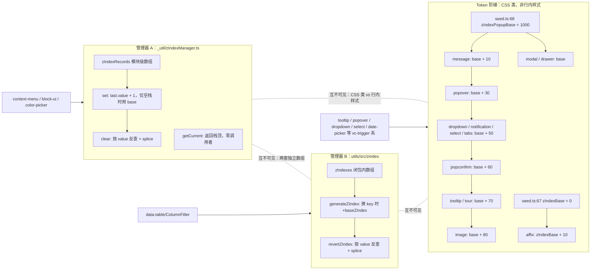
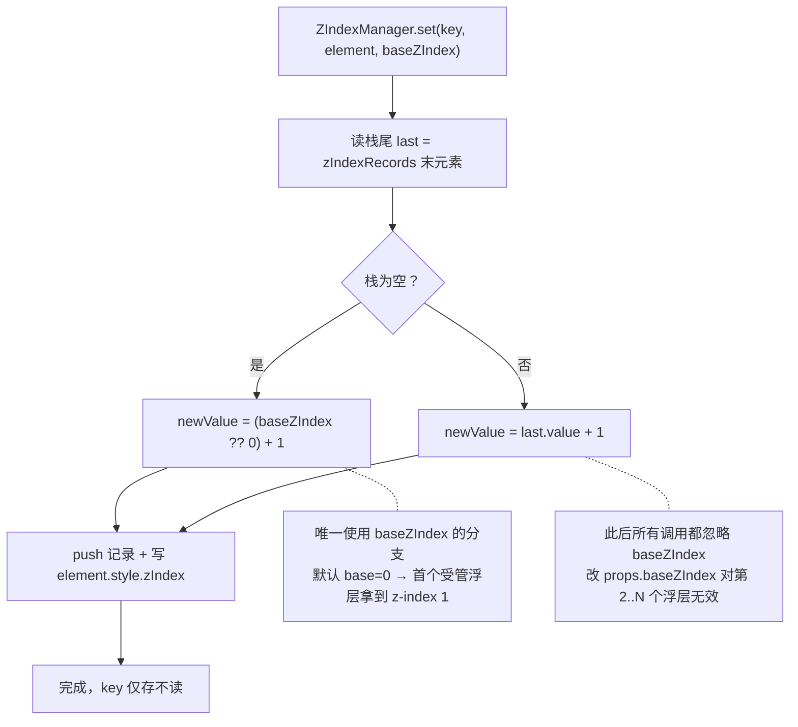
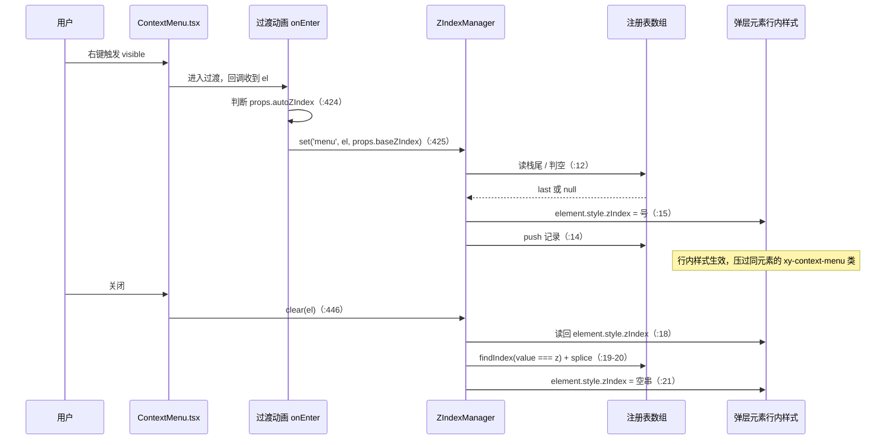

# I10 z-index 层级编排

> **本篇解决**：一个 `<xy-context-menu>` 打开时它身上的 `z-index: 1` 是从哪几行算出来的；为什么同一个包里 `<xy-notification>` 和 `<xy-dropdown>` 会压不住彼此；为什么改 `zIndexPopupBase` 对四类受管组件毫无效果；以及仓库里**两套** z-index 分配器同时存在时，谁写的行内样式会覆盖谁。
> **前置**：A07（交互基础设施总览：一个浮层是怎么拼起来的）　**读者坐标**：`02-infrastructure` 第 10/16 篇
> 主题边界（按 `OUTLINE.md` I10 行）：本篇只讲**叠序编排**——层级号的分配、回收、两套实现的分工，以及 popover/tooltip/tour/notification/dropdown 的冲突后果。浮层横向调用序列归 A07，`vc-align` 的坐标求解归 I01，`vc-trigger` 的开合时序与 `popupStyle` 透传归 I02，本篇只在接缝处一行引用，不重述。

---

## 一、职责与边界

`_util/zIndexManager.ts` 是一个 **28 行的行内样式分配器**（`packages/xiaoye-ui/src/_util/zIndexManager.ts:1`-`28`）。它做且只做三件事：

1. 维护一个模块级数组 `zIndexRecords`，按「当前最大号 + 1」给下一个元素发号（`packages/xiaoye-ui/src/_util/zIndexManager.ts:4`、`packages/xiaoye-ui/src/_util/zIndexManager.ts:12`-`14`）。
2. 把发出来的号**直接写进元素的行内样式** `element.style.zIndex`（`packages/xiaoye-ui/src/_util/zIndexManager.ts:15`）。
3. 卸载时按号反查记录并 `splice`，同时把行内样式清空（`packages/xiaoye-ui/src/_util/zIndexManager.ts:17`-`22`）。

明确**不负责**，且这四条都是实测的「真没有」而非修辞：

- **不认识 Design Token**。全仓 `zIndexBase` / `zIndexPopupBase` 两个种子值（`packages/xiaoye-ui/src/theme/themes/seed.ts:67`-`68`）从未被 `zIndexManager.ts` 读取过——该文件里没有任何 `import`（`packages/xiaoye-ui/src/_util/zIndexManager.ts:1`-`4` 全文只有注释与一个数组字面量）。这是本篇最重要的结论，§四 论点 3 展开。
- **不做跨组件协调，不做分组**。`key` 参数被存进记录但从不被读回来分组（`packages/xiaoye-ui/src/_util/zIndexManager.ts:10`-`14`），论点 2 展开。
- **不参与 `vc-trigger` 浮层链路**。trigger 系弹层的层级是 props → 行内样式（`packages/xiaoye-ui/src/vc-trigger/Popup/PopupInner.tsx:145`、`packages/xiaoye-ui/src/vc-trigger/Popup/PopupInner.tsx:159`），走的是 CSS Token 那条路，两套机制互不可见。
- **没有 SSR / 多实例隔离**。`zIndexRecords` 是模块单例（`packages/xiaoye-ui/src/_util/zIndexManager.ts:4`），SSR 下同一进程内所有请求共享它，论点 5 展开。

被谁依赖（3 个组件用 `_util` 版，1 个组件用 `@xiaoye-ui/utils` 版，实测穷举见 §附 检查点 1）：

| 消费方 | 调用点 | 传入的 key | 传入的 baseZIndex |
| --- | --- | --- | --- |
| `context-menu/ContextMenu.tsx:425` | `set` | `'menu'` | `props.baseZIndex`（默认 `0`，`packages/xiaoye-ui/src/context-menu/contextMenuTypes.ts:53`） |
| `block-ui/BlockUI.tsx:176` | `set` | `'modal'` | `props.baseZIndex`（默认 `0`，`packages/xiaoye-ui/src/block-ui/blockUITypes.ts:29`） |
| `color-picker/ColorPicker.tsx:360` | `set` | `'overlay'` | `props.baseZIndex \|\| 全局配置值`（`packages/xiaoye-ui/src/color-picker/colorPickerTypes.ts:65`） |
| `data-table/ColumnFilter.tsx:308` | 另一套 `ZIndex.set` | `'overlay'` | `$xiaoyeUI?.config?.zIndex?.overlay`（可为 `undefined`） |

依赖谁：零。`packages/xiaoye-ui/src/_util/zIndexManager.ts` 不导入任何东西。它也不经任何 barrel 转出——`packages/xiaoye-ui/src/_util/index.ts`（46 行）里没有 `zIndex` 字样，`packages/xiaoye-ui/package.json` 的 `exports` 中既无 `./_util` 也无 `./zindex` 键，三个消费方全部直连文件路径导入（`packages/xiaoye-ui/src/context-menu/ContextMenu.tsx:36`、`packages/xiaoye-ui/src/block-ui/BlockUI.tsx:18`、`packages/xiaoye-ui/src/color-picker/ColorPicker.tsx:21`）。**这是 `_util` 里少数纯自包含的文件之一**：正因为自包含，它能被这几个组件轻松复用；也正因自包含，它与主题系统彻底脱钩。对照另一套：`packages/utils/src/zindex/index.ts` 经 `packages/utils/src/index.ts:10` 出现在 `@xiaoye-ui/utils` 的包根导出面上，**它是公开 API**，改动要走 semver。

---

## 二、源码地图

本篇覆盖 3 类文件：分配器本体（2 个）、受管消费方（5 个）、层级基准与逃逸点（Token 层 + 硬编码站点）。

| 文件 | 行数 | 职责 | 关键导出 / 主入口 |
| --- | --- | --- | --- |
| `packages/xiaoye-ui/src/_util/zIndexManager.ts` | 28 | 全局单栈发号器 | `ZIndexManager`（`packages/xiaoye-ui/src/_util/zIndexManager.ts:6`）、默认导出同名（`:28`） |
| `packages/utils/src/zindex/index.ts` | 61 | **第二套**发号器：独立数组 + 号段跳跃 | `ZIndex`（`packages/utils/src/zindex/index.ts:61`）、`ZIndexOptions`（`:1`） |
| `packages/utils/src/index.ts` | 10 | 把上面这套重新导出到包根 | `export * from './zindex'`（`packages/utils/src/index.ts:10`） |
| `packages/xiaoye-ui/src/context-menu/ContextMenu.tsx` | 934 | 右键菜单：进入动画里发号 | `packages/xiaoye-ui/src/context-menu/ContextMenu.tsx:425`、回收 `:446`、`:793` |
| `packages/xiaoye-ui/src/block-ui/BlockUI.tsx` | 308 | 遮罩/阻断层 | `packages/xiaoye-ui/src/block-ui/BlockUI.tsx:176`、回收 `:152`、`:184`、`:233` |
| `packages/xiaoye-ui/src/color-picker/ColorPicker.tsx` | 718 | 取色浮层（唯一读全局配置的一支） | `packages/xiaoye-ui/src/color-picker/ColorPicker.tsx:359`-`360`、回收 `:375`、`:615` |
| `packages/xiaoye-ui/src/data-table/ColumnFilter.tsx` | 790 | 列筛选浮层（**用另一套实现**） | `packages/xiaoye-ui/src/data-table/ColumnFilter.tsx:14` 导入、`:308` 发号、`:333`/`:532` 回收 |
| `packages/xiaoye-ui/src/theme/interface/seeds.ts` | 216 | 层级种子定义 | `zIndexBase`（`:155`）、`zIndexPopupBase`（`:164`） |
| `packages/xiaoye-ui/src/theme/themes/seed.ts` | 76 | 层级种子取值 | `packages/xiaoye-ui/src/theme/themes/seed.ts:67`-`68` |
| `packages/xiaoye-ui/src/vc-trigger/Popup/PopupInner.tsx` | 228 | 弹层根节点的行内 `zIndex` | `packages/xiaoye-ui/src/vc-trigger/Popup/PopupInner.tsx:145`、`:159` |
| `packages/xiaoye-ui/src/vc-trigger/Popup/Mask.tsx` | 37 | 遮罩行内 `zIndex` | `packages/xiaoye-ui/src/vc-trigger/Popup/Mask.tsx:33` |
| `packages/xiaoye-ui/src/block-ui/__tests__/block-ui.test.tsx` | 294 | **全仓唯一**测到发号行为的测试（3 个用例） | `packages/xiaoye-ui/src/block-ui/__tests__/block-ui.test.tsx:150`、`:163`、`:175` |

测试现状（一句话，细节在 §七）：`zIndexManager.ts` 与 `packages/utils/src/zindex/index.ts` **都没有自己的测试文件**——`find` 全仓只命中这两个源文件本身；能间接保护发号逻辑的只有 `block-ui` 的 3 个用例（`packages/xiaoye-ui/src/block-ui/__tests__/block-ui.test.tsx:150`、`:163`、`:175`），而它们按 `packages/xiaoye-ui/vitest.config.mts:33` 的 glob 才会被执行。

---

## 三、架构与数据流

### 3.1 静态结构：三套刻度并存

先把关系画清楚，后面所有冲突都能从这张图上读出来。



图里三条虚线是本篇的靶心：**三个发号来源，零个互通通道**。`M1` 与 `M2` 各持一个数组，谁都不知道对方发到几号；`TOK` 走 CSS 类名，`M1`/`M2` 走行内样式——而行内样式在层叠里**优先级高于**任何类选择器（不需要 `!important`），所以受管组件一旦拿到号，Token 阶梯对它就失效了。这解释了 §七 前三条坑的共同成因。

### 3.2 发号决策树：`set` 只有两个分支



`zIndexRecords.length > 0` 这个三元判断（`packages/xiaoye-ui/src/_util/zIndexManager.ts:12`-`13`）是整个文件唯一的分支，也是全部两个坑的来源：`baseZIndex` 只在**进程生命周期内第一次发号**时被读，之后永久失效。

### 3.3 一次开合的时序



注意最后三步的顺序：**先读行内样式，再反查数组**。这意味着数组不是真相来源，DOM 才是。任何在 `set` 之后手工改写 `element.style.zIndex` 的代码（组件自己、用户 CSS、或另一个库）都会让 `clear` 找不到对应记录——`findIndex` 返回 `-1`，`splice` 不执行（`packages/xiaoye-ui/src/_util/zIndexManager.ts:19`-`20` 的 `if (idx !== -1)` 只保护了 `splice`），但行内样式照样被清空（`:21`），号就**泄漏在数组里**永远不出去。这是 §七 坑 4。

## 四、核心机制精读

### 论点 1：`baseZIndex` 只在「注册表为空」这一条分支里被读取，因此默认配置下首个受管浮层拿到的是 `z-index: 1`，而不是任何一个浮层基准值

**断言**：`ZIndexManager` 名义上接受调用方给的层级基准，实际上只在进程生命周期的**第一次**发号时用它；且三个消费方的 `baseZIndex` 默认值全是 `0`，于是这条唯一分支算出的第一个号是 `1`。

代码原文，`_util/zIndexManager.ts` 的全部状态与发号逻辑：

```ts
// packages/xiaoye-ui/src/_util/zIndexManager.ts:4
const zIndexRecords: { key: string; value: number }[] = [];

export const ZIndexManager = {
  get(element?: HTMLElement): number {
    return element ? parseInt(element.style.zIndex, 10) || 0 : 0;
  },
  set(key: string, element: HTMLElement, baseZIndex?: number): void {
    const base = baseZIndex ?? 0;
    const last = zIndexRecords.length > 0 ? zIndexRecords[zIndexRecords.length - 1] : null;
    const newValue = last ? last.value + 1 : base + 1;
    zIndexRecords.push({ key, value: newValue });
    element.style.zIndex = String(newValue);
  },
```

逐段解释：

- `:4` 的数组是 `const` 修饰的**模块级可变状态**。`const` 只锁住绑定不锁内容，`push`/`splice` 全在上面直接发生（`:14`、`:20`）。模块级意味着它属于「一次 `import` 一份」，同进程内所有组件实例、所有 `<xy-config-provider>` 树共用它——不存在「按主题/按应用分栈」的可能。
- `:11` `const base = baseZIndex ?? 0`：`??` 而非 `||`，所以调用方显式传 `0` 和传 `undefined` 结果一致，都是基准 `0`。注意 `ColorPicker.tsx:360` 写的是 `props.baseZIndex || zIndex`（`||`），那里 `0` 会被右侧吞掉，这是消费方写法与本体写法的一次不一致，见 §七 坑 6。
- `:12` `const last = ... ? ... : null`——**整个文件唯一的分支判断**。`base` 只在 `last` 为 `null` 时才进入表达式。
- `:13` `newValue = last ? last.value + 1 : base + 1`：栈非空时，`base` 被彻底丢弃，新号 = 栈尾 + 1。
- `:14`-`:15` 先 `push` 再写行内样式。顺序是先记账后落地，意味着如果 `element` 在这两行之间被销毁（异步竞态），账本里会留下一条指向已消失元素的记录。

于是把默认值代进去：`contextMenuTypes.ts:53`、`blockUITypes.ts:29` 两处都是 `baseZIndex: { type: Number, default: 0 }`，`colorPickerTypes.ts:65` 同样默认 `0`。第一个打开的受管浮层得到 `0 + 1 = 1`。

这个 `1` 的实际含义需要和 Token 阶梯对照才显出来。同一个包里的弹层基准（`seed.ts:68` 定义 `zIndexPopupBase: 1000`）：

| 组件 | 表达式 | 证据 | 实算值 |
| --- | --- | --- | --- |
| affix | `zIndexBase + 10` | `packages/xiaoye-ui/src/affix/style/index.ts:24` | 10（基准取 `zIndexBase`，不是 popup） |
| message | `zIndexPopupBase + 10` | `packages/xiaoye-ui/src/message/style/index.ts:178` | 1010 |
| popover | `zIndexPopupBase + 30` | `packages/xiaoye-ui/src/popover/style/index.ts:179` | 1030 |
| modal 主体与遮罩 | `zIndexPopupBase` | `packages/xiaoye-ui/src/modal/style/index.ts:70`、`:98` | 1000 |
| modal 确认框层 | `zIndexPopupBase + 10` | `packages/xiaoye-ui/src/modal/style/index.ts:178` | 1010 |
| drawer | `zIndexPopupBase` | `packages/xiaoye-ui/src/drawer/style/index.ts:228` | 1000 |
| dropdown / notification / select / tabs / mentions / date-picker / menu | `zIndexPopupBase + 50` | `packages/xiaoye-ui/src/dropdown/style/index.ts:455`、`notification/style/index.ts:282`、`select/style/index.ts:340`、`tabs/style/index.ts:904`、`mentions/style/index.ts:230`、`date-picker/style/index.ts:1444`、`menu/style/index.ts:539` | 1050 |
| popconfirm | `zIndexPopupBase + 60` | `packages/xiaoye-ui/src/popconfirm/style/index.ts:86` | 1060 |
| tooltip / tour | `zIndexPopupBase + 70` | `packages/xiaoye-ui/src/tooltip/style/index.ts:151`、`tour/style/index.ts:243` | 1070 |
| image 预览 | `zIndexPopupBase + 80` | `packages/xiaoye-ui/src/image/style/index.ts:313` | 1080 |

**结论回扣**：受管阶梯（1、2、3…）与 Token 阶梯（1000…1080）不是「谁高谁低」的关系，而是**两套刻度**。`z-index: 1` 的受管浮层压在 `z-index: 1000` 的 Modal 下面——从图上看不出矛盾，因为两者都不是「错」的，只是发号器从没读过基准。想让受管组件进入浮层带，调用方必须**每次**手工传一个足够大的 `baseZIndex`；而因为 `:13` 的实现，只有**第一个**受管浮层会真的用到它，后面每个都在它上面 +1 累加。唯一测出这件事的测试正是为此而写的：`packages/xiaoye-ui/src/block-ui/__tests__/block-ui.test.tsx:152` 显式传 `baseZIndex: 1000` 才敢断言结果。

### 论点 2：`key` 参数在两套实现里都是装饰性的——它被写进记录，但没有任何一条路径把它读回来做分组；`utils` 版里那段按 key 检索的代码从公开 API 不可达

**断言**：`_util` 版的 `key` 只进不出；`utils` 版虽然写了「按 key 检索」的分支，但所有公开入口都把开关硬编码成 `true`，使该分支永远不执行。两套实现的 `key` 都不能用于「同组浮层内部互压、异组浮层按号段分层」。

`_util` 版三个入口对 `key` 的处理：

```ts
// packages/xiaoye-ui/src/_util/zIndexManager.ts:10
  set(key: string, element: HTMLElement, baseZIndex?: number): void {
    const base = baseZIndex ?? 0;
    const last = zIndexRecords.length > 0 ? zIndexRecords[zIndexRecords.length - 1] : null;
    const newValue = last ? last.value + 1 : base + 1;
    zIndexRecords.push({ key, value: newValue });
    element.style.zIndex = String(newValue);
  },
  clear(element: HTMLElement): void {
    const z = parseInt(element.style.zIndex, 10) || 0;
    const idx = zIndexRecords.findIndex(r => r.value === z);
    if (idx !== -1) zIndexRecords.splice(idx, 1);
    element.style.zIndex = '';
  },
  getCurrent(_key: string): number {
    return zIndexRecords.length > 0 ? zIndexRecords[zIndexRecords.length - 1].value : 0;
  },
```

- `:14` 是 `key` 唯一的去处——塞进记录对象。
- `:19` 的 `findIndex` 谓词是 `r.value === z`，**只比数值**，不比 key。所以 `clear` 无法回答「这个 key 还剩几个」。
- `:23` 形参名写成 `_key`（下划线前缀），TS 惯例即「我知道这个参数没用」。函数体 `:24` 直接返回栈尾，与传入的 key 无关。这不是遗漏：`getCurrent` 在整个仓库里**没有任何调用者**（穷举命令见 §附 检查点 2），签名保留 `_key` 只是为了对上 `utils` 版的 `ZIndexOptions.getCurrent(key)`（`packages/utils/src/zindex/index.ts:5`）。

`utils` 版写了 key 感知逻辑，但入口把开关焊死：

```ts
// packages/utils/src/zindex/index.ts:11
  const generateZIndex = (key: string, autoZIndex: boolean, baseZIndex: number = 999) => {
    const lastZIndex = getLastZIndex(key, autoZIndex, baseZIndex);
    const newZIndex = lastZIndex.value + (lastZIndex.key === key ? 0 : baseZIndex) + 1;

    zIndexes.push({ key, value: newZIndex });

    return newZIndex;
  };
```

```ts
// packages/utils/src/zindex/index.ts:31
  const getLastZIndex = (key: string, autoZIndex: boolean, baseZIndex: number = 0) => {
    for (let i = zIndexes.length - 1; i >= 0; i--) {
      if (autoZIndex ? true : zIndexes[i].key === key) {
        return zIndexes[i];
      }
    }
    return { key, value: baseZIndex };
  };
```

`packages/utils/src/zindex/index.ts:33` 的三元里，`autoZIndex` 为真时条件恒真、直接返回末元素；只有为假时才逐项比较 `key`。而 `autoZIndex` 的两个来源都是字面量 `true`：`:48` 的 `generateZIndex(key, true, baseZIndex)` 和 `:57` 的 `getCurrentZIndex(key, true)`，`getCurrentZIndex`（`:27`）再把它原样转给 `getLastZIndex`。文件内不存在第三条路径，`ZIndex` 是 `handler()` 的返回值（`:61`）且没有对外暴露 `autoZIndex` 开关——所以 `:33` 的 `zIndexes[i].key === key` 是从公开 API **不可达**的死分支。

死分支并非无害，它决定了 `:13` 的行为：因为 `getLastZIndex` 永远返回全局末元素，`lastZIndex.key === key` 就变成了「上一个发号的浮层是不是同一种组件」的判定。于是 `utils` 版的真实语义是**跨组跳跃**——不同 `key` 之间相差一整个 `baseZIndex` 号段：

- 空注册表首次 `set`：`:37` 返回 `{key, value: 999}`（`:11` 的默认值经 `:12` 透传），`newZIndex = 999 + 0 + 1 = 1000`。恰好落进浮层带。
- 同 key 再次 `set`：`+0+1` → 1001。
- 换 key `set`：`+999+1` → 2000。

**结论回扣**：`_util` 版是「一条从 1 开始的连续栈」，`utils` 版是「以 999 为段宽的号段分配器」，两者的 `key` 都**没有**被用来做组内比较——前者从不读，后者读了但只能读到「上一个是不是同组」。`ColumnFilter.tsx:308` 传的 `'overlay'` 和 `ColorPicker.tsx:360` 传的 `'overlay'` 因此不会汇合到同一组：它们各自在**自己的数组**里发号，字面量相同纯属巧合。

### 论点 3：两套刻度在 Tour 上撞出了可见后果——同一个组件的遮罩走行内 `1001`，面板走 CSS 类 `1070`，而 `1050` 带上的 Notification 与 Dropdown 既压得住遮罩又压不住面板

**断言**：`zIndexManager.ts` 与 Token 阶梯没有任何数据通路，导致「行内样式」和「类选择器」两套层级来源在同一层 DOM 上共存；行内样式优先级更高，于是凡是被 `set` 过的元素，其 Token 层级一律失效。Tour 是最好的观测样本：它一半靠行内、一半靠类。

Tour 面板的层级来自 CSS：

```ts
// packages/xiaoye-ui/src/tour/style/index.ts:48
      [componentCls]: {
        ...resetComponent(token),

        color: colorText,
        position: 'absolute',
        zIndex: tourZIndexPopup,
        display: 'block',
```

```ts
// packages/xiaoye-ui/src/tour/style/index.ts:240
export default genComponentStyleHook('Tour', token => {
  const { borderRadiusLG, fontSize, lineHeight } = token;
  const TourToken = mergeToken<TourToken>(token, {
    tourZIndexPopup: token.zIndexPopupBase + 70,
```

Tour 遮罩的层级来自 props 默认值，且**写成行内样式**：

```ts
// packages/xiaoye-ui/src/vc-tour/Tour.tsx:54
    zIndex: { type: Number, default: 1001 },
```

```tsx
// packages/xiaoye-ui/src/vc-tour/Mask.tsx:54
                  style={[
                    {
                      position: 'fixed',
                      left: 0,
                      right: 0,
                      top: 0,
                      bottom: 0,
                      zIndex,
                      pointerEvents: 'none',
                    },
                    attrs.style as CSSProperties,
                  ]}
```

逐段解释：

- `tour/style/index.ts:53` 把 `tourZIndexPopup` 挂在 `[componentCls]` 上，`:243` 定义为 `zIndexPopupBase + 70`，按 `seed.ts:68` 的 `1000` 算得 **1070**。
- `vc-tour/Tour.tsx:54` 是一个硬编码的 prop 默认值 **1001**，`vc-tour/Tour.tsx:198` 把它交给 `<Mask>`、`:253` 交给高亮容器，最终在 `vc-tour/Mask.tsx:61` 进入行内 `style`。
- 公开层 `packages/xiaoye-ui/src/tour/index.tsx` 里没有任何 `zIndex` 字样，`packages/xiaoye-ui/src/tour/interface.ts` 没有**手写**的 `zIndex` 条目，但它的 `tourProps` 以 `...VCTourProps()` 展开 vendor props（`tour/interface.ts:6`），因此 `zIndex` 其实**在公开 props 面里**（`vc-tour/Tour.tsx:54` 声明），`:z-index="n"` 走的是 prop 而不是 attrs——初稿把「目录里 grep 不到 zIndex 字样」当成了「props 面不含它」，C03-13 复核时补正；下面的结论（能改、IDE 不提示）仍然成立，只是通道判错。实测 `grep -rn "zIndex" tour/` 在整个 `tour/` 目录只命中 **2 行**，都在 `packages/xiaoye-ui/src/tour/style/index.ts:53` 与 `:243`（即 token 那两条）。也就是说：**组件层既没有在类型上开放 `zIndex`，也没有主动覆盖 vendor 层的默认值**。Tour 因此同时携带 1070（面板，CSS 类）与 1001（遮罩，行内）两个号，分别由两条互不知情的链路产出。另一个旁路是 `tour/index.tsx:75` 的 `{...attrs}` 展开：凡是没有被 `props: tourProps()`（`tour/index.tsx:23`）接住的名字才会落到 attrs 再透传给 `<VCTour>`（`tour/index.tsx:75`），`zIndex` 不走这条，它被 prop 声明接住了，**能改，但不在公开类型里、IDE 不提示、`pnpm typecheck` 也不保证**。
- `1070 > 1001` 让面板浮在遮罩之上，这一条是对的。问题在第三档：`notification/style/index.ts:282` 与 `dropdown/style/index.ts:455` 都是 `zIndexPopupBase + 50` = **1050**，落在 1001 与 1070 **之间**。

于是 Tour 打开时，页面上真实的叠序是 `遮罩 1001 < Notification / Dropdown / Select / Tabs / Menu / DatePicker 1050 < Tour 面板 1070`，后果可以直接从这三行号读出来：

1. **Tour 遮罩压不住 Notification**（1050 > 1001）。引导流程里若同时有通知弹出，通知保持全亮并浮在暗色遮罩上方，而 Tour 的聚光灯效果正是靠这层遮罩做的——它是一张满屏 SVG `<mask>`，先铺 `fill="white"` 的全视口矩形、再在高亮位置铺 `fill="black"` 的矩形挖洞（`packages/xiaoye-ui/src/vc-tour/Mask.tsx:75`-`86`），洞外的部分才暗。洞外压不住，聚光灯就名存实亡。`pointerEvents: 'none'`（`packages/xiaoye-ui/src/vc-tour/Mask.tsx:62`）意味着这不只是观感问题——遮罩本来就不拦事件，通知仍可被点击。
2. **Dropdown 菜单同样亮在遮罩之上**（`dropdown/style/index.ts:455` = 1050），Tour 想引导用户点某个下拉时，菜单项不受暗化，高亮框的「唯一亮区」前提失效。
3. **Tooltip 与 Tour 面板同为 1070**（`tooltip/style/index.ts:151` = `zIndexPopupBase + 70`，与 `tour/style/index.ts:243` 完全相同的偏移）。两者相等时 CSS 层叠退化为 DOM 顺序决定。而这两类节点默认都落在同一个容器里：trigger 系弹层在没有 `getPopupContainer` 时直接挂到 `document.body`（`packages/xiaoye-ui/src/vc-trigger/Trigger.tsx:455`-`456`），Tour 自己的容器走 `PortalWrapper`（`packages/xiaoye-ui/src/vc-tour/Tour.tsx:24` 导入、`:257` 使用）。同容器内的两个同层级兄弟节点，**源码里没有任何一处固定它们的先后顺序**（Portal 机制归 A07 / I03）——这意味着「引导中的步骤面板」和「该步骤里某个元素的 tooltip」谁在上头取决于挂载时机。这是本篇能给出的最强「冲突后果」断言：它不是概率问题，而是**没有定义**。
4. `popconfirm` 用 `+60`（`packages/xiaoye-ui/src/popconfirm/style/index.ts:86`）插在 1050 与 1070 之间，`image` 预览用 `+80`（`packages/xiaoye-ui/src/image/style/index.ts:313`）压在 Tour 之上——层级带被手工分配，没有集中表。

回到受管组件：因为 `set` 写的是行内样式（`packages/xiaoye-ui/src/_util/zIndexManager.ts:15`），三个受管组件即使某天在 CSS 里补上 `z-index` 也不会生效——行内值永远压过类选择器。反过来，`clear` 把行内值清成空串（`:21`）后，CSS 里的层级**立刻重新接管**。这意味着同一组件在「打开一次并关闭」前后可能属于两个不同的层级体系，这是 §七 坑 1 与坑 2 的共同根因。

### 论点 4：回收（`clear`）的记账键是「元素此刻的行内值」而不是元素身份，且消费方两侧守卫条件不对称——号会泄漏，未受管元素的行内层级会被静默清空

**断言**：`clear` 先读 `element.style.zIndex` 再拿这个数去数组里找记录；找不到时**只跳过 `splice`、不跳过样式清空**。任何在 `set` 之后对同一元素行内 `zIndex` 的改写都会让那条记录永久留在数组里，把整条阶梯永久抬高。

```ts
// packages/xiaoye-ui/src/_util/zIndexManager.ts:17
  clear(element: HTMLElement): void {
    const z = parseInt(element.style.zIndex, 10) || 0;
    const idx = zIndexRecords.findIndex(r => r.value === z);
    if (idx !== -1) zIndexRecords.splice(idx, 1);
    element.style.zIndex = '';
  },
```

- `:18` 的 `parseInt(...) || 0`：元素行内为空串、为 `auto`、为 `NaN` 时统统折成 `0`。
- `:19` 用这个 `0` 去 `findIndex(r.value === 0)`。三个消费方默认 `baseZIndex: 0`，`set` 产出 `base + 1 = 1`（`:13`），因此正常情况下数组里**不存在值为 0 的记录**，`idx === -1`，`:20` 跳过——但 `:21` 在 `if` 块**外面**，无条件执行。净效果：对一个从未 `set` 过的元素调 `clear`，它身上的行内 `z-index` 被抹掉，且没有任何告警。这条路径在消费方是可达的：`packages/xiaoye-ui/src/block-ui/BlockUI.tsx:175` 的 set 守卫是 `props.autoZIndex && props.zIndex === undefined`，而 `packages/xiaoye-ui/src/block-ui/BlockUI.tsx:183` 的 clear 守卫只有 `props.autoZIndex`。当调用方传入 `zIndex` 时，`set` 不执行、`clear` 执行，于是 `:152` 与 `:184` 会两次清掉用户自己的行内层级（`:151` 与 `:183` 命中的是同一个 `maskRef.value`／`node`）。
- `:14` 的 `push` 是无条件的，`:20` 的 `splice` 每次最多删一条。若同一元素被 `set` 两次（两次进入过渡而中间没走完 leave 钩子），数组留下两条记录、`clear` 只消掉一条，另一条**永久泄漏**；此后每一次发号都建立在泄漏值之上。任何「`set` 之后覆写同一元素行内 `zIndex`」的代码路径都会造成同形失配——§附 检查点 1 场景 B 用合成覆写复现了它：值被改写后 `clear` 反查不到记录，号在数组里单调累积。

三条 leave/卸载路径与各自的 set 配对关系也值得核对：`packages/xiaoye-ui/src/context-menu/ContextMenu.tsx:805`（卸载时对 `container` 调 `clear`）与 `packages/xiaoye-ui/src/color-picker/ColorPicker.tsx:615`（卸载时对 `pickerEl.value` 调 `clear`）各自配对了 leave 路径 `ContextMenu.tsx:446`、`ColorPicker.tsx:375`。卸载路径收到的元素与过渡钩子发给 `set` 的元素是否为同一个 DOM 节点，取决于 `container` 存的是组件实例还是元素——本篇不断言它们相同或不同（见 §附 检查点 3 的实测方式）；若不同，`clear` 走的就是上面那条「找不到记录但仍清空样式」的路径。

### 论点 5：唯一把层级基准接到「全局配置」上的通道从未被接通——`'$xiaoyeUI'` 这个 inject 键在仓库里只有消费者、没有提供者，两个读它的组件永远走 fallback

**断言**：`ColorPicker.tsx:359` 与 `ColumnFilter.tsx:308` 都试图从注入的 `$xiaoyeUI.config.zIndex.overlay` 取层级基准，但全仓没有任何一处 `provide('$xiaoyeUI', …)`，所以这两处取值恒为 `undefined`，基准分别退化为 `0`（`_util` 版）与 `999`（`utils` 版默认参数）。

```ts
// packages/xiaoye-ui/src/color-picker/ColorPicker.tsx:358
      if (props.autoZIndex) {
        const zIndex = ($xiaoyeUI as any)?.config?.zIndex?.overlay ?? 0;
        ZIndexManager.set('overlay', el, props.baseZIndex || zIndex);
      }
```

`$xiaoyeUI` 不是全局变量，而是 setup 顶部的注入结果：`packages/xiaoye-ui/src/color-picker/ColorPicker.tsx:36` 写的是 `const $xiaoyeUI = inject<any>('$xiaoyeUI', undefined)`，缺省值 `undefined`。把它代回 `:359`：`undefined?.config?.zIndex?.overlay ?? 0` → `0`；再到 `:360` 的 `props.baseZIndex || zIndex` → 默认 `baseZIndex` 为 `0`（`packages/xiaoye-ui/src/color-picker/colorPickerTypes.ts:65`），`0 || 0` 仍是 `0`。**结论：ColorPicker 交给管理器的基准恒等于 0**，与论点 1 的默认路径完全一致，配置读取整段是空转。

另一支用同一键，但缺省值不同：

```ts
// packages/xiaoye-ui/src/data-table/ColumnFilter.tsx:308
      ZIndex.set('overlay', el, $xiaoyeUI?.config?.zIndex?.overlay);
```

`packages/xiaoye-ui/src/data-table/ColumnFilter.tsx:71` 的注入缺省是 `{}`，`{}.config?.zIndex?.overlay` → `undefined`，传给 `ZIndex.set` 后进入 `packages/utils/src/zindex/index.ts:46` 的 `baseZIndex?: number`，在 `:11` 被形参默认值 `999` 接住。于是 data-table 的列筛选浮层拿到的号段宽度是 999，与论点 2 的「1000 起跳」一致。

同一键还有 3 处消费者，全都带缺省值，说明这是仓库既定事实而非个别笔误：`packages/xiaoye-ui/src/data-table/RowCheckbox.tsx:19`、`packages/xiaoye-ui/src/data-table/BodyCell.tsx:86`、`packages/xiaoye-ui/src/data-table/HeaderCheckbox.tsx:16`。

这条断言的否定验证做了两遍（负面结论按规矩需交叉验证）：

1. `grep -rn "provide.*xiaoyeUI" packages apps` → 无命中。
2. `grep -rhoE "provide\([^,)]{1,40}" packages apps --include='*.ts' --include='*.tsx' --include='*.vue' | sort -u` → 全部 provide 键是 `provide(AppConfigContextKey`、`provide(DesignTokenContextKey` 这类**符号键**与 `provide('localeData'`、`provide('vcTriggerContext'` 这类字符串键，其中不含 `'$xiaoyeUI'`。

与论点 5 同源的第二件事：**`_util` 版的 `getCurrent` 零调用者**。第一轮 grep 命中 5 处 `getCurrent`，去掉定义与 `utils` 版自身后，`_util/zIndexManager.ts:23` 的实现在仓库里没有任何调用点。它存在的唯一理由是对齐 `utils` 版的接口形状（`packages/utils/src/zindex/index.ts:5` 的 `ZIndexOptions.getCurrent`）。

第三件事：两套实现的**分工完全由 import 语句决定**，没有任何规范或类型约束。`packages/utils/src/index.ts:10` 把 `utils` 版导出到包根（`export * from './zindex'`），而 `xiaoye-ui` 内部既有人从 `@xiaoye-ui/utils/zindex` 引（`packages/xiaoye-ui/src/data-table/ColumnFilter.tsx:14`），也有三个人从 `../_util/zIndexManager` 引（`packages/xiaoye-ui/src/context-menu/ContextMenu.tsx:36`、`packages/xiaoye-ui/src/block-ui/BlockUI.tsx:18`、`packages/xiaoye-ui/src/color-picker/ColorPicker.tsx:21`）。两个模块的接口签名甚至**不兼容**：`_util` 版是对象单例（`packages/xiaoye-ui/src/_util/zIndexManager.ts:6`），`utils` 版是 `handler()` 的一次性闭包返回值（`packages/utils/src/zindex/index.ts:61`）且 `set` 的 `element` 参数可选（`:46` vs `_util` 的 `:10` 必填）。把一处 import 改成另一处，行为会变（号段起点 1 vs 1000），而 TypeScript 不会报错——因为 `utils` 版的 `element?: HTMLElement` 更宽松。

### 论点 6：全仓硬编码 zIndex 有 117 处，其中 94 处是局部堆叠上下文、真正越过浮层带边界的只有 3 处——问题不是「硬编码太多」，而是「逃逸点没有登记」

**断言**：把「硬编码」一律当缺陷是误判。实测分布显示绝大多数是元素在**自己组件内部**压 sibling（值 -1/0/1/2），与层级编排无关；真正越过量级边界的裸数字只剩 `select` 的 999（带下沿之下）与 `vc-tour` 的 1001（带内，但来自 props 默认值）两处——修前富文本编辑器工具栏提示那个高于带内一切的 9999 已随组件在 2026-10-02 移除，测试文件里另有一个显式的 9999 基准，不进生产产物。

穷举命令（排除 `dist`、`node_modules` 与文档站的构建缓存，§附 检查点 1 同一条）：

```bash
grep -rEn "zIndex['\"]?\s*[:=]\s*-?[0-9]+" --include='*.ts' --include='*.tsx' --include='*.vue' --include='*.js' packages apps \
  | grep -v node_modules | grep -v '/dist/' | grep -v '.vitepress/cache'
```

实测计数与分布：

| 口径 | 数量 | 判读 |
| --- | --- | --- |
| 总命中 | 105 | `packages` 101 + `apps` 4（`apps/docs/examples/layout/fixed.vue:3` 一处、`apps/docs/examples/watermark/` 三个示例各一处） |
| `.less` / `.css` 命中 | 0 | 层级全部来自 CSS-in-JS，没有静态样式逃逸点 |
| 值为 -1 / 0 / 1 / 2 | 87 | 局部堆叠上下文，与浮层带无关，不是缺陷 |
| 值为 3–49 | 13 | 中区间，全部是组件内部层（`spin` 4/10、`carousel` 15、`watermark` 9、`upload` 10、`qrcode` 10、`tree-table` 10、`image-compare` 10、`data-table` 10） |
| 值 ≥ 50 | 5 | 其中 1 处在测试文件；下表列 4 处生产站点 |

值 ≥ 50 的全部站点：

| 站点 | 值 | 性质 |
| --- | --- | --- |
| `packages/xiaoye-ui/src/dropdown/style/index.ts:71` | -9999 | `&::before` 悬停桥接占位，配合 `opacity: 0.0001`，故意压到不可见（同文件 `:64` 才是 `zIndex: zIndexPopup`） |
| `packages/xiaoye-ui/src/float-button/style/index.ts:103` | 99 | 未走 token；`affix` 同类悬浮件用 `zIndexBase + 10`（`packages/xiaoye-ui/src/affix/style/index.ts:24`） |
| `packages/xiaoye-ui/src/float-button/style/index.ts:225` | 99 | 同上，第二处 |
| `packages/xiaoye-ui/src/select/style/multiple.ts:175` | 999 | `&-mirror` 测量节点，同块 `:176` 有 `visibility: 'hidden'`；999 恰低于浮层带下沿 1000 |

另有两类不匹配上面正则、但同属硬编码层级的写法：

- props 默认值形态：`packages/xiaoye-ui/src/vc-tour/Tour.tsx:54` 的 `default: 1001`（论点 3 的主角）。
- 测试里的显式基准：`packages/xiaoye-ui/src/block-ui/__tests__/block-ui.test.tsx:165` 的 `props: { zIndex: 9999 }`，配套用例 `:150`-`:175`。

逐段解释这张表为什么重要：

- `zIndexPopupBase` 是 `1000`（`packages/xiaoye-ui/src/theme/themes/seed.ts:68`），整个浮层带被 `+0` 到 `+80` 占满（论点 1 的对照表）。`999`（`select/style/multiple.ts:175`）落在带下沿之下——测量镜像节点本就不可见，不影响视觉，但它是「裸数字恰好压着浮层带边界」的活样本：任何把它抬高过 1000 的改动都会悄悄改变它与真实浮层的相对关系。生产代码里目前已没有高于带内一切的裸数字，但要警惕它以新组件的形式回来： Teleport 到 body 的浮层如果不用 token 或发号器，就会复制修前那个 9999 的形状。
- `float-button/style/index.ts:103` 与 `:225` 的 `99` 是「半个 bug」：`float-button` 是与 `affix` 同类的贴边悬浮件，`affix` 读了 `zIndexBase`（`packages/xiaoye-ui/src/affix/style/index.ts:24`、`:24`），`float-button` 没读。改 `zIndexBase` 时二者行为分叉。
- `94` 处 `-1/0/1/2` 不应被批量「token 化」。它们的作用域是组件自己的 `position: relative` 子节点排序，`z-index: 1` 在这里不是「层级」而是「谁盖谁」，把它们接到 `zIndexBase` 上会让一次主题改动引发近百处视觉回归。这是本篇对「统一层级」诉求的明确反对意见，细节见 §六。

**结论回扣**：层级编排在本库不是一个系统，而是三套并行机制（Token 阶梯 / 管理器 A / 管理器 B）加 3 个未登记的量级逃逸值。任何「把某个浮层提到最前」的需求，都必须先回答「它属于哪一套」——这决定了改 CSS token 还是改行内样式，也决定了改完会不会被 `clear`（`packages/xiaoye-ui/src/_util/zIndexManager.ts:21`）打回原形。

## 五、对外契约如何生效

层级这个值有**三条互不相通的生效路径**，每条从入口到 DOM 的走法不同，因此「同一个 prop 名字」在不同组件上意味着不同的控制权归属。

**路径 1：props → 过渡钩子 → 行内样式（受管三件套）。** 契约声明集中在两个 prop 上：`autoZIndex` 用 `booleanType(true)`（`packages/xiaoye-ui/src/context-menu/contextMenuTypes.ts:51`、`packages/xiaoye-ui/src/block-ui/blockUITypes.ts:27`、`packages/xiaoye-ui/src/color-picker/colorPickerTypes.ts:63`），`baseZIndex` 用 `{ type: Number, default: 0 }`（`packages/xiaoye-ui/src/context-menu/contextMenuTypes.ts:53`、`packages/xiaoye-ui/src/block-ui/blockUITypes.ts:29`、`packages/xiaoye-ui/src/color-picker/colorPickerTypes.ts:65`）。值不走 `computed`、不进 render——它在**过渡钩子**里被消费：`onEnter`（`packages/xiaoye-ui/src/context-menu/ContextMenu.tsx:425`-`426`）、`onMaskEnter`（`packages/xiaoye-ui/src/block-ui/BlockUI.tsx:175`-`177`）、`onOverlayEnter`（`packages/xiaoye-ui/src/color-picker/ColorPicker.tsx:358`-`361`）。这带来一个契约上的硬后果：**`autoZIndex` 翻转不会作用于已经打开的浮层**，因为 `set` 只在进入钩子里调一次；要生效必须关一次再开。

`block-ui` 在这条路径上加了第三个 prop 来做人工接管，注释就写在源码里：`packages/xiaoye-ui/src/block-ui/blockUITypes.ts:30` 写「显式指定 z-index（设置后 autoZIndex 失效）」，实现是 `packages/xiaoye-ui/src/block-ui/BlockUI.tsx:175` 的 `if (props.autoZIndex && props.zIndex === undefined)`。三个消费方里**只有它**实现了这条退出通道；`context-menu` 与 `color-picker` 都只有 `autoZIndex && baseZIndex` 两个开关，即调用方无法「精确指定一个号」，只能指定基准且受第一条论点限制。

**路径 2：seed token → 组件 token → CSS 类（trigger 系浮层）。** 契约入口是 `zIndexBase` / `zIndexPopupBase` 两个种子（`packages/xiaoye-ui/src/theme/interface/seeds.ts:155`、`:164`，取值 `packages/xiaoye-ui/src/theme/themes/seed.ts:67`-`68`）。各组件在 `genComponentStyleHook` 的第二个参数里做加法语义（`packages/xiaoye-ui/src/dropdown/style/index.ts:455`、`packages/xiaoye-ui/src/notification/style/index.ts:282`、`packages/xiaoye-ui/src/tooltip/style/index.ts:151`、`packages/xiaoye-ui/src/popover/style/index.ts:179`），再在样式对象里落到 `componentCls` 上（`packages/xiaoye-ui/src/notification/style/index.ts:92`、`packages/xiaoye-ui/src/tabs/style/index.ts:151`、`packages/xiaoye-ui/src/select/style/dropdown.ts:45`）。这条路径**受主题切换影响、受 ConfigProvider 作用域影响，且可被 `@xiaoye-ui/vite-plugin` 的静态样式抽取预生成**——与路径 1 的行内写入是完全不同的可预测性等级。改 `zIndexPopupBase` 只动这一条，路径 1、3 一动不动。

**路径 3：props → 行内样式，但不经过任何管理器（`vc-trigger` 弹层）。** `zIndex` 在 trigger 的 props 面里就是一个裸 `Number`（`packages/xiaoye-ui/src/vc-trigger/interface.ts:124`、`packages/xiaoye-ui/src/vc-trigger/Popup/interface.ts:8`），`Trigger.tsx:408`、`:428` 透传给 Popup，最后：

```ts
// packages/xiaoye-ui/src/vc-trigger/Popup/PopupInner.tsx:156
      const mergedStyle: CSSProperties[] = [
        {
          ...stretchStyle.value,
          zIndex,
          opacity:
            statusValue === 'motion' || statusValue === 'stable' || !visible.value ? null : 0,
          // pointerEvents: statusValue === 'stable' ? null : 'none',
          pointerEvents: !visible.value && statusValue !== 'stable' ? 'none' : null,
        },
        attrs.style as CSSProperties,
```

- `:159` 把 prop 的 `zIndex` 放进 `mergedStyle` 数组的**第一个**对象，`:165` 把 `attrs.style` 放在**第二个**。Vue 合并行内样式数组时后者覆盖前者，所以调用方通过 `style` 传进来的 `zIndex` **能压过** `zIndex` prop——两个名字不同、优先级却有向的入口，是排查「我明明设了 zIndex 却不生效」时必须先看的一段。
- 遮罩同样走行内：`packages/xiaoye-ui/src/vc-trigger/Popup/Mask.tsx:33` 直接把 `zIndex` 拼进 `style`，与路径 1 的写法形似但**来源完全不同**（props 而非发号器）。
- `packages/xiaoye-ui/src/vc-tour/Mask.tsx:54`-`65` 是同一形状的第三个实例，也是论点 3 里那个 `1001` 的落点。

**expose 面上的可测性契约，三个消费方不一致。** 只有 `context-menu` 把层级契约挂进了 `expose`：`packages/xiaoye-ui/src/context-menu/ContextMenu.tsx:815`-`804` 逐条输出 `autoZIndex: props.autoZIndex`、`baseZIndex: props.baseZIndex`，紧邻 `:801`-`802` 的 `model` / `appendTo`。`color-picker` 的 `expose`（`packages/xiaoye-ui/src/color-picker/ColorPicker.tsx:620`-`631`）只暴露交互方法（`onInputClick`、`pickColor`、`updateUI` 等），**不含任何层级字段**，尽管 `:619` 上方就写着 `// Expose for testing`；`block-ui` 同样没有暴露 `autoZIndex` / `baseZIndex`。后果是「实例反查层级配置」这件事只在 `context-menu` 上可行，写跨组件的层级回归测试时不能照抄它的做法——目前唯一能断言行内样式的路径是测试里直接读 DOM（`packages/xiaoye-ui/src/block-ui/__tests__/block-ui.test.tsx:150`-`175`）。

`ZIndexManager` 本体**不在包对外面上**：`packages/xiaoye-ui/package.json` 的 `exports` 无 `./_util` 键，`packages/xiaoye-ui/src/_util/index.ts` 也不转出它，所以路径 1 的号段宽度无法从库外干预，唯一的库外把手是各组件的 `baseZIndex`。相反，`packages/utils/src/zindex/index.ts` 经 `packages/utils/src/index.ts:10` 是**公开导出**，`ZIndexOptions`（`packages/utils/src/zindex/index.ts:1`）构成 `@xiaoye-ui/utils` 的 API 面。

---

## 六、设计取舍

**取舍一：文件头写明了动机——去重，而不是建体系。**

```ts
// packages/xiaoye-ui/src/_util/zIndexManager.ts:1
// 共享 ZIndex 管理器：统一管理弹层/模态等组件的 z-index 分配与回收
// 抽取自 context-menu / color-picker / galleria / block-ui 中的重复实现
```

`:2` 是作者自陈的动机：注释里的这 4 个组件原本各有一份重复实现，于是抽了一份（其中一个消费方已随 2026-10-02 的组件移除退出，现存 3 个）。这解释了文件为什么长这样——它的目标是**消除多处重复**，不是**统一全库叠序**。因此它没有 import 主题、没有 token、没有 provider，只有 28 行。**代价**：它成了第五套、第六套局部实现之外的又一个孤岛；`data-table/ColumnFilter.tsx:14` 就近选了另一套（论点 5），说明这次抽取**没有覆盖到最后一个同类组件**。

**取舍二：为什么不用「全部走 token 的静态层级带」这条路。** 静态带（路径 2）的优点是可预期、可 SSR 预抽取、可主题联动；缺点是一次只能表达**固定**的相对顺序，无法表达「谁后打开谁在上」这种运行时需求。`context-menu` 与 `block-ui` 都需要后者（同一页面可能有多个遮罩层层叠），所以确实需要一个运行时发号器。**被放弃的另一条路**是「每次打开都读 `getCurrent()` 再 +1 并把它交给 CSS 变量」，那样能同时保住主题联动与运行时顺序；现方案的赔处是行内样式**永久压过**类选择器（论点 3 末段），使得同一个组件在受管与 token 两条路之间只能二选一。

**取舍三：为什么不合并 `packages/utils/src/zindex/index.ts` 与 `_util/zIndexManager.ts`。** 两者语义其实不同：前者是号段分配器（`packages/utils/src/zindex/index.ts:13` 的跨 key 跳跃），后者是连续栈（`packages/xiaoye-ui/src/_util/zIndexManager.ts:13` 的 +1）。但**没有任何注释或文档说明这个分工**，而 `packages/utils/src/zindex/index.ts:5` 的接口形状与 `_util` 版逐字段雷同（`get`/`set`/`clear`/`getCurrent`），这强烈暗示同源分叉而非有意设计。合并的阻力是**公开性不对称**：`utils` 版在包根导出面上（`packages/utils/src/index.ts:10`），删改要走 semver；`_util` 版不在（§五），可以随手改。于是低风险的一侧（`_util`）保留了，高风险的一侧（`utils`）继续被 `data-table` 依赖——**当前状态是两边都不敢动**。

**取舍四：模块级单例 vs 作用域化实例。** 选前者（`packages/xiaoye-ui/src/_util/zIndexManager.ts:4`）换来零配置与最小体积；赔上的是 SSR（同一 Node 进程内所有请求共享一份数组，先渲染的请求把号抬高，后请求读到的是**上一个请求留下的栈**）、多实例应用（微前端两个子应用各自 `import` 同一份共享库时会互相干扰）、以及测试隔离。测试隔离这一条有**直接物证**：`packages/xiaoye-ui/src/block-ui/__tests__/block-ui.test.tsx:159` 的断言写的是 `expect(z).toBeGreaterThanOrEqual(1001)` ——一个 `>=`，不是相等。用例在 `:152` 显式传 `baseZIndex: 1000`，却仍然不敢断言具体值，只能断言「不低于 1001」，因为同一个 `vitest worker` 里先前跑过的用例可能已经在这份共享数组上留下了记录、把栈尾抬高。**断言强度被迫降级，就是单例设计赔掉的东西。** 源码里没有找到任何缓解措施：`zIndexRecords` 没有 `reset` 接口，`ZIndexManager` 没有工厂函数（`packages/xiaoye-ui/src/_util/zIndexManager.ts:6` 是对象字面量而非 `handler()`），与 `utils` 版形成对照——后者至少把状态放在闭包里（`packages/utils/src/zindex/index.ts:9`）从而**理论上**可以多实例化，尽管它只在 `:61` 实例化了一次。

## 七、坑与改动指南

### 坑 1：给受管三件套的 CSS 加 `z-index` 不生效

- **触发**：为 `<xy-context-menu>` / `<xy-block-ui>` / `<xy-color-picker>` 的 `style/index.ts` 补一条 `zIndex` 想让浮层提到前面。
- **症状**：本地看样式表里规则存在、值也对，页面上叠序毫无变化； DevTools 里那一条被划掉。
- **原因**：`set` 把号写进行内样式（`packages/xiaoye-ui/src/_util/zIndexManager.ts:15`），行内优先级恒高于类选择器。
- **定位**：`packages/xiaoye-ui/src/_util/zIndexManager.ts:15`；消费侧写入点 `packages/xiaoye-ui/src/context-menu/ContextMenu.tsx:425`、`packages/xiaoye-ui/src/block-ui/BlockUI.tsx:176`、`packages/xiaoye-ui/src/color-picker/ColorPicker.tsx:360`。CSS 里已有的层级（如 `packages/xiaoye-ui/src/context-menu/style/index.ts:49`、`packages/xiaoye-ui/src/block-ui/style/index.ts:69` 的 `zIndex: 1`）在浮层打开期间全部是装饰性的。

### 坑 2：调整 `zIndexPopupBase` 后，Modal/Notification 动了，受管三件套没动，相对关系翻转

- **触发**：主题里把 `zIndexPopupBase` 从 `1000` 调到 `100`（常见于「避开宿主站 9999 层级」的诉求）。
- **症状**：Dropdown/Notification/Modal 全部下移，而右键菜单、遮罩、取色浮层仍停在 1、2、3……原本在下的组件跑到上面，且**不同页面上结果不同**（取决于受管阶梯被抬到几号）。
- **原因**：`zIndexManager.ts` 与主题之间没有任何数据通路——文件里 `import` 数为 0，`zIndexPopupBase` / `useToken` / `token.` 出现次数为 0（实测计数见 §附 检查点 3）。种子值只作用于 token 阶梯（`packages/xiaoye-ui/src/theme/themes/seed.ts:68`）。
- **定位**：`packages/xiaoye-ui/src/_util/zIndexManager.ts:11`-`13`；`packages/xiaoye-ui/src/theme/themes/seed.ts:67`-`68`；受管侧唯一的把手是 `baseZIndex`（`packages/xiaoye-ui/src/context-menu/contextMenuTypes.ts:53` 等三处，默认 `0`）。

### 坑 3：Tour 遮罩压不住 Notification 与 Dropdown，引导的「唯一亮区」前提被破

- **触发**：Tour 引导流程进行中同时有通知推送或用户展开下拉。
- **症状**：通知/下拉菜单保持全亮并浮在暗色遮罩之上；遮罩又不拦事件，用户能直接点通知里的操作，引导态被打断。
- **原因**：遮罩是行内 `1001`（`packages/xiaoye-ui/src/vc-tour/Tour.tsx:54` → `packages/xiaoye-ui/src/vc-tour/Mask.tsx:61`），而 Notification 与 Dropdown 都是 `zIndexPopupBase + 50` = `1050`（`packages/xiaoye-ui/src/notification/style/index.ts:282`、`packages/xiaoye-ui/src/dropdown/style/index.ts:455`）；`pointerEvents: 'none'` 在 `packages/xiaoye-ui/src/vc-tour/Mask.tsx:62`。
- **定位**：上面三行；Tour 面板的 `1070` 在 `packages/xiaoye-ui/src/tour/style/index.ts:53` + `:243`。两条修法：把遮罩也纳入 token，或在公开层给 `<xy-tour>` 补一个 typed 的 `zIndex` prop 覆盖 vendor 默认值——目前 `tour/` 目录里 `zIndex` 只出现在上面那两行样式代码中（`grep -rn "zIndex" tour/` 命中 2 行），`tour/index.tsx:23` 的 props 面与 `tour/interface.ts` 都没有开放它，调用方只能靠 `tour/index.tsx:75` 的 `{...attrs}` 旁路传值。

### 坑 4：Tooltip 与 Tour 面板同为 1070，谁在上头源码未定义

- **触发**：引导步骤指向一个带 tooltip 的元素，且 tooltip 与步骤面板同时可见。
- **症状**：叠序在不同交互路径下不一致——先开 tooltip 再进引导时面板在上，反之面板被 tooltip 盖住。
- **原因**：两者偏移量完全相同（`packages/xiaoye-ui/src/tooltip/style/index.ts:151` 与 `packages/xiaoye-ui/src/tour/style/index.ts:243` 都写 `zIndexPopupBase + 70`），同值时 CSS 层叠退化为 DOM 顺序，而两者都是 portal 到 `body` 末尾的节点（portal 机制归 A07 / I03），后插入者胜。
- **定位**：上述两个 `+70` 行。**该分支无测试保护**——`tour` 与 `tooltip` 目录下都没有断言叠序的用例。

### 坑 5：号泄漏——反复开合后 z-index 单调爬升且永不回落

- **触发**：任何在 `set` 之后覆写同一元素行内 `zIndex` 的代码路径——组件自己、用户脚本或另一个库的直写都算；§附 检查点 1 场景 B 用合成覆写复现了这条路径（`e.style.zIndex = '999'` 后 `clear` 反查失配）。
- **症状**：开发者工具里看到第 N 次打开的菜单带 `z-index: 40`，而当前页面只开着一个浮层；层级号越用越大，最终撞上宿主站层的 `9999`。
- **原因**：`clear` 用**元素此刻的行内值**去 `findIndex`（`packages/xiaoye-ui/src/_util/zIndexManager.ts:18`-`19`）。值被改写过 → 找不到 → `splice` 跳过（`:20`）→ 记录永久残留 → 下一次发号在它上面 +1（`:13`）。
- **定位**：`packages/xiaoye-ui/src/_util/zIndexManager.ts:18`-`21`。§附 检查点 1 附了一段真跑过的脚本，实测「5 次正常开合后下一个号 = 1」与「5 次带覆写的开合后下一个号 = 7」的差别。

### 坑 6：`clear` 会抹掉不受管元素的行内层级

- **触发**：`block-ui` 显式传 `zIndex`。`set` 守卫要求 `props.zIndex === undefined`（`packages/xiaoye-ui/src/block-ui/BlockUI.tsx:175`），`clear` 守卫只要求 `autoZIndex`，而三条 `clear` 路径都是这个弱条件：`removeMask()` 内的 `:151`-`:152`（该函数起于 `packages/xiaoye-ui/src/block-ui/BlockUI.tsx:142`，源码注释写作「强制移除遮罩（跳过动画，立即清理）」）、离开钩子 `onMaskAfterLeave` 的 `BlockUI.tsx:183`-`:184`、`onBeforeUnmount`（起于 `BlockUI.tsx:229`）里的 `:232`-`:233`。
- **症状**：调用方自己写的 `z-index` 在遮罩关闭后消失，元素掉回 CSS 类决定的层级；再次打开时又出现——像一个「偶发的层级闪烁」。
- **原因**：`element.style.zIndex = ''` 在 `if (idx !== -1)` 块**外面**无条件执行（`packages/xiaoye-ui/src/_util/zIndexManager.ts:20`-`21`）。找不到记录不影响它清空样式。
- **定位**：`packages/xiaoye-ui/src/_util/zIndexManager.ts:21` 与 `packages/xiaoye-ui/src/block-ui/BlockUI.tsx:183`。修法是把清空移进 `if` 内，或让两侧守卫对齐。**该分支无测试保护**：`packages/xiaoye-ui/src/block-ui/__tests__/block-ui.test.tsx:163`-`:172` 只测了「传 `zIndex` 时 `set` 不覆盖它」（`:171` 断言行内值为 `9999`），走的是进入钩子；离开钩子 `onMaskAfterLeave` 在整个测试文件里一次都没被调用，所以「传了 `zIndex` 的元素随后被 `clear` 抹平」这一步没有任何用例覆盖。

### 坑 7：`baseZIndex` 传了但没生效（不是 bug，是接口形状骗人）

- **触发**：页面上已经有一个受管浮层开过，再给第二个组件传 `baseZIndex: 2000`。
- **症状**：第二个浮层拿到 `2` 而不是 `2001`。
- **原因**：`base` 只在空栈分支参与表达式（`packages/xiaoye-ui/src/_util/zIndexManager.ts:12`-`13`）。
- **定位**：`packages/xiaoye-ui/src/_util/zIndexManager.ts:13`。§附 检查点 1 的第二行输出就是这一条的实测（`a = 1 / b = 2 / c = 3`）。唯一能精确指定一个号的消费方是 `block-ui`（`packages/xiaoye-ui/src/block-ui/BlockUI.tsx:175` 的 `zIndex` 逃生门）。

### 坑 8：把 import 从 `_util` 改成 `@xiaoye-ui/utils/zindex` 不会报类型错，但号段起点从 1 变成 1000

- **触发**：新组件参考 `context-menu` 抄了层级代码，但 IDE 自动补全给了 `@xiaoye-ui/utils` 那个。
- **症状**：层级比同类组件高出一整量级，压住了本该压住它的 Modal；或号一次跳 999（换 key 时）。
- **原因**：`utils` 版的 `set` 第二参可省（`packages/utils/src/zindex/index.ts:46`），类型上兼容 `_util` 版的必填签名（`packages/xiaoye-ui/src/_util/zIndexManager.ts:10`），编译器不拦；而两者的空栈起跳值不同（`packages/xiaoye-ui/src/_util/zIndexManager.ts:11` 的 `?? 0` vs `packages/utils/src/zindex/index.ts:11` 的 `= 999`）。
- **定位**：上述四处。**该情形无测试保护**，且没有任何 lint 规则区分两者。

### 测试现状与安全边界

`packages/xiaoye-ui/src/_util/zIndexManager.ts` 与 `packages/utils/src/zindex/index.ts` **都没有自己的测试文件**（实测：按文件名找 `*zindex*test*` / `*ZIndex*test*` 为空；按内容找包含 `zIndexManager` 的 `*.test.*` 也为 0 命中，命令见 §附 检查点 3）。全仓唯一涉及发号行为的用例是 `packages/xiaoye-ui/src/block-ui/__tests__/block-ui.test.tsx` 里的 3 个 `it`：`:150`（`autoZIndex: true` → 断言行内值 `>= 1001`，见 `:159`）、`:163`（传了 `zIndex: 9999` → 断言行内值仍是 `'9999'`，`:171`）、`:175`（`autoZIndex: false` → 断言行内未被写）。它们会被执行是因为 `packages/xiaoye-ui/vitest.config.mts:33` 的 `include` 覆盖了 `src/**/*.test.{js,ts,jsx,tsx}`。

这 3 个用例**只调用进入钩子** `onMaskEnter`（`packages/xiaoye-ui/src/block-ui/__tests__/block-ui.test.tsx:156`、`:170`、`:182`），全文件搜不到一次 `onMaskAfterLeave`，因此以下四条全部无保护：空栈与非空栈的 base 差异（坑 7）、`clear` 的按值反查失配（坑 5）、显式 `zIndex` 元素仍被 `clear` 抹掉（坑 6）、以及泄漏后的阶梯形状（坑 5）。另外注意 `:159` 用的是 `toBeGreaterThanOrEqual` 而不是相等断言——这个让步本身就是模块级单例的副作用，详见 §六 取舍四。

改动安全边界（按风险从低到高）：

1. **只改消费方的 `baseZIndex` 默认值**（四处：`packages/xiaoye-ui/src/context-menu/contextMenuTypes.ts:53` 等）——风险最低，能一次让受管阶梯对齐 token 带，但受坑 7 限制：只有页面上**第一个**受管浮层真用到它，其余仍是「栈尾 + 1」。
2. **把 `clear` 的样式清空移进 `if (idx !== -1)`**（`packages/xiaoye-ui/src/_util/zIndexManager.ts:21`）——修坑 6，但会让「行内值已失配」的记录泄漏更彻底（本来至少样式被抹平），需要同时补按元素去重。
3. **让 `zIndexManager` 读 token**——需要给 `set` 传入基准来源，即新增参数或改为工厂；`_util` 版不在包导出面上（`packages/xiaoye-ui/src/_util/index.ts` 无 `zIndex` 字样），改起来不破公开 API；但 `utils` 版是公开的（`packages/utils/src/index.ts:10`），同样改动要走 semver。这是两套实现目前**合并不了**的实际原因，见 §六 取舍三。

验证命令（改完必跑）：

```bash
pnpm --filter xiaoye-ui test:unit -- block-ui      # 唯一直接护住发号行为的用例
node docs/column/tools/verify-refs.mjs --excerpt docs/column/02-infrastructure/10-zindex-orchestration-层级编排.md
```

第二条是专栏自检；第一条覆盖范围极窄，这本身就是本篇最重要的一条事实：**这个模块的公开行为目前几乎无测试保护**。

---

## 附：本篇可证伪的三个检查点

### 检查点 1：直接跑真源码，验证「base 只在空栈生效」与「按值反查失配导致号泄漏」

下面两段脚本 `import` 的是仓库里那个真实文件（不是复刻），在本篇写作时各跑一次、各起一个进程。**命令与输出都是原样粘贴。**

第一段——验证论点 1 与论点 2：

```bash
node --experimental-strip-types --input-type=module -e "
const { ZIndexManager } = await import('./packages/xiaoye-ui/src/_util/zIndexManager.ts');
const mk = () => ({ style: {} });
const a = mk(), b = mk(), c = mk();
ZIndexManager.set('menu', a);
ZIndexManager.set('modal', b, 2000);
ZIndexManager.set('overlay', c, 2000);
console.log('a(默认base) =', a.style.zIndex, '| b(base=2000) =', b.style.zIndex, '| c(base=2000) =', c.style.zIndex);
ZIndexManager.clear(b);
const d = mk();
ZIndexManager.set('menu', d, 5000);
console.log('clear b 后 d(base=5000) =', d.style.zIndex);
console.log('getCurrent 传任意 key 都一样 =', ZIndexManager.getCurrent('menu'), ZIndexManager.getCurrent('overlay'));
"
```

实际输出：

```
a(默认base) = 1 | b(base=2000) = 2 | c(base=2000) = 3
clear b 后 d(base=5000) = 4
getCurrent 传任意 key 都一样 = 4 4
```

三个数各自回扣一条论点：`a = 1` 是论点 1 的「默认基准落在 1」；`b = 2` 而非 `2001` 是论点 1 的「base 只在空栈生效」；`getCurrent` 传 `'menu'` 与 `'overlay'` 得同一个数是论点 2 的「key 只进不出」。`clear(b)` 之后 `d` 拿到 `4` 而不是 `5001`，再次印证同一分支。

第二段——验证论点 4 的号泄漏与「clear 抹掉未受管元素样式」：

```bash
node --experimental-strip-types --input-type=module -e "
const { ZIndexManager } = await import('./packages/xiaoye-ui/src/_util/zIndexManager.ts');
const mk = () => ({ style: {} });
// 场景 A：正常配对，阶梯不增长
for (let i = 0; i < 5; i++) { const e = mk(); ZIndexManager.set('menu', e, 0); ZIndexManager.clear(e); }
const probe = mk(); ZIndexManager.set('menu', probe, 0);
console.log('A 正常开合 5 次后，下一次发号 =', probe.style.zIndex);
// 场景 B：set 之后行内值被改写（合成覆写，形状同「进钩子后手工直写行内层」的组件代码），clear 反查失配
for (let i = 0; i < 5; i++) { const e = mk(); ZIndexManager.set('menu', e, 0); e.style.zIndex = '999'; ZIndexManager.clear(e); }
const probe2 = mk(); ZIndexManager.set('menu', probe2, 0);
console.log('B 同样 5 次开合，下一次发号 =', probe2.style.zIndex);
// 场景 C：clear 一个从未 set 过的元素
const x = mk(); x.style.zIndex = '77'; ZIndexManager.clear(x);
console.log('C 未受管元素被 clear 后的行内值 =', JSON.stringify(x.style.zIndex));
"
```

实际输出：

```
A 正常开合 5 次后，下一次发号 = 1
B 同样 5 次开合，下一次发号 = 7
C 未受管元素被 clear 后的行内值 = ""
```

`A = 1` 说明正常配对时记录被完整回收、阶梯不增长。`B = 7` 是泄漏的直接证据：这个新进程里 A 场景留下 1 条未释放记录（`probe` 还开着），B 的 5 轮各泄漏 1 条，于是第 7 号被发出——**同样次数的开合，一个是 1 一个是 7**。`C` 输出空串证实 `packages/xiaoye-ui/src/_util/zIndexManager.ts:21` 的无条件清空：元素 `x` 从未被 `set` 过（注册表里没有它的记录），`clear` 仍把它的行内值抹成空串。

顺带一条：`B = 7` 依赖同一进程内 A 场景残留的记录，这正是 §六 取舍四 说的模块级单例污染——**同样的操作序列，在干净进程与复用进程里给出不同的号**。任何把 `zIndexManager` 行为写进单测的尝试都会遇到这个耦合。

若上述任一个数字变了（比如 `b` 拿到 `2001`，或 `B` 也输出 `1`），本篇论点 1、2、4 中对应的那条即为假。

### 检查点 2：`getCurrent` 是否真的零调用、`'$xiaoyeUI'` 是否真的无人 provide

```bash
grep -rn "ZIndexManager.getCurrent\|ZIndex.getCurrent" packages apps \
  --include='*.ts' --include='*.tsx' --include='*.vue' | grep -v node_modules | grep -v '/dist/'
grep -rn "provide.*xiaoyeUI" packages apps | grep -v node_modules | grep -v '/dist/'
```

两条都应为**空输出**（本篇写作时实测均为 0 命中）。任何一条命中标明：`_util/zIndexManager.ts:23` 的 `getCurrent` 不再是死代码，或论点 5 关于配置通道空转的结论需要改写——届时 ColorPicker 与 ColumnFilter 的层级基准就不是恒走 fallback。

### 检查点 3：层级与主题彻底脱钩，且两套实现都没有自己的测试

```bash
grep -c "import\|zIndexPopupBase\|useToken\|token\." packages/xiaoye-ui/src/_util/zIndexManager.ts
grep -rn "zIndexPopupBase + " packages/xiaoye-ui/src --include='*.ts' | wc -l
find packages -path '*/node_modules' -prune -o -path '*/dist' -prune -o \
  \( -name '*zindex*test*' -o -name '*ZIndex*test*' \) -print
```

期望值依次为 `0`、`14`、空（三条均在本篇写作时实测）。第一条为 `0` 是论点 3 的全部依据——发号器里连一个 `import` 都没有，不可能读 token；第二条 `14` 是 token 阶梯的实际站点数（对应论点 1 的对照表）；第三条为空即「没有专属测试」成立。若第一条不再是 `0`，说明有人已经把层级接进主题，坑 2 应随之删除。
