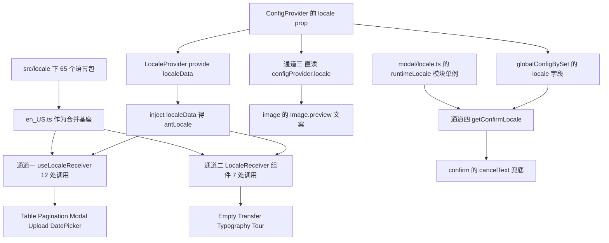
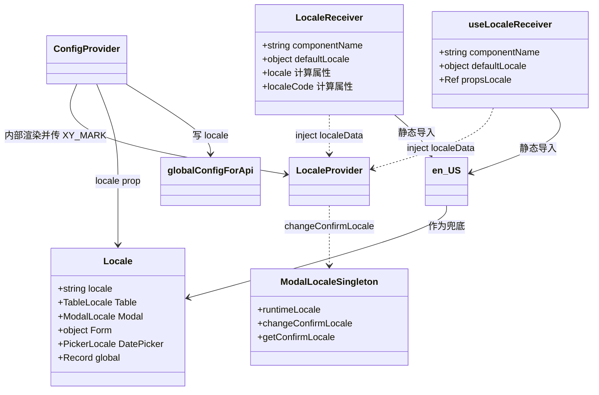
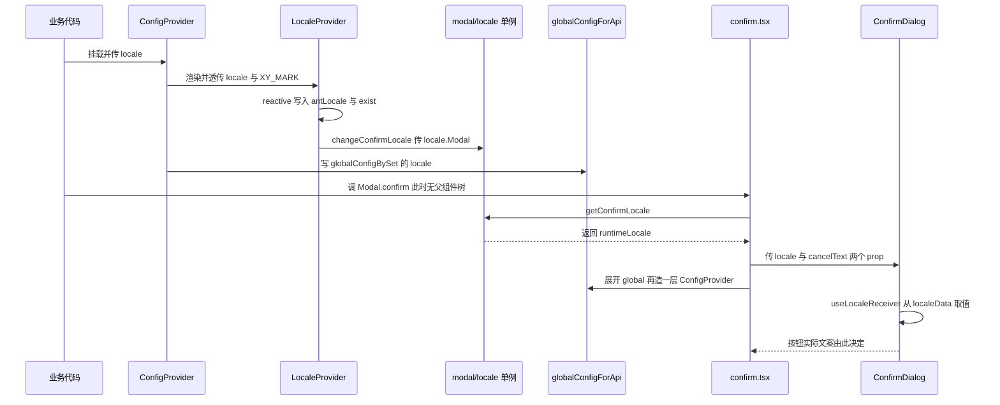
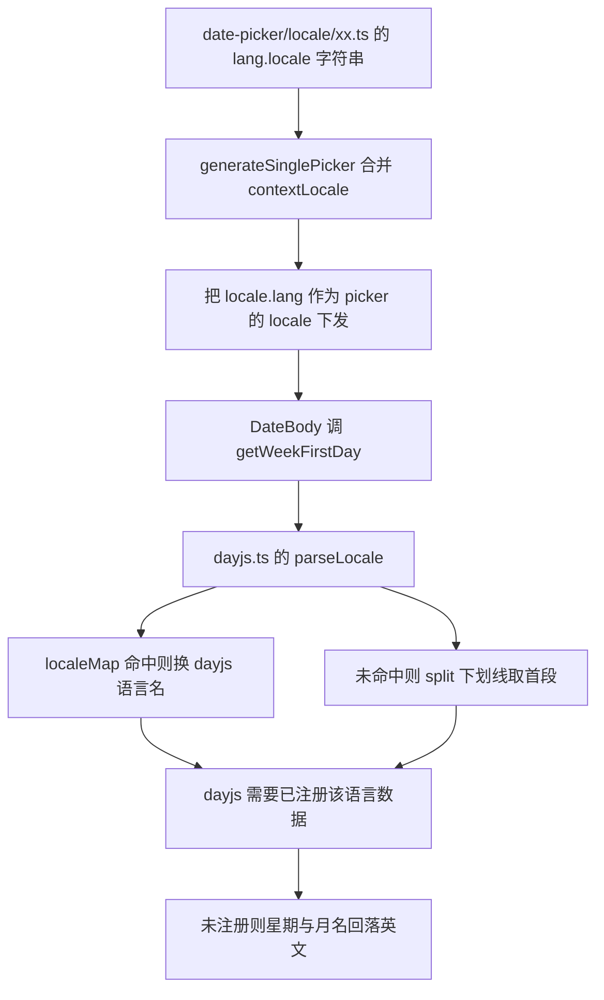

# I11 多语言体系

> **本篇解决**：一个语言包对象从被 `ConfigProvider` 接收，到变成按钮上一个字的完整路径；以及这条路径上的四个分叉、合并语义的确切行为（浅合并）、类型契约的真实约束力、静态方法绕过组件树的取文案方式、新增一个语言包究竟要动几处。
> **前置**：A05 ConfigProvider 注入链与 Size/Disabled Context　**读者坐标**：`02-infrastructure` 第 11/16 篇

## 一、职责与边界

多语言体系负责两件事：**装载**（把 65 个语言包文件变成可被 `import` 的模块，见 `packages/xiaoye-ui/src/locale/`）与**取用**（组件在渲染时按组件名拿到自己那一份文案）。它不负责「哪个 ConfigProvider 层生效」——`prefixCls`、`theme`、`size`、`direction` 的纵向注入链与嵌套覆盖规则归 **A05**；本篇只在需要说明 locale 从哪一层落下来时引用它的行号。它也不负责日期数字格式本身（星期名、月名、周起点由 dayjs 的语言数据提供，见 §四 论点 7），locale 侧只负责把 `lang.locale` 这个字符串传下去。

明确不负责的还有：文案的**生产与审校**。仓库里没有翻译记忆、没有 key 对齐脚本、没有 CI 校验语言包结构一致，`Locale` 接口把除 `locale` 之外的所有槽位都声明为可选（`packages/xiaoye-ui/src/locale/index.tsx:19-52`），因此「某个语言少一个字段」在本库里不是编译错误，而是运行时掉回英文——这条结论决定了本篇后文所有关于缺口的讨论。

依赖清单（读源码所得，非推测）：

- **被谁依赖**：`table/Table.tsx:238`、`pagination/Pagination.tsx:96`、`modal/Modal.tsx:162`、`modal/ConfirmDialog.tsx:78`、`modal/useModal/HookModal.tsx:55`、`form/FormItemLabel.tsx:32`、`popconfirm/index.tsx:149`、`calendar/generateCalendar.tsx:242`、`qrcode/index.tsx:29`、`upload/Upload.tsx:300`、`date-picker/generatePicker/generateSinglePicker.tsx:159`、`date-picker/generatePicker/generateRangePicker.tsx:157` 共 12 处 `useLocaleReceiver` 调用；`empty/index.tsx:51`、`typography/Base.tsx:504`、`transfer/index.tsx:446`、`transfer/ListItem.tsx:49`、`tour/panelRender.tsx:96`、`config-provider/index.tsx:243` 共 6 处 `LocaleReceiver` 组件用法；另有 `image/index.tsx:47` 直读上下文、`modal/confirm.tsx:82` 走模块单例、`config-provider/index.tsx:200-214` 走 Form 专用通道。
- **依赖谁**：`_util/warning`（`locale/index.tsx:5`）、`_util/registerComponent`（`locale/index.tsx:14`）、`_util/type` 的 `withInstall`（`locale/index.tsx:6`）、`modal/locale`（`locale/index.tsx:4`）、以及 `form/interface` 的 `ValidateMessages`、`table/interface` 的 `TableLocale`、`date-picker/generatePicker` 的 `PickerLocale` 等**类型**（`locale/index.tsx:7-13`）。
- **文档面**：`apps/docs/examples/config-provider/locale.vue` 是仓库内唯一的语言切换示例；`apps/docs/components/config-provider.md:108` 只留了一行 prop 说明。

## 二、源码地图

| 文件 | 行数 | 职责 | 关键导出 |
| --- | --- | --- | --- |
| `packages/xiaoye-ui/src/locale/LocaleReceiver.tsx` | 85 | 取用协议本体：组件 + hook | 默认导出 `LocaleReceiver`（:21）、`useLocaleReceiver`（:66）、`LocaleComponentName`（:5） |
| `packages/xiaoye-ui/src/locale/index.tsx` | 110 | `Locale` 类型 + 遗留 `LocaleProvider` 组件 | `Locale`（:19）、`XY_MARK`（:61）、默认导出 `LocaleProvider`（:110） |
| `packages/xiaoye-ui/src/locale/en_US.ts` | 143 | **兜底基座**，被 `LocaleReceiver` 静态导入 | 默认导出 `localeValues` |
| `packages/xiaoye-ui/src/locale/zh_CN.ts` | 142 | 简体中文包 | 同上 |
| `packages/xiaoye-ui/src/locale/`（其余 63 个包） | 合计 6548（含前两个文件与 `index.tsx`、`LocaleReceiver.tsx`） | 各语言包，命名 `语言大写_地区大写.ts` | 同上 |
| `packages/xiaoye-ui/src/locale-provider/index.ts` | 5 | 兼容壳，仅转发 | 见 :1-5 |
| `packages/xiaoye-ui/src/locale-provider/LocaleReceiver.tsx` | 5 | 兼容壳，仅转发 | 见 :1-3 |
| `packages/xiaoye-ui/src/locale-provider/index.test.js` | 264 | 该体系唯一的测试文件 | 无导出 |
| `packages/xiaoye-ui/src/modal/locale.ts` | 28 | 静态方法的模块级文案单例 | `ModalLocale`（:3）、`changeConfirmLocale`（:13）、`getConfirmLocale`（:26） |
| `packages/xiaoye-ui/src/vc-pagination/locale/` | 66 个 `.ts` | 分页子包（`items_per_page` 等蛇形 key） | 默认导出对象 |
| `packages/xiaoye-ui/src/date-picker/locale/` | 62 个 `.ts` + `example.json` | 日期子包，含 dayjs 语言名 | 默认导出 `PickerLocale` |
| `packages/xiaoye-ui/src/time-picker/locale/` | 62 | 时间占位符子包 | `TimePickerLocale` |
| `packages/xiaoye-ui/src/calendar/locale/` | 62 | 日历子包，多为 3 行转发 | `date-picker/locale/xx` |
| `packages/xiaoye-ui/src/config-provider/index.tsx` | 257 | locale 的落点与 Form 专用通道 | `locale` computed（:98）、`validateMessagesRef`（:200） |
| `packages/xiaoye-ui/src/form/utils/messages.ts` | 49 | **与语言包无关**的内置英文校验基座 | `defaultValidateMessages`（:3） |

主实现入口是 `packages/xiaoye-ui/src/locale/LocaleReceiver.tsx:21`（组件形态）与同文件 `:66`（hook 形态）。`locale/index.tsx` 虽然名字叫 `index`，但它**不聚合任何语言包**——它导出的是类型和遗留 Provider，65 个包之间没有互相引用，也没有一个 `all_LOCALES` 之类的注册对象；这个「没有中心登记表」的事实决定了 §四 论点 6 的结论。

`packages/xiaoye-ui/scripts/source-entry.mjs:57-67` 与 `packages/xiaoye-ui/scripts/entry-generator.mjs:478-484` 是语言包唯二被「扫到」的地方：前者把 `src/locale/` 下每个 `.ts/.tsx` 变成一个构建入口，后者在 `package.json` 里写入 `./es/locale` 与 `./es/locale/*` 通配。因此新增一个包不需要手工登记导出面——这与组件目录必须跑 `pnpm gen:entries` 的规则不同，`locale` 目录本身被 `gen-entries.mjs:34` 的 `EXCLUDE_DIRS` 排除，而 `locale-provider` **没有**被排除，于是它作为「组件」进入了 `src/components.ts:196` 的聚合导出与 `typings/global.d.ts:52` 的 `XYLocaleProvider` 全局类型声明。一个已被标记废弃的组件仍然占着公开 API 面，这是本篇「坑」第 5 条的根因。

## 三、架构与数据流

### 图 1：取文案的四条并行通道



四条通道不是「新旧替换」关系而是并存：通道一、二都从 `antLocale` 取数，差别只在调用形式（hook 返回 `ComputedRef`，组件把值塞进 `children` 函数）；通道三绕开 `localeData`，只认 `configProviderKey`，所以**纯用遗留 `LocaleProvider` 包起来的 `Image` 拿不到文案**；通道四完全不经过组件树。逐图说明：`PACK → BASE` 这条边是硬编码的——`LocaleReceiver.tsx:3` 用静态 `import defaultLocaleData from './en_US'` 把英文包钉成基座，只要用到本体系，英文包必进产物；`CPV → LPV` 这条边是 ConfigProvider 在 `config-provider/index.tsx:225` 内部渲染 `LocaleProvider` 实现的，也就是说「provide 的人」永远不是 ConfigProvider 自己；`CPV → GM` 这条边则解释了静态方法为什么能拿到语言。

### 图 2：模块关系



`classDiagram` 里最要紧的是三个方向：`ConfigProvider --> LocaleProvider`（Provider 套 Provider，locale 靠遗留通道下发）、`LocaleProvider ..> ModalLocaleSingleton`（组件树里的 locale 变更会**外溢**到模块级变量）、以及两条 `..> LocaleProvider`（取用端只认 `localeData` 这个字符串 key 的 inject，见 `locale/LocaleReceiver.tsx:36` 与 `:71`，不是 `InjectionKey`，因此拼错 key 会静默拿到默认值 `{}`）。

### 图 3：`Modal.confirm` 的取文案时序（不经组件树）



时序图里的两条下行路径要分清：`SIN-->>CFM` 拿到的 `runtimeLocale` 只被用在 `confirm.tsx:91` 的 `cancelText` 兜底上；真正决定 `okText`、`justOkText` 的是 `GCF` 展开出的那层 `ConfigProvider`（`confirm.tsx:84`）经 `LocaleProvider` 再经 `useLocaleReceiver`（`ConfirmDialog.tsx:78`）。原因见 §四 论点 4——`ConfirmDialog` 的 props 白名单里没有 `locale`。

### 图 4：日期文案的第二条腿（dayjs）



`packages/xiaoye-ui/src/vc-picker/generate/dayjs.ts:32-98` 的 `localeMap` 有 67 行，但只有 13 条是生效映射（`:36`、`:37`、`:43`、`:44`、`:49`、`:50`、`:58`、`:66`、`:78`、`:81`、`:95`、`:96`、`:97`），其余 52 行是形如 `// cs_CZ:` 的注释占位。这条腿解释了 `apps/docs/components/config-provider.md:140-142` 那条 FAQ 的技术原因，也解释了为什么 `locale/zh_CN.ts:11` 的 `locale: 'zh-cn'` 与 `vc-picker/locale/zh_CN.ts:4` 的 `locale: 'zh_CN'` 是两种不同拼写——前者给 `localeCode` 用，后者给 `localeMap` 查表用。

## 四、核心机制精读

### 论点 1：`Locale` 的契约只有一个必填字段，其余全靠自觉

契约定义在 `packages/xiaoye-ui/src/locale/index.tsx:19-52`，全库只有一份，被 65 个包以 `import type { Locale } from '../locale-provider'` 引入（走的是 `locale-provider/index.ts:3` 的转发壳而不是 `locale` 本体）。

```ts
// packages/xiaoye-ui/src/locale/index.tsx:19
export interface Locale {
  locale: string;
  Pagination?: PaginationLocale;
  Table?: TableLocale;
  Popconfirm?: Record<string, any>;
  Form?: {
    optional?: string;
    defaultValidateMessages: ValidateMessages;
  };
  Image?: {
    preview: string;
  };
  DatePicker?: DatePickerLocale;
  TimePicker?: Record<string, any>;
  Calendar?: Record<string, any>;
  Modal?: ModalLocale;
```

结论：**TS 兜不住「某个语言少一个字段」，但能兜住「少一整块里的必填字段」——前提是那一块自己声明了必填**。三层边界要分清。第一层是槽位级：除 `locale: string`（:20）外全部带 `?`（:21-53），所以一个包可以整块不写 `Form`、`global`、`Empty`，编译器一声不吭——`locale/vi_VN.ts:7-44` 就是这个样子，它给了 `Table`/`Modal`/`Transfer`/`Upload`/`Empty` 但完全没有 `global`、`Form`、`Icon`、`Text`、`Tour`、`Image`、`QRCode`。第二层是字段级：`Table` 槽位类型是 `TableLocale`（`packages/xiaoye-ui/src/table/interface.tsx:29-47`），16 个字段**清一色可选**（`emptyText?`、`filterCheckall?`、`cancelSort?`），少写不报错；`Form.optional?`（index.tsx:25）同理。第三层是反例：日期子包的 `lang` 走 `PickerLocale`（`packages/xiaoye-ui/src/date-picker/generatePicker/interface.ts:31-34`），其字段来自 `vc-picker/interface.ts:5-40`，那里 `yearFormat`（:11）、`today`（:15）、`dateFormat`（:32）等**都是必填**，少一个立刻 TS2739；`Tour` 也一样（`packages/xiaoye-ui/src/tour/interface.ts:38-42` 三个字段无 `?`）。这解释了为什么 65 个包里 `Modal.justOkText` 覆盖率是 65/65 而 `Table.filterCheckall` 只有 5/65——前者是必填所以想漏也难，后者是可选且没人校验。

还有一个更隐蔽的洞：`Popconfirm`、`TimePicker`、`Calendar`、`Select`、`Icon`、`global` 六个槽位的类型是 `Record<string, any>`（index.tsx:23、:32、:33、:36、:39、:40），等于**放弃类型检查**。`locale/index.tsx:5` 派生出的 `LocaleComponentName`（`Exclude<keyof Locale, 'locale'>`）因此只能约束「组件名拼写」，约束不了拼写正确之后里面的内容。

### 论点 2：合并是逐组件的浅合并，基座被静态导入钉死成 `en_US`

```ts
// packages/xiaoye-ui/src/locale/LocaleReceiver.tsx:71
  const localeData = inject<LocaleReceiverContext>('localeData', {} as LocaleReceiverContext);
  const componentLocale = computed<Locale[T]>(() => {
    const { antLocale } = localeData;
    const locale =
      unref(defaultLocale) || (defaultLocaleData as LocaleInterface)[componentName || 'global'];
    const localeFromContext = componentName && antLocale ? antLocale[componentName] : {};

    return {
      ...(typeof locale === 'function' ? (locale as Function)() : locale),
      ...(localeFromContext || {}),
      ...(unref(propsLocale) || {}),
    };
  });
```

回退顺序与合并语义都是确定的三行：**组件属性 `propsLocale` > 上下文里该组件那一块 > 基座**。合并只发生在**一层**（三个 `...` 展开），没有递归、没有 `merge` 函数、没有 key 白名单。基座有两个来源：调用方显式传的 `defaultLocale`（第二个入参），或 `LocaleReceiver.tsx:3` 静态导入的 `defaultLocaleData`（即 `locale/en_US.ts`）按组件名取出的那一片。所谓「部分覆盖」的真实含义因此是：**同组件内缺的 key 拿英文，跨组件缺的整块拿英文**，两种缺法都静默。

浅合并的破坏力在 `lang` 这种「整块有意义」的对象上才会真正显形。`packages/xiaoye-ui/src/date-picker/generatePicker/generateSinglePicker.tsx:200` 写的是 `const locale = { ...contextLocale.value, ...props.locale };`，随后 `:252` 把 `locale!.lang` 整体交给面板；`props.locale` 的类型是 `PickerLocale`（`date-picker/generatePicker/props.ts:95`），而 `lang` 内部的 `placeholder`、`rangePlaceholder`、`yearPlaceholder` 等是可选的（`interface.ts:37-53` 一片 `?:`）。于是调用方为了改一个占位符写 `:locale="{ lang: { placeholder: 'x' } }"` 时，**`lang` 被整体替换**，`weekSelect`、`previousMonth`、`nextCentury` 这些面板与无障碍标签全部变 `undefined`（消费点如 `vc-picker/panels/DatePanel/DateHeader.tsx:49`、`panels/WeekPanel/index.tsx:17`）。同一份语义在 `Table` 上不会出事，因为 `Table` 里没有嵌套对象。**这就是「浅合并会导致什么后果」在本库唯一一处能造成结构性损坏的位置**，且它有一条真实证据链：`generateRangePicker.tsx:192` 与 `generateSinglePicker.tsx:200` 是两份复制粘贴的同款浅合并。

对照来看，本库另一处文案链路是**深**的：`packages/xiaoye-ui/src/form/utils/validateUtil.ts:48` 用 `setValues({}, defaultValidateMessages, options.validateMessages)`，而 `setValues` 内部 `internalSetValues` 对「两边都是对象」的 key 递归合并（`packages/xiaoye-ui/src/form/utils/valueUtil.ts:44-61`，注释在 :42 直接给出了期望行为）。同一种「部分覆盖」语义，在 `LocaleReceiver` 是浅、在校验消息是深，两套实现并存且互不复用——这是 §七 第 2 条坑的根源。

### 论点 3：`LocaleProvider` 是唯一 provide 的人，`exist` 哨兵与 `legacyLocale` 决定回退

```ts
// packages/xiaoye-ui/src/locale/index.tsx:77
    const state = reactive({
      antLocale: {
        ...props.locale,
        exist: true,
      },
      XY_MARK__: XY_MARK,
    });
    provide('localeData', state);
    watch(
      () => props.locale,
      locale => {
        changeConfirmLocale(locale && locale.Modal);
        state.antLocale = {
          ...locale,
          exist: true,
        } as any;
      },
      { immediate: true },
    );
```

整条注入链里真正 `provide('localeData', …)` 的只有这一处（`locale/index.tsx:84`），`ConfigProvider` 自己不 provide locale——它在 `packages/xiaoye-ui/src/config-provider/index.tsx:225` 渲染一个 `LocaleProvider` 把活外包出去，外包的理由写在 `index.tsx:220-229`：

```tsx
// packages/xiaoye-ui/src/config-provider/index.tsx:220
    const renderProvider = (legacyLocale: Locale) => {
      let childNode = shouldWrapSSR.value ? wrapSSR(slots.default?.()) : slots.default?.();
      if (props.theme)
        childNode = <DesignTokenProvider value={memoTheme.value}>{childNode}</DesignTokenProvider>;
      return (
        <LocaleProvider locale={locale.value || legacyLocale} XY_MARK__={XY_MARK}>
          {childNode}
        </LocaleProvider>
      );
    };
```

`legacyLocale` 从哪来是本节的关键：`config-provider/index.tsx:243` 用 `<LocaleReceiver children={(_, __, legacyLocale) => renderProvider(legacyLocale as Locale)} />` 把外层 `antLocale`（第三个实参由 `locale/LocaleReceiver.tsx:61` 的 `children?.(locale.value, localeCode.value, antLocale)` 交出）当兜底。也就是说**嵌套 ConfigProvider 不传 `locale` 时，它继承的不是父 ConfigProvider 的 `locale` prop，而是父级那一层 `localeData` 里的整份 `antLocale`**。两条继承通道（`configProviderKey` 与 `localeData`）在此交汇，一条改动如果只动了 `parentContext.locale` 而没落到 `antLocale`，嵌套子树就看不见它。

`exist: true`（`locale/index.tsx:80`、`:92`）是给 `localeCode` 用的哨兵：

```ts
// packages/xiaoye-ui/src/locale/LocaleReceiver.tsx:43
      const localeFromContext = componentName && antLocale ? antLocale[componentName] : {};
      return {
        ...(typeof locale === 'function' ? locale() : locale),
        ...(localeFromContext || {}),
      };
    });
    const localeCode = computed(() => {
      const { antLocale } = localeData;
      const localeCode = antLocale && antLocale.locale;
      // Had use LocaleProvide but didn't set locale
      if (antLocale && antLocale.exist && !localeCode) {
        return defaultLocaleData.locale;
      }
      return localeCode;
    });
```

它区分「没有 Provider」与「有 Provider 但没给 `locale` 字段」：前者 `localeCode` 返回 `undefined`，后者返回英文包的 `'en'`（`locale/en_US.ts:11`）。组件侧真正消费 `localeCode` 的场景很少（`Empty`、`Image` 只要文案），但它被 `apps/docs/examples/config-provider/locale.vue:126-129` 拿去驱动 `dayjs.locale(val)`——文档站把「组件文案」和「dayjs 语言数据」用同一个字符串缝在一起，缝点是 `Locale.locale` 这个唯一必填字段（拼写约定为 `zh-cn` 这类 dayjs 语言名，`locale/zh_CN.ts:11`；而日期面板内部走的是另一套 `lang.locale`，拼写约定为 `zh_CN`，`vc-picker/locale/zh_CN.ts:4`）。

### 论点 4：两个 Provider 并存是历史遗留，且废弃告警的反向逻辑容易读错

`locale-provider/` 目录只有 3 个文件、274 行，其中两个是 5 行的转发：`locale-provider/index.ts:1-5` 做 `export * from '../locale'` 再默认导出同一对象，`locale-provider/LocaleReceiver.tsx:1-5` 同理转发 `locale/LocaleReceiver`。真正的实现全在 `src/locale/`。**被废弃的是 `LocaleProvider` 组件本体，而不是 `locale-provider` 目录**——目录反而是公开入口（`src/components.ts:203-204` 把它当组件聚合，`typings/global.d.ts:54` 给它生成了 `XYLocaleProvider` 全局类型），因为 `gen-entries.mjs:34` 的 `EXCLUDE_DIRS` 排除了 `locale` 却没排除 `locale-provider`。

废弃告警在 `locale/index.tsx:72-76`：

```ts
// packages/xiaoye-ui/src/locale/index.tsx:72
    warning(
      props.XY_MARK__ === XY_MARK,
      'LocaleProvider',
      '`LocaleProvider` is deprecated. Please use `locale` with `ConfigProvider` instead',
    );
```

读法容易搞反：`warning(valid, …)` 在 `valid` 为**假**时才打印（`packages/xiaoye-ui/src/vc-util/warning.ts:4-9`，默认导出是带去重开关的 `warningOnce`，见 :22-35 与 :41），而 `ConfigProvider` 渲染时会显式传 `XY_MARK__={XY_MARK}`（`config-provider/index.tsx:225`），所以库内自用时全程静默，只有用户手写 `<xy-locale-provider>` 才触发。告警本身又是 dev-only：`_util/warning.ts:9-12` 在生产环境把 `warning` 替换成 `noop`。结论是**今天真正在消费 `LocaleProvider` 的只有一个调用方**——`ConfigProvider`，其余 12 处 `useLocaleReceiver` 与 7 处 `LocaleReceiver` 都是它的下游。两个 provider 的差异因此不是功能差异而是「谁能配 locale」：`ConfigProvider` 有 `locale` prop（`config-provider/context.ts:83`）并参与继承与 `globalConfigBySet` 写入，`LocaleProvider` 只有 `locale` 与 `XY_MARK__` 两个 prop（`locale/index.tsx:65-70`），不会写全局，也不提供 `configProviderKey`——这就是 §三 图 1 里通道三（`image/index.tsx:47`）在纯 `LocaleProvider` 下失效的原因。

### 论点 5：`Modal.confirm` 的文案不依赖组件树，但它依赖一个不还原的模块单例

```ts
// packages/xiaoye-ui/src/modal/locale.ts:1
import defaultLocale from '../locale/en_US';

export interface ModalLocale {
  okText: string;
  cancelText: string;
  justOkText: string;
}

let runtimeLocale: ModalLocale = {
  ...(defaultLocale.Modal as ModalLocale),
};

export function changeConfirmLocale(newLocale?: ModalLocale) {
  if (newLocale) {
    runtimeLocale = {
      ...runtimeLocale,
      ...newLocale,
    };
  } else {
    runtimeLocale = {
      ...(defaultLocale.Modal as ModalLocale),
    };
  }
}

export function getConfirmLocale() {
  return runtimeLocale;
}
```

模块级可变变量 + 两个函数，构成一个全局单例。写者只有一个：`locale/index.tsx:88` 的 `changeConfirmLocale(locale && locale.Modal)`，在 `LocaleProvider` 的 `watch`（`immediate: true`）里被调用；读者也只有一个：`packages/xiaoye-ui/src/modal/confirm.tsx:82`。于是 `Modal.confirm` 不需要 `inject`、不需要父级有 Provider——只要**曾经**有任何一个 `ConfigProvider`/`LocaleProvider` 挂载过，单例就被改写过，之后在任何位置、任何树外容器里调用 `Modal.confirm` 都能拿到那份文案。

代价写在一个不起眼的细节里：`changeConfirmLocale` 的 `if (newLocale)` 分支是 `{...runtimeLocale, ...newLocale}`（`modal/locale.ts:15-18`），**增量合并且从不卸载**，`else` 分支才整体复位到英文（:20-22）。`locale/index.tsx:85-95` 的 `watch` 没有配套的 `onScopeDispose`/卸载钩子，所以「最后一个挂载的 Provider 说了算」是字面意义上的成立：单页应用里从中文页跳到英文页、英文页卸载之后再跳回来，期间弹出的 `confirm` 仍是上一个页面的语言。

更要紧的是这条单例链**几乎不产出最终文案**。`confirm.tsx:77-95` 的 `Wrapper` 同时把 `runtimeLocale` 用作 prop 和用作兜底：

```tsx
// packages/xiaoye-ui/src/modal/confirm.tsx:77
  const Wrapper = (p: ModalFuncProps) => {
    const global = globalConfigForApi;
    const rootPrefixCls = global.prefixCls;
    const prefixCls = p.prefixCls || `${rootPrefixCls}-modal`;
    const iconPrefixCls = global.iconPrefixCls;
    const runtimeLocale = getConfirmLocale();
    return (
      <ConfigProvider {...(global as any)} prefixCls={rootPrefixCls}>
        <ConfirmDialog
          {...p}
          rootPrefixCls={rootPrefixCls}
          prefixCls={prefixCls}
          iconPrefixCls={iconPrefixCls}
          locale={runtimeLocale}
          cancelText={p.cancelText || runtimeLocale.cancelText}
        ></ConfirmDialog>
      </ConfigProvider>
    );
  };
```

`ConfirmDialog` 的 props 是用字符串数组白名单声明的（`packages/xiaoye-ui/src/modal/ConfirmDialog.tsx:37-76`），**列表里没有 `'locale'`**，配合 `inheritAttrs: false`（:36），`locale={runtimeLocale}` 落到 `attrs` 而 `attrs` 只被读了 `style`（:146）与 `class`（:157）。真正渲染按钮文案的是 `:160` 的 `const mergedLocal = locale.value;`——来自 `:78` 的 `useLocaleReceiver('Modal')`，它读的是 `localeData`，而 `localeData` 由 `:84` 那层 `<ConfigProvider {...(global as any)}>` 产生，`global` 即 `globalConfigForApi`，其 `locale` 字段由 `config-provider/index.tsx:99-105` 的 watch 写入 `globalConfigBySet`。一句话：**静态方法的文案实际走「全局 reactive → 自建 ConfigProvider → LocaleProvider → receiver」这条长链，模块单例只剩 `cancelText` 一处兜底还在用它**（`confirm.tsx:91` → `ConfirmDialog.tsx:170`）。`okText`/`justOkText` 由 `ConfirmDialog.tsx:224-225` 决定，完全不经过单例。

### 论点 6：Form 校验文案是第四条独立链路，浅合并与深合并在这里打架

```ts
// packages/xiaoye-ui/src/config-provider/index.tsx:200
    const validateMessagesRef = computed(() => {
      // Additional Form provider
      let validateMessages: ValidateMessages = {};

      if (locale.value) {
        validateMessages =
          locale.value.Form?.defaultValidateMessages ||
          defaultLocale.Form?.defaultValidateMessages ||
          {};
      }
      if (props.form && props.form.validateMessages) {
        validateMessages = { ...validateMessages, ...props.form.validateMessages };
      }
      return validateMessages;
    });
```

这条链路**不经过 `LocaleReceiver`**：`index.tsx:216` 把它塞进 `useProvideGlobalForm`，消费端 `packages/xiaoye-ui/src/form/Form.tsx:144-151` 做 `{...defaultValidateMessages, ...globalValidateMessages.value, ...props.validateMessages}`——注意这里的 `defaultValidateMessages` 是 `import` 自 `packages/xiaoye-ui/src/form/utils/messages.ts:3`，**一份与 65 个语言包完全无关的内置英文**（`Validation error on field '${name}'`、`'${name}' is required`）。链路终点在 `form/utils/validateUtil.ts:48`，那里才做深合并。于是同一次覆盖被两种语义接力：`Form.tsx:145` 浅、`validateUtil.ts:48` 深。净效果是「用户给的嵌套 key 能保住，但没被语言包定义的 key 会掉到内置英文而不是掉到 `en_US.ts` 的 `Form.defaultValidateMessages`」。

第二处不一致是模板变量名：`form/utils/messages.ts:4-7` 用 `${name}`，而语言包用 `${label}`（`locale/zh_CN.ts:85-88`、`locale/en_US.ts:85-88`）。变量池由 `validateUtil.ts:78-84` 组装，`name`（字段路径）恒在、`label` 由 `packages/xiaoye-ui/src/form/FormItem.tsx:285` 传入的 `messageVariables` 提供。`replaceMessage`（`validateUtil.ts:18-22`）对匹配不到的 key 直接返回 `kv[key]`，即 `undefined`，字符串里会留下字面量 `undefined`。这条链路对 locale 体系的真实要求只有一句：**要改校验文案就改语言包的 `Form.defaultValidateMessages`，别混用 `Form.validateMessages`，两者变量名不同**。

`Form.optional` 走的是完全正常的通道（`packages/xiaoye-ui/src/form/FormItemLabel.tsx:32` 的 `useLocaleReceiver('Form')` + `:89` 的 `formLocale.value?.optional || defaultLocale.Form?.optional`），因此覆盖率只有 25/65 的语言包（见论点 7）会让非必填字段的「（可选）」标记显示为英文 `(optional)`——`locale/by_BY.ts:78-125` 给了完整的 `defaultValidateMessages` 却没给 `optional`，白俄罗斯语表单上就挂着 `(optional)`。

### 论点 7：缺翻译的表现是英文回落，且泄漏面可以量化

既不是空串也不是编译报错。机制在论点 2 的三行展开里，实测覆盖率如下（分母 65，统计方式见本篇 §附 检查点 3）：

| 语言包里的槽位 | 定义它的包数 | 未定义时的英文兜底值 |
| --- | --- | --- |
| `Table.filterCheckall` | 5 | `Select all items`（`locale/en_US.ts:24`） |
| `Table.filterSearchPlaceholder` | 5 | `Search in filters`（`locale/en_US.ts:25`） |
| `Form.optional` | 25 | `(optional)`（`locale/en_US.ts:84`） |
| `Image` 整块 | 25 | `Preview`（`locale/en_US.ts:134`） |
| `Tour` 整块 | 6 | `Next`/`Previous`/`Finish`（:39-41） |
| `QRCode` 整块 | 5 | `QR code expired` 等（:137-139） |
| `global` 整块 | 40 | `Please select`（:17） |
| `Empty` 整块 | 63 | `No data`（:72） |
| `Form.defaultValidateMessages` | 39 | 掉到内置英文 `form/utils/messages.ts:3` |

消费点决定这些泄漏是否真的可见。`Table.filterCheckall` 的读点是 `packages/xiaoye-ui/src/table/hooks/useFilter/FilterDropdown.tsx:404`，`filterSearchPlaceholder` 是 `FilterSearch.tsx:28`，两处读的都是 `useLocaleReceiver` 合并后的 `tableLocale`（经 `table/Table.tsx:365`、`:487` 注入 hook），所以 60 个语言的筛选面板里有整句英文。反例是 `Table.emptyText`：`locale/zh_CN.ts` 整份没有这个 key，`locale/en_US.ts:26` 有，但 `table/Table.tsx:631` 读的是**原始 prop** `props.locale?.emptyText` 而不是合并结果，所以中文表格的空数据位仍然走 `renderEmpty('Table')` → `Empty` 的 `暂无数据`（`locale/zh_CN.ts:71`）。同一个 key 在 `list/index.tsx:313` 也是同样读法。这个区别很脆：把 `Table.tsx:631` 改成 `tableLocale.value?.emptyText` 就会让 33 个未定义 `emptyText` 的语言包立刻在空表上显示 `No data`，并连带让 `renderEmpty` 失效。

还有两处「包里的英文不是兜底而是漏翻」的实例：`locale/az_AZ.ts:19` 的 `selectInvert: 'Invert current page'`（整份阿塞拜疆语包里唯一的英文字面量，同文件其余文案都是本地语言）与 `locale/ga_IE.ts:22`、`locale/it_IT.ts:19` 的 `filterReset: 'Reset'`。日语包 `locale/ja_JP.ts:18`、`:32`、`:34`、`:37` 四处 `OK` 属于可接受用字，与上面两类性质不同。另外 `locale/ar_EG.ts`、`fa_IR.ts`、`he_IL.ts`、`ur_PK.ts` 四个 RTL 语言包里**没有任何方向元数据**（`Locale` 接口也没有 `direction` 字段，`grep` 在 65 个包里搜 `rtl|direction` 命中 0），换语言不会翻转排版，必须另外设 `ConfigProvider` 的 `direction`（默认 `'ltr'`，`config-provider/context.ts:89-92`）。

### 论点 8：新增一个语言包要动的文件数取决于是否要日期/分页，且没有结构校验

```js
// packages/xiaoye-ui/scripts/source-entry.mjs:57
  // locale 入口：扫描 src/locale/ 下所有 .ts/.tsx 文件，生成 locale/<name> 入口
  const localeDir = resolve(srcDir, 'locale');
  if (existsSync(localeDir) && statSync(localeDir).isDirectory()) {
    const localeFiles = readdirSync(localeDir).filter(
      name => (name.endsWith('.ts') || name.endsWith('.tsx')) && !name.endsWith('.d.ts'),
    );
    for (const file of localeFiles) {
      const name = file.replace(/\.(ts|tsx)$/, '');
      entries[`locale/${name}`] = resolve(localeDir, file);
    }
  }
```

有自动发现，但没有登记：构建入口由上面的目录扫描生成，包导出面由 `packages/xiaoye-ui/scripts/entry-generator.mjs:478-484` 写成 `./es/locale` 与 `./es/locale/*` 两条（落到 `packages/xiaoye-ui/package.json` 的 `exports` 里 `:606` 与 `:610`，发布形态在 `publishConfig` 里同样只有这两条通配）。因此**新增纯文案包只需要 1 个文件**：`src/locale/xx_YY.ts`，默认导出一个 `Locale` 对象即可被 `xiaoye-ui/es/locale/xx_YY` 引到。

但四个子包不会自动出现。一个完整语言包 = 1 + 4（`vc-pagination/locale/xx_YY.ts`、`date-picker/locale/xx_YY.ts`、`time-picker/locale/xx_YY.ts`、`calendar/locale/xx_YY.ts`，参考 `locale/zh_CN.ts:2-5` 的四行 import），其中 `calendar/locale/*` 多为三行转发（`calendar/locale/zh_CN.ts` 全文 3 行）、`time-picker/locale/*` 八行（`time-picker/locale/zh_CN.ts:1-8`）、`date-picker/locale/*` 三十行且必须凑齐必填 `lang` 字段（`date-picker/locale/zh_CN.ts:6-23`，靠 `:18` 展开 `...CalendarLocale` 兜住必填）。若少一个子包文件，现有做法是改 import 指向别的语言：`locale/zh_HK.ts:2-5` 四行全指 `zh_TW`，`locale/ne_NP.ts:1-4` 四行全指 `en_US`（尼泊尔语包的日期与分页文案就是英文）。

`packages/xiaoye-ui/scripts/entry-generator.mjs` 与 `gen-entries.mjs` 都不校验语言包之间的 key 对齐，也没有 `pnpm` 脚本做这件事——**该体系唯一的自动化检查就是那个不断言的测试**（见 §七）。仓库里还留着一份事实上的模板：`packages/xiaoye-ui/src/date-picker/locale/example.json`，62 个日期子包没有任何一个引用它（全仓 `grep example.json` 只命中三处文档链接），而那三处链接（`apps/docs/components/date-picker.md:176`、`:223`、`apps/docs/components/calendar.md:77`）指向 `…/blob/main/components/date-picker/locale/example.json`，本仓库里并不存在 `components/` 这一层目录（真实路径是 `packages/xiaoye-ui/src/date-picker/locale/example.json`）。

## 五、对外契约如何生效

`locale` 这个 prop 从调用方到屏幕只有一条主干，但它在主干上换了三种载体。第一段是**声明**：`config-provider/context.ts:83` 用 `locale: objectType<Locale>()` 声明，运行时类型只有 `Object`，因此 `:locale="null"`、传数组、传一个 `{ zh: … }` 结构的错对象都不会被 Vue 的 prop 校验拦住，类型层由 `ConfigProviderProps`（`context.ts:115`）在编译期兜。第二段是**分流**：同一个 computed `locale`（`config-provider/index.tsx:98`）被同时送到三个去处——`configProviderInnerProps.locale`（`:157`，接口声明在 `context.ts:120`，即 `ConfigProviderInnerProps`）、`globalConfigBySet.locale`（`:102`，供静态 API）、`<LocaleProvider locale=…>`（`:225`，供 receiver 家族）。三处不是冗余：走 `configProviderKey` 取 locale 的只有 `image/index.tsx:47` 一处；把 `globalConfigForApi.locale` 用于文案的只有 `modal/confirm.tsx:78-84`（`vc-notification/Notification.tsx:277` 同样展开 `global`，但通知体里没有可翻译文案，它只用 `getPrefixCls`，见 `:258`）；走 `antLocale` 的是其余全部 18 个调用点。**改 locale 的注入语义必须三处一起改**，只改一处就会出现「组件正常、静态方法异常」这类难查症状。

第三段是**取用**，两种形态共享同一份数据但入参能力不同。hook 形态 `useLocaleReceiver(componentName, defaultLocale, propsLocale)` 的第三个入参是「组件级覆盖」的唯一通道，只有三处用到：`pagination/Pagination.tsx:96`、`table/Table.tsx:238`、`upload/Upload.tsx:300-303`（后两处传 `toRef(props, 'locale')` / `computed(() => props.locale)`）。也就是说：**`<xy-table>`、`<xy-pagination>`、`<xy-upload>` 有 `locale` prop，而 `<xy-modal>`、`<xy-qrcode>`、`<xy-popconfirm>`、`<xy-form-item>` 没有**——`modal/Modal.tsx:162` 调 `useLocaleReceiver('Modal')` 时不接第三参，按钮文案只能在 `:195`、`:203` 用 `cancelText || locale.value.cancelText` 这种「显式 prop 优先」的方式覆盖。`ConfirmDialog.tsx:24` 那个带 JSDoc `@private` 的 `locale?: ModalLocale` 因此既是类型存在又是运行时不存在（论点 5 已解释白名单），这种「类型说可以、运行时忽略」的字段是本次精读里最容易误判的一处契约。

组件形态 `LocaleReceiver` 的契约体现在参数顺序上：`locale/LocaleReceiver.tsx:59` 写的是 `const children = props.children || slots.default;`，即**声明式 prop 优先于默认插槽**，随后 `:61` 以 `(locale, localeCode, antLocale)` 三参调用它。第三个参数是给 `ConfigProvider` 自己用的（`config-provider/index.tsx:243` 只取第三参、前两参写作 `_`/`__`），其余 6 个业务调用点只取第一参。插槽内容因此拿到的是「合并后的那一块」而不是整份 locale，这限制了组件能改什么：`empty/index.tsx:53-54` 只能读 `locale.description`，`tour/panelRender.tsx:97` 只能拿到 `Tour` 那一整块再自己挑字段。

`renderEmpty` 与 locale 的交界值得单独一段，因为它是「空状态文案」的真正来源。链路是 `useConfigInject.ts:19` 把 `configProvider.renderEmpty` 原样透出（注意这里没包 computed，取的是函数本身）→ `config-provider/index.tsx:88-94` 的四级回退 `props.renderEmpty || slots.renderEmpty || parentContext.renderEmpty || defaultRenderEmpty` → `config-provider/renderEmpty.tsx:29-31` → `DefaultRenderEmpty` 的 switch（`:12-24`，`Table`/`List` 用简版图标、`Select`/`TreeSelect`/`Cascader`/`Transfer`/`Mentions` 用小号类名、其余用默认）→ `<Empty>` → `empty/index.tsx:51-53` 的 `LocaleReceiver componentName="Empty"`。所以**空状态文案的唯一真相是 `Locale.Empty.description`，而不是 `Locale.Select` 或 `Locale.Table.emptyText`**：`select/index.tsx:246` 的 `renderEmpty?.('Select') || <DefaultRenderEmpty componentName="Select" />` 最终仍落到 `Empty.description`。而 `Locale.Select`（`locale/index.tsx:36`）在全库没有任何读取点，`az_AZ.ts`、`hy_AM.ts`、`kn_IN.ts`、`ms_MY.ts` 四个包写的 `Select: { notFoundContent }` 是死数据。

产物侧的契约有两条。其一是体积：`LocaleReceiver.tsx:3` 与 `modal/locale.ts:1` 都对 `locale/en_US` 做静态 `import`，`config-provider/index.tsx:13` 再来一次，因此英文包及其四个子包（`vc-pagination/locale/en_US.ts`、`date-picker/locale/en_US.ts`、`time-picker/locale/en_US.ts`、`calendar/locale/en_US.ts`）在任何用到 locale 的构建里都不可摇掉；`package.json` 的 `sideEffects` 数组不含 `locale/**`，加上 `./es/locale/*` 通配（`package.json` 的 `exports` 里 `:606`、`:610`），用户自己选的语言包则是可 tree-shake 的单文件。其二是可寻址：`xiaoye-ui/es/locale/zh_CN` 是发布态路径，而 `apps/docs/examples/config-provider/locale.vue:101-102` 用的是 `xiaoye-ui/locale/en_US`——后者能跑只因为文档站配了 `xiaoye-ui/*` → `packages/xiaoye-ui/src/*` 的别名，`package.json` 的 202 个 `exports` 键里**没有** `./locale/*`，照抄示例的外部消费者会解析失败。

SSR 与序列化上没有特例：`locale/index.tsx:84` 的 `provide` 在 setup 同步阶段执行、`reactive` 初值来自 props，因此服务端渲染的组件树能拿到与客户端一致的 `antLocale`；`LocaleReceiver` 里没有任何 `typeof window` 分支。风险点反而在 `watch` 的 `immediate: true`（`locale/index.tsx:94`）与单例写入的组合上——服务端每个请求若共享同一模块实例，`runtimeLocale` 是跨请求的（坑 2）。

## 六、设计取舍

**取舍一：静态导入英文包作合并基座，而不是「缺 key 就不渲染」。** 换来的是任何 `Locale` 对象都天然安全，`useLocaleReceiver` 不需要判空、不需要 `??`，18 个调用点因此都能直接 `locale.value.xxx` 取值；代价是**英文泄漏被制度化**且不可关闭——60 个语言的筛选面板显示 `Select all items` 不是 bug，是当前架构的定义（论点 7）。被放弃的另一条路是「缺 key 回落 `localeCode` 对应的二级语言包」，它需要一张 `zh_TW → zh_CN → en_US` 的回落链表，而表本身又得有人维护，本库现有的 65 个包连 key 对齐检查都没有（论点 8），加表只会把问题从静默变成误配。

**取舍二：浅合并而不是深合并。** 深合并在这个数据形状上有一个具体的坑：`Locale` 里存在**语义为定长元组**的字段，`Transfer.titles: ['', '']`（`locale/en_US.ts:53`）、`DatePicker` 的 `rangePlaceholder: ['开始日期', '结束日期']`（`date-picker/locale/zh_CN.ts:13`）。如果按 `internalSetValues` 那样递归（`form/utils/valueUtil.ts:44-61`，它对数组走 `Array.isArray(store) ? [...store] : { ...store }` 再逐 key 覆盖），一个只写了一个元素的 `rangePlaceholder` 会保留基座的第二个元素，得到「中文起始 + 英文结束」这种比整句英文更糟的结果。浅合并的赔付是 `lang` 被整体替换（坑 1），而 `PickerLocale.lang` 的必填字段（`vc-picker/interface.ts:11-39`）恰好让「只传半个 lang」在纯 TS 项目里会报错，只留下「用 `as any` 或 JS 调用」这条漏口。

**取舍三：保留 `locale-provider` 兼容壳而不是就地改名。** 5 行的 `locale-provider/index.ts:1-5` 与 `locale-provider/LocaleReceiver.tsx:1-5` 让历史 import 路径继续可用，也让 `Locale` 类型有一个稳定的对外位置（65 个包全部从 `'../locale-provider'` 引类型，见 `locale/zh_CN.ts:6`）。赔上是**双路径长期并存**：18 个调用点里 16 个走壳、2 个走真身（`qrcode/index.tsx:5`、`tour/panelRender.tsx:8`），再加上 `src/components.ts:196` 把废弃 Provider 当组件聚合、`typings/global.d.ts:52` 给它生成全局类型，废弃信号在工具链里被削弱成「它还是个正式组件」。而 `gen-entries.mjs:34` 的 `EXCLUDE_DIRS` 排除 `locale` 却不排除 `locale-provider`，说明这条壳路径已经和生成物耦合，删除它会同时改动三个生成物，实际成本远高于收益。

**取舍四：静态方法用模块单例而不是 Context。** `confirm.tsx:96-101` 的 `render` 是手工 `createVNode` + `vueRender`，`vm.appContext` 只在调用方显式给了 `parentContext`/`appContext` 时才有效（`:98`），因此 `Modal.confirm` 无法假设自己能 inject 到任何 Provider；`modal/locale.ts` 的模块变量是**唯一不依赖树的通道**，这个选择是必要的而非偷懒。赔上的是生命周期缺失（不卸载、不还原、增量合并，论点 5）与「同应用多语言区域互相污染」。库其实已经补了第二条更完整的通道（`globalConfigForApi.locale` → 自建 `ConfigProvider`，`confirm.tsx:84`），但没敢删第一条，于是留下两条只有 `cancelText` 重叠的链路。

**取舍五：`Locale` 用可选槽位 + 大量 `Record<string, any>`。** 好处是新组件加文案不需要改 `Locale` 接口以外的任何东西，`QRCode`、`Tour` 这类后加槽位可以直接被 5-6 个包实现（论点 7 的计数）；坏处是「加一个 key」在 65 个包里是**可选动作**，覆盖率永远单调下降，且 `Record<string, any>` 让最容易被漏的六个槽位（`Popconfirm`/`TimePicker`/`Calendar`/`Select`/`Icon`/`global`）连编译期提示都没有。更严的替代方案是把每个组件文案拆成 `Required<XxxLocale>`，但那会让 40 个未写 `Image` 块的包、26 个未写 `Form` 块的包（`defaultValidateMessages` 覆盖 39/65）当场编译失败——这个取舍的真实形状是「已知 65 个包做不到结构一致，于是让类型去迁就数据」。

## 七、坑与改动指南

1. **给 `<xy-date-picker>` 传 `:locale="{ lang: { placeholder: 'x' } }"`。** 症状：占位符变了，但面板的月/年导航标题、`PageUp`/`PageDown` 的无障碍标签、周日起点全部变 `undefined` 或退回默认；范围选择器同样表现。定位：浅合并点 `date-picker/generatePicker/generateSinglePicker.tsx:200` 与整体下发点 `:252`（以及 `generateRangePicker.tsx:192`/`:253`）。正确改法是带上完整 `lang`，或改语言包本体。**该分支无测试保护**：`locale-provider/index.test.js` 里唯一涉及 date-picker locale 的用例被 `it.skip`（`:239`）。
2. **`Modal.confirm` 的语言粘滞。** 触发：在 A 页面挂 `ConfigProvider :locale="zhCN"`，切到无 Provider 的 B 页面调 `Modal.confirm`，或反过来。症状：文案停留在上一个页面的语言，`destroy` 也不还原。定位：`modal/locale.ts:13-24`（增量合并、只在全量 else 分支复位）与 `locale/index.tsx:85-95`（`watch` 无卸载钩子）；再看第二通道 `config-provider/index.tsx:99-105` 写入的 `globalConfigBySet`（`config-provider/globalConfig.ts:18`）同样从不回滚。验证方式：`grep -n "onScopeDispose\|onBeforeUnmount" packages/xiaoye-ui/src/locale/index.tsx packages/xiaoye-ui/src/modal/locale.ts` 应无输出。
3. **`ConfigProvider.config({ locale })` 类型不收但运行时生效。** 触发：想给静态 API 设语言。症状：TS 报未知属性，删掉类型注解后又能用。定位：`config-provider/globalConfig.ts:46-50` 的 `GlobalConfigProviderProps` 只列了 `prefixCls`/`iconPrefixCls`/`getPopupContainer`，而 `:129-134` 的 `Object.assign(globalConfigBySet, reactive(rest))` 会把任何额外键原样并入。改法是补 `locale?: MaybeRef<Locale>` 到该类型，或让调用方改挂 `ConfigProvider`。
4. **新增语言包只写 1 个文件。** 触发：加 `src/locale/xx_YY.ts` 并在文档里宣称「支持 xx 语」。症状：界面文案半中半英，日期与分页尤其明显。定位：四个子包 import 位（参考 `locale/zh_CN.ts:2-5`）；缺文件的现实参照是 `locale/zh_HK.ts:2-5`（指向 `zh_TW`）与 `locale/ne_NP.ts:1-4`（指向 `en_US`）。补完后需要一次 `pnpm --filter xiaoye-ui build` 才能确认 `locale/xx_YY` 入口被 `scripts/source-entry.mjs:57-67` 扫到。
5. **删或改 `Locale` 的槽位不会有任何检查拦住。** 触发：想给某个组件补文案 key。症状：本地写了、别的语言没有，`typecheck` 全绿。定位：`locale/index.tsx:19-52` 的可选性 + `table/interface.tsx:29-47` 的全可选。安全边界：只在**必填字段所在**的槽位（`DatePicker` 的 `lang`、`Tour`、`Modal`、`Image.preview`）内改动，风险最低；动 `Record<string, any>` 类槽位时，改动只影响 1 个语言的显示。
6. **依赖 `ant-` 时代留下的字段名。** `locale/LocaleReceiver.tsx:18` 与 `:41`、`locale/index.tsx:78`、`:90` 用的 inject 值键名是 `antLocale`，`locale/index.tsx:16-18` 的 `TransferLocaleForEmpty` 与 `locale/index.tsx:25` 的 `Form.optional` 也源自上游实现的形状；同文件 `LocaleReceiver.tsx:23` 的组件 `name` 是 `'LocaleReceiver'`，**没有 `XY` 前缀**，与根目录 `AGENTS.md` 的命名红线不符。改名会同时打断 18 个调用点与 `config-provider/index.tsx:243` 的三参约定，属于跨篇协调事项（命名与迁移归 A05/A06 讨论）。另有一处重复声明要留意：`ModalLocale` 在 `modal/locale.ts:3-7` 与 `modal/Modal.tsx:146-150` 各写了一份完全相同的字段，改一处必改两处。
7. **死槽位造成的假覆盖。** `Locale.global`（`locale/index.tsx:39`，40 个包写了 `placeholder`）、`Locale.Icon`（`:40`，39 个包）、`Locale.Select`（`:36`，4 个包）、`Locale.TimePicker`（`:32`，65 个包）**都没有读取点**：全库 `componentName`/首参枚举只出现 Calendar、DatePicker、Empty、Form、Modal、Pagination、Popconfirm、QRCode、Table、Text、Tour、Transfer、Upload 十三项。`<xy-time-picker>` 的占位符实际来自 `date-picker/util.ts:27-28` 读的 `timePickerLocale`（`date-picker/locale/zh_CN.ts:20-22`），与 `Locale.TimePicker` 无关。清理这批槽位是收益明确、风险也明确的改动：删除即减少 65 个包的死翻译，但 `Empty`、`Select` 的空状态文案改动会同时波及 `renderEmpty`（§五 末段）。
8. **`dayjs` 的拼写约定不一致。** 触发：新语言只写 `Locale.locale: 'xx'` 却发现日期面板仍是英文。定位：`vc-picker/generate/dayjs.ts:32-98` 的 `localeMap` 只有 13 条生效（如 `:37` 的 `by_BY: 'be'`、`:49` 的 `fr_BE: 'fr'` 还带 `todo` 注释），其余靠 `:100-103` 的 `locale.split('_')[0]` 猜测；键是 `zh_CN` 这种文件茎风格（值取自 `vc-picker/locale/zh_CN.ts:4`），而 `Locale.locale` 是 `zh-cn` 风格（`locale/zh_CN.ts:11`），两者不可互换。文档侧的对应说明是 `apps/docs/components/config-provider.md:142-144`。
9. **`ku_IQ` 的兼容注释指向不存在的路径。** `locale/ku_IQ.ts:7-8` 写「please use xiaoye-ui/lib/locale/kmr_IQ instead」，但本库的导出面只有 `./es/locale/*`（`package.json:119-121`），没有 `lib` 目录约定；`vc-picker/generate/dayjs.ts:66` 也保留着 `kmr_IQ: 'ku'` 与一条 `// ku_IQ:` 注释。按注释里给的路径 import 会解析失败。

**测试现状**：`packages/xiaoye-ui/src/locale-provider/index.test.js`（264 行）是该体系唯一的测试文件，`vitest.config.mts:33` 的 include 会收它。它的问题有三层：`:178-194` 循环 51 个语言包只 `mount` 加 `await sleep()`，**没有任何断言**，只能挡住「挂载抛错」；`:196` 与 `:239` 两个真正有断言意图的用例（`Modal.xxx` 的文案、locale 变更触发 dayjs 切换）被 `it.skip`；`locales` 数组（`:68-120`）只列 51 个包，`az_AZ`、`bn_BD`、`by_BY`、`fr_CA`、`ga_IE`、`gl_ES`、`ka_GE`、`kk_KZ`、`km_KH`、`kmr_IQ`、`lt_LT`、`ml_IN`、`ur_PK`、`zh_HK` 这 14 个从未被测。`config-provider/__tests__/config-provider.test.tsx` 与 `config-provider/index.test.js` 均不涉及 locale。改动安全边界因此很窄：**能测的只有「不抛异常」，文案正确性完全靠人工**，任何 key 语义变更都要在 PR 里手工指定一个语言包做目视核对。

**验证命令**：

```bash
node docs/column/tools/verify-refs.mjs --excerpt docs/column/02-infrastructure/11-locale-system-多语言体系.md
pnpm --filter xiaoye-ui test:unit src/locale-provider/index.test.js
pnpm --filter xiaoye-ui exec vitest run src/form src/config-provider
pnpm gen:entries        # 只有增删 locale-provider 目录下的文件时才需要
pnpm typecheck
```

`pnpm gen:entries` 的必要性来自 §二 末尾那条排除规则：动 `src/locale/` 不需要它，动 `src/locale-provider/` 需要它。

## 附：本篇可证伪的三个检查点

1. **浅合并导致英文整句泄漏（论点 2、论点 7）。** 用一条命令验证 `filterCheckall` 的覆盖率与读取点：

```bash
grep -L "filterCheckall" packages/xiaoye-ui/src/locale/*.ts | wc -l
grep -n "filterCheckall" packages/xiaoye-ui/src/table/hooks/useFilter/FilterDropdown.tsx
```

   期望 60 与一处 `locale.filterCheckall` 读取；再把 `apps/docs/examples/config-provider/locale.vue:9` 的 `:locale` 换成 `zh_TW` 渲染筛选面板，即可看到英文 `Select all items`。
2. **静态方法的 locale 通道不经过 `ConfirmDialog` 的 `locale` prop（论点 5）。**

```bash
grep -n "'locale'" packages/xiaoye-ui/src/modal/ConfirmDialog.tsx
grep -n "locale" packages/xiaoye-ui/src/modal/confirm.tsx
```

   第一条只应命中 `:24` 的接口声明而**不命中** `:37-76` 的 props 白名单；第二条应命中 `:82`、`:90`、`:91`。若把 `:91` 的 `runtimeLocale.cancelText` 改成任意字符串再跑 `pnpm --filter xiaoye-ui test:unit src/modal`，不会有任何用例失败——这既证明该路径无测试，也证明它是唯一被消费的单例出口。
3. **`Locale` 接口的约束力边界与「无结构校验」（论点 1、论点 8）。** 任选一个 46 行的短包，把它复制成新名字并只做一处破坏性改动，检查类型与测试都不会拦：

```bash
cp packages/xiaoye-ui/src/locale/vi_VN.ts /tmp/probe.ts
grep -n "Form\|global\|Text\|Icon\|Tour" packages/xiaoye-ui/src/locale/vi_VN.ts
grep -rn "example.json" packages apps | grep -v node_modules
```

   第二条应**零命中**（`vi_VN.ts` 完全没有 `Form` 块，而 `const localeValues: Locale` 在 `:7` 合法），第三条应只命中 `date-picker/locale/example.json` 的三处文档链接，且这些链接指向的 `components/date-picker/…` 路径在本仓库不存在（`ls components` 报 no such file）。


