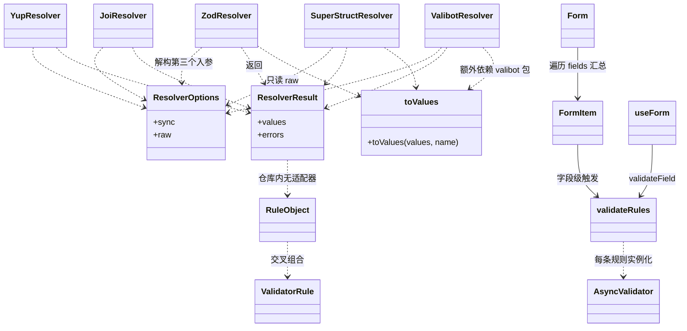
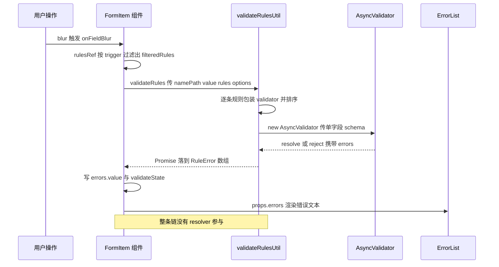
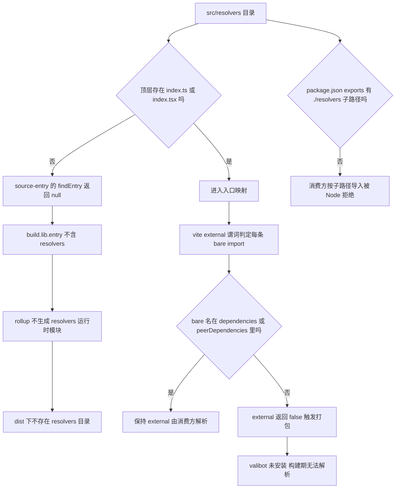
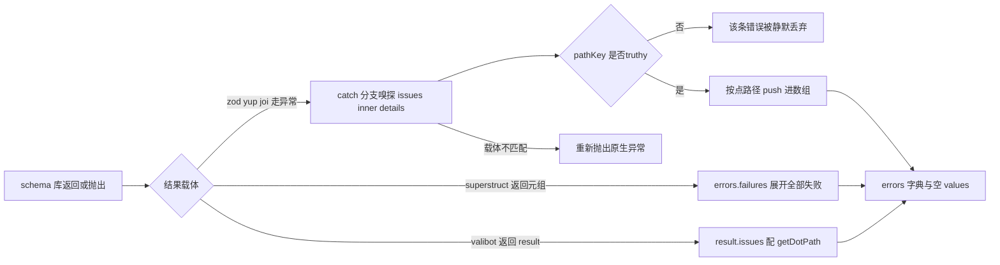

# I12 校验适配层 resolvers：五种 schema 的归一化契约

> **本篇解决**：`src/resolvers/` 里那五个目录到底把 zod / yup / joi / superstruct / valibot 归一成了什么形状；这个形状与 `Form` 真正执行的规则对象是不是同一种东西；为什么五个 resolver 一条测试都没有、也没进构建产物，却仍然留在源码树里；新增第六种 schema 要动哪几处登记点。
> **前置**：A06（Props 体系与类型工具）　**读者坐标**：`02-infrastructure` 第 12/16 篇
> Form 的字段注册、校验调度与上下文下发属 **C06-01「Form 表单」**，本篇只在「规则产物如何被执行」这一处接口上停留；props 定义与类型工具归 **A06**，此处一行引用；错误文案的多语言装载路径归 **I11「多语言体系」**，本篇也只给一行引用。

---

## 一、职责与边界

`resolvers/` 只做一件事：**把五个 schema 库各自的校验结果，压进同一个返回形状**。具体是三件小事——把「库方法名不同」压进一次字符串索引（同一个方法在 zod 里叫 `parseAsync`、在 yup 里叫 `validate`、在 joi 里叫 `validateAsync`）、把「错误载体不同」压进一个 `Record<点路径, 原生错误对象[]>` 字典、把「字段级取值还是表单级取值」压进 `utils/forms.ts` 的一个三元表达式。整个适配层加起来 269 行，其中真正的适配逻辑只有五段 30 到 38 行的对称结构。

它明确**不负责**下面这些，而这几点恰恰是读代码时最容易误以为它负责的东西：

- 不负责生成 `Form` 能消费的规则对象。`RuleObject` 是 `BaseRule & Partial<ValidatorRule>`（`packages/xiaoye-ui/src/form/interface.ts:87-94`），resolver 产出的 `{ values, errors }` 与它没有任何结构关系，仓库里也不存在把前者变成后者的代码。
- 不负责错误文案。返回字典的 value 是各库的**原生错误对象**（zod 的 `issue`、yup 的 `ValidationError`、joi 的 `detail`、superstruct 的 `failure`、valibot 的 `issue`），一条都没被格式化成字符串，也不读 `validateMessages`。
- 不负责执行与调度。它不在 `FormItem` 的校验链上，也不在 `useForm` 的链上，谁调用它、什么时候调用它，本层完全没有答案。
- 不负责依赖安装。五个 schema 库既不在 `dependencies` 也不在 `peerDependencies`（`packages/xiaoye-ui/package.json:43-102` 通篇没有它们的键）。

依赖与被依赖，实测结果相当干净，干净到反常：

| 方向 | 对象 | 证据 |
| --- | --- | --- |
| 被依赖 | **零**。全仓含字面量 `resolvers` 的文件共 9 个，其中 6 个是 `src/resolvers/` 自身的类型文件，另 3 个是无关的 `@xiaoye-ui/auto-import-resolver` | `packages/vite-plugin/src/index.ts:1`、`packages/nuxt-module/src/module.ts:9` |
| 依赖 | `isNotEmpty`（判定 path 是否为空） | `packages/xiaoye-ui/src/resolvers/zod/index.js:1` → `packages/utils/src/object/index.ts:17` |
| 依赖 | `toValues`（本包内唯一的共享领域函数） | `packages/xiaoye-ui/src/resolvers/zod/index.js:2` → `packages/xiaoye-ui/src/utils/forms.ts:1` |
| 依赖 | 外部包 `valibot` 的三个具名导出 | `packages/xiaoye-ui/src/resolvers/valibot/index.js:2` |
| 类型依赖 | `..` 指向的手写类型锚点 | `packages/xiaoye-ui/src/resolvers/zod/index.d.ts:5` → `resolvers/index.d.ts:4` |

`Form` 侧真正的校验执行体是第三方 `async-validator`，它在依赖表里的位置是 `packages/xiaoye-ui/package.json:58`，导入点是 `packages/xiaoye-ui/src/form/utils/validateUtil.ts:1`。也就是说，本库对外提供「校验适配层」却没有提供「适配目标」：五个 resolver 是被孤立进来的，不是被接进来的。

## 二、源码地图

`resolvers/` 与它唯一的共享工具一共 17 个文件、269 行。五个 schema 各自是一份**三件套**：实现 `index.js`、手写声明 `index.d.ts`、子包入口指针 `package.json`（五份 `package.json` 内容逐字节相同，见 `packages/xiaoye-ui/src/resolvers/zod/package.json:1-5`）。

| 文件 | 行数 | 职责 | 关键导出（首行） |
| --- | --- | --- | --- |
| `resolvers/index.d.ts` | 12 | 共享类型锚点，纯声明无实现 | `ResolverOptions`（`:4`）、`ResolverResult`（`:9`） |
| `resolvers/zod/index.js` | 35 | zod 适配 | `zodResolver`（`:4`） |
| `resolvers/zod/index.d.ts` | 11 | zod 手写声明 | `:7` |
| `resolvers/yup/index.js` | 38 | yup 适配 | `yupResolver`（`:4`） |
| `resolvers/yup/index.d.ts` | 11 | yup 手写声明 | `:7` |
| `resolvers/joi/index.js` | 38 | joi 适配 | `joiResolver`（`:4`） |
| `resolvers/joi/index.d.ts` | 10 | joi 手写声明 | `:6` |
| `resolvers/superstruct/index.js` | 30 | superstruct 适配 | `superStructResolver`（`:4`） |
| `resolvers/superstruct/index.d.ts` | 11 | superstruct 手写声明 | `:7` |
| `resolvers/valibot/index.js` | 35 | valibot 适配 | `valibotResolver`（`:5`） |
| `resolvers/valibot/index.d.ts` | 10 | valibot 手写声明 | `:6` |
| `utils/forms.ts` | 3 | 字段级 / 表单级取值收口 | `toValues`（`:1`） |

主实现入口按行号排开是 `packages/xiaoye-ui/src/resolvers/zod/index.js:4`、`resolvers/yup/index.js:4`、`resolvers/joi/index.js:4`、`resolvers/superstruct/index.js:4`、`resolvers/valibot/index.js:5`。valibot 晚一行，因为它的第 2 行多了一条真实运行时 import。

三处结构细节值得先记下，后面各节会反复用到。

第一，**`resolvers/` 顶层没有 `package.json`**，只有一个 `index.d.ts`。这意味着 `resolvers/*/index.d.ts` 里 `from '..'` 的类型引用只能靠 TypeScript 的目录解析规则命中 `index.d.ts`（`moduleResolution: bundler`，`tsconfig.base.json:5`），在任何运行时解析器眼里 `..` 是解析不出来的——好在五条引用都是 `import type`，会被擦除。第二，五个子目录各带一份 `package.json`，`main`/`module`/`types` 三键指向同目录相对文件，这套写法服务的是「每个 schema 一个独立 npm 包」的分发形态，与本库「单包 + `exports` 子路径」的分发形态不匹配（第五节展开）。第三，实现文件是 `.js` 而不是 `.ts`/`.tsx`，这与主库其余源码文件的扩展名约定相反，直接后果是它落到了类型检查的覆盖范围之外（第四节论点 5）。

## 三、架构与数据流

### 3.1 归一化契约与被截断的执行链



这张图的重点是那条**唯一断开的边**：`ResolverResult ..> RuleObject` 上写着「仓库内无适配器」。左侧七个类（五个 resolver 加两个类型锚点）和右侧六个类（规则与执行链）各自内部完整闭合，中间没有任何文件把它们接起来。`toValues` 被三个 resolver 显式连出、另两个同样调用但图中省略以保持节点数可控（`resolvers/yup/index.js:16` 与 `resolvers/joi/index.js:16` 都调它）。`ValibotResolver` 那条「额外依赖 valibot 包」的边是全图唯一指向第三方运行时包的边，它决定了第五节构建结论的成败。

### 3.2 一次字段校验的真实时序



`onFieldBlur` 在 `packages/xiaoye-ui/src/form/FormItem.tsx:310`，它唯一做的事是把 `{ triggerName: 'blur' }` 塞进 `validateRules`（`FormItem.tsx:311`）。`validateRules` 定义在 `FormItem.tsx:254`，先做两件过滤：`namePath` 为空直接返回 undefined（`FormItem.tsx:256-258`，注释原话是「no name, no value, so the validate result is incorrect」），再按 `trigger` 把规则数组切一遍（`FormItem.tsx:263-272`）。过滤后为空数组则 `Promise.resolve()` 提前收场（`FormItem.tsx:273-275`）——这是「一次字段校验可能根本不调用校验器」的分支。真正的转交发生在 `FormItem.tsx:276`，把 `formContext.validateMessages.value` 与 `options` 合并后进参给 util。util 内部每条规则各 new 一个 validator 实例（`packages/xiaoye-ui/src/form/utils/validateUtil.ts:44-46`），并只提交 `{ [name]: value }` 这一个键（`validateUtil.ts:54`），注释解释了原因：「only check one value in a time to avoid namePath validate issue」（`validateUtil.ts:96-98`）。结果回流写 `errors.value`（`FormItem.tsx:297`）并经 `formContext.onValidate`（`FormItem.tsx:299-303`）冒到 Form 的 `onValuesChange`/`onValidate` 面。

### 3.3 为什么这五个 resolver 进不了产物



三条判定路径相互独立，结论都是「不可达」。入口扫描的目录过滤器在 `packages/xiaoye-ui/scripts/source-entry.mjs:31-35`，它排除下划线开头、点开头、`vc-` 开头以及 `EXCLUDE_DIRS` 名单里的目录（`scripts/source-entry.mjs:15`）——`resolvers` 三条都不沾、也不在名单里，于是**以候选组件目录的身份进入扫描**，再在 `scripts/source-entry.mjs:39-45` 的内层循环里因为找不到 `index.ts`/`index.tsx` 而被静默丢弃。实测输出可直接复现：`node packages/xiaoye-ui/scripts/source-entry.mjs` 打印「共扫描到 286 个入口」，把结果管道到 `grep resolver` 命中 0 条。

### 3.4 五个 resolver 的错误聚合分岔



分岔的根源是五个库把「校验不通过」表达成两种完全不同的控制流：三种靠 throw（zod `resolvers/zod/index.js:9,16`、yup `resolvers/yup/index.js:9,19`、joi `resolvers/joi/index.js:9,19`），两种靠返回值（superstruct `resolvers/superstruct/index.js:8`、valibot `resolvers/valibot/index.js:14`）。这决定了 `throw e` 这个逃逸路径只存在于前三者（`resolvers/zod/index.js:33`、`resolvers/yup/index.js:36`、`resolvers/joi/index.js:36`），后两者永远不会向外抛。

## 四、核心机制精读

### 论点 1：共同接口形状是三参柯里化工厂 + 单参异步闭包 + 固定二元返回

五个 resolver 的对外形状完全一致，一致到可以互换：`(schema, schemaOptions, resolverOptions) => async ({ values, name }) => { values, errors }`。以 zod 为代表样本：

```ts
// packages/xiaoye-ui/src/resolvers/zod/index.js:4
export const zodResolver =
  (schema, schemaOptions, resolverOptions) =>
  async ({ values, name }) => {
    const { sync = false, raw = false } = resolverOptions || {};

    try {
      const result = await schema[sync ? 'parse' : 'parseAsync'](values, schemaOptions);

      return {
        values: toValues(raw ? values : result, name),
        errors: {},
      };
```

逐行看这个形状给出的四个承诺。第一个入参 `schema` 是库实例本身，resolver 不 import 库（valibot 除外），所以它对版本零感知；第二个入参 `schemaOptions` 原样转发给库的方法调用，`resolvers/zod/index.js:10` 是第二实参，`resolvers/yup/index.js:10-13` 把它展进选项对象；第三个入参 `resolverOptions` 是本层唯一的自有配置，且被 `resolverOptions || {}` 兜底，说明它可以整体省略。返回对象的两个键是穷尽的：成功路径 `errors: {}`（`resolvers/zod/index.js:14`、`resolvers/yup/index.js:17`、`resolvers/joi/index.js:17`、`resolvers/superstruct/index.js:28`、`resolvers/valibot/index.js:17`），失败路径 `values: toValues(raw ? values : undefined, name)`（`resolvers/zod/index.js:19` 等四处），即**失败时不返回可用值**。这个「二值必居其一、另一个留空」的约定是本层真正的契约核心，比类型文件写的一切都更硬。

第二入参在三家有共同点但语义不同：zod 与 yup、joi 都把它并进库选项，superstruct 却把它当成 `validate` 的第二个位置参数（`resolvers/superstruct/index.js:8`），valibot 把它包进第三个参数的对象里（`resolvers/valibot/index.js:11-12`）。柯里化形状相同，参数落点不同——这是「归一化只发生在出入口，不发生在中间」的直接证据。

### 论点 2：五个都返回 Promise，但同步语义只有四个能兑现

`async` 关键字出现在全部五处内层函数上（`resolvers/zod/index.js:6`、`resolvers/yup/index.js:6`、`resolvers/joi/index.js:6`、`resolvers/superstruct/index.js:6`、`resolvers/valibot/index.js:7`），所以对外永远是 Promise。但 Promise 外壳不等于异步执行：`sync` 选项决定内部走哪条路，方法名映射靠硬编码字符串索引完成：

```ts
// packages/xiaoye-ui/src/resolvers/joi/index.js:10
      const result = await schema[sync ? 'validate' : 'validateAsync'](values, {
```

三家映射方向互不相同——zod 同步版叫 `parse`、异步版叫 `parseAsync`（`resolvers/zod/index.js:10`）；yup 同步版叫 `validateSync`、异步版叫 `validate`（`resolvers/yup/index.js:10`）；joi 同步版叫 `validate`、异步版叫 `validateAsync`（`resolvers/joi/index.js:10`）。同一个「同步」语义在三个库里落在三个不同键名上，本层用「三元表达式 + 计算属性」把差异吸收掉，代价是**方法名拼错不会被任何检查发现**：`schema['valdateSync']` 只会得到 `undefined` 然后在调用点抛 `is not a function`，被外层 try 吞进形状嗅探分支后因不含 `inner` 而 `throw e`（`resolvers/yup/index.js:20,36`）。

superstruct 是唯一拿不到 `sync` 的：

```js
// packages/xiaoye-ui/src/resolvers/superstruct/index.js:7
    const { raw = false } = resolverOptions || {};
    const [errors, data] = schema.validate(values, schemaOptions);
```

它解构时只取 `raw`（`resolvers/superstruct/index.js:7`），因为 `schema.validate` 本就是同步 API（`resolvers/superstruct/index.js:8`），但函数体仍在 `async` 闭包里，于是「传 `sync: true` 会更快」这个由共享类型 `ResolverOptions.sync`（`resolvers/index.d.ts:5`）暗示的承诺，在这一家身上是空的。valibot 用另一种写法达到同一效果：同步分支不加 `await`、异步分支加 `await`（`resolvers/valibot/index.js:10-12`），靠三元表达式把两条路径并到一个 `const result` 上。

### 论点 3：失败聚合有两种范式，且聚合开关只有一个家族显式传了

try/catch 家族的聚合核心是一段同构的 reduce，以 zod 为例：

```js
// packages/xiaoye-ui/src/resolvers/zod/index.js:17
      if (Array.isArray(e?.issues || e?.errors)) {
        return {
          values: toValues(raw ? values : undefined, name),
          errors: (e.issues || e.errors).reduce((acc, error) => {
            const pathKey = isNotEmpty(error.path) ? error.path.join('.') : name;

            if (pathKey) {
              acc[pathKey] ||= [];
              acc[pathKey].push(error);
            }

            return acc;
          }, {}),
        };
      }
```

三处细节各有含义。`Array.isArray(e?.issues || e?.errors)`（`resolvers/zod/index.js:17`）用 `||` 同时接受 zod 的 `issues` 与另一种假想载体的 `errors`，这是**结构嗅探**而非类型判定：只要 throw 出来的东西带这两个数组之一就当作校验失败，否则原样 `throw e`（`resolvers/zod/index.js:33`）。yup 认 `e?.inner`（`resolvers/yup/index.js:20`）、joi 认 `e?.details`（`resolvers/joi/index.js:20`），三家都只认一个键。`error.path.join('.')`（`resolvers/zod/index.js:21`、`resolvers/joi/index.js:24`、`resolvers/superstruct/index.js:14`）说明这三家给的 path 是数组；yup 偏一步，直接用裸 `error.path`（`resolvers/yup/index.js:24`），因为 yup 的 path 本来就是点字符串；valibot 更特殊，它把 issue 交给 `getDotPath(error)` 换取点路径（`resolvers/valibot/index.js:24-25`）。归一化结果因此是同一个东西：**键为点路径、值为原生错误对象数组的普通对象**。

聚合度差异是这五家里最容易被忽略的一处。yup 与 joi 在调用时硬塞 `abortEarly: false`（`resolvers/yup/index.js:11`、`resolvers/joi/index.js:11`），valibot 硬塞 `abortPipeEarly: false`（`resolvers/valibot/index.js:11-12`），三家都显式关掉「遇到第一个错就停」；superstruct 靠 `errors.failures()` 展开全部失败（`resolvers/superstruct/index.js:13`）。zod 分支什么都没传（`resolvers/zod/index.js:10` 的实参只有 `values` 与 `schemaOptions`），它能否一次给出全部错误完全取决于 zod 自身的默认行为。返回值聚合这一层是共享的 `acc[pathKey] ||= []` 加 push（`resolvers/zod/index.js:24-25`），所以哪怕上游只报一个错，返回字典的形状也照样正确——**形状一致，条数不一定一致**。

`||=`（逻辑或赋值）是 ES2021 语法，出现在 `resolvers/zod/index.js:24`、`resolvers/yup/index.js:27`、`resolvers/joi/index.js:27`、`resolvers/superstruct/index.js:17`、`resolvers/valibot/index.js:28` 五处，而基础配置的目标是 `target: 'es2016'`（`tsconfig.base.json:3`）。今天因为文件不进构建（第 3.3 节）而没有暴露，一旦入口接通就要由 Vite/esbuild 的 target 决定是降级还是直出。

### 论点 4：字段级与表单级由一个 `name` 参数决定，全部逻辑只有三行

```ts
// packages/xiaoye-ui/src/utils/forms.ts:1
export const toValues = <T>(values: T, name?: string): T | Record<string, T> => {
  return name ? { [name]: values } : values;
};
```

这 3 行是整个适配层唯一的共享领域函数，五个 resolver 全部导入它（`resolvers/zod/index.js:2`、`resolvers/yup/index.js:2`、`resolvers/joi/index.js:2`、`resolvers/superstruct/index.js:2`、`resolvers/valibot/index.js:3`）。语义是：调用方给了 `name`，就把结果包成 `{ [name]: value }`，让单字段校验也返回「整张 store 的一个切片」；没给 `name` 就原样返回整个对象，对应整表校验。于是同一个 resolver 既能服务字段级调用也能服务表单级调用，差别只体现在入参那一个键上，成功与失败两条路径都走同一个函数（`resolvers/zod/index.js:13,19`）。

`raw` 与它构成第二个维度：`raw ? values : result`（`resolvers/zod/index.js:13`）决定回传的是**调用方送进来的原始值**还是**schema 消化后的输出值**。zod 的输出是 parse 结果、yup 的是 `validate` resolve 的值、valibot 的是 `result.output`（`resolvers/valibot/index.js:16`）、superstruct 的是元组第二项 `data`（`resolvers/superstruct/index.js:27`）。`raw: true` 的实际用途是放弃 schema 的类型转换与默认值填充，把控制权还给调用方。joi 分支也写 `raw ? values : result`（`resolvers/joi/index.js:16`），但这里的 `result` 是不是「消化后的值」存在疑点，见第七节坑 5。superstruct 的失败分支把这条维度直接抹掉了：

```js
// packages/xiaoye-ui/src/resolvers/superstruct/index.js:12
        values: toValues(undefined, name),
```

其余四家在失败分支都写 `toValues(raw ? values : undefined, name)`（`resolvers/zod/index.js:19`、`resolvers/yup/index.js:22`、`resolvers/joi/index.js:22`、`resolvers/valibot/index.js:22`），只有 superstruct 无条件给 `undefined`。结果：同样开着 `raw: true`，zod 在校验失败时把原值交回、superstruct 交回 `undefined`，五个 resolver 的形状一致但语义在这一格上不一致。

### 论点 5：`index.d.ts` 手写声明与实现有六处不一致，且没有任何机制能发现

`resolvers/index.d.ts` 提供的两个类型锚点全文如下：

```ts
// packages/xiaoye-ui/src/resolvers/index.d.ts:4
export interface ResolverOptions {
  sync?: boolean;
  raw?: boolean;
}

export interface ResolverResult<T> {
  values: T;
  errors: Record<string, any>;
}
```

逐条对账，不一致处如下（每条都给出双侧行号）：

| 编号 | 不一致点 | 声明侧 | 实现侧 |
| --- | --- | --- | --- |
| a | `values` 类型丢掉了字段包装 | `resolvers/index.d.ts:10` | `utils/forms.ts:1` |
| b | `sync` 被共享类型承诺，superstruct 不消费 | `resolvers/index.d.ts:5` | `resolvers/superstruct/index.js:7` |
| c | zod 泛型把 schema 类型当值类型 | `resolvers/zod/index.d.ts:7` | `resolvers/zod/index.js:10` |
| d | yup 的泛型 `T` 无推导来源 | `resolvers/yup/index.d.ts:7` | `resolvers/yup/index.js:16` |
| e | joi / valibot 的 schema 参数退化为 `any` | `resolvers/joi/index.d.ts:7`、`resolvers/valibot/index.d.ts:7` | 无对应类型 |
| f | `errors` 的 value 类型是裸 `any`，未表达「原生错误对象数组」 | `resolvers/index.d.ts:11` | `resolvers/zod/index.js:25` |

a 与 b 是同一类问题：`ResolverResult.values` 被声明成 `T`，而实现返回 `T | Record<string, T>`（`utils/forms.ts:2`），字段级调用的返回值形状在类型面上被吞掉；`sync?: boolean` 写在共享接口里，等于对五个 resolver 同时许诺，而 `resolvers/superstruct/index.js:7` 的解构只认 `raw`。c 更实质：`zod/index.d.ts:7` 写 `<T extends Schema<any, any>>`，于是 `ResolverResult<T>` 的 `values` 被推断成「一个 ZodSchema 对象」，而运行时那格放的是 parse 的输出值；正确的写法应是从 `T` 反推输出类型，声明里没有这一步。d 同理，`<T>(schema: AnyObjectSchema, ...)`（`resolvers/yup/index.d.ts:7-8`）里 `T` 不出现在任何参数位置，调用方不显式实例化就恒为 `unknown`。五家里只有 superstruct 的泛型是自洽的：`schema: Struct<T>`（`resolvers/superstruct/index.d.ts:8`）里 `T` 就是断言后的类型，恰好对上 `values: T`。

之所以这些错误从没被人看见，原因在配置层，与代码质量无关：`packages/xiaoye-ui/tsconfig.json:15` 的 `include` 覆盖 `src/**/*`，但 `tsconfig.base.json` 通篇（第 2 到 23 行）没有声明 `allowJs`，也没有 `checkJs`，五个 `.js` 实现因此不在类型检查面上；同时 `skipLibCheck: true`（`tsconfig.base.json:7`）把整个 `.d.ts` 群豁免，连 `resolvers/zod/index.d.ts:4` 引用的 `zod` 包在本地并未安装（依赖表 `packages/xiaoye-ui/package.json:46-102` 无此键）这类模块解析失败也不会上报。实测复核：`pnpm --filter xiaoye-ui typecheck` 退出码 0，日志里 grep 不到 `resolver` 字样。

结论要按字面理解：**这一层唯一的静态防线也是离线声明，它错了不会有任何信号。**

### 论点 6：resolver 产出的规则不被 Form 执行，Form 的执行体是 `async-validator`

先在依赖层面确认，再在调用点确认。`packages/xiaoye-ui/package.json:58` 声明：

```json
// packages/xiaoye-ui/package.json:58
    "async-validator": "^4.0.0",
```

它在源码里只被一个文件消费：

```ts
// packages/xiaoye-ui/src/form/utils/validateUtil.ts:44
  const validator = new AsyncValidator({
    [name]: [cloneRule],
  });

  const messages = setValues({}, defaultValidateMessages, options.validateMessages);
  validator.messages(messages);

  let result = [];

  try {
    await Promise.resolve(validator.validate({ [name]: value }, { ...options }));
```

三个可核对的机制事实：每**一条**规则各实例化一个 validator（`validateUtil.ts:44-46`），不是整表一次；提交的数据只含一个键（`validateUtil.ts:54`），键名由 `namePath.join('.')` 得来（`validateUtil.ts:107`）；文案在此层合并（`validateUtil.ts:48`），默认表来自 `packages/xiaoye-ui/src/form/utils/messages.ts:3-49`。字段执行入口有三处，全都在 Form 侧：字段级 `packages/xiaoye-ui/src/form/FormItem.tsx:276`、`useForm` 的 `validateField` 在 `packages/xiaoye-ui/src/form/useForm.ts:231-246`（`validateRules` 调用点为 `useForm.ts:237`，并把 `[name]` 直接当 namePath）、整表级在 `packages/xiaoye-ui/src/form/Form.tsx:280` 遍历已注册字段后逐个调 `field.validateRules`。

resolver 想接入，唯一的合法落点是自定义校验器：

```ts
// packages/xiaoye-ui/src/form/interface.ts:46
type Validator = (
  rule: RuleObject,
  value: StoreValue,
  callback: (error?: string) => void,
) => Promise<void> | void;

export interface ValidatorRule {
  warningOnly?: boolean;
  message?: string | VueNode;
  /** custom validate function (Note: callback must be called) */
  validator: Validator;
}
```

签名对不上，而且是对三面：入参是 `(rule, value, callback)`（`interface.ts:46-50`）而不是 `({ values, name })`；出参要求「resolve 或 reject」，而 resolver 出的是 `{ values, errors }` 数据对象，从不 reject 校验失败；错误内容要求 `string`（`interface.ts:49` 的 callback 形参类型），而 resolver 给的是原生错误对象。包装层在 `validateUtil.ts:110-174`：它把用户写的 `validator` 再包一层，用 `hasPromise` 探测返回值是否 thenable（`validateUtil.ts:140-141`），是 promise 就吞掉 callback 并在 `.catch(err => callback(err || ' '))` 里把错误转成字符串（`validateUtil.ts:154-156`），不是 promise 才允许 callback 但发一条告警（`validateUtil.ts:147`）。这段包装决定了「resolver 若要接入必须以 promise 形式 reject 字符串」这条硬约束。仓库里没有这段胶水。

因此本篇给出的最重要结论是：**归一化契约只归一了 schema 侧，没有归一到 Form 侧。** 用户拿到 `{ values, errors }` 之后，需要自己把 `errors` 字典拆成「哪个字段、哪几条文案」再塞回 `rules`，而这条拆法在源码里没有任何一处实现或示例可参照。

### 论点 7：五个 schema 库一个都不是依赖，构建 external 规则对 valibot 是致命判定

依赖面事实：`packages/xiaoye-ui/package.json:43-45` 的 `peerDependencies` 只有 `vue`；`packages/xiaoye-ui/package.json:46-102` 的 `dependencies` 有 50 余项，逐项读完，`zod`、`yup`、`joi`、`superstruct`、`valibot` 一个都不在其中。`pnpm-lock.yaml` 的 importers 段（起于 `pnpm-lock.yaml:10`）也不含这五个键，`node_modules` 下五者目录均不存在（实测 `ls -d node_modules/zod` 等五条皆空）。所以「用户不装 zod 会不会被强拉依赖」的答案是**不会，一条依赖都不会**——代价是这五个 resolver 在本仓库内**一行都跑不起来**。

后果落在构建上。`vite.config.mts` 的 external 不是名单，而是一个谓词：

```ts
// packages/xiaoye-ui/vite.config.mts:36
      external(source) {
        if (source === 'vue') return true;
        if (source.startsWith('@xiaoye-ui/')) return true;
        // 将 package.json 中声明的依赖（含子路径导入）全部 external 化
        for (const dep of externalDeps) {
          if (source === dep || source.startsWith(dep + '/')) return true;
        }
        return false;
      },
```

`externalDeps` 由 `vite.config.mts:13-17` 从 `dependencies` 与 `peerDependencies` 两处键合并而来。判定链是闭合的：不在依赖表 → 循环不命中 → `return false`（`vite.config.mts:43`）→ 该 bare import 被视作**需要打包的本仓源码依赖**。对四个不 import 库的 resolver 无影响（它们只碰 `schema` 对象方法与 `@xiaoye-ui/utils`，后者由 `vite.config.mts:38` 命中 external）；对 valibot 是致命的，因为它是唯一带真实运行时 import 的一家（`resolvers/valibot/index.js:2`）。也就是说，**只要有人把 resolvers 接进入口，`valibot` 那一支会立刻把 `pnpm build` 打挂**，另外四支则会被静默打进产物、把「可选依赖」变成「已内联的第三方代码」。

现状靠第 3.3 节那条入口发现规则兜住了：`dist/resolvers` 不存在（实测 `ls packages/xiaoye-ui/dist/resolvers` 报 No such file）。而 `dist/utils/forms.d.ts` 存在、`dist/utils/forms.mjs` 不存在，这个不对称恰好暴露了机制：`vite-plugin-dts`（`vite.config.mts:24-28`）按 tsconfig 的 `include` 铺声明文件，rollup 只按入口可达图铺运行时文件，于是 `toValues` 有类型、无实现产物。

### 论点 8：新增第六种 schema，需要动的登记点没有一处是自动的

答案分两类：必须手写的三处，以及会被意外触发的四处。

必须手写的，是把三件套照抄一遍：`resolvers/<name>/index.js`（导出 `<name>Resolver`，保持 `resolvers/zod/index.js:4-6` 的柯里化形状与 `{ values, errors }` 返回）、`resolvers/<name>/index.d.ts`（从 `resolvers/index.d.ts` 取两个锚点，形如 `resolvers/yup/index.d.ts:5`）、`resolvers/<name>/package.json`（逐字节复制 `resolvers/zod/package.json:1-5`）。若新库需要 `sync` 语义，还得在 `resolvers/index.d.ts:4-7` 这个共享接口里保持一致，否则重复 superstruct 的空头承诺。

会被意外触发的登记点更有风险，因为它们的判定方式都是「有没有 `index.ts`/`index.tsx`」，而 resolver 家族今天恰好没有：

1. 构建入口。`scripts/source-entry.mjs:31-35` 的目录过滤器不含 `resolvers`（`EXCLUDE_DIRS` 见 `scripts/source-entry.mjs:15`），一旦补上 barrel 文件，它就变成一个组件入口。
2. 生成物。`scripts/entry-generator.mjs:290-295` 的 `findEntry` 同样只认两种扩展名，`scanComponentExports` 靠它返回值决定收录（`scripts/entry-generator.mjs:309-312`）；收录后 `buildComponentsTs` 会无条件写出 `export * from './resolvers'`（`scripts/entry-generator.mjs:409`），五个 resolver 名就此进入包根导出面。`gen-entries.mjs:34` 的 `EXCLUDE_DIRS` 名单同样不含 `resolvers`，所以 `pnpm gen:entries` 不会拦。
3. 快照防线。`packages/xiaoye-ui/tests/index.test.js:25-27` 断言包根导出键数组与快照一致，`tests/index.test.js:52` 硬编码 `expect(expected.length).toBe(111)`，`tests/index.test.js:32` 的 `excluded` 名单也不含 `resolvers`。加 barrel 的结果是这两处一起红，而红的原因会被读成「组件数变了」。
4. 发布面。`packages/xiaoye-ui/package.json:96-614` 的 `exports` 是生成物（由 `entry-generator.mjs:462-477` 写出），发布期再由 `scripts/postbuild.mjs:145` 转成 dist 路径并与 `publishConfig.exports` 合并，全程没有 resolvers 的位置；`packages/xiaoye-ui/package.json:30-32` 的 `files` 只含 `dist`，而 dist 里没有它。

也就是说，**本层没有任何一处存在「schema 家族清单」这样的集中登记**。五个目录就是五个目录，靠文件系统并列存在；加第六种不会有任何东西提示你还需要登记，也不会自动登记。

## 五、对外契约如何生效

结论先给：这一层的对外契约**目前不生效**，且不是「实现有 bug」级别的不生效，而是「通路不存在」级别。

从消费侧走一遍。第一道墙是包解析：`packages/xiaoye-ui/package.json:125` 起的 `exports` 映射里没有 `./resolvers` 也没有 `./resolvers/*`，按 Node 的 `exports` 语义，未列出的子路径一律不可解析，`import { zodResolver } from 'xiaoye-ui/resolvers/zod'` 直接失败；连在本仓库的 workspace 里都过不去，因为 `exports` 对 workspace 链接同样生效。第二道墙是发布物：`packages/xiaoye-ui/package.json:30-32` 只发 `dist`，`publishConfig.directory`（`packages/xiaoye-ui/package.json:76`）也指向 `dist`，而 `dist` 树内没有 `resolvers` 目录（第 3.3 节实测）。于是五份子目录 `package.json` 里的 `main`/`module`/`types` 指针（`resolvers/zod/package.json:2-4`）在生产环境是死字段——它们指向的相对路径在发布物里不存在。第三道墙是聚合面：`packages/xiaoye-ui/src/components.ts` 全文不含 `resolver` 字样，`src/index.ts:6` 的 `export * from './components'` 因此也带不出它们，`app.use` 的注册循环（`packages/xiaoye-ui/src/index.ts:15-22`）更与它们无关。第四道墙是文档：`apps/docs` 下 `zod`、`yup`、`joi`、`superstruct`、`valibot` 五个库名零命中，`resolver` 一词也只出现在自动导入解析器的语境里（唯一含 `resolvers:` 的 `apps/docs/guide/installation.md:87` 讲的是 `unplugin-vue-components` 的选项，与本层同名不同物）。`apps/docs/components/form.md:104` 与 `:388` 把用户直接引向 `async-validator` 的规则语法，`:385` 一行给出 `validator` 这条自定义入口，全程不提 schema 适配层。

> 属性清单见 [apps/docs/components/form.md](../../../apps/docs/components/form.md)。

契约里唯一在 Form 侧真实生效的部分，是**字段级与表单级共享一个 name 语义**这一思路：`validateRules` 把 `namePath` 拼成点字符串再交给校验器（`packages/xiaoye-ui/src/form/utils/validateUtil.ts:107`），`toValues` 也用点路径与 `name` 作字典键（`packages/xiaoye-ui/src/utils/forms.ts:2`），两边的键形态可以对接。除此之外没有任何共同语言：`RuleError.errors` 要求 `string[]`（`packages/xiaoye-ui/src/form/interface.ts:109-112`），`Form.validateFields` 汇总时按 `warningOnly` 把字符串分成 errors 与 warnings（`packages/xiaoye-ui/src/form/Form.tsx:293-299`），最终 `ErrorList` 拿 `VueNode[]` 直接文本插值渲染（`packages/xiaoye-ui/src/form/ErrorList.tsx:10`、`ErrorList.tsx:53-61`）。resolver 返回的是错误对象数组，塞进这条链的唯一后果是屏幕上出现 `[object Object]`。

文案链路同理。`validateMessages` 的合并顺序是「内置默认 → 全局注入 → 组件 props」（`packages/xiaoye-ui/src/form/Form.tsx:145-151`），全局那份来自 ConfigProvider 读 locale 的 `Form.defaultValidateMessages`（`packages/xiaoye-ui/src/config-provider/index.tsx:200-213`，类型形状声明在 `packages/xiaoye-ui/src/locale/index.tsx:24-27`），context 的兜底值是内置表（`packages/xiaoye-ui/src/form/context.ts:55`）。这套机制按 `RuleType`（`packages/xiaoye-ui/src/form/interface.ts:31-44`）逐类型给模板，再用 `${name}` 占位替换（`packages/xiaoye-ui/src/form/utils/validateUtil.ts:17-22`）。resolver 一侧既没有 `type` 概念也没有模板槽位，多语言体系（见 **I11**）对它无话可说——**它连一条字符串都不产，谈不到文案本地化。**

至于 props/类型工具的层面（见 **A06**，一行引用），本层不属于它：resolver 不是组件、没有 props、不参与 attrs 透传，`initDefaultProps` 一类工具与它无交集。

## 六、设计取舍

先说这套形状本身在换什么。三参柯里化加单参异步闭包，本质是「**把库的差异吸收在闭包里，把调用方的差异留给入参**」。它换来三样东西：五个 resolver 可以互相替换而调用点不动（因为形状逐字相同，见 `resolvers/zod/index.js:4-6` 与 `resolvers/joi/index.js:4-6`）；库版本升级不会破坏 resolver 的类型面，因为 resolver 根本不 import 库（`resolvers/joi/index.d.ts:7` 干脆把 schema 写成 `any`）；bundle 里不会混进任何 schema 库代码。被放弃的另一条路是「本库定义一套中立的规则 DSL，五个库各写一个 importer 把 schema 翻译成 `RuleObject`」——那条路会把 schema 的能力集（zod 的 `.refine`、superstruct 的 coercion）压平到 async-validator 能表达的最小公倍数，代价明显更大。这一层选的是「不翻译语义，只归一形状」，`resolvers/index.d.ts:11` 里 `errors` 的 value 写成 `any` 正是这个选择的直接后果：形状归一之后，语义原样外抛，交给调用方。

再说依赖处理，这里有一组真实权衡。把五个库写成 `peerDependencies` 会立刻污染所有不用 schema 校验的用户（peer 缺失会告警）；写成 `dependencies` 更糟，`vite.config.mts:40-42` 会把它们全部 external 化，但体积与安装成本由用户承担；写成 optional peer 需要包管理器与打包器都支持，且 `external` 谓词无法表达「可选」这个维度——它只有「命中名单则 external」和「未命中则打包」两个返回值（`vite.config.mts:36-44`）。当前做法（既不在依赖表、也不在入口、也不在 `exports`）实际上等价于「**用不进构建来实现零成本可选**」，赔上是这一层彻底不可用，且 `resolvers/valibot/index.js:2` 那条真实 import 变成一颗不知道什么时候会炸的地雷。要区分的是：这个结果是三条独立判定叠加出来的（入口扫描 `scripts/source-entry.mjs:39-45`、`exports` 生成 `scripts/entry-generator.mjs:290-295`、依赖表 `packages/xiaoye-ui/package.json:46-102`），还是有意设计，源码里读不出答案，没有任何注释、issue 链接或 CHANGELOG 条目提到 resolvers——`CHANGELOG.md` 中 resolver 相关条目只有 `@xiaoye-ui/auto-import-resolver`（`CHANGELOG.md:49`、`:56`），与本层无关。

第三处权衡是 SSR 与 tree-shaking 之外的**类型面成本**。手写 `.d.ts` 而不是把 `.js` 改写成 `.ts`，好处是适配层不进 `typecheck` 也不进 `dts` 生成，构建零负担；赔上的是第 4.5 论点列出的六处漂移永久无人发现。`resolvers/zod/index.d.ts:7` 那条把 schema 类型当值类型的错误，只要文件是 `.ts` 且被 `include` 命中就会立刻显形，而它今天显不了形。

第四处：为什么形状选成「`{ values, errors }` + 点路径字典」。这个形状与 Form 需要的 `{ name: InternalNamePath, errors: string[] }[]`（`packages/xiaoye-ui/src/form/interface.ts:100`）方向不同，前者以路径为键的字典便于单字段查询，后者以字段为元素便于遍历渲染。选字典的隐含前提是「调用方每次只关心一个字段」，而 `toValues` 的 `name` 分支（`utils/forms.ts:2`）正是为这个前提准备的。也就是说这一层是按「字段级校验优先」的心智设计的，整表校验（`name` 为空）是次要路径，所以整表路径上连错误聚合都退化成了「`name` 为 undefined 则丢弃」（`resolvers/zod/index.js:23`）。

## 七、坑与改动指南

**坑 1｜表单级错误会被静默丢弃。** 触发条件：用整表校验（不传 `name`），且 schema 的错误发生在对象根上（如 zod 的顶层 `refine`、superstruct 的 struct 级失败），此时 `error.path` 是空数组或空串。症状：`errors` 字典里没有对应键，UI 显示校验通过，promise 却失败，或反之，且没有任何日志。定位位置：`resolvers/zod/index.js:21-26`、`resolvers/yup/index.js:24-29`、`resolvers/joi/index.js:24-29`、`resolvers/superstruct/index.js:14-19`、`resolvers/valibot/index.js:25-30`——五处同构的 `if (pathKey)` 守卫，空数组经 `isNotEmpty` 判为 false（`packages/utils/src/object/methods/isNotEmpty.ts:4` → `packages/utils/src/object/methods/isEmpty.ts:6`），`name` 又是 `undefined`，`pathKey` 落空即跳过 push。**该分支无测试保护**（第「测试现状」段）。

**坑 2｜`sync: true` 在 superstruct 上无效，但类型允许你传。** 触发条件：为了「同步校验避免一帧闪烁」统一给五个 resolver 传 `sync: true`。症状：形状与耗时完全没变化，仍是 Promise，因为 `resolvers/superstruct/index.js:7` 只解构 `raw`。定位位置：对照 `resolvers/index.d.ts:5` 与 `resolvers/superstruct/index.js:7`；其余四家的解构行分别是 `resolvers/zod/index.js:7`、`resolvers/yup/index.js:7`、`resolvers/joi/index.js:7`、`resolvers/valibot/index.js:8`。

**坑 3｜失败时 `raw` 只有一家不兑现。** 触发条件：开着 `raw: true` 做「保留用户原始输入」的表单回写，schema 从 zod 换成 superstruct。症状：失败路径下 `values` 从原值变成 `{ [name]: undefined }`，字段被清空。定位位置：`resolvers/superstruct/index.js:12` 对比 `resolvers/zod/index.js:19`、`resolvers/yup/index.js:22`、`resolvers/joi/index.js:22`、`resolvers/valibot/index.js:22`。

**坑 4｜`errors` 的值不是字符串，接进 Form 会渲染成对象。** 触发条件：把 resolver 的 `errors` 字典直接塞给 `ErrorList` 或 `validateInfos[name].help`。症状：界面出现 `[object Object]`，`errors.value.length` 判断仍正常。定位位置：`packages/xiaoye-ui/src/form/ErrorList.tsx:53-61` 是纯文本插值；`packages/xiaoye-ui/src/form/interface.ts:109-112` 要求 `string[]`；五处 push 进去的都是库原生对象（`resolvers/zod/index.js:25` 等）。

**坑 5｜joi 成功分支的 `values` 形状存疑。** 触发条件：用 `joiResolver` 且依赖 schema 的转换结果。症状：拿到的可能不是校验后的值，而是库的结果包装对象。定位位置：`resolvers/joi/index.js:10` 把 `validateAsync` 的返回值整个赋给 `result`，`resolvers/joi/index.js:16` 又整个塞进 `toValues`，而其余四家塞的是「数据本身」（`resolvers/zod/index.js:10` 的 parse 返回、`resolvers/valibot/index.js:16` 的 `result.output`、`resolvers/superstruct/index.js:27` 的 `data`）。
> ⚠️ 未在源码中找到对应实现，此处为待核实推断：joi 的 `validateAsync` 实际返回裸值还是 `{ value, error }` 包装，本仓库未安装 joi（`packages/xiaoye-ui/package.json:46-102` 无该键、无测试），无法就地验证。

**坑 6｜改 `.js` 忘改 `.d.ts` 不会被任何检查拦住。** 触发条件：调整 resolver 的选项或返回形状。症状：类型面与运行时长期分叉，用户按 `.d.ts` 写代码后拿到不同形状。定位位置：`packages/xiaoye-ui/tsconfig.json:15` 的 include 与实际不检查的 `.js`（`tsconfig.base.json` 无 `allowJs`/`checkJs`）、`tsconfig.base.json:7` 的 `skipLibCheck`。复现命令：`pnpm --filter xiaoye-ui typecheck`（当前退出码 0，且日志无 resolver 字样）。

**坑 7｜一旦给 `resolvers/` 补上 `index.ts`，会同时改四件事。** 触发条件：为了「有个统一入口」而加 barrel。症状：`pnpm build` 因 valibot 无法解析而失败（`vite.config.mts:43` 的 `return false` 加 `resolvers/valibot/index.js:2`）；`pnpm gen:entries` 重写 `src/components.ts` 与 `package.json` 的 `exports`（`scripts/entry-generator.mjs:409`、`:461-470`）；`pnpm check:entries` 报 drift；`packages/xiaoye-ui/tests/index.test.js:52` 的 `toBe(111)` 断言失败。定位位置与判定链见第 3.3 节与论点 8。

**坑 8｜聚合条数不可预期。** 触发条件：期望一次拿到字段的全部 schema 错误。症状：同字段多条规则时，四家给全量、zod 那一支取决于库默认（`resolvers/zod/index.js:10` 未传任何聚合开关，其余见 `resolvers/yup/index.js:11`、`resolvers/joi/index.js:11`、`resolvers/valibot/index.js:11-12`、`resolvers/superstruct/index.js:13`）。另外 yup 用裸 `error.path` 当键（`resolvers/yup/index.js:24`）而另三家显式 `join('.')`，嵌套数组场景下键形态是否一致依赖库实现。

**测试现状。** `packages/xiaoye-ui/vitest.config.mts:33` 的 include 是 `['tests/**/*.test.{js,ts,jsx,tsx}', 'src/**/*.test.{js,ts,jsx,tsx}']`，`exclude: []`（`vitest.config.mts:34`），glob 在覆盖范围上**并不排除** `src/resolvers/**`。实测两种方法交叉确认命中文件为 0：`find packages/xiaoye-ui/src/resolvers packages/xiaoye-ui/src/utils -name '*.test.*'` 返回空；全仓 `*.test.*` 文件中 grep 五个 resolver 函数名（`zodResolver|yupResolver|joiResolver|valibotResolver|superStructResolver`）返回空。作为对照，仓库共有 166 个 `*.test.*` 文件，Form 侧有 `packages/xiaoye-ui/src/form/__tests__/useForm.test.ts:75-76` 这样真正使用 `validator` 规则的用例。也就是说，本层**五个 resolver 一个测试都没有，坑 1 到坑 8 涉及的每一条分支都没有测试保护**；而 `coverage.exclude`（`packages/xiaoye-ui/vitest.config.mts:38`）只排 `**/*.d.ts`，`.js` 实现文件一旦被算进统计会把覆盖率拉穿。

**改动安全边界。** 想真正启用这一层，最小闭环是四步：①在 `resolvers/` 之外新增一个 `form` 侧适配器，把 `ResolverResult.errors` 映射成 `{ name: InternalNamePath, errors: string[] }[]`，并把 `Validator`（`packages/xiaoye-ui/src/form/interface.ts:46-50`）的 promise-reject 约定满足掉；②决定依赖策略，要么把五个库声明为 optional peer 并让 `vite.config.mts:36-44` 的谓词额外把「已知 schema 库名单」external 掉，要么把 valibot 那支改成与其余四家同构的「只碰 schema 对象方法」；③补 `.ts` 化并让 `tsconfig` 真的检查它；④为每个 resolver 至少写「path 为空数组」和「raw 为 true」两条用例，正好覆盖坑 1 与坑 3。验证命令依次是 `pnpm --filter xiaoye-ui test:unit`、`pnpm --filter xiaoye-ui typecheck`、`pnpm check:entries`、`pnpm --filter xiaoye-ui build`。

## 附：本篇可证伪的三个检查点

1. **resolver 无人引用、也不在包根导出面上。** 执行 `grep -rn "resolvers" . --exclude-dir=node_modules --exclude-dir=dist --exclude-dir=.git | grep -v pnpm-lock`，应只得到 9 个文件：3 个与校验无关、讲的是 `auto-import-resolver`（`packages/vite-plugin/src/index.ts:1`、`packages/nuxt-module/src/module.ts:9`、`apps/docs/guide/installation.md:87`），余下 6 个全在 `packages/xiaoye-ui/src/resolvers/` 自身的类型文件里；再执行 `grep -c resolver packages/xiaoye-ui/src/components.ts`，应为 `0`。
2. **这五个 resolver 不进构建入口、也不进产物。** 执行 `node packages/xiaoye-ui/scripts/source-entry.mjs | grep -c resolver`，输出 `0`（首行同时打印「共扫描到 286 个入口」）；执行 `ls packages/xiaoye-ui/dist/resolvers`，报 `No such file or directory`；对照 `ls packages/xiaoye-ui/dist/utils` 只有 `forms.d.ts` 而无 `forms.mjs`，即可验证「类型面可达、运行时不可达」的不对称。
3. **五个 schema 库不是依赖，且 `.d.ts` 的漂移不会被 typecheck 抓到。** 执行 `grep -nE '"(zod|yup|joi|superstruct|valibot)"' packages/xiaoye-ui/package.json`，无输出（依赖表见 `packages/xiaoye-ui/package.json:43-102`）；执行 `pnpm --filter xiaoye-ui typecheck`，退出码 0；再读 `tsconfig.base.json:7` 的 `skipLibCheck` 与 `packages/xiaoye-ui/tsconfig.json:15` 的 `include`，即可自行确认「`.d.ts` 被豁免、`.js` 不在检查面」这两条前提成立。
