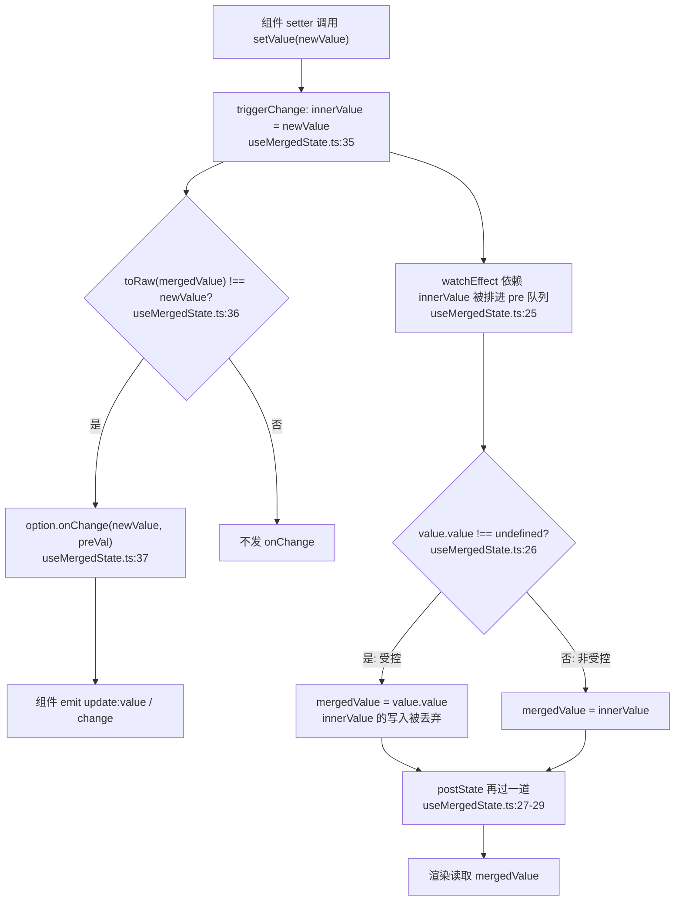
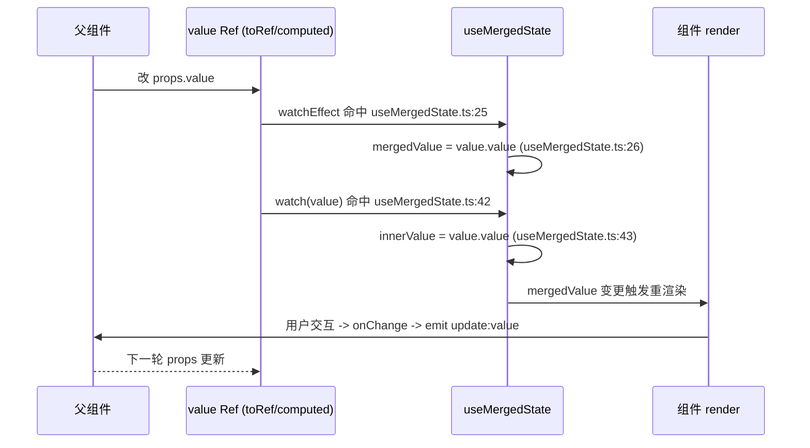
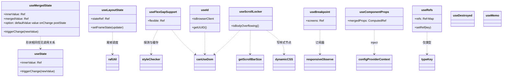

# I13 响应式内核 hooks

> **本篇解决**：`packages/xiaoye-ui/src/_util/hooks/` 里那 11 个文件到底各自管哪一段响应式时机；`useMergedState` 与 `useState` 两套受控实现的分界线在哪、谁真的在用；`useId` 在服务端给出的 id 和客户端是否一致；以及改哪一行会同时影响 21 个受控调用点。
> **前置**：A06（Props 体系与类型工具）　**读者坐标**：`02-infrastructure` 第 13/16 篇
> 「受控/非受控」这一对术语在专栏里的统一定义归 A06，本篇不重复论证 props 声明与 `initDefaultProps`；单个组件的受控用法归各组件篇（`C04-00` 类横写会以本篇为前置）；`toReactive`/`reactivePick` 属于 A06 的 props 响应式包装主题，本篇只在 §五 给一行引用，不展开。

---

## 一、职责与边界

`_util/hooks/` 是组件层的**响应式时机底座**：它把「外部 props 与内部状态的合并」「DOM 能力探测」「卸载后写状态」「一帧内的批量更新」这四类反复出现的时机问题，抽成 11 个不超过 52 行的函数。它的产出物只有一个形状——`[Ref<T>, setter]` 或 `Ref<T>`，不含渲染、不含样式、不含事件。

它明确**不负责**：

- 不负责 props 声明。`value`/`defaultValue`/`onChange` 这些键的命名与类型来自各组件的 `xxxTypes.ts`，`useMergedState` 只是接收已经建好的 `Ref`（`packages/xiaoye-ui/src/_util/hooks/useMergedState.ts:8` 的形参类型是 `Ref<T> | Ref<UnwrapRef<T>>`，调用方传的是 `toRef(props, 'value')`，见 `packages/xiaoye-ui/src/vc-select/Select.tsx:255`）。props 响应式包装（`toReactive`/`reactivePick`）归 A06。
- 不负责 emit。`onChange` 是回调参数（`useMergedState.ts:9`），不是 Vue 事件；把 `onChange` 接到 `emit('update:value')` 上的是组件本身。
- 不负责「哪些状态该受控」。全仓存在三套并存的受控写法（见论点 2），hook 只覆盖其中一套。
- 不负责响应式断点的计算。`useBreakpoint`（`packages/xiaoye-ui/src/_util/hooks/useBreakpoint.ts:6`）只是订阅器的外壳，阈值与 `matchMedia` 都在 `_util/responsiveObserve.ts`。

依赖清单（全部是 `_util` 内部或 Vue 本体，没有一条依赖组件目录）：

| 依赖 | 用途 | 证据 |
| --- | --- | --- |
| `vue`（`ref`/`shallowRef`/`watch`/`watchEffect`/`computed`/`inject`） | 全部响应式原语 | `packages/xiaoye-ui/src/_util/hooks/useMergedState.ts:2` |
| `_util/raf` | `useLayoutState` 的尾帧调度 | `packages/xiaoye-ui/src/_util/hooks/useLayoutState.ts:3` |
| `_util/canUseDom` | `useId` 的环境判定 | `packages/xiaoye-ui/src/_util/hooks/useId.ts:2` |
| `_util/styleChecker` | `useFlexGapSupport` 的探测与缓存 | `packages/xiaoye-ui/src/_util/hooks/useFlexGapSupport.ts:2` |
| `_util/responsiveObserve` | `useBreakpoint` 的订阅器 | `packages/xiaoye-ui/src/_util/hooks/useBreakpoint.ts:4` |
| `_util/type`（`Key`） | `useRefs` 的 Map 键类型 | `packages/xiaoye-ui/src/_util/hooks/useRefs.ts:3` |
| `config-provider/context` | `useComponentProps` 的注入源 | `packages/xiaoye-ui/src/_util/hooks/useComponentProps.ts:2` |
| `vc-util/Dom/dynamicCSS`、`_util/getScrollBarSize` | `useScrollLocker` 的 DOM 副作用 | `packages/xiaoye-ui/src/_util/hooks/useScrollLocker.ts:3-4` |

被依赖侧最集中的三族是 `vc-picker`（`useMergedState` 在三个文件里合计命中 13 行，含导入行：`packages/xiaoye-ui/src/vc-picker/RangePicker.tsx:299`、`PickerPanel.tsx`、`Picker.tsx`）、`vc-select` 族（`packages/xiaoye-ui/src/vc-select/Select.tsx:200`、`packages/xiaoye-ui/src/vc-tree-select/TreeSelect.tsx:27`、`packages/xiaoye-ui/src/vc-cascader/Cascader.tsx:12`）和 `tabs`/`table`（`packages/xiaoye-ui/src/tabs/src/Tabs.tsx:24`、`packages/xiaoye-ui/src/table/hooks/useSelection.tsx:10`）。

## 二、源码地图

`_util/hooks/` 根目录现有 14 个文件、652 行——本篇表格覆盖的 11 个 hook 之外，还有 `useGroupValue.ts`（115 行，`radio/Group.tsx` 与 `checkbox/Group.tsx` 在用的受控组值 hook，本篇不展开）与两份测试（`useComponentProps.test.tsx` 74 行、`useGroupValue.test.tsx` 123 行，2026-09-30 起补上）；`_vueuse/` 兼容层 11 个文件 500 行。**没有 `index.ts` barrel**——每个 hook 都要按完整路径逐个导入（`packages/xiaoye-ui/src/tabs/src/Tabs.tsx:22` 这类），所以 tree-shaking 天然干净，也让「谁在用」可以直接用导入路径统计出来。

| 文件 | 行数 | 职责 | 关键导出（定义首行） | 外部消费者 |
| --- | --- | --- | --- | --- |
| `hooks/useMergedState.ts` | 47 | 受控/非受控合并 | `useMergedState`（`:4`） | 16 文件 / 21 调用点 |
| `hooks/useState.ts` | 17 | 纯内部状态 | `useState`（`:4`） | 14 文件 / 12 调用点 |
| `hooks/useLayoutState.ts` | 41 | 尾帧批量更新 | `useLayoutState`（`:9`）、`Updater`（`:5`） | **0**（死副本，见论点 4） |
| `hooks/useBreakpoint.ts` | 24 | 断点订阅外壳 | `useBreakpoint`（`:6`） | 5 组件 + 1 再导出 |
| `hooks/useId.ts` | 30 | 无障碍 id | `useId`（`:25`）、`getUUID`（`:10`）、`isBrowserClient`（`:7`） | 1（`vc-tour/Mask.tsx:5`） |
| `hooks/useFlexGapSupport.ts` | 11 | flex gap 探测 | 匿名默认导出（`:4`） | 2（`space`、`grid/Row`） |
| `hooks/useDestroyed.ts` | 12 | 卸载守卫 | `useDestroyed`（`:3`） | 2（`_util/ActionButton.tsx` 与 `_util/components/ActionButton.tsx` 两份副本） |
| `hooks/useRefs.ts` | 20 | 键控 ref 表 | `useRefs`（`:8`）、`RefsValue`（`:6`） | 5 文件（3 调用 + 2 类型） |
| `hooks/useComponentProps.ts` | 65 | 配置注入合并 | `useComponentProps`（`:31`） | **0**（唯一调用方已随 2026-10-02 的组件移除删除；`useComponentProps.test.tsx` 74 行三用例防回归） |
| `hooks/useMemo.ts` | 21 | 条件重算缓存 | `useMemo`（`:4`） | 3（含 `vc-picker/hooks/useValueTexts.ts:3`） |
| `hooks/useScrollLocker.ts` | 52 | 滚动锁定样式 | 默认导出（`:21`）、`isBodyOverflowing`（`:14`） | 1（`_util/PortalWrapper.tsx:16`） |
| `hooks/_vueuse/*` | 500 | vueuse 风格兼容层 | `useElementSize`（`useElementSize.ts:20`）等 | 2 实际 + 1 类型 |

主实现入口是 `useMergedState.ts:4`——本篇一半的结论由它 47 行决定。`_vueuse/` 里真正被组件调用的只有两个：`useElementSize.ts:20`（`packages/xiaoye-ui/src/vc-picker/RangePicker.tsx:48`）与 `useMutationObserver.ts`（`packages/xiaoye-ui/src/watermark/index.tsx:5`）；`types.ts` 的 143 行全是 `MaybeRef`/`ConfigurableWindow` 之类的类型占位（`packages/xiaoye-ui/src/_util/hooks/_vueuse/types.ts:120`），没有运行时成本，但也没有任何组件用它做约束。样式文件在本目录不存在——这些 hook 不产 CSS，唯一直接写样式的是 `useScrollLocker.ts:35-42` 的 `updateCSS`。

`hooks/` 与组件目录里同名文件的关系要注意两点：`useLayoutState` 的活实现在 `packages/xiaoye-ui/src/vc-table/hooks/useFrame.ts:7`；`useId` 的主版本在 `packages/xiaoye-ui/src/vc-select/hooks/useId.ts:25`。本目录不是这两个 hook 的实际提供者。

## 三、架构与数据流

### 图 1：一次 `setValue` 在 `useMergedState` 内部分成两条腿



两条腿的分工是这张图的重点：**左腿（B→C→D→F）决定对外说什么，右腿（B→G→H→K→L）决定对内显示什么**。二者读写的 ref 不同（`useMergedState.ts:23-24` 是两个独立 `ref()`），所以「父组件不接 `update:value`」时，渲染不动（右腿回到 `value.value`，`useMergedState.ts:26`），但 `innerValue` 已经被推进（左腿起点 B，`useMergedState.ts:35`）——这个不对称是论点 2 里三种手写实现分岔的根源。判定条件写成 `!== undefined` 而不是「prop 是否存在」，因此受控与非受控可以在运行时来回切换，切换瞬间由 `useMergedState.ts:42` 的 `watch(value)` 决定内部值。

### 图 2：完整闭环——外部 value 变、内部值同步、渲染回流



注意 `watchEffect`（`useMergedState.ts:25`）和 `watch(value)`（`useMergedState.ts:42`）会**因为同一次 props 变更各自跑一次**，前者更新 `mergedValue`，后者把值抄进 `innerValue`。两条都排默认 pre 队列，顺序由注册顺序决定（`watchEffect` 先建，`useMergedState.ts:25` 在 `:42` 之前）。`tabs/src/Tabs.tsx:199` 传的是 `computed(() => props.activeKey)`、`vc-select/Select.tsx:255` 传的是 `toRef(props, 'value')`——两种都能被 `watch` 追踪（`useMergedState.ts:42`），但 `computed` 源在 `props` 未变而依赖不变时不产生新值，`toRef` 每次都直接反映 props。

### 图 3：静态结构——本目录 11 个 hook 与它们的依赖面



图中只有 `useMergedState ..> useState` 这一条是「逻辑关系」而非「导入关系」，且已注明是形状相同（`useMergedState.ts:12` 与 `useState.ts:6` 的返回类型完全一样）：源码里两者互不引用，这是它们能长期并存、且能被随手互换的原因。其余每条边都是真实 import：`useLayoutState.ts:3`、`useBreakpoint.ts:4`、`useFlexGapSupport.ts:2`、`useId.ts:2`、`useScrollLocker.ts:3-5`、`useComponentProps.ts:2`、`useRefs.ts:3`。`useDestroyed.ts:1` 和 `useMemo.ts:2` 只依赖 `vue`，是图里唯一的孤立节点。

三张图合起来给出本层的数据流判定：**状态只有「内部」与「合并后」两份，外部 `value` 不是状态**；一切时机问题（探测、订阅、卸载、样式注入）都被推迟到 `onMounted` 或 `flush: 'post'`，因此本层的 hook 在 SSR 下全部「安全但贫乏」——返回初值、不报错、也不给出与客户端一致的结果。

## 四、核心机制精读

### 论点 1：`useMergedState` 与 `useState` 返回值同构，但只有前者知道「外部 value 存在」

**断言**：`packages/xiaoye-ui/src/_util/hooks/` 下并存两套状态原语，二者返回完全一样的 `[Ref<T>, (val: T) => void]` 元组（`useState.ts:6`、`useMergedState.ts:12`），把 `useState` 用在受控组件上不会有任何类型或运行时错误，只会静默失去受控能力——因为 `useState` 的实现里根本不存在 `value` 这条输入通道。

```ts
// packages/xiaoye-ui/src/_util/hooks/useState.ts:4
export default function useState<T, R = Ref<T>>(
  defaultStateValue?: T | (() => T),
): [R, (val: T) => void] {
  const initValue: T =
    typeof defaultStateValue === 'function' ? (defaultStateValue as any)() : defaultStateValue;

  const innerValue = ref(initValue) as Ref<T>;

  function triggerChange(newValue: T) {
    innerValue.value = newValue;
  }

  return [innerValue as unknown as R, triggerChange];
}
```

`useState` 全部 17 行里只有一次 `ref()` 和一次赋值（`useState.ts:10`、`useState.ts:13`），没有 `watch`、没有 `watchEffect`、没有 `onChange` 回调位——它是一个「带函数式初始值的 `ref` 语法糖」。它的 `triggerChange` 无相等性判断，相同值重复写入照样触发依赖。

```ts
// packages/xiaoye-ui/src/_util/hooks/useMergedState.ts:13
const { defaultValue, value = ref() } = option || {};
let initValue: T =
  typeof defaultStateValue === 'function' ? (defaultStateValue as any)() : defaultStateValue;
if (value.value !== undefined) {
  initValue = unref(value as any) as T;
}
if (defaultValue !== undefined) {
  initValue = typeof defaultValue === 'function' ? (defaultValue as any)() : defaultValue;
}

const innerValue = ref(initValue) as Ref<T>;
const mergedValue = ref(initValue) as Ref<T>;
watchEffect(() => {
  let val = value.value !== undefined ? value.value : innerValue.value;
  if (option.postState) {
    val = option.postState(val as T);
  }
  mergedValue.value = val as T;
});
```

三点要拆开看：

- `useMergedState.ts:13` 的 `value = ref()` 只是给「没传 `value`」补一个空壳 ref，好让后面所有 `value.value` 读取无需判空；它同时意味着**受控判定不是「有没有传 value」，而是「`value.value !== undefined`」**（`useMergedState.ts:16`、`useMergedState.ts:26`）。传了 `value: toRef(props, 'value')` 但父组件没绑定时，组件照样按非受控跑。
- 初始化是三段覆盖，后写赢：位置参数 → `value` → `defaultValue`（`useMergedState.ts:14-21`）。`defaultValue` 排在 `value` 之后（`useMergedState.ts:19`），因此**首帧 `innerValue` 会被 `defaultValue` 覆盖**，随后 `watchEffect` 首次同步执行（`useMergedState.ts:25`）才把 `mergedValue` 拉回 `value.value`。对外显示正确，但影子缓冲 `innerValue` 停在 `defaultValue` 上。
- `mergedValue` 与 `innerValue` 是两个独立 ref（`useMergedState.ts:23-24`），不是别名。渲染读 `mergedValue`，写入进 `innerValue`，二者的 reconcile 完全靠那个 `watchEffect`。

```ts
// packages/xiaoye-ui/src/_util/hooks/useMergedState.ts:33
function triggerChange(newValue: T) {
  const preVal = mergedValue.value;
  innerValue.value = newValue;
  if (toRaw(mergedValue.value) !== newValue && option.onChange) {
    option.onChange(newValue, preVal);
  }
}

// Effect of reset value to `undefined`
watch(value, () => {
  innerValue.value = value.value as T;
});

return [mergedValue as unknown as R, triggerChange];
```

- `triggerChange` **无论受控与否都写 `innerValue`**（`useMergedState.ts:35`），受控模式下这次写入不会反映到 `mergedValue`，因为 `watchEffect` 立刻用 `value.value` 覆盖回去（`useMergedState.ts:26`）。所以受控组件里 `innerValue` 是一块「乐观缓冲」。
- `onChange` 的门槛是 `toRaw(mergedValue.value) !== newValue`（`useMergedState.ts:36`）。`ref()` 会把对象/数组深包成 reactive 代理，`mergedValue.value` 拿到的是代理而 `newValue` 是裸对象，不做 `toRaw` 就永远不相等、`onChange` 每次都会多发一次——这一行就是为此而存在的。副作用是：**同值重复调用 `setValue` 不会向外发 `onChange`**，与 `useState.ts:12` 的无条件写入语义不同。
- `useMergedState.ts:42` 的 `watch(value, ...)` 没有 `immediate`，只在外部 `value` 引用变化后触发，且**无条件把 `value.value` 抄进 `innerValue`**——包括 `undefined`。

两者谁在用：`useMergedState` 有 16 个文件导入、21 处调用点；`useState` 有 14 个文件导入、12 处调用点。同一文件里混用的例子也存在：`vc-select/Select.tsx:200`、`Select.tsx:283` 用 `useMergedState` 管 `searchValue` 和 `value`，`Select.tsx:445` 用 `useState` 管 `accessibilityIndex`；`tabs/src/Tabs.tsx:204` 用 `useMergedState` 管 `activeKey`，`Tabs.tsx:197`、`Tabs.tsx:208` 用 `useState` 管 `mobile` 与 `activeIndex`。分界线是「这个状态要不要被父组件接管」，而这条线只存在于开发者脑中，没有任何类型或 lint 强制。

### 论点 2：受控逻辑实际有三套实现，hook 只覆盖了 `vc-*` 层的一半

**断言**：「统一实现受控/非受控」在 `xiaoye-ui` 里只完成到一半——`useMergedState` 的 16 个调用文件里 9 个是 `vc-*` 目录（`vc-picker` 3、`vc-image` 2、`vc-select`、`vc-tree-select`、`vc-cascader`、`vc-tour` 各 1），7 个是 `tabs`/`upload`/`popconfirm`/`float-button`/`typography`/`calendar`/`table/hooks`；而表单控件族 `switch`（`packages/xiaoye-ui/src/switch/index.tsx:109`）、`collapse`（`packages/xiaoye-ui/src/collapse/Collapse.tsx:53`）、`tooltip`（`packages/xiaoye-ui/src/tooltip/Tooltip.tsx:108`）、`vc-input`（`packages/xiaoye-ui/src/vc-input/Input.tsx:26`）、`vc-checkbox`（`packages/xiaoye-ui/src/vc-checkbox/Checkbox.tsx:33`）、`vc-pagination`（`packages/xiaoye-ui/src/vc-pagination/Pagination.tsx:64`）全部各自手写 `value === undefined ? defaultValue : value` 或 `firstNotUndefined([...])`。（2026-09-30 更新：`checkbox` 与 `radio` 两个 Group 已从手写实现收敛进 `_util/hooks/useGroupValue.ts` 共享内核，手写点从 7 处降为 5 处，见下文摘录。）这类手写点与 `useMergedState` 并存但语义不同。

```ts
// packages/xiaoye-ui/src/switch/index.tsx:97
const checked = ref<string | number | boolean>(
  props.checked !== undefined ? props.checked : (attrs.defaultChecked as boolean),
);
const checkedStatus = computed(() => checked.value === props.checkedValue);

watch(
  () => props.checked,
  () => {
    checked.value = props.checked;
  },
);
```

`switch` 的写法有两个和 hook 不一样的地方：初始值从 `attrs.defaultChecked` 取（`switch/index.tsx:98`），因为 `defaultChecked` 没进 props 声明，只能从 `attrs` 里捞；回流 watcher（`switch/index.tsx:102-107`）无条件赋值，父组件把 `checked` 改回 `undefined` 时内部值也被清成 `undefined`，没有 `useMergedState.ts:26` 那样的 `value.value !== undefined ? ... : innerValue.value` 回退分支。

```ts
// packages/xiaoye-ui/src/collapse/Collapse.tsx:103
const setActiveKey = (activeKey: Key[]) => {
  if (props.activeKey === undefined) {
    stateActiveKey.value = activeKey;
  }
  const newKey = props.accordion ? activeKey[0] : activeKey;
  emit('update:activeKey', newKey);
  emit('change', newKey);
};
```

这是第三种受控写法：**受控时不写内部 state**（`collapse/Collapse.tsx:104`），只 emit。`checkbox/Group.tsx:50-69` 的 `toggleOption` 走同一个语义（2026-09-30 起：写入经 `useGroupValue` 内核的 `setInternalValue`，受控时不落内部值）。对比 `useMergedState.ts:35` 的无条件 `innerValue.value = newValue`，两者在「父组件收到 `update:xxx` 却故意不更新」这一场景下最终状态不同：`Collapse` 停在旧 key，`useMergedState` 系的组件里 `innerValue` 已经被推进，一旦外部 `value` 变回 `undefined` 就会跳到那个被忽略的新值。

```ts
// packages/xiaoye-ui/src/checkbox/Group.tsx:29
    const { internalValue: mergedValue, setInternalValue } = useGroupValue<CheckboxValueType[]>(
      props,
      {
        initialValue: () => props.defaultValue,
        normalize: v => v || [],
      },
    );
```

`checkbox/Group.tsx:37` 的 `normalize: v => v || []` 是手写版特有的兜底（2026-09-30 起以内核 `normalize` 钩子的形式保留）：`props.value` 为 `undefined` 时把内部数组清空，而 `useMergedState` 会把 `undefined` 原样交给 `postState` 处理（`useMergedState.ts:27-29`）。`firstNotUndefined` 是这条手写路径上的公共零件，但它只解决「取第一个非 undefined 初值」，不管回流：

```ts
// packages/xiaoye-ui/src/_util/firstNotUndefined.ts:1
function firstNotUndefined<T>(arr: T[] = []): T {
  for (let i = 0, len = arr.length; i < len; i++) {
    if (arr[i] !== undefined) {
      return arr[i];
    }
  }
  return undefined;
}
```

`collapse/Collapse.tsx:53` 用它做了 hook 里那段「三段覆盖」的简化版，但 `Collapse.tsx:56-62` 的回流 watcher 又额外带 `{ deep: true }`——`useMergedState.ts:42` 的 `watch(value, ...)` 没有 deep，数组型 value 原地 mutate 后不会同步。这两处差异不会编译报错，只会让两个组件对同一个父组件写法给出不同反应。

`select` 是唯一保持分层的例子：`select/index.tsx:5` 直接导入 `RcSelect`（即 `vc-select`）并把 `value` 透传下去，受控判定完全由 `vc-select/Select.tsx:254` 的 `useMergedState` 承担，xy 层不再持有一份内部 state。`input` 走的是另一条：`vc-input/Input.tsx:26` 用 `shallowRef(props.value === undefined ? props.defaultValue : props.value)` 自建状态，`input/TextArea.tsx:63` 又另起一个 `mergedValue = shallowRef('')`，两层各自管一半。

可复现统计：

```bash
cd packages/xiaoye-ui/src
grep -rn "useMergedState(" --include='*.ts' --include='*.tsx' --include='*.vue' . \
  | grep -v "_util/hooks/useMergedState.ts" | wc -l   # 21 处调用点
grep -rln "useMergedState" --include='*.ts' --include='*.tsx' --include='*.vue' . \
  | grep -v "^./_util/hooks/" | wc -l                 # 16 个文件
grep -rn "= useState(" --include='*.ts' --include='*.tsx' . \
  | grep -v "_util/hooks/useState.ts" | wc -l          # 12 处调用点
grep -rn "=== undefined ? props\.default\|firstNotUndefined(\[" \
  --include='*.ts' --include='*.tsx' . | wc -l         # 7 处手写受控
```

### 论点 3：`useId` 在服务端恒定返回同一个串，SSR 只保证「不报错」，不保证 id 唯一或与客户端一致

**断言**：`_util/hooks/useId.ts` 的稳定性策略是「非浏览器环境直接给常量」，因此服务端渲染出的 `id` 对所有实例都相同，客户端水合后拿到的是自增数字——两端不一致，且服务端 HTML 内部本身就重复。同时这个 hook 在仓库里有两份逐行等价的副本加第三份 `getUUID`，三份的 SSR 防护程度不同。

```ts
// packages/xiaoye-ui/src/_util/hooks/useId.ts:4
let uuid = 0;

/** Is client side and not jsdom */
export const isBrowserClient = process.env.NODE_ENV !== 'test' && canUseDom();

/** Get unique id for accessibility usage */
export function getUUID(): number | string {
  let retId: string | number;

  // Test never reach
  /* istanbul ignore if */
  if (isBrowserClient) {
    retId = uuid;
    uuid += 1;
  } else {
    retId = 'TEST_OR_SSR';
  }

  return retId;
}

export default function useId(id = ref('')) {
  // Inner id for accessibility usage. Only work in client side
  const innerId = `vc_unique_${getUUID()}`;

  return id.value || innerId;
}
```

逐段：

- `useId.ts:7` 的 `isBrowserClient` 在**模块求值时**算一次（`canUseDom()` 见 `_util/canUseDom.ts:1-3`，判 `window.document.createElement`），不是每次调用重算。SSR 下它恒为 `false`，且因为 Node 的模块缓存，多个请求共享同一份模块状态。
- 非浏览器分支返回字面量 `'TEST_OR_SSR'`（`useId.ts:19`），拼出来就是 `vc_unique_TEST_OR_SSR`（`useId.ts:27`）。**页面上放 5 个需要自动生成 id 的组件，服务端 HTML 里就有 5 个同名 id**，`aria-labelledby`/`for` 会全部指到第一个匹配元素。这就是这段代码在 SSR 下的真实症状：不崩、但无障碍关联失效。
- 客户端首次渲染走 `useId.ts:16-17` 的自增，得到 `vc_unique_0`、`vc_unique_1`……与服务端串不一致。因为 `innerId` 是在 hook 调用时算出的普通字符串（`useId.ts:27`，不是 `computed`），组件不会因为两端差异而自动纠正，只能靠 `id.value || innerId` 的前半段（`useId.ts:29`）——**调用方显式传 `id` 才可能一致**。真实调用点恰好就是这么用的：`vc-select/Select.tsx:194`、`vc-tree-select/TreeSelect.tsx:230` 传 `toRef(props, 'id')`，只有 `vc-tour/Mask.tsx:38` 是裸调 `useId()`。
- 第二份实现 `vc-select/hooks/useId.ts` 与上面 30 行**逐行相同，只有前缀字面量不同**（`vc-select/hooks/useId.ts:27` 用的是 `rc_select_`，上游实现遗留的命名，本库 `_util` 版已换成 `vc_unique_`，见 `_util/hooks/useId.ts:27`），而且两份各自持有自己的 `let uuid = 0`（`_util/hooks/useId.ts:4`、`vc-select/hooks/useId.ts:4`）——计数器不共享，所以不同组件族会各自从 0 开始编号。
- 第三份 `getUUID`（`vc-dialog/util.ts` 的那份）原先**完全没有 SSR 防护**：

```ts
// packages/xiaoye-ui/src/vc-dialog/Dialog.tsx:59
    const ariaIdRef = shallowRef<string>(`vcDialogTitle${getCurrentInstance()?.uid ?? 0}`);
```

> **2026-09-29 已修复**：上面这行原来写的是 `vcDialogTitle${getUUID()}`，由 `vc-dialog/util.ts` 里一个无防护的 `let uuid = -1` 自增提供——服务端连续处理请求时编号会跨请求累加（泄漏计数），且与水合后的客户端对不上。现在该 helper 与 `util.ts` 里的定义一并删除，改用组件实例 `uid`（服务端与客户端创建顺序一致，因此两端相等），本节的「三份实现」收缩为两份（`_util/hooks/useId.ts` 与 `vc-select/hooks/useId.ts`）。

两份 `useId` 实现的分布可直接核对：

```bash
cd packages/xiaoye-ui/src
grep -rn "getUUID" --include='*.ts' --include='*.tsx' . | grep -v "= getUUID"   # 修复后 2 处定义 + 2 处调用（原为 3 与 2），实跑正是这 4 行
grep -rn "_util/hooks/useId\|vc-select/hooks/useId" --include='*.ts' --include='*.tsx' .  # 只数到 3 行，见下
grep -rn "from './hooks/useId'" vc-select --include='*.ts' --include='*.tsx'              # 第 4 行在这里
```

第二条命令的「4 行导入」要拆成两条才成立，本篇此前把它写成一条命令的期望值，现在按实测更正：`vc-select/` 之外确有三个导入点（`vc-tour/Mask.tsx:5`、`vc-tree-select/TreeSelect.tsx:26`、`vc-cascader/Cascader.tsx:11`），而第四个调用方 `vc-select/Select.tsx:38` 写的是相对路径 `from './hooks/useId'`，不含 `vc-select/hooks/useId` 这个串，所以被第一条模式漏掉——这是命令的写法问题，不是代码的漏检。

`_util/hooks/useId.ts` 的导入方只有 1 个（`vc-tour/Mask.tsx:5`），其余三个选择器族都从 `vc-select/hooks/useId` 取（`vc-select/Select.tsx:38`、`vc-tree-select/TreeSelect.tsx:26`、`vc-cascader/Cascader.tsx:11`）。`vc-select/` 目录不在本专栏的 `src/_util/hooks/` 范围内，此处只登记重复，不展开其内部。

### 论点 4：`_util/hooks/useLayoutState.ts` 是零消费者的死副本，活的那份在 `vc-table/hooks/useFrame.ts` 且批处理语义不同

**断言**：两个同名同签名的 `useLayoutState` 并存，`_util` 版没有任何导入方；`vc-table` 用的是自己目录里的副本，而两份对「一帧内多次 `setState`」的处理不一样——`_util` 版把整批 updater 折叠到一个本地变量上、只发布最终值，`useFrame` 版逐个写回 `shallowRef`，中间态会逐次触发依赖。

先证明「零消费者」，两条独立命令：

```bash
cd packages/xiaoye-ui
# 方法一：全仓（排除 dist/node_modules）按符号名找，只看非定义、非 vc-table 的结果
grep -rn "useLayoutState" --include='*.ts' --include='*.tsx' --include='*.vue' --include='*.js' \
  --exclude-dir=node_modules --exclude-dir=dist src apps ../../apps 2>/dev/null \
  | grep -v vc-table
# => 只剩 src/_util/hooks/useLayoutState.ts:9 这一行定义本身
# 方法二：按导入路径找（能抓到 `export * from` 形式的 barrel 转发）
grep -rn "hooks/useLayoutState" --exclude-dir=node_modules --exclude-dir=dist .
# => 空
```

```ts
// packages/xiaoye-ui/src/_util/hooks/useLayoutState.ts:9
export function useLayoutState<State>(
  defaultState: State,
): [Ref<State>, (updater: Updater<State>) => void] {
  const stateRef = shallowRef(defaultState);
  let tempState = stateRef.value;

  let updateBatchRef = [];
  const rafRef = shallowRef();
  function setFrameState(updater: Updater<State>) {
    raf.cancel(rafRef.value);
    updateBatchRef.push(updater);

    rafRef.value = raf(() => {
      const prevBatch = updateBatchRef;
      // const prevState = stateRef.value;
      updateBatchRef = [];

      prevBatch.forEach(batchUpdater => {
        tempState = batchUpdater(tempState);
      });

      // if (tempState !== stateRef.value) {
      stateRef.value = tempState;
      // }
    });
  }
```

- 批次容器是普通数组 `let updateBatchRef = []`（`useLayoutState.ts:15`），不进响应式系统，配合 `tempState`（`:13`）做「本地累加、末尾一次性发布」：`stateRef.value = tempState` 只发生在 `:31` 一行。
- 三次被注释掉的守卫（`:23`、`:30`、`:32`）是这段代码的历史痕迹：原本打算跳过同值写入，现在每次 flush 都无条件写 `stateRef`。
- `raf.cancel(rafRef.value)` 在 push 之前（`:18`）——同帧第二次调用会先取消上一帧的排程再重新排，保证所有 updater 落在同一个尾部帧里。`rafRef` 用 `shallowRef` 存 id 而不是普通变量（`:16`），语义上没有区别，只是让 id 可读。
- `onBeforeUnmount` 里取消尾帧（`useLayoutState.ts:36-38`），避免卸载后写 ref。
- `raf` 本身来自 `_util/raf.ts`：非浏览器环境退化成 `setTimeout(callback, 16)`（`_util/raf.ts:4-6`），所以这个 hook 在 jsdom/SSR 下依然会「异步」更新，不是同步生效。

对照活着的副本：

```ts
// packages/xiaoye-ui/src/vc-table/hooks/useFrame.ts:7
export function useLayoutState<State>(
  defaultState: State,
): [Ref<State>, (updater: Updater<State>) => void] {
  const stateRef = shallowRef<State>(defaultState);
  let rafId: number;
  const updateBatchRef = shallowRef<Updater<State>[]>([]);
  function setFrameState(updater: Updater<State>) {
    updateBatchRef.value.push(updater);
    raf.cancel(rafId);
    rafId = raf(() => {
      const prevBatch = updateBatchRef.value;
      // const prevState = stateRef.value;
      updateBatchRef.value = [];
      prevBatch.forEach(batchUpdater => {
        stateRef.value = batchUpdater(stateRef.value as State);
      });
    });
  }
```

差异是三处、都可验证：批次数组在活副本里是 `shallowRef`（`useFrame.ts:12`，死副本是裸数组 `useLayoutState.ts:15`）；`raf.cancel` 在 push 之后（`useFrame.ts:15` vs `useLayoutState.ts:18`）；最关键的是 `useFrame.ts:21` 的 `stateRef.value = batchUpdater(stateRef.value)`——每个 updater 都直接发布，中间态对 `shallowRef` 的依赖方可见，而死副本 `useLayoutState.ts:27` 只推进 `tempState`。真实调用方是表格的列宽计算：`vc-table/Table.tsx:338` 的 `useLayoutState(new Map<Key, number>())` 与 `vc-table/stickyScrollBar.tsx:54` 的滚动状态，两者都从 `./hooks/useFrame` 导入（`vc-table/Table.tsx:23`、`vc-table/stickyScrollBar.tsx:19`）。

结论落点：**改 `_util/hooks/useLayoutState.ts` 不会影响任何组件**，但会制造第三份分叉；要改表格的批处理语义，位置在 `vc-table/hooks/useFrame.ts:16-23`。

### 论点 5：四个「小 hook」各自钉住一个具体时序，其中 `useComponentProps` 只有 1 个消费者

**断言**：`useDestroyed`、`useRefs`、`useMemo`、`useComponentProps` 都不涉及受控语义，它们各自解决一个时机问题——卸载后写状态、模板 ref 回收、条件重算、配置注入合并。四者合计只有 10 个引用文件（`useRefs` 的 5 个里有 1 个只取类型 `RefsValue`），`useComponentProps` 的唯一调用方已随 2026-10-02 的组件移除删除、当前为零。

```ts
// packages/xiaoye-ui/src/_util/hooks/useDestroyed.ts:3
const useDestroyed = () => {
  const destroyed = shallowRef(false);
  onBeforeUnmount(() => {
    destroyed.value = true;
  });

  return destroyed;
};
```

它存在的原因是 `onBeforeUnmount` 是唯一「还拿得到实例、但已经确定要销毁」的钩子（`useDestroyed.ts:5-7`）。真实用法是 Promise 回调守卫：`_util/ActionButton.tsx:39` 拿到 ref，`ActionButton.tsx:60` 与 `:67` 在 `then`/`catch` 里判 `if (!isDestroyed.value)` 才写 `loading.value = false`；`_util/components/ActionButton.tsx` 的同名副本在 `:60` 与 `:67` 是同一个模式。没有这层守卫，Modal 的确定按钮在异步请求返回前被关闭，就会触发「写入已卸载组件状态」。

```ts
// packages/xiaoye-ui/src/_util/hooks/useRefs.ts:8
const useRefs = (): UseRef => {
  const refs = ref<RefsValue>(new Map());

  const setRef = (key: Key) => (el: RefType) => {
    refs.value.set(key, el);
  };
  onBeforeUpdate(() => {
    refs.value = new Map();
  });
  return [setRef, refs];
};
```

`setRef` 是柯西化的（`useRefs.ts:11-13`），因为模板里的 `:ref="setRef(tab.key)"` 每次 render 都会生成新函数并重新绑定；`onBeforeUpdate` 整表清空（`useRefs.ts:14-16`）解决的是「上一轮存在、这一轮被移除」的节点残留在 Map 里。注意 `refs` 用的是 `ref(new Map())`（`useRefs.ts:9`）而不是 `shallowRef`——Map 的 `set` 不会被深层代理追踪，真正的响应式变化来自 `:15` 的整表替换。调用方：`tabs/src/TabNavList/index.tsx:114`、`rate/index.tsx:60`、`vc-progress/src/Circle.tsx:79`，类型还被 `vc-progress/src/common.ts:1` 单独引走。

```ts
// packages/xiaoye-ui/src/_util/hooks/useMemo.ts:9
const cacheRef: Ref<T> = ref(getValue() as any);
watch(condition, (next, pre) => {
  if (shouldUpdate) {
    if (shouldUpdate(next, pre)) {
      cacheRef.value = getValue();
    }
  } else {
    cacheRef.value = getValue();
  }
});

return cacheRef;
```

`useMemo.ts:9` 在 setup 期同步算一次首值，之后只有 `watch` 命中才重算（`:10`，无 `immediate`）。它不是 `computed`：`computed` 每次依赖变化都重算，而这个 hook 把「要不要重算」交给调用方。两个真实调用点用同一条谓词：`vc-select/OptionList.tsx:45-48` 与 `vc-tree-select/OptionList.tsx:43-46` 都传 `next => next[0]`，而 `condition` 的第 0 项是 `() => baseProps.open`——即**只有下拉面板打开时才刷新缓存**，面板关闭期间 `flattenOptions`/`treeData` 怎么变都不重算，等打开那一刻一次性补上。`vc-picker/hooks/useTextValueMapping.ts:8` 的注释「Must useMemo, to assume that `valueTexts` only match on the first change」就是这套语义的使用说明。

`useComponentProps` 是这批里最新的一个，注释直接写明是「简化版」。下面摘录的是它 2026-09-30 重写前的形状——重写后「显式传入」不再靠 `props[key] !== undefined` 判断，改读 `instance.vnode.props`（见现行文件头注释与 `useComponentProps.test.tsx` 的回归说明）：

```ts
// packages/xiaoye-ui/src/_util/hooks/useComponentProps.ts:31
export default function useComponentProps<P extends Record<string, any>>(name: string, props: P) {
  const configProvider = inject(configProviderKey, {
    ...defaultConfigProvider,
  });

  return computed(() => {
    const injected = configProvider.componentProps?.value?.[name] || {};
    const merged: Record<string, any> = { ...injected };
    for (const key of Object.keys(props)) {
      if (props[key] !== undefined) {
        merged[key] = props[key];
      }
    }
    return merged as P & Record<string, any>;
  });
}
```

- 优先级声明是「显式 props > ConfigProvider 注入 > 组件默认值」。上列摘录的旧实现先铺 `injected` 再用 `props[key] !== undefined` 覆盖，缺陷是带默认值的 prop 永远不等于 `undefined`、组件默认值会盖掉注入——2026-09-30 的重写改为先铺 `props`、再让注入值覆盖、最后用 `instance.vnode.props`（模板 kebab-case 也认）把「真正显式传入」的键抬回最高优先级（现行 `useComponentProps.ts:39-46` 与 `:58-62`），并由 `useComponentProps.test.tsx` 的三个用例钉住。
- `componentProps` 是 ConfigProvider 的声明 prop（`config-provider/context.ts:112`），类型上是 `ComputedRef`（`context.ts:157`），因此这里必须 `.value?.[name]`（`useComponentProps.ts:49`）。而兜底用的 `defaultConfigProvider`（`config-provider/context.ts:165-173`）根本没有 `componentProps` 键——只有外面那条 `?.` 在挡，缺一个问号就抛。
- 当前全仓**没有任何调用方**：唯一调用过它的组件（一个富文本编辑器）已随 2026-10-02 的组件移除删除。也就是说「ConfigProvider 注入组件级默认 props」这条链路现在只由 hook 本体、文件头注释与那三个单测定义，没有任何生产消费者；`useConfigInject` 才是其余组件实际走的路。二者关系见 A06 Props 体系与类型工具。

### 论点 6：`flush` 在受控 hook 里根本不存在，时序全靠默认 pre 队列；唯一的显式 flush 是 `useScrollLocker`

**断言**：`useMergedState` 与 `useState` 的参数表里没有 `flush`（`useMergedState.ts:6-11`、`useState.ts:4-6`），整个 hooks 目录只有一处显式 `flush`，即 `useScrollLocker.ts:50` 的 `'post'`。默认 pre 队列带来一个可复现后果：`triggerChange` 返回后同步读 `mergedValue.value` 拿到的是旧值。

```bash
cd packages/xiaoye-ui/src/_util/hooks
grep -rn "flush" .
# ./useScrollLocker.ts:50:    { flush: 'post' },
# ./_vueuse/useResizeObserver.ts:78:    { immediate: true, flush: 'post' },
# ./_vueuse/types.ts:120:  flush?: WatchOptions['flush'];
# ./_vueuse/types.ts:130:  flush?: WatchOptions['flush'];
```

四条命中里只有 `useScrollLocker.ts:50` 属于本目录自己写的逻辑，另两条是 `_vueuse/types.ts:120`、`:130` 给 vueuse 兼容层透传的 `WatchOptions['flush']` 类型（`useResizeObserver.ts:78` 实际用了它），且 `_vueuse/` 的外部消费者只有 `vc-picker/RangePicker.tsx:48` 的 `useElementSize` 和 `watermark/index.tsx:5` 的 `useMutationObserver`（其余 `tryOnMounted`、`resolveUnref`、`isSupported` 在全仓无外部引用，只被 `_vueuse/` 内部互调，如 `useSupported.ts:1` 用 `tryOnMounted`、`unrefElement.ts:3` 用 `resolveUnref`）。

`useScrollLocker` 需要 `'post'` 是因为它往文档里写样式：

```ts
// packages/xiaoye-ui/src/_util/hooks/useScrollLocker.ts:21
export default function useScrollLocker(lock?: Ref<boolean>) {
  const mergedLock = computed(() => !!lock && !!lock.value);
  uuid += 1;
  const id = `${UNIQUE_ID}_${uuid}`;

  watchEffect(
    onClear => {
      if (!canUseDom()) {
        return;
      }
      if (mergedLock.value) {
        const scrollbarSize = getScrollBarSize();
        const isOverflow = isBodyOverflowing();

        updateCSS(
          `
html body {
  overflow-y: hidden;
  ${isOverflow ? `width: calc(100% - ${scrollbarSize}px);` : ''}
}`,
          id,
        );
      } else {
        removeCSS(id);
      }
      onClear(() => {
        removeCSS(id);
      });
    },
    { flush: 'post' },
  );
}
```

- `mergedLock`（`useScrollLocker.ts:22`）把 `lock` 可能为 `undefined` 的情况压成布尔，所以无参调用 `useScrollLocker()` 也安全。
- 每个实例有独立 `<style>` 标识：`uuid += 1`（`:23`）配合模块级的 `` `vc-util-locker-${Date.now()}` ``（`:7`），两层浮层各自 `updateCSS(..., id)`（`:35-42`）互不覆盖；`onClear`（`:46-48`）保证 effect 重跑和组件销毁都摘掉自己的节点。
- `canUseDom()` 守卫在 effect 内而不是模块顶层（`:28-30`），所以 SSR 首帧直接 return——这是这个文件唯一的服务端防护，配合 `flush: 'post'` 让 DOM 读写排在渲染之后。
- `isBodyOverflowing` 的注释写着「Test usage export. Do not use in your production」（`:11-13`），但它在测试里其实没被用到，见 §七 第 5 条。

对比真正的「同步时序」实现，本目录之外有一个参照物：`src/_util/eagerComputed.ts:11` 显式写了 `flush: 'sync'` 并注明 `// needed so updates are immediate.`。受控 hook 没有走这条路，于是：

```ts
// packages/xiaoye-ui/src/_util/hooks/useMergedState.ts:25
watchEffect(() => {
  let val = value.value !== undefined ? value.value : innerValue.value;
  if (option.postState) {
    val = option.postState(val as T);
  }
  mergedValue.value = val as T;
});
```

`watchEffect` 默认 `flush: 'pre'`（这里没传第二个参数，`useMergedState.ts:25-31`）。它的依赖是 `innerValue` 与 `value`，所以 `triggerChange`（`useMergedState.ts:35`）同步改完 `innerValue` 后，`mergedValue` 还在旧值上，要等本轮调度器 flush 才更新。这就是「setter 之后立刻读 merged 值读到旧值」的根因；`vc-picker/RangePicker.tsx:335` 用 `mergedValue.value` 作为另一个 `useMergedState` 的首参、而把真正的同步比较放进 `computed`（`vc-select/Select.tsx:259`）这类写法，都是在绕开这条时序。断点侧更直接：`list/index.tsx:216` 把 `useBreakpoint` 的结果包进 `eagerComputed`（`_util/eagerComputed.ts:4` 的 `flush: 'sync'`）而不是普通 `computed`，说明「同步可读」在断点场景里是硬需求，而受控 hook 没有提供同等保证。

`_vueuse` 层给出的另一种解法是 `tryOnMounted`（`_vueuse/tryOnMounted.ts:11-15`）：有实例就挂 `onMounted`，没有实例则按 `sync` 参数决定「立即执行」还是 `nextTick`。`useSupported.ts:9` 先无条件 `update()`、`useSupported.ts:11` 再 `tryOnMounted(update, sync)`，所以 `isSupported` 首值一定是同步算出来的——这与 `useFlexGapSupport.ts:5` 把首值写死成 `false`、只在 `onMounted` 里补（见论点 7）是两个相反的选择，同目录并存。

### 论点 7：探测类 hook 的缓存不在 hook 里，而在被探测的模块里；首帧一律给「不支持/未知」

**断言**：`useFlexGapSupport` 每次调用都新建 ref、每次挂载都调一次探测函数，它自己不缓存；真正的缓存是 `styleChecker` 的模块级 `flexGapSupported`。`useBreakpoint` 同理——订阅动作被推到 `onMounted`，因此首帧 `screens` 恒为 `{}`，依赖它的组件在 SSR 与首屏都走「无断点」分支。

```ts
// packages/xiaoye-ui/src/_util/hooks/useFlexGapSupport.ts:4
export default () => {
  const flexible = shallowRef(false);
  onMounted(() => {
    flexible.value = detectFlexGapSupported();
  });

  return flexible;
};
```

- `shallowRef(false)`（`useFlexGapSupport.ts:5`）意味着返回值默认「不支持 flex gap」，且因为 `onMounted` 在服务端不执行，SSR 输出永远是不支持分支。
- 探测函数确实有缓存，但缓存在模块作用域：

```ts
// packages/xiaoye-ui/src/_util/styleChecker.ts:34
let flexGapSupported: boolean | undefined;
export const detectFlexGapSupported = () => {
  if (!canUseDocElement()) {
    return false;
  }

  if (flexGapSupported !== undefined) {
    return flexGapSupported;
  }

  // create flex container with row-gap set
  const flex = document.createElement('div');
  flex.style.display = 'flex';
  flex.style.flexDirection = 'column';
  flex.style.rowGap = '1px';

  // create two, elements inside it
  flex.appendChild(document.createElement('div'));
  flex.appendChild(document.createElement('div'));

  // append to the DOM (needed to obtain scrollHeight)
  document.body.appendChild(flex);
  flexGapSupported = flex.scrollHeight === 1; // flex container should be 1px high from the row-gap
  document.body.removeChild(flex);
```

`styleChecker.ts:36-38` 用 `canUseDocElement()`（`styleChecker.ts:3`）挡掉无 DOM 环境；`:40-42` 是唯一的 memo 分支；`:45-57` 是真实探测——建 div、挂到 `document.body`、读 `scrollHeight` 触发一次布局、再摘掉。所以整个运行时里这套 DOM 副作用只做一次，后续调用直接命中 `:56` 写入的模块变量。

两个消费者都把结果用在渲染分支上：`space/index.tsx:50`（`const supportFlexGap = useFlexGapSupport()`）与 `grid/Row.tsx:103`。由于赋值发生在 `onMounted`，这两处的第一帧都按「不支持 gap」生成样式，浏览器里会看到一次额外的重排——这是 `useFlexGapSupport.ts:6` 这个时机选择的直接后果，不是缓存问题。

```ts
// packages/xiaoye-ui/src/_util/hooks/useBreakpoint.ts:6
function useBreakpoint(): Ref<ScreenMap> {
  const screens = shallowRef<ScreenMap>({});
  let token = null;
  const responsiveObserve = useResponsiveObserve();

  onMounted(() => {
    token = responsiveObserve.value.subscribe(supportScreens => {
      screens.value = supportScreens;
    });
  });

  onUnmounted(() => {
    responsiveObserve.value.unsubscribe(token);
  });

  return screens;
}
```

- 初始 `{}` + `onMounted` 订阅（`useBreakpoint.ts:7`、`:11`）：首屏与 SSR 拿到空对象。`subscribe` 自身会在注册时同步回调一次（`_util/responsiveObserve.ts:48` 的 `func(screens)`），所以挂载后能立刻补上当前断点。
- `token` 是普通 `let`（`useBreakpoint.ts:8`），不是 ref；`unsubscribe(token)`（`:18`）读的就是闭包里的这个值。
- 断点阈值来自 Design Token 而不是硬编码：`_util/responsiveObserve.ts:13-21` 用 `token.screenXSMax`/`screenSM`/… 拼媒体查询串，因此换 `ConfigProvider` 的 token 会改变断点。代价是 `useResponsiveObserve()` 把整个订阅器包在 `computed` 里（`_util/responsiveObserve.ts:26`），`subscribers` 这个 Map 也是 `computed` 内部的局部变量（`_util/responsiveObserve.ts:28`）——**token 一变就会重建一套订阅表**，旧订阅者不再收到通知，而 `register()`（`_util/responsiveObserve.ts:63`）已经挂上的 `matchMedia` 监听只在 `unregister()` 里清理（`:55-61`）。
- 媒体查询串有一个可见的字面量缺陷：`_util/responsiveObserve.ts:20` 写成 `` xxxl: `{min-width: ${token.screenXXXL}px}` ``，用的是花括号而不是圆括号。`window.matchMedia`（`_util/responsiveObserve.ts:72`）对非法查询不抛错，只返回 `matches: false` 的对象，于是 `screens.xxxl` 恒为假——依赖 `xxxl` 的响应式属性（`list/index.tsx:37`、`descriptions/index.tsx:61` 的 `xxxl` 档位）实际永不生效。
- 监听用的是已废弃的 `mql.addListener`（`_util/responsiveObserve.ts:73`），配对的 `removeListener` 在 `:59`；两者一致所以不泄漏，但和现代 `addEventListener` 相比少了多次注册去能力。

`useBreakpoint` 的真实调用方有 5 个组件加 1 处再导出：`pagination/Pagination.tsx:95`、`steps/index.tsx:76`、`table/Table.tsx:212`、`list/index.tsx:214`、`avatar/Avatar.tsx:63`、`grid/index.ts:11`。注意 `Pagination.tsx:95` 把返回值命名为 `breakpoint`（单数），其余命名为 `screens`——同一个 `Ref<ScreenMap>`（`useBreakpoint.ts:6` 的返回类型）在两个文件里读法相同，只是名字不统一，改名时容易漏。

## 五、对外契约如何生效

`useMergedState` 的对外契约只有 4 个选项位（`packages/xiaoye-ui/src/_util/hooks/useMergedState.ts:6-11`），其中三个是输入、一个是输出：`value`（受控源）、`defaultValue`（非受控初值）、`postState`（渲染前的最后加工）、`onChange`（对外唯一通知口）。但 21 个调用点里只有 4 处传了 `onChange`（`packages/xiaoye-ui/src/vc-picker/Picker.tsx:247`、`packages/xiaoye-ui/src/vc-picker/RangePicker.tsx:405`、`packages/xiaoye-ui/src/vc-image/src/PreviewGroup.tsx:110`、`packages/xiaoye-ui/src/vc-image/src/Image.tsx:99`），把四项用满的只有 2 处（`Picker.tsx:243`、`RangePicker.tsx:392`）。先看其中一处：

```ts
// 以下为修前快照（2026-09-29 已改，源码里已不存在 callEvent 这一行），故不挂 path:line 标注
const [mergedOpen, triggerInnerOpen] = useMergedState(false, {
  value: toRef(props, 'open'),
  defaultValue: props.defaultOpen,
  postState: postOpen => (props.disabled ? false : postOpen),
  onChange: newOpen => {
    emit('openChange', newOpen);
    callEvent(props.onOpenChange, newOpen);   // ← 修前多这一行，同一个函数第二次投递

    if (!newOpen && operationRef.value && operationRef.value.onClose) {
      operationRef.value.onClose();
    }
  },
});
```

`useMergedState` 本身对事件派发毫不知情，双投是**调用方在 `onChange` 回调里自己写的第二行**造成的：`emit('openChange')` 会去 vnode 的 `props` 上取 `onOpenChange`，而紧跟的 `callEvent(props.onOpenChange, …)` 取的是同一个函数对象。修后同一处只剩 `emit`：

```ts
// packages/xiaoye-ui/src/vc-picker/Picker.tsx:243
      const [mergedOpen, triggerInnerOpen] = useMergedState(false, {
        value: toRef(props, 'open'),
        defaultValue: props.defaultOpen,
        postState: postOpen => (props.disabled ? false : postOpen),
        onChange: newOpen => {
          // emit 已覆盖 vnode 上的 props.onOpenChange，再调一次就是双投
          emit('openChange', newOpen);

          if (!newOpen && operationRef.value && operationRef.value.onClose) {
            operationRef.value.onClose();
          }
        },
      });
```

范围侧 `vc-picker/RangePicker.tsx:405` 的同一回调做了完全相同的删除（`:406` 现在是说明注释、`:407` 是 `emit('openChange', newOpen)`）。本篇只复跑了能落在回归文件里的那几条：`packages/xiaoye-ui/src/_util/__tests__/event-dispatch-count.test.tsx:122` 测 `@change`、`:233` 与 `:247` 分别测单选与范围侧的 `@mousedown`，判据都是 `toHaveBeenCalledTimes(1)`，实跑全部通过。**`@open-change` 在本组件的修前/修后次数仍未实测**（2026-09-30 试过四条触发路径：`focus` 输入框、`click` 输入框、容器上 `mousedown`+`click`、点 `.xy-picker-suffix` 图标，jsdom 下 `openChange` 全部 0 次——面板能靠 `open: true` 直进（所以 `change` 与根节点 `mousedown`/`click` 数得到），拿不到的只是「用户交互 → 受控开合」这一跳，卡点在 vc-trigger 的弹出时机而不是 `useMergedState`）——该回归文件里没有针对 date-picker `openChange` 的计数用例（唯一一条 `@open-change` 计数在 `:165`，属 FloatButtonGroup），所以「开合事件修前投 2 次」只能按同形机制推断，不能当实测结论引用。顺带一条与本篇直接相关的结论：**这份 hook 的 `onChange` 不是事件出口，只是"值变了"的通知**，所以删除调用方那一行不会影响 `useMergedState` 的任何行为（`useMergedState.ts:36` 的门槛逻辑一字未动）。

这条路径是契约的完整闭环，值得逐步对上号：

1. **入口**：`props.open` 经 `toRef` 变成 `Ref`（`Picker.tsx:244`）——注意必须在 `setup` 里包，直接传 `props` 的普通属性会让 `useMergedState.ts:26` 读到快照而永不更新。`table/hooks/useSelection.tsx:87` 用的是 `computed(() => mergedRowSelection.value.selectedRowKeys)`，即间接受控（值藏在 `rowSelection` 对象里）。
2. **渲染读的是返回值**，不是 props：组件模板里读 `mergedOpen`（`useMergedState.ts:46` 返回的 `mergedValue`）。`postState` 在 `useMergedState.ts:27-29` 生效，所以 `disabled` 时面板强制关闭（`Picker.tsx:246`），这个「强制」是渲染层的，`innerValue` 里仍是 `true`。
3. **事件回流**：`onChange`（`Picker.tsx:247`）**修后只做两件事**——`emit` Vue 事件、做副作用；**修前做三件**，多出来的一件是 `callEvent(props.onOpenChange, newOpen)`，它与上一行 `emit('openChange')` 指向同一个用户函数（形状见上方修前快照）。`emit` 的声明在各组件的 `emits` 数组里（如 `packages/xiaoye-ui/src/float-button/FloatButtonGroup.tsx:25` 的 `['update:open', 'openChange']`），hook 对此毫不知情——也就是说「`onChange` 回调里该不该再手工调一次 props 回调」完全是调用方的自由，本轮之后全库的口径是**不要**（`FloatButtonGroup.tsx` 的 `onMouseenter`/`onMouseleave`/`handleOpenChange` 三处在同一轮里删掉了同样的第二行，其局部 `callEvent` 定义也随之删除）。
4. **门槛**：`onChange` 只在 `toRaw(mergedValue.value) !== newValue` 时触发（`useMergedState.ts:36`）。也就是说 `Picker.tsx:246` 的 `postState` 生效后，如果外部 `open` 已经是 `false`，用户点击不会再发 `openChange`——这是 `postState` 与 `onChange` 相互作用产生的可见行为，源码里没有注释说明。

剩下 17 个调用点根本不把 `onChange` 当出口：`vc-select/Select.tsx:397` 调 `setInternalValue(labeledValues)` 之后，由 `Select.tsx:438` 自己 `emit('change', ...)`；再往上一层的 `select/index.tsx:305` 把 `onChange={triggerChange}` 传给 `RcSelect`，`triggerChange` 在 `select/index.tsx:201-205` 里同时做 `emit('update:value', args[0])`、`emit('change', ...args)` 和 `formItemContext.onFieldChange()`。也就是说 `v-model:value` 的回流发生在 **xy 层**，而 `vc-select/Select.tsx:177` 的 `emits` 数组里虽然声明了 `'update:value'`，`vc-select/` 目录内没有任何一处 `emit('update:value')`——这个声明是空的（复现：`grep -rn "update:value" packages/xiaoye-ui/src/vc-select/` 只有 `Select.tsx:177` 一行）。结论：`useMergedState` 的 `onChange` 只是「可选的近路」，不是契约的必经点，改它不会打断任何 emit；反过来，指望它统一发事件也不成立。

`value` 为 `computed` 还是 `toRef` 在 `useMergedState.ts:42` 的 `watch` 下等价（两者都是可被 `watch` 的 `Ref`），但 `defaultValue` 只在 setup 读一次：`float-button/FloatButtonGroup.tsx:32` 只传 `value`、`vc-select/Select.tsx:254-256` 只传 `value` 而把 `props.defaultValue` 放到首参位置——两种写法都合法，区别是首参会被 `useMergedState.ts:19-21` 的 `defaultValue` 覆盖，也可能被 `useMergedState.ts:16-18` 的 `value` 覆盖，三条初值通道并存。传 `defaultValue` 的（`Picker.tsx:252`、`PickerPanel.tsx:197`）与用首参的（`Select.tsx:283`、`Upload.tsx:56`）各占一半，效果差别只在两者同时出现时（`useMergedState.ts:19` 后写赢）。

其余 hook 的契约面更窄：

- `useComponentProps` 输出 `ComputedRef`。它的 context 通道是 `inject(configProviderKey, ...)`（`packages/xiaoye-ui/src/_util/hooks/useComponentProps.ts:32`），与 `useConfigInject` 走同一个 key（`packages/xiaoye-ui/src/config-provider/context.ts:163`）。当前它没有任何生产消费者（唯一调用方已随 2026-10-02 的组件移除删除，见论点 5），行为由 `useComponentProps.test.tsx` 定义。props 到 `attrs` 的透传、以及 `toReactive`/`reactivePick` 这类把 props 变响应式源的工具，归 **A06 Props 体系与类型工具**，本篇不展开。
- `useRefs` 的契约是「一对返回值必须成对使用」：`tabs/src/TabNavList/index.tsx:114` 解构出 `[setRef, btnRefs]`，模板里 `:ref="setRef(key)"`，读取在 `TabNavList/index.tsx:317` 的 `btnRefs.value.get(key)`。`onBeforeUpdate` 清空（`packages/xiaoye-ui/src/_util/hooks/useRefs.ts:15`）意味着**任何跨渲染周期缓存 DOM 节点的做法都拿不到**，只能在同一次更新内用。
- `useDestroyed` 输出 `Ref<boolean>`，只被读、不被写（`packages/xiaoye-ui/src/_util/hooks/useDestroyed.ts:6`），写点在 `_util/ActionButton.tsx:60` 这类异步回调守卫里，属于「组件契约」而非「hook 契约」。
- `useScrollLocker` **没有返回值**（`packages/xiaoye-ui/src/_util/hooks/useScrollLocker.ts:21` 的函数签名不带 `return`），它的效果只有 DOM 里的 `<style>` 节点。调用方 `_util/PortalWrapper.tsx:109-122` 传一个聚合了 `autoLock && visible && canUseDom()` 的 `computed`，即锁定条件是「组件说了算」，hook 只负责写与清。这是本目录里唯一一个「副作用即契约」的 hook，也因此它是唯一必须用 `flush: 'post'` 的那个（`useScrollLocker.ts:50`）。
- `useBreakpoint`/`useFlexGapSupport` 只输出 `Ref`，不参与事件；`useState` 输出元组但**没有 `onChange` 通道**，所以用它管的任何状态都不可能自动对外通知——`vc-select/Select.tsx:416` 的 `accessibilityIndex`、`_util/wave/WaveEffect.tsx:26-30` 的四个几何值都是纯内部状态，这正是它们选用 `useState` 的理由。

## 六、设计取舍

**取舍一：`mergedValue` 用 `ref` + `watchEffect`，而不是一个 `computed`。**
`useMergedState.ts:24-31` 完全可以写成 `const mergedValue = computed(() => value.value !== undefined ? postState(value.value) : postState(innerValue.value))`——少一个 ref、少一条 watcher，而且消除论点 6 里的「set 后同步读旧值」。之所以不是这样，源码里能看到的唯一理由是 `postState` 的副作用：`upload/Upload.tsx:44-50` 的 `postState` 会往传入的 file 对象上写 `file.uid = ...`，`vc-picker/RangePicker.tsx:319` 的 `postState` 调用 `reorderValues` 生成新数组。`computed` 是惰性的，这类加工会在「谁先读」的时刻发生，读多次也可能发生多次；`watchEffect`（`useMergedState.ts:25`）把它固定成「依赖变化后恰好一次」。**换来的是确定性求值次数，赔上的是多一份额外状态和一次 pre-flush 滞后。** 这个理由是我从 `postState` 的两个真实实现推出来的，`useMergedState.ts` 本身没有注释说明，属于待核实推断。

**取舍二：形参收 `Ref` 而不是收 `props + key`。**
`useMergedState.ts:8` 的类型是 `Ref<T> | Ref<UnwrapRef<T>>`。好处是任何响应式源都能当受控源，`table/hooks/useSelection.tsx:87` 才能把 `rowSelection.selectedRowKeys` 这种「藏在对象里的第三层属性」接进来。代价是**每个调用点都要自己做 `toRef`/`computed` 包装**，包错（传普通值）不会报错，只会让 `useMergedState.ts:26` 永远读到一个快照。仓库里 21 个调用点因此分成 4 种写法：`toRef`（`vc-select/Select.tsx:255`、`vc-picker/Picker.tsx:244`）、`computed`（`vc-tour/Tour.tsx:77`、`table/hooks/useSelection.tsx:87`）、已有 ref（`vc-image/src/PreviewGroup.tsx:109` 的 `previewVisible`）、以及不传 `value` 纯非受控（`vc-picker/RangePicker.tsx:335`）。**灵活性换来了零约束。**

**取舍三：不合并 `useState` 与 `useMergedState`。**
`useState.ts:4` 相比 `ref()` 只多了函数式初值（`useState.ts:7-8`）。把它并进 `useMergedState` 技术上可行（不传 `value` 即可），但会给 12 个纯内部状态调用点白加两条 watcher（`useMergedState.ts:25`、`:42`）；反过来把 `useMergedState` 降级成 `useState` 会让 21 个受控点全部失去受控。**代价是两套 API 长期并存、形状又完全同构（`useState.ts:6` 与 `useMergedState.ts:12`），任何人都能随手互换而不被类型系统拦住**——这是本篇认定为缺陷的取舍，不是可辩护的设计。

**取舍四：`useId` 在服务端返回常量而不是请求级计数器。**
`useId.ts:19` 的 `'TEST_OR_SSR'` 换来「同一次服务端渲染里，无论组件被求值几次、顺序如何，id 都不漂移」；代价是 `useId.ts:27` 拼出的串在所有实例间相同，无障碍关联退化。与之相对，`vc-dialog/util.ts:11-14` 的 `getUUID` 没有这个保护，服务端会产生跨请求递增的值——两种做法都谈不上正确，只是把「不稳定」与「不唯一」各选了一头。

**取舍五：`_vueuse/` 兼容层整目录保留。**
500 行里只有 `useElementSize.ts:20` 和 `useMutationObserver.ts` 两个函数有外部消费者（`vc-picker/RangePicker.tsx:48`、`watermark/index.tsx:5`），`tryOnMounted.ts:11` 只服务于 `useSupported.ts:11` 一条内部链，`resolveUnref.ts:7`、`types.ts` 的 143 行类型全部是 vueuse 上游的移植件。**保留换来的是「继续从 vueuse/ecma 侧搬 hook 时零改造」，赔上的是 3/4 的死代码与一套没人维护的 `ConfigurableWindow` 抽象（`_vueuse/_configurable.ts:3`，以及它的四个 `default*` 常量 `_configurable.ts:31-34`）。**

**没有被取舍的路**：Vue 3.4 起官方提供 `defineModel`，`packages/xiaoye-ui/package.json:44` 的 `peerDependencies` 写的是 `"vue": ">=3.4.0"`，版本门槛并不构成障碍。仓库里没有任何一处使用 `defineModel`（`grep -rn "defineModel" packages/xiaoye-ui/src --include='*.ts' --include='*.tsx' --include='*.vue'` 为空），也没有注释解释为什么坚持自研 `useMergedState`；**「为什么不换」未在源码中找到对应说明，此处不给结论**。

## 七、坑与改动指南

**坑 1：受控转非受控时，值被清空而不是回退。**
触发：父组件把绑定的变量置回 `undefined`（`<xy-date-picker v-model:value="v" />` 里 `v = undefined`）。症状：控件立刻变空，且此后它确实转为非受控，但初值是空的，用户之前选的值找不回来。原因：`useMergedState.ts:42-44` 的 `watch(value, ...)` 无条件把 `value.value` 抄进 `innerValue`，抄进去的就是 `undefined`；随后 `useMergedState.ts:26` 的三元式落到 `innerValue`，拿到的也是这个 `undefined`。定位：`packages/xiaoye-ui/src/_util/hooks/useMergedState.ts:42`（写入点）与 `packages/xiaoye-ui/src/_util/hooks/useMergedState.ts:26`（回退点）。手写实现同样有此问题且更彻底——`packages/xiaoye-ui/src/switch/index.tsx:102-107` 的回流 watcher 连 `!== undefined` 判断都没有；`packages/xiaoye-ui/src/checkbox/Group.tsx:37` 靠 `|| []` 把它变成「清空数组」这种看起来正常的表现。

**坑 2：`postState` 返回新对象/新数组时，`onChange` 的同值去重完全失效。**
触发：`postState` 里做映射或重建数组（真实形状见 `packages/xiaoye-ui/src/upload/Upload.tsx:44-50` 的 `list.map(...)`、`packages/xiaoye-ui/src/vc-picker/RangePicker.tsx:319` 的 `reorderValues`），且同一处还传了 `onChange`（`packages/xiaoye-ui/src/vc-picker/RangePicker.tsx:392-406` 就是这个组合）。症状：重复设置同一个值时外部仍收到变更事件，父组件的 `change` 处理被反复触发。原因：`useMergedState.ts:36` 比较的是 `toRaw(mergedValue.value)` 与入参 `newValue`，而 `mergedValue` 存的是 `postState` 的产物（`useMergedState.ts:28`、`:30`），新数组永远不等于传入的原数组。定位：`packages/xiaoye-ui/src/_util/hooks/useMergedState.ts:36`。这个分支无测试保护。

**坑 3：把 `useState` 与 `useMergedState` 互换不报错，只改变行为。**
触发：重构时把 `const [x, setX] = useState(...)` 改成 `useMergedState(...)`（或反向），因为返回类型一模一样。症状：反向替换时组件静默失去受控能力——`useState.ts:4` 的形参表里根本没有 `value`（`useState.ts:4-6`），多余的第二个实参会被忽略；正向替换时给纯内部状态白加两条 watcher。原因：`useState.ts:6` 与 `useMergedState.ts:12` 的返回签名同为 `[R, (val: T) => void]`，且都用了 `as unknown as R` 逃逸（`useState.ts:16`、`useMergedState.ts:46`）。定位：`packages/xiaoye-ui/src/_util/hooks/useState.ts:4`。真实可互换的例子：`packages/xiaoye-ui/src/tabs/src/Tabs.tsx:191`（`useState` 管 `mobile`）与 `Tabs.tsx:204`（`useMergedState` 管 `activeKey`）在同一个 `setup` 里相邻三行。

**坑 4：`triggerChange` 之后同步读返回值拿到旧值。**
触发：在事件处理函数里 `setValue(v); if (merged.value === v) {...}`。症状：判断恒不成立，偶发的「点了没反应」。原因：`useMergedState.ts:25` 的 `watchEffect` 用默认 `flush: 'pre'`，`mergedValue` 的写入排在队列里，而 `innerValue.value = newValue`（`useMergedState.ts:35`）是同步的。定位：`packages/xiaoye-ui/src/_util/hooks/useMergedState.ts:25`。对照实现：`packages/xiaoye-ui/src/_util/eagerComputed.ts:11` 用 `flush: 'sync'` 明确规避了同一问题；本目录里唯一的 `'post'` 用法是 `packages/xiaoye-ui/src/_util/hooks/useScrollLocker.ts:50`。**结论：本层任何 hook 都不提供 `flush` 开关**（复现：`grep -rn "flush" packages/xiaoye-ui/src/_util/hooks/ --exclude-dir=_vueuse` 只有 `useScrollLocker.ts:50` 一行）。

**坑 5：`useRefs` 的 Map 每轮更新前被整表清空，缓存节点跨周期必然失效。**
触发：把 `refs.value.get(key)` 拿到的 DOM 存到组件外部变量里，或在下一次 `updated` 之后才用。症状：`null`/旧节点操作报错，或滚动定位定位到已卸载的 tab。原因：`useRefs.ts:14-16` 的 `onBeforeUpdate` 里 `refs.value = new Map()`，旧条目全部作废，只能靠本轮模板重新绑定（`useRefs.ts:11-13`）。定位：`packages/xiaoye-ui/src/_util/hooks/useRefs.ts:15`。消费方 `packages/xiaoye-ui/src/tabs/src/TabNavList/index.tsx:317` 是在事件里即时 `get`，这是唯一安全用法。

**坑 6：`useMemo` 的刷新条件依赖 `condition` 数组的下标顺序。**
触发：给已有调用加一个条件源、或调换 `condition` 顺序。症状：下拉面板的选项缓存不再在打开时刷新（或反过来变成每次都刷新）。原因：两个调用点都硬编码 `next => next[0]` 作为 `shouldUpdate`（`packages/xiaoye-ui/src/vc-select/OptionList.tsx:48`、`packages/xiaoye-ui/src/vc-tree-select/OptionList.tsx:46`），而 `next[0]` 必须是 `() => baseProps.open`（条件数组在 `vc-select/OptionList.tsx:47`、`vc-tree-select/OptionList.tsx:45`）；`useMemo.ts:11-13` 只按 `shouldUpdate` 返回值决定是否重算。定位：`packages/xiaoye-ui/src/_util/hooks/useMemo.ts:10-14`。另外 `useMemo.ts:9` 的首值只在 setup 算一次，改 `condition` 也补不回来。

**坑 7：`xxxl` 断点永不命中，且失效方式是静默的。**
触发：任何按 `responsiveArray` 遍历断点的响应式属性——`packages/xiaoye-ui/src/list/index.tsx:217-219` 的 `screens.value[breakpoint]`、`packages/xiaoye-ui/src/descriptions/index.tsx:76-78` 的 `screens[breakpoint]`、`packages/xiaoye-ui/src/grid/Row.tsx:87` 的同一套遍历，而 `responsiveArray` 的第一项就是 `'xxxl'`（`packages/xiaoye-ui/src/_util/responsiveObserve.ts:10`），对应档位值也真实存在于公开类型里（`packages/xiaoye-ui/src/list/index.tsx:37`、`packages/xiaoye-ui/src/descriptions/index.tsx:61` 的 `xxxl: 3`）。症状：用户写了 `:column="{ xxxl: 3 }"` 之类的配置，超宽屏上永远不生效，也不报错。原因：媒体查询串用了花括号——`packages/xiaoye-ui/src/_util/responsiveObserve.ts:20` 的 `` `{min-width: ${token.screenXXXL}px}` ``；`window.matchMedia` 对非法查询不抛错（`_util/responsiveObserve.ts:72`），只让 `matches` 恒为 `false`，`dispatch`（`_util/responsiveObserve.ts:39`）于是把 `xxxl: false` 分发给所有订阅者。定位：`packages/xiaoye-ui/src/_util/responsiveObserve.ts:20`。同函数其它六档（`_util/responsiveObserve.ts:14-19`）都是正确的圆括号，改一处即可。**因为是动态键访问，`grep -rn "screens.xxxl"` 抓不到影响面**，这条只能靠读遍历循环确认。

**坑 8：改 `_util/hooks/useLayoutState.ts` 不会产生任何效果。**
触发：想调整表格列宽的批量更新时机而打开了本目录那个文件。症状：改完行为一点没变。原因：这个文件零消费者（证明命令见论点 4），活跃实现在 `packages/xiaoye-ui/src/vc-table/hooks/useFrame.ts:7`，且两者语义不同（`useLayoutState.ts:26-31` 折叠到本地变量 vs `useFrame.ts:20-22` 逐个发布）。定位：`packages/xiaoye-ui/src/_util/hooks/useLayoutState.ts:9`。

**坑 9：`isBodyOverflowing` 的导出注释是假的。**
触发：读代码时相信 `packages/xiaoye-ui/src/_util/hooks/useScrollLocker.ts:11-13` 那句「Test usage export. Do not use in your production」，进而以为有对应测试。症状：改动后没有测试报警。原因：全仓（排除 `dist`、`node_modules`）除该文件自身外没有任何引用——`grep -rn "isBodyOverflowing" --exclude-dir=node_modules --exclude-dir=dist packages/xiaoye-ui` 只命中 `useScrollLocker.ts:14` 与 `:33`。定位：`packages/xiaoye-ui/src/_util/hooks/useScrollLocker.ts:14`。

### 测试现状

- `_util/hooks/` 目录**没有任何直接单测**，两种方法交叉验证：`find packages/xiaoye-ui/src/_util/hooks -type f \( -name '*.test.*' -o -name '*.spec.*' \)` 为空；`ls packages/xiaoye-ui/src/_util/hooks/*.test.*` 报 no matches。
- 这些文件**本来会被执行**：`packages/xiaoye-ui/vitest.config.mts:33` 的 `include` 是 `['tests/**/*.test.{js,ts,jsx,tsx}', 'src/**/*.test.{js,ts,jsx,tsx}']`，覆盖 `.js` 与 `.tsx`，所以缺的是文件而不是配置。要验证本目录，新建 `packages/xiaoye-ui/src/_util/hooks/useMergedState.test.tsx` 即会被自动收录。
- 唯一的间接接触是被 stub 掉的：`packages/xiaoye-ui/src/avatar/Avatar.test.js:4` 导入 `useBreakpoint`，`:6` 立刻 `vi.mock('../_util/hooks/useBreakpoint', ...)`，`:171` 用 `mockReturnValue` 喂假数据——`useBreakpoint.ts:11-15` 的订阅与 `:17-19` 的退订逻辑一次都没被真跑过。
- 受控 hook 的 16 个调用文件里，9 个 `vc-*` 目录全部没有测试文件（`find packages/xiaoye-ui/src/vc-picker -name '*.test.*'`、`vc-select`、`vc-tree-select`、`vc-cascader`、`vc-image`、`vc-tour` 均为 0），只有 xy 层有：`tabs` 1、`upload` 2、`popconfirm` 1、`float-button` 2、`typography` 1、`calendar` 1、`table` 6。**改 `useMergedState` 时，`vc-picker`/`vc-select` 那 12 个调用点不会有任何测试报错**，只能靠 `pnpm --filter xiaoye-ui test:unit` 里 xy 层的快照间接暴露。

### 安全边界与验证命令

- **可以放心改**：`useDestroyed.ts`（12 行，两个调用点都是纯读，`_util/ActionButton.tsx:60`、`_util/components/ActionButton.tsx:67`）、`_vueuse/types.ts`（纯类型，无运行时）、`useLayoutState.ts`（死副本，但改了也没用，见坑 8）。
- **改一处影响 21 处**：`useMergedState.ts` 的任何一行，尤其 `:26` 的受控判定与 `:36` 的去重比较。这两行的改动等价于改全站表单控件行为，验证必须跑 `pnpm --filter xiaoye-ui test:unit`（`select`、`switch`、`collapse`、`checkbox`、`table`、`pagination` 各有测试文件），并 `pnpm typecheck`。
- **改一处影响两族探测**：`_util/styleChecker.ts:34` 的模块缓存键、`_util/responsiveObserve.ts:13-21` 的断点表，分别牵动 `space`/`grid/Row` 与 `table`/`list`/`steps`/`pagination`/`avatar`。
- **不要在本目录加 barrel**：目前 `hooks/` 无 `index.ts`，所有调用点写全路径（`tabs/src/Tabs.tsx:22`）。`_util/index.ts` 已经在做 43 条 `export *` 机械转发（`_util/index.ts:3-46`，其中 `_util/index.ts:21` 是 `toReactive`、`_util/index.ts:21` 是 `reactivePick`，两者归 A06），若再加一条 `export * from './hooks/useState'`，`useState` 这个名字会同时出现在 `_util` 公共面与 `xiaoye-ui/_util/hooks/useState` 两个入口上，触发 `src/components.ts` 的歧义名处理（参见根目录 `AGENTS.md` 的 `pnpm gen:entries` 说明与 `pnpm check:entries`）。反面教材就在同一个 barrel 里：`_util/debouncedWatch.ts:77` 定义了 `debouncedWatch`，`_util/index.ts:42` 把它转发出去，全仓（排除 `dist`、`node_modules`）没有任何调用方。

## 附：本篇可证伪的三个检查点

1. **`_util/hooks/useLayoutState.ts` 零消费者，活副本在 `vc-table`。** 跑：
   ```bash
   cd /Users/xiaoye/Desktop/publish/xiaoye-ui-vue/packages/xiaoye-ui
   grep -rn "useLayoutState" --include='*.ts' --include='*.tsx' --include='*.vue' --include='*.js' \
     --exclude-dir=node_modules --exclude-dir=dist src | grep -v "vc-table"
   ```
   预期输出只有一行：`src/_util/hooks/useLayoutState.ts:9:export function useLayoutState<State>(`。多出任何一行，论点 4 的「死副本」结论作废。
2. **21 个 `useMergedState` 调用点里只有 4 处传 `onChange`。** 跑：
   ```bash
   cd /Users/xiaoye/Desktop/publish/xiaoye-ui-vue/packages/xiaoye-ui/src
   grep -rn "useMergedState(" --include='*.ts' --include='*.tsx' --include='*.vue' . \
     | grep -v "_util/hooks/useMergedState.ts" | wc -l
   grep -rn -A13 "useMergedState(" --include='*.ts' --include='*.tsx' . \
     | grep -v "_util/hooks/useMergedState.ts" | grep "onChange:" | wc -l
   ```
   预期分别是 `21` 与 `4`（四处为 `vc-picker/Picker.tsx:247`、`vc-picker/RangePicker.tsx:405`、`vc-image/src/PreviewGroup.tsx:110`、`vc-image/src/Image.tsx:99`）。§五 关于「`onChange` 只是近路」的结论完全依赖这组数字。
3. **`xxxl` 媒体查询是花括号，断点恒假。** 跑：
   ```bash
   grep -n "xxxl" /Users/xiaoye/Desktop/publish/xiaoye-ui-vue/packages/xiaoye-ui/src/_util/responsiveObserve.ts
   ```
   预期第 20 行为 `` xxxl: `{min-width: ${token.screenXXXL}px}`, ``，而第 14-19 行的六档都是 `(min-width: ...)`。再用 `grep -rn "responsiveArray" packages/xiaoye-ui/src --include='*.tsx' --include='*.ts'` 确认影响面是动态键访问（`list/index.tsx:217`、`descriptions/index.tsx:76`、`grid/Row.tsx:87`），因此 `grep "screens.xxxl"` 搜不到——这正是坑 7 说的「失效方式静默」。
