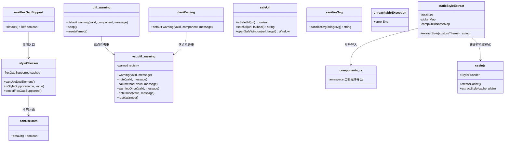
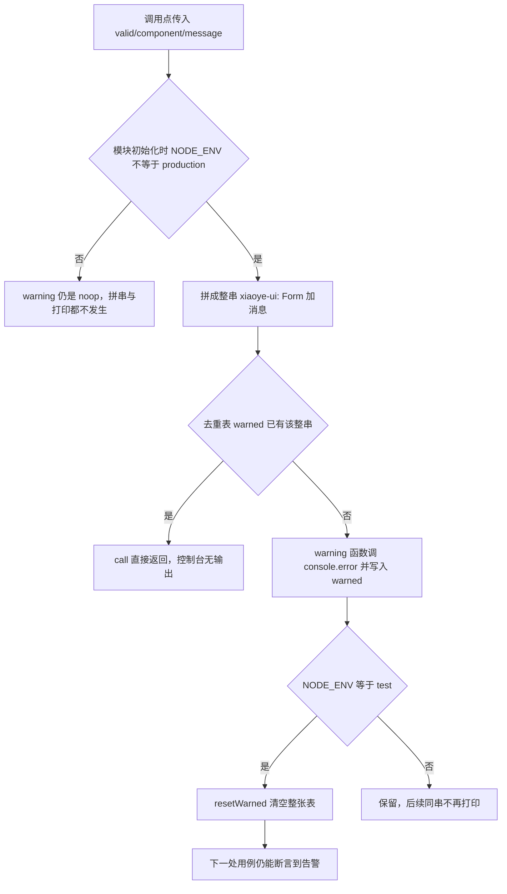
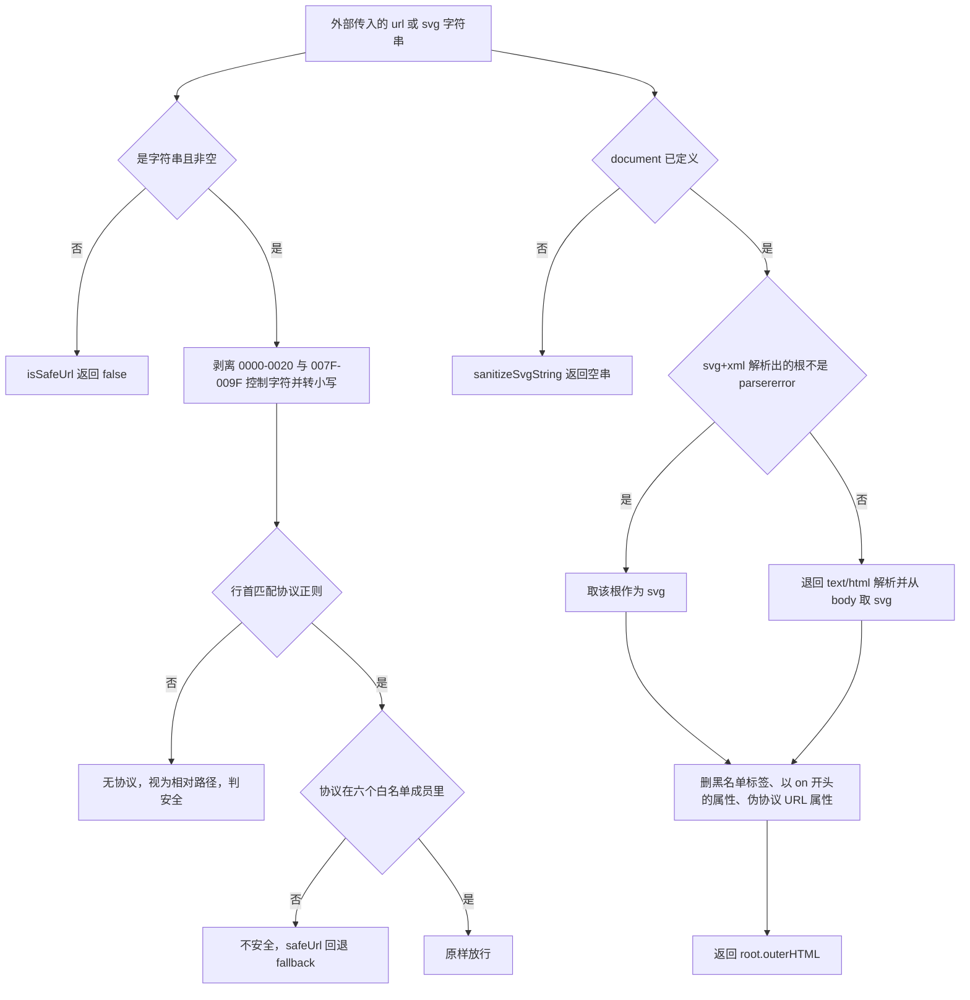
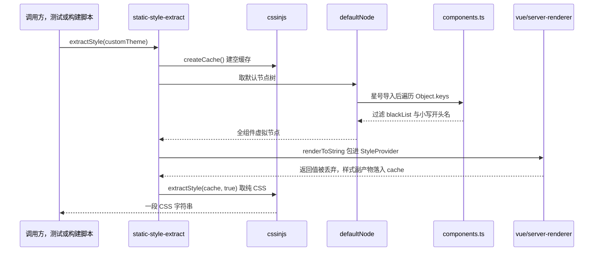

# I14 运行时约束与静态检查

> **本篇解决**：`packages/xiaoye-ui/src/_util/` 里那五个「不成体系但谁都在用」的运行时约束文件——开发期告警到底有几条通道、为什么同一条通道会打出 `undefined`、`styleChecker` 的探测结果缓存在哪里、`safeUrl` / `sanitizeSvg` 的白名单与黑名单各自漏在哪、`static-style-extract` 这个「全组件抽一遍样式」的构建期校验器现在被谁调用、以及新增一个组件时这五处会怎么绊你一下。
> **前置**：A04（cssinjs 样式引擎与 SSR 注水）　**读者坐标**：`02-infrastructure` 第 14/16 篇
> 边界：`_util/cssinjs/` 引擎本体（`Cache`、`useStyleRegister`、`extractStyle(cache)` 的注水语义、`hashId`）归 **A04**，本篇只在「抽取器如何调用引擎」这一层接口处引用它（`packages/xiaoye-ui/src/_util/cssinjs/hooks/useStyleRegister/index.tsx:457`）；`_util/env.ts` 的浏览器嗅探、`_util/canUseDom.ts` 只在作为前置判定时出现；单个组件为什么触发某条告警归各组件篇；`ThemeProvider` 与 CSS 变量的注入归 A05。

---

## 一、职责与边界

这组文件负责的是**约束**而不是功能：它们不产出任何 UI，只在运行时对「环境能力」「输入合法性」「样式可生成性」三件事做判定，并把判定结果变成三种极窄的产出——一条 `console.error`、一个布尔值、一个被改写过的字符串或空串。

它明确**不负责**：

- 不负责样式生成。`static-style-extract` 只把组件树交给引擎渲染一次（`packages/xiaoye-ui/src/_util/static-style-extract/index.tsx:83`），样式的键、哈希、注水与回收全在 cssinjs 引擎里，归 A04。
- 不负责样式 token 的取值与派生。`styleChecker` 回答的是「这个浏览器认不认识 `row-gap` 这个属性」，不认识某属性时该退化成什么布局，是各组件的事（`packages/xiaoye-ui/src/space/index.tsx:50`、`packages/xiaoye-ui/src/grid/Row.tsx:103`）。
- 不负责错误处理。`UnreachableException` 只**构造**一个 `Error` 而不抛出（`packages/xiaoye-ui/src/_util/unreachableException.ts:5`），抛与不抛由调用方决定——而实测全仓没有调用方。
- 不负责 XSS 的整体策略。`safeUrl` 与 `sanitizeSvgString` 各自只看「协议」与「标签/事件属性」这两个维度，不处理 HTML 实体编码、不处理 CSP、也不管 `style` 属性里的 `url()`。

依赖清单（本组文件向上只依赖 Vue 与 cssinjs 的导出面，向下被组件层广泛使用）：

| 依赖方向 | 目标 | 证据 |
| --- | --- | --- |
| `_util/warning` → `vc-util/warning` | 复用去重表与 `console.error` 落点 | `packages/xiaoye-ui/src/_util/warning.ts:1` |
| `vc-util/devWarning` → `vc-util/warning` | 与上一行平行的第二条同签名通道 | `packages/xiaoye-ui/src/vc-util/devWarning.ts:1` |
| `_util/styleChecker` → `_util/canUseDom` | 所有探测的环境前置 | `packages/xiaoye-ui/src/_util/styleChecker.ts:1` |
| `_util/hooks/useFlexGapSupport` → `styleChecker` | 把模块级探测包成 `Ref<boolean>` | `packages/xiaoye-ui/src/_util/hooks/useFlexGapSupport.ts:2` |
| `_util/safeUrl` → 无依赖 | 纯字符串判定 | `packages/xiaoye-ui/src/_util/safeUrl.ts:13` |
| `_util/sanitizeSvg` → `DOMParser`（浏览器 API） | 解析后遍历删节点 | `packages/xiaoye-ui/src/_util/sanitizeSvg.ts:39` |
| `static-style-extract` → `cssinjs` + `components` + `vue/server-renderer` | 构建期全量渲染 | `packages/xiaoye-ui/src/_util/static-style-extract/index.tsx:1` |

被谁依赖（按文件计，非测试文件，grep 实测）：`_util/warning` 的字面量路径 `'_util/warning'` 被 27 个文件导入（`packages/xiaoye-ui/src/form/Form.tsx:5` 是其中一例），`vc-util/devWarning` 被 32 个文件导入（`packages/xiaoye-ui/src/tree/Tree.tsx:15`），`vc-util/warning` 被 32 个文件导入（`packages/xiaoye-ui/src/vc-tree/utils/treeUtil.ts:13`）。也就是说，**同一个「开发期告警」动作在仓库里有三扇入口门**，本篇论点 1 会把这三扇门和它们的签名差异钉死。

## 二、源码地图

| 文件 | 行数 | 职责 | 关键导出 |
| --- | --- | --- | --- |
| `_util/warning.ts` | 21 | 组件层告警门面：拼前缀、dev 期生效、test 期关去重 | `default warning`（`:21`）、`resetWarned`（`:3`）、`noop`（`:4`） |
| `vc-util/warning.ts` | 42 | 唯一的 `console` 落点与去重表本体 | `warning`（`:4`）、`note`（`:11`）、`resetWarned`（`:18`）、`call`（`:22`）、`warningOnce`（`:33`）、`noteOnce`（`:37`） |
| `vc-util/devWarning.ts` | 7 | 与 `_util/warning` 同签名的第二套门面，少一段 test 期重置 | `default`（`:5`） |
| `_util/styleChecker.ts` | 62 | CSS 属性/值能力探测与 flex gap 探测，结果缓存在模块级变量 | `canUseDocElement`（`:3`）、`isStyleSupport`（`:26`）、`detectFlexGapSupported`（`:35`） |
| `_util/canUseDom.ts` | 5 | 一切 DOM 判定的环境前置 | `default canUseDom`（`:1`） |
| `_util/safeUrl.ts` | 55 | URL 协议白名单，含控制字符剥离 | `isSafeUrl`（`:25`）、`safeUrl`（`:40`）、`openSafeWindow`（`:48`） |
| `_util/sanitizeSvg.ts` | 79 | 图标字符串净化：黑名单标签、`on*` 属性、伪协议 URL | `sanitizeSvgString`（`:31`） |
| `_util/unreachableException.ts` | 7 | 穷尽性哨兵，只造 `Error` 不抛 | `default UnreachableException`（`:1`） |
| `_util/static-style-extract/index.tsx` | 93 | 构建期把全组件渲染一次并抽出 CSS | `extractStyle`（`:81`） |
| `_util/static-style-extract/interface.ts` | 3 | 抽取器的主题包装钩子类型 | `CustomRender`（`:3`） |
| `_util/safeUrl.test.ts` | 68 | 本组唯一有充分单测的文件，六组绕过用例 | — |
| `_util/unreachableException.test.js` | 8 | 只断言消息文本的内联快照 | — |
| `_util/static-style-extract/index.test.js` | 79 | 三个「含/不含某颜色」断言，第四组整体被注释 | — |

主实现入口与外部锚点：抽取器在 `packages/xiaoye-ui/src/_util/static-style-extract/index.tsx:81`，它调用的引擎侧 `extractStyle` 在 `packages/xiaoye-ui/src/_util/cssinjs/hooks/useStyleRegister/index.tsx:457`（函数本体归 A04，本篇只用到它的入参形状）；`_util/index.ts` 用 `export *` 把本组文件暴露成包内公共面（`packages/xiaoye-ui/src/_util/index.ts:8`、`packages/xiaoye-ui/src/_util/index.ts:32`、`packages/xiaoye-ui/src/_util/index.ts:41`）。

两处「不在本组文件里、却决定本组行为」的外部约束要提前标出。构建配置里没有 `define` 项，`process.env.NODE_ENV` 以字面量形式留在产物里（`packages/xiaoye-ui/vite.config.mts:20`，同一块配置里 `minify: false` 见 `packages/xiaoye-ui/vite.config.mts:54`）。测试环境的 `NODE_ENV` 由 Vitest 注入，`environment: 'jsdom'` 与用例发现范围见 `packages/xiaoye-ui/vitest.config.mts:31` 与 `packages/xiaoye-ui/vitest.config.mts:33`，这意味着本组文件里 `process.env.NODE_ENV === 'test'` 的分支只在跑单测时成立，生产与开发都走不到。

## 三、架构与数据流

### 图 1：静态结构——本组七个实现模块与它们的下游



这张图要读出三件事。第一，告警链只有一个**落点**（`console.error` 在 `packages/xiaoye-ui/src/vc-util/warning.ts:7`）和一个**去重表**（模块级对象 `warned`，`packages/xiaoye-ui/src/vc-util/warning.ts:2`），但有两个门面：`_util/warning.ts`（`packages/xiaoye-ui/src/_util/warning.ts:11`）与 `vc-util/devWarning.ts`（`packages/xiaoye-ui/src/vc-util/devWarning.ts:6`），两者模板串写法逐字相同，唯一差别是前者在 test 环境多调一次 `resetWarned()`（`packages/xiaoye-ui/src/_util/warning.ts:16`）。门面分叉却没有第三处收敛点，这是本篇多数坑的根因。

第二，能力探测的缓存位置在**被探测的模块里**（`packages/xiaoye-ui/src/_util/styleChecker.ts:34` 的 `flexGapSupported`），不在 hook 里；`useFlexGapSupport` 只负责把它搬进响应式壳（`packages/xiaoye-ui/src/_util/hooks/useFlexGapSupport.ts:7`）。因此「刷新页面重新探测」不成立，「在单测里重置探测结果」也不成立——模块没有导出任何重置入口。

第三，消毒链（`safeUrl`、`sanitizeSvg`）与告警链、探测链**互不相干**。`safeUrl` 由组件层的数据映射点接走（`packages/xiaoye-ui/src/mega-menu/MegaMenu.tsx:268` 等）；`sanitizeSvg` 的唯一组件调用方已随 2026-10-02 的组件移除删除，当前零消费（见论点 6）。`UnreachableException` 在图上是**孤立节点**：它只被 `_util/index.ts:41` 的 `export *` 引用了一次，而 `export *` 不会重导出 `default`，等于没有任何实际出口（论点 8）。

### 图 2：一次 `warning(false, 'Form', msg)` 走过的全部判定



关键的顺序陷阱在 B 与 E 的层级差：B 是**模块加载时求值一次**的分支（`packages/xiaoye-ui/src/_util/warning.ts:10`），它决定 `warning` 这个绑定指向 `noop` 还是指向真正的实现（`packages/xiaoye-ui/src/_util/warning.ts:9`）；E 才是每次调用的判定（`packages/xiaoye-ui/src/vc-util/warning.ts:27`）。也就是说生产环境下的「零开销」来自赋值交换，而不是来自调用时的 `if`——这是 Rollup/esbuild 能把 `if` 块整体删掉的前提（`packages/xiaoye-ui/vite.config.mts:20` 未配置 `define`，删不删由消费者的打包器决定，详见论点 3）。

第二个陷阱是 E 的键：去重的粒度是**拼好之后的整串**（`packages/xiaoye-ui/src/vc-util/warning.ts:29` 写入 `warned[message] = true`，而这个 `message` 是门面拼完前缀的结果）。前缀里带的 `component` 因此参与去重——同一个 `message` 从两个组件发出会打印两次，反之同一组件里两条不同消息各打印一次。这一点决定了 `component` 参数不是装饰，少传就同时破坏「可读性」和「去重语义」（论点 1 的三个误用点正是如此）。

### 图 3：两条消毒链的判定分支



左链（URL）是**白名单**结构：六个协议（`packages/xiaoye-ui/src/_util/safeUrl.ts:10`）之外的具名协议一律拒绝，`file:` 也在拒绝之列（断言在 `packages/xiaoye-ui/src/_util/safeUrl.test.ts:24`）；而**无协议**这一支被显式判为安全（`packages/xiaoye-ui/src/_util/safeUrl.ts:31`），注释给出的理由是交给浏览器按基址解析。右链（SVG）是**黑名单**结构：一张标签表（`packages/xiaoye-ui/src/_util/sanitizeSvg.ts:10`）、一条 `on` 前缀规则（`packages/xiaoye-ui/src/_util/sanitizeSvg.ts:62`）、三个 URL 属性名（`packages/xiaoye-ui/src/_util/sanitizeSvg.ts:25`）。两条链的安全模型方向相反，因此它们的失效模式也相反：URL 侧漏的是「白名单没写全的新协议」，SVG 侧漏的是「黑名单没写全的新标签或新属性」。

### 图 4：`extractStyle` 的构建期时序



图里最反常的一步是「返回值被丢弃」：`packages/xiaoye-ui/src/_util/static-style-extract/index.tsx:83` 调用 `renderToString` 但既没 `await` 也没接返回值，紧接着 `packages/xiaoye-ui/src/_util/static-style-extract/index.tsx:90` 就从 cache 里取样式。这个抽取器要的从来不是 HTML，而是**渲染这个动作的副产物**——组件 `setup` 期间调用 `useStyle` 时写进 cache 的样式条目（引擎侧接口 `packages/xiaoye-ui/src/_util/cssinjs/index.ts:25`）。`vue/server-renderer` 的 `renderToString` 返回 Promise，不 `await` 意味着：只要组件树全同步，样式就已经在 cache 里了，能取到；一旦有组件走异步 `setup` 或 `Suspense`，`:90` 就可能在样式注册之前执行，抽出的 CSS 少一段。这个风险在仓库里没有测试保护（`packages/xiaoye-ui/src/_util/static-style-extract/index.test.js:9` 的三个用例只断言颜色串的含与不含）。第二次的 `extStyle(cache, true)` 里 `true` 是 `plain` 参数，作用是只吐 CSS 文本不吐 `<style>` 标签（引擎侧签名 `packages/xiaoye-ui/src/_util/cssinjs/hooks/useStyleRegister/index.tsx:457`），细节归 A04。

## 四、核心机制精读

### 论点 1：告警有三条入口门、两种签名，而类型系统拦不住「少传一个 component」

断言：`_util/warning` 的门面签名是 `(valid, component, message?)`，`message` 可选，于是**只传两个参数在类型上合法**，运行时却把消息填进 `component` 的位置、把 `undefined` 打进控制台；仓库里实测有 3 处这样的调用点。

```ts
// packages/xiaoye-ui/src/_util/warning.ts:6
type Warning = (valid: boolean, component: string, message?: string) => void;

// eslint-disable-next-line import/no-mutable-exports
let warning: Warning = noop;
if (process.env.NODE_ENV !== 'production') {
  warning = (valid, component, message) => {
    vcWarning(valid, `[xiaoye-ui: ${component}] ${message}`);
```

`message?: string`（`packages/xiaoye-ui/src/_util/warning.ts:6`）是这套约定的软肋：`vcWarning` 是 `vc-util/warning` 的**默认导出**，也就是 `warningOnce`（`packages/xiaoye-ui/src/vc-util/warning.ts:33`），它只接两个参数，所以门面唯一的实质动作就是这条模板串拼装（`packages/xiaoye-ui/src/_util/warning.ts:12`）。三处误用都精确命中这个形状：

```ts
// packages/xiaoye-ui/src/_util/vnode.ts:26
  warning(typeof node.props.class !== 'object', 'class must be string');
```

同样的两参数写法出现在 `packages/xiaoye-ui/src/vc-slider/src/common/createSlider.tsx:67`（第二个参数是整句 `Slider[max] - Slider[min] ...` 模板串）和 `packages/xiaoye-ui/src/_util/cssinjs/theme/Theme.ts:22`（第二个参数是 `[Xiaoye UI CSS-in-JS] Theme should have at least one derivative function.`，而该文件 `packages/xiaoye-ui/src/_util/cssinjs/theme/Theme.ts:1` 导入的确实是 `_util/warning` 的默认导出）。这三处的实际输出形如 `Warning: [xiaoye-ui: class must be string] undefined`——组件位被消息占据、消息位是字符串 `undefined`。

对照另一侧的正确用法。`vc-*` 层统一从 `vc-util/warning` 取具名 `warning` 或默认 `warningOnce`，全部是两参数形状（按「导入的就是 warning 这个绑定」口径实测 27 个文件、64 个调用点，无一例外，例如 `packages/xiaoye-ui/src/vc-select/utils/warningPropsUtil.ts:33` 与 `packages/xiaoye-ui/src/vc-tree/utils/treeUtil.ts:77`）；组件层用三参数，例如 `packages/xiaoye-ui/src/icon/index.tsx:5` 的 `warning(false, 'Icon', 'Empty Icon')` 与 `packages/xiaoye-ui/src/form/Form.tsx:191`。第三扇门 `vc-util/devWarning.ts` 又是三参数门面（`packages/xiaoye-ui/src/vc-util/devWarning.ts:6`），签名里 `message: string` **不带问号**，所以走这扇门反而不可能出现 `undefined` 尾巴（`packages/xiaoye-ui/src/tree/Tree.tsx:192` 是本仓的一个调用示例）。

结论：三条门里只有一条（`_util/warning`）允许漏参，漏了还静默。这不是「写法不统一」的洁癖问题，而是同一份去重表被三种串格式共用（论点 2），任何一处拼装变了，去重语义就跟着变。

### 论点 2：去重发生在拼装之后，键是完整消息串；测试环境里这层去重被显式关掉

断言：`warned` 表的写入点在 `call` 里，用的是**门面拼完前缀之后的整串**；而 `_util/warning` 在 `NODE_ENV === 'test'` 时每次调用后清空整张表，等价于在单测里把去重关掉——这正是若干组件测试必须先 `resetWarned()` 再断言 `console.error` 的原因。

```ts
// packages/xiaoye-ui/src/vc-util/warning.ts:18
export function resetWarned() {
  warned = {};
}

export function call(
  method: (valid: boolean, message: string) => void,
  valid: boolean,
  message: string,
) {
  if (!valid && !warned[message]) {
    method(false, message);
    warned[message] = true;
  }
}
```

`warned` 是模块级对象（`packages/xiaoye-ui/src/vc-util/warning.ts:2`），`resetWarned` 把它整体赋成 `{}`（`:19`）而不是逐键删除，所以它是**全清**语义：没有「只清某一条」的 API。去重判定 `!warned[message]`（`packages/xiaoye-ui/src/vc-util/warning.ts:27`）在 `valid` 为假时才生效，写完立刻置真（`packages/xiaoye-ui/src/vc-util/warning.ts:29`）。

```ts
// packages/xiaoye-ui/src/_util/warning.ts:14
    // StrictMode will inject console which will not throw warning in React 17.
    if (process.env.NODE_ENV === 'test') {
      resetWarned();
    }
```

这段带着一条 React 17 时代的注释残留（`packages/xiaoye-ui/src/_util/warning.ts:14`），本库的行为是：test 环境下每发出一条告警就把表清空，于是**同一文件的第二个用例仍能收到同一条告警**。`packages/xiaoye-ui/src/checkbox/checkbox.test.js:28` 在断言前显式调了一次 `resetWarned()`（导入自 `packages/xiaoye-ui/src/checkbox/checkbox.test.js:4`），随后 `packages/xiaoye-ui/src/checkbox/checkbox.test.js:36` 用 `expect(errorSpy).toHaveBeenCalledWith('Warning: [xiaoye-ui: Checkbox] ...')` 钉住整串格式——这个断言字面量就是门面模板串的影子，改了 `packages/xiaoye-ui/src/_util/warning.ts:12` 的前缀格式，这类用例同步红。同类模式还在 `packages/xiaoye-ui/src/descriptions/index.test.js:62`、`packages/xiaoye-ui/src/button/index.test.js:240`、`packages/xiaoye-ui/src/switch/index.test.js:32`。

值得注意的反差：`vc-util/devWarning.ts` 那扇门**没有**这段 test 分支（整个文件 7 行，`packages/xiaoye-ui/src/vc-util/devWarning.ts:5` 到 `:6` 只有拼装），也就是说用 `devWarning` 的组件在单测里是受去重保护的——同一批测试文件里两种行为并存，`packages/xiaoye-ui/src/tree/Tree.tsx:15` 与 `packages/xiaoye-ui/src/tree/Tree.tsx:16` 就在同一个文件中同时导入了这两扇门。

### 论点 3：生产环境的「零开销告警」靠模块初始化时的赋值交换，代价是把消除责任交给消费者

断言：`_util/warning` 把 dev 判定放在**模块顶层的 `if`** 里，而不是放在每次调用的 `if` 里；配合 `vc-util/warning` 内部的第二道运行时判定，形成「双层门」，但外层这道门能否被打包器删掉，取决于消费者是否替换 `process.env.NODE_ENV`——本库构建产物不做这个替换。

```ts
// packages/xiaoye-ui/src/_util/warning.ts:9
let warning: Warning = noop;
if (process.env.NODE_ENV !== 'production') {
  warning = (valid, component, message) => {
    vcWarning(valid, `[xiaoye-ui: ${component}] ${message}`);
```

外层是**变量赋值**（`packages/xiaoye-ui/src/_util/warning.ts:9` 先把 `warning` 指向 `noop`，`:10` 起才可能改指实现），文件顶部还专门挂了一条 `eslint-disable-next-line import/no-mutable-exports`（`packages/xiaoye-ui/src/_util/warning.ts:8`）来容忍这个可变导出。内层 `warning`/`note` 各自再判一次 `process.env.NODE_ENV !== 'production'`（`packages/xiaoye-ui/src/vc-util/warning.ts:6`、`packages/xiaoye-ui/src/vc-util/warning.ts:13`），并且都判了 `console !== undefined`——后者是为无 `console` 的宿主（某些 worker、旧环境）兜底。

产物侧的实测结论是：库构建没有把 `process.env.NODE_ENV` 常量折叠掉。`packages/xiaoye-ui/vite.config.mts:20` 起的整个 `defineConfig` 对象里没有 `define` 字段（可用 `grep -nE "^\s+define:" packages/xiaoye-ui/vite.config.mts` 自查（该命令无输出）），同时 `packages/xiaoye-ui/vite.config.mts:54` 显式 `minify: false`、`packages/xiaoye-ui/vite.config.mts:46` 用 `preserveModules` 保持模块一比一映射，因此每个产物模块都原样保留 `if (process.env.NODE_ENV !== 'production')`。这类判定出现在主库 `src` 的 54 个文件里（剔除测试文件后是 53 个）。后果分两种：消费者的打包器（Vite、webpack、Rollup 默认在 production 模式下会替换或至少允许 `DefinePlugin`）会把它变成 `if (false)` 并删块；纯 Node ESM 直接跑产物的场景里 `process` 是全局可用的，判定成立与否取决于 `process.env.NODE_ENV` 是否真被设成 `production`；而**没有 `process` shim 的浏览器直连 ESM**（例如未打包的 import map）会在模块求值时就抛 `process is not defined`，因为这条 `if` 在顶层（`packages/xiaoye-ui/src/_util/warning.ts:10`）。这是本论点最需要接手人记住的一条：告警门面的成本是零，但它的**存在本身**是一个环境假设。

### 论点 4：能力探测的结果缓存在被探测模块里，判定方式是「写进去再读回来」，SSR 与首帧一律给 false

断言：`styleChecker` 的三个函数共用一个前置（`canUseDom()`），值支持判定靠「写一个值看它是否被接受」，flex gap 判定必须把节点挂进 `document.body` 量 `scrollHeight`；探测结果缓存在模块级变量且无重置入口，`useFlexGapSupport` 把它接进响应式时首帧恒为 `false`。

```ts
// packages/xiaoye-ui/src/_util/styleChecker.ts:15
const isStyleValueSupport = (styleName: string, value: any) => {
  if (!isStyleNameSupport(styleName)) {
    return false;
  }

  const ele = document.createElement('div');
  const origin = ele.style[styleName];
  ele.style[styleName] = value;
  return ele.style[styleName] !== origin;
};
```

判定链是两级：`isStyleSupport` 只有在「不是数组且传了 `styleValue`」时才走值判定（`packages/xiaoye-ui/src/_util/styleChecker.ts:27`），否则退化成名字判定（`packages/xiaoye-ui/src/_util/styleChecker.ts:31`）。名字判定的实现是 `styleNameList.some(name => name in documentElement.style)`（`packages/xiaoye-ui/src/_util/styleChecker.ts:10`），支持传数组求「任一命中」（`packages/xiaoye-ui/src/_util/styleChecker.ts:7`）。值判定用「写入后读回比较」（`packages/xiaoye-ui/src/_util/styleChecker.ts:23`），这意味着**浏览器认识该属性但拒绝该值**才算不支持——`isStyleSupport('position', 'sticky')` 就是这个用法（`packages/xiaoye-ui/src/vc-table/context/StickyContext.tsx:7`）。两处环境前置都建立在同一个 `canUseDom` 上（`packages/xiaoye-ui/src/_util/styleChecker.ts:6` 与经由 `packages/xiaoye-ui/src/_util/styleChecker.ts:3` 的 `canUseDocElement`，本体在 `packages/xiaoye-ui/src/_util/canUseDom.ts:1`），非浏览器一律返回 `false`（`packages/xiaoye-ui/src/_util/styleChecker.ts:12`），SSR 下所有能力都是「不支持」。

```ts
// packages/xiaoye-ui/src/_util/styleChecker.ts:34
let flexGapSupported: boolean | undefined;
export const detectFlexGapSupported = () => {
  if (!canUseDocElement()) {
    return false;
  }

  if (flexGapSupported !== undefined) {
    return flexGapSupported;
  }
```

三态设计（`boolean | undefined`）是这段的关键：`undefined` 表示「没测过」，`false` 表示「测过且不支持」（`packages/xiaoye-ui/src/_util/styleChecker.ts:40` 用 `!== undefined` 区分这两态），所以 `false` 也会被长期缓存。`canUseDocElement` 的判定比 `canUseDom` 更严（`packages/xiaoye-ui/src/_util/styleChecker.ts:3`），因为它要求 `document.documentElement` 真值存在。真正的探测要建 flex 容器、塞两个子节点、挂到 `document.body`、量 `scrollHeight === 1`、再摘掉（`packages/xiaoye-ui/src/_util/styleChecker.ts:45` 到 `packages/xiaoye-ui/src/_util/styleChecker.ts:57`）——这是一次**依赖布局**的测量，jsdom 里 `scrollHeight` 恒为 0，因此单测里它必然给出 `false`，与真实老浏览器结果一致但和「jsdom 模拟新浏览器」的期待相反。

缓存放在模块里而不是 hook 里，导致 `useFlexGapSupport` 只能在挂载后回写（`packages/xiaoye-ui/src/_util/hooks/useFlexGapSupport.ts:6`），初值是 `shallowRef(false)`（`packages/xiaoye-ui/src/_util/hooks/useFlexGapSupport.ts:5`），于是 `packages/xiaoye-ui/src/space/index.tsx:50` 与 `packages/xiaoye-ui/src/grid/Row.tsx:103` 在首帧拿到的都是「不支持」。这一点与 I13 论点 7 的结论同构：探测类 hook 的缓存不在 hook 里，首帧一律给「不支持/未知」。至于模块顶层求值（`packages/xiaoye-ui/src/typography/Base.tsx:36`、`packages/xiaoye-ui/src/typography/Base.tsx:37`）与顶层副作用（`packages/xiaoye-ui/src/modal/Modal.tsx:37`），本篇 §五 会说明它们如何在环境边界上分叉。

### 论点 5：`safeUrl` 是「先剥控制字符再取协议」的白名单，无协议一律放行，且当前只接了一个组件

断言：`extractProtocol` 在匹配正则前先把 `\u0000-\u0020` 与 `\u007F-\u009F` 整段删掉并转小写，这一笔同时防御了前导空白、换行插字与大小写混淆三种绕过；判定结果只有「具名协议且命中白名单」与「无协议」两支为真。

```ts
// packages/xiaoye-ui/src/_util/safeUrl.ts:10
const SAFE_PROTOCOLS = new Set(['http:', 'https:', 'mailto:', 'tel:', 'sms:', 'ftp:']);

/** 协议提取：先剔除空白与控制字符，防范 `java\nscript:` / ` javascript:` 一类绕过 */
const PROTOCOL_RE = /^([a-z][a-z0-9+\-.]*):/;

function extractProtocol(url: string): string {
  const cleaned = url.replace(/[\u0000-\u0020\u007F-\u009F]/g, '').toLowerCase();
  const matched = PROTOCOL_RE.exec(cleaned);
  return matched ? `${matched[1]}:` : '';
}
```

三个设计决定值得逐条钉住。第一，`Set` 而不是数组，成员是**带冒号**的完整协议串（`packages/xiaoye-ui/src/_util/safeUrl.ts:10`），因此 `'https'` 这类漏冒号的写法永远不会命中。第二，正则 `^([a-z][a-z0-9+\-.]*):`（`packages/xiaoye-ui/src/_util/safeUrl.ts:13`）锚定行首，剥完控制字符之后才匹配，所以 `' javascript:alert(1)'`、`'java\tscript:alert(1)'`、`'\u0000javascript:alert(1)'` 都会被还原成 `javascript:` 而被拒（测试就在 `packages/xiaoye-ui/src/_util/safeUrl.test.ts:28`、`packages/xiaoye-ui/src/_util/safeUrl.test.ts:30`、`packages/xiaoye-ui/src/_util/safeUrl.test.ts:31`）。第三，**取不到协议就是安全**（`packages/xiaoye-ui/src/_util/safeUrl.ts:31`），这一支覆盖了 `/foo`、`#anchor` 与协议相对的 `//cdn.example.com/a.png`（断言在 `packages/xiaoye-ui/src/_util/safeUrl.test.ts:14` 到 `packages/xiaoye-ui/src/_util/safeUrl.test.ts:16`）。第三点是有意的信任选择：`//host/path` 最终由浏览器按当前页协议解析，不会执行脚本，但它**可以指向任意主机的任意资源**，若调用方把它塞进 `src` 并期待同源，这个校验不会提醒你。

边界形状也值得记：空串、`null`、`undefined`、非字符串都判不安全（`packages/xiaoye-ui/src/_util/safeUrl.ts:26`，测试在 `packages/xiaoye-ui/src/_util/safeUrl.test.ts:35` 与 `packages/xiaoye-ui/src/_util/safeUrl.test.ts:37`），`safeUrl` 因此对空 URL 返回 `fallback`（`packages/xiaoye-ui/src/_util/safeUrl.ts:41`）。`openSafeWindow` 在判定通过后仍把 `noopener,noreferrer` 硬编码进第三个参数（`packages/xiaoye-ui/src/_util/safeUrl.ts:52`），对应测试断言的是完整参数列表（`packages/xiaoye-ui/src/_util/safeUrl.test.ts:61` 到 `packages/xiaoye-ui/src/_util/safeUrl.test.ts:64`）。

覆盖面是本篇要如实记录的最大缺口。全仓（排除 `dist`）里 `isSafeUrl`、`safeUrl`、`openSafeWindow` 三个导出的生产调用点只有 `packages/xiaoye-ui/src/mega-menu/MegaMenu.tsx:8` 这一处导入，用在两处 `href` 上（`packages/xiaoye-ui/src/mega-menu/MegaMenu.tsx:268`、`packages/xiaoye-ui/src/mega-menu/MegaMenu.tsx:325`）；`openSafeWindow` 没有任何组件调用，只被测试引用（`packages/xiaoye-ui/src/_util/safeUrl.test.ts:53`）。`packages/xiaoye-ui/src/typography/Link.tsx:21` 走的是另一条老路——它只按 `target === '_blank'` 自动补 `rel="noopener noreferrer"`，不校验 `href` 协议。也就是说「URL 消毒统一收敛到此处」这句写在文件头注释里的目标（`packages/xiaoye-ui/src/_util/safeUrl.ts:6`）目前只落地到一个组件。

### 论点 6：`sanitizeSvgString` 用黑名单删节点，且「非浏览器就返回空串」，服务端与客户端结果必然不同

断言：净化流程是「解析 → 校验根是 svg → 遍历快照数组删黑名单标签 → 删 `on` 前缀属性 → 删伪协议 URL 属性 → 回吐 `outerHTML`」，其中解析分支与环境分支共同决定输出，而环境分支在服务端直接返回空串。

```ts
// packages/xiaoye-ui/src/_util/sanitizeSvg.ts:10
const FORBIDDEN_TAGS = new Set([
  'script',
  'style',
  'iframe',
  'object',
  'embed',
  'link',
  'meta',
  'foreignobject',
  'animate',
  'set',
  'handler',
]);
```

黑名单的内容能读出维护者的威胁模型：除了 `script`、`iframe`、`object`、`embed` 这些经典载体，还写了 `foreignobject`（可以嵌 HTML 与脚本，`packages/xiaoye-ui/src/_util/sanitizeSvg.ts:18`）以及 `animate`、`set`（SMIL 动画可指向外部资源并驱动属性变化，`packages/xiaoye-ui/src/_util/sanitizeSvg.ts:19` 与 `packages/xiaoye-ui/src/_util/sanitizeSvg.ts:20`）。`style` 也被禁（`:12`），代价是合法的 `<style>` 图标内样式一并消失——这与「宁可少渲染也不执行」的取向一致。

```ts
// packages/xiaoye-ui/src/_util/sanitizeSvg.ts:31
export function sanitizeSvgString(svg?: string | null): string {
  if (typeof document === 'undefined' || typeof svg !== 'string' || svg.trim() === '') {
    return '';
  }
```

环境判定用的是 `typeof document === 'undefined'`（`packages/xiaoye-ui/src/_util/sanitizeSvg.ts:32`），而不是本组其它文件统一用的 `canUseDom()`（`packages/xiaoye-ui/src/_util/canUseDom.ts:1`）——这是本组里唯一绕开公共前置的环境判定，行为上更宽松（只判 `document` 不判 `window.document.createElement`）。解析走两段回落：先按 `image/svg+xml` 解析并检查根节点名不是 `parsererror`（`packages/xiaoye-ui/src/_util/sanitizeSvg.ts:39` 与 `packages/xiaoye-ui/src/_util/sanitizeSvg.ts:40`），失败才退回 `text/html` 再从 `body` 里取第一个 `svg`（`packages/xiaoye-ui/src/_util/sanitizeSvg.ts:43`、`packages/xiaoye-ui/src/_util/sanitizeSvg.ts:44`）；两条路都拿不到 svg 根就返回空串（`packages/xiaoye-ui/src/_util/sanitizeSvg.ts:47`）。遍历用的是 `[root, ...root.querySelectorAll('*')]` 的快照数组（`packages/xiaoye-ui/src/_util/sanitizeSvg.ts:51`），命中黑名单就 `node.remove()` 并 `continue`（`packages/xiaoye-ui/src/_util/sanitizeSvg.ts:55`）——注意 `continue` 意味着**被删掉的节点不会再被清属性**，它的子树也因此脱离文档，风险由「脱离文档」而不是「属性清理」承担。属性侧两条规则：`name.startsWith('on')` 一律删（`packages/xiaoye-ui/src/_util/sanitizeSvg.ts:62`），`href`/`xlink:href`/`src` 三个属性名在剥掉控制字符并小写后以 `javascript:` 或 `data:` 开头才删（`packages/xiaoye-ui/src/_util/sanitizeSvg.ts:67` 到 `packages/xiaoye-ui/src/_util/sanitizeSvg.ts:71`）。最后返回 `root.outerHTML`（`packages/xiaoye-ui/src/_util/sanitizeSvg.ts:76`）。

消费点已经清零：修前唯一的组件调用方是一个富文本编辑器的建议菜单，它在 `icon` 是字符串时渲染 `h('span', { innerHTML: sanitizeSvgString(icon) })`，该组件已随 2026-10-02 的组件移除删除，`sanitizeSvgString` 现在没有任何生产消费者。但机制断言不依赖这个调用方成立：把 `:32` 的服务端空串分支和「调用方把返回值直接塞进 `innerHTML`」这个预期用法放在一起看，结论是明确的——同一棵树在 SSR 里得到空字符串、在客户端 hydrate 时得到净化后的 svg 标记。这是消毒链的固有代价——不安全的输入不能渲染，但 SSR 场景下连安全输入也拿不到标记；将来任何组件接这条链，都会原样继承这个行为。本文件没有任何测试（本组七个实现文件里带测试的是 `safeUrl.test.ts`、`unreachableException.test.js` 与 `static-style-extract/index.test.js` 三份，没有 `sanitizeSvg.test`），`FORBIDDEN_TAGS` 与 `URL_ATTRS` 两张表也没有用例保护（`packages/xiaoye-ui/src/_util/safeUrl.test.ts:5` 覆盖的是 URL 侧）。

### 论点 7：`static-style-extract` 是一张「哪些组件能独立渲染」的硬编码知识表，且当前没有生产调用者

断言：抽取器的全部复杂度都不在样式上，而在三张表和一个过滤器里；它把「组件能否被零 props 渲染」这一事实写死在源码里，新增组件时必须同步维护，而它的调用者只有自己的测试。

```ts
// packages/xiaoye-ui/src/_util/static-style-extract/index.tsx:5
const blackList: string[] = [
  'ConfigProvider',
  'Grid',
  'Tour',
  'SelectOptGroup',
  'SelectOption',
  'MentionsOption',
  'TreeNode',
  'TreeSelectNode',
  'LocaleProvider',
  // SortableItem 必须在 DragDropProvider 内才能渲染（依赖 inject context）
  // 其样式由 SortableList 的 useStyle 统一注册，无需单独提取
  'SortableItem',
];
```

入口是 `import * as xiaoyeUI from '../../components'`（`packages/xiaoye-ui/src/_util/static-style-extract/index.tsx:2`），星号导入的对象里既有组件也有 `xxxProps`、工具函数等小写开头的名字，所以过滤条件是两条并列：不在黑名单、且首字母大写（`packages/xiaoye-ui/src/_util/static-style-extract/index.tsx:43`）。首字母大写这一条把 props 工厂与非组件导出挡在渲染之外，这与生成物 `src/components.ts` 的导出形状耦合（生成链路归 A02）。剩下的五类分支全是为了让组件「能渲染」而补的最小 props：`Dropdown` 需要 `menu={{ items: [] }}`（`packages/xiaoye-ui/src/_util/static-style-extract/index.tsx:46` 起）、`Anchor` 需要 `items={[]}`（`packages/xiaoye-ui/src/_util/static-style-extract/index.tsx:53`）、三个 picker 家族成员被改写成 `DatePicker` 加 `picker` 类型（映射表 `packages/xiaoye-ui/src/_util/static-style-extract/index.tsx:20`，分支在 `packages/xiaoye-ui/src/_util/static-style-extract/index.tsx:56`）、子组件被塞回父组件（映射表 `packages/xiaoye-ui/src/_util/static-style-extract/index.tsx:26`，分支在 `packages/xiaoye-ui/src/_util/static-style-extract/index.tsx:61`）、`QRCode` 与 `Segmented` 需要 `value={''}`（`packages/xiaoye-ui/src/_util/static-style-extract/index.tsx:69`），其余走无 props 直渲染（`packages/xiaoye-ui/src/_util/static-style-extract/index.tsx:76`）。

黑名单的注释把维护理由写得很直白（`packages/xiaoye-ui/src/_util/static-style-extract/index.tsx:15`）：`SortableItem` 依赖 inject 的 context，脱离 `DragDropProvider` 就渲染不了。同一理由适用于 `TreeNode`、`TreeSelectNode`、`SelectOption` 等（`packages/xiaoye-ui/src/_util/static-style-extract/index.tsx:12`）。这意味着**抽取器是一个渲染前置条件的守门员**：任何新组件如果要求特定 props 或特定 provider，就会在这张表里缺一条——症状不是编译失败，而是抽出的 CSS 少一段，或者构建期/测试期直接抛错。

调用侧的实测结论值得写明：仓库内 `extractStyle`（本文件的那个）除了 `packages/xiaoye-ui/src/_util/static-style-extract/index.test.js:2` 之外没有任何引用者，`package.json` 的 `exports` 里也没有对应入口（`packages/xiaoye-ui/package.json:20` 的 `main` 直指 `src/index.ts`），而 Nuxt 模块侧留了一条明确的待办——组件级 CSS-in-JS 样式尚未在 SSR 中注入（`packages/nuxt-module/src/runtime/plugin.server.ts:37`）。因此它现在的身份是「构建期自检 + 给消费者自备的抽取能力」，而不是 SSR 链路的必经点。它的测试强度也匹配这个身份：三条用例分别断言「默认主题不含某个绿色」（`packages/xiaoye-ui/src/_util/static-style-extract/index.test.js:10`）、「自定义 token 后含」（`:26`）、「暗色算法下含派生出的另一个色值」（`:44`），全部只查字符串包含关系，不查选择器、不查节点、不查去重；第四组 `hashPriority` 用例整段被注释掉（`packages/xiaoye-ui/src/_util/static-style-extract/index.test.js:46` 到 `packages/xiaoye-ui/src/_util/static-style-extract/index.test.js:78`），三条用例都把超时显式放宽到三十秒（`packages/xiaoye-ui/src/_util/static-style-extract/index.test.js:11`）——这个时长本身就是「全组件渲染一次很慢」的直接证据。

### 论点 8：`UnreachableException` 只造不抛，而且它根本没有被聚合入口导出

断言：这个类的作用是把「穷尽性检查里不该到达的分支」变成一个带上下文的 `Error` 对象，但全仓没有任何 `new` 之外的调用点，也没有任何 `throw`；同时 `_util/index.ts` 用 `export *` 引它，而 `export *` 不会重导出 `default`，所以这个「导出」是空的。

```ts
// packages/xiaoye-ui/src/_util/unreachableException.ts:1
export default class UnreachableException {
  error: Error;

  constructor(value: any) {
    this.error = new Error(`unreachable case: ${JSON.stringify(value)}`);
  }
}
```

它的构造语义要求调用方自己 `throw new UnreachableException(v).error`（`packages/xiaoye-ui/src/_util/unreachableException.ts:5`），这种「造而不抛」的形状在 TypeScript 里有它的用途——配合 `switch` 穷尽性检查把不可达分支的类型收窄写成一条语句。但实测主库源码里没有这种配合：`unreachableException` 的引用只剩 `packages/xiaoye-ui/src/_util/index.ts:41` 的一行 `export *` 和自身测试（`packages/xiaoye-ui/src/_util/unreachableException.test.js:6` 只断言消息文本）。更需要注意的是导出的形状：`export *` 只转发具名导出，本文件唯一的导出是 `default`（`packages/xiaoye-ui/src/_util/unreachableException.ts:1`），所以从 `_util/index` 拿不到它，必须写 `import UnreachableException from './unreachableException'`（测试就是这么做的，`packages/xiaoye-ui/src/_util/unreachableException.test.js:1`）。这与 A02 提到的生成物聚合是同一类陷阱：`export *` 的静默不完整不会报错。

## 五、对外契约如何生效

本组文件没有组件实例，也就没有 props、slots、expose；它们的对外契约是**函数签名 + 调用时机 + 输出形状**三件事，而这三件事各自的失效方式不同。

告警的契约实质是一条**字符串格式**。调用点通常在 `setup` 体内而不是渲染函数里，例如 `packages/xiaoye-ui/src/auto-complete/index.tsx:63` 的三条弃用告警直接写在 `setup` 体内（`packages/xiaoye-ui/src/auto-complete/index.tsx:62` 是该 `setup` 的入口），意味着每次实例化都会重新求值判定条件；另一类是把告警放进生命周期钩子，`packages/xiaoye-ui/src/checkbox/Checkbox.tsx:58` 在 `onMounted` 里、`packages/xiaoye-ui/src/switch/index.tsx:86` 与 `packages/xiaoye-ui/src/switch/index.tsx:91` 在 `onBeforeMount` 里；真正把噪声压住的是去重表（`packages/xiaoye-ui/src/vc-util/warning.ts:27`），而不是调用点的 `if`。无论放哪一处，同一个串都只播一次，压噪声的始终是去重表而不是调用位置的选择。对下游而言，这条格式的稳定性由测试锁住：`packages/xiaoye-ui/src/checkbox/checkbox.test.js:36` 断言的是完整字符串 `Warning: [xiaoye-ui: Checkbox] ...`，其中 `Warning: ` 前缀来自 `packages/xiaoye-ui/src/vc-util/warning.ts:7`，`[xiaoye-ui: ...]` 来自 `packages/xiaoye-ui/src/_util/warning.ts:12`。改任何一段都会红一片用例，这是本组唯一被测试**反向绑定**的契约。事件与 expose 维度上它什么都不产出：`resetWarned` 是显式再导出的（`packages/xiaoye-ui/src/_util/warning.ts:3`），供测试使用；`noop` 也导出了（`packages/xiaoye-ui/src/_util/warning.ts:4`），但除门面自身初始化（`packages/xiaoye-ui/src/_util/warning.ts:9`）外全仓无人引用。

能力探测的契约是「同步返回布尔」，代价是它把求值时机推给了调用方决定，而仓库里有三种截然不同的时机。第一种是**模块顶层求值**：`packages/xiaoye-ui/src/typography/Base.tsx:36` 与 `packages/xiaoye-ui/src/typography/Base.tsx:37` 在 import 期就把结果固化成两个常量，服务端渲染时它们是 `false`，浏览器里是 `true`，同一个模块在两端给出不同值；`packages/xiaoye-ui/src/modal/Modal.tsx:37` 更进一步，用顶层 `if` 决定是否注册全局点击监听（`packages/xiaoye-ui/src/modal/Modal.tsx:16` 是它的导入）。第二种是 **context 初始化时求值**：`packages/xiaoye-ui/src/vc-table/context/StickyContext.tsx:7` 在 provide 之前把 `isStyleSupport('position', 'sticky')` 并入已有值。第三种是**挂载后求值**：`packages/xiaoye-ui/src/_util/hooks/useFlexGapSupport.ts:6` 用 `onMounted` 回写 `shallowRef`，因此 `packages/xiaoye-ui/src/space/index.tsx:50` 首帧必然读到 `false`。三种时机都合法，但只有第三种能同时保证 SSR 不崩；前两种在 SSR 下会把「不支持」烧进渲染结果。

消毒链的契约是「进出都是字符串，且失败不抛只降级」。`safeUrl` 接的是数据而非 vnode：`packages/xiaoye-ui/src/mega-menu/MegaMenu.tsx:8` 导入后，在把 `items` 数据结构映射成内部菜单项的两个位置各调一次（`packages/xiaoye-ui/src/mega-menu/MegaMenu.tsx:268`、`packages/xiaoye-ui/src/mega-menu/MegaMenu.tsx:325`），产出的 `href` 直接进入渲染属性。因为 `fallback` 默认是空串（`packages/xiaoye-ui/src/_util/safeUrl.ts:40`），不合法 URL 的表现是 `href=""`——浏览器会把它解析成当前页，点击等于自跳转，不是「链接被禁用」。要真正禁用必须自己传第二个参数或在外部先判 `isSafeUrl`（`packages/xiaoye-ui/src/_util/safeUrl.ts:25`）。`sanitizeSvgString` 的契约更像「返回可安全 innerHTML 的字符串或空串」（`packages/xiaoye-ui/src/_util/sanitizeSvg.ts:31`），预期用法是调用方不做二次判断直接塞进 `innerHTML`——修前那个唯一调用方（已随 2026-10-02 的组件移除删除）正是这么用的；它的降级是**不渲染**（空串），因此服务端与客户端的产出差异会直接体现在 DOM 上。两者都没有事件、没有 context，也不参与 `useConfigInject` 的注入链（注入链归 A05）。

抽取器的对外契约只有一个高阶钩子：`extractStyle(customTheme?: CustomRender)`（`packages/xiaoye-ui/src/_util/static-style-extract/index.tsx:81`），`CustomRender` 的定义是「拿到默认节点树、返回一棵新树」（`packages/xiaoye-ui/src/_util/static-style-extract/interface.ts:3`）。这就是它把主题系统接进来的唯一方式——调用方用 `ConfigProvider` 包住整棵默认树（实际用法见 `packages/xiaoye-ui/src/_util/static-style-extract/index.test.js:15`），算法与 token 都靠外层 provider 注入（`packages/xiaoye-ui/src/_util/static-style-extract/index.test.js:34`），抽取器本身不感知主题。返回值是纯 CSS 文本而非 vnode 或 HTML（`packages/xiaoye-ui/src/_util/static-style-extract/index.tsx:90`），所以它天然对接「塞进 `<head>`」这一步，而这一步在本库的 Nuxt 模块里还是待办（`packages/nuxt-module/src/runtime/plugin.server.ts:37`）。

## 六、设计取舍

**告警前缀放在门面而不是调用点。** 现在的方案是每个门面各自拼 `[xiaoye-ui: ${component}] ${message}`（`packages/xiaoye-ui/src/_util/warning.ts:12` 与 `packages/xiaoye-ui/src/vc-util/devWarning.ts:6` 两份一模一样的模板）。被放弃的路是让 `vc-util/warning` 直接收三个参数、把格式收敛到一处。代价已经显现：两份模板串各自演化，`_util/warning` 的 `message` 可选导致论点 1 的三处静默误用；而换到单一落点后，`component` 会由 TS 强制必填，误用不可能通过类型检查。赔上的其实是 `vc-*` 层的独立性——那 27 个文件保持两参数形状（`packages/xiaoye-ui/src/vc-tree/utils/treeUtil.ts:77` 是典型），它们不该知道 `xiaoye-ui` 这个产品前缀，这是这层分叉真实存在的理由，也是它无法被简单合并的原因。

**去重表全清而不是逐条失效。** `resetWarned` 把整张 `warned` 赋成 `{}`（`packages/xiaoye-ui/src/vc-util/warning.ts:19`）。替代方案是导出「按 key 删除」或「按组件前缀删除」。不做的收益是实现只有一行、且测试里「跑前全清」的语义最容易写（`packages/xiaoye-ui/src/descriptions/index.test.js:62`）；代价是任何一次全清都会让**其他模块**本应被压住的告警重新打印出来，多个用例共享一个 jsdom 环境时控制台会被放大，这正是 `packages/xiaoye-ui/src/_util/warning.ts:16` 那段 test 分支看起来「多余」（其实是在补偿）的背景。

**能力探测缓存放模块级、不提供重置入口。** `flexGapSupported` 是三态模块变量（`packages/xiaoye-ui/src/_util/styleChecker.ts:34`），全生命周期只测一次（`packages/xiaoye-ui/src/_util/styleChecker.ts:40`）。替代方案是放进 `App` 级 context 或导出一个 `__resetStyleCheckerCache()`。现方案换来的是零依赖与零配置：任何模块在任何时机调用都能拿到一致答案，不需要 provider。赔上是测试可控性——jsdom 里 `scrollHeight` 恒 0，所以「支持 flex gap」这条分支在单测里无法覆盖（`packages/xiaoye-ui/src/_util/styleChecker.ts:56` 的判定在测试环境永远走 false），`packages/xiaoye-ui/src/space/index.tsx:50` 的 gap 分支也就跟着失去测试保护。

**消毒用自研而不下 DOMPurify。** `sanitizeSvg.ts` 全文 79 行、零依赖，只用浏览器自带的 `DOMParser`（`packages/xiaoye-ui/src/_util/sanitizeSvg.ts:39`）。替代方案是引入成熟的净化库。不做的理由在依赖表里能找到旁证：`package.json` 的运行时依赖清单里没有任何 HTML 净化库（`packages/xiaoye-ui/package.json:46` 起），而组件库的产物是按模块拆分的 ESM（`packages/xiaoye-ui/vite.config.mts:46`），一个净化库会进每一个用到字符串图标的包。换来的是零新增依赖与可读的黑名单，赔上是**黑名单需要有人盯**——`FORBIDDEN_TAGS` 目前是 11 项（`packages/xiaoye-ui/src/_util/sanitizeSvg.ts:10`），而本文件没有任何测试，也没有任何文档说明新增项的流程。

**SSR 样式抽取保持「构建期自检」身份，不进 SSR 必经链。** 现状是抽取器只在测试里跑（`packages/xiaoye-ui/src/_util/static-style-extract/index.test.js:9`），Nuxt 模块只注入全局 CSS 变量、组件级样式注入留待办（`packages/nuxt-module/src/runtime/plugin.server.ts:37`）。替代方案是在服务端渲染入口强制走一次 `extractStyle`。现方案换来的是消费者的自由度（可以自己决定何时抽、抽哪些主题），赔上的是「首屏缺样式」由使用者负责——而 `renderToString` 不被 `await` 的实现细节（`packages/xiaoye-ui/src/_util/static-style-extract/index.tsx:83`）也说明它从一开始就不是为在线渲染路径写的。

## 七、坑与改动指南

**坑 1：给 `_util/warning` 少传一个参数，告警变成 `[xiaoye-ui: 消息] undefined`。** 触发条件是从 `vc-util/warning` 的习惯写法（两参数）直接迁到 `_util/warning`（三参数），或反过来。症状是控制台读起来像「组件名很长、消息是 undefined」，且因为去重键包含整串，同一条误用只播一次，很容易被忽略。定位位置：签名在 `packages/xiaoye-ui/src/_util/warning.ts:6`，拼装在该文件 `:12`；仓内现存的三处实例是 `packages/xiaoye-ui/src/_util/vnode.ts:26`、`packages/xiaoye-ui/src/vc-slider/src/common/createSlider.tsx:67`、`packages/xiaoye-ui/src/_util/cssinjs/theme/Theme.ts:22`，改这三处不需要跑测试就能验证（把第二个参数挪到第三个位置）。

**坑 2：在没有 `process` 全局的环境直接加载产物，模块求值即失败。** 触发条件是把库的 ESM 产物交给浏览器原生模块系统或 import map，且中间没有把 `process.env.NODE_ENV` 替换成字符串常量的步骤。症状不是「告警没关掉」而是**导入阶段就抛 `process is not defined`**，因为判定写在模块顶层（`packages/xiaoye-ui/src/_util/warning.ts:10`）。定位位置：本库构建不替换该字面量，`grep -n "define" packages/xiaoye-ui/vite.config.mts` 无输出即证；构建配置里 `minify: false` 与 `preserveModules` 见 `packages/xiaoye-ui/vite.config.mts:54` 与 `packages/xiaoye-ui/vite.config.mts:46`。同类顶层判定在 `_util` 与 `vc-util` 里还有多处（`packages/xiaoye-ui/src/vc-util/warning.ts:6`、`packages/xiaoye-ui/src/vc-util/warning.ts:13`）。

**坑 3：新增组件依赖 inject 或必填 props，抽取器静默少抽一段样式或直接抛错。** 触发条件是新组件的 `useStyle` 只在子组件里注册，或组件 `setup` 里直接读注入值。症状分两种：CI 上 `packages/xiaoye-ui/src/_util/static-style-extract/index.test.js:9` 变红（抛错型），或者更坏的——测试仍全绿但抽出的 CSS 里少了新组件那一段（`packages/xiaoye-ui/src/_util/static-style-extract/index.tsx:43` 的过滤器把它跳过了）。定位位置：三张表在 `packages/xiaoye-ui/src/_util/static-style-extract/index.tsx:5`（黑名单）、`:20`（picker 家族）、`:26`（父子映射），特例 props 分支在 `:46`、`:53`、`:69`。

**坑 4：在单测里断言告警却没先 `resetWarned()`，第二个用例收不到输出。** 触发条件是同一个组件文件里写两条依赖同一条告警串的用例。症状是第二条用例的 `errorSpy` 断言拿到零次调用（`packages/xiaoye-ui/src/_util/warning.ts:16` 的 test 分支只在**已经发出一条告警之后**才清空，第一次被去重挡掉时不会走到那里）。定位位置：去重判定 `packages/xiaoye-ui/src/vc-util/warning.ts:27`、写法参考 `packages/xiaoye-ui/src/checkbox/checkbox.test.js:28` 与 `packages/xiaoye-ui/src/switch/index.test.js:32`。

**坑 5：把 `safeUrl` 的返回值当「合法 URL」用，或者以为不合法时链接被禁用。** 触发条件是用 `safeUrl(item.url)` 的结果再做业务判断。症状是 `href=""` 的链接点击后自跳转（空串被浏览器解析为当前文档 URL），而不是不可点击。定位位置：默认 fallback 在 `packages/xiaoye-ui/src/_util/safeUrl.ts:40`，空串判不安全在 `:27`；正确做法是判 `isSafeUrl`（`packages/xiaoye-ui/src/_util/safeUrl.ts:25`）再决定渲染与否，或显式传 fallback。另需知道协议相对 `//host` 会直接放行（`packages/xiaoye-ui/src/_util/safeUrl.ts:31`）。

**坑 6：字符串 SVG 图标在 SSR 首屏不出现，客户端才出现。** 触发条件是 `icon` 传 SVG 字符串并走 `innerHTML`。症状是服务端 HTML 里那一段是空 `<span>`，hydrate 后才有图形，两侧 DOM 不一致。定位位置：环境分支 `packages/xiaoye-ui/src/_util/sanitizeSvg.ts:32`。修前唯一把净化结果交给 `innerHTML` 的组件消费点已随 2026-10-02 的组件移除删除，当前 `sanitizeSvgString` 零消费——这条坑暂时没有活体症状，但下一个接入方会原样踩到。同一段净化代码没有任何测试保护，改动 `FORBIDDEN_TAGS`（`packages/xiaoye-ui/src/_util/sanitizeSvg.ts:10`）或属性规则（`:62`）时不会有用例失败。

**坑 7：flex gap 探测在 jsdom 里永远是 false，「支持」分支没有测试。** 触发条件是给 `Space` 或 `Grid.Row` 的 gap 分支写单测。症状是断言永远拿到不支持的那一侧布局，测试通过却不证明真实浏览器行为。定位位置：测量依赖真实布局的 `scrollHeight` 判定在 `packages/xiaoye-ui/src/_util/styleChecker.ts:56`，缓存三态在 `:34` 与 `:40`，首帧 `false` 由 `packages/xiaoye-ui/src/_util/hooks/useFlexGapSupport.ts:5` 决定，下游在 `packages/xiaoye-ui/src/space/index.tsx:50` 与 `packages/xiaoye-ui/src/grid/Row.tsx:103`。

**坑 8：模块顶层求值探测结果，把「不支持」烧进 SSR 渲染结果。** 触发条件是把 `isStyleSupport(...)` 写在模块作用域当常量。症状是服务端与客户端对同一能力给出不同布尔，进而导致 class 或样式差异、以及水合内容不一致。定位位置：现成的两个样例 `packages/xiaoye-ui/src/typography/Base.tsx:36`、`packages/xiaoye-ui/src/modal/Modal.tsx:37`；安全写法是 `packages/xiaoye-ui/src/_util/hooks/useFlexGapSupport.ts:6` 的挂载后回写。

### 测试现状

本组实现文件里只有三处带测试（`safeUrl`、`unreachableException`、`static-style-extract`），且都不测核心行为。`packages/xiaoye-ui/src/_util/safeUrl.test.ts` 是 68 行、覆盖三个导出的正面与绕过面（`packages/xiaoye-ui/src/_util/safeUrl.test.ts:20` 是伪协议组，`:28` 到 `:31` 是控制字符组，`:48` 是 fallback 组，`:54` 到 `:64` 是 `window.open` 参数组）——它是本组唯一能称为「安全测试」的资产。`packages/xiaoye-ui/src/_util/unreachableException.test.js:6` 只锁一条消息文本。`packages/xiaoye-ui/src/_util/static-style-extract/index.test.js` 的三条用例只查颜色串（`:10`、`:26`、`:44`），第四组 `hashPriority` 整体注释掉（`:46` 到 `:78`）。**无测试保护的部分要点名**：`sanitizeSvg.ts` 零测试；`styleChecker.ts` 零测试，且 `detectFlexGapSupported` 的 true 分支在测试环境不可达；`_util/warning.ts` 与 `vc-util/devWarning.ts` 没有直接测试，只被组件用例间接断言字符串格式（`packages/xiaoye-ui/src/button/index.test.js:240`、`packages/xiaoye-ui/src/descriptions/index.test.js:62`）；`vc-util/warning.ts` 的 `noteOnce` 路径（`packages/xiaoye-ui/src/vc-util/warning.ts:37`）在仓库里没有对应测试，使用它的两处是 `packages/xiaoye-ui/src/vc-select/utils/warningPropsUtil.ts:54` 与 `packages/xiaoye-ui/src/vc-picker/generate/dayjs.ts:107`。

### 安全边界与验证命令

改动本组的安全边界是「签名与输出形状可以改，落点与判定时机不要改」。具体来说：给 `_util/warning` 增加必填参数会波及 29 个非测试文件的 36 个调用点（以 `_util/warning` 默认导出为目标的实测口径）；动 `packages/xiaoye-ui/src/_util/warning.ts:12` 或 `packages/xiaoye-ui/src/vc-util/warning.ts:7` 的字符串格式，会连带红掉上面点名的四个测试文件；把探测从「挂载后」挪到「模块顶层」等于给 SSR 引入分叉（论点 4）；给抽取器加新分支前，先确认新组件在 `packages/xiaoye-ui/src/_util/static-style-extract/index.tsx:5` 的黑名单里是否需要一条。验证命令：

```bash
pnpm --filter xiaoye-ui exec vitest run src/_util           # 本组三份测试
pnpm --filter xiaoye-ui exec vitest run src/checkbox src/switch src/descriptions src/button
pnpm --filter xiaoye-ui exec vue-tsc --noEmit                # 让签名漂移在编译期暴露
grep -rn "from '.*_util/warning'" packages/xiaoye-ui/src --include='*.ts' --include='*.tsx' | wc -l
```

`vue-tsc` 那条是本组唯一的自动化护栏：论点 1 的误用属于「类型合法但语义错」，它拦不住；但把 `message` 从可选改成必填，它能立刻列出全部待修调用点。

## 附：本篇可证伪的三个检查点

**检查点 1（对应论点 1 与坑 1）：`_util/warning` 的三参数约定确实在部分调用点被破坏。** 执行

```bash
grep -rn "warning(" packages/xiaoye-ui/src/_util/vnode.ts packages/xiaoye-ui/src/vc-slider/src/common/createSlider.tsx packages/xiaoye-ui/src/_util/cssinjs/theme/Theme.ts
```

三行输出里的调用都只给了两个实参，而这三个文件的 `warning` 分别导入自 `packages/xiaoye-ui/src/_util/vnode.ts:4`、`packages/xiaoye-ui/src/vc-slider/src/common/createSlider.tsx:5`、`packages/xiaoye-ui/src/_util/cssinjs/theme/Theme.ts:1`，都是 `_util/warning` 的默认导出。按 `packages/xiaoye-ui/src/_util/warning.ts:12` 的模板，这三处的输出必然是 `[xiaoye-ui: <消息正文>] undefined`。若这三处实际打印出正常消息，则本篇论点 1 被推翻。

**检查点 2（对应论点 3 与坑 2）：库构建不折叠 `process.env.NODE_ENV`。** 执行

```bash
grep -nE "^\s+define:" packages/xiaoye-ui/vite.config.mts        # 预期无输出
grep -rl "process.env.NODE_ENV" packages/xiaoye-ui/src | wc -l   # 预期 54
```

第一条无输出（注意不能用 `grep "define"`，那会命中 `defineConfig` 那两行）即说明构建配置里没有把该表达式替换成常量的步骤（`packages/xiaoye-ui/vite.config.mts:20` 起的整个配置对象里也没有任何 `esbuild.define` 注入或 `treeshake` 覆写项）；第二条给出源码侧该判定出现的文件数。补一步实测：`pnpm --filter xiaoye-ui build` 之后 `grep -n "process.env.NODE_ENV" packages/xiaoye-ui/dist/_util/warning.mjs` 仍有命中，即证明产物原样保留、消除责任在消费者。若这条 grep 无命中（说明构建链后来加了替换），坑 2 需要改写。

**检查点 3（对应论点 2 与坑 4）：test 环境里的自动 `resetWarned()` 让去重失效。** 执行

```bash
pnpm --filter xiaoye-ui exec vitest run src/switch src/checkbox
```

先确认基线全绿，然后临时删除 `packages/xiaoye-ui/src/_util/warning.ts:15` 到 `:17` 这三行（保留测试文件里 `packages/xiaoye-ui/src/switch/index.test.js:32`、`:47`、`:74` 与 `packages/xiaoye-ui/src/checkbox/checkbox.test.js:28` 的显式 `resetWarned()` 不动），重跑同一命令。两种结果都有信息量：仍全绿说明显式调用已经足够、`:15` 那段分支是冗余保险；出现「第二次同串告警收不到」的红色用例说明该分支在承担实际职责。两种结果都构成证据，足以证伪或坐实本篇「test 里等于把去重关掉」这句断言。改完记得把三行还回去。
