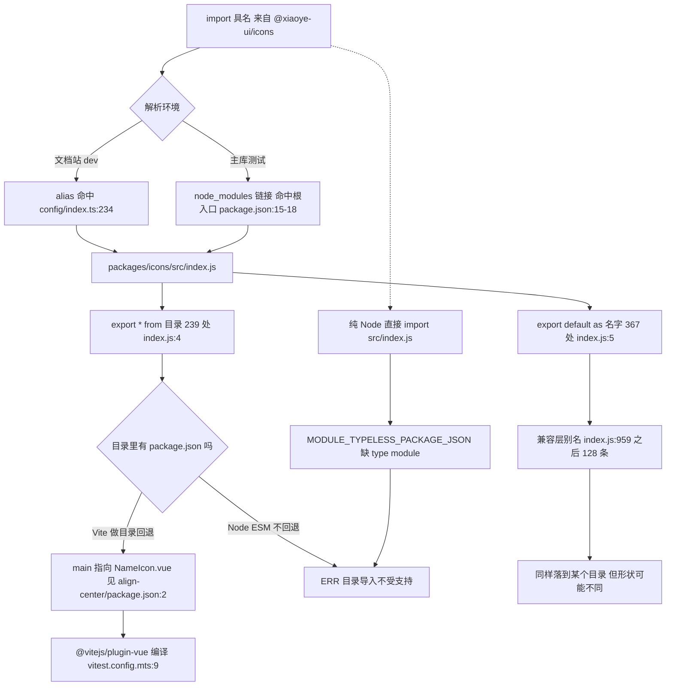
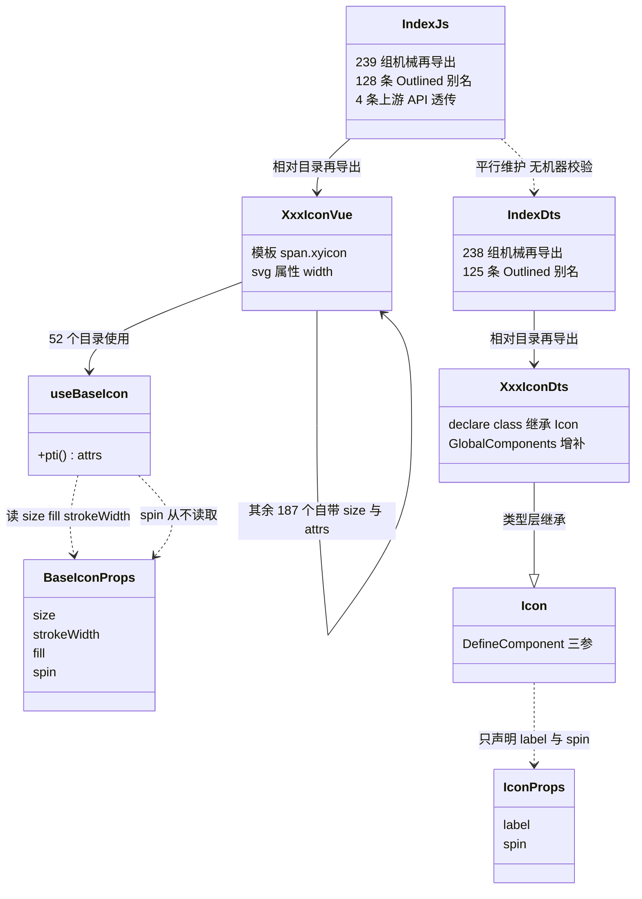
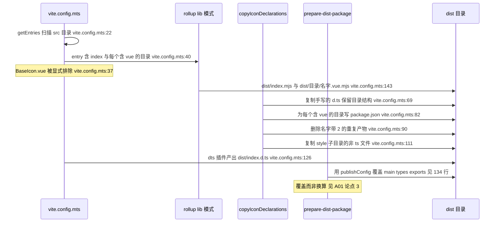

# I15 icons 包生成链与兼容层

> **本篇解决**：`@xiaoye-ui/icons` 里那 722 个文件到底是谁生成谁的、`index.js` 顶部那句 `Auto-Generated` 是不是真的、`xyicon` 这个类名从哪来又为什么和 `iconPrefixCls` 脱钩、加一个图标要动几处、漏一处会以什么姿势报错。
> **前置**：`A01 monorepo 拓扑与发布链路`　**读者坐标**：`02-infrastructure` 第 15/16 篇
> 边界：图标的**使用面**（自动导入、文档站注册、`unplugin-icons`）归 **A08**（并行撰写中），本篇只在需要解释「为什么仓库内没人走 `exports` 表」时引用一行；包边界、构建顺序、发布产物形状、`publishConfig.exports` 覆盖式生效、缺 `"type":"module"` 的后果链归 **A01**（已完成，见 `docs/column/01-architecture/01-monorepo-topology-拓扑与发布链路.md`），本篇一律只引用不重述；`resetIcon()` 的 Token 派生与 `hashId` 注水归 **A03**（已审）。

---

## 一、职责与边界

这个包负责三件事，且只做这三件：

1. 把 239 个手写的图标 SFC 变成**可按名导入**的组件集合——`import { SearchIcon } from '@xiaoye-ui/icons'`；
2. 维护一层 `XxxOutlined` / `XxxFilled` 形状的**兼容层**，让从上游图标命名迁移过来的调用方不必逐个改名；
3. 为每个图标提供一份**类型声明**与一个**目录解析垫片**，使深路径写法与 TS 类型都能落地。

明确不负责：

- **没有 svg 源数据**。`packages/icons/src` 下 240 个 `.json` 全是目录级 `package.json`，一个图标源文件都没有；240 个 `.ts` 全是 `.d.ts`（`*.ts` glob 把 `.d.ts` 一并计入）。也就是说这个包**不存在「源 → 产物」的转换**，它的「产物」就是被 checked-in 的 `.vue` 本身。
- **不管图标长什么样**。viewBox、描边宽度、路径来自各自的 SFC，包内没有统一的尺寸/描边规范入口。
- **不管谁来用**。96 处主库引用与 186 处文档示例的注册、自动导入、按需样式都不在本篇，见 A08。
- **不管发布形状**。`publishConfig.exports` 的 `./*` 通配、`sideEffects` 在发布期如何被搬运，见 A01 论点 6 与 §5.1。

依赖方向（逐条实测）：

| 方向 | 对象 | 证据 |
| --- | --- | --- |
| 被依赖 | `xiaoye-ui` 声明 `@xiaoye-ui/icons: workspace:*` | `packages/xiaoye-ui/package.json:55` |
| 被依赖 | `xiaoye-ui-docs` 以 devDependency 引用 | `apps/docs/package.json:17` |
| 依赖 | `@xiaoye-ui/core/composables` 取 `useBaseIcon`，52 个目录 | `packages/icons/src/export/ExportIcon.vue:22` |
| 依赖 | `@xiaoye-ui/core` 取 `DefineComponent` 类型，237 份 `.d.ts` | `packages/icons/src/align-center/AlignCenterIcon.d.ts:1` |
| 依赖 | `@ant-design/icons-vue`（上游实现）只被兼容层引用 1 处 | `packages/icons/src/index.js:1356` |
| 依赖 | `@xiaoye-ui/utils` 声明为 `dependencies` 但源码引用数为 0 | `packages/icons/package.json:287` |

最后两行需要一句定性：`AGENTS.md:683` 写的红线是「禁止从 `@ant-design/icons-vue` 或其子路径导入图标」，`AGENTS.md:756` 写的是「禁止引入**新的** `@ant-design/icons-vue` 依赖」；本包对上游包的依赖是**存量**且只出现在兼容层这一处运行时文件里，属于红线为自己留的后门，而不是消费侧的违规。实测主库与文档站共 282 个引用点（96 + 186），**全部**写成裸说明符 `@xiaoye-ui/icons` 的命名导入，没有一处默认导入、没有一处深路径导入、没有一处直引上游包：

```bash
grep -rhoE "from '@xiaoye-ui/icons[^']*'" packages/xiaoye-ui/src | sort | uniq -c
# 96 from '@xiaoye-ui/icons'
```

这条实测结论比 AGENTS.md 的承诺更有价值：它说明 `package.json` 里那 235 条指向 `.vue` 的深路径导出键，**在本仓库内没有任何调用方**（唯一走深路径的是 `.d.ts` 里的 `@xiaoye-ui/icons/baseicon`，236 份，纯类型用途）。

---

## 二、源码地图

`packages/icons` 受版本控制的顶层只有 4 项：`package.json`、`tsconfig.json`、`vite.config.mts`、`src/`；本机另有 `node_modules/` 与构建产生的 `dist/`（`.gitignore:59` 的 `dist` 规则，当前不存在）。

| 文件 | 行数 | 职责 | 关键导出 |
| --- | --- | --- | --- |
| `packages/icons/src/index.js` | 1,356 | 运行时 barrel：239 组目录再导出 + 兼容层 | 367 个 `export { default as }` |
| `packages/icons/src/index.d.ts` | 1,343 | 类型 barrel，与上一份**手工平行** | 363 个 `export { default as }` |
| `packages/icons/src/<dir>/<Name>Icon.vue` | 239 个 | 图标本体，模板即产物 | 仅 `default` |
| `packages/icons/src/<dir>/<Name>Icon.d.ts` | 239 个 | 手写声明：`declare class <Name>Icon extends Icon {}` + `GlobalComponents` | `default` |
| `packages/icons/src/<dir>/package.json` | 239 个 | 目录解析垫片（`main` 指向 `.vue`） | 无 |
| `packages/icons/src/baseicon/BaseIcon.vue` | 10 | 无模板的类型锚点 | `BaseIcon` |
| `packages/icons/src/baseicon/BaseIcon.d.ts` | 14 | 全仓唯一的 `Icon` / `IconProps` 定义处 | `Icon`、`IconProps` |
| `packages/icons/src/baseicon/style/index.less` | 32 | 静态图标样式，**全仓无人引用** | 无 |
| `packages/icons/src/baseicon/style/index.js` | 1 | 上面那份 less 的副作用入口 | 无 |
| `packages/icons/vite.config.mts` | 153 | 多入口库构建 + 拷 `.d.ts` + 生成 dist 目录 `package.json` | 默认导出 config |
| `packages/icons/package.json` | 295 | dev/pub 双身份 manifest | `exports` 238 键 |
| `packages/core/src/composables/index.ts` | 53 | `useBaseIcon` 的真实实现所在 | `useBaseIcon`、`BaseIconProps` |
| `packages/xiaoye-ui/src/icon/index.tsx` | 11 | 主库侧的 `XYIcon` 空壳 | 默认导出 |

主实现入口不在任何一个组件文件里，而在这两条：barrel 的机械段从 `packages/icons/src/index.js:3` 开始，兼容层从 `packages/icons/src/index.js:959` 开始；构建入口从 `packages/icons/vite.config.mts:26` 开始。

`packages/icons` 自己**没有** `typecheck` 脚本（`package.json:275-279` 只有 `build`/`postbuild`/`dev`/`dev:link`），而根上的 `pnpm typecheck` 是 `pnpm -r run typecheck`——`-r` 只对声明了该脚本的包执行。加上包内测试文件数为 0（两种方法交叉验证：`find packages -name "*.test.*" | grep icons` 为空；`grep -rl "xyicon" --include='*.test.*'` 也为空），这个包处于**既无类型检查、也无测试、也无快照**的三不管状态。它下面 239 个目录之所以没塌，靠的是下游主库的 7 个测试文件恰好 import 了图标（`packages/xiaoye-ui/src/button/index.test.js`、`input/index.test.js`、`menu/index.test.js`、`message/index.test.js`、`notification/index.test.js`、`select/index.test.js`、`list/loading.test.js`）——那是「顺带被跑到」，不是「被覆盖」。

---

## 三、架构与数据流

### 3.1 一个图标名是怎么被解析出来的



三条路径的分岔是这套结构全部复杂性的来源。文档站走 `apps/docs/.vitepress/config/index.ts:231-232` 两条 alias，**绕过 `exports` 字段**直达 `src/index.js` 与 `src/<dir>`；主库的 vitest 只 alias 了 `xiaoye-ui` 本体（`packages/xiaoye-ui/vitest.config.mts:41-46`），因此 `@xiaoye-ui/icons` 老老实实走 `node_modules` → 包根 `exports` → `./src/index.js`（`packages/icons/package.json:14-18`），然后再由 barrel 内部的**相对目录**说明符触发第二层解析——这一层不受 `exports` 管辖，归 `align-center/package.json:2` 的 `main` 字段管，而 `main` 指向 `.vue`，于是必须有 `@vitejs/plugin-vue`（`packages/xiaoye-ui/vitest.config.mts:9`）在场。纯 Node 走同一条路时，在第一个相对目录说明符上就死：实测 Node 24.14 报 `Directory import '.../src/align-center' is not supported resolving ES modules`，此前还会先打印一条 `MODULE_TYPELESS_PACKAGE_JSON` 警告——这条警告正是 A01 论点 11 里「缺 `type: module`」的可观测形态，但在 Node 20+ 上它已经不再是致命错误，致命的是目录导入。两者叠加的结论没变：**这个包的 barrel 是 bundler-only 的**。

图里 `M` 那条「形状可能不同」是本篇第七节坑 5 的入口：兼容层不做形状归一，它只是把 `XxxOutlined` 这个名字绑到某个目录上。

### 3.2 模块之间的真实引用关系



这张图要说的是**三处断裂**。第一处：运行时的 props 契约来自 `BaseIconProps`（`packages/core/src/composables/index.ts:5-10`），类型的 props 契约来自 `IconProps`（`packages/icons/src/baseicon/BaseIcon.d.ts:3-6`），两者交集只有 `spin`，而 `spin` 恰好是谁都不读的那个。第二处：239 个 `.d.ts` 中的 237 个从 `@xiaoye-ui/core` 根入口要 `DefineComponent`，而该包从未导出它（`packages/core/src/index.ts:2-4` 只搬运 `composables`/`config`/`utils`，全仓 `grep -rn "DefineComponent" packages/core/src` 命中数为 0）。第三处：`IndexJs` 与 `IndexDts` 之间没有任何同步机制，图上那条虚线是本篇论点 1 的全部证据来源。

### 3.3 构建期到底生成了什么



三条说明。其一，`getEntries()` 的目录筛选（`packages/icons/vite.config.mts:29-32`）只看「是不是目录、开头不是 `.` 或 `_`」，**不看它有没有被 `index.js` 再导出**；反过来 `index.js` 也不看有没有被建成入口。两边各算一遍，没有交叉校验，这是 §七 坑 6 的成因。其二，`packages/icons/vite.config.mts:37` 把 `BaseIcon.vue` 从入口收集里排除，但 `packages/icons/vite.config.mts:73-82` 生成目录 `package.json` 时用的是另一次 `readdirSync` 且**没有排除**——于是 `dist/baseicon/package.json` 的 `main` 会指向 `./BaseIcon.vue.mjs`，该文件是否存在取决于 `packages/icons/src/index.js:96` 的那条 `export * from './baseicon'` 是否把 SFC 拉进模块图；这是一条只在构建后才暴露的隐式耦合。其三，`external` 里显式列了上游包（`packages/icons/vite.config.mts:139`），所以兼容层的 4 行透传在 dist 里保持为 `import`，把上游包变成了 `@xiaoye-ui/icons` 的真实运行时要求（依赖声明见 `packages/icons/package.json:285`）。其四，`prepare-dist-package.mjs:134-136` 那条「`publishConfig.exports` 整包覆盖、不做 src→dist 换算」的规则是 A01 论点 3 与 §5.1 的结论，本篇只补一个图标侧的后果：因为覆盖式生效，那 235 条手工维护的深路径键**从来没有进入过发布产物**，也就是说它们既没人用、也没被发布、更没有任何工具在校验它们。

---

## 四、核心机制精读

### 论点 1：`Auto-Generated` 是假的——这条「生成链」上没有任何生成器，真实同步面是四处

`packages/icons/src/index.js` 第 1 行与 `index.d.ts` 第 1 行都写着同一个横幅：

```js
// packages/icons/src/index.js:1
/***************** XiaoyeUI Icons (Auto-Generated) *****************/
```

全仓能匹配 `Auto-Generated` 的只有 5 个文件，其中 3 个在 `packages/xiaoye-ui`（`components.ts`、`typings/global.d.ts` 及其生成器 `scripts/entry-generator.mjs`，那三个**确实**由 `pnpm gen:entries` 产出，见 A02），另 2 个就是这两份 barrel。而写手不存在：`scripts/`、`packages/*/scripts/`、`packages/icons/vite.config.mts` 三处对 `icons/src` 的引用只有 `vite.config.mts` 里那一句注释（`:48`），且方向是**读**不是写；`packages/icons` 目录下也没有 `scripts/`。`vite.config.mts:47` 自己就把真相写在注释里：

```ts
// packages/icons/vite.config.mts:47
// 复制每个图标目录下手工编写的 .d.ts，并为每个目录生成 package.json
```

「手工编写」四个字解释了为什么 `index.js` 与 `index.d.ts` 会长得不一样。实测两份 barrel 的差集：

```bash
cd packages/icons/src
grep -oE "as [A-Za-z0-9_]+" index.js   | sed 's/as //' | sort -u > /tmp/js.txt
grep -oE "as [A-Za-z0-9_]+" index.d.ts | sed 's/as //' | sort -u > /tmp/dts.txt
comm -23 /tmp/js.txt /tmp/dts.txt
```

输出 4 个名字：`ExportIcon`、`ExportOutlined`、`BellOutlined`、`PrinterOutlined`。前两个在 `index.js:271-273`（`export * from './export'` 与具名导出，整段被 `.d.ts` 漏掉——`index.d.ts` 对 `export` 目录的引用数为 0），后三个在 `index.js:1341-1348`。计数上，`index.js` 有 239 条 `export * from './<dir>'`、239 条 `XxxIcon` 具名导出、128 条 `Outlined/Filled/TwoTone` 别名（合计 367 条 `export { default as }`）；`index.d.ts` 对应 238 / 238 / 125（合计 363）。差值不是四舍五入，是漏。

这个漂移**不是纸面问题**，它可复现地报错。我在 `/tmp` 建一个只含符号链接的探测目录（不写仓库任何文件），用仓库自带的 tsc 走 `moduleResolution: bundler` + 仓库默认 `skipLibCheck: true`（`tsconfig.base.json:7`）检查：

```
error TS2724: '"@xiaoye-ui/icons"' has no exported member named 'ExportOutlined'. Did you mean 'HeartOutlined'?
error TS2305: Module '"@xiaoye-ui/icons"' has no exported member 'BellOutlined'.
```

也就是说，**运行时给得出 `BellOutlined`，类型层给不出**，写 `import { BellOutlined } from '@xiaoye-ui/icons'` 的业务代码直接编译失败。而这两个名字已经有人用了：`apps/docs/examples/ripple/with-icon.vue:42`、`apps/docs/examples/statistic/in-card.vue:110`、`apps/docs/examples/affix/with-menu.vue:37` 引用 `BellOutlined`，`apps/docs/examples/toolbar/with-buttons.vue:37` 同时引用 `ExportOutlined` 与 `PrinterOutlined`。文档站跑得过，是因为它走 alias（`apps/docs/.vitepress/config/index.ts:231`）拿运行时那份 `index.js`，而 VitePress 的示例编译不做严格类型解析。

更硬的证据在 git 史里——同样的坑已经踩过三次：`96b85ed feat(icons): 添加 @ant-design/icons-vue 兼容层导出`、`d24b1ac fix(icons): 补充 27 个遗漏的图标映射`、`967ad72 fix(icons): 修复 39 个图标兼容层导出缺失导致运行时报错`。最后那条 commit message 直接给出了症状原文：「导致运行时 SyntaxError: does not provide an export named」。一个靠人肉平行维护、被同一段漏导出反复炸三次、修完仍然没有留下任何校验脚本的结构，是这篇最该被记下来的事实。

### 论点 2：单个图标目录只有三件套，且 `.vue` 就是最终产物

`align-center/` 的全部内容：

```json
// packages/icons/src/align-center/package.json:1
{
  "main": "./AlignCenterIcon.vue",
  "module": "./AlignCenterIcon.vue",
  "types": "./AlignCenterIcon.d.ts",
  "browser": {
    "./sfc": "./AlignCenterIcon.vue"
  },
  "sideEffects": [
    "*.vue"
  ]
}
```

三个文件的分工是：**`.vue` 是被解析的实体，`.d.ts` 是类型真相（手写、且经常与实体不符，见论点 3），`package.json` 是让「目录说明符」能被解析的垫片**。谁引用谁：`index.js` 用**目录**说明符引用这个目录（`packages/icons/src/index.js:4-5`），目录说明符交给解析器后落到本目录 `package.json:2` 的 `main`，于是真正被加载的文件是 `AlignCenterIcon.vue`。这就是那 239 份 `package.json` 存在的全部理由——它们不是发布装饰，而是 barrel 能在做「目录 → package.json → main」回退的解析器（Vite）里跑通的一环；纯 Node ESM 不做这个回退，所以同一份文件对它毫无意义（实测见 §3.1 与 §六）。

`browser: {"./sfc": ...}` 这一项要单独交代：它是 webpack + vue-loader 时代为 SFC 子请求准备的映射，属于上游包结构的形状复刻（本库该形状对应的是上游实现的做法，不是本地设计）。本仓库的构建链是 Vite（`packages/icons/vite.config.mts:124` 用的是 `@vitejs/plugin-vue`），全仓没有任何 vue-loader 依赖，因此这个键在本仓库**没有任何消费者**，239 份文件里它都是死字段。

顺带把 §一 那句「没有 svg 源」钉实：整个 `src` 的 722 个文件按扩展名分解为 239 `.vue` + 240 `.d.ts` + 240 `package.json` + 2 `.js` + 1 `.less`，`.js` 是 `index.js` 与 `baseicon/style/index.js`，`.less` 是 `baseicon/style/index.less`。没有任何 `.svg`、没有任何图标数据 json、没有任何 `<style>` 块（`grep -rn "<style" packages/icons/src` 命中 0）。所以「svg → 组件产物」这条链在本仓库的真实形态是：**svg 手写进 SFC 模板，SFC 即产物，只有构建期的一次 `vite build` 把它编成 `.mjs`**。

### 论点 3：SFC 有四代形状，props 通道互不兼容

`grep` 出来的分布是 181 / 51 / 6 / 1（和为 239）：viewBox `0 0 24 24` 的 181 个、viewBox `0 0 14 14` 且用 `useBaseIcon` 的 51 个、viewBox `64 64 896 896` 的 6 个品牌图标、以及无模板的 `baseicon/BaseIcon.vue`。差别不是审美，是三套**互不相通的 size 通道**。

第一代（181 个），以 `align-center` 为例：

```vue
<!-- packages/icons/src/align-center/AlignCenterIcon.vue:1 -->
<template>
  <span class="xyicon">
    <svg
      :width="size"
      :height="size"
      viewBox="0 0 24 24"
      fill="none"
      xmlns="http://www.w3.org/2000/svg"
      v-bind="$attrs"
    >
```

它**不 import 任何东西**，`size` 由本地 `defineProps({size:{type:[Number,String],default:14}})` 提供（同文件 `:26-33`），靠模板里的 `:width="size"` 生效；`v-bind="$attrs"` 把外部属性二次铺到 `<svg>` 上。

第二代（51 个），以 `export` 为例：

```vue
<!-- packages/icons/src/export/ExportIcon.vue:1 -->
<template>
  <span class="xyicon">
    <svg
      width="14"
      height="14"
      viewBox="0 0 14 14"
      fill="none"
      xmlns="http://www.w3.org/2000/svg"
      v-bind="pti()"
    >
```

模板里的 `width="14"` 是**硬编码缺省值**，`size` 通过 `pti()` 返回的对象覆盖（`:28` 调用 `useBaseIcon(props)`）。它的 props 直接来自 core 的类型：`defineProps<BaseIconProps>()`。第二代内部还不统一：49 个用 `defineProps<...>`，`check/CheckIcon.vue:24-28` 与 `pencil/PencilIcon.vue` 却用对象式并**额外声明了两个 `BaseIconProps` 里根本没有的字段**：

```ts
// packages/icons/src/check/CheckIcon.vue:24
const props = defineProps({
  size: { type: [Number, String], default: 14 },
  label: { type: String, default: undefined },
  spin: { type: Boolean, default: false },
});
```

第三代（6 个品牌图标，twitter / youtube / github / facebook / instagram / linkedin）是最坏的一代：它**同时**声明了 `size` prop 与硬编码的 `width="14"`，两者没有任何连线。

```vue
<!-- packages/icons/src/twitter/TwitterIcon.vue:1 -->
<template>
  <span class="xyicon">
    <svg
      width="14"
      height="14"
      viewBox="64 64 896 896"
      fill="currentColor"
      xmlns="http://www.w3.org/2000/svg"
      v-bind="$attrs"
    >
```

判别命令（两个计数相减恰好为 6）：`grep -rl 'defineProps({' --include='*.vue' . | wc -l` → 189；`grep -rl ':width=' --include='*.vue' . | wc -l` → 183。这 6 个文件是「有 prop、无绑定」的组合，`<TwitterIcon :size="32" />` 永远返回 14×14。

类型层的形状分布又是一套：239 份 `.d.ts` 里 236 份是 `declare class <Name>Icon extends Icon {}` + `GlobalComponents` 增补（`align-center/AlignCenterIcon.d.ts:4-10`），2 份（`moon/MoonIcon.d.ts`、`sun/SunIcon.d.ts`）是另一套形状——直接从 `vue` 取 `DefineComponent` 并只声明 `size`、**不做 `GlobalComponents` 增补**，1 份是 `baseicon/BaseIcon.d.ts` 本身。用 `moon`/`sun` 的地方是 `packages/xiaoye-ui/src/dark-mode-toggle/DarkModeToggle.tsx:5` 与 `:111-113`，正好证明形状不统一并不影响运行，只影响「你以为模板是一样的」。

结论：`extends Icon` 只存在于**类型层**。运行时没有任何一个图标继承过 `BaseIcon`；`baseicon/BaseIcon.vue` 是一份连模板都没有的占位（`<script setup>` 调 `useBaseIcon(props)` 后不返回任何东西，`:2-9`），它存在的唯一意义是给 `BaseIcon.d.ts:14` 那个 `Icon` 常量提供一个可被 `import type` 的路径。这是典型的「用类型继承冒充运行时基类」，改起来两边都要动。

### 论点 4：`xyicon` 是硬编码字面量，与 `iconPrefixCls` 的可配置机制完全脱钩

类名的规范出处有两条链路，而图标包只认其中一条的字面值。

```ts
// packages/xiaoye-ui/src/config-provider/context.ts:14
export const defaultIconPrefixCls = 'xyicon';
```

`ConfigProvider` 把它做成可覆盖的响应式值，并在自己的样式里按这个值注 CSS：

```ts
// packages/xiaoye-ui/src/config-provider/index.tsx:76
    const iconPrefixCls = computed(
      () => props.iconPrefixCls || parentContext.iconPrefixCls.value || defaultIconPrefixCls,
    );
```

`packages/xiaoye-ui/src/config-provider/index.tsx:82` 把这个 computed 交给 `useStyle`，后者按 `.${iconPrefixCls.value}` 生成选择器并展开 `resetIcon()`（`packages/xiaoye-ui/src/config-provider/style/index.ts:18-22`），`path` 是 `['xiaoye-ui-icons', iconPrefixCls]`（同文件 `:14`）。另一条更宽的注入面在每个组件的样式 hook 里：`packages/xiaoye-ui/src/theme/util/genComponentStyleHook.ts:61-68` 对**每个组件**都注册一遍 `.xyicon` 的 reset，并在 `:95` 把它做成 Token 字段 `iconCls`。这段与四层 Token 的关系 A03 已写，本篇不重述，只取它的可观测后果。

而图标侧是这样落地的：

```vue
<!-- packages/icons/src/align-center/AlignCenterIcon.vue:2 -->
  <span class="xyicon">
```

238 个文件都是这一行（`grep -rl 'class="xyicon"'` → 238；唯一没有它的是无模板的 `baseicon/BaseIcon.vue`）。它是**字符串字面量**，不是 prop、不是 inject、也不是 CSS 变量。于是 `<ConfigProvider :icon-prefix-cls="myicon">` 的效果是：主库生成的 CSS 选择器变成 `.myicon`，而 DOM 上的类仍然是 `.xyicon`——reset 整块失效，图标退化为浏览器默认的 `inline` svg 排布。这个不对称的根因不是遗漏，是**依赖方向**：`xiaoye-ui` 依赖 `@xiaoye-ui/icons`（`packages/xiaoye-ui/package.json:55`），图标包不可能反向 import `useConfigInject` 去读那个 context，否则就是循环依赖；它也不能靠 peer 依赖去拿，因为图标包唯一能拿到的内部包是 `@xiaoye-ui/core`，而 core 里没有任何前缀概念——它自己的 `config` 子入口至今只是占位（`packages/core/src/config/index.ts:2-3` 的 `useDesignToken` 与 `useTheme` 都返回空对象）。

同一处还漏出第三个名字。图标包里唯一那份样式文件用的是 `.xy-icon`（带连字符）而不是 `.xyicon`：

```less
// packages/icons/src/baseicon/style/index.less:1
.xy-icon {
    display: inline-block;
    vertical-align: baseline;
    flex-shrink: 0;
}

.xy-icon--spin {
    -webkit-animation: xy-icon-spin 2s infinite linear;
    animation: xy-icon-spin 2s infinite linear;
}
```

全仓 `grep -rn "xy-icon"` 的结果只有这个文件里的 6 处，也就是说：**没有任何 DOM 会带上 `.xy-icon`，没有任何文件 import 这个 less**（`baseicon/style/index.js:1` 那句 `import './index.less'` 的引用者只有 `vite.config.mts:97` 的那条复制注释）。它被 `copyIconDeclarations` 原样搬进 `dist/baseicon/style/`（`vite.config.mts:111` 只跳过 `.ts`），于是**发布产物里带着一份指向不存在类名的 CSS，且入口是 `.js` 里的裸 less import**——消费者真要按 `@xiaoye-ui/icons/baseicon/style` 引它，就得自己配 less 编译。这解释了 §七 坑 4 的后半段：`.xy-icon--spin` 的动画永远不会播。

### 论点 5：`size` 在库内必然失效，因为 CSS 规则压过 SVG 呈现属性

`resetIcon()` 里那两行是关键：

```ts
// packages/xiaoye-ui/src/style/index.ts:28
export const resetIcon = (): CSSObject => ({
  display: 'inline-flex',
  alignItems: 'center',
  justifyContent: 'center',
  width: '1em',
  height: '1em',
  color: 'inherit',
  fontStyle: 'normal',
  lineHeight: 0,
  textAlign: 'center',
  textTransform: 'none',
  verticalAlign: '-0.125em',
  textRendering: 'optimizeLegibility',
  '> *': {
    lineHeight: 1,
  },
  svg: {
    display: 'inline-block',
    width: '1em',
    height: '1em',
  },
});
```

`:49-53` 生成的选择器是 `.xyicon svg`（外层由 `genComponentStyleHook.ts:66` 或 `config-provider/style/index.ts:18` 提供）。而所有图标改尺寸用的都是 **SVG 呈现属性**：第一代 `:width="size"`（`align-center/AlignCenterIcon.vue:4-5`），第二代 `pti()` 里的 `attrs.width = attrs.height = String(props.size)`（`packages/core/src/composables/index.ts:22`）。呈现属性在 CSS 级联里的优先级低于**任何**作者样式规则，所以只要 `.xyicon` reset 在场，`.xyicon svg { width: 1em }` 就赢，`size` 传什么都不改外观。

由于 `genComponentStyleHook.ts:61-68` 把这段 reset 塞进**每个组件**的共享样式层（去重靠 `['Shared', rootPrefixCls]` 这条 `path`，A03 论点已展开），而主库组件正是图标的主要使用场景，实际效果是：**`size` 这个 prop 在库内是死的，只在库外——某个组件样式与 ConfigProvider 都没被加载的角落——才偶然生效**。图标尺寸的**真源**是外层文字的 `font-size`，这是 `resetIcon()` 用 `1em` + `verticalAlign: -0.125em` 明确的设计意图（注释在 `:39` 指向上游那篇讲 svg 对齐的文章）。也就是说 `size` 与 `font-size` 两套通道方向相反，`size` 是从上游图标包抄来的遗留 API。想真改大小，只有两条正路：给外层文字设 `font-size`，或者传 `style`（内联样式优先级高于 `.xyicon svg`）。

### 论点 6：兼容层把上游包变成本包的硬依赖，且三分之一的别名不保真

`index.js:959` 之后是手写的映射区，共 128 条别名：

```js
// packages/icons/src/index.js:1341
// BellOutlined (映射自 BellIcon)
export { default as BellOutlined } from './bell';

// PrinterOutlined (映射自 PrinterIcon)
export { default as PrinterOutlined } from './printer';

// ExportOutlined (映射自 ExportIcon)
export { default as ExportOutlined } from './export';
```

区块末尾还透传 4 个上游 API：

```js
// packages/icons/src/index.js:1350
// 以下 @ant-design/icons-vue 的特殊 API 通过兼容层透传，便于文档/业务统一从 @xiaoye-ui/icons 引入
export {
  createFromIconfontCN,
  default as Icon,
  getTwoToneColor,
  setTwoToneColor,
} from '@ant-design/icons-vue';
```

这 4 个名字在上游包里真实存在，我核对过它的 ESM 入口：`packages/icons/node_modules/@ant-design/icons-vue/es/index.js` 第 1-4 行分别是 `export * from './icons'`、`export * from './components/twoTonePrimaryColor'`、`export { default as createFromIconfontCN }`、`export { default }`——`default` 那一行是 `default as Icon` 能成立的前提，如果缺它这行 `export` 会直接把整包拖崩。

代价有三层。第一层是**安装面**：`dependencies` 里那条 `@ant-design/icons-vue: ^7.0.0`（`packages/icons/package.json:285`）不是 `workspace:` 前缀，因此不会被发布期的规范化改动（`scripts/prepare-dist-package.mjs:156-158` 只重写 workspace/catalog 范围），它会原样出现在发布 manifest 里——每个装 `@xiaoye-ui/icons` 的人都装一个上游图标包（该包 `es/icons` 下有 790 个组件文件，外加 `@ant-design/icons-svg`、`@ant-design/colors` 两个传递依赖）。打包面还算可控：上游包自己声明 `sideEffects: false`，未被引用的 790 个组件能被摇掉——这条「摇得掉」的依据来自上游 manifest，不是本库的保证。第二层是**语义保真**：128 条别名里有 32 条在注释里自称「近似映射」，例如 `packages/icons/src/index.js:1236-1237` 的 `CaretDownOutlined` 落到 `./chevrondown`（一个 V 形描边箭头，而原语义是实心三角）、`packages/icons/src/index.js:1248-1249` 的 `CloseCircleFilled` 落到 `./circle-x`（非实心）。这两条正被主库核心路径使用：`packages/xiaoye-ui/src/table/hooks/useSorter.tsx:1` 导入 `CaretDownOutlined` 并在 `:141` 渲染排序箭头，`packages/xiaoye-ui/src/input/ClearableLabeledInput.tsx:2` 导入 `CloseCircleFilled` 并在 `:52` 用作清除按钮，另有 `packages/xiaoye-ui/src/form/FormItem.tsx:74` 与 `packages/xiaoye-ui/src/result/index.tsx:22` 把它作为错误态图标。也就是说，**替换后的视觉与本库自研图标混在同一套组件里，风格由一张手写映射表而非设计规范决定**。第三层是**类型层落后**：`index.d.ts` 只有 125 条别名，漏掉上面那 3 条，于是「运行时能用、类型上不存在」的裂缝正好开在兼容层最需要的地方。

### 论点 7：主库的 `Icon` 是一个只会 warn 的空壳，而 barrel 的 `Icon` 是上游实现——同名不同物

```tsx
// packages/xiaoye-ui/src/icon/index.tsx:1
import warning from '../_util/warning';
import { withInstall } from '../_util/type';

const Icon = () => {
  warning(false, 'Icon', 'Empty Icon');
  return null;
};

Icon.displayName = 'XYIcon';

export default withInstall(Icon);
```

`packages/xiaoye-ui/src/components.ts:164-165` 把这个空壳以 `Icon` 之名纳入包根导出（`components.ts` 是 A02 的生成物，勿手改）。于是 `<xy-icon>` 渲染的是 `null` 加一条告警，而 `import { Icon } from '@xiaoye-ui/icons'` 拿到的是上游那个支持 `component`/`createFromIconfontCN` 的真 Icon——两个同名符号，语义完全无关，一个占住了组件标签面，一个藏在图标包里。文档站那页 `apps/docs/components/icon.md` 通篇写的是后者的用法（`:23` 甚至承诺「通过设置 `spin` 属性来实现动画旋转效果」，`:11` 还指向上游生态的 Sketch 插件），这构成 §七 坑 2 与坑 4 的文档侧根因。C01-02（Icon 组件篇，前置本篇）需要处理的就是这个空壳该往哪走。

### 论点 8：单根 barrel + `sideEffects: ["*.vue"]` = 取一个图标要背上 239 个组件

```json
// packages/icons/package.json:8
  "sideEffects": [
    "*.vue"
  ],
```

这是 `A01` 论点 6 表格里那一行的图标侧展开（那边讲的是主包四条 pattern 与发布搬运，此处只补图标侧特有证据，不重述）。机制链条是：主库 96 处、文档 186 处引用全部写成 `import { 一个名字 } from '@xiaoye-ui/icons'`，解析到 `src/index.js`；该文件把 239 个目录**逐个**再导出（`index.js:4-5` 起的 239 组），而每个目标 `.vue` 都被 manifest 声明为「有副作用、不可摇」。压缩器面对这个 barrel 无权删除任何未被使用的图标模块。这里还有一处容易被忽略的语义细节：那 239 条 `export * from './<dir>'` 对 JS 侧几乎不产出任何东西——SFC 编译后只导出 `default`，而 `export *` 明确不含 `default`——它们真正的作用只有两个：把模块拉进模块图（配合 `sideEffects` 即强制保留），以及在 `index.d.ts` 里把 `baseicon/BaseIcon.d.ts:3-12` 的 `IconProps`/`IconEmits` 等类型带到包根（`index.d.ts:96`）。换句话说，1,356 行里有一半的 `export *` 在运行时是纯粹的「加载指令」。

实际用量对照：主库 96 处引用聚成 86 个不同的导出名，落到 **63** 个图标目录，占 239 个目录的 26%；兼容层 128 条别名里又有一部分指向同一目录。也就是说按名取用面很窄，而 barrel 结构强迫每个消费者按全集加载。要打破这个组合，只有三条路（见 §六）。

---

## 五、对外契约如何生效

图标包没有插槽、没有 `expose`、没有事件、没有 context，契约面比主库任何组件都薄，但它的四条通道各自都在别处定义——这正是它难维护的原因。

**名字通道**：`调用方写的名字 → index.js 的具名导出 → 目录 → 目录 package.json 的 main → .vue 文件`。链条上任何一环缺失，症状不同：`index.js` 漏名字 = 运行时 `SyntaxError: does not provide an export named`（见 `967ad72` commit message）；`index.d.ts` 漏名字 = `TS2305`（论点 1 实测）；`package.json` 的 `exports` 漏目录 = 深路径写法在 Node 下 `ERR_MODULE_NOT_FOUND`（论点 3 的坑 6 有复现命令）。注意 `exports` 漏键在**本仓库不会暴露**：所有引用都写裸说明符，走 `exports["."]`（`packages/icons/package.json:15-18`），根本碰不到那 235 条目录键。

**属性通道**：`defineProps` 决定属性是 prop 还是 attr。第一代（181 个）把 `size` 做成 prop 并在模板绑定，同时 `v-bind="$attrs"` 把外部属性铺到 `<svg>`——由于 Vue 的自动继承仍会把 `class`/`style` 打到根节点 `<span class="xyicon">`，同一个 `class` 会**同时**出现在 `<span>` 和 `<svg>` 上；第二代（51 个）只绑 `pti()`，`class` 只落在 `<span>`。两代混用意味着「给图标加一个只作用于外层容器的样式」与「只作用于 svg 的样式」在这两种图标上行为不同。第三代（6 个）声明了 prop 却没有绑定，属性通道对它是关闭的。

**类型通道**：调用方 `import { SearchIcon }` 拿到的类型来自 `index.d.ts` 的具名导出，再往下一级级落到 `search/SearchIcon.d.ts`（该目录 `package.json:4` 的 `types` 字段是这个形状唯一可用的声明落点；至于 TS 具体按哪条规则命中它，我没有逐环核实，本节下面只写实测到的现象）。于是公开类型面是 `declare class SearchIcon extends Icon {}`，`Icon` 又由 `baseicon/BaseIcon.d.ts:14` 定义为 `DefineComponent<IconProps, IconSlots, IconEmits>`。把这条链和运行时链并排看：运行时接受 `size`/`strokeWidth`/`fill`（`packages/core/src/composables/index.ts:5-10`），类型只声明 `label`/`spin`（`packages/icons/src/baseicon/BaseIcon.d.ts:3-6`），两个方向的偏差**都存在**。它之所以从没被报出来，是 `tsconfig.base.json:7` 的 `skipLibCheck: true`。把它关掉再让 tsc 走进这条链（命令见 §附 检查点 2），实测错误分布是：**236 条** `TS2305: Module '@xiaoye-ui/core' has no exported member 'DefineComponent'`、**235 条** `TS2307: Cannot find module '@xiaoye-ui/icons/baseicon'`、外加 `baseicon/BaseIcon.d.ts:1` 的 `EmitFn` 同源一条；仓库里没有任何 `declare module '*.vue'` 垫片（`grep -rn "declare module '\*.vue'" packages apps` 命中 0），所以那份 `.d.ts` 指向 `exports` 里的 `./src/baseicon/BaseIcon.vue`（`packages/icons/package.json:43`）时类型层无从落地。结论：整个图标类型层建立在两处坏引用之上，靠 `skipLibCheck` 静默降级为「导出存在但形状不可用」，任何「类型有问题会报错」的直觉在这个包里都不成立。

**样式通道**：`<span class="xyicon">` 的字面量 ↔ 主库 `.xyicon` 的 reset（`genComponentStyleHook.ts:66` 与 `config-provider/style/index.ts:18`）。这是一条**纯字符串约定**，没有代码连接，一端可配置（`iconPrefixCls`），一端硬编码。组件侧还有四处把 `.xyicon` 直接写死在样式生成器里而不是用 `token.iconCls`：`packages/xiaoye-ui/src/steps/style/index.tsx:163`、`packages/xiaoye-ui/src/dark-mode-toggle/style/index.ts:78` 与 `:82`、`packages/xiaoye-ui/src/sortable-list/style/index.ts:179`；对照正确姿势是 `progress/style/index.ts:35` 从 token 解构 `iconCls` 再在 `:107` 使用。另有 `theme/convertLegacyToken.ts:139` 把 `'iconfont-css-prefix'` 映射为 `'xyicon'`，属于「为工具链预留但无工具链」的同一族残留（A03 论点 10 已登记）。

**全局注册通道**：236 份 `.d.ts` 各自向 `GlobalComponents` 增补了**不带 `XY` 前缀**的名字（`align-center/AlignCenterIcon.d.ts:6-10` 写的是 `AlignCenterIcon`），而主库生成物 `packages/xiaoye-ui/typings/global.d.ts:5` 起一律 `XYXxx`（图标占位是 `:46` 的 `XYIcon`）。两套全局名并存，图标那套与 AGENTS.md 的命名规范直接冲突，且因为它只增补类型、没有任何 `app.component` 注册动作，模板里写 `<AlignCenterIcon />` 类型能过、运行时解析不到组件。

---

## 六、设计取舍

**为什么用「人肉平行两份 barrel」而不是补一个生成器？**
现在的成本模型是：新增一个图标要动 4 个地方（建目录三件套、写 `index.js` 的两行、写 `index.d.ts` 的两行、给 `package.json` 的 `exports` 加一键），四件事互相独立、没有任何机器校验。另一条路是把目录变成唯一真源、`index.js`/`index.d.ts`/`exports` 全由扫描目录生成——本仓库在 `packages/xiaoye-ui` 一侧**已经这么做了**（`pnpm gen:entries` 一次生成三个生成物，`prebuild` 只 `--check`，见 A02）。放弃它的理由只能是「手写注释里带着映射语义」（`近似映射`、`无 Filled 变体`、`映射自新建的 SwapIcon`），这些注释是这份文件唯一的人类可读信息，生成器要保住它们就必须把映射表外置成一份数据文件——而那等于承认现在没有真源。赔上的代价是可复现的：git 史里 3 次「补漏」提交、当前仍有 4 个名字漂移、文档站因走 alias 而看不见这些漂移。

**为什么图标不自己带样式，而靠主库的 `resetIcon()`？**
自解释的方案是 SFC 里放 `<style>`（实测 0 个）。不这么做换来两件事：与四层 Token/`hashId`/SSR 注水一致（A03/A04 的主场），以及图标包可以完全不依赖主库。代价就是论点 4 那条断裂：类名前缀失去注入通道，只能硬编码 `xyicon`；同时留下 `.xy-icon` 那份无人 import 的死 less。第三个方案——让图标包 peer 依赖主库读 context——被依赖方向否掉了（`packages/xiaoye-ui/package.json:55` 已经确定主库 → 图标包），所以这条断裂在当前分层下**没有干净的修法**，只有两害相权：要么钉死类名（现状），要么把 `iconPrefixCls` 下沉到 `@xiaoye-ui/core`（改动面大，且 core 目前连 `DefineComponent` 都没导出）。

**为什么保留 `XxxOutlined` 兼容层，而不是强制改名？**
迁移一次要改 96 处主库引用 + 186 处文档示例，且下游用户也会受影响；写 128 条别名把这 282 处变成零改动，看起来是便宜的。赔上的是：`@ant-design/icons-vue` 成为本包的**发布期硬依赖**（`packages/icons/package.json:285`）、AGENTS.md 的两条红线（`:683`、`:756`）在同一个包里既是规范又是例外、32 条「近似映射」把视觉语义交给一张手写表、以及兼容层的漏导出直接变成运行时炸点。这里没有代价更小的第二条路，只有一笔显式技术债——它的退出条件是「全部调用方改用 `XxxIcon` 命名」，而仓库里**没有任何机制在统计还剩多少调用方用别名**（判别命令见 §附 检查点 2）。

**为什么 239 个目录各放一份 `package.json`，而不是把根 `exports` 写全？**
因为两者服务不同解析器。目录级 `package.json` 让**相对目录说明符**可解析（barrel 内部用的就是这个，`packages/icons/src/align-center/package.json:2`）；根 `exports` 让**包级深路径**可解析（`packages/icons/package.json:20` 起 235 条）。前一条判断有两组实测撑着：其一，实跑 `npx vitest run src/button/index.test.js`（在 `packages/xiaoye-ui` 目录下）18 个用例全过，而该文件经 `packages/xiaoye-ui/src/button/LoadingIcon.tsx:2` 走的就是「裸说明符 → `exports["."]` → `src/index.js` → 目录 → 目录 `package.json` 的 `main` → `.vue`」这条链，`packages/xiaoye-ui/vitest.config.mts:41-46` 只 alias 了 `xiaoye-ui` 本体、没有 alias 图标包；其二，纯 Node 24 在同一个 `src/index.js` 上报 `Directory import '.../src/align-center' is not supported resolving ES modules`。两组差值只能由目录级 manifest 的 `main` 回退解释（我没有逐行读 Vite 解析器源码，但正反两个方向都跑过了）。同时保留两套意味着两套都会漂移：实测根 `exports` 少了 4 个目录（`android`、`enter`、`export`、`swap`），并且兜底通配符 `./*` 的目标写成了 `./*`（`packages/icons/package.json:255`）而不是 `./src/*`——开发态包根下并没有 `align-center` 这样的目录，通配命中即失败（实测 `import('@xiaoye-ui/icons/android')` → `ERR_MODULE_NOT_FOUND`，报错路径里没有 `src` 段）。也就是说：一旦有人真用深路径写法，就会立刻发现这份表里唯一没被校验过的部分。而 `swap`/`enter`/`android` 三个目录能工作，靠的是 `packages/icons/src/index.js:947-957` 的再导出走的是**裸说明符**那条路，不是 `exports`。

---

## 七、坑与改动指南

1. **加图标只写了 `.vue`，运行时报「does not provide an export named」。**
   触发：新建 `src/<dir>/` 后忘了同步 `index.js`、`index.d.ts`、`package.json` 的 `exports`。
   症状：主库测试文件里 `SyntaxError: does not provide an export named 'XxxIcon'`；或类型上 `TS2305`；或用深路径时 `ERR_MODULE_NOT_FOUND`。
   定位：`packages/icons/src/index.js:1`（看横幅别当真）、`packages/icons/package.json:20`（首条键）、`packages/icons/vite.config.mts:47`（「手工编写」的自白）。
   历史上已炸三次：`96b85ed`、`d24b1ac`、`967ad72`。
   该分支**无测试保护**：包内测试文件数 0、`typecheck` 脚本缺失，`pnpm -r run typecheck`（根 `package.json`）不会进这个目录。

2. **`<XxxIcon :size="20" />` 不生效。**
   触发：在主库组件内或任何已加载 `.xyicon` reset 的位置。
   症状：尺寸恒等于外层文字的 `1em`。
   定位：`packages/xiaoye-ui/src/style/index.ts:49-53`（`.xyicon svg { width: 1em }`）与 `packages/xiaoye-ui/src/theme/util/genComponentStyleHook.ts:61-68`（每个组件都注一次）。
   改法：设 `font-size`，或传 `style`；**不要**去删那两行 `1em`——那是图标与文字基线对齐的设计意图（注释 `:39`）。

3. **6 个品牌图标的 `size` 连属性通道都没接上。**
   触发：`<TwitterIcon :size="32" />`、`<GithubIcon>`、`<YoutubeIcon>`、`<FacebookIcon>`、`<InstagramIcon>`、`<LinkedinIcon>`。
   症状：传什么都不变，模板里是死的 `width="14"`。
   定位：`packages/icons/src/twitter/TwitterIcon.vue:4-5` 对照 `:19-24`。
   判别：`grep -rl 'defineProps({' --include='*.vue' packages/icons/src | wc -l`（189）减去 `grep -rl ':width=' ... | wc -l`（183）。这 6 个也是全仓唯一 viewBox 为 `64 64 896 896` 的图标，属于上游形状的残留。

4. **`spin` 属性、`.xy-icon--spin`、`rotate` 全部是死 API。**
   触发：照文档写 `<SyncOutlined spin />` 或 `:rotate="180"`（`apps/docs/examples/icon/basic.vue:6-7`，文档 `apps/docs/components/icon.md:23` 明文承诺过 `spin`）。
   症状：图标不动、不转。
   定位：`packages/core/src/composables/index.ts:19-28`（`useBaseIcon` 从不读 `props.spin`）、`packages/icons/src/baseicon/style/index.less:7`（唯一动画定义，选择器是 `.xy-icon`，没有 DOM 用它）、`packages/icons/src/baseicon/style/index.js:1`（无人 import）。
   复核：全仓 spin 关键帧只有一处——`grep -rn "@keyframes" packages apps --include='*.less' --include='*.css' | grep -v node_modules` 只返回 `packages/icons/src/baseicon/style/index.less:23`；主库侧 `rotate(360deg)` 的三处出现里，只有 `packages/xiaoye-ui/src/dark-mode-toggle/style/index.ts:82-83` 是给图标转的（选择器 `&${componentCls}-checked > .xyicon`，配合 `:78` 的 `transition`），另外两处是徽标定位与表格展开（`packages/xiaoye-ui/src/badge/style/index.ts:54`、`packages/xiaoye-ui/src/table/style/expand.ts:103`）。也就是说：**仓库里唯一真正生效的图标旋转，是消费方组件自己写 CSS 打 `.xyicon` 实现的，与 `spin` 属性无关**。副作用是 `xy-button` 的 loading 图标（`packages/xiaoye-ui/src/button/LoadingIcon.tsx:39-41` 渲染 `LoadingOutlined`，其样式 `packages/xiaoye-ui/src/button/style/index.ts:443-445` 只做了 `transition`，没有 animation）看起来不会转。`rotate` 同样无人读取，但主库仍在传：`packages/xiaoye-ui/src/image/PreviewGroup.tsx:30` 写的是 `<SwapOutlined rotate={90} />`，这个 prop 既不在 `BaseIconProps`（`packages/core/src/composables/index.ts:5-10`）也不在 `IconProps`（`packages/icons/src/baseicon/BaseIcon.d.ts:3-6`）里，传值后被静默丢弃。**这条分支无测试保护**。

5. **兼容层别名换图标，视觉对不上原语义。**
   触发：`CaretDownOutlined`（实心三角 → V 形描边）、`CloseCircleFilled`（实心 → 描边）、`WarningFilled`、`UpOutlined` 等 32 条。
   症状：组件里图标风格与自研图标混排，设计走查看不出来、单测看不出来。
   定位：`packages/icons/src/index.js:1236-1237`、`:1248-1249`（注释里就写着「近似映射」）。
   安全边界：改任何一条别名等于改公开视觉，必须先确认调用面——用 §附 检查点 2 的命令统计。

6. **`vite.config.mts` 的入口收集与 `index.js` 的再导出各算一遍，谁也不校验谁。**
   触发：新增一个有 `.vue` 但没进 `index.js` 的目录；或一个目录里放两个 `.vue`。
   症状：前者产出一个无人可达的 dist 目录条目；后者取 `vueFiles[0]`（`packages/icons/vite.config.mts:40` 与 `:74` 两处都是 `[0]`），`readdirSync` 不排序，**入口与 `dist/<dir>/package.json` 的 `main` 取决于文件系统返回顺序**。
   定位：`packages/icons/vite.config.mts:29-42`（入口收集，含 `:37` 对 `BaseIcon.vue` 的排除）对照 `:60-82`（拷贝与 manifest 生成，**没有**同样的排除）。
   改法：把两处收敛成一个函数并改成按名排序。

7. **`pnpm typecheck` 与 `pnpm test:unit` 都不覆盖这个包，改坏了要等下游炸。**
   触发：改 `.d.ts`、改 `exports`、改 `index.js`。
   症状：本地全绿，用户侧 `TS2305` 或运行时 `SyntaxError`。
   定位：`packages/icons/package.json:275-279`（无 `typecheck`）与 `package.json:28`（`typecheck: pnpm -r run typecheck`）、`package.json:23`（`test:unit: pnpm --filter xiaoye-ui test:unit`）。
   最小修法：给 icons 加 `typecheck`（`vue-tsc --noEmit`，同 `packages/core/package.json:41` 的写法），并加一个只断言「`index.js` 与 `index.d.ts` 的导出名集合相等、且每个名字都能解析到存在的目录」的脚本——这正是 A02 的 `check:entries` 在主库侧已经做到的事。

8. **深路径写法在两个环境下都会失败，但报错不一样。**
   触发：`import '@xiaoye-ui/icons/android'`（该目录没有显式 `exports` 键）。
   症状：开发态 `ERR_MODULE_NOT_FOUND`（通配把路径解析到包根，`src` 段丢了）；发布态如果目标是个目录，Node 报 `ERR_UNSUPPORTED_DIR_IMPORT`（我用一个最小探测包实测过这种 `./*` → `./*` 通配指向目录的行为）。
   定位：`packages/icons/package.json:255`（开发态通配）、`:266`（发布态通配，两处字符串完全相同，但它们对 `src/` 前缀的要求相反）。
   现状安全边界：本仓库没人用深路径，所以这条只在文档或下游新增写法时才咬人；A01 坑 9 讲的是同一通配的另一面（产物文件名变成公开 API），不重复展开。

9. **`GlobalComponents` 被 236 个无前缀名字污染。**
   触发：模板里直接写 `<SearchIcon />`。
   症状：类型检查通过、运行时解析不到组件（没有任何地方 `app.component` 注册它们，注册工具是 `packages/xiaoye-ui/src/_util/registerComponent.ts`，图标包里无人调用）。
   定位：`packages/icons/src/align-center/AlignCenterIcon.d.ts:6-10`，与生成物 `packages/xiaoye-ui/typings/global.d.ts:5` 的 `XYXxx` 约定对照。
   该删还是该改名要先定调：AGENTS.md 的命名规范（`XYXxx`）与图标包的既有形状互斥，这是**契约冲突**，不是笔误。

10. **`@xiaoye-ui/utils` 是本包的未使用依赖，会随发布进入消费者的安装树。**
    触发：装 `@xiaoye-ui/icons`。
    症状：多一个包，无功能收益，也不会报错。
    定位：声明在 `packages/icons/package.json:287`；引用数为 0（`grep -rn "@xiaoye-ui/utils" packages/icons/src | wc -l` → 0）。三包分工的正式讨论归 I16。

**改动这个包的安全边界**：只有 `.vue` 的模板与路径数据可以单文件改；只要涉及**名字**（新增/删除/改名/别名映射），就必须同一次改动里覆盖 `index.js`、`index.d.ts`、`package.json` 的 `exports` 三处，并跑 §附 的三个命令。包本身没有测试，验证只能靠这些外部一致性与一次真实构建（`pnpm --filter @xiaoye-ui/icons build` 会写 `packages/icons/dist`，构建前确认该目录可丢弃）。

---

## 附：本篇可证伪的三个检查点

1. **两份 barrel 的名字集合是否相等**（论点 1、论点 6 第三层）：

   ```bash
   cd packages/icons/src
   grep -oE "as [A-Za-z0-9_]+" index.js   | sed 's/as //' | sort -u > /tmp/js.txt
   grep -oE "as [A-Za-z0-9_]+" index.d.ts | sed 's/as //' | sort -u > /tmp/dts.txt
   echo "js=$(wc -l < /tmp/js.txt) dts=$(wc -l < /tmp/dts.txt)"
   comm -23 /tmp/js.txt /tmp/dts.txt
   ls -d */ | sed 's|/$||' | sort > /tmp/dirs.txt
   grep -oE "from '\./[^']+'" index.js | sed "s/from '\.\///;s/'//" | sort -u | comm -13 - /tmp/dirs.txt
   grep -oE "from '\./[^']+'" index.d.ts | sed "s/from '\.\///;s/'//" | sort -u | comm -13 - /tmp/dirs.txt
   ```
   实测：`js=368 dts=364`，差集为 `ExportIcon`、`ExportOutlined`、`BellOutlined`、`PrinterOutlined`；`index.js` 覆盖全部 239 个目录，`index.d.ts` 少一个 `export`。若某天四个差集全空、且两个目录差集都为空，则论点 1 的「无校验」结论需要更新（说明补了校验脚本）。

2. **类型层与运行时层的偏差是否已经咬到调用方**（论点 1、五·类型通道）：

   ```bash
   rm -rf /tmp/probe-icons && mkdir -p /tmp/probe-icons/node_modules/@xiaoye-ui
   ln -s "$(pwd)/packages/icons" /tmp/probe-icons/node_modules/@xiaoye-ui/icons
   printf "import { AlignCenterIcon, ExportOutlined, BellOutlined } from '@xiaoye-ui/icons';\nconsole.log(AlignCenterIcon, ExportOutlined, BellOutlined);\n" > /tmp/probe-icons/a.ts
   node node_modules/typescript/bin/tsc --noEmit --module esnext --moduleResolution bundler --target es2020 --skipLibCheck /tmp/probe-icons/a.ts
   # 再把 --skipLibCheck 去掉，观察 239 份 .d.ts 的两条系统性错误
   ```
   实测：带 `--skipLibCheck` 时报 `TS2724（ExportOutlined）` 与 `TS2305（BellOutlined）`，`AlignCenterIcon` 正常；不带 `--skipLibCheck` 时错误计数为 `236 × TS2305 'DefineComponent'`、`235 × TS2307 '@xiaoye-ui/icons/baseicon'`、`1 × TS2305 'EmitFn'`（用 `| grep -oE "error TS[0-9]+: .*" | sort | uniq -c` 统计）。**探测目录只在 `/tmp`，符号链接指向仓库只读，不会改仓库任何文件。**另外那条 `TS2550 hasOwn` 来自 `packages/utils/src/object/methods/toValue.ts:8`，是我这条命令把 `--target` 设成 `es2020` 造成的假阳性，不是图标包的问题——复现时请带 `--lib es2022`。

3. **`spin` 与图标动画是否真的无人实现**（论点 4、坑 4）：

   ```bash
   grep -rn "@keyframes" packages apps --include='*.less' --include='*.css' | grep -v node_modules
   grep -rn "spin" packages/icons/src --include='*.vue' --include='*.d.ts' | grep -v index.d.ts
   grep -rn "@xiaoye-ui/icons" packages/icons/src | wc -l   # 自引用深路径的类型用途计数
   grep -rn "@ant-design/icons-vue" packages/xiaoye-ui/src apps/docs --include='*.tsx' --include='*.vue' --include='*.ts' | grep -v node_modules | wc -l
   ```
   实测：第一条只命中 `packages/icons/src/baseicon/style/index.less:23`；第二条只有 `baseicon/BaseIcon.d.ts:5`（类型声明）、`check/CheckIcon.vue:27`、`pencil/PencilIcon.vue:27`（props 声明）以及 51 个 `SpinnerIcon` 之类的**名字巧合**，无任何 `:class` 绑定；第三条为 236（全部是 `.d.ts` 里的 `import type { Icon }`，无运行时用途）；第四条为 0——主库与文档站没有任何一处直引上游图标包，红线在消费侧成立，唯一的运行时引用是 `packages/icons/src/index.js:1356` 这一行。**注意局限**：以上命令只证「仓库内不存在实现」，不能证明浏览器运行时一定没有动画（用户自带 CSS 不在证据范围内）。附带一条自洽校验：第三条的 236 与检查点 2 里 `TS2307` 的 235 相差 1，缺的那一份正是 `packages/icons/src/export/ExportIcon.d.ts`——它因为 `index.d.ts` 漏掉 `./export` 而从未被程序加载，两条独立测量对上了同一个漏洞。
