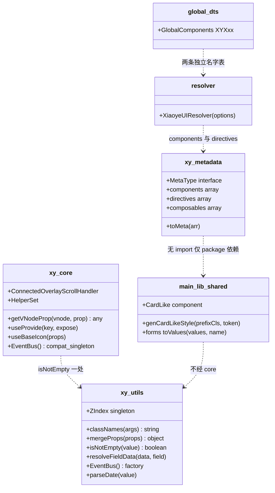
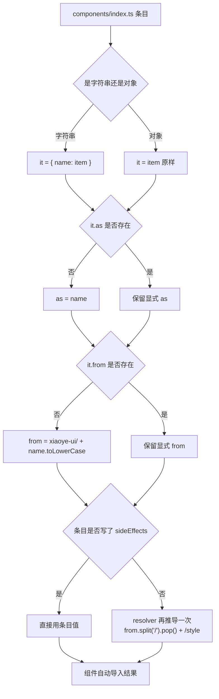
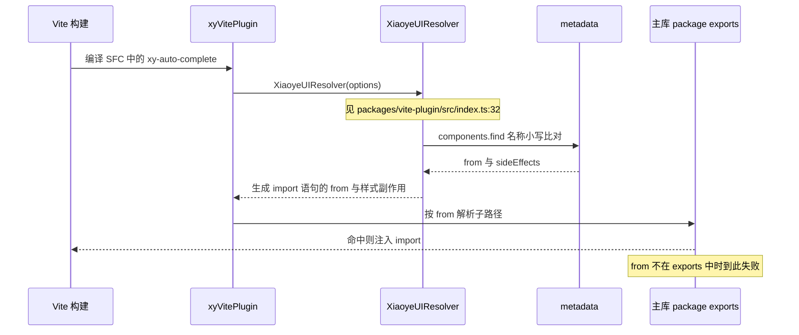

# I16 core / utils / metadata 三包的分工

> **本篇解决**：`@xiaoye-ui/utils`、`@xiaoye-ui/core`、`@xiaoye-ui/metadata` 三个「共享代码」包各自到底装了什么、被谁调用、能不能合并；以及主库内部为什么还要再长出 `src/utils/forms.ts` 与 `src/_shared/`。
> **前置**：A01 monorepo 拓扑与发布链路　**读者坐标**：`02-infrastructure` 收尾篇，解释 `packages/*` 中除主库与 icons 之外的三个小包

## 一、职责与边界

三个包不是同一层抽象，但在仓库里被写成了同一层的样子。读源码得到的真实分工是：

| 包 | 实际职责 | 明确不负责 |
| --- | --- | --- |
| `@xiaoye-ui/utils` | 与 Vue 无关的纯函数库：DOM 读写、对象/数组比较、类名、日期解析、storage、zindex、eventbus | 不做组件、不做响应式、不认识 `VNode` |
| `@xiaoye-ui/core` | 少量「认识 Vue」的运行时工具：`getVNodeProp`、`useProvide`、`ConnectedOverlayScrollHandler`、`HelperSet` | 不承载组件基类，`api`/`config` 两个子路径是空占位 |
| `@xiaoye-ui/metadata` | 一份「组件名 → 导入路径 → 样式副作用」的静态清单，供消费侧工具链查表 | 不含任何运行时代码，不校验自己写的路径是否存在 |

依赖方向要先纠正一个容易误读的印象：`utils` 不是「只有 core 会用」的孤岛，`core` 也不是「被广泛复用的运行时基座」。用两组计数说明真实分工（命令可复制，本篇附录用同一条口径复核）：

```bash
grep -rn "from '@xiaoye-ui/utils" packages/xiaoye-ui/src apps | wc -l                          # 64
grep -rn "from '@xiaoye-ui/core" packages apps | wc -l                                          # 310（排除 dist 与 node_modules）
grep -rln "from '@xiaoye-ui/core" packages --include='*.d.ts' | wc -l                           # 241（排除 dist）
grep -rln "from '@xiaoye-ui/core" packages --include='*.ts' --include='*.tsx' \
  --include='*.js' --include='*.vue' | grep -v '\.d\.ts' | wc -l                                # 65
```

`@xiaoye-ui/core` 的 310 处引用里，241 个文件是 `.d.ts`（例如 `packages/icons/src/angleleft/AngleLeftIcon.d.ts:1`、`packages/xiaoye-ui/src/data-table/DataTable.d.ts:10`），它们从 core 导入的是 `DefineComponent`、`EmitFn`、`HintedString`、`NoInfer`、`Nullable` 这类 Vue 通用类型；而 `grep -rn "DefineComponent" packages/core/src` 的结果是**空**——core 的 276 行源码从未导出过这些名字（见论点 2）。剩下 65 个文件才是值导入，其中多数是图标组件从 `@xiaoye-ui/core/composables` 取 `useBaseIcon`（`packages/icons/src/baseicon/BaseIcon.vue:2`），其余是 `tree-table` / `data-table` / `color-picker` 取 `getVNodeProp`、`HelperSet`、`ConnectedOverlayScrollHandler`、`useProvide`（`packages/xiaoye-ui/src/tree-table/TreeTable.tsx:14`、`packages/xiaoye-ui/src/tree-table/TreeTable.tsx:15`、`packages/xiaoye-ui/src/color-picker/ColorPicker.tsx:13`）。

包与包之间的真实编译期依赖只有一条边，而且只有一行代码在用：`packages/core/src/utils/HelperSet.ts:1` 的 `import { isNotEmpty } from '@xiaoye-ui/utils/object'`。core 内另一处提到 utils 的是注释文本（`packages/core/src/utils/index.ts:10`），不是 import。`metadata` 不 import 任何兄弟包源码，但它的 `package.json:22` 声明了 `"xiaoye-ui": "workspace:*"`——一个 253 行、全是字符串字面量的包声明了对 17 万行主库的依赖（见第七节坑 5）。消费链（`auto-import-resolver` / `nuxt-module` / `llms.txt`）如何读取 metadata 属于 A08「消费侧集成：自动导入与文档生成链」，本篇只写数据模型侧与被消费侧的**契约**，不重述 A08 的插件实现。

主库内部又长出两处「共享代码」：`packages/xiaoye-ui/src/utils/forms.ts`（3 行，`toValues`）与 `packages/xiaoye-ui/src/_shared/`（4 个文件、425 行）。这两处的存在理由不一样，而且都不是「顺手重复造轮子」：`forms.ts` 被 5 个校验适配层直接引用（如 `packages/xiaoye-ui/src/resolvers/zod/index.js:2`），这些适配层是 `.js` 文件、只有主库内部路径能解析到它们；`_shared/style/genCardLikeStyle.ts:1` 的返回类型是主库自己的 `CSSObject`（`src/_util/cssinjs`），把它搬进 `utils` 就得把 cssinjs 与 `theme/` 一起搬。第七节会给出另一条结论：`_shared/style/compact-item.ts` 是一份**零引用**的副本，与 `src/style/compact-item.ts` 同名同实现，属于可以直接删的那一类。

## 二、源码地图

### 2.1 `@xiaoye-ui/utils`（157 个 `.ts`、3,171 行）

| 路径 | 行数 | 职责 | 关键导出 |
| --- | --- | --- | --- |
| `packages/utils/src/index.ts` | 10 | 聚合 barrel，10 个 `export *` | — |
| `packages/utils/src/dom/index.ts` | 87 | DOM 子路径 barrel | `addClass` / `findSingle` / `getOuterWidth` … |
| `packages/utils/src/dom/methods/` | 83 个文件 | 单个 DOM 操作一文件 | — |
| `packages/utils/src/dom/helpers/` | 4 个文件 | `blockBodyScroll` / `exportCSV` / `saveAs` | — |
| `packages/utils/src/object/index.ts` | 43 | 对象/数组子路径 barrel | `resolveFieldData` / `equals` / `sort` |
| `packages/utils/src/date/methods/parseDate.ts` | 213 | 日期解析，包内最大单文件 | `parseDate` |
| `packages/utils/src/eventbus/index.ts` | 48 | 事件总线工厂 | `EventBus` |
| `packages/utils/src/zindex/index.ts` | 61 | 层级计数工厂 | `getZIndex` 系 |
| `packages/utils/src/storage.ts` | 66 | SSR/隐私模式安全 storage | `getStorageValue` 系 |
| `packages/utils/src/classnames/index.ts` | 38 | 类名拼接 | `classNames` |
| `packages/utils/src/mergeprops/index.ts` | 39 | props 合并 | `mergeProps` |
| `packages/utils/src/url/index.ts` | 55 | URL 处理 | — |
| `packages/utils/src/uuid/index.ts` | — | ID 生成 | `UniqueComponentId` |

入口是 barrel 而非主实现，`packages/utils/src/index.ts:1` 起是 10 行连续的 `export * from './<dir>'`，没有任何逻辑。

### 2.2 `@xiaoye-ui/core`（7 个 `.ts`、276 行）

| 路径 | 行数 | 职责 | 关键导出 |
| --- | --- | --- | --- |
| `packages/core/src/index.ts` | 5 | 主入口，re-export 三个子路径 | — |
| `packages/core/src/composables/index.ts` | 52 | `baseIconProps` + `useProvide` | `useProvide` / `useProvideTyped` |
| `packages/core/src/utils/index.ts` | 38 | utils barrel + 内置 `EventBus` 兼容层 | `HelperSet` / `getVNodeProp` |
| `packages/core/src/utils/internal.ts` | 91 | 滚动父级监听 + VNode prop 读取 | `ConnectedOverlayScrollHandler` |
| `packages/core/src/utils/HelperSet.ts` | 85 | 组件内 helper 注册表 | `HelperSet` |
| `packages/core/src/config/index.ts` | 3 | **空占位** | `useDesignToken` / `useTheme` |
| `packages/core/src/api/index.ts` | 2 | **空占位** | `export default {}` |

主实现入口是 `packages/core/src/utils/index.ts:1`，整个包 276 行里有 5 行是纯占位文件。

### 2.3 `@xiaoye-ui/metadata`（5 个 `.ts`、253 行）

| 路径 | 行数 | 职责 | 关键导出 |
| --- | --- | --- | --- |
| `packages/metadata/src/index.ts` | 4 | barrel | — |
| `packages/metadata/src/shared.ts` | 20 | 数据模型 + 推导函数 | `MetaType` / `toMeta` |
| `packages/metadata/src/components/index.ts` | 210 | 13 个分组 + `components` 汇总 | `form` / `data` / `antd` / `components` |
| `packages/metadata/src/composables/index.ts` | 8 | 3 个组合式函数条目 | `composables` |
| `packages/metadata/src/directives/index.ts` | 11 | 6 个指令条目 | `directives` |

`packages/metadata/src/components/index.ts:4` 是第一个分组 `form`，`:196` 是汇总数组。

### 2.4 主库内的「第四、第五处」共享代码

| 路径 | 行数 | 职责 |
| --- | --- | --- |
| `packages/xiaoye-ui/src/utils/forms.ts` | 3 | `toValues`：按 `name` 包一层对象 |
| `packages/xiaoye-ui/src/_shared/CardLike.tsx` | 112 | 卡片类组件的公共渲染骨架 |
| `packages/xiaoye-ui/src/_shared/style/genCardLikeStyle.ts` | 152 | 卡片类组件的 Token 样式生成 |
| `packages/xiaoye-ui/src/_shared/style/compact-item.ts` | 103 | 紧凑布局共用样式片段 |
| `packages/xiaoye-ui/src/_shared/style/compact-item-vertical.ts` | 58 | 同上，垂直方向 |
| `packages/xiaoye-ui/src/config/index.ts` | 53 | 含 `getThemeCssString`（`:23`） |

`_shared` 的四行里有两行是死代码：`compact-item.ts`（103 行）与 `compact-item-vertical.ts`（58 行）在整个 `packages/xiaoye-ui/src` 下**没有任何导入方**——所有 `genCompactItemStyle` 的 import 都指向 `src/style/compact-item`（`packages/xiaoye-ui/src/button/style/index.ts:6`、`packages/xiaoye-ui/src/input/style/index.ts:6`、`packages/xiaoye-ui/src/select/style/index.ts:8` 等）。剩下两行只有 `panel` 一个消费者：`packages/xiaoye-ui/src/panel/Panel.tsx:3` 取 `CardLike`，`packages/xiaoye-ui/src/panel/style/index.ts:3` 取 `genCardLikeStyle`。也就是说 `_shared` 当前实际服务 1 个组件，161 行是可直接删除的副本。

### 2.5 第二份「组件名 → 路径」表在哪

仓库里表示「组件名 → 导入路径」这一关系的表有**两份**，键的形态不同、维护方式相反：

| 表 | 键形态 | 值形态 | 维护方式 | 服务对象 |
| --- | --- | --- | --- | --- |
| `packages/xiaoye-ui/typings/global.d.ts:6` | `XYAutoComplete` | `typeof import('xiaoye-ui')['AutoComplete']` | `pnpm gen:entries` 生成，禁止手改 | IDE 模板补全与类型检查 |
| `packages/metadata/src/components/index.ts:4` | `AutoComplete` | `xiaoye-ui/autocomplete`（`toMeta` 推导） | 手写 | 构建期自动导入的 `from` 与样式副作用 |

生成物那一份的键是 `XY` 前缀的 PascalCase（因为要落进 Vue 的 `GlobalComponents` 接口，见 `packages/xiaoye-ui/typings/global.d.ts:3` 的 `declare module 'vue'`），手写那一份的键是组件名本身。两者没有任何交叉校验，`pnpm check:entries` 只比对三个生成物是否新鲜，不会去比对 metadata（详见论点 1 与第六节）。

## 三、架构与数据流

### 3.1 静态结构：三个包 + 两处主库内共享代码的关系



图里有三条边值得解释。第一条 `xy_core ..> xy_utils` 只有 `isNotEmpty` 一个符号在用，它是三包之间**唯一**一行真实的编译期依赖（`packages/core/src/utils/HelperSet.ts:1`）；其余 core 的源码文件（`packages/core/src/utils/internal.ts:1`、`packages/core/src/composables/index.ts:2`）只 import `vue` 的类型，不碰 utils。第二条 `xy_metadata ..> main_lib_shared` 是**假边**：metadata 的源码不 import 主库任何文件，但 `packages/metadata/package.json:22` 写了 `"xiaoye-ui": "workspace:*"`，包图上因此存在一条实质为空跑的依赖。第三条 `global_dts ..> resolver` 画的是「两条互不校验的名字表」：一份由 `pnpm gen:entries` 生成、给 IDE 类型用，一份手写、给构建期解析用（见 2.5）。

### 3.2 `from` 与 `sideEffects` 是怎么被推出来的



`packages/metadata/src/shared.ts:21` 与 `packages/metadata/src/shared.ts:16` 是这两步推导的全部实现，`??=` 意味着**只有条目没写时才补**，写了就原样保留。所以同一份 metadata 里既有 `xiaoye-ui/dropdown`（显式，`:10`）也有 `xiaoye-ui/radio/Group`（显式带子路径，`:21`），还有大量由 `name.toLowerCase()` 生成的值。第二段推导发生在消费侧：`packages/auto-import-resolver/src/index.ts:48` 在 `sideEffects` 未显式给出时，把 `from` 拆成 `xiaoye-ui/<last>/style` 再猜一次样式路径。也就是说，一条 metadata 条目最终产生的两个模块路径（组件路径与样式路径）**没有一个字段是「从源码算出来的」**，全部是字符串规则拼接；`toMeta` 不校验、resolver 也不校验（`packages/auto-import-resolver/src/index.ts:36` 只做 `components.find`）。这是 3.1 里那张「不校验」职责栏的技术根据。

### 3.3 一次构建期解析的完整闭环



需要注意 `packages/auto-import-resolver/src/index.ts:33` 的比对是 `c.name.toLocaleLowerCase() === cName?.toLocaleLowerCase()`，把名字两侧都小写后才相等——所以 `QRCode` 与 `qrcode`、`AutoComplete` 与 `autocomplete` 在**查表阶段**都能命中，命中之后才把 `from` 交给模块解析。这解释了为什么路径漂移不会被 resolver 提前拦住：名字匹配是大小写无关的，路径匹配却是大小写敏感且分隔符敏感的（kebab-case）。文档站不在这条链路上：`apps/docs` 下 grep `metadata` 只有 `apps/docs/guide/index.md:43` 的一句目录说明，没有任何 import。

## 四、核心机制精读

### 论点 1：metadata 与生成物曾用两套不同的「名字 → 路径」函数，修前实测 140 个条目里 80 个的 `from` 在 `package.json` 的 `exports` 中不存在（2026-09-30 已改 kebab 规则并修完，现状见本论点末段）

`toMeta` 的路径推导修前只有一行（现行版本已改为 kebab 推导并在 `MetaType` 上新增 `exp` 字段，见 `packages/metadata/src/shared.ts:17-30`；下面摘录的是修前形状）：

```ts
// packages/metadata/src/shared.ts:17
export function toMeta(arr?: any[]): MetaType[] | undefined {
  return arr?.map(item => {
    const it = typeof item === 'string' ? { name: item } : item;

    it.as ??= it?.name;
    it.from ??= `xiaoye-ui/${it?.name?.toLowerCase()}`;

    return it;
  });
}
```

修前 `packages/metadata/src/shared.ts` 的推导规则是 **PascalCase 名直接小写、不插连字符**（现行规则已改为 kebab，并在 `MetaType` 上补了 `exp` 具名导出格，摘录见上）。而 `pnpm gen:entries` 生成的 `exports` 键来自主库的**目录名**，目录名是 kebab-case（`AGENTS.md` 的组件目录约定，实测目录清单里是 `auto-complete`、`color-picker`、`date-picker`、`input-number`、`split-button`、`tree-select`）。修前两个函数对同一个组件给出不同的字符串：

```bash
# 复现口径：把裸字符串条目按 toMeta 规则拼成 from，再和 exports 键比对
node -e 'const fs=require("fs"),src=fs.readFileSync("packages/metadata/src/components/index.ts","utf8");
const ex=new Set(Object.keys(require("./packages/xiaoye-ui/package.json").exports).map(k=>k.replace(/^\.\//,"")));
const names=[...new Set([...src.matchAll(/'"'"'([A-Z][A-Za-z0-9]*)'"'"'/g)].map(m=>"xiaoye-ui/"+m[1].toLowerCase()))];
console.log(names.length, names.filter(p=>!ex.has(p.replace(/^xiaoye-ui\//,""))).length)'
# 输出（修前）：140 80
# 2026-10-02 同一口径复跑：111 49
```

复跑仍不为零的原因是该脚本无视显式 `from`/`exp` 字段，把带 `exp` 的子组件条目仍按「名字小写」判——按 A08 论点 4 的真实链路口径（显式 `from` 优先、`exp` 走具名导入），当前清单的 `from` 失配是 **0**。

修前那 80 个不存在的 `from` 里，样例是 `xiaoye-ui/autocomplete`、`xiaoye-ui/colorpicker`、`xiaoye-ui/datepicker`、`xiaoye-ui/rangepicker`、`xiaoye-ui/inputgroup`、`xiaoye-ui/inputnumber`、`xiaoye-ui/treeselect`、`xiaoye-ui/splitbutton`（对应真实目录 `packages/xiaoye-ui/src/auto-complete`、`color-picker`、`date-picker`、`input-number`、`tree-select`、`split-button`）。**这一类不是组件不存在，是命名函数不一致**：`toMeta` 少了一步 kebab 化。

还有一类更糟：条目本身指向的组件在 `src` 下没有目录。修前用 `ls -d packages/xiaoye-ui/src/<候选目录>` 逐个探，`dock`、`menubar`、`tab-menu`、`tiered-menu`、`terminal`、`dynamic-dialog`、`confirm-dialog`、`fluid`、`icon-field`、`input-chips`、`circular-slider`、`range-picker`、`splitter-panel`、`lazy-content` 全部 MISS，而 metadata 里有对应条目（修前清单登记的 `Dock`、`Menubar`、`TabMenu`、`TieredMenu`、`Terminal`、`DynamicDialog`、`ConfirmDialog`、`Fluid`、`IconField`、`InputChips`、`CircularSlider`、`LazyContent`）。`antd` 分组里也有同批漂移（`AnchorLink`、`CardGrid`、`CardMeta`、`DescriptionsItem`、`ListItemMeta` 均无同名目录，它们本该是子路径条目）。**2026-09-30 的处置**：第二类整条虚构的条目从清单删除，「确有实现但是具名导出」的那批改用 `exp` 字段按父目录重登记（机制见 A08 论点 4），两类漂移当日清零。

结论：**metadata 曾是一份手写的、无校验的、与生成物并行存在的第二名字表，并且一度与主库目录结构脱钩**。`pnpm check:entries` 只校验 `src/components.ts`、`typings/global.d.ts`、`package.json` 的 `exports` 三个生成物是否新鲜，从不读 metadata；`packages/metadata` 至今没有自己的测试文件（`find packages/metadata packages/core packages/utils -name '*.test.*'` 排除 node_modules 后为空），防回归靠主库侧的 `packages/xiaoye-ui/tests/metadata-entries.test.js` 双向对赌（A08 论点 4）。新的漂移仍只能靠消费方构建时报「Cannot find module」或那条测试暴露。

### 论点 2：core 被引用 310 次，但它真正的「使用面」是 241 个 `.d.ts` 把它当 Vue 类型门面，这些 import 在源码里根本不存在对应导出

core 的运行时只有 276 行，7 个文件（`packages/core/src/index.ts:1` 起 re-export 三个子路径）。它的 `types` 入口就是源码入口：

```json
// packages/core/package.json:9
  "main": "./src/index.ts",
  "module": "./src/index.ts",
  "types": "./src/index.ts",
```

而 `packages/core/src/index.ts:2` 到 `packages/core/src/index.ts:4` 只 re-export `./composables`、`./config`、`./utils` 三个子路径，这三个文件导出的全部符号是 `baseIconProps`、`BaseIconProps`、`useBaseIcon`、`useProvide`、`useProvideTyped`、`useDesignToken`、`useTheme`、`HelperSet`、`HelperSetOptions`、`ConnectedOverlayScrollHandler`、`getVNodeProp`、`EventBus`。

但仓库里有 241 个 `.d.ts` 文件从 core 导入别的名字：

```ts
// packages/icons/src/angleleft/AngleLeftIcon.d.ts:1
import type { DefineComponent } from '@xiaoye-ui/core';
import type { Icon } from '@xiaoye-ui/icons/baseicon';

declare class AngleLeftIcon extends Icon {}

declare module 'vue' {
  export interface GlobalComponents {
    AngleLeftIcon: DefineComponent<AngleLeftIcon>;
  }
}

export default AngleLeftIcon;
```

`grep -rn "DefineComponent" packages/core/src` 输出为空；`EmitFn`、`HintedString`、`NoInfer`、`Nullable` 同样为空（`packages/xiaoye-ui/src/data-table/DataTable.d.ts:10` 一条 import 就用掉了四个不存在的名字）。按 §3 红线，这批名字在 core 里**没有导出**是事实，不是推断。

这些假 import 之所以不炸，靠的是基类配置里的一个开关：

```json
// tsconfig.base.json:6
    "strict": false,
    "skipLibCheck": true,
```

`skipLibCheck: true` 让 TS 不再检查 `.d.ts` 内部的类型正确性，于是 `packages/icons/tsconfig.json` 的 `"include": ["src/**/*"]`（`packages/icons/tsconfig.json:7`）把 240 个图标声明文件全量纳入编译也不会报错。同理 `tsconfig.json:8` 把 `@xiaoye-ui/core` 映射到 `packages/core/src/index.ts`，映射本身成功、成员不存在，也被跳过。

于是 core 的实际角色是：**一个 276 行的运行时小工具包，加一个由 241 个 `.d.ts` 共同指向、但内容并不存在的「Vue 通用类型门面」**。删掉 core 会让图标包与表格包编译不过（值导入侧），改 core 的导出面不会让那 241 个 `.d.ts` 报错（类型导入侧）——两个方向的反馈都缺失，这是本篇认为最危险的一处结构事实。

### 论点 3：「两套 utils」的真实分界不是「纯函数 vs 认识 Vue」，而是「原生实现 vs 迁移组件带进来的实现」，四组功能同时存在两份

`packages/utils/package.json` 里**没有 `dependencies` 字段**（`grep -n "dependencies" packages/utils/package.json` 无输出），它是零依赖叶子包；`packages/core/package.json:43` 才有 `peerDependencies: { vue: "^3.4.0" }`。这条差异让很多人以为分界是「认识不认识 Vue」。但主库 `src/_util/` 本身就有一整套同类实现，两边同时在线：

| 能力 | 包 `@xiaoye-ui/utils` | 主库 `src/_util/` | 同时被用 |
| --- | --- | --- | --- |
| 类名拼接 | `packages/utils/src/classnames/index.ts:1` 的 `cn` | `packages/xiaoye-ui/src/_util/classNames.ts:2` 的 `classNames` | 是 |
| z-index 分配 | `packages/utils/src/zindex/index.ts:61` 的 `ZIndex` | `packages/xiaoye-ui/src/_util/zIndexManager.ts:6` 的 `ZIndexManager` | 是 |
| 事件总线 | `packages/utils/src/eventbus/index.ts:10` 的 `EventBus` | `packages/core/src/utils/index.ts:35` 的 `EventBus` | 是 |
| 空值/对象判断 | `packages/utils/src/object/index.ts:17` 的 `isNotEmpty` | `packages/xiaoye-ui/src/_util/isValidValue.ts:1` | 是 |

类名这一组最能说明问题。包里的 `classNames` 已经挂了废弃标记，只是个转发壳：

```ts
// packages/utils/src/classnames/index.ts:31
/**
 * @deprecated Use `cn` instead.
 * @param args
 * @returns
 */
export function classNames(...args: any[]): string | undefined {
  return cn(...args);
}
```

而主库 `_util/classNames.ts:2` 是完全独立的一份实现（它依赖 `./util` 里的 `isArray`/`isString`/`isObject`，见 `packages/xiaoye-ui/src/_util/classNames.ts:1`），没有引用包里的任何一个。用使用量区分归属更直接：主库里 `from '../_util/classNames'` 或 `from '../../_util/classNames'` 有 **155 处**，而 `packages/xiaoye-ui/src/data-table/DataTable.tsx:5` 与 `packages/xiaoye-ui/src/data-table/TableBody.tsx:11` 这类文件走的是 `import { cn } from '@xiaoye-ui/utils'`。z-index 一侧同样分裂：`packages/xiaoye-ui/src/context-menu/ContextMenu.tsx:36`、`packages/xiaoye-ui/src/block-ui/BlockUI.tsx:18` 与 `packages/xiaoye-ui/src/color-picker/ColorPicker.tsx:21` 用主库的 `ZIndexManager`，而 `packages/xiaoye-ui/src/data-table/ColumnFilter.tsx:14` 是全仓库唯一一处 `import { ZIndex } from '@xiaoye-ui/utils/zindex'`。

分界的来历写在 core 自己的文件头注释里：

```ts
// packages/core/src/utils/index.ts:1
// Core utils：补充迁移组件所需的工具函数与类
```

`packages/xiaoye-ui/src/_shared/style/genCardLikeStyle.ts:4` 同一类语气：「原 `_shared/style/card-like.less` 的 `.card-like()` 混合，迁移为纯 CSS-in-JS 函数」。也就是说：**`utils`/`core` 是随「迁移进来的组件家族」一起搬进来的配套层，`_util` 是主库原生层。** 两层的同名能力互不调用，谁迁进来就沿用自己的那一份；这就解释了为什么 `data-table`/`tree-table`/`panel` 一族看起来比别的组件更「爱 import 包」。

### 论点 4：事件总线有三份实现，其中一份是 core 里的「兼容占位」，且它是模块级单例、与 utils 那一份互不相通

utils 侧是闭包工厂，每次调用返回独立实例（`packages/utils/src/eventbus/index.ts:10`，内部 `const allHandlers = new Map<string, Handler[]>()` 在 `:11`，`on` 里 `return this` 依赖对象字面量的隐式 this）；core 侧是 class + 工厂 + **模块级单例 default 导出**：

```ts
// packages/core/src/utils/index.ts:12
class EventBusClass {
  private handlers = new Map<string, Array<(evt: unknown) => void>>();
  on(type: string, handler: (evt: unknown) => void) {
    const arr = this.handlers.get(type) ?? [];
    arr.push(handler);
    this.handlers.set(type, arr);
    return this;
  }
  // ...
}
// packages/core/src/utils/index.ts:35
export function EventBus() {
  return new EventBusClass();
}
export default EventBus();
```

`packages/core/src/utils/index.ts:8` 到 `:11` 的注释自陈这是占位：「旧版本 core 包内置了一个 EventBus 类，现已被 `@xiaoye-ui/utils/eventbus` 取代，这里保留以避免破坏老调用方」。但两份实现**语义不等价**：`packages/core/src/utils/index.ts:38` 的 `export default EventBus()` 在模块加载时就 new 出一个共享实例，任何 `import bus from '@xiaoye-ui/core/utils'` 的调用方拿到的都是同一个 Map；而 `packages/utils/src/eventbus/index.ts:10` 只提供工厂，调用方必须自己保存返回值。主库现在用的是后者（`packages/xiaoye-ui/src/_util/overlayEventBus.ts:1` 的 `import { EventBus } from '@xiaoye-ui/utils/eventbus'`）。

后果是：**跨这两个入口的两个模块即使订阅同一个事件名也收不到彼此的消息**，因为 Map 不是同一个。这类问题只在运行时表现，且 `packages/core` 与 `packages/utils` 都没有测试文件，不会有任何用例拦住它。

### 论点 5：utils 之所以不能被主库的 `_util` 取代，是因为它必须先满足「无 Vue、可被 Node 侧与包外直接 import」这一条

utils 的入口是 10 行纯 `export *`（`packages/utils/src/index.ts:1` 到 `packages/utils/src/index.ts:10`，无一行逻辑），`packages/utils/package.json:45` 标了 `"sideEffects": false`，同时 `exports` 为每个能力开了子路径（`packages/utils/package.json:20` 的 `"."`、`:24` 的 `"./object"`、`:28` 的 `"./dom"`）。这三件事合起来是它的存在理由：

- **子路径粒度**：`packages/xiaoye-ui/src/table-core/utils.ts:9`、`packages/xiaoye-ui/src/table-core/sorting.ts:12`、`packages/xiaoye-ui/src/table-core/filtering.ts:12` 都只 import `@xiaoye-ui/utils/object`，不碰 DOM 侧的 87 行 barrel（`packages/utils/src/dom/index.ts:1`）。若这些函数住在主库 `_util` 里，就会连带 `theme/`、`cssinjs` 一起进入依赖图。
- **包外可 import**：`packages/nuxt-module/src/module.ts:8` 直接 `import { isNotEmpty } from '@xiaoye-ui/utils'`——Nuxt 模块运行在 Node 构建期，那里没有主库的样式运行时。
- **文档/脚本可 import**：`packages/xiaoye-ui/src/resolvers/zod/index.js:1`、`packages/xiaoye-ui/src/resolvers/joi/index.js:1`、`packages/xiaoye-ui/src/resolvers/superstruct/index.js:1`、`packages/xiaoye-ui/src/resolvers/yup/index.js:1`、`packages/xiaoye-ui/src/resolvers/valibot/index.js:1` 五个校验适配层全是 `.js`，全部从包根 `'@xiaoye-ui/utils'` 取 `isNotEmpty`。

对照之下，`@xiaoye-ui/core` 的四个入口里有三个只服务于「认识 Vue」的符号：`packages/core/src/utils/internal.ts:71` 的 `getVNodeProp` 读 `vnode.props`，`packages/core/src/utils/internal.ts:7` 的 `ConnectedOverlayScrollHandler` 直接 `window.getComputedStyle`（`packages/core/src/utils/internal.ts:39`），`packages/core/src/composables/index.ts:38` 的 `useProvide` 调 `provide`。这三样搬进 utils 会立刻把 `vue` 依赖带进零依赖包，所以分界在**依赖属性**上是成立的——论点 3 说的「分界不是这条」指的是同名能力的归属，而不是包该不该合并。

### 论点 6：`_shared` 之所以不能并进 `utils` 或 `core`，是因为它耦合的是主库类型系统；而它现在的规模（1 个消费者）说明它是迁移现场的残留，不是设计出来的共享层

`_shared/style/genCardLikeStyle.ts` 的签名与依赖：

```ts
// packages/xiaoye-ui/src/_shared/style/genCardLikeStyle.ts:1
import type { CSSObject } from '../../_util/cssinjs';

/**
 * 共享卡片样式（card / panel 复用）。
 * 原 _shared/style/card-like.less 的 .card-like() 混合，迁移为纯 CSS-in-JS 函数。
 * 旧 less 通过 @card-like-* 变量（最终指向 antd seed/map token）驱动，此处直接用 token。
```

`packages/xiaoye-ui/src/_shared/style/genCardLikeStyle.ts:13` 起直接从 `token` 解构 `colorBgContainer`、`colorBorder`、`borderRadiusLG`、`boxShadowTertiary`、`paddingMD`、`paddingLG`——这些是主库 Design Token 链路（A03）的产物。把它搬进 `utils` 需要连带 `src/_util/cssinjs` 与 `src/theme/`，等于把样式引擎搬进零依赖包；搬进 `core` 则需要 core 依赖主库，而主库已经依赖 core（`packages/core/package.json:47` 只声明了 `@xiaoye-ui/utils`）。所以「留在主库内部、用 `_` 前缀标成私有」是唯一不违反依赖方向的位置——这是 `_shared` 存在的技术理由。

但同一份证据也说明它**不是**被设计出来的共享层：152 行的 `genCardLikeStyle` 与 112 行的 `CardLike` 至今只有 `panel` 一个消费者（`packages/xiaoye-ui/src/panel/Panel.tsx:3`、`packages/xiaoye-ui/src/panel/style/index.ts:3`），`card` 组件没有引用它——尽管 `packages/xiaoye-ui/src/_shared/CardLike.tsx:8` 的 `component` prop 默认值就是 `'card'`、`packages/xiaoye-ui/src/_shared/CardLike.tsx:38` 用 `xy-${props.component}` 生成前缀，注释里写着「card / panel 复用」。抽象是按两家的公共形状做的，目前只有一家在用。

`packages/xiaoye-ui/src/utils/forms.ts` 是同一逻辑的 3 行版本，也是同一迁移现场的产物：

```ts
// packages/xiaoye-ui/src/utils/forms.ts:1
export const toValues = <T>(values: T, name?: string): T | Record<string, T> => {
  return name ? { [name]: values } : values;
};
```

它的消费者是五个校验适配层（`packages/xiaoye-ui/src/resolvers/zod/index.js:2` 起都是 `import { toValues } from '../../utils/forms'`）。这些适配层自己就住在主库 `src` 下，用相对路径引用；把 `toValues` 放进 `@xiaoye-ui/utils` 反而要求五个 `.js` 文件新增一个包依赖，收益为零。注意这一处的取舍方向和论点 5 相反：`isNotEmpty` 值得放包里（`packages/nuxt-module/src/module.ts:8` 这种包外消费者需要它），`toValues` 不值得。**判断标准是「有没有包外消费者」，不是「是不是工具函数」。**

### 论点 7：`src/config` 是第二个配置入口，但它既不在生成物的 `exports` 里、也没有 metadata 声称的那些导出——它和 `config-provider` 的分工是靠「谁先被写出来」而不是靠职责

主库有两个都叫「配置」的位置：`packages/xiaoye-ui/src/config-provider/`（`useConfigInject` 的来源，AGENTS.md 的「配置注入」指它）与 `packages/xiaoye-ui/src/config/index.ts`。后者 53 行，导出三件事加一个 default：

```ts
// packages/xiaoye-ui/src/config/index.ts:23
export const getThemeCssString = (mode: 'light' | 'dark' = 'light'): string => {
  const lightVars = [
    '--xy-primary-color: #1677ff',
    '--xy-success-color: #52c41a',
    '--xy-warning-color: #faad14',
    '--xy-error-color: #ff4d4f',
    // ...
  ];
```

`packages/xiaoye-ui/src/config/index.ts:25` 到 `:32` 是一组硬编码的 `--xy-*` CSS 变量，`packages/xiaoye-ui/src/config/index.ts:36` 到 `:43` 是暗色那组。这一份颜色表完全绕开了 Seed → Map → Alias → Component 的 Token 链路（A03），是专栏里需要如实记录的不一致：同一套色值在库里存在两个真源。`packages/xiaoye-ui/src/config/index.ts:1` 与 `:2` 只 import 了 `../theme/themes/default` 和 `../theme/themes/dark` 两个算法函数，`packages/xiaoye-ui/src/config/index.ts:34` 的 default 把它们原样抛出，但没有任何地方把 `getThemeCssString` 的输出与这两个算法关联起来。

更关键的是这个子路径**在公开产物里不存在**。`pnpm gen:entries` 生成的 `exports` 只有 `./config-provider` 与 `./config-provider/style`，`packages/xiaoye-ui/src/components.ts:92` 到 `packages/xiaoye-ui/src/components.ts:94` 收录的也只有 `./config-provider`；`src/config` 既没进 `components.ts` 也没进 `exports`。但有两个地方把它当公开 API 用：

- `packages/metadata/src/composables/index.ts:5` 声明 `{ name: 'useXiaoyeUI', as: 'useXiaoyeUI', from: 'xiaoye-ui/config' }`——`packages/xiaoye-ui/src/config/index.ts` 里没有 `useXiaoyeUI` 这个导出（全 53 行的导出面是 `applyTheme`、`registerCssVariables`、`getThemeCssString`、default），且 `xiaoye-ui/config` 不可解析。`useXiaoyeUI` 这个名字的真实含义是 Nuxt 模块的一个**布尔开关**（`packages/nuxt-module/src/types.d.ts:19`、`packages/nuxt-module/src/module.ts:60`），不是组合式函数。
- `packages/nuxt-module/src/types.d.ts:1` 写 `import type { XiaoyeUIConfiguration } from 'xiaoye-ui/config'`，而 `XiaoyeUIConfiguration` 的实际定义在模块自己的垫片里（`packages/nuxt-module/src/type-shims.d.ts:7`）——消费方不得不给一个不存在的子路径补 `declare module`，才让 `packages/nuxt-module/src/types.d.ts:31` 的 `XiaoyeUIOptions extends XiaoyeUIConfiguration` 成立。

所以两处的分工是历史结果：`config-provider` 是组件运行时读的（`useConfigInject`），`src/config` 是给应用侧的一次性辅助函数与主题算法出口，后者从未被生成物承认。删 `src/config` 不会破坏构建，但会破坏那两个已经写歪的引用。

## 五、对外契约如何生效

三个包都没有 props/slots/expose，它们的「对外契约」是另外三种形态：**子路径契约**（utils）、**约定式 key 契约**（core）、**数据字段契约**（metadata）。逐条说清从写入到生效的路径。

### 5.1 utils：契约是 `exports` 映射，不是函数签名

消费方写的路径必须命中 `packages/utils/package.json` 的 `exports` 键，命中后直接落到 `.ts` 源码（`packages/utils/package.json:22` 的 `"import": "./src/index.ts"`，开发期不指向 `dist`）。`packages/utils/src/index.ts:1` 的包根 barrel 和 `packages/utils/src/object/index.ts:1` 的子路径 barrel 都能用，但代价不同：前者一次 `export *` 十个目录（含 87 行的 DOM barrel `packages/utils/src/dom/index.ts:1`），后者只带出对象侧。`packages/xiaoye-ui/src/table-core/filtering.ts:12` 选择子路径，`packages/xiaoye-ui/src/resolvers/zod/index.js:1` 选择包根——两种写法现在都工作，`sideEffects: false`（`packages/utils/package.json:45`）保证打包器可以摇掉未用的部分，但这依赖具体 bundler 对 barrel 的处理能力，属于契约里的软约束。

### 5.2 core：契约靠「同一个 key 字符串」在两个文件之间维持

`useProvide` 不做任何注册表，它就是把对象塞进 Vue 的 provide：

```ts
// packages/core/src/composables/index.ts:38
export function useProvide(provideKey: string | symbol, expose: Record<string, any>) {
  provide(provideKey, expose);
  return expose;
}
```

父组件（`packages/xiaoye-ui/src/data-table/DataTable.tsx:2`）与子组件（`packages/xiaoye-ui/src/data-table/TableHeader.tsx:4`）必须手写同一个 key 字符串，改一侧不改另一侧不会有任何编译期错误。`packages/core/src/composables/index.ts:46` 另给了泛型版本 `useProvideTyped`，它只补了 `InjectionKey<T>` 的类型位（`packages/core/src/composables/index.ts:47`），运行时行为与 `:38` 完全一致。

`getVNodeProp` 的契约更隐蔽，它在替调用方消化 Vue 的两条命名规则：

```ts
// packages/core/src/utils/internal.ts:71
export function getVNodeProp(vnode: VNode | undefined, prop: string): any {
  if (vnode) {
    const props = vnode.props as Record<string, any> | undefined;

    if (props) {
      const kebabProp = prop.replace(/([a-z])([A-Z])/g, '$1-$2').toLowerCase();
      const propName = Object.prototype.hasOwnProperty.call(props, kebabProp) ? kebabProp : prop;

      // 兼容 defineComponent（.ts）与 Options API（.vue）
      const typeProps = (vnode.type as any).props || (vnode.type as any).extends?.props;

      // 修复：同时支持 Boolean 简写（expander: Boolean）和对象写法（expander: { type: Boolean }）
      const propDef = typeProps?.[prop];
      const isBooleanProp = propDef === Boolean || propDef?.type === Boolean;

      return isBooleanProp && props[propName] === '' ? true : props[propName];
    }
  }

  return null;
}
```

注意 `packages/core/src/utils/internal.ts:76` 只处理「camelCase → kebab-case」单向降级，`packages/core/src/utils/internal.ts:83` 的 `typeProps?.[prop]` 用的还是**原始 camel 名**去查 props 定义——如果组件用 kebab 名定义 prop，这里会查不到从而漏掉 Boolean 空串转换。三个消费点都在表格族（`packages/xiaoye-ui/src/tree-table/HeaderCell.tsx:4`、`packages/xiaoye-ui/src/tree-table/BodyCell.tsx:5`、`packages/xiaoye-ui/src/data-table/utils.js:1`），这个分支没有任何测试文件保护。

`ConnectedOverlayScrollHandler` 的契约是「谁 bind 谁 unbind」：`packages/core/src/utils/internal.ts:21` 逐个 `addEventListener`，`packages/core/src/utils/internal.ts:21` 按 `this.scrollableParents` 当前内容 `removeEventListener`；`packages/core/src/utils/internal.ts:61` 的注释明确写了不把 `window` 放进列表，由调用方处理。它只在 `packages/xiaoye-ui/src/data-table/ColumnFilter.tsx:15` 与 `packages/xiaoye-ui/src/color-picker/ColorPicker.tsx:13` 两处被用。

### 5.3 metadata：契约是 `MetaType` 的五个字段，且每个字段的生效方式不同

| 字段 | 声明处 | 谁读 | 缺省行为 |
| --- | --- | --- | --- |
| `name` | `packages/metadata/src/shared.ts:2` | resolver 查表的键（`packages/auto-import-resolver/src/index.ts:33`） | 无缺省，条目必须有 |
| `as` | `packages/metadata/src/shared.ts:3` | 指令侧决定注入名（`packages/auto-import-resolver/src/index.ts:66`） | `toMeta` 用 `name` 兜（`packages/metadata/src/shared.ts:21`） |
| `from` | `packages/metadata/src/shared.ts:4` | 生成的 import 语句来源（`packages/auto-import-resolver/src/index.ts:44`） | `xiaoye-ui/` + 小写名（`packages/metadata/src/shared.ts:16`） |
| `sideEffects` | `packages/metadata/src/shared.ts:11` | 样式副作用路径（`packages/auto-import-resolver/src/index.ts:45`） | resolver 用 `from` 末段拼 `/style` 再猜（`packages/auto-import-resolver/src/index.ts:48`） |
| `use.as` | `packages/metadata/src/shared.ts:13` | 仅 Nuxt 侧读（`packages/nuxt-module/src/utils.ts:2` 的 `MetaType` 消费） | 不填即不注入 |

`sideEffects` 允许显式写 `false` 来关掉样式注入，`packages/metadata/src/components/index.ts:10` 的 `Dropdown` 就是这么写的；`packages/metadata/src/components/index.ts:21` 的 `RadioGroup` 则两条都显式写（`from: 'xiaoye-ui/radio/Group'` + `sideEffects: 'xiaoye-ui/radio/style'`）——因为 `from` 指到子路径后，`:44` 的兜底推导会算出 `xiaoye-ui/Group/style` 这个不存在的路径。这两条是「显式覆盖兜底规则」的标准写法，新增子组件时应该照它抄。

指令侧的条目更简单：`packages/metadata/src/directives/index.ts:4` 的 `badge` 用 `{ name: 'badge', as: 'BadgeDirective', from: 'xiaoye-ui/badgedirective' }` 三段式，resolver 走 `packages/auto-import-resolver/src/index.ts:65` 到 `:64` 的分支，只取 `as` 与 `from`、完全忽略 `sideEffects`——指令没有样式副作用这一说。

## 六、设计取舍

### 6.1 metadata：为什么不改成从生成物派生

被放弃的路很明确：让 `pnpm gen:entries` 顺手产出 metadata，或反过来由 `src/components.ts` + `package.json` 的 `exports` 推导出那张表。这样论点 1 的 80 条漂移就不可能存在。

没这么做的原因是**两张表的键不等价**。生成物的键是「包根导出的符号名」，metadata 的键是「使用者在模板里写的名字」。`RadioGroup` 在主库不是顶层符号（它是子路径 `xiaoye-ui/radio/Group`，见 `packages/metadata/src/components/index.ts:21`），`TypographyTitle` 同理（`packages/metadata/src/components/index.ts:187` 到 `:189`，三条一起构成一个 `typography/<Name>` 家族）。要把这些从扫描里生出来，需要一张「子组件 → 父目录 + 样式子入口」的映射表，而这张表现在不存在——它的信息散落在目录结构与各组件 `index.ts` 的手工导出里。

赔上的代价已经写进论点 1：metadata 与真实目录脱钩 80+ 条，且**没有任何一道闸门**会发现（`pnpm check:entries` 不读它，三包零测试）。换来的收益只有「改名字时不用动构建脚本」。这是一个失败方向明确的取舍，本篇的结论是它已经不划算。

### 6.2 core：为什么不并进主库，也不并进 utils

`packages/icons/src/baseicon/BaseIcon.vue:2` 的 `import { useBaseIcon, type BaseIconProps } from '@xiaoye-ui/core/composables'` 是决定性证据：240 个图标组件需要这份 props 定义与这个 composable，而图标包不能依赖主库——主库已经依赖图标包（`AGENTS.md` 的图标规范与 `tsconfig.json:10` 的 `@xiaoye-ui/icons` 映射），依赖会成环。所以必须有一个「比主库低一层、又认识 Vue」的位置放这些共享符号，core 就是那个位置。

反过来为什么不并进 utils：`packages/core/src/composables/index.ts:3` 要 `import { provide } from 'vue'`，并进 utils 就等于给零依赖包（`packages/utils/package.json` 无 `dependencies`）加上 `packages/core/package.json:43` 的 `peerDependencies: vue`。而 `packages/nuxt-module/src/module.ts:8` 这类 Node 侧消费者依赖 utils 不带 Vue。

真正的代价是 core 的**身份漂移**：它为了承载 5 个运行时符号（`packages/core/src/utils/index.ts:4`、`packages/core/src/utils/index.ts:6`、`packages/core/src/composables/index.ts:38`），接受了 241 个 `.d.ts` 对它的类型幻想（论点 2），而这 241 处的引用意图「core 应该是一个 Vue 类型门面」与 core 的实现意图「core 是迁移组件的运行时补充」完全无关。两边的反馈都缺失，所以这个包的实际约束力接近于零。

### 6.3 空占位子路径：留着是为了让报错指向自己

`packages/core/src/api/index.ts:2` 是 `export default {};`，`packages/core/src/config/index.ts:2` 是 `useDesignToken` / `useTheme` 两个返回空对象的函数。`packages/core/src/index.ts:5` 的注释说明 `api` 子路径「仍通过 package.json exports 暴露，但暂不通过主入口 re-export」。

被放弃的路是把这两个文件删掉、并从 `packages/core/package.json:25` 与 `packages/core/package.json:29` 的 `exports` 里撤掉。现在这样写的收益是：迁移进来的组件如果引用了不存在的 `FilterService`，会拿到一个空对象而不是构建失败，`packages/xiaoye-ui/src/table-core/filterService.ts:4` 的注释正是靠这句话把「当前项目 `@xiaoye-ui/core/api` 为空占位符，未导出 FilterService / FilterMatchMode / FilterOperator」写成了文档。赔上是：**引用不存在的 API 不再报错**。这两条合起来是一处有意的降级，不是遗漏。

### 6.4 `skipLibCheck`：留着换构建速度，赔掉类型面真实性

`tsconfig.base.json:7` 的 `skipLibCheck: true` 是全仓 `tsconfig` 的公共基线，`packages/core/tsconfig.json:2`、`packages/icons/tsconfig.json:2`、`packages/xiaoye-ui/tsconfig.json:2` 都继承它。关掉它能立刻暴露那 241 个 `.d.ts` 的假 import；打开它的理由只能是「`@vue/*`、`unplugin-vue-components` 等第三方 `.d.ts` 自身不干净，关掉会有一堆非本仓错误的噪声」（`packages/auto-import-resolver/src/index.ts:3` 就 import 了第三方的 `ComponentResolveResult`）。这一条本篇只能给出机制、给不出「当年为什么开」的记录——见文末未证实清单。

### 6.5 `_shared`：为什么不发布

`_shared` 用 `_` 前缀且不在 `pnpm gen:entries` 的收录范围（对照 `packages/xiaoye-ui/src/components.ts:92` 到 `:94` 只收 `config-provider`），意味着它永远不会有 `./_shared` 子入口。理由是它的形状还不稳定：`CardLike` 的 8 个插槽（`packages/xiaoye-ui/src/_shared/CardLike.tsx:27` 到 `:36`）与 `genCardLikeStyle` 的 `token: any` 签名（`packages/xiaoye-ui/src/_shared/style/genCardLikeStyle.ts:12`）都还是迁移现场的形状，一旦发布就得进语义化版本的兼容承诺。赔上的是「第二个卡片类组件复用时没有编译期提示」，只能靠读源码。

## 七、坑与改动指南

**坑 1：新增多词组件后，`toMeta` 生成的 `from` 一定是错的。**
触发条件：在 metadata 里以裸字符串登记一个 PascalCase 名超过一个单词、且目录名是 kebab-case 的组件（例如把 `BlockUI` 只写成 `'BlockUI'`）。
症状：本地类型检查与 `pnpm build` 全绿，使用者开启自动导入后构建报 `Cannot find module 'xiaoye-ui/blockui'`（正确路径是 `./block-ui`，见 `packages/xiaoye-ui/package.json` 的 `exports`）。
定位位置：`packages/metadata/src/shared.ts:16` 少一步 kebab 化；正确写法参照 `packages/metadata/src/components/index.ts:10`（`Dropdown`）与 `packages/metadata/src/components/index.ts:90`（`ProgressBar`）——**显式给 `from`**，别依赖推导。同一坑对样式路径也成立：`packages/auto-import-resolver/src/index.ts:48` 的兜底会把 `from` 末段当目录名。

**坑 2：改 `_shared/style/compact-item.ts` 不会改变任何输出。**
触发条件：想调整紧凑布局样式，在 `_shared` 里改了 `genCompactItemStyle`。
症状：文档站与产物完全没变化，怀疑热更新坏了。
定位位置：`packages/xiaoye-ui/src/_shared/style/compact-item.ts:2` 与 `packages/xiaoye-ui/src/style/compact-item.ts:2` 是逐字相同的两份（`diff` 只有三行相对路径差异），全部组件 import 的是后者（`packages/xiaoye-ui/src/button/style/index.ts:6`）。同理 `packages/xiaoye-ui/src/_shared/style/compact-item-vertical.ts:2` 对 `packages/xiaoye-ui/src/button/style/index.ts:7`。这两个副本共 161 行、零引用，可直接删；删除前用 `grep -rn "_shared/style/compact" packages/xiaoye-ui/src` 复核一次。

**坑 3：把 `@xiaoye-ui/core/utils` 的默认导出当全局事件总线用。**
触发条件：`import bus from '@xiaoye-ui/core/utils'` 与 `import { EventBus } from '@xiaoye-ui/utils/eventbus'` 在两个模块里各订阅一个同名事件。
症状：`emit` 一侧永远收不到，且断点里两边都「注册成功」。
定位位置：`packages/core/src/utils/index.ts:38` 的模块级单例与 `packages/utils/src/eventbus/index.ts:11` 的闭包 Map 是两个对象。主库现在的唯一入口是后者（`packages/xiaoye-ui/src/_util/overlayEventBus.ts:1`）。新代码统一走 `@xiaoye-ui/utils/eventbus`；core 的这份只作为老调用方的兼容壳存在（`packages/core/src/utils/index.ts:8` 的注释）。

**坑 4：以为 metadata 会随 `pnpm gen:entries` 更新。**
触发条件：改了组件目录名或新增组件，跑完 `pnpm gen:entries` 就提交。
症状：`pnpm check:entries` 通过，自动导入却缺一整条组件；缺的那条不会有任何报错提示。
定位位置：`packages/xiaoye-ui/scripts/entry-generator.mjs` 与 `gen-entries.mjs` 不引用 metadata（`grep -rn metadata packages/xiaoye-ui/scripts scripts` 无输出），metadata 是 `packages/metadata/src/components/index.ts:4` 起的手写清单。**改目录名后必须手工同步 metadata**，并把 2.5 那张两表对照当作 review 项。

**坑 5：`@xiaoye-ui/metadata` 声明了对主库的 workspace 依赖，但它一行都没用。**
触发条件：给 metadata 加 CI 步骤、或想把 metadata 单独装到外部工程。
症状：`pnpm --filter @xiaoye-ui/metadata build` 会连带把 17 万行的主库拉进构建图；外部安装也带上整个主库。
定位位置：`packages/metadata/package.json:22` 的 `"xiaoye-ui": "workspace:*"`。metadata 的 253 行（`packages/metadata/src/index.ts:1`、`packages/metadata/src/shared.ts:1`、`packages/metadata/src/components/index.ts:1`、`packages/metadata/src/composables/index.ts:1`、`packages/metadata/src/directives/index.ts:1`）全是字符串字面量，不 import 主库符号；`packages/metadata/package.json:12` 还标了 `"sideEffects": false`。要删这条依赖，先确认 `tsup` 配置没有靠它做路径解析。

**坑 6：`getVNodeProp` 对 kebab 名定义的 prop 会漏掉 Boolean 空串转换。**
触发条件：子组件用 kebab 名（少见但 Options API 会这样）定义 `expand-all: Boolean`，父组件按 camel 名 `expandAll` 读取。
症状：模板写 `expand-all`（值为空串）时读到 `''` 而不是 `true`，展开行为失效。
定位位置：`packages/core/src/utils/internal.ts:76` 做了名字降级，但 `packages/core/src/utils/internal.ts:83` 用原始 `prop` 去查 `typeProps`，查不到就走 `packages/core/src/utils/internal.ts:86` 的 `props[propName]` 原值返回。该分支无测试保护。

**坑 7：`HelperSet.update()` 是空实现。**
触发条件：迁移或新写一个用 `HelperSet` 收集子组件的容器（现有用法见 `packages/xiaoye-ui/src/data-table/DataTable.tsx:3`、`packages/xiaoye-ui/src/tree-table/TreeTable.tsx:14`），指望调 `update()` 能重算 helper。
症状：静默无效。
定位位置：`packages/core/src/utils/HelperSet.ts:25` 到 `:27` 只有 `// @todo`。真实的收集发生在 `packages/core/src/utils/HelperSet.ts:37` 的 `get()` 里，每次调用现场遍历插槽（`packages/core/src/utils/HelperSet.ts:48`）。`grep -rn "\.update()" packages/xiaoye-ui/src/data-table packages/xiaoye-ui/src/tree-table` 当前无命中，说明没人调用，也就没人验证过。

**坑 8：从 `xiaoye-ui/config` 导入。**
触发条件：照 metadata 或 nuxt 类型声明的写法在应用里 `import { useXiaoyeUI } from 'xiaoye-ui/config'`。
症状：安装到消费工程后模块解析失败；在仓库内也可能因 `tsconfig.json:7` 的 `xiaoye-ui/*` 直映射到 `src/*` 而「看起来能用」，一到产物就断。
定位位置：`packages/xiaoye-ui/src/config/index.ts` 的导出面是 `applyTheme`（`:7`）、`registerCssVariables`（`:16`）、`getThemeCssString`（`:23`）与 default（`:50`），**没有 `useXiaoyeUI`**；`src/config` 也不在生成的 `exports` 与 `packages/xiaoye-ui/src/components.ts` 里。需要组合式配置请走 `xiaoye-ui/config-provider`。同理 `packages/core/src/config/index.ts:2` 的 `useDesignToken` 返回空对象，不要拿它当 Token 来源（Token 来源是 A03 的 `theme/internal`）。

### 测试现状与安全边界

`packages/utils`、`packages/core`、`packages/metadata` 三个包**一个测试文件都没有**（`find packages/utils packages/core packages/metadata -name '*.test.*' -not -path '*/node_modules/*'` 为空），而主库有 146 个。也就是说：本篇三包的所有行为契约目前只有「被主库消费时顺带跑到」这一层保护，包自身没有回归。

改动安全边界：

- **动 `utils` 的函数签名**：先跑 `pnpm --filter xiaoye-ui test:unit`，覆盖点来自表格族（`packages/xiaoye-ui/src/table-core/sorting.ts:12` 用 `localeComparator`/`sort`，`packages/xiaoye-ui/src/table-core/filtering.ts:12` 与 `packages/xiaoye-ui/src/table-core/utils.ts:9` 用 `resolveFieldData`）。`packages/utils/src/date/methods/parseDate.ts:1`（213 行、包内最大单文件）在改前没有任何用例，属于自行加测再动。
- **动 `core` 的导出面**：必须同步检查 `packages/icons/src/**/**.d.ts` 的 241 个引用（论点 2），它们不会因为缺成员而报错，所以要靠 `grep -rln "from '@xiaoye-ui/core'" --include='*.d.ts'` 人工比对。
- **动 `metadata`**：改完跑一次 `packages/auto-import-resolver` 的解析（或直接在文档站开自动导入的示例工程构建），因为唯一能发现漂移的地方是消费方构建。
- **动 `_shared`**：`pnpm typecheck` 之外没有行为测试；`CardLike` 的插槽名清单（`packages/xiaoye-ui/src/_shared/CardLike.tsx:27` 到 `:36`）改动会直接影响 `panel` 文档示例的渲染结果，验收以 `packages/xiaoye-ui/src/panel/Panel.tsx:3` 的引用点为准。

```bash
# 本篇涉及的检查命令（按改动面选跑）
pnpm typecheck
pnpm --filter xiaoye-ui test:unit
pnpm gen:entries && pnpm check:entries   # 只保证生成物新鲜，不覆盖 metadata
grep -rn "from '@xiaoye-ui/utils" packages/xiaoye-ui/src apps | wc -l
grep -rln "from '@xiaoye-ui/core" packages --include='*.d.ts' | wc -l
```

## 附：本篇可证伪的三个检查点

1. **metadata 的 `from` 与生成物 `exports` 是否已经对不上。** 预期结果是两个数相等才叫「一致」，当前是 140 与 80：

```bash
node -e 'const fs=require("fs"),src=fs.readFileSync("packages/metadata/src/components/index.ts","utf8");
const ex=new Set(Object.keys(require("./packages/xiaoye-ui/package.json").exports).map(k=>k.replace(/^\.\//,"")));
const names=[...new Set([...src.matchAll(/'"'"'([A-Z][A-Za-z0-9]*)'"'"'/g)].map(m=>"xiaoye-ui/"+m[1].toLowerCase()))];
console.log(names.length, names.filter(p=>!ex.has(p.replace(/^xiaoye-ui\//,""))).length)'
```

2. **core 是否真的导出了那批 Vue 通用类型。** 三条 `grep` 都应为空，而引用它们的 `.d.ts` 数量应为 241：

```bash
grep -rn "DefineComponent\|EmitFn\|HintedString\|NoInfer\|Nullable" packages/core/src
grep -rln "from '@xiaoye-ui/core" packages --include='*.d.ts' | wc -l
grep -n "skipLibCheck" tsconfig.base.json
```

3. **`_shared` 的两份 compact-item 是否零引用。** 第一条命令应完全没有输出（说明没有任何文件 import 过 `_shared/style/compact*`），第二条只应命中 `src/style/compact-item`，第三条只应有两行。

```bash
grep -rn "_shared/style/compact" packages/xiaoye-ui/src
grep -rn "from '\.\./style/compact-item'" packages/xiaoye-ui/src | head -5
grep -rn "_shared" packages/xiaoye-ui/src --include='*.ts' --include='*.tsx' | grep -v "^packages/xiaoye-ui/src/_shared/"
```

第 3 条的最后一条命令只有两行输出（`packages/xiaoye-ui/src/panel/Panel.tsx:3` 与 `packages/xiaoye-ui/src/panel/style/index.ts:3`），这是「`_shared` 实际服务 1 个组件」的直接证据。
