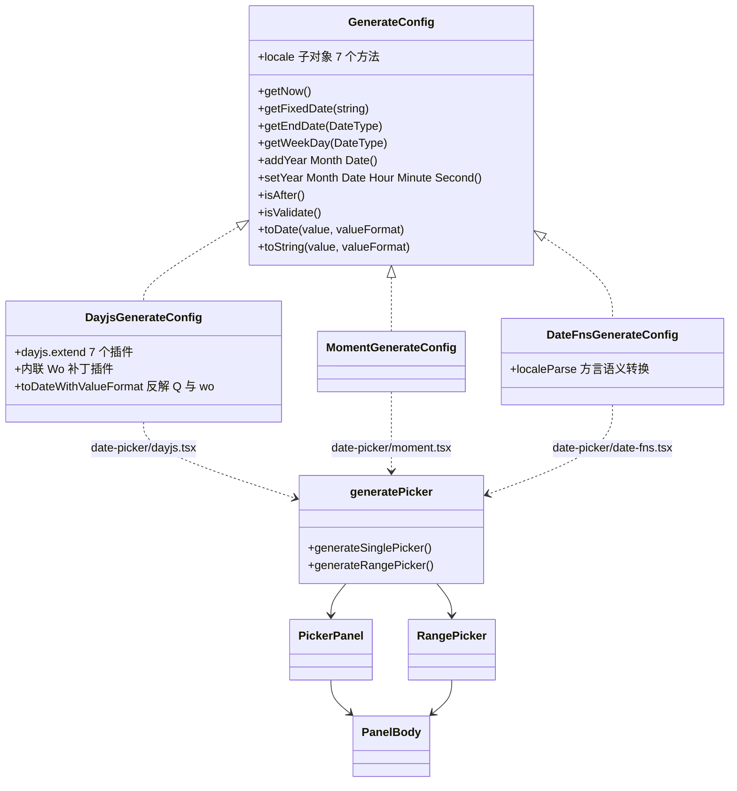
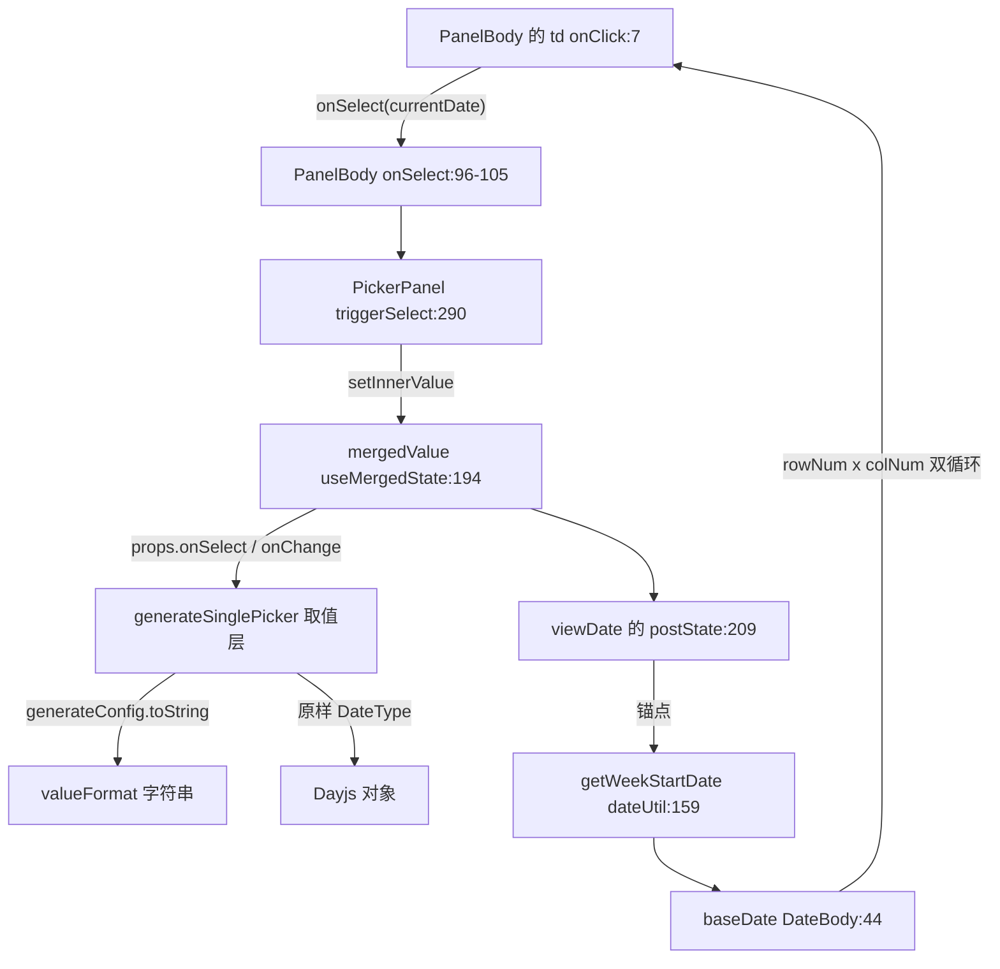
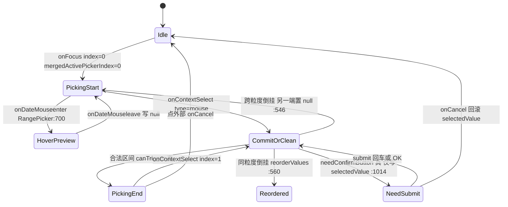

# I07 日期计算内核

> **本篇解决**：把「日期」这件事从这个组件库里剥出来看清楚——驱动日历面板的**不是** dayjs 而是中间那张 30 个函数的方法表；面板上一格一格的日子是**怎么**被算出来的（没有补位算法）；范围选择点了第二下之后谁是 start；`valueFormat` 字符串在**哪一层**变成 Dayjs 对象；时间面板的每一列步进而非每一格是怎么对齐的。
> **前置**：A07 交互基础设施总览：一个浮层是怎么拼起来的（未完成，本篇只按编号引用其主题，不展开）　**读者坐标**：`02-infrastructure` 第 7/16 篇

## 一、职责与边界

日期内核负责四件事：**日期算术的抽象**（`packages/xiaoye-ui/src/vc-picker/generate/`，一份接口 + 三实现）、**面板格子的生成**（`vc-picker/panels/`，`PanelBody` 的双层循环 + 各面板的 `getCellDate`/`isInView`）、**范围选择的中间态与非法区间纠正**（`vc-picker/RangePicker.tsx` + `hooks/useRangeViewDates.ts` + `hooks/useHoverValue.ts`）、**单位换算与格式解析**（`vc-picker/utils/dateUtil.ts`、`utils/timeUtil.ts`、`panels/TimePanel/TimeBody.tsx`）。

明确不负责：浮层如何定位、弹层如何接管点击外部（归 **A07**，其内部机制本篇不展开）；`xy-date-picker` 暴露哪些 props、`showTime` 的对象形态怎么合并进面板（归 **C05-06**）；语言包本身怎么装载、`PickerLocale` 从哪一层落到面板上（归 **I11 多语言体系**，本篇只用到一件事：面板拿到的是 `locale.locale` 这个字符串，形如 `zh_CN`，`date-picker/locale/` 下的包负责提供它）。

依赖清单（`grep -rn "from '.*vc-picker'"` 全量结果，非推测）：

- **被谁依赖**：直接引用 `vc-picker` 的只有 3 个文件——`date-picker/generatePicker/generateSinglePicker.tsx:53`、`date-picker/generatePicker/generateRangePicker.tsx:26`、`calendar/generateCalendar.tsx`。`time-picker` **不**直连 vc-picker，它复用 date-picker 的工厂：`time-picker/time-picker.tsx:4` 导入 `generatePicker`、`time-picker/dayjs.tsx:3` 导入 dayjs 的 generate 配置。也就是说内核的唯一入口是 `generatePicker`，`time-picker` 是它的第二个消费者。
- **依赖谁**：`vc-util/warning` 的 `noteOnce`（`vc-picker/generate/dayjs.ts:11`）、`_util/hooks/useMergedState`（`vc-picker/PickerPanel.tsx:38`）、`_util/KeyCode`（`vc-picker/utils/uiUtil.ts:2`）、`_util/classNames`（`vc-picker/panels/PanelBody.tsx:7`）、`shallowequal`（`vc-picker/RangePicker.tsx` 内部）、以及两个组件内 Context：`PanelContext.tsx`、`RangeContext.tsx`。
- **外部依赖**：`dayjs` 是运行时依赖（`packages/xiaoye-ui/package.json:61`）；`moment` 只出现在 devDependencies（`packages/xiaoye-ui/package.json:619`）；`date-fns` 连主库的声明都没有，只在仓库根的 devDependencies 里（`package.json:62`）。这三行的差别就是本篇 §四 论点 1 的全部内容。

## 二、源码地图

| 文件 | 行数 | 职责 | 关键导出 / 主入口行 |
| --- | --- | --- | --- |
| `packages/xiaoye-ui/src/vc-picker/generate/index.ts` | 52 | **算术接口本体**（`GenerateConfig`，纯类型） | `GenerateConfig`（:1） |
| `packages/xiaoye-ui/src/vc-picker/generate/dayjs.ts` | 249 | dayjs 实现 + 插件注册 + 语言名映射 | `generateConfig`（:163）、默认导出（:249） |
| `packages/xiaoye-ui/src/vc-picker/generate/moment.ts` | 158 | moment 实现 | `generateConfig`（:6）、`toDate`（:138） |
| `packages/xiaoye-ui/src/vc-picker/generate/dateFns.ts` | 139 | date-fns 实现 | `generateConfig`（:44）、`localeParse`（:35） |
| `packages/xiaoye-ui/src/vc-picker/Picker.tsx` | 671 | 单选容器：输入 + 弹层 + 面板装配 | `mergedValue`（:244）、`forwardKeydown`（:313） |
| `packages/xiaoye-ui/src/vc-picker/RangePicker.tsx` | 1360 | **范围选择内核**，本篇最长文件 | 见 §四 论点 4 |
| `packages/xiaoye-ui/src/vc-picker/PickerPanel.tsx` | 618 | 单选面板容器，`viewDate` 的持有者 | `viewDate`（:206）、`mergedMode`（:253） |
| `packages/xiaoye-ui/src/vc-picker/panels/PanelBody.tsx` | 150 | **格子矩阵生成器**（所有面板共用） | 双层循环（:59-131） |
| `packages/xiaoye-ui/src/vc-picker/panels/DatePanel/DateBody.tsx` | 119 | 日面板：锚点 + `isInView` | `getWeekStartDate`（:44） |
| `packages/xiaoye-ui/src/vc-picker/panels/DatePanel/index.tsx` | 116 | 日面板容器 + 键盘指令映射 | `DATE_ROW_COUNT`（:11）、`operationRef`（:40） |
| `packages/xiaoye-ui/src/vc-picker/panels/TimePanel/TimeBody.tsx` | 314 | 时间列生成与步进对齐 | 见 §四 论点 6 |
| `packages/xiaoye-ui/src/vc-picker/hooks/useCellClassName.ts` | 97 | 格子类名计算（in-view / in-range / hover 全家） | `useCellClassName`（:6）、`-in-view`（:55） |
| `packages/xiaoye-ui/src/vc-picker/hooks/useRangeViewDates.ts` | 128 | 双面板视图日期 | `viewDates`（:80） |
| `packages/xiaoye-ui/src/vc-picker/hooks/usePickerInput.ts` | 176 | 输入框键盘与粘贴接管 | 见 §四 论点 5 |
| `packages/xiaoye-ui/src/vc-picker/utils/dateUtil.ts` | 321 | 比较与解析工具集 | `getWeekStartDate`（:159）、`isInRange`（:141）、`parseValue`（:214） |
| `packages/xiaoye-ui/src/vc-picker/utils/timeUtil.ts` | 60 | 时间单位与步进元数据 | 见 §四 论点 6 |
| `packages/xiaoye-ui/src/vc-picker/utils/uiUtil.ts` | 279 | 键盘处理器、默认格式、滚动 | `createKeydownHandler`（:69）、`getDefaultFormat`（:147） |
| `packages/xiaoye-ui/src/date-picker/generatePicker/index.tsx` | 85 | 工厂聚合 | `generatePicker`（见论点 5） |
| `packages/xiaoye-ui/src/date-picker/generatePicker/generateSinglePicker.tsx` | 310 | 单选取值与 `valueFormat` 转换 | 见 §四 论点 5 |
| `packages/xiaoye-ui/src/date-picker/dayjs.tsx` | 39 | **发布面唯一入口**：绑定 Dayjs | `generatePicker<Dayjs>`（:19） |
| `packages/xiaoye-ui/src/date-picker/moment.tsx`／`date-fns.tsx` | 41／41 | 另两套绑定，未进 `exports` | `generatePicker<Moment>`／`<Date>`（:18） |

注意一个目录名的事实：**任务书写的 `src/date-picker/generate/` 这个目录不存在**。`ls packages/xiaoye-ui/src/date-picker` 只给出 `generatePicker/`，真正的「generate 适配层」在 `src/vc-picker/generate/`。`date-picker/` 侧只有三个**绑定文件**（`dayjs.tsx`、`moment.tsx`、`date-fns.tsx`），它们不含任何日期算术，只做「把配置塞进工厂 + 起标签名」这一件事。本篇一律用真实路径。

## 三、架构与数据流

### 图 1：适配层的静态结构（谁实现接口、谁消费实现）



这张图要说的是**分层唯一性**：`GenerateConfig` 只出现在 `vc-picker/generate/index.ts:1`，是一个纯类型（文件里没有任何运行时代码，52 行全是类型声明）；面板层 `PanelBody` 完全不认识 dayjs，它只通过 props 里的 `generateConfig` 调用接口（`vc-picker/panels/PanelBody.tsx:66-71` 用 `generateConfig` 传给 `getCellDateDisabled`）。**任何一处面板直接写 `dayjs()` 都会破坏这张图**，实测 `vc-picker/panels/` 下没有任何 `from 'dayjs'` 导入。

### 图 2：一次点击的值流（单选）



分支解释：`CELL → PB` 这条边上的 `onClick` 做了 `e.stopPropagation()`（`vc-picker/panels/PanelBody.tsx:97`），防止点击冒泡到弹层的「点击外部关闭」逻辑——这是 A07 主题与本内核的接缝处；`PP → MV` 之后分成两条出口（字符串与对象），分叉点在 `date-picker/generatePicker/` 而不是 vc-picker 里，这正是「值类型转换归组件层」的证据（详见论点 5）；`MV → VD` 这条回边解释了为什么选中一个跨月日期后面板会翻月——`viewDate` 的初值来自 `mergedValue`（`vc-picker/PickerPanel.tsx:208` 的 `defaultValue: props.defaultPickerValue || mergedValue.value`）。

## 四、核心机制精读

### 论点 1：日期内核的全部耦合面就是 30 个纯函数；三套实现里只有 dayjs 真正可被使用方触及

`GenerateConfig` 不是「一个 class」，而是一份**扁平的方法表**。读完整文件可以看到它的分组与数量是固定的：

```ts
// packages/xiaoye-ui/src/vc-picker/generate/index.ts:1
export type GenerateConfig<DateType> = {
  // Get
  getWeekDay: (value: DateType) => number;
  getSecond: (value: DateType) => number;
  getMinute: (value: DateType) => number;
  getHour: (value: DateType) => number;
  getDate: (value: DateType) => number;
  getMonth: (value: DateType) => number;
  getYear: (value: DateType) => number;
  getNow: () => DateType;
  getFixedDate: (fixed: string) => DateType;
  getEndDate: (value: DateType) => DateType;

  // Set
  addYear: (value: DateType, diff: number) => DateType;
  addMonth: (value: DateType, diff: number) => DateType;
  addDate: (value: DateType, diff: number) => DateType;
  setYear: (value: DateType, year: number) => DateType;
  // ...
  // Compare
  isAfter: (date1: DateType, date2: DateType) => boolean;
  isValidate: (date: DateType) => boolean;

  toDate: (value: string | string[] | DateType | DateType[], valueFormat: string) => DateType | DateType[];
  toString: (value: string | string[] | DateType | DateType[], valueFormat: string) => string | string[];
  locale: {
    getWeekFirstDay: (locale: string) => number;
    getWeekFirstDate: (locale: string, value: DateType) => DateType;
    getWeek: (locale: string, value: DateType) => number;
    format: (locale: string, date: DateType, format: string) => string;
    /** Should only return validate date instance */
    parse: (locale: string, text: string, formats: string[]) => DateType | null;
    getShortWeekDays?: (locale: string) => string[];
    getShortMonths?: (locale: string) => string[];
  };
};
```

精确计数：**取数 10 个**（`:3-12`）、**变位 9 个**（`:15-23`，其中 `addXxx` 3 个走 diff、`setXxx` 6 个走绝对值）、**比较 2 个**（`:26-27`）、**字符串互转 2 个**（`:29-36`）、**locale 子对象 7 个**（`:38-50`，其中 `getShortWeekDays`/`getShortMonths` 是**可选**的，两个 `?` 在 `:48` 与 `:50`）。合计 30 个函数位、24 个顶层键。注意没有的东西：没有 `subtract`、没有 `startOf/endOf`、没有 `diff`、没有 `isBefore`（`isBefore` 靠 `isAfter` 反着用）、没有时区方法。接口层面就没有给「相对差值」留位置。

实现侧三套齐全，且三套都被接进了工厂：

```tsx
// packages/xiaoye-ui/src/date-picker/dayjs.tsx:18
const { DatePicker, WeekPicker, MonthPicker, YearPicker, TimePicker, QuarterPicker, RangePicker } =
  generatePicker<Dayjs>(dayjsGenerateConfig);
```

`date-picker/moment.tsx:18` 与 `date-picker/date-fns.tsx:18` 是同构的两行，只是类型参数换成 `Moment` 与 `Date`；`time-picker/` 与 `calendar/` 目录下各有同样三份（`time-picker/dayjs.tsx:3`、`time-picker/moment.tsx:3`、`time-picker/date-fns.tsx:2`；`calendar/dayjs.tsx:1`、`calendar/moment.tsx:2`、`calendar/date-fns.tsx:1`），合计 **9 个绑定文件 × 3 套实现**。

但「实现了」不等于「能用」。**主库的公开导出面只有一个入口**：`date-picker/index.tsx:1` 写死 `import DatePicker from './dayjs'`，`packages/xiaoye-ui/package.json:231-235` 的 `exports` 只登记了 `./date-picker` 与 `./date-picker/style` 两个键，没有 `./date-picker/moment` 或 `./date-picker/date-fns`。而依赖声明那一侧更硬：`dayjs` 在 `dependencies`（`packages/xiaoye-ui/package.json:46`），`moment` 在 `devDependencies`（同文件 `:698`），`date-fns` 只出现在仓库根的 `devDependencies`（`package.json:62`）。

结论分三层：**换 date-fns 在架构上是允许的**（工厂是纯泛型，面板零依赖具体库，`dateFns.ts:44-137` 已把 30 个方法位填满）；**在发布面上是拿不到的**（既没有 subpath export，也没有 dependency 声明，用户 `import 'xiaoye-ui/date-picker/date-fns'` 会同时撞上 exports 白名单和缺失依赖）；**在实现质量上是有暗坑的**——`dateFns.ts` 需要把 dayjs 方言的格式串翻译一遍才能给 date-fns 用，这个翻译函数 `localeParse` 只做了一半：

```ts
// packages/xiaoye-ui/src/vc-picker/generate/dateFns.ts:35
const localeParse = (format: string) => {
  return format
    .replace(/Y/g, 'y')
    .replace(/D/g, 'd')
    .replace(/gggg/, 'yyyy')
    .replace(/g/g, 'G')
    .replace(/([Ww])o/g, 'wo');
};
```

它在 `locale.format`（`:97`）与 `locale.parse`（`:103`）里被调用，但 `toDate`（`:115-127`）与 `toString`（`:128-136`）**直接**把 `valueFormat` 交给 `parseDate`/`formatDate`，没有过 `localeParse`。也就是说：date-fns 实现下如果传 `valueFormat: 'YYYY-MM-DD'`，走 `value` 字符串化那条路会拿到 date-fns 不认识 token 的结果（date-fns 的 `YYYY` 不是它的有效 token）。这不是理论风险，而是「两套实现覆盖的路径不等价」的直接证据，写进 §七 坑 3。

### 论点 2：dayjs 插件不是按需加载，而是在 generate 模块顶层作为 import 副作用注册，且带一个手写补丁插件

```ts
// packages/xiaoye-ui/src/vc-picker/generate/dayjs.ts:1
import type { Dayjs } from 'dayjs';
import dayjs from 'dayjs';
import weekday from 'dayjs/plugin/weekday';
import localeData from 'dayjs/plugin/localeData';
import weekOfYear from 'dayjs/plugin/weekOfYear';
import weekYear from 'dayjs/plugin/weekYear';
import quarterOfYear from 'dayjs/plugin/quarterOfYear';
import advancedFormat from 'dayjs/plugin/advancedFormat';
import customParseFormat from 'dayjs/plugin/customParseFormat';
import type { GenerateConfig } from '.';
import { noteOnce } from '../../vc-util/warning';

dayjs.extend(customParseFormat);
dayjs.extend(advancedFormat);
dayjs.extend(weekday);
dayjs.extend(localeData);
dayjs.extend(weekOfYear);
dayjs.extend(weekYear);
dayjs.extend(quarterOfYear);

dayjs.extend((_o, c) => {
  // todo support Wo (ISO week)
  const proto = c.prototype;
  const oldFormat = proto.format;
  proto.format = function f(formatStr: string) {
    const str = (formatStr || '').replace('Wo', 'wo');
    return oldFormat.bind(this)(str);
  };
});
```

**7 个具名插件**（`vc-picker/generate/dayjs.ts:13-19`）+ **1 个匿名补丁插件**（`:21-29`）。逐个对应到内核里的真实用法，可以验证「一个都不能少」：`customParseFormat` 支撑 `parse` 里 `dayjs(text, format, true)` 的严格模式（`:220`）；`weekday`+`localeData` 支撑 `getWeekDay`（`:168-171`）与 `getWeekFirstDay`（`:195`）；`weekOfYear`+`weekYear` 支撑 `getWeek`（`:197`）以及 `Wo`/`gggg` token；`quarterOfYear` 支撑 `QuarterPanel` 与 `toDateWithValueFormat` 的 `.quarter()`（`:142`）；`advancedFormat` 支撑 `Q`/`wo`/`ww`/`gggg` 这些格式化 token。

那个匿名插件是全篇唯一一处**改 dayjs 原型**的地方：它把 `proto.format` 包一层，先把字符串里的 `Wo` 换成 `wo` 再交给原实现（`:26`）。为什么需要：`week` 面板的默认格式就是 `gggg-wo`（`vc-picker/utils/uiUtil.ts:161`），而大写 `Wo`（ISO 周）dayjs 原生不支持，代码里留了 `// todo support Wo (ISO week)`（`:22`）。代价：这是**全局副作用**，一旦 `import 'xiaoye-ui/date-picker'`，宿主应用里所有 dayjs 实例的 `format` 都被改写过，同名的 `Wo` 在应用自己的代码里也会静默降级成 `wo`；且插件在模块顶层执行，tree-shaking 动不了它，也无法按需关闭。

注册位置只此一处（`grep -rn "dayjs.extend" --include='*.ts' --include='*.tsx' packages apps --exclude-dir=dist` 的命中全部落在 `vc-picker/generate/dayjs.ts:13-21`）。没有 `ConfigProvider` 级别的开关，也没有「内核用了哪些插件」的对外声明——接入方想知道必须读这个文件。

另一半是语言名映射。dayjs 的 locale 名与本库的语言 key 不同形，`localeMap`（`:32-98`）只登记了 10 个特例（`bn_BD`、`by_BY`、`en_GB`、`en_US`、`fr_BE`、`fr_CA`、`hy_AM`、`kmr_IQ`、`nl_BE`、`pt_BR`、`zh_CN`、`zh_HK`、`zh_TW`），其余一律走兜底：

```ts
// packages/xiaoye-ui/src/vc-picker/generate/dayjs.ts:100
const parseLocale = (locale: string) => {
  const mapLocale = localeMap[locale];
  return mapLocale || locale.split('_')[0];
};
```

`locale.split('_')[0]` 意味着 `zh_CN` 之外的绝大多数 key（如文件里成排注释掉的 `es_ES`、`ja_JP`、`ru_RU`）会被削成 `es`/`ja`/`ru` 去查 dayjs。与 **I11 多语言体系** 的接缝就在这一行：本库 locale 包提供的 `lang.locale` 字符串（形如 `zh_CN`）传到这里被二次翻译，**dayjs 自己的语言数据文件是否被宿主 `import` 过，内核不管**——`weekday()`、`monthsShort()`（`:198-199`）在语言数据缺失时会掉回英文而不报错。这是 I11 未覆盖、本篇必须点出的一条：文案在 locale 包侧，日历数字与星期名在 dayjs 侧，两边只有 `parseLocale` 这一个翻译点。

### 论点 3：面板没有「补位算法」，42 格是同一个锚点的连续日期流；跨月判断只产出一个类名

直觉上日历面板要处理「上月尾巴补几天、下月开头补几天」。本内核里**不存在**这种补位代码——它把整张表退化成一个公式：给定锚点 `baseDate` 与行列数，第 `i×colNum+j` 格就是 `baseDate` 往后数第 `offset` 天。

```tsx
// packages/xiaoye-ui/src/vc-picker/panels/PanelBody.tsx:59
  for (let i = 0; i < rowNum; i += 1) {
    const row: VueNode[] = [];
    let rowStartDate: DateType;

    for (let j = 0; j < colNum; j += 1) {
      const offset = i * colNum + j;
      const currentDate = getCellDate(baseDate, offset);
      const disabled = getCellDateDisabled({
        cellDate: currentDate,
        mode: mode.value,
        disabledDate,
        generateConfig,
      });

      if (j === 0) {
        rowStartDate = currentDate;

        if (prefixColumn) {
          row.push(prefixColumn(rowStartDate));
        }
      }
```

`PanelBody`（150 行）是个**无状态的 render 函数组件**（`vc-picker/panels/PanelBody.tsx:33` 的 `function PanelBody<DateType>(_props)`，注意它没有 `defineComponent`，靠 `useMergeProps(_props)` 取 props），矩阵的三要素 `rowNum`、`colNum`、`baseDate` 和三个策略函数 `getCellDate`、`getCellText`、`getCellClassName` 全部由上层面板注入。`getCellDateDisabled`（`vc-picker/utils/dateUtil.ts:234`）负责把 `disabledDate` 按面板粒度放大：在 `year` 模式下判断的是「这一年里有没有任何一天可用」，这就是为什么禁用逻辑不会因面板层级改变而写五遍。

日面板给出的参数是：

```tsx
// packages/xiaoye-ui/src/vc-picker/panels/DatePanel/DateBody.tsx:44
  const baseDate = getWeekStartDate(locale.locale, generateConfig, viewDate);
  // ...
  const getCellClassName = useCellClassName({
    cellPrefixCls,
    today,
    value,
    generateConfig,
    // ...
    isSameCell: (current, target) => isSameDate(generateConfig, current, target),
    isInView: date => isSameMonth(generateConfig, date, viewDate),
    offsetCell: (date, offset) => generateConfig.addDate(date, offset),
  });
```

锚点的算式是全部机制所在：

```ts
// packages/xiaoye-ui/src/vc-picker/utils/dateUtil.ts:159
export function getWeekStartDate<DateType>(
  locale: string,
  generateConfig: GenerateConfig<DateType>,
  value: DateType,
) {
  const weekFirstDay = generateConfig.locale.getWeekFirstDay(locale);
  const monthStartDate = generateConfig.setDate(value, 1);
  const startDateWeekDay = generateConfig.getWeekDay(monthStartDate);

  let alignStartDate = generateConfig.addDate(monthStartDate, weekFirstDay - startDateWeekDay);

  if (
    generateConfig.getMonth(alignStartDate) === generateConfig.getMonth(value) &&
    generateConfig.getDate(alignStartDate) > 1
  ) {
    alignStartDate = generateConfig.addDate(alignStartDate, -7);
  }

  return alignStartDate;
}
```

三步：把 `viewDate` 钳到 1 号（`:165`）；按 locale 的周首日回退到那一周的开头（`:168`）；如果回退后还落在**同月的 1 号之后**（即锚点晚于 1 号），再整周往前退 7 天（`:170-175`）。第三条判断的意义是「保证第一行一定含 1 号之前的那些天」，否则 6 行 × 7 = 42 格里会出现整月都在视图内、最后一行全是下月的偏斜。行数固定为 6：`const DATE_ROW_COUNT = 6;`（`vc-picker/panels/DatePanel/index.tsx:11`），传给 `rowCount`（同文件 `:107`），列数 `colNum={WEEK_DAY_COUNT}`（`DateBody.tsx:85`），`WEEK_DAY_COUNT = 7`（`vc-picker/utils/dateUtil.ts:5`）。**格子总数恒为 42，与月份长短无关**，这是本面板最反直觉也最省钱的一条设计。

表头同理，不是补位而是取模：`weekDaysLocale[(i + weekFirstDay) % WEEK_DAY_COUNT]`（`DateBody.tsx:61`），`weekDaysLocale` 优先用 locale 包里的 `shortWeekDays`，没有才回落到 `generateConfig.locale.getShortWeekDays`（`DateBody.tsx:51-55`）——这个可选分支就是 `index.ts:48` 那个 `?` 的唯一消费点。

「跨月」在这里被降级成一个类名。`isInView` 是 `useCellClassName` 的入参（`vc-picker/hooks/useCellClassName.ts:21` 声明为必填函数），产出的唯一结果是：

```ts
// packages/xiaoye-ui/src/vc-picker/hooks/useCellClassName.ts:53
    return {
      // In view
      [`${cellPrefixCls}-in-view`]: isInView(currentDate),

      // Range
      [`${cellPrefixCls}-in-range`]: isInRange<DateType>(
        generateConfig,
        rangeStart,
        rangeEnd,
        currentDate,
      ),
      [`${cellPrefixCls}-range-start`]: isRangeStart(currentDate),
      [`${cellPrefixCls}-range-end`]: isRangeEnd(currentDate),
```

回答任务书的问题：`cellInMonth` 这个判断在本库里**不叫这个名字、也不是一个函数**，它就是 `DateBody.tsx:73` 那个 `isInView: date => isSameMonth(...)` 的箭头函数，语义随面板变化——`MonthBody` 给的是 `isInView: () => true`（`vc-picker/panels/MonthPanel/MonthBody.tsx:41`，月面板不存在跨月），`QuarterBody` 同样恒真（`vc-picker/panels/QuarterPanel/QuarterBody.tsx:37`），`YearBody` 则换成十年区间判断：

```ts
// packages/xiaoye-ui/src/vc-picker/panels/YearPanel/YearBody.tsx:32
  const startYear = Math.floor(yearNumber / YEAR_DECADE_COUNT) * YEAR_DECADE_COUNT;
  const endYear = startYear + YEAR_DECADE_COUNT - 1;
  const baseYear = generateConfig.setYear(
    viewDate,
    startYear - Math.ceil((YEAR_COL_COUNT * YEAR_ROW_COUNT - YEAR_DECADE_COUNT) / 2),
  );

  const isInView = (date: DateType) => {
    const currentYearNumber = generateConfig.getYear(date);
    return startYear <= currentYearNumber && currentYearNumber <= endYear;
  };
```

年面板的锚点公式和日面板不同：它先算出所在十年的起点，再从 `4×3` 共 12 格里**居中**多留的 2 格往前退（`:36` 的 `Math.ceil((12-10)/2)`），于是 10 个年份上下各 1 格灰格。这是「连续流 + isInView 类名」这套机制在年粒度上的复用，`DecadeBody` 更进一步把 `getCellDate` 换成 `generateConfig.addYear(date, offset * DECADE_UNIT_DIFF)`（`vc-picker/panels/DecadePanel/DecadeBody.tsx:60`）——同一个 `PanelBody`，步长从 1 年变 10 年，矩阵代码一行没改。

这套设计的收益与代价都很清楚：**收益**是矩阵生成完全无分支，面板不需要知道月份天数、闰年、周首日之外的任何东西；`disabled`、`start`/`end` 边缘类（`PanelBody.tsx:89-93`）也都在同一条流上算。**代价**是视图里存在「不属于本月的可选格子」：点击一个 `-in-view` 为 false 的格子会正常触发 `onSelect`（`PanelBody.tsx:96-105` 只挡 `disabled`），选中后 `viewDate` 随之翻月——这不是 bug，但改动者必须知道「灰格」和「禁用格」是两个正交概念，把它们混为一谈（例如给非 in-view 格子加 `disabled`）会直接破坏跨月选择。

### 论点 4：范围选择同时维护三份值状态；点错顺序时清空另一端而不是交换

任务书问「start/end 谁先谁后、点错顺序怎么处理」。答案是：**谁先谁后由 `mergedActivePickerIndex` 决定，而不是由时间的先后决定**；点错顺序的处理是**丢掉另一头**。

三份状态必须分清：

```tsx
// packages/xiaoye-ui/src/vc-picker/RangePicker.tsx:316
      const [mergedValue, setInnerValue] = useMergedState<RangeValue<DateType>>(null, {
        value: toRef(props, 'value'),
        defaultValue: props.defaultValue,
        postState: values =>
          props.picker === 'time' && !props.order
            ? values
            : reorderValues(values, props.generateConfig),
      });

      // =========================== View Date ===========================
      // Config view panel
      const [startViewDate, endViewDate, setViewDate] = useRangeViewDates({
        values: mergedValue,
        // ...
      });

      // ========================= Select Values =========================
      const [selectedValue, setSelectedValue] = useMergedState(mergedValue.value, {
        postState: values => {
          let postValues = values;

          if (mergedDisabled.value[0] && mergedDisabled.value[1]) {
            return postValues;
          }

          // Fill disabled unit
          for (let i = 0; i < 2; i += 1) {
            if (
              mergedDisabled.value[i] &&
              !getValue(postValues, i) &&
              !getValue(props.allowEmpty, i)
            ) {
              postValues = updateValues(postValues, props.generateConfig.getNow(), i);
            }
          }
          return postValues;
        },
      });
```

`mergedValue`（`:331`）是**已提交**的值，也是 `value`/`onChange` 的那一份；`selectedValue`（`:350`）是**当前选择会话的中间态**，面板高亮、hover 预览都以它为基准；`hoverRangedValue`（`:691`）是纯视觉的悬浮预览。三者是不同 ref，不存在「一个对象里带个 selecting 标记」的写法。中间态与提交值分开的直接后果：用户点了一头不点另一头、然后点外部关闭，`onChange` 不会触发——因为 `triggerChange` 只在选满或提交时被调用。

`selectedValue` 的 `postState` 还藏着一件事：被禁用的一端会自动填上 `getNow()`（`:365`）。这是「只禁用起点输入框」这类配置能工作的原因，同时也是「为什么我传了 `disabled={[true, false]}` 之后 `onChange` 收到的 start 不是 undefined」的答案。

哪一端在选：

```tsx
// packages/xiaoye-ui/src/vc-picker/RangePicker.tsx:299
      const [mergedActivePickerIndex, setMergedActivePickerIndex] = useMergedState<0 | 1>(0, {
        value: toRef(props, 'activePickerIndex'),
      });
```

默认 0（先选 start），并且它是**受控 prop**（`activePickerIndex`，声明在 `:129`、注册在 props 数组 `:247`）。面板点击落到哪一格由它决定：

```tsx
// packages/xiaoye-ui/src/vc-picker/RangePicker.tsx:998
      const onContextSelect = (date: DateType, type: 'key' | 'mouse' | 'submit') => {
        const values = updateValues(selectedValue.value, date, mergedActivePickerIndex.value);

        if (type === 'submit' || (type !== 'key' && !needConfirmButton.value)) {
          // triggerChange will also update selected values
          triggerChange(values, mergedActivePickerIndex.value);
          // clear hover value style
          if (mergedActivePickerIndex.value === 0) {
            onStartLeave();
          } else {
            onEndLeave();
          }
        } else {
          setSelectedValue(values);
        }
      };
```

`needConfirmButton` 为真（`picker === 'date' && showTime` 或 `picker === 'time'`，`:283-285`）时，鼠标点击只写中间态（`:1014` 的 `setSelectedValue`），必须等 `submit`（回车或点 OK）才进 `triggerChange`。这就是带时间的 RangePicker「点完日期还要点确定」这条交互在内核层的实现位置。

非法区间的纠正集中在 `triggerChange` 的这一段，它是本篇认为最反直觉的代码：

```tsx
// packages/xiaoye-ui/src/vc-picker/RangePicker.tsx:514
        // >>>>> Format start & end values
        if (startValue && endValue && generateConfig.isAfter(startValue, endValue)) {
          if (
            // WeekPicker only compare week
            (picker === 'week' &&
              !isSameWeek(generateConfig, locale.locale, startValue, endValue)) ||
            // QuotaPicker only compare week
            (picker === 'quarter' && !isSameQuarter(generateConfig, startValue, endValue)) ||
            // Other non-TimePicker compare date
            (picker !== 'week' &&
              picker !== 'quarter' &&
              picker !== 'time' &&
              !(showTime
                ? isEqual(generateConfig, startValue, endValue)
                : isSameDate(generateConfig, startValue, endValue)))
          ) {
            // Clean up end date when start date is after end date
            if (sourceIndex === 0) {
              values = [startValue, null];
              endValue = null;
            } else {
              startValue = null;
              values = [null, endValue];
            }

            // Clean up cache since invalidate
            openRecordsRef.value = {
              [sourceIndex]: true,
            };
          } else if (picker !== 'time' || order !== false) {
            // Reorder when in same date
            values = reorderValues(values, generateConfig);
          }
        }
```

读法：外层 `if` 已经确定「新起点晚于新终点」，即区间是反的。此时**先问反得是否跨粒度**——week 比周号（`isSameWeek`）、quarter 比季度（`isSameQuarter`）、其余比日（`isSameDate`，带 `showTime` 时比到秒 `isEqual`）。

- 跨粒度（真的反了）：`:546-552` 按 `sourceIndex` 判断用户这一次动的是哪头，**保留刚点的那头、把另一头置 null**。也就是说在已有 `[3/10, 3/20]` 的状态下，用户把起点改成 4/1，得到的是 `[4/1, null]`（中间态只剩一头），而不是 `[3/20, 4/1]` 这种自动交换。设计意图很直白：自动交换会让用户「刚点的那一下」被另一个日期的语义覆盖，重选一次的成本低于误改一整段。
- 同粒度反了（例如 `showTime` 下同一天但时分秒倒挂、或年/月面板上同一年内的两侧）：`:558-560` 走 `reorderValues` **交换**，因为此时两个值指向同一个显示格子，不存在语义覆盖问题。`order === false`（仅 `picker === 'time'` 有意义）可以把这个交换也关掉，配合 `:334-337` 的 `postState` 短路，得到「时间范围不排序」的行为。

`reorderValues` 本体只有 6 行，且只在两端都有值时才动：

```ts
// packages/xiaoye-ui/src/vc-picker/RangePicker.tsx:50
function reorderValues<DateType>(
  values: RangeValue<DateType>,
  generateConfig: GenerateConfig<DateType>,
): RangeValue<DateType> {
  if (values && values[0] && values[1] && generateConfig.isAfter(values[0], values[1])) {
    return [values[1], values[0]];
  }

  return values;
}
```

注意 `:337` 把它挂在 `mergedValue` 的 `postState` 上——**受控 `value` 传错顺序也会在渲染前被纠正**，因此 `onChange` 回调里几乎不可能拿到反序的对，除非 `picker === 'time' && !order`。

另一处副作用是 `openRecordsRef`（`:290` 定义，注释原文 `We record oqqpened status here in case repeat open with picker`，含上游遗留的拼写错误 `oqqpened`）。`:555-557` 把它重置成「只有刚操作的那一头算打开过」，效果是非法区间被清理后另一端会**重新弹开**，用户被引导去补另一头而不是看到一段无效区间。

提交与否由 `canValueTrigger` 把门：

```ts
// packages/xiaoye-ui/src/vc-picker/RangePicker.tsx:61
function canValueTrigger<DateType>(
  value: EventValue<DateType>,
  index: number,
  disabled: [boolean, boolean],
  allowEmpty?: [boolean, boolean] | null,
): boolean {
  if (value) {
    return true;
  }

  if (allowEmpty && allowEmpty[index]) {
    return true;
  }

  if (disabled[(index + 1) % 2]) {
    return true;
  }

  return false;
}
```

第三行条件 `(index + 1) % 2` 是**对端**的禁用状态：只要另一头被禁用，空头也算可提交（`:590` 的 `canTrigger` 要求两头都过）。随后 `:592-604` 才 `setInnerValue(values)` 并比对 `isEqual(mergedValue…, startValue/endValue)` 决定是否 `emit('change')`。所以「值变了但没触发 onChange」只有两种可能：另一头空且未 `allowEmpty`，或新值与旧值 `isEqual` 完全相同。

hover 预览的写法值得一记，它复用同一个索引：

```tsx
// packages/xiaoye-ui/src/vc-picker/RangePicker.tsx:685
      const onDateMouseenter = (date: DateType) => {
        setHoverRangedValue(updateValues(selectedValue.value, date, mergedActivePickerIndex.value));
        if (mergedActivePickerIndex.value === 0) {
          onStartEnter(date);
        } else {
          onEndEnter(date);
        }
      };

      const onDateMouseleave = () => {
        setHoverRangedValue(updateValues(selectedValue.value, null, mergedActivePickerIndex.value));
```

`onDateMouseenter` 通过 `PanelContext` 提供给 `PanelBody`（`RangePicker.tsx:1014-1015` 的 `useProvidePanel`），`PanelBody.tsx:106-115` 在 `td` 上绑 mouseenter/mouseleave。而 `rangeHoverValue.value || selectedValue.value`（`:937`）作为 `rangedValue` 注入 `RangeContext`，最后被 `useCellClassName` 消费成 `-in-range`/`-range-hover` 类名（`hooks/useCellClassName.ts:58-80`）——这就是「鼠标还没点，选中段已经画出来了」的完整链路。

### 图 3：范围选择的状态流转



分支说明：`CommitOrClean` 是 `triggerChange` 的状态化身，它的三条出边分别对应 `:546`（清空另一端并回到当前索引）、`:560`（交换）、`:592`（提交）；`NeedSubmit` 只在 `needConfirmButton` 为真时进入（`:1004` 的条件），这解释了为什么日期区间面板点第二下就关而带时间的不关；`onCancel` 回滚走 `Picker.tsx:360-364`（单选）与 RangePicker 的对应分支，中间态被丢弃、`mergedValue` 不动。

### 论点 5：本内核没有 `activeDate`，视图日期叫 `viewDate`；键盘导航由面板自注册、由输入 hook 转发；值类型转换在 date-picker 层

先把命名事实钉住，因为它会误导任何从上游实现或从文档站搜过来的读者：

```bash
# 仓库内 activeDate 的命中数（已排除 dist 与 node_modules）
grep -rn "activeDate" packages/xiaoye-ui/src packages/xiaoye-ui/tests apps/docs \
  --include='*.ts' --include='*.tsx' --include='*.js' --include='*.vue' --include='*.md' | wc -l   # 输出 0
```

替代它的是一对名字：**内部状态 `viewDate`**（面板层与 `useMergedState` 用它）与**面板级 prop `pickerValue`**（受控源）。注意后者只到面板这一层为止，不是组件的公开 prop，详见 §五 最后一段。

单选侧的持有者是 `PickerPanel`，不是某个 hook：

```tsx
// packages/xiaoye-ui/src/vc-picker/PickerPanel.tsx:206
      const [viewDate, setInnerViewDate] = useMergedState<DateType | null>(null, {
        value: toRef(props, 'pickerValue'),
        defaultValue: props.defaultPickerValue || mergedValue.value,
        postState: date => {
          const { generateConfig, showTime, defaultValue } = props;
          const now = generateConfig.getNow();
          if (!date) return now;
          // When value is null and set showTime
          if (!mergedValue.value && props.showTime) {
            if (typeof showTime === 'object') {
              return setDateTime(
                generateConfig,
                Array.isArray(date) ? date[0] : date,
                showTime.defaultValue || now,
              );
            }
            // ...
            return setDateTime(generateConfig, Array.isArray(date) ? date[0] : date, now);
          }
          return date;
        },
      });
```

`:208` 的 `defaultValue: props.defaultPickerValue || mergedValue.value` 是「选中跨月日期后面板跟着翻」的源头；`postState` 里的 `setDateTime`（`utils/timeUtil.ts:17-31`）则负责「有 showTime 但值为空时，视图日期要带上默认时分秒」，这段是 `viewDate` 唯一被加工的地方。对外通知函数是 `setViewDate`（`:235-240`），它同时调 `props.onPickerValueChange`。

范围侧因为有两个面板，视图日期被抽成独立 hook：`hooks/useRangeViewDates.ts:65`（`export default function useRangeViewDates`），返回三元组 `[startViewDate, endViewDate, setViewDate]`（`:75` 的签名）。它的取视图日期优先级写在 `getViewDate`（`:84-97`）：先 `defaultDates[index]`，再用户手动设过的 `viewDates`，再 `getRangeViewDate`，最后 `getNow()`。其中 `getRangeViewDate`（`:37-63`）决定第二面板显示哪个月：

```ts
// packages/xiaoye-ui/src/vc-picker/hooks/useRangeViewDates.ts:50
  if (startDate && endDate) {
    const distance = getStartEndDistance(startDate, endDate, picker, generateConfig);
    switch (distance) {
      case 'same':
        return startDate;
      case 'closing':
        return startDate;
      default:
        return getClosingViewDate(endDate, picker, generateConfig, -1);
    }
  }

  return startDate;
```

`closing` 的定义在 `utils/dateUtil.ts:180-195` 的 `getClosingViewDate`（按 picker 粒度算下一档视图），`getStartEndDistance` 在 `useRangeViewDates.ts:8-35`。这段的意思是：**右面板默认只显示比左面板晚一档的视图**，跨得太远时才退到 `endDate - 1` 档，避免两个面板相距十万八千里。

键盘导航**不是一个 hook**，而是一条「面板注册 ref + 输入 hook 转发」的链子：

```tsx
// packages/xiaoye-ui/src/vc-picker/Picker.tsx:299
      const forwardKeydown = (e: KeyboardEvent) => {
        if (mergedOpen.value && operationRef.value && operationRef.value.onKeydown) {
          // Let popup panel handle keyboard
          return operationRef.value.onKeydown(e);
        }
```

`operationRef` 在 `Picker.tsx:240` 创建，各面板在渲染时把自己的处理函数**覆盖写入**（`vc-picker/panels/DatePanel/index.tsx:40`：`operationRef.value = { onKeydown: (event) => createKeydownHandler(event, {...}) }`），映射规则是方向键 ±1 天、上下 ±7 天、Ctrl/Cmd+左右 ±1 年、PgUp/PgDn ±1 月（`DatePanel/index.tsx:43-54`），语义翻译集中在 `utils/uiUtil.ts:69-144` 的 `createKeydownHandler`。注意它调的是 `onSelect(..., 'key')` 而不是 `onChange`——键盘选值走的是与鼠标同一条 `onContextSelect` 路径（`RangePicker.tsx:998`），因此键盘也受 `needConfirmButton` 约束，差别只在 `type === 'submit'` 时回车直接提交（`:1004`）。

输入侧的按键归 `hooks/usePickerInput.ts`：

```ts
// packages/xiaoye-ui/src/vc-picker/hooks/usePickerInput.ts:60
      switch (e.which) {
        case KeyCode.ENTER: {
          if (!open.value) {
            triggerOpen(true);
          } else if (onSubmit() !== false) {
            typing.value = true;
          }

          e.preventDefault();
          return;
        }
```

`onSubmit` 的具体实现由 `Picker.tsx:345-359` 注入：先检查 `selectedValue` 非空且未被 `disabledDate` 拒绝，再 `triggerChange` + `triggerOpen(false)` + `resetText()`。Esc 走 `onCancel`（`usePickerInput.ts:85-88` → `Picker.tsx:360-364`），把中间态回滚成 `mergedValue`。Tab 用来跳出而不提交（`:72-83`）。**所以「哪个 hook 管键盘」的准确回答是：`usePickerInput` 管 Enter/Tab/Esc 这三个输入框级按键，日期步进类的方向键由每个面板自己经 `operationRef` 提供**，两者靠 `forwardKeydown` 连接。

值的类型转换不在 vc-picker。`valueFormat` 在 vc-picker 里只以参数名出现在三处 generate 实现的 `toDate`/`toString` 签名里（`vc-picker/generate/dayjs.ts:233`、`moment.ts:138`、`dateFns.ts:115`），vc-picker 的 props 层面完全不知道有这个东西（`grep -rn "valueFormat" vc-picker --include='*.ts*' | grep -v "generate/"` 输出空）。转换全部发生在组件层：

```tsx
// 以下为修前快照（2026-09-29 已改，源码里已不存在 callEvent 这一行），故不挂 path:line 标注
const onChange = (date: DateType, dateString: string) => {
  const value = maybeToString(date);
  emit('update:value', value);
  emit('change', value, dateString);
  callEvent(props.onChange, value, dateString);   // ← 修前多这一行，同一个函数第二次投递
  formItemContext.onFieldChange();
};
```

`emit('change')` 本来就会去 vnode 的 `props` 上找 `onChange`，紧跟的 `callEvent(props.onChange, …)` 是第二个投递口；本层那份逐字相同的局部 `callEvent` 定义（修前在 `generateSinglePicker.tsx` setup 顶部）随之删掉了。修后该位置的真实形状：

```tsx
// packages/xiaoye-ui/src/date-picker/generatePicker/generateSinglePicker.tsx:124
        const maybeToString = (date: DateType) => {
          return props.valueFormat ? generateConfig.toString(date, props.valueFormat) : date;
        };
        const onChange = (date: DateType, dateString: string) => {
          const value = maybeToString(date);
          emit('update:value', value);
          // emit 已覆盖 vnode 上的 props.onChange，紧跟着再调一次就是双投
          emit('change', value, dateString);
          formItemContext.onFieldChange();
        };
```

同一条规则在本层落到 6 个桥接函数上（`onChange`、`onOpenChange`、`onFocus`、`onBlur`、`onPanelChange`、`onOk`），并且**必须配第二动作**才有效：本层把 `{ ...props, ...attrs }` 整包摊给厂商层，事件键一旦同时来自摊包与显式 arrow，`mergeProps` 会把它们并成数组、每穿一层翻一倍，所以修后新增了一份 `BRIDGED_EVENT_HANDLERS` 名单（`generateSinglePicker.tsx:39`-`:35`）并在摊包后逐键删掉（`:194`）；范围侧对称地声明在 `generateRangePicker.tsx:46`-`:42`、删除在 `:186`。判别力有实测：修前 `xy-date-picker` 选一次日期 `@change` 得 **2** 次，修后 **1** 次，判据是 `packages/xiaoye-ui/src/_util/__tests__/event-dispatch-count.test.tsx:122` 的「DatePicker 选一次日期，@change 只投递一次」（`toHaveBeenCalledTimes(1)` 在 `:131`），同文件 `:233`、`:247` 两条另测 `@mousedown`。`onOpenChange` 那条在厂商层也有同型删除（`vc-picker/Picker.tsx:249` 只剩 `emit('openChange', newOpen)`，`:255` 是说明注释，原先紧跟其后的 `callEvent(props.onOpenChange, newOpen)` 已删；该处属于 `useMergedState` 的 `onChange` 回调，形态与本篇论点无关，但机制完全相同）。

入口方向对称，且写成 `computed` 以便 `value` 变化时重算：

```tsx
// packages/xiaoye-ui/src/date-picker/generatePicker/generateSinglePicker.tsx:161
        const value = computed(() => {
          if (props.value) {
            return props.valueFormat
              ? generateConfig.toDate(props.value as string | DateType, props.valueFormat)
              : props.value;
          }
          return (props.value === '' ? undefined : props.value) as DateType;
        });
```

`props.value === ''` 那个分支是给表单清空用的：空字符串被翻译成 `undefined`（非受控）而不是 `null`，这一行决定了 `<xy-form>` 重置后 date-picker 显示占位符而不是「0000-00-00」。同文件 `:163`（`defaultValue`）与 `:171`（`defaultPickerValue`）是同一模式的复制，范围侧对应 `generateRangePicker.tsx:122`（出去）与 `:154`、`:162`、`:170`（进来）。**结论：`vc-picker` 全程只处理 `DateType`，字符串 ↔ 对象只发生在 `date-picker/generatePicker/`。**

### 论点 6：时间列是一张从 0 开始按 step 递增的等差表；步进对齐靠整除，不对齐时只 warning 不裁剪

列内容由一个纯函数生成：

```ts
// packages/xiaoye-ui/src/vc-picker/panels/TimePanel/TimeBody.tsx:13
function generateUnits(
  start: number,
  end: number,
  step: number,
  disabledUnits: number[] | undefined,
) {
  const units: Unit[] = [];
  for (let i = start; i <= end; i += step) {
    units.push({
      label: leftPad(i, 2),
      value: i,
      disabled: (disabledUnits || []).includes(i),
    });
  }
  return units;
}
```

三列都从 **0** 起（`TimeBody.tsx:137-144` 小时 `0..23`、`:179-186` 分钟 `0..59`、`:188-195` 秒 `0..59`），步长取 `props.hourStep ?? 1` 等（`:141`、`:183`、`:192`）。因为起点恒为 0，「格子落在哪些数字上」= `i % step === 0`，与当前值无关，滚动定位因此可以直接用数值当 key（`panels/TimePanel/TimeUnitColumn.tsx:31-39` 的 `liRefs.value.get(props.value!)` + `scrollTo`）。

真正处理「当前值不落在格子上」这个情况的只有一个地方，而且只服务于 Now 按钮：

```ts
// packages/xiaoye-ui/src/vc-picker/utils/timeUtil.ts:33
export function getLowerBoundTime(
  hour: number,
  minute: number,
  second: number,
  hourStep: number,
  minuteStep: number,
  secondStep: number,
): [number, number, number] {
  const lowerBoundHour = Math.floor(hour / hourStep) * hourStep;
  if (lowerBoundHour < hour) {
    return [lowerBoundHour, 60 - minuteStep, 60 - secondStep];
  }
  const lowerBoundMinute = Math.floor(minute / minuteStep) * minuteStep;
  if (lowerBoundMinute < minute) {
    return [lowerBoundHour, lowerBoundMinute, 60 - secondStep];
  }
  const lowerBoundSecond = Math.floor(second / secondStep) * secondStep;
  return [lowerBoundHour, lowerBoundMinute, lowerBoundSecond];
}
```

语义是「向下取整到 step 的整数倍；一旦某一位被压低，低位就取该 step 下的**最大可表示值**（`60 - step`）」，例如 `hourStep=2, minuteStep=15` 时 9:47:33 → `[8, 45, 45]`。唯一调用点在 `PickerPanel.tsx:356-363` 的 `onNow`，随后 `setTime`（`utils/timeUtil.ts:4-15`）写回，再 `triggerSelect(adjustedNow, 'submit')`（`PickerPanel.tsx:374`）。**也就是说：点 Now 会对齐到 step 网格，点普通单元格不会**——面板不做「把用户选的 47 分吸附到 45」这种事，因为 `TimeBody` 的 units 表本身就只有网格上的值，用户点不到 47。

step 的合法性检查只做了一件事：

```ts
// packages/xiaoye-ui/src/vc-picker/PickerPanel.tsx:158
      const isHourStepValid = computed(() => isValidStep(props.hourStep, 24));
      const isMinuteStepValid = computed(() => isValidStep(props.minuteStep, 60));
      const isSecondStepValid = computed(() => isValidStep(props.secondStep, 60));
```

`hourStep` 必须整除 24、`minuteStep`/`secondStep` 必须整除 60（判定收在 `timeUtil.ts` 新增的 `isValidStep`：整数、>0、整除上限，2026-09-30 起从内联取模改为标准件）。不满足时 dev `watchEffect` 发 `warning`。`onNow` 路径上的 `getLowerBoundTime` 一直有保护（`PickerPanel.tsx:363-365` 用 `isHourStepValid.value ? hourStep : 1`）；**列生成侧 2026-09-30 起也已收敛**——`TimeBody.tsx:141` 改用 `normalizeStep(props.hourStep, 24)`，非法 step 建列时直接折回 1，不再是「Now 按 1、列表按 7」的分叉（即 §七 坑 5，已修复）。

12 小时制是**后置过滤 + 重映射**，不是重新生成：

```tsx
// packages/xiaoye-ui/src/vc-picker/panels/TimePanel/TimeBody.tsx:164
    const hours = computed(() => {
      if (!props.use12Hours) return rawHours.value;
      return rawHours.value
        .filter(isPM.value ? hourMeta => hourMeta.value >= 12 : hourMeta => hourMeta.value < 12)
        .map(hourMeta => {
          const hourValue = hourMeta.value % 12;
          const hourLabel = hourValue === 0 ? '12' : leftPad(hourValue, 2);
          return {
            ...hourMeta,
            label: hourLabel,
            value: hourValue,
          };
        });
    });
```

`rawHours` 永远是 0-23（`:137-144`），12 小时制先按 `isPM` 砍半（`:167`）再把 `value` 换成 `h % 12`（`:169`，注意 0 点的 label 特殊处理成 `12`，`:170`）。AM/PM 列的禁用状态由 24 小时表反推（`:148-162`：只要某半天里有一个不 disabled 的 hour，该半天就可选）。写回时 `setTime` 再加 12（`:125-131`，`!props.use12Hours || !isNewPM ? mergedHour : mergedHour + 12`）。这条链解释了 12 小时制 + `hourStep` 组合为什么容易出问题：step 作用在 24 小时表上，砍半后列长可能不足一半。

键盘在时间面板里是「列间左右、列内上下」的两段式：

```tsx
// packages/xiaoye-ui/src/vc-picker/panels/TimePanel/TimeBody.tsx:219
      operationRef.value = {
        onUpDown: (diff: number) => {
          const column = columns[activeColumnIndex];
          if (column) {
            const valueIndex = column.units.findIndex(unit => unit.value === column.value);

            const unitLen = column.units.length;
            for (let i = 1; i < unitLen; i += 1) {
              const nextUnit = column.units[(valueIndex + diff * i + unitLen) % unitLen];

              if (nextUnit.disabled !== true) {
                column.onSelect(nextUnit.value);
                break;
              }
            }
          }
        },
      };
```

`(valueIndex + diff * i + unitLen) % unitLen` 是**环绕查找**：`i` 从 1 递增，等于「按 step 跳一格，若禁用就再跳一格」，最多绕表一圈。这让上下键跨 `disabledHours` 的洞，而不是停在洞上。列数统计来自 `countBoolean([showHour, showMinute, showSecond, use12Hours])`（`panels/TimePanel/index.tsx:63`，函数体在 `:40-41` 的 `boolList.filter(bool => bool !== false).length`）——**`undefined` 计入列数**，因为「未显式关闭」等于「会渲染」。左右键只做 `activeColumnIndex` 的模运算（`TimePanel/index.tsx:68-70`），初次按上下会把 `-1` 归零（`:72-73`）。列节点由 `addColumnNode(condition, node, ...)` 组装，`condition !== false` 才 push（`TimeBody.tsx:246`），并把 `active: activeColumnIndex === columns.length` 传给 `TimeUnitColumn`（`:251`）。

## 五、对外契约如何生效

契约链有四段：**props 定义 → 类型转换 → 容器注入 → 面板消费**。以 `dateRender`（单元格自定义渲染）与 `disabledDate` 为例，它们的路径完全不同，值得对照。

`dateRender` 是**插槽优先**的：组件层 `generateSinglePicker.tsx:210` 在渲染函数里写 `dateRender = slots.dateRender`（解构默认值，等价于「prop 没给就用同名插槽」），再作为 prop 传进 vc-picker（`:235`）。它最终落到 `DateBody.tsx:77-79`：

```tsx
// packages/xiaoye-ui/src/vc-picker/panels/DatePanel/DateBody.tsx:77
  const getCellNode = dateRender
    ? (date: DateType) => dateRender({ current: date, today })
    : undefined;
```

`getCellNode` 是 `PanelBody` 的**可选**入参（`vc-picker/panels/PanelBody.tsx:24` 带 `?`），渲染时优先于默认内层 div：`{getCellNode ? getCellNode(currentDate) : <div class={...}>{getCellText(currentDate)}</div>}`（同文件 `:117-121`）。也就是说自定义单元格**换掉的是 `-cell-inner`**，外层 `td` 上的所有类名（`-in-view`、`-in-range`、`-selected`）仍由内核生成——这是「用 dateRender 后选中背景还在、但内部结构变了」的原因。

`disabledDate` 则全程是 prop，没有任何插槽形态。它从 `generatePicker/props.ts:99`（`functionType<(date: DateType) => boolean>()`）声明，经 `Picker.tsx`/`RangePicker.tsx` 原样透传到面板，`PanelBody.tsx:66-71` 每个格子调一次 `getCellDateDisabled`（`vc-picker/utils/dateUtil.ts:234-321`）。**它的粒度会随面板 mode 放大**：`mode` 取自 `useInjectPanel()`（`PanelBody.tsx:52`），`date`/`week` 直接判日（`dateUtil.ts:297-300`），`month` 遍历当月每一天（`:301-305`），`year` 遍历 12 个月并递归回 `month`（`:311-313`），`quarter` 遍历 3 个月（`:306-310`），`decade` 遍历 10 年再递归（`:314-319`）。语义是「这一段里只要有一天可用，这一格就可点」，实现是**递归 + 短路**。

事件契约同样分两段。vc-picker 内部只 emit 三个东西给容器（以 Range 为例）：`calendarChange`（`RangePicker.tsx:563`，参数带 `info.range = 'start' | 'end'`，判定就是 `sourceIndex === 0 ? 'start' : 'end'`）、`change`（`:601`）、`ok`（`:1081`）。组件层把它们重新包装成 `v-model:value` 可用的 `update:value` 并附加 `formItemContext.onFieldChange()`（`generateSinglePicker.tsx:137-139`）——**表单校验的触发点是这一行，不在 vc-picker 里**，因此任何绕过 `generatePicker` 直接使用 vc-picker 的写法都不会触发表单校验。

`expose` 的边界很窄：组件层只暴露 `focus`/`blur`（`generateSinglePicker.tsx:124-129`），两者都转发到内部 `pickerRef`。面板级的键盘接管不对外暴露，它靠 `operationRef` 这个 ref 在组件内部传递（`Picker.tsx:240` 创建、`Picker.tsx:414` 传给 `PickerPanel`）。

视图日期的公开面**只有 `defaultPickerValue`，没有 `pickerValue`**。这一点必须说清，因为内核里明明写着受控通道：`PickerPanel.tsx:59` 声明 `pickerValue?: DateType`、`:129` 注册为 prop、`:207` 用它作为 `useMergedState` 的受控源，范围侧同样在 `RangePicker.tsx:1098`、`:1101` 把 `pickerValue` 与 `onPickerValueChange` 传给左右面板。但这条通道在两个方向上都被掐断了：

```ts
// packages/xiaoye-ui/src/vc-picker/Picker.tsx:105
type OmitPanelProps<Props> = Omit<
  Props,
  'onChange' | 'hideHeader' | 'pickerValue' | 'onPickerValueChange'
>;
```

单选容器的公开类型 `PickerBaseProps`/`PickerDateProps`/`PickerTimeProps` 全部经过 `OmitPanelProps`（`Picker.tsx:111`、`:114`、`:124`），即从类型层面抹掉这两个名字；渲染时更硬，直接写死：

```tsx
// packages/xiaoye-ui/src/vc-picker/Picker.tsx:469
          style: undefined,
          pickerValue: undefined,
          onPickerValueChange: undefined,
          onChange: null,
```

范围侧对称：`RangePicker.tsx:152-153` 把这两个名字列进公开 props 的 Omit 联合。因此**使用方无法受控日历翻到哪一月**，能做的只有两件事：用 `defaultPickerValue` 定初值（组件层声明在 `generatePicker/props.ts:179` 单选、`:209` 范围），以及通过 `panelChange` 观察（组件层 emit 在 `generateSinglePicker.tsx:151`、`generateRangePicker.tsx:148`，二者都注册在各自的 emits 数组 `:58`、`:62`）。源码里没有注释说明这层抹除的动机（`Picker.tsx:105-108` 与 `:484` 都无解释文字），能证实的只有一处技术冲突：受控 `pickerValue` 与 `mergedValue` 的 `postState`（`PickerPanel.tsx:209-232`）会互相覆盖——`viewDate` 的初值取 `mergedValue`（`:208`），而 `postState` 又会在 `showTime` 且值为空时用 `setDateTime` 改写传入的日期，两个来源无法判定优先级。改动者若要把 `pickerValue` 放出来，必须同时处理 `:484-485` 这两行硬编码与 `PickerPanel.tsx:208` 的 `defaultValue` 优先级。

还有一条注入通道，但它**只有半个是活的**：组件层想换掉 vc-picker 用的子组件，靠的是 `generatePicker/index.tsx:11` 的 `export const Components = { button: PickerButton, rangeItem: PickerTag }`。这张表在 vc-picker 侧**只有一个读取点**——`utils/getRanges.tsx:29` 的 `const Button = (components.button || 'button')`，即页脚的确认按钮（`okNode` 从 `:41` 起、`:43` 用它渲染），这一半成立：要换页脚按钮，改 `date-picker/PickerButton.tsx` 而不是 vc-picker。另一半 `rangeItem: PickerTag` 是**写进去就没人读的键**：`interface.ts:99-101` 声明的 `Components` 类型只有 `button?: any` 一个键（表里那个 `rangeItem` 从类型面起就不合法），全树 `grep -rn rangeItem packages/xiaoye-ui/src` 只命中 `generatePicker/index.tsx:11` 这一处写入、零处读取，`date-picker/PickerTag.tsx:4` 因此是一个除了被登记进这张表之外没有任何调用点的组件。**preset 的外观与这张表无关**：预设项由静态导入的 `PresetPanel`（`Picker.tsx:21` 导入、`:491` 使用，范围侧 `RangePicker.tsx:14`/`:1133`）渲染，`components` 参数没有传到它，`getRanges.tsx` 里的 `presetNode` 只是「此刻」按钮（`:32-38`，按钮类名 `-now-btn` 在 `:34`），和 `presets` 属性是两条独立通道。所以正确的修法是：改 preset 按钮的**样式**要落到 `date-picker/style/index.ts:1295-1299` 的 `${componentCls}-presets` 分支（token 是 `:26-27` 的 `presetsWidth`/`presetsMaxWidth`），改 preset 的**结构**只能改 `PresetPanel` 本身；本篇初稿在此写过「要替换 preset 按钮样式，改的是这两个文件而不是 vc-picker」，该说法只对 `PickerButton` 成立，已由 C05-06 论点 3 反证并在此更正。

## 六、设计取舍

**取舍 1：为什么保留 30 个方法的适配层，而不是直接依赖 dayjs。** 收益是明确的：面板层（`panels/` 全部文件）与工具层（`utils/dateUtil.ts`）里没有任何 `from 'dayjs'`，值类型是泛型 `DateType`，`generatePicker<DateType>` 因此可以同构产出三套组件（`date-picker/dayjs.tsx:19`、`moment.tsx:18`、`date-fns.tsx:18`）。赔上的代价是**接口面太窄导致实现侧绕路**：接口没有 `diff`、没有 `startOf`、没有 `isBefore`（`generate/index.ts` 全文可见），于是

- 求月末必须拼字符串再解回来：`getLastDay` 用 `${year}-${month}-01` 造一个固定日期，再 `getEndDate` 取月末（`vc-picker/utils/timeUtil.ts:53-59`）；
- 求星期序必须强制切语言：`getWeekDay` 先 `date.locale('en')` 再 `weekday() + firstDayOfWeek()`（`vc-picker/generate/dayjs.ts:168-171`），因为接口要求返回的是「相对周首日的偏移」而不是星期号；
- 比较只能反着用：`isInRange` 用两次 `isAfter`（`vc-picker/utils/dateUtil.ts:151-156`），`isBefore` 无处可查。

这三处都是「接口缺一元、实现补一次」的固定成本。

**取舍 2：连续日期流而不是补位数组。** 见论点 3。换来的是一致且无分支的矩阵；赔上是 42 格恒定（短月会出现整行灰格）、以及「灰格可选」这个必须靠类名传达给用户的语义。替代方案（按月份实际天数生成 + 末尾填充）会让 `rowNum` 变成 4/5/6 的动态值，行高跳动且范围选中跨越行数变化时的 hover 计算会重排——`useCellClassName.ts:48-51` 那两个 edge 判断依赖 `prevDate`/`nextDate` 的连续性，动态行数不会破坏它，但会让 `-start`/`-end`（`PanelBody.tsx:89-93`）的边界更难对齐。

**取舍 3：`dayjs.extend` 放在模块顶层而不是 provider 里。** 换来的是「任何 generate 实现自己保证插件齐备」，`ConfigProvider` 无需增加一项 dayjs 配置；赔上是全局副作用 + 一个原型补丁（`vc-picker/generate/dayjs.ts:21-29`）。替代方案（把 `Wo` 的替换放在 `locale.format` 调用处，即 `:200` 那行之前处理字符串）完全可行且更收敛，当前写法属于实现选择的遗留。

**取舍 4：非法区间用「清空另一端」而不是「交换」。** 见论点 4 的 `:546-552`。这条设计把「用户最后一次的意图」放在区间合法性之上，代价是用户会看到另一端突然变空、`onChange` 因 `canValueTrigger` 不过而不触发（`:590-592`）——外部观察者以为是「没生效」，实际是被降级成中间态。反过来，同粒度倒挂才交换（`:558-560`），这个二分是刻意的，不是疏漏。

**取舍 5：三套实现能力不对称。** `toDate` 的高级 token 反解（季度 `Q`、周 `wo`/`ww`/`w`）只在 dayjs 实现里存在（`vc-picker/generate/dayjs.ts:125-161`），moment 与 dateFns 的 `toDate` 是「字符串直接进库解析」（`moment.ts:138-147`、`dateFns.ts:115-127`）。也就是说 `picker="week"` + `valueFormat: 'gggg-wo'` 这条组合**只有 dayjs 实现能正确回读**。把 `toDateWithValueFormat` 抽到共享层是更一致的做法，但它依赖 dayjs 的 `quarter()`/`week()` setter，抽象不出「与库无关」的形态——这正是适配层边界暴露的地方。

## 七、坑与改动指南

**坑 1：`panelChange` 的守卫条件恒真。**

- 触发：任何面板模式或视图日期变化（点月份名进月面板、翻年）。
- 症状：`panelChange` 每次都会触发，包括视图日期完全没变的情况。
- 原因：条件写成同一个表达式自比。
- 定位：`packages/xiaoye-ui/src/vc-picker/PickerPanel.tsx:282-287`，其中 `:284` 是 `isEqual(generateConfig, viewDate.value, viewDate.value)`；`isEqual` 定义在 `vc-picker/utils/dateUtil.ts:132-138`，两个实参相同时必为 `true`（`isNullEqual` 对同为空值也返回 `true`，`dateUtil.ts:7-15`）。
- 修法提示：这里需要的是「上一次 viewDate」，而组件里**没有**缓存旧值的位置——改动时要么引入 `watch` 前值，要么直接把该分支简化为 `if (onPanelChange)` 并让调用方自己判重。**该分支没有任何测试保护**（`vc-picker` 全目录无测试文件，见本段末尾命令）。

**坑 2：换 date-fns 之前先补两件事。**

- 触发：按 §二 的 9 个绑定文件之一（如 `date-picker/date-fns.tsx`）直接引入使用。
- 症状：要么 `import 'xiaoye-ui/date-picker/date-fns'` 直接失败（exports 白名单里没有这个 subpath，`packages/xiaoye-ui/package.json:231-235` 只有 `./date-picker` 与 `./date-picker/style`），要么本地软链成功后 `valueFormat` 解析出错误日期。
- 原因：`date-fns` 只在仓库根 devDependencies（`package.json:62`）；`dateFns.ts` 的 `toDate`/`toString` 没有过 `localeParse`（`vc-picker/generate/dateFns.ts:103-136`，对比 `:97`、`:103` 有做方言转换）。
- 定位：`vc-picker/generate/dateFns.ts:35-42`（转换函数本体）、`packages/xiaoye-ui/package.json:61`（dayjs 才是 runtime dep）。

**坑 3：`order` / `allowEmpty` / `disabled` 三者共同决定 onChange 到底发不发。**

- 触发：时间范围 `order: false`，或单端 `disabled` + 空值。
- 症状：面板上选中了、输入框有文字，但 `onChange` 不触发；或反过来触发了一次带 `null` 的 change。
- 原因：`mergedValue` 的 `postState` 在 `picker === 'time' && !order` 时跳过排序（`RangePicker.tsx:319-322`）；`selectedValue` 会给禁用端自动补 `getNow()`（`:359-367`）；`canValueTrigger` 只看**对端**是否禁用（`:61-80` 的 `disabled[(index + 1) % 2]`），三者语义互相纠缠。
- 定位：`vc-picker/RangePicker.tsx:319`、`:359`、`:590`。

**坑 4：给非 `in-view` 的灰格加 `disabled` 会杀掉跨月选择。**

- 触发：改 `useCellClassName` 或改样式引擎让灰格不可点。
- 症状：月末点下月 1 号、月初点上月末一天不生效。
- 原因：可点性只由 `getCellDateDisabled` 决定（`vc-picker/panels/PanelBody.tsx:66-71` 与 `:96-105` 的 `if (!disabled && onSelect)`），`-in-view` 只是类名（`vc-picker/hooks/useCellClassName.ts:55`），两者必须保持正交。
- 定位：`vc-picker/panels/DatePanel/DateBody.tsx:73`（isInView 的定义处）。

**坑 5：`hourStep` 不整除 24 时，列不补齐、Now 按钮却按 1 处理。**（2026-09-30 已修复）

- 触发：`hourStep: 7` 或 `minuteStep: 7`。
- 症状（修复前）：小时列显示 `00 07 14 21`（缺 23），点 Now 得到的是真实当前小时而不是网格值。
- 原因（修复前）：合法性只用于 warning，建列直接用原值（`TimeBody.tsx:141` 的 `props.hourStep ?? 1`），只有 `onNow` 走了 `isHourStepValid.value ? hourStep : 1`（`PickerPanel.tsx:363-365`）。
- **修复（2026-09-30，HANDOFF #34）**：`timeUtil.ts` 新增 `isValidStep`/`normalizeStep` 标准件，`TimeBody.tsx:141` 起三处读取点统一 `normalizeStep(props.hourStep, 24)`——非法 step 建列时折回 1，两条路径口径一致。
- 定位：`vc-picker/utils/timeUtil.ts`（`isValidStep`/`normalizeStep`，唯一吸附实现仍在 `getLowerBoundTime`）。

**坑 6：decade 面板的 `disabledDate` 调用量是乘法级。**

- 触发：在 `picker="year"`/年面板/十年面板上挂一个复杂 `disabledDate`。
- 症状：面板打开明显卡顿，`disabledDate` 内部打印计数爆表。
- 原因：`decade` 格 → 10 年 → 每年递归 `year` 模式 → 12 月 → 每月递归 `month` 模式 → ≤31 天，最坏单格约 3,720 次调用；十年面板是 4 行 × 3 列共 12 格（`vc-picker/panels/DecadePanel/DecadeBody.tsx:6-7`、`vc-picker/panels/DecadePanel/index.tsx:9`）。
- 定位：`vc-picker/utils/dateUtil.ts:234-321`（递归体在 `:263-290`），调用点在 `vc-picker/panels/PanelBody.tsx:66-71` 的双层循环内，**每次渲染都重算**（`PanelBody` 是普通 render 函数，无 memo，`PanelBody.tsx:33`）。有短路（第一个可用日即返回，`:258-260`），所以最坏情况只发生在整段被禁用时——但这正是最常见的用法（禁用「今天之前」）。

**坑 7：`Wo` 的原型补丁影响宿主项目的 dayjs。**

- 触发：应用代码里自行调用 `dayjs().format('Wo')` 并期望 ISO 周。
- 症状：得到的是 `wo`（非 ISO 周），且没有任何报错。
- 原因：`vc-picker/generate/dayjs.ts:21-29` 无条件替换了 `proto.format`。
- 定位：同文件 `:22` 的 `// todo support Wo (ISO week)` 注释即该缺陷的自认。

**坑 8：`date-picker/utils.js` 是放在 `src/` 里的测试辅助文件，且对 DOM 结构做了硬编码假设。**

- 触发：改单元格的可访问性属性或 title 格式。
- 症状：`RangePicker.test.js` 的 `selectCell` 静默找不到节点、测试挂掉或假通过。
- 原因：`hasSelected` 依赖 `document.body.querySelector('[title="${date.format('LL')}"][role="gridcell"]')` 并断言类名含 `xy-calendar-selected-day`（`packages/xiaoye-ui/src/date-picker/utils.js:4-10`）；`title` 由内核生成（`vc-picker/panels/DatePanel/DateBody.tsx:91-97`），两者耦合无测试断言。
- 定位：该文件不是构建入口（`packages/xiaoye-ui/scripts/source-entry.mjs:42` 只按目录 index 生成 entry），只被 `src/date-picker/RangePicker.test.js:5` 引用；`.js` 后缀让它同时被 vite 的 JSX 插件吃掉（`packages/xiaoye-ui/vitest.config.mts:26`），却不会被 `src/**/*.test.*` 收集（`vitest.config.mts:33`）。

**测试现状（按 `packages/xiaoye-ui/vitest.config.mts:33` 的 include glob 判定，三种方法交叉验证）**：

```bash
# 1) glob 是否覆盖 .test.js —— 覆盖：include: ['tests/**/*.test.{js,ts,jsx,tsx}', 'src/**/*.test.{js,ts,jsx,tsx}']
sed -n '33p' packages/xiaoye-ui/vitest.config.mts
# 2) 内核目录里有没有测试文件（期望空）
find packages/xiaoye-ui/src/vc-picker \( -iname '*test*' -o -iname '*spec*' \) -type f
grep -rln "describe(" packages/xiaoye-ui/src/vc-picker --include='*.js' --include='*.ts' --include='*.tsx'
# 3) 组件层测试实际执行（实测输出：Test Files 1 passed / Tests 6 passed | 1 skipped (7)）
cd packages/xiaoye-ui && npx vitest run src/date-picker/RangePicker.test.js
```

结论：`date-picker/` 下 6 个 `.test.js`（`DatePicker`、`RangePicker`、`WeekPicker`、`QuarterPicker`、`mount`、`other`）**会被执行**，`time-picker/index.test.js` 与 `calendar/index.test.js` 同样；但**内核 `vc-picker/` 目录下 0 个测试文件**，也就是说本篇论点 3、4、6 描述的矩阵生成、非法区间清理、时间列环绕查找**全部没有直接单测**，只能通过 `date-picker` 的组件级快照间接覆盖。已知的一个显式放弃是 `src/date-picker/RangePicker.test.js:21` 的 `it.skip('should not throw error when value is reset to `[]`')`——即「受控 value 传空数组」这条路径当前无保护，而这正是 `reorderValues`（`RangePicker.tsx:50-59`）与 `getValue`（`vc-picker/utils/miscUtil.ts:34-36`）配合的边界。

**安全改动边界**：改 `generate/index.ts` 的方法签名 = 同时改 3 个实现 + 9 个绑定文件 + `vc-picker` 全部调用点，属于公开 API 级变更；改 `PanelBody.tsx` 的双层循环 = 影响 6 个面板（Date/Week/Month/Year/Decade/Quarter 全部复用它）；改 `RangePicker.tsx` 的 `triggerChange` = 必须先跑 `pnpm --filter xiaoye-ui test:unit -- src/date-picker` 并人工验证「点错顺序」「allowEmpty」「showTime 确定按钮」三条路径，因为它们都没有单测。

## 附：本篇可证伪的三个检查点

1. **内核不依赖 dayjs**：`grep -rn "from 'dayjs'" packages/xiaoye-ui/src/vc-picker --exclude-dir=dist | grep -v "generate/"` 的输出应当**为空**（不加 `grep -v` 时，命中只落在 `packages/xiaoye-ui/src/vc-picker/generate/dayjs.ts:2`）；任何一条来自 `panels/` 或 `utils/` 的命中都说明本篇论点 1 的分层结论已失效。
2. **面板格子恒为 42**：`grep -n "DATE_ROW_COUNT" packages/xiaoye-ui/src/vc-picker/panels/DatePanel/index.tsx`（`:11` 与 `:107` 两处）加上 `grep -n "WEEK_DAY_COUNT = " packages/xiaoye-ui/src/vc-picker/utils/dateUtil.ts`（`:5`）可算出 6×7；`PanelBody.tsx:59-63` 的双层循环没有任何「按月份天数截断」的分支——若将来出现 `rowCount` 随月份变化，本篇论点 3 作废。
3. **dayjs 插件数量与位置**：`grep -c "dayjs.extend" packages/xiaoye-ui/src/vc-picker/generate/dayjs.ts` 应为 **8**（7 个具名 `:13-19` + 1 个匿名 `:21`），`grep -rn "dayjs.extend" packages apps --include='*.ts' --include='*.tsx' --exclude-dir=dist --exclude-dir=node_modules` 的命中文件应当**只有**这一个。
