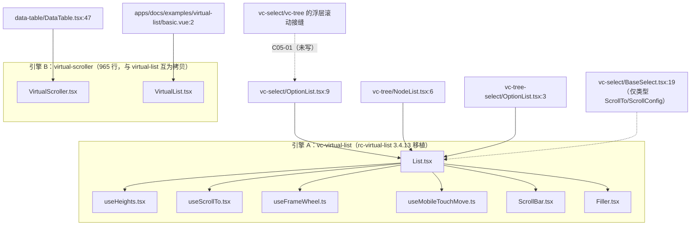
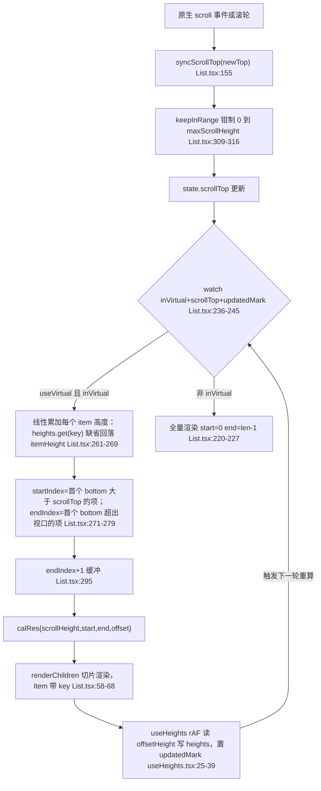

# I08 虚拟化双实现：vc-virtual-list 与 virtual-scroller

> **本篇解决**：`vc-virtual-list`、`virtual-list`、`virtual-scroller` 三个目录到底是什么关系？各自用在哪里、可见窗口与高度怎么算、`scrollTo` 边界如何处理、为什么允许两套并存、选型该看哪几个维度。
> **前置**：I03 vc-util 工具层（本篇只在接缝处引用编号与标题，不展开其内容）　**读者坐标**：`02-infrastructure` 第 8 篇

## 一、职责与边界

三个目录、两套互不兼容的虚拟化引擎，服务两类完全不同的调用方：

- `src/vc-virtual-list/`（548 行主文件）是**内部基座**，文件头注释写明其上游：`// base rc-virtual-list 3.4.13`（`packages/xiaoye-ui/src/vc-virtual-list/index.ts:1`）。它只被下拉与树消费：`vc-select/OptionList.tsx:9`、`vc-tree/NodeList.tsx:6`、`vc-tree-select/OptionList.tsx:3`，其余引用全部是类型导入（`ScrollTo`/`ScrollConfig`，见 `vc-select/BaseSelect.tsx:19`、`vc-select/Selector/index.tsx:23`）。
- `src/virtual-scroller/`（965 行主文件）与 `src/virtual-list/`（965 行主文件）是**同一份实现的两个拷贝**：对两个文件跑 `diff` 仅 36 行差异（组件名、props 文件名、`prefixCls` 注册名、一处数值容错、一处注释位置）。`virtual-scroller` 是内部件被 `data-table/DataTable.tsx:47` 直接导入（`const DTVirtualScroller = VirtualScroller`，`DataTable.tsx:61`）；`virtual-list` 是对外公开件（`XYVirtualList`），**库内没有任何组件导入它**，只有文档示例在用（`apps/docs/examples/virtual-list/basic.vue:2`）。
- 本篇负责：两套引擎的窗口计算、高度策略、overscan、`scrollTo` 边界、DOM/key 复用策略、并存成因与能力矩阵。不负责：下拉浮层如何接入选项列表（C05-01，未写，只给编号）、表格固定列/分组渲染（I05、C08 系列）、I03 工具层本身。

## 二、源码地图

| 文件 | 行数 | 职责 | 关键导出 |
| --- | --- | --- | --- |
| `vc-virtual-list/index.ts` | 4 | 入口，`// base rc-virtual-list 3.4.13` 溯源注释（:1） | default List |
| `vc-virtual-list/List.tsx` | 548 | 主引擎：窗口计算 watch（:236-300）、滚动合成（:307-360）、scrollTo 接线（:399） | `List`、`ScrollConfig` |
| `vc-virtual-list/hooks/useHeights.tsx` | 66 | 动态高度测量：rAF 批量读 `offsetHeight` 写 `heights` Map（:25-39） | `useHeights`、`CacheMap` |
| `vc-virtual-list/hooks/useScrollTo.tsx` | 112 | `scrollTo({index/key, align, offset})`，容器未挂载即中止（:45），动态高度重试 3 次（:43） | — |
| `vc-virtual-list/hooks/useFrameWheel.ts` | 60 | 滚轮平滑合成 | — |
| `vc-virtual-list/hooks/useMobileTouchMove.ts` | 92 | 触屏滚动 | — |
| `vc-virtual-list/hooks/useOriginScroll.ts` | 33 | 边界（顶/底）判定，避免越界滚动 | — |
| `vc-virtual-list/utils/itemUtil.js` | 147 | 纯数学：`alignScrollTop`（:11）、`getRangeIndex`（:131）、`requireVirtual` 开关阈值（:145） | — |
| `vc-virtual-list/utils/algorithmUtil.js` | 81 | 二分查找辅助 | — |
| `vc-virtual-list/ScrollBar.tsx` | 266 | 自绘滚动条（替代原生滚动条） | — |
| `vc-virtual-list/Filler.tsx` | 71 | 撑高容器 + `offset` 平移 | — |
| `virtual-list/interface.ts` | 52 | props：`orientation: vertical\|horizontal\|both`（:7,:18）、`itemSize: number \| number[]`（:15）、`numToleratedItems`（:19）、`lazy`（:22）、`columns`（:25）、`appendOnly`（:32）、`autoSize`（:33） | `virtualListProps` |
| `virtual-list/VirtualList.tsx` | 965 | 主引擎（与 `virtual-scroller/VirtualScroller.tsx` 内容 99% 相同） | `XYVirtualList` |
| `virtual-list/style/index.ts` | 69 | Component Token 挂进主题（`theme/interface/components.ts:62`） | — |
| `virtual-scroller/virtualScrollerTypes.ts` | 37 | 同款 props 的另一份定义 | `virtualScrollerProps` |
| `virtual-scroller/VirtualScroller.tsx` | 965 | 主引擎本体，:866 有「修复源项目 bug」注释 | `XYVirtualScroller` |
| `virtual-list/__tests__/virtual-list.test.js` | 164 | 公开件测试 | — |
| `virtual-scroller/index.test.js` | 189 | 内部件测试 | — |

并存的时间线证据（`git log --diff-filter=A`，各取首次添加提交）：

| 文件 | 首次入库 | 所在提交 |
| --- | --- | --- |
| `vc-virtual-list/List.tsx` | 2026-07-15 | `refactor: 阶段2 - 主组件库迁移至 packages/xiaoye-ui/src/` |
| `virtual-scroller/VirtualScroller.tsx` | 2026-07-17 | `feat(components): 完成 batch 1 组件迁移并补充 22 个组件的文档与示例` |
| `virtual-list/VirtualList.tsx` | 2026-07-19 | `feat(components): 完成编辑器功能补全与多组件迁移`（提交主题原文以一个已于 2026-10-02 移除的编辑器组件命名，此处从略） |

## 三、架构与数据流

先看三者的静态依赖关系（全部边都来自 `grep -rn "virtual" packages/xiaoye-ui/src --include='*.tsx' --include='*.ts' | grep import` 的实际输出）：



两张图说明两个事实：其一，两个引擎在库内**没有任何交集**，引擎 A 的消费者全是 `vc-*` 下拉/树，引擎 B 的 `virtual-scroller` 只被 `data-table` 用、`virtual-list` 只被文档示例用；其二，`virtual-scroller` 与 `virtual-list` 是并排放置的孪生文件，不是上下层关系。

引擎 A 的窗口计算数据流：



关键回路在 K→E：测量结果 `updatedMark`（每次高度变化换一个新的 Symbol，`useHeights.tsx:16-19`）反向触发窗口重算，形成「估算 → 渲染 → 测量 → 修正」的闭环，动态高度的累计误差就是这么收敛的。

引擎 B 的滚动区间状态机：

```mermaid
stateDiagram-v2
    direction LR
    s0["初始化 viewInit：setSize+calculateOptions"] --> s1["驻留区间 [first,last]"]
    s1 --> s1: "onScroll→onScrollPositionChange：currentIndex=floor(scrollPos/itemSize)（VirtualList.tsx:267-268）"
    s1 --> s2["区间外溢：越过 triggerIndex（±numToleratedItems）"]
    s2 --> s1: "calculateFirst/Last 重划驻留区间，loadedItems 重切片（VirtualList.tsx:102-115）"
    s1 --> s3["lazy 模式：emit lazy-load{first,last} 交父组件供数（VirtualList.tsx:434-441）"]
    s3 --> s1
    s1 --> s4["disabled=true：直接渲染 props.items 全量（VirtualList.tsx:899-907）"]
```

引擎 B 里 `onScroll` 不重排 DOM，只推动 `first/last` 两个游标；游标是否移动取决于是否越过 `numToleratedItems` 缓冲带，因此小幅抖动滚动不触发任何重渲染。

## 四、核心机制精读

### 论点 1：两套引擎不是演进关系而是两次独立移植，`virtual-list` 只是 `virtual-scroller` 的改名拷贝，并存没有统一计划

断言：三个目录来自两次互不相干的移植批次——引擎 A 移植自上游 React 实现（文件头有版本注释），引擎 B 移植自另一个 Vue 项目（代码内有「源项目」注释），而 `virtual-list` 与 `virtual-scroller` 之间是文件级拷贝，仅改了名字。

证据一：引擎 A 的溯源注释是硬编码的上游版本号：

```tsx
// packages/xiaoye-ui/src/vc-virtual-list/index.ts:1
// base rc-virtual-list 3.4.13
```

`List.tsx` 还残留上游默认前缀（此处引用的是上游实现的标识，非本库现状命名）：

```tsx
// packages/xiaoye-ui/src/vc-virtual-list/List.tsx:468
      prefixCls = 'rc-virtual-list',
```

证据二：引擎 B 的移植痕迹与上游 bug 修复注释：

```tsx
// packages/xiaoye-ui/src/virtual-scroller/style/index.ts:7
// 迁移自源项目 virtualscroller/style/index.ts

// packages/xiaoye-ui/src/virtual-scroller/VirtualScroller.tsx:866
    // 修复源项目 bug：d_numItemsInViewport_cols 在 return 之后定义，TS 严格模式下会报错
    // 必须移到 return 之前
```

证据三：两份 965 行主文件的 `diff` 总共只有 36 行，差异全部是身份标识和两处微调：

```diff
// diff virtual-list/VirtualList.tsx virtual-scroller/VirtualScroller.tsx（节选）
< import virtualListProps from './interface';
> import virtualScrollerProps from './virtualScrollerTypes';
<   name: 'XYVirtualList',
>   name: 'XYVirtualScroller',
<   __XY_VIRTUAL_LIST: true,
>   __XY_VIRTUAL_SCROLLER: true,
<     const { prefixCls } = useConfigInject('virtual-list', props);
>     const { prefixCls } = useConfigInject('virtualscroller', props);
```

第三处差异是 `virtual-list` 在 `parseFloat` 前加了 `|| 0` 容错（`VirtualList.tsx:351-357` 对比 `VirtualScroller.tsx:352-355`）——拷贝之后两份代码各修各的，已经开始分叉。

证据四：git 首次入库时间线（`git log --diff-filter=A --format="%ad %s" --date=short -- <file>`）：`List.tsx` 2026-07-15（阶段 2 主库迁移批次）、`VirtualScroller.tsx` 2026-07-17（batch 1 组件迁移批次）、`VirtualList.tsx` 2026-07-19（编辑器补全与多组件迁移批次，该编辑器组件已于 2026-10-02 移除）。三个文件分属三个提交批次，间隔两天一份；`virtual-list` 晚于 `virtual-scroller` 两天出现且内容 99% 相同，符合「另一个迁移会话需要公开件，直接复制改名」的特征。

结论回扣：「为何并存」的答案不是「一套服务简单列表、一套服务复杂场景」这类设计分工——引擎 B 的公开件 `virtual-list` 在库内**零消费者**（除 `components.ts:395-396` 的聚合导出口和文档示例外，`grep -rn "XYVirtualList\|from '.*xiaoye-ui/virtual-list'" packages apps` 无组件级命中），它的存在理由只是「迁移批次不同、需要一个对外品牌名」。把「移植自不同上游、无统一收敛计划」写成设计哲学是给历史包袱贴金，源码不支持这种说法。

### 论点 2：两者都是滚动位置驱动，不用 IntersectionObserver；但窗口算法一个是 O(n) 累加扫描、一个是 O(1) 除法

断言：两个引擎的可见窗口都从 `scrollTop` 直接推算，三个目录中不存在任何 IntersectionObserver。

先给负面结论的交叉验证（两种方法）：

```bash
grep -rn "IntersectionObserver" packages/xiaoye-ui/src/vc-virtual-list packages/xiaoye-ui/src/virtual-list packages/xiaoye-ui/src/virtual-scroller   # 0 命中
grep -rn "observe(" packages/xiaoye-ui/src/vc-virtual-list packages/xiaoye-ui/src/virtual-list packages/xiaoye-ui/src/virtual-scroller          # 仅 ResizeObserver 相关命中
```

引擎 A 的 `startIndex/endIndex` 在 `List.tsx` 的 watch 回调里，逐行累加每项（测得）高度，找到第一个底边越过 `scrollTop` 的项：

```tsx
// packages/xiaoye-ui/src/vc-virtual-list/List.tsx:261
        for (let i = 0; i < dataLen; i += 1) {
          const item = data[i];
          const key = getKey(item);

          let cacheHeight = heights.get(key);
          if (cacheHeight === undefined) {
            cacheHeight = itemHeight;
          }
          const currentItemBottom = itemTop + cacheHeight;

          if (startIndex === undefined && currentItemBottom >= scrollTop) {
            startIndex = i;
            startOffset = itemTop;
          }

          // Check item bottom in the range. We will render additional one item for motion usage
          if (endIndex === undefined && currentItemBottom > scrollTopHeight) {
            endIndex = i;
          }

          itemTop = currentItemBottom;
        }
```

这是 O(n)/次滚动：n 条数据每次滚动位置变化都要完整累加一遍才能定位窗口。数据到万级时这段循环就是主要开销（其文件头的 `GHOST_ITEM_KEY` 注释「Our algorithm have additional one ghost item」见 `itemUtil.js:1-5`，是上游算法说明的残留，本文件里该常量只被注释提及，主循环未使用——按 `grep -n GHOST_ITEM_KEY vc-virtual-list -r` 可复核其唯一使用点在 `ScrollBar`）。为什么引擎 A 不用更快的算法：`heights` 缓存 Map 的键是数据 key 而非下标（`useHeights.tsx:14-15`，扫描时先 `getKey(item)` 再 `heights.get(key)`，`List.tsx:263-265`），窗口计算必须在「按数据顺序累计」的序列上进行，实测高度序列没有可二分的位置索引——每个未测量项都可能是估算值，任何跳步都会算错 `itemTop`。佐证移植身份的一个细节：`utils/algorithmUtil.js` 里提供了二分风格的 `getIndexByStartLoc`（`algorithmUtil.js:14`）和 `findListDiffIndex`（`algorithmUtil.js:39`），但交叉验证显示整个 `vc-virtual-list` 目录没有任何文件导入这个模块（`grep -rn "algorithmUtil\|findListDiffIndex\|getIndexByStartLoc" vc-virtual-list --include='*.ts*'` 除去定义文件自身零命中）——81 行工具函数是随上游整包拷贝进来的死代码，本仓库的窗口计算并未使用它们。

引擎 B 的对应物是 `getRenderedRange` 里的一次除法：

```tsx
// packages/xiaoye-ui/src/virtual-list/VirtualList.tsx:267
      const calculateFirstInViewport = (_pos: number, _size: number) =>
        Math.floor(_pos / (_size || _pos));
```

配合视口容量 `calculateNumItemsInViewport = Math.ceil(_contentSize / (_itemSize || _contentSize))`（`VirtualList.tsx:313-314`），窗口起止就是两条 O(1) 公式。O(1) 的代价见论点 3：它只可能精确，因为高度必须是先验声明的。

### 论点 3：高度策略一个选「先验声明 + 动态测量修正」，一个选「纯先验声明」，动态修正的累计链路在 useHeights 的 rAF 批读

断言：引擎 A 允许每个 item 实际高度不同，用 rAF 批读 `offsetHeight` 写入以 key 为索引的 `heights` Map，并靠 Symbol 标记触发窗口重算来修正累计高度；引擎 B 从头到尾信任 `itemSize` 声明值，不测任何单项高度。

引擎 A 的测量函数：

```tsx
// packages/xiaoye-ui/src/vc-virtual-list/hooks/useHeights.tsx:14
  const instance = new Map<VNodeProps['key'], HTMLElement>();
  const heights = new Map();
  const updatedMark = ref(Symbol('update'));
  watch(mergedData, () => {
    updatedMark.value = Symbol('update');
  });
  let collectRaf: number = undefined;

  function cancelRaf() {
    wrapperRaf.cancel(collectRaf);
  }
  function collectHeight() {
    cancelRaf();
    collectRaf = wrapperRaf(() => {
      instance.forEach((element, key) => {
        if (element && element.offsetParent) {
          const { offsetHeight } = element;
          if (heights.get(key) !== offsetHeight) {
            //changed = true;
            updatedMark.value = Symbol('update');
            heights.set(key, element.offsetHeight);
          }
        }
      });
    });
  }
```

修正链路逐段拆解：`instance` Map 由每个 `Item` 挂载时通过 `setNodeRef` 注册（`List.tsx:65`，`<Item key={key} setRef={ele => setNodeRef(item, ele)}>`）；`collectHeight` 用 `wrapperRaf` 合并同一帧内的多次请求（`useHeights.tsx:26-27`，`wrapperRaf` 来自 `../../_util/raf`，其内部机制归 I03）；只有 `offsetHeight` 真正变化才替换 `updatedMark` 的 Symbol（`:31-34`），避免空转重渲染。`updatedMark` 出现在窗口计算 watch 的依赖数组里（`List.tsx:242`），于是「测量 → 重算 → 再测量」闭环成立；下一轮累加时 `heights.get(key)` 命中即用实测值、未命中回落 `itemHeight` 估算值（`List.tsx:265-268`）。累计总高直接取扫描结束后的 `itemTop`（`scrollHeight: itemTop`，`List.tsx:297`），所以滚动条长度会随修正过程跳动。

闭环还有第二条腿：内容盒自身尺寸变化（如图片加载完成撑高 inner）时，`Filler` 内嵌的 `ResizeObserver` 会回调 `onInnerResize`，而 List 把这条回调直接接到 `collectHeight`（`List.tsx:517`，`<Filler ... onInnerResize={collectHeight}>`；观察器实体在 `Filler.tsx:39-45`，仅当 `offsetHeight` 非零才触发）。也就是说引擎 A 有「逐项测量」和「整体尺寸监听」两路修正入口，最终都汇入同一条 rAF 批读；批读内部只有检测到某项高度值与缓存不同才替换 `updatedMark` 的 Symbol、拉起下一轮窗口重算（`useHeights.tsx:31-34`），测量本身每帧都会重读所有已注册实例的 `offsetHeight`，缓存省掉的是「重算」而不是「重读」。

引擎 B 的总高是公式算出来的，永远不测单项：

```tsx
// packages/xiaoye-ui/src/virtual-list/VirtualList.tsx:391
        if (both) {
          spacerStyle.value = {
            ...spacerStyle.value,
            height: `${items.length * itemSize[0] + contentPos.y}px`,
            width: `${((props.columns || items[1])?.length || 0) * itemSize[1] + contentPos.x}px`,
          };
        } else {
          const size = horizontal
            ? (props.columns || items).length * itemSize + contentPos.x
            : items.length * itemSize + contentPos.y;
```

文件里唯一的 `offsetHeight` 读取是容器自身（`VirtualList.tsx:312` 的 `element.value.offsetHeight`）；`autoSize`（`VirtualList.tsx:445-459`）测的也是内容容器整体而非单项。结论：`itemSize` 声明值与真实渲染高度不符时，引擎 B 会产生窗口错位或尾部留白，且没有任何自我修正机制；引擎 A 则会经历几帧跳动后收敛。

### 论点 4：overscan 缓冲设计完全不同——引擎 A 只有底部 +1 且靠「不进虚拟化」兜底，引擎 B 有可配置的 `numToleratedItems` 缓冲带和方向滞回

断言：白屏风险由缓冲策略决定。引擎 A 的缓冲极简（底部多渲染一项），真正的防抖动手段是「数据不够长就整体不虚拟化」和 `scrollTop` 钳制；引擎 B 用缓冲区 + 触发索引滞回，滚动在缓冲带内完全不重渲染。

引擎 A 的缓冲只有这一行：

```tsx
// packages/xiaoye-ui/src/vc-virtual-list/List.tsx:294
        // Give cache to improve scroll experience
        endIndex = Math.min(endIndex + 1, dataLen);
```

顶部没有缓冲（`startIndex` 精确等于窗口首项，`List.tsx:271-274`）。窗口外的空间不靠占位行、而靠一次平移补齐：`Filler` 外层撑到全高、内层用 `transform: translateY(offset)` 把切片内容推到 `startOffset` 位置（`Filler.tsx:26-37`，`offset` 即窗口计算产物的 `startOffset`，`List.tsx:273`、`List.tsx:301`）。这种「撑高 + 平移」模式决定了它的白屏特征——缓冲越薄，滚动瞬间新进入视口的行越可能还没渲染，但由于每次 `scrollTop` 变化都同步重算窗口（watch 依赖见 `List.tsx:236-245`），白屏窗口最长只有一帧渲染的时间差。配套的兜底是两级开关：

```tsx
// packages/xiaoye-ui/src/vc-virtual-list/List.tsx:105
    const useVirtual = computed(() => {
      const { height, itemHeight, virtual } = props;
      return !!(virtual !== false && height && itemHeight);
    });
    const inVirtual = computed(() => {
      const { height, itemHeight, data } = props;
      return useVirtual.value && data && itemHeight * data.length > height;
    });
```

`inVirtual` 为假时全量渲染，并且注释写明「Always use virtual scroll bar in avoid shaking」（`List.tsx:219`）——数据长度临界时宁可全渲染也不反复进出虚拟化。纯数学版本在 `requireVirtual`（`itemUtil.js:145-147`）。

引擎 B 的缓冲默认是半个视口：

```tsx
// packages/xiaoye-ui/src/virtual-list/VirtualList.tsx:313
      const calculateNumItemsInViewport = (_contentSize: number, _itemSize: number) =>
        Math.ceil(_contentSize / (_itemSize || _contentSize));
      const calculateNumToleratedItems = (_numItems: number) => Math.ceil(_numItems / 2);
```

可由 `numToleratedItems` prop 覆盖（`interface.ts:19`，且 watch 同步进内部态，`VirtualList.tsx:140-143`）。渲染末项在缓冲带上再加 2 或 3 倍缓冲：

```tsx
// packages/xiaoye-ui/src/virtual-list/VirtualList.tsx:412
      const calculateLast = (_first: number, _num: number, _numT: number, _isCols = false) =>
        getLast(_first + _num + (_first < _numT ? 2 : 3) * _numT, _isCols);
```

区间移动不跟滚动位置逐帧联动，而要越过 `triggerIndex` 才重划（`onScrollPositionChange` 中 `calculateTriggerIndex(...)`、`isScrollDownOrRight` 方向判断，`VirtualList.tsx:664-689`）——这是滞回（hysteresis）设计：向下滚在尾部越过缓冲才前移窗口，回滚不会立即触发同幅回移，重渲染频率显著低于逐帧计算。另有 `appendOnly`（`interface.ts:32`）：只允许窗口向后移动（`VirtualList.tsx:663`），服务日志流式追加场景。

防抖动的第三条路线在引擎 A 独有的「接管滚轮」上，这决定了两者白屏/抖动的表现差异。引擎 A 在虚拟化开启时把容器原生滚动条藏掉（`List.tsx:421-422` 的 `overflowY: 'hidden'`），滚动完全由滚轮增量合成——它累加 `deltaY`、`preventDefault` 拦截原生行为、下一帧一次性写回 `syncScrollTop`：

```tsx
// packages/xiaoye-ui/src/vc-virtual-list/hooks/useFrameWheel.ts:27
  function onWheel(event: { preventDefault?: any; deltaY?: any }) {
    if (!inVirtual.value) return;

    raf.cancel(nextFrame!);

    const { deltaY } = event;
    offsetRef += deltaY;
    wheelValue = deltaY;

    // Do nothing when scroll at the edge, Skip check when is in scroll
    if (originScroll(deltaY)) return;

    // Proxy of scroll events
    if (!isFF) {
      event.preventDefault();
    }

    nextFrame = raf(() => {
      // Patch a multiple for Firefox to fix wheel number too small
      const patchMultiple = isMouseScroll ? 10 : 1;
      onWheelDelta(offsetRef * patchMultiple);
      offsetRef = 0;
    });
  }
```

逐段看：同帧内多次滚轮被 `raf.cancel` + 累加合并成一次位移（`:30-33`、`:44-49`）；已到顶/底还往回滚时 `originScroll` 放行让原生滚动接手（`:37`，判定逻辑在 `useOriginScroll.ts`，边界状态来自 `List.tsx:318-319`）；Firefox 的 `DOMMouseScroll` 精度问题用 10 倍补偿（`:45-47`）。三类滚轮事件的挂载与换实例重挂在 `List.tsx:379-392` 的 `watchEffect` 里完成（`wheel` 带 `passive: false` 才能 `preventDefault`，`DOMMouseScroll`/`MozMousePixelScroll` 专供 Firefox）。触屏路径同理由 `useMobileTouchMove` 接管（调用点 `List.tsx:354-359`，实现在 `useMobileTouchMove.ts`）。引擎 B 对滚轮和触摸零拦截——两份主文件中 `wheel`/`touchmove` 各 0 命中（`grep -cni "wheel\|touchmove" virtual-list/VirtualList.tsx virtual-scroller/VirtualScroller.tsx` 输出均为 0），滚动语义完全交给浏览器原生，它的平滑性来自缓冲带而非输入合成。两种路线的抖动表现因此相反：引擎 A 快滚可能因合成延迟「跟不住」指针（输入被 rAF 排队），引擎 B 快滚跟手但窗口重划时机受制于 `triggerIndex` 的滞回宽度。

### 论点 5：`scrollTo` 的健壮性差距——引擎 A 对容器未挂载、动态高度未测齐都有显式重试，引擎 B 只防负数不防越界

断言：程序化滚动到第 i 项是两个引擎边界处理差异最大的地方。引擎 A 把「滚动目标依赖测量结果」当作异步问题处理；引擎 B 当作一次乘法同步解决，越界靠浏览器钳制。

引擎 A 的 `useScrollTo`：

```tsx
// packages/xiaoye-ui/src/vc-virtual-list/hooks/useScrollTo.tsx:35
      if ('index' in arg) {
        ({ index } = arg);
      } else {
        index = data.findIndex((item: object) => getKey(item) === arg.key);
      }

      const { offset = 0 } = arg;

      // We will retry 3 times in case dynamic height shaking
      const syncScroll = (times: number, targetAlign?: 'top' | 'bottom') => {
        if (times < 0 || !containerRef.value) return;

        const height = containerRef.value.clientHeight;
        let needCollectHeight = false;
        let newTargetAlign = targetAlign;

        // Go to next frame if height not exist
        if (height) {
```

要点：容器未挂载时 `!containerRef.value` 直接中止（`:45`）；目标项若尚未测得高度（`cacheHeight === undefined`，`:69-71`）则置 `needCollectHeight`，下一帧先 `collectHeight()` 再递归重试（`:101-106`），初始预算 `syncScroll(5)`（`:109`）——注意 `:43` 注释写「retry 3 times」但代码实参是 5，注释是上游残留，以代码为准。滚动落点最终仍经过 `syncScrollTop → keepInRange` 钳制（`List.tsx:155-169`、`List.tsx:309-316`）：

```tsx
// packages/xiaoye-ui/src/vc-virtual-list/List.tsx:163
      const alignedTop = keepInRange(value);

      if (componentRef.value) {
        componentRef.value.scrollTop = alignedTop;
      }
      state.scrollTop = alignedTop;
```

顶/底越界分别由 `isScrollAtTop/isScrollAtBottom`（`List.tsx:318-319`）交给滚轮合成层避让原生滚动（`useOriginScroll`，`List.tsx:321`）；数据缩短导致原生滚动条回弹时由 `onFallbackScroll` 重新同步（`List.tsx:330-337`）。`scrollTo()` 不传参数被解释为「闪一下滚动条」（`useScrollTo.tsx:19-23` 调 `triggerFlash`），这是给下拉框用的特殊分支。

引擎 B 的 `scrollToIndex`：

```tsx
// packages/xiaoye-ui/src/virtual-list/VirtualList.tsx:220
    function scrollToIndex(index: number | number[], behavior: ScrollBehavior = 'auto') {
      const both = isBoth();
      const horizontal = isHorizontal();
      const valid = both ? (index as number[]).every(i => i > -1) : (index as number) > -1;

      if (valid) {
        const firstVal = first.value;
        const scrollTop = element.value?.scrollTop || 0;
```

下界：负数 index 整个静默忽略（`:223-225` 的 `valid` 门禁）。上界：没有对 `items.length` 的校验，`newFirst = calculateFirst(index, numToleratedItems)`（`:253`，`calculateFirst` 见 `:232`：`_index <= _numT ? 0 : _index`）直接进 `calculateCoord(first, itemSize, contentPos)`（`:233-234`），乘出超出 spacer 的坐标后交给原生 `scrollTo`——浏览器会钳到最大值，数据层不报错但 `first.value` 已被写成越界值（`:262`），需要下一次 `onScroll` 才能纠正。容器未挂载：`scrollTo` 有 `element.value &&` 门禁（`:217`），静默无效，与 `scrollToIndex` 组合时表现为「调用了没反应」而无任何告警。

### 论点 6：两套实现都没有 DOM 回收池，复用正确性完全押在 key 策略上——引擎 A 强制 key、引擎 B 干脆不挂 key，「复用错乱」的成因在两边各不相同

断言：本仓库虚拟化没有 keepPool 一类的节点回收机制；窗口移动时的 DOM 复用交给框架 diff，而两引擎给框架的信号相反。

先做负面结论的交叉验证（两种方法）：

```bash
grep -rni "keepPool\|pool\|recycl" packages/xiaoye-ui/src/vc-virtual-list packages/xiaoye-ui/src/virtual-list packages/xiaoye-ui/src/virtual-scroller   # 退出码 1，0 命中
ls packages/xiaoye-ui/src/vc-virtual-list packages/xiaoye-ui/src/virtual-list packages/xiaoye-ui/src/virtual-scroller                                   # 无 pool 相关文件名
```

引擎 A 的 key 由调用方**必填**：

```tsx
// packages/xiaoye-ui/src/vc-virtual-list/List.tsx:88
    itemKey: {
      type: [String, Number, Function] as PropType<Key | ((item: Record<string, any>) => Key)>,
      required: true,
    },
```

`itemKey` 既可以是字段名也可以是函数，统一归一化成 `getKey`（`List.tsx:131-148`）。这个 key 同时干三件事：Vue 的 diff key（`<Item key={key}>`，`List.tsx:65`）、`heights` 缓存索引（`useHeights.tsx:41-44` 的 `instance.set(key, ...)`）、滚动定位寻址（`useScrollTo.tsx:38` 按 key `findIndex`）。每个 item 的真实 DOM 通过 `Item` 包装组件把 ref 克隆进子节点根元素：

```tsx
// packages/xiaoye-ui/src/vc-virtual-list/Item.tsx:9
const Item: FunctionalComponent<ItemProps> = ({ setRef }, { slots }) => {
  const children = flattenChildren(slots.default?.());

  return children && children.length
    ? cloneVNode(children[0], {
        ref: setRef as any,
      })
    : children;
};
```

引擎 B 的渲染循环里没有任何 key：

```tsx
// packages/xiaoye-ui/src/virtual-list/VirtualList.tsx:934
              <div ref={contentRef} class={contentClass.value} style={contentStyle.value}>
                {loadedItems.value.map((item, index) =>
                  slots.item?.({ item, options: getOptions(index), index }),
                )}
              </div>
```

`loadedItems` 就是 `props.items.slice(first, last)`（`VirtualList.tsx:111`），窗口平移一位，数组首位消失、尾部新增——无 key 时 Vue 按位置就地 patch，即「DOM 复用」，复用的粒度是整个节点子树。

「复用错乱」的两种成因因此分别是：

- 引擎 A：`itemKey` 取值重复。`instance` 与 `heights` 都以 key 为 Map 索引（`useHeights.tsx:14-15`），后注册的同 key 项会覆盖前者的 DOM 引用与高度记录，测量值串到另一行上；累计扫描按键取高（`List.tsx:263-268`）随之错位。下拉选项用 `label` 当 key 且有同名项时最易触发。
- 引擎 B：无 key + 槽内容含局部状态。行间滚动时输入框焦点、勾选态、组件内部 `ref` 状态都会「留在原位 DOM 上」而非跟随数据。库内实际消费者 `data-table` 正是绕开 `item` 槽、用 `content` 槽全权接管渲染来自行解决（`DataTable.tsx:47` 引入后由 `BodyCell.tsx:451` 的 `getVirtualScrollerProp` 反查引擎选项，行级 key 由表格自己管理）。

## 五、对外契约如何生效

引擎 A（`vc-virtual-list`）的契约全部面向库内：

- 渲染入口是 `children` 函数 prop（`List.tsx:97`），签名 `RenderFunc` 定义在 `vc-virtual-list/interface.ts`（14 行小文件）；引擎把它包进 `Item` 再切片（`List.tsx:58-68`），所以调用方无法控制 key——key 由 `itemKey` prop 推导（`List.tsx:63`）。
- 程序化滚动经 `expose({ scrollTo })`（`List.tsx:412`，`scrollTo` 实体由 `useScrollTo` 工厂产出，接线在 `List.tsx:399-410`，把 `componentRef/mergedData/heights/getKey/collectHeight/syncScrollTop` 六件套注入）。类型别名 `ScrollTo`/`ScrollConfig` 从 `List.tsx:37-48` 导出，被 `vc-select/BaseSelect.tsx:19`、`vc-select/Selector/index.tsx:23`、`vc-tree-select/OptionList.tsx:3` 以**纯类型**方式引用——即下拉组件只消费它的滚动定位协议，不碰渲染。
- 可见集回流：`onVisibleChange(visibleList, fullList)` 在 `calRes.start/end` 变化后以 `flush: 'post'` 触发（`List.tsx:434-443`），给虚拟列表补「哪些行真的可见」的语义。
- 滚动期间原生滚动条被 `overflowY: 'hidden'` 藏起、`scrollMoving` 时 `pointerEvents: 'none'`（`List.tsx:421-425`），可见滚动条由 `ScrollBar.tsx`（266 行）自绘并支持拇指拖拽（`ScrollBar.tsx:143`，注意这是**滚动条拖拽**，不是条目拖拽）。虚拟化关闭判定链：`useVirtual`（`List.tsx:105-108`）→ `inVirtual`（`List.tsx:109-112`）→ `requireVirtual` 纯函数（`itemUtil.js:145-147`）。

引擎 B（`virtual-list` / `virtual-scroller`）的契约面向插槽与 v-model：

- `prefixCls` 来自 `useConfigInject('virtual-list', props)`（`VirtualList.tsx:74`）与 `useConfigInject('virtualscroller', props)`（`VirtualScroller.tsx:75`），最终类名前缀 `xy-virtual-list` / `xy-virtualscroller`，测试断言可见（`virtual-list/__tests__/virtual-list.test.js:76-78`、`virtual-scroller/index.test.js:33`）。样式钩子分别注册 Component Token：`genComponentStyleHook('VirtualList')`（`virtual-list/style/index.ts:7`）与 `genComponentStyleHook('VirtualScroller')`（`virtual-scroller/style/index.ts:10`，`:9` 有一行注释「第一参数必须匹配 ComponentTokenMap 的键 'VirtualScroller'（大写 S）」——大小写敏感的键曾出过坑）。主题类型挂接在 `theme/interface/components.ts:62`（`VirtualListComponentToken`）与 `:163`（`VirtualScroller?: {}`）。
- 事件契约 `emits: ['update:numToleratedItems', 'scroll', 'scroll-index-change', 'lazy-load']`（`VirtualList.tsx:34`）。`update:numToleratedItems` 在 `calculateOptions` 末尾回写计算所得缓冲值（`VirtualList.tsx:424`），`lazy-load` 把 `{first,last}` 交给父组件供数（`VirtualList.tsx:434-441`），即懒加载模式下引擎只发区间、不持数据。
- 命令契约 `expose({ scrollTo, scrollToIndex, getRenderedRange, getOptions, getLoaderOptions, element, content })`（`VirtualList.tsx:887-895`）。`getOptions/getLoaderOptions` 给每个行生成 `{index,count,first,last,even,odd}` 元信息（`VirtualList.tsx:844-866`），`data-table` 的 `BodyRow.tsx:296-303`、`BodyCell.tsx:451-527` 逐层反查这些选项——这是引擎 B 与表格的全部接缝（表格架构见 I05《vc-table 架构》，此处一行带过；两目录公开件在组件队列中的对位篇目为 C08-06、C08-07，下拉接缝为 C05-01，均未写，只给编号）。
- `disabled: true` 时整个虚拟化被旁路，直接渲染 `props.items` 全量（`VirtualList.tsx:899-907`），`data-table` 用它实现「行数少就不虚拟」（`BodyRow.tsx:50`）。

## 六、设计取舍

引擎 A 的取舍：选「测得准」而不是「算得快」。

- 换来的能力：不等高条目（图片、展开行）可滚动，`heights` Map 收敛后总高精确（`List.tsx:265-268`、`useHeights.tsx:31-34`）；滚轮/触屏在自绘滚动条下仍平滑（`useFrameWheel.ts`、`useMobileTouchMove.ts`）。
- 赔上的成本：每次 `scrollTop` 变化做一次 O(n) 累加（`List.tsx:261-282`），万级条目滚动有可感知开销；测量异步带来首滚跳动，`scrollTo` 被迫做成多帧重试（`useScrollTo.tsx:43-45`、`:109`）；为了把 ref 塞进用户节点需要一个克隆包装的 `Item`（`Item.tsx:12-16`），单根约束转嫁给调用方。

引擎 B 的取舍：选「算得快 + 能力面宽」，牺牲自适应。

- 换来的能力：窗口计算两条 O(1) 公式（`VirtualList.tsx:267-268`、`:313-314`），滚动重渲染频率被 `numToleratedItems` 缓冲带压到最低（`:315`、`:412-413`）；一个组件覆盖纵向/横向/双向/网格列/懒加载/流式追加六种形态（`interface.ts:18,19,22,25,32,33`）。
- 赔上的成本：高度必须外部保证恒等，声明与实际不符时无任何修正（论点 3）；`scrollToIndex` 上界不校验（`VirtualList.tsx:220-263`）；无自绘滚动条，双向滚动依赖原生行为。

两套为什么不能合一：高度模型冲突是根本性的——引擎 A 的窗口算法以「实测 Map」为输入（`List.tsx:265`），引擎 B 的窗口算法以「标量 itemSize」为输入（`VirtualList.tsx:268`），合并意味着任一方放弃自己的核心循环。源码里没有统一计划的痕迹（引擎目录间没有互相指向的迁移注释，仅存的移植注释各自独立：`vc-virtual-list/index.ts:1`、`virtual-scroller/style/index.ts:7`），实际演化方向是各自被各自的消费者锁死：`vc-select`/`vc-tree` 继续用 A，`data-table` 继续用 B。

给接手者的选型判据（按本篇论证直接推导，不需要额外验证）：条目高度不可预知（富文本、图片、可展开行）只能用引擎 A，引擎 B 没有修正回路（坑 3）；条目恒定且要横向/双向/懒加载/仅追加只能用引擎 B，引擎 A 连横向坐标轴都没有（能力矩阵）；数据量十万级且高度恒定时引擎 B 的 O(1) 窗口加滞回缓冲明显占优（论点 2、4）；需要程序化精确定位到「某个 key」时引擎 A 的 `scrollTo({key})` 是唯一支持按 key 寻址的实现（`useScrollTo.tsx:36-38`），引擎 B 的 `scrollToIndex` 只认数字下标（`VirtualList.tsx:220`）。公开件 `virtual-list` 与内部件 `virtual-scroller` 之间没有选型差异——同一份代码，选哪个只取决于调用方是否允许依赖内部目录。

能力矩阵（只列源码可证行号，未找到的如实写）：

| 能力 | vc-virtual-list | virtual-list / virtual-scroller |
| --- | --- | --- |
| 纵向滚动 | 是（`List.tsx:31-34`） | 是（`interface.ts:18`） |
| 横向滚动 | 未在源码中找到实现（无横向 prop/坐标轴分支） | 是（`VirtualList.tsx:290`） |
| 双向同时 | 未在源码中找到实现 | 是（`orientation: 'both'`，`interface.ts:7`） |
| 动态高度测量 | 是（`useHeights.tsx:25-39`） | 否，纯声明式 `itemSize`（`VirtualList.tsx:391-404`） |
| overscan 可调 | 否，固定底部 +1（`List.tsx:295`） | 是（`numToleratedItems`，`interface.ts:19`） |
| 懒加载（emit 区间父供数） | 未在源码中找到实现（目录内 `lazy` 0 命中） | 是（`VirtualList.tsx:434-441`） |
| 仅追加模式 | 未在源码中找到实现 | 是（`appendOnly`，`VirtualList.tsx:663`） |
| 分组/树 | 引擎不提供，由消费者拍平（`vc-tree/NodeList.tsx:6`） | 未在源码中找到实现（`columns` 仅网格列，`interface.ts:25`） |
| 条目拖拽排序 | 未在源码中找到实现（`ScrollBar.tsx:143` 的 dragging 是滚动条拇指拖拽） | 未在源码中找到实现 |
| 自绘滚动条 | 是（`ScrollBar.tsx`，266 行） | 否，用原生滚动 |
| 可见区间回调 | 是（`onVisibleChange`，`List.tsx:437-440`） | 是（`scroll-index-change`，`VirtualList.tsx:34`） |

## 七、坑与改动指南

**坑 1**——引擎 A 的 `itemKey` 不唯一。
触发：给 `vc-select` 之类消费者传了重复的 key 字段（同名 label）。症状：滚动时行高串行、总高跳动、偶发白块。原因：`instance`/`heights` 两个 Map 以 key 为唯一索引（`useHeights.tsx:14-15`），同 key 后注册覆盖前注册（`useHeights.tsx:41-50`），而窗口扫描按键取高（`List.tsx:265-268`）。定位：`packages/xiaoye-ui/src/vc-virtual-list/hooks/useHeights.tsx` + 调用方 `itemKey` 定义处。该分支无测试保护（`vc-virtual-list` 目录下无任何 `*.test.*` 文件，按 `packages/xiaoye-ui/vitest.config.mts:33` 的 glob 也不存在可执行用例）。

**坑 2**——引擎 A 的条目根节点必须是可承载 ref 的单元素。
触发：`children(item)` 返回 Fragment、注释节点或多根组件。症状：该行高度永远测不到（`element && element.offsetParent` 条件不满足或被跳过），一直用 `itemHeight` 估算，长列表滚动跳动。原因：`Item` 把 ref 克隆在 `flattenChildren` 后的第一个子节点上（`Item.tsx:12-16`），测量只认这个实例（`useHeights.tsx:28-37`）。定位：`packages/xiaoye-ui/src/vc-virtual-list/Item.tsx`。无测试保护。

**坑 3**——引擎 B 的 `itemSize` 与真实渲染高度不符。
触发：给不等高内容（换行文本、图片）配了固定 `itemSize`。症状：窗口起点漂移越来越大、滚到底留空白或提前见底。原因：区间与总高都是声明值乘法（`VirtualList.tsx:267-268`、`:391-404`），源码中没有单项测量回路可修正（全文 `offsetHeight` 仅读容器：`:312`、`:373`）。定位：`virtual-list/VirtualList.tsx` 的 `calculateOptions`/`setSpacerSize`。改动建议：要么 CSS 强制行高恒等，要么换引擎 A。

**坑 4**——引擎 B `scrollToIndex` 越界与未挂载全部静默。
触发：`scrollToIndex(999999)`、或数据未加载就滚动定位。症状：不报错、不定位；下一次滚动前内部 `first` 还停在越界值上，行号类插槽参数短暂错位。原因：只校验下界（`VirtualList.tsx:223-225`），越界坐标由浏览器钳制但 `first.value` 直接写入（`:262`）；容器未挂载时 `scrollTo` 的 `element.value &&` 短路（`:216-218`）。定位：`virtual-list/VirtualList.tsx:220-263`。两测试文件都未覆盖越界路径（`virtual-list/__tests__/virtual-list.test.js:82` 只测正向滚动事件、`virtual-scroller/index.test.js` 无 scrollToIndex 用例）。

**坑 5**——引擎 B 无 key 渲染叠加有状态槽内容。
触发：`item` 槽里放 `xy-input`、`xy-checkbox` 等带局部状态组件。症状：快速滚动后状态残留在「原来的行」上。原因：`loadedItems.map` 不产生 key（`VirtualList.tsx:935-937`），Vue 按位置就地复用。定位：需要行级状态正确就走 `content` 槽自行挂 key（参照 `data-table/BodyCell.tsx:451-527` 的反查协议），不要给 `item` 槽签名打补丁（`VirtualList.tsx:936` 是公开契约）。

**坑 6**——修一个 bug 要改两个文件。
触发：给 `virtual-list` 或 `virtual-scroller` 任一文件修缺陷。症状：另一份拷贝行为不变，同类缺陷二次出现；两份已开始分叉（`parseFloat` 容错只补在 `VirtualList.tsx:351-357`，`VirtualScroller.tsx:352-355` 未补）。原因：两文件 99% 相同（`diff` 共 36 行）。定位：改任何一份前，先 `diff packages/xiaoye-ui/src/virtual-list/VirtualList.tsx packages/xiaoye-ui/src/virtual-scroller/VirtualScroller.tsx` 确认同步面，两边一起改。

测试现状与验证命令：引擎 B 两份测试合计 353 行，覆盖的是身份标记、install、类名、spacer 渲染与滚动事件发射（`virtual-list/__tests__/virtual-list.test.js:53-96`、`virtual-scroller/index.test.js:17-100`），**窗口数学、overscan、scrollTo 越界、lazy 均无用例**；引擎 A 无任何测试。改动后最低验证集：

```bash
pnpm --filter xiaoye-ui test:unit -- virtual
node docs/column/tools/verify-refs.mjs --excerpt docs/column/02-infrastructure/8-virtualization-虚拟化双实现vc-virtual.md
```

## 附：本篇可证伪的三个检查点

1. 「`virtual-list` 与 `virtual-scroller` 是拷贝而非分层」：运行 `diff packages/xiaoye-ui/src/virtual-list/VirtualList.tsx packages/xiaoye-ui/src/virtual-scroller/VirtualScroller.tsx | wc -l`，输出的差异行数应远小于 965 行文件体量（本篇写作时实测 36），且逐行看只有名称、props 文件、`prefixCls` 与 `parseFloat` 容错差异；若差异增长到包含窗口算法级改动，本论点需要重写。
2. 「两引擎都不使用 IntersectionObserver、没有 keepPool」：运行 `grep -rniE "IntersectionObserver|keepPool|recycl" packages/xiaoye-ui/src/vc-virtual-list packages/xiaoye-ui/src/virtual-list packages/xiaoye-ui/src/virtual-scroller; echo rc=$?`，应输出 `rc=1`（零命中）；一旦出现命中文件，论点 2 与论点 6 的负面结论即失效。
3. 「窗口算法一 O(n) 一 O(1)」：`grep -n "for (let i = 0; i < dataLen" packages/xiaoye-ui/src/vc-virtual-list/List.tsx` 应命中 261 行的线性累加循环；`grep -n "Math.floor(_pos" packages/xiaoye-ui/src/virtual-list/VirtualList.tsx` 应命中 267 行的除法取整。两处任一改为二分/缓存实现，则论点 2 的复杂度对比不成立。
