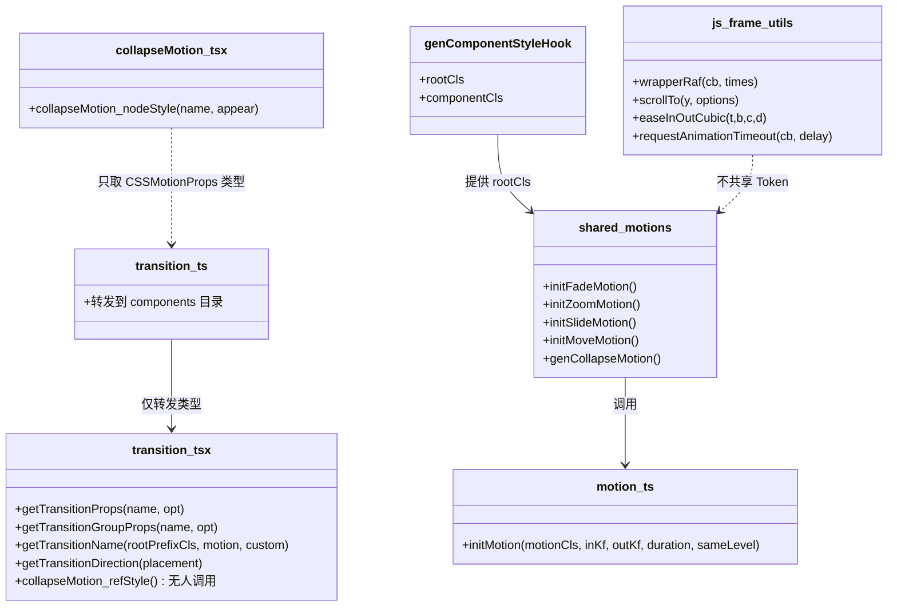
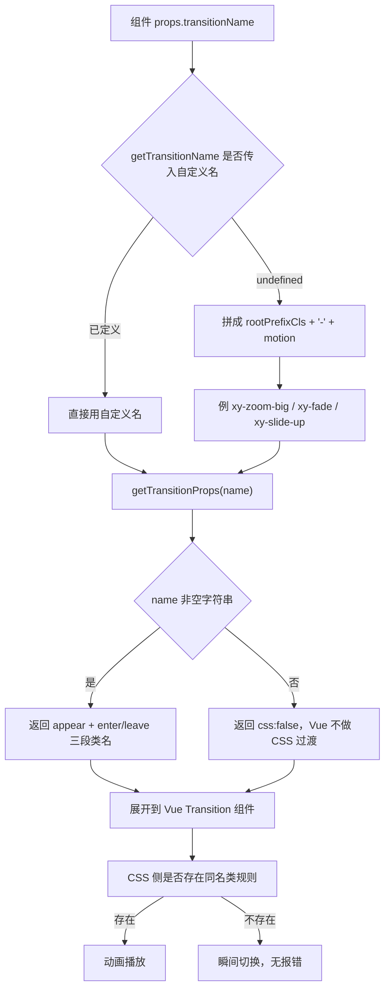
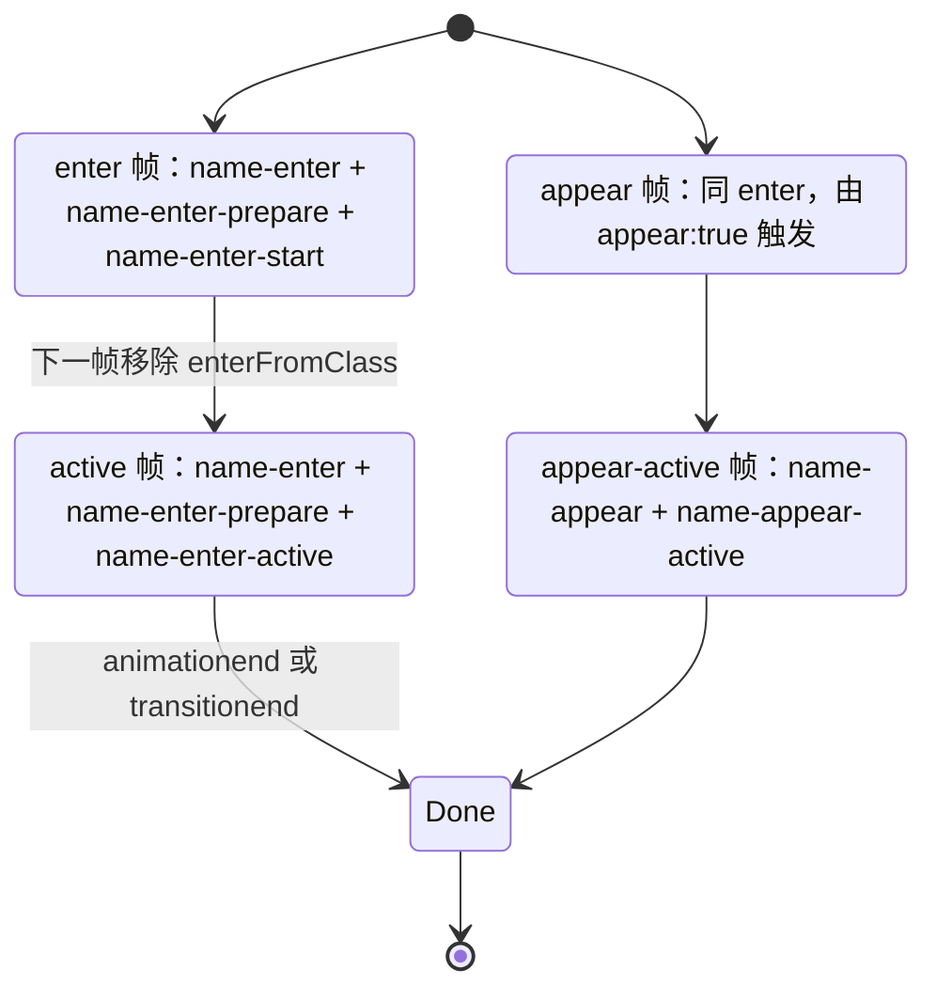
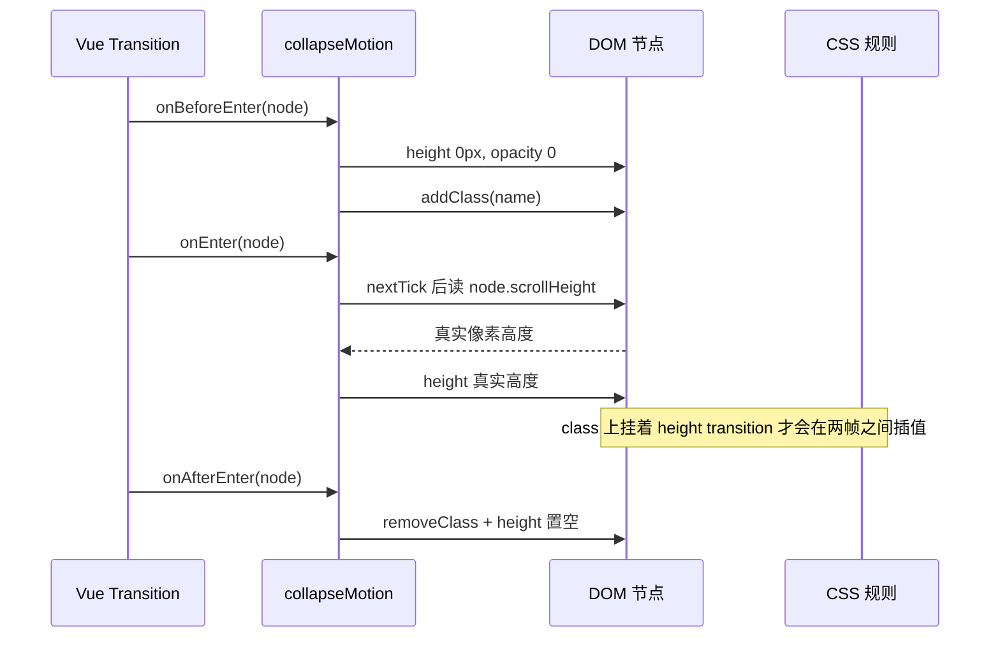

# I09 动画与 motion 体系

> **本篇解决**：一个组件的进出场动画，类名是谁拼的、CSS 是谁生成的、这两串字符串在哪个函数上对齐；`transition.ts` 与 `transition.tsx` 为什么同时存在且其中一份是死代码；折叠高度动画在哪个帧测量、为什么必须测两次；以及本库对 `prefers-reduced-motion` 到底做了什么。
> **前置**：A04 cssinjs 样式引擎与 SSR 注水（本篇只引用其结论，不重述引擎机制）、A03 Design Token 四层体系（`motionDuration*` / `motionEase*` 的派生链路见 A03）　**读者坐标**：`02-infrastructure` 第 9 篇

## 一、职责与边界

motion 体系负责三件事：**把「进出场」翻译成 Vue `<Transition>` 认识的类名集合**、**把这些类名对应的 CSS 关键帧与时长缓动生成出来**、**在纯 CSS 无法表达的场合（高度未知、需要逐帧滚动）提供 JS 侧的帧调度与缓动函数**。

它明确不负责：浮层定位与层层叠（A07 / I01 / I02 / I10）、焦点陷阱（`focus-trap`）、滚动锁定（`useScrollLocker`，见 C07-01）、以及 Token 的派生计算本身（A03）。

依赖方向是单向的：motion 的 CSS 生成层依赖 theme 与 cssinjs，JS 层依赖 Vue 的 `<Transition>` 钩子协议，二者之间**没有任何函数调用关系**，只共享一份「类名拼写约定」。这条隐式契约是本篇的主线，也是绝大多数 motion 相关 bug 的来源。

依赖清单（均为本库真实文件）：

- 被组件依赖：`_util/transition.tsx` 的四个 `getTransition*` 工厂被 drawer、modal、tooltip、popover、popconfirm、cascader、select、tree-select、image、badge、alert、upload、notification、menu、form、float-button、vc-dialog、vc-trigger 等目录导入（它们共同的入口原是 `_util/transition.ts` 那个两行转发 shim，该 shim 已于 2026-09-29 删除，现在直接解析到本文件）。
- 被样式依赖：`style/motion/index.ts:41-77` 导出的 `initFadeMotion` / `initZoomMotion` / `initSlideMotion` / `initMoveMotion` / `genCollapseMotion` 由各组件的 `style/index.ts` 在自己的样式钩子里点名调用（例如 `packages/xiaoye-ui/src/dropdown/style/index.ts:408-412`）。
- 依赖谁：`theme/util/genComponentStyleHook.ts:96` 提供的 `rootCls`、`theme/themes/shared/genCommonMapToken.ts:9-11` 提供的 `motionDuration*`、`_util/cssinjs` 的 `Keyframes`。

## 二、源码地图

| 文件 | 行数 | 职责 | 关键导出 |
| --- | --- | --- | --- |
| `packages/xiaoye-ui/src/style/motion/motion.ts` | 52 | 三段类名 CSS 的唯一生成器 | `initMotion`（`motion.ts:15`） |
| `packages/xiaoye-ui/src/style/motion/fade.ts` | 49 | 淡入淡出关键帧 + 线性缓动 | `fadeIn` / `fadeOut` / `initFadeMotion`（`fade.ts:25`） |
| `packages/xiaoye-ui/src/style/motion/zoom.ts` | 224 | 7 个缩放变体、12 个 `Keyframes`，唯一带 `-prepare` 规则的运动 | `initZoomMotion`（`zoom.ts:190`）、`zoom.ts:159` 的变体查表 |
| `packages/xiaoye-ui/src/style/motion/slide.ts` | 166 | 4 个滑入变体、8 个 `Keyframes`（`scaleY` + `opacity`） | `initSlideMotion`（`slide.ts:139`） |
| `packages/xiaoye-ui/src/style/motion/move.ts` | 163 | 4 个纯位移变体、8 个 `Keyframes` | `initMoveMotion`（`move.ts:139`） |
| `packages/xiaoye-ui/src/style/motion/collapse.ts` | 24 | 折叠高度过渡的两条 CSS（legacy 与非 legacy） | `genCollapseMotion`（默认导出，`collapse.ts:4`） |
| `packages/xiaoye-ui/src/style/motion/index.ts` | 77 | 汇总出口，把 5 组 `initXxxMotion` 与 30 个 `Keyframes` 实例一起导出 | `index.ts:41-77` |
| `packages/xiaoye-ui/src/_util/transition.tsx` | 130 | 真实现；2026-09-29 之前它被同目录 2 行 shim `transition.ts` 遮蔽成死代码，现已删除该 shim | `transition.tsx:21` |
| `packages/xiaoye-ui/src/_util/transition.tsx` | 129 | 类名协议工厂 + 一份无人使用的折叠 motion | `getTransitionProps`（`transition.tsx:21`）、`getTransitionName`（`transition.tsx:122`） |
| `packages/xiaoye-ui/src/_util/components/transition.tsx` | 129 | 与上面逐行同内容，只差一行 import 路径 | 同上，经 `components/index.ts:12-19` 转发 |
| `packages/xiaoye-ui/src/_util/collapseMotion.tsx` | 50 | DOM 节点版折叠动画（真正被 5 个组件用） | 默认导出（`collapseMotion.tsx:5`） |
| `packages/xiaoye-ui/src/_util/easings.ts` | 8 | JS 侧三次进出缓动 | `easeInOutCubic`（`easings.ts:1`） |
| `packages/xiaoye-ui/src/_util/scrollTo.ts` | 38 | 逐帧滚动，`easings` 唯一消费者 | `default scrollTo`（`scrollTo.ts:14`） |
| `packages/xiaoye-ui/src/_util/raf.ts` | 52 | 可取消、可跨帧的 rAF 包装 | `wrapperRaf`（`raf.ts:21`）、`raf.ts:48` 的 `cancel` |
| `packages/xiaoye-ui/src/_util/getRequestAnimationFrame.ts` | 46 | 带厂商前缀探测的 rAF 获取 | 默认导出（`getRequestAnimationFrame.ts:16`） |
| `packages/xiaoye-ui/src/_util/requestAnimationTimeout.ts` | 23 | rAF 轮询实现的 setTimeout | `requestAnimationTimeout`（`requestAnimationTimeout.ts:8`） |

主实现入口有两处，分别代表两条互不调用的链路：类名协议在 `packages/xiaoye-ui/src/_util/transition.tsx:21`（`getTransitionProps`），CSS 生成在 `packages/xiaoye-ui/src/style/motion/motion.ts:15`（`initMotion`）。这两个函数之间没有任何 import 关系，全靠字符串拼写一致。

组件本地另写的 motion 样式也在地图里，它们是本主题的边界外延：`packages/xiaoye-ui/src/drawer/style/motion.ts:4`（抽屉自绘 transition 型 motion）、`packages/xiaoye-ui/src/tabs/style/motion.ts:5`（页签自绘 + 复用共享 slide）、`packages/xiaoye-ui/src/_util/index.ts:46`（把 `_util/components/*` 整体再导出一次的兼容层）。

## 三、架构与数据流

### 3.1 模块静态关系



图里三条边说明了本体系的全部耦合：`_util/transition.ts`（2 行 shim，2026-09-29 已删除）当时只做转发、不含逻辑，故现在这条边直接落在 `transition.tsx`；`style/motion/index.ts:41-77` 的五个 `initXxxMotion` 唯一共享的实现是 `motion.ts:15` 的 `initMotion`；而 `collapseMotion.tsx:3` 对 `transition` 的依赖只剩一个 TypeScript 类型 `CSSMotionProps`。右侧的 `js_frame_utils` 与 CSS 侧**没有任何边**——JS 动画不读 Token，见 `scrollTo.ts:15` 写死的 `duration = 450`。

### 3.2 motionName 是怎么定下来的



`transition.tsx:122-127` 里 `getTransitionName` 只有一条分支：`transitionName !== undefined` 就原样返回，否则拼 `${rootPrefixCls}-${motion}`。判定用的是 `!== undefined` 而不是真值检查，因此显式传空串是一种开关：`select/index.tsx:60` 把 `choiceTransitionName` 默认值定为 `''`，于是 `getTransitionProps('')` 命中 `transition.tsx:38` 的 `{ css: false, ...opt }` 分支，标签删除动作默认没有过渡动画；而 `tree-select/index.tsx:173` 与 `cascader/index.tsx:318` 传的 `motion` 是空串，只有当调用方也没给 `choiceTransitionName` 时才会拼出 `xy-` 这种没有任何 CSS 对应的类名前缀。图最后一条 `K -->|不存在| M` 是本体系最危险的出口：类名协议与 CSS 生成是两条独立链路，缺 CSS 不会有任何告警。

### 3.3 enter 阶段的类名状态机



`transition.tsx:30-32` 三行决定了这张图：`enterFromClass` 挂三个类、`enterActiveClass` 挂两个、`enterToClass` 挂两个，Vue 在下一帧把 from 类移除、把 to 类加上。CSS 侧配合的机制是「先声明动画但不播」：`motion.ts:28-31` 给 `-enter` / `-appear` 设 `animationPlayState: 'paused'`，`motion.ts:39-44` 才在 `-enter-active` 出现时设 `animationName` + `running`。`-enter-start` 在这张状态机里**没有任何 CSS 对应**——全仓搜索 `enter-start` 只在 `_util/transition.tsx:30` 与 `_util/components/transition.tsx:30` 出现，`style/motion/` 下零命中。

### 3.4 折叠高度动画的取帧时序



关键点在 `collapseMotion.tsx:15-20`：`onEnter` 里必须再包一层 `nextTick`，因为 `onBeforeEnter` 刚写下的 `height: 0px` 要先进过一次样式计算，`scrollHeight` 才能读到「内容撑开」的高度；而 `onBeforeLeave`（`collapseMotion.tsx:28-31`）反过来读 `offsetHeight`，`onLeave` 再套一个 `setTimeout`（`collapseMotion.tsx:33-37`）把高度改回 0。这两处「延迟一拍」是同一个动因：transition 只在**两次样式之间**插值，同帧改两次等于没改。

## 四、核心机制精读

### 论点 1：`motionName` 的「三段式」不是三段而是四类十二个拼写，生成点是 `getTransitionProps`，与 CSS 的唯一耦合是模板字符串

断言：本库进出场协议的真实拼写在 `packages/xiaoye-ui/src/_util/transition.tsx:21-40`，它把 `<name>-enter/-appear/-leave` 三个基础段与 `-prepare`、`-start`、`-active` 三个后缀段组合成 12 个类名交给 Vue；CSS 侧 `packages/xiaoye-ui/src/style/motion/motion.ts:15-52` 用同一套模板字符串反向拼出选择器。两边没有任何共享常量或类型约束。

```tsx
// packages/xiaoye-ui/src/_util/transition.tsx:21
export const getTransitionProps = (transitionName: string, opt: TransitionProps = {}) => {
  const transitionProps: TransitionProps = transitionName
    ? {
        name: transitionName,
        appear: true,
        // type: 'animation',
        // appearFromClass: `${transitionName}-appear ${transitionName}-appear-prepare`,
        // appearActiveClass: `xy-base-transition`,
        // appearToClass: `${transitionName}-appear ${transitionName}-appear-active`,
        enterFromClass: `${transitionName}-enter ${transitionName}-enter-prepare ${transitionName}-enter-start`,
        enterActiveClass: `${transitionName}-enter ${transitionName}-enter-prepare`,
        enterToClass: `${transitionName}-enter ${transitionName}-enter-active`,
        leaveFromClass: ` ${transitionName}-leave`,
        leaveActiveClass: `${transitionName}-leave ${transitionName}-leave-active`,
        leaveToClass: `${transitionName}-leave ${transitionName}-leave-active`,
        ...opt,
      }
    : { css: false, ...opt };
  return transitionProps;
};
```

```ts
// packages/xiaoye-ui/src/style/motion/motion.ts:24
  return {
    [`
      ${sameLevelPrefix}${motionCls}-enter,
      ${sameLevelPrefix}${motionCls}-appear
    `]: {
      ...initMotionCommon(duration),
      animationPlayState: 'paused',
    },

    [`${sameLevelPrefix}${motionCls}-leave`]: {
      ...initMotionCommonLeave(duration),
      animationPlayState: 'paused',
    },

    [`
      ${sameLevelPrefix}${motionCls}-enter${motionCls}-enter-active,
      ${sameLevelPrefix}${motionCls}-appear${motionCls}-appear-active
    `]: {
      animationName: inKeyframes,
      animationPlayState: 'running',
    },
```

逐段解释：

- `transition.tsx:24` 固定写死 `appear: true`，意味着挂载即走入场动画；`transition.tsx:27-29` 三行 appear 类名被注释掉，所以**单个 `<Transition>` 场景不再显式指定 appear 系列类名**，此时 `motion.ts:38-41` 里的 `${motionCls}-appear${motionCls}-appear-active` 组合选择器能否命中完全取决于 Vue 对 appear 阶段的默认回落，本库代码没有对此做任何保障或测试。对照组是 `getTransitionGroupProps`：`transition.tsx:48-49` 显式把 `appearActiveClass` 设成裸 `name`、`appearToClass` 设成 `-appear -appear-active`，`transition.tsx:50` 又把 `-appear` 与 `-enter` 一起塞进 `enterFromClass`——列表场景是手工拼出 `-appear` 协议的，单元素场景不是。被注释的 `appearActiveClass: 'xy-base-transition'`（`transition.tsx:28`）是一处未落地的抽象：如果启用，所有共享 motion 会依赖一个公共基类来声明时长与缓动，而现状是每个 `initXxxMotion` 各自声明（`fade.ts:34`、`slide.ts:148`、`move.ts:148`、`zoom.ts:199-204`）。
- `transition.tsx:30-32` 的 enter 三段是关键设计：`enterFromClass` 里同时挂 `-enter`、`-enter-prepare`、`-enter-start`；`enterActiveClass` 保留 `-enter -enter-prepare`；`enterToClass` 只加 `-enter-active`。配合 `motion.ts:24-31`（`-enter` 只设 `animationDuration` + `animationFillMode: 'both'` 且 `paused`）与 `motion.ts:38-44`（`-enter` 与 `-enter-active` 同时存在时才给 `animationName` 并 `running`），得到「第一帧排版但不动、第二帧开播」的两帧结构。这解释了为什么 `initMotion` 从不需要 `-enter-start` 的规则：`-start` 在这个协议里是**留给组件自定义的空位**，`style/motion/` 目录下没有任何一处定义它。
- `transition.tsx:33` 的 `leaveFromClass: ` 开头带一个前导空格，`transition.tsx:34-35` 两行完全相同。后者是冗余：`leaveActiveClass` 与 `leaveToClass` 都等于 `-leave -leave-active`，于是 `motion.ts:46-49` 的组合选择器在离开阶段的**第一帧就会命中**，leave 没有「先停一拍」的保护。这解释了 `motion.ts:49` 为什么要在 leave 上加 `pointerEvents: 'none'`——离场首帧元素仍在原位可点，只能靠禁点兜底。
- `motion.ts:4-13` 两个函数体逐字符相同，`motion.ts:9` 留着 `// FIXME: origin less code seems same as initMotionCommon. Maybe we can safe remove`——仓库自己把这处重复归因到 Less 时代（上游实现）的 `motion-common` 分段，迁移到 CSS-in-JS 后没有收敛，只留下了「也许可以安全删除」的注释而不是删除动作。
- CSS 侧的选择器基座来自 `motionCls = `${rootCls}-fade``（`fade.ts:30`）与 `rootCls: `.${rootPrefixCls.value}``（`theme/util/genComponentStyleHook.ts:96`），拼出的完整选择器形如 `.xy-fade-enter`；JS 侧 `getTransitionName(rootPrefixCls.value, 'fade', ...)`（`modal/Modal.tsx:238`）拼出同名串 `xy-fade`。两条链路唯一的交汇点就是这个 `xy` 前缀 + 运动名，`ConfigProvider` 改 `rootPrefixCls` 时两侧同时变，这是它们目前唯一保持同步的原因。

结论：协议由 JS 侧单点定义（`getTransitionProps`）、CSS 侧多点复刻（每个 `initXxxMotion` 自己拼字符串），二者一致性**没有任何机制保障**，只有一处 `FIXME`（`motion.ts:9`）承认了这层重复。

### 论点 2：四个 `initXxxMotion` 是同一份模版的四次复制，只有 zoom 补上了 `-prepare` 的兜底规则，slide 保留了 zoom 的 `scale(0)` 却没有保留兜底

断言：`initMotion` 只负责「时长 + 播放状态 + 关键帧名」这一层公共骨架（`motion.ts:24-51`），四个 `initXxxMotion` 各自追加入场前的静态样式；差异集中在三处——是否隐藏元素、是否给 `-prepare` 规则、是否消费 `motionEase*` Token。

```tsx
// packages/xiaoye-ui/src/style/motion/zoom.ts:205
    {
      [`
        ${motionCls}-enter,
        ${motionCls}-appear
      `]: {
        transform: 'scale(0)',
        opacity: 0,
        animationTimingFunction: token.motionEaseOutCirc,

        '&-prepare': {
          transform: 'none',
        },
      },

      [`${motionCls}-leave`]: {
        animationTimingFunction: token.motionEaseInOutCirc,
      },
    },
```

```tsx
// packages/xiaoye-ui/src/style/motion/slide.ts:150
    {
      [`
      ${motionCls}-enter,
      ${motionCls}-appear
    `]: {
        transform: 'scale(0)',
        transformOrigin: '0% 0%',
        opacity: 0,
        animationTimingFunction: token.motionEaseOutQuint,
      },

      [`${motionCls}-leave`]: {
        animationTimingFunction: token.motionEaseInQuint,
      },
    },
```

逐段解释：

- `-prepare` 是**首帧防抖规则**。`getTransitionProps` 在 enter 第一帧挂 `-enter-prepare`（`transition.tsx:30-31`），`zoom.ts:214-216` 让这一帧的 `transform` 回到 `none`，避免元素带着 `scale(0)` 参与布局计算；下一帧 `-prepare` 仍在（`enterActiveClass` 里保留了它，`transition.tsx:31`），但动画已经 `running`，关键帧接管 `transform`。也就是说 `-prepare` 只在**第一帧有效**这个性质来自 JS 侧，而不是 CSS 自己判断的。
- `slide.ts:155` 与 `zoom.ts:210` 逐字符相同（`transform: 'scale(0)'`），但 slide 的关键帧里根本没有 `scale(0)`：`slideUpIn` 的 0% 是 `transform: 'scaleY(0.8)'`（`slide.ts:8-11`）。这说明 slide 的入场前静态样式是从 zoom 复制来的，`scale(0)` 与自身关键帧不一致；它能被容忍的原因是同一块里的 `opacity: 0`（`slide.ts:157`）让首帧不可见。对照 `move.ts:150-156`——同一模版第三次复制时把 `transform` 整行删掉了，只留 `opacity: 0`，这反过来佐证 slide 那行是残留而非设计。slide 同时也没有 `-prepare` 兜底，全仓只有 `zoom.ts:214` 一处 `&-prepare`。
- `fade.ts:41`/`fade.ts:45` 用字面量 `'linear'` 而不是 Token，是四个 motion 里唯一不消费 `motionEase*` 的（`zoom.ts:212`/`zoom.ts:220`、`slide.ts:158`/`slide.ts:162`、`move.ts:155`/`move.ts:159` 都读 Token）。fade 这样做在观感上成立（透明度线性变化本来就接近匀速），但后果是「换主题缓动曲线」对淡入淡出无效。
- `fade.ts:27` 的 `sameLevel = false` 形参是四个里唯一有的：`initFadeMotion(token, true)`（`image/style/index.ts:289`）用 `&` 前缀让选择器不再下降一层，因为图片预览的淡入挂在 `` `&` `` 复合选择器上；`motion.ts:22` 的 `sameLevelPrefix` 就是为这一个调用点存在的。`initZoomMotion`（`zoom.ts:190`）、`initSlideMotion`、`initMoveMotion` 都没这个参数，所以它们只能整体嵌进别的选择器里（`image/style/index.ts:288` 把 zoom 嵌在 `` [`${previewCls}-root`] `` 下）。
- 时长全部来自 Map Token：`fade.ts:34`、`slide.ts:148`、`move.ts:148` 用 `token.motionDurationMid`，只有 `zoom.ts:203` 对 `zoom-big-fast` 特判成 `motionDurationFast`。这三个 Token 由 `motionBase` + `motionUnit` 线性算出（`theme/themes/shared/genCommonMapToken.ts:9-11`，派生链路见 A03）；Seed 层只有 `motionUnit`（`seeds.ts:184`）和 `motionBase`（`seeds.ts:189`）两个可配数值，`seeds.ts:175` 挂着一条 TODO：「缺一个懂 motion 的人来收敛 Motion 相关的 Token」。

结论：共享层只抽象到「播放状态机」为止，入场前的静态样式、缓动曲线、防闪规则都在四个复制体里各写一遍。新增第五种 motion 的模板就是复制这四个文件，而 `-prepare` 与 `sameLevel` 两处细节最容易被漏抄。

### 论点 3：`transition.ts` 与 `transition.tsx` 并存是「阶段2 迁移」留下的一半重构——`transition.ts` 转发到 `components/`，`.tsx` 原件被同名 `.ts` 遮蔽成死代码

断言：全仓有 29 个文件、33 行 `import ... from '.../_util/transition'`（命令见本篇末检查点 2），它们当时命中的都是 `packages/xiaoye-ui/src/_util/transition.ts` 第 2 行的转发，落地实现在 `_util/components/transition.tsx`；`_util/transition.tsx` 全文 129 行没有任何调用方能到达。

```ts
// 修复前 packages/xiaoye-ui/src/_util/transition.ts 全文（该 shim 已于 2026-09-29 删除）
// Re-export from components subdirectory for backward compatibility
export * from './components/transition';
```

```bash
# 构建产物里的同一事实（packages/xiaoye-ui/dist/_util/）
$ ls packages/xiaoye-ui/dist/_util | grep -i '^transition'
transition.d.ts
$ cat packages/xiaoye-ui/dist/_util/transition.d.ts
export * from './components/transition';
//# sourceMappingURL=transition.d.ts.map
$ ls packages/xiaoye-ui/dist/_util/components | grep -i '^transition'
transition.d.ts
transition.mjs
```

逐段解释：

- 来历可查。`_util/transition.tsx` 与 `_util/collapseMotion.tsx` 由提交 `aa46b66`（2026-07-15，「阶段2 - 主组件库迁移至 `packages/xiaoye-ui/src/`」）引入；次日的 `29d04b1`（「迁移 `xy-` 前缀并补齐图标/工具/测试」）新增了 `_util/components/transition.tsx`、`_util/components/collapseMotion.tsx` 与 `_util/transition.ts`、`_util/components/index.ts`。也就是说「搬进 `components/` 子目录 + 留一层兼容转发」这件事做了前半，原件没删。
- 遮蔽不是推测，可实测。TypeScript 在 `NodeJs` 与 `Bundler` 两种 `moduleResolution` 下都把 `./transition` 解析到 `transition.ts`：

```bash
# 复现（仓库根执行）
node -e "const ts=require('typescript');const o={moduleResolution:ts.ModuleResolutionKind.Bundler,allowJs:true,jsx:ts.JsxEmit.Preserve};
console.log(ts.resolveModuleName('./transition','packages/xiaoye-ui/src/_util/collapseMotion.tsx',o,ts.createCompilerHost(o)).resolvedModule.resolvedFileName)"
# 输出 packages/xiaoye-ui/src/_util/transition.ts
```

- 构建产物独立佐证（上面的 `ls` 输出）：`dist/_util/` 下只有 `transition.d.ts`，内容就是那一行 `export * from './components/transition'`，**没有** `transition.mjs`；运行时实现只存在于 `dist/_util/components/transition.mjs`。若 `_util/transition.tsx` 真被引用，它会与 `transition.ts` 争抢同一个 `transition.d.ts` 输出名。
- 内容层面两份只差一行：`diff packages/xiaoye-ui/src/_util/transition.tsx packages/xiaoye-ui/src/_util/components/transition.tsx` 仅 `transition.tsx:9` 的 `import { tuple } from './type'` 变成 `'../type'`；`_util/collapseMotion.tsx` 与其 `components/` 副本差两行——`collapseMotion.tsx:2` 的相对路径深度，以及副本第 51 行多出的具名导出（见 `packages/xiaoye-ui/src/_util/components/collapseMotion.tsx:51`）。这排除了「两份实现有功能分叉」的可能——它们是纯复制。
- 唯一还活着的旧路径依赖是类型：`_util/collapseMotion.tsx:3` 写 `import type { CSSMotionProps } from './transition'`，命中同名转发后再穿透到 `components/transition.tsx:79-82` 的接口定义。所以 `transition.tsx` 里的 `CSSMotionProps`、`MotionEvent`、`MotionEventHandler` 这些类型对消费方而言是从 `components/` 版本取的。
- `_util/index.ts:46` 的 `export * from './components'` 把 `components/` 的整套再导出一遍，`_util/index.ts:1` 因此挂着 `/* eslint-disable import/export */`。这条链使 `_util/components/collapseMotion.tsx` 成为**第二个可被 import 的同内容模块实例**，与 `_util/collapseMotion.tsx` 并存（两份都活着，见论点 4）；而 `components/index.ts:12-19` 的具名转发列表里刻意没有 `collapseMotion`，所以 `transition.tsx:84` 那份基于 ref 的折叠实现是**彻底的孤儿**：既不在 `components/index.ts` 的导出面上，也没有任何调用点。

结论：`transition.tsx` 可以删，但删除前必须先处理一件事——`getTransitionProps`（`transition.tsx:21`）与 `components/transition.tsx:21` 行号相同、内容相同，任何「按行号定位」的外部引用或工具脚本（包括本专栏）都会在两份之间给出正确答案，从而掩盖问题。这类同内容双胞胎是本节要传达的真实风险。

### 论点 4：折叠高度动画不走 `motionName` 协议，而是「手工加一个裸类 + 内联 height + 两次延迟测量」；仓库里同时存在两套签名不同的实现，其中一套无人调用

断言：`_util/collapseMotion.tsx:5-49` 返回的 `CSSMotionProps` 与 `getTransitionProps` 的输出是**两种互不兼容的协议**——前者只挂一个裸类名（无 `-enter`/`-leave` 后缀），靠内联 `height` 驱动；后者挂 12 个后缀类名，靠 CSS 关键帧驱动。而且仓库里有两份 `collapseMotion`：签名 `(name, appear)` 的 DOM 版被 5 个组件使用，签名 `(name, style, className)` 的 ref 版零调用。

```tsx
// packages/xiaoye-ui/src/_util/collapseMotion.tsx:10
    onBeforeEnter: (node: HTMLDivElement) => {
      node.style.height = '0px';
      node.style.opacity = '0';
      addClass(node, name);
    },
    onEnter: (node: HTMLDivElement) => {
      nextTick(() => {
        node.style.height = `${node.scrollHeight}px`;
        node.style.opacity = '1';
      });
    },
    onAfterEnter: (node: HTMLDivElement) => {
      if (node) {
        removeClass(node, name);
        node.style.height = null;
        node.style.opacity = null;
      }
    },
    onBeforeLeave: (node: HTMLDivElement) => {
      addClass(node, name);
      node.style.height = `${node.offsetHeight}px`;
      node.style.opacity = null;
    },
    onLeave: (node: HTMLDivElement) => {
      setTimeout(() => {
        node.style.height = '0px';
        node.style.opacity = '0';
      });
    },
```

逐段解释：

- **`overflow: hidden` 不在 JS 里，在 CSS 里**，且必须写。`collapse.ts:17` 给 `${rootCls}-motion-collapse` 设 `overflow: 'hidden'`；`collapseMotion` 全程只改 `height`/`opacity`（`collapseMotion.tsx:11-12`、`collapseMotion.tsx:17-18`），若宿主组件没在其样式里调用 `genCollapseMotion`，内容会在高度收缩时溢出可见。这条规则嵌在 `${token.componentCls}` 之内（`collapse.ts:5`），意味着它是**按组件局部生成**的：`tree/style/index.ts:478`、`form/style/index.ts:485`、`collapse/style/index.tsx:269`、`menu/style/index.ts:513`、`upload/style/index.ts:64` 各调一次（共 5 处，`grep -rn "genCollapseMotion(" packages/xiaoye-ui/src --include='*.ts' --include='*.tsx' --include='*.tsx' | grep -v /dist/` 实测五个文件各 1 次；本篇初稿只列了三处，C02-09《Collapse》复核时补正），谁没调谁就没有折叠动画——`genCollapseMotion` 不是全局工具类，尽管它的类名带的是 `xy-` 根前缀。
- **`height` 与 `opacity` 用 `!important` 抢优先级**：`collapse.ts:11-12` 与 `collapse.ts:18-19` 的 transition 声明末尾都挂着 `!important`，因为过渡的目标值来自内联样式（`collapseMotion.tsx:17`），而组件自身样式表里常有更具体的 `transition` 简写会把它盖掉。legacy 分支（`collapse.ts:7-14`）把 `transition` 收进 `&-active`，即「平时不加过渡、加了 `-active` 才加」，非 legacy 分支（`collapse.ts:16-20`）则无条件挂 transition；`collapseMotion` 从头到尾不添加 `-active` 类（它只 `addClass(node, name)`，`collapseMotion.tsx:13`），因此**只有非 legacy 那条规则服务当前实现**，`collapse.ts:7-14` 在整个 `packages/xiaoye-ui/src` 里没有任何生产者。
- **为什么 enter 侧要 `nextTick`**：`onBeforeEnter`（`collapseMotion.tsx:10-14`）把 `height` 写成 `0px` 并加上裸类，`onEnter`（`collapseMotion.tsx:15-20`）不在同一句里读高度，而是先 `nextTick` 再读 `node.scrollHeight`。延迟的目的是把测量推到 Vue 完成本次渲染队列之后，此时子树节点已经全部 patch 到文档里，`scrollHeight` 才是内容真实高度。这条链路的必然坑在于**测量时刻与内容稳定时刻不同步**：面板里若有异步渲染（懒加载子树、图片未到位），`collapseMotion.tsx:17` 读到的是当时的高度，动画会按这个偏小的值收缩；兜底来自 `onAfterEnter` 把 `height` 置 `null`（`collapseMotion.tsx:24`），动画结束后交还给自然布局。leave 方向测量的是 `offsetHeight`（`collapseMotion.tsx:30`，当前渲染高度，此时内容仍在，值可信），随后 `collapseMotion.tsx:34` 用裸 `setTimeout`（无延时参数，即下一个宏任务）把 `height` 归零。两处延迟的**任务队列种类不同**（microtask vs macrotask），是实现细节上的不一致而非设计分工。
- **`onAfterEnter` 必须清干净**：`collapseMotion.tsx:21-27` 移除裸类并把 `height`/`opacity` 置 `null`。这一步被删掉的后果见本篇第七节坑 3——`upload/UploadList/index.tsx:198-202` 就把它 `delete` 了。
- **`appear` 的默认值覆盖了调用方意图**：`CollapsePanel.tsx:90-94` 写 `{ appear: false, css: false, ...openAnimation }`，而 `collapseMotion` 的返回对象里 `appear: true`（`collapseMotion.tsx:8`）、`css: true`（`collapseMotion.tsx:9`），展开顺序在后，两个默认值全部被覆盖。也就是说折叠面板首次渲染同样会走一遍展开动画，`appear: false` 这行是失效代码。`css: true` 被保留才是关键：它让 Vue 走 CSS 时长探测并在 `transitionend` 后才移除元素。
- **两套实现的分工**：ref 版 `transition.tsx:84-120` 通过 `style.value`/`className.value` 写响应式变量，需要调用方自己把这两个 ref 绑到节点的 `:style`/`:class`；DOM 版直接操作节点。全仓 5 个调用点全部导入 DOM 版（`collapse/Collapse.tsx:18`、`menu/src/Menu.tsx:42`、`upload/UploadList/index.tsx:23`、`form/ErrorList.tsx:6`、`vc-tree/MotionTreeNode.tsx:16`），ref 版没有任何调用者，且 `components/index.ts:12-19` 的具名导出清单也不含它。
- **第三种用法是「协议混合」**：`form/ErrorList.tsx:35-38` 把 `collapseMotion(...)` 的返回值当作第二参数传给 `getTransitionGroupProps`，于是错误项同时获得列表类名协议（`transition.tsx:42-59`）和手工裸类 + 内联高度两套机制；`upload/UploadList/index.tsx:199-206` 做了同样的混合，但先删掉了三个 `onAfter*` 钩子。

结论：折叠动画是 motion 体系里唯一的「JS 直接写内联样式」分支，它的正确性依赖三件外部条件——宿主组件调用了 `genCollapseMotion`、CSS 里有 `overflow: hidden`、`onAfter*` 清理钩子没被删。这三条都没有类型或测试保障。

### 论点 5：JS 动画层与 Token 体系完全脱钩——`easings.ts` 只服务 JS 逐帧计算，`motionEaseOut*` 只进 CSS，两者没有任何共享常量；仓库里有三套 rAF 抽象，其中两套在库内无人调用

断言：CSS 侧的缓动与时长来自 Token（`motionEaseOutCirc` 等，`seeds.ts:191-205`；`motionDuration*`，`theme/interface/maps/index.ts:15-17`），JS 侧的缓动是 `easings.ts:1` 的手写三次曲线、时长是 `scrollTo.ts:15` 的默认 `450` 毫秒。改主题不会改变 JS 动画的节奏，反之亦然。

```ts
// packages/xiaoye-ui/src/_util/easings.ts:1
export function easeInOutCubic(t: number, b: number, c: number, d: number) {
  const cc = c - b;
  t /= d / 2;
  if (t < 1) {
    return (cc / 2) * t * t * t + b;
  }
  return (cc / 2) * ((t -= 2) * t * t + 2) + b;
}
```

```ts
// packages/xiaoye-ui/src/_util/scrollTo.ts:14
export default function scrollTo(y: number, options: ScrollToOptions = {}) {
  const { getContainer = () => window, callback, duration = 450 } = options;
  const container = getContainer();
  const scrollTop = getScroll(container, true);
  const startTime = Date.now();

  const frameFunc = () => {
    const timestamp = Date.now();
    const time = timestamp - startTime;
    const nextScrollTop = easeInOutCubic(time > duration ? duration : time, scrollTop, y, duration);
    if (isWindow(container)) {
      (container as Window).scrollTo(window.scrollX, nextScrollTop);
    } else if (container instanceof Document) {
      (container as Document).documentElement.scrollTop = nextScrollTop;
    } else {
      (container as HTMLElement).scrollTop = nextScrollTop;
    }
    if (time < duration) {
      raf(frameFunc);
    } else if (typeof callback === 'function') {
      callback();
    }
  };
  raf(frameFunc);
}
```

逐段解释：

- `easeInOutCubic(t, b, c, d)` 是 Penner 式签名（时间、起点、终点、总时长），返回值是**绝对数值**而不是 0-1 进度，所以它只能用在「我自己按帧写值」的场合，无法作为 `animation-timing-function` 交给 CSS。CSS 需要的是 `cubic-bezier(...)` 字符串，这正是 Seed 层 `motionEaseOut*` 全是 `string` 类型的原因（`seeds.ts:191-205`）。**分工是类型决定的，不是风格决定的。**
- `scrollTo.ts:15` 的 `duration = 450` 与 `motionDurationSlow`（`genCommonMapToken.ts:11` 算出的 `motionBase + 3 * motionUnit`）数值接近但彼此独立；调用方 `anchor/Anchor.tsx:16`、`back-top/BackTop.tsx:17`、`float-button/BackTop.tsx:17`、`table/Table.tsx:33` 都没有从 Token 取时长。结果是同一页面里锚点滚动与浮层淡出「看起来同时长」纯属巧合。
- `scrollTo.ts:23` 每次都用 `time > duration ? duration : time` 夹住时间，最后一帧落在 `d` 上返回终点值 `c`，因此不需要额外的收尾赋值；收尾由 `scrollTo.ts:31-35` 的 `callback` 承担。这里有个隐含约定：`duration` 为 0 时第一帧就返回终点，等价于「关闭动画」——`vc-picker/utils/uiUtil.ts:31` 另写了一份 `scrollTo(element, to, duration)`，在 `uiUtil.ts:38-45` 显式处理 `duration <= 0` 分支并用 `perTick`（`uiUtil.ts:48-49`）做线性推进，两套滚动实现并存且互不调用、缓动曲线也不同。
- 三套 rAF 抽象的分工与现状：`_util/raf.ts:1-6` 的 `raf` 在**每次调用时**判断 `typeof window`，SSR 下退化为 `setTimeout(callback, 16)`；`getRequestAnimationFrame.ts:17-19` 在函数被调用时判断一次并返回 `() => {}`（空函数，回调永不执行）；`requestAnimationTimeout.ts:4` 更极端，在**模块求值时**就固化 `const raf = getRequestAnimationFrame()`。后两者的库内调用点是零：全仓搜 `requestAnimationTimeout`、`getRequestAnimationFrame`、`cancelAnimationTimeout` 三个符号，除 `_util/requestAnimationTimeout.ts:1-4` 自身的互相引用与 `_util/index.ts:15-16` 的再导出外没有任何消费者，而 `_util/index.ts` 这个桶文件本身也没有任何 importer（两条 grep 见本篇末检查点 3）。
- `wrapperRaf` 是三者中唯一在用的：`_util/wave/WaveEffect.tsx:93` 用它延后一帧读取样式、`vc-virtual-list/hooks/useHeights.tsx:27` 用它批量量高。它的 `times` 参数（`raf.ts:21`）提供了「跨 N 帧再执行」的能力，这是 `window.requestAnimationFrame` 没有的；代价是 `raf.ts:15` 那张 `rafIds` 映射表要负责回收，而 `raf.ts:48-52` 的 `cancel` 传错了键：

```ts
// packages/xiaoye-ui/src/_util/raf.ts:48
wrapperRaf.cancel = (id: number) => {
  const realId = rafIds.get(id);
  cleanup(realId);
  return caf(realId);
};
```

`rafIds` 的键是 `wrapperRaf` 自己分配的 `id`（`raf.ts:39` 的 `rafIds.set(id, realId)`），而 `cleanup(realId)`（`raf.ts:17-19`，即 `rafIds.delete(realId)`）删的是浏览器返回的帧句柄。取消动作本身生效（`raf.ts:51` 的 `caf(realId)` 用了正确的值），但表项永久残留；更糟的是 `rafUUID`（`raf.ts:14`）与浏览器帧句柄都是小整数递增序列，一旦某个 `realId` 撞上另一条在途记录的键，就会把**别人的**表项删掉，使那条记录再也取消不了。

结论：motion 体系在 CSS 与 JS 之间没有共享的时序词汇表。想「全局改动画节奏」只能改 CSS 半边，JS 半边（滚动、波浪、测量）不受影响。

### 论点 6：`prefers-reduced-motion` 只有一个孤岛式 helper、零调用点，本库唯一的「关动画」开关是点击波纹；`appear: true` 写死在协议工厂里，是 SSR 首屏动画的唯一保障

断言：AGENTS.md 要求遵循 WCAG，但进出场 motion 既没有媒体查询适配也没有全局开关。`packages/utils/src/dom/methods/isPrefersReducedMotion.ts:6` 是全仓唯一读取该媒体查询的代码，它在 `packages/utils/src/dom/index.ts:70` 被导出，然后没有任何调用者。

```ts
// packages/utils/src/dom/methods/isPrefersReducedMotion.ts:1
export default function isPrefersReducedMotion(): boolean {
  if (typeof window === 'undefined' || !window.matchMedia) {
    return false;
  }

  const mediaQuery = window.matchMedia('(prefers-reduced-motion: reduce)');

  return mediaQuery.matches;
}
```

逐段解释：

- 这个 helper 的返回值语义是「读不到就当不减弱」（`isPrefersReducedMotion.ts:2-4`），SSR 下也返回 `false`，也就是说即便有人调用它，服务端渲染出的 HTML 也会带上完整动画。
- 负面结论用两种方式复核过。第一种：`grep -rn "isPrefersReducedMotion" packages apps` 只命中定义文件与 `dom/index.ts:70` 的再导出两行。第二种：把范围放宽到大小写不敏感的 `reduced`，并覆盖 `ts/tsx/vue/js/less/css/md/json`，结果仍然只有那三行。两条命令都排除了 `node_modules` 与 `dist`。因此「`xiaoye-ui` 主库不消费该 helper」是确定的——注意 `xiaoye-ui` 确实在其他地方依赖 `@xiaoye-ui/utils`（例如 `_util/overlayEventBus.ts`、`table-core/utils.ts`），所以这不是「包没接上」导致的假阴性。
- 唯一存在的动画开关是点击波纹：`config-provider/context.ts:108-110` 定义 `wave: { disabled?: boolean }`，`config-provider/index.tsx:139` 沿 Context 向下游传递，`_util/wave/useWave.ts:15` 在入口早退。`ripple` 同样在 `config-provider/context.ts:111` 定义、`config-provider/index.tsx:140` 合并（默认 `true`）。除此之外，`theme/interface/components.ts` 里没有任何名字含 `motion` 或 `animation` 的 Component Token，`ConfigProvider` 也没有全局 `transitionName`。后果：用户开启系统级减弱动画偏好后，本库所有 `initMotion` 生成的关键帧动画与 `collapseMotion` 的折叠动画仍会完整播放；`motionDuration*` 只能靠手工把 `motionUnit`/`motionBase` 调成 0（`genCommonMapToken.ts:5` 解构这两个 Seed）来近似关闭，而这属于主题改动而非无障碍适配。
- SSR 侧的真正保障来自 `transition.tsx:24` 的 `appear: true`。Vue 的 `<Transition>` 在服务端只渲染节点、不加任何阶段类名，因此水合后的首帧是否播放入场动画，完全取决于 `appear` 是否打开。三个后果依次是：（一）`getTransitionProps('')` 走 `transition.tsx:38` 的 `{ css: false }`，连 appear 也无从生效；（二）`CollapsePanel.tsx:91` 想用一个 `appear: false` 关掉首屏折叠动画，但它位于展开对象的前面（`collapseMotion.tsx:8` 的 `appear: true` 在后），这个意图被静默吞掉；（三）`vc-dialog/Content.tsx:58-69` 的 `onPrepare` 挂在 `onBeforeEnter`（`Content.tsx:130`）上，是纯 DOM 钩子，服务端渲染阶段不执行，于是 `transformOrigin`（`Content.tsx:42`）保持 `undefined`，`Content.tsx:43-56` 的计算属性走不到 `Content.tsx:52-53` 那条赋值分支，客户端水合后首帧的缩放没有指定原点。Modal 侧的完整生命周期已在 C07-01 论述，此处不重述。
- JS 帧调度在服务端的行为分三种，且都不报错：`raf.ts:1-6` 每次调用判窗、退化为 16ms 定时器（定时器仍会被排出去）；`getRequestAnimationFrame.ts:17-19` 返回空函数，回调**静默不执行**；`requestAnimationTimeout.ts:4` 在模块求值期就把结果固化，之后即使 `window` 出现也不会恢复。第三种写法在纯 CSR 里没有影响，在共享模块实例的环境（某些框架把服务端求值过的模块带到客户端）里会让 `requestAnimationTimeout.ts:14` 的轮询链直接断掉。浮层与弹窗在 SSR 下的样式注水问题归 A04，本篇不展开。

结论：无障碍与 SSR 这两个维度上，motion 体系给出的答案都是「靠 `appear: true` 和调用方自觉」。`isPrefersReducedMotion` 是为本篇主题准备好但没接上的插座。

## 五、对外契约如何生效

调用方能动这条链路的入口一共四类，全部汇聚到同一个 `<Transition>` 展开动作上。

**第一类：`transitionName` / `maskTransitionName`。** 组件先把用户值连同默认运动名交给 `getTransitionName`，再把结果交给 `getTransitionProps`，最后整体展开进 `<Transition>`：`vc-dialog/Content.tsx:126` 拿到 props 里的 `motionName`（声明于 `Content.tsx:19`）生成 `transitionProps`，`Content.tsx:128-133` 展开后再用显式的 `onBeforeEnter`、`onAfterEnter`、`onAfterLeave` 覆盖同名钩子——展开顺序决定了**组件自己写的钩子优先级更高**，用户通过 `opt` 传入的同名钩子会被吃掉（`transition.tsx:36` 的 `...opt` 在 `getTransitionProps` 内部是最后一层，但外层 JSX 属性又覆盖了它）。典型链：`modal/Modal.tsx:237-238` 用 `getTransitionName(rootPrefixCls.value, 'zoom', props.transitionName)` 与 `'fade'` 两条；`popconfirm/index.tsx:237`、`popover/index.tsx:72` 用 `'zoom-big'`；`tooltip/Tooltip.tsx:300` 与 `image/index.tsx:37-38`、`image/PreviewGroup.tsx:57-58` 同构。

**第二类：placement 到运动名的映射。** `getTransitionDirection`（`transition.tsx:14-19`）把 `topLeft`/`topRight` 折成 `slide-down`，其余折成 `slide-up`，被 `select/index.tsx:181-185`、`cascader/index.tsx:319`、`tree-select/index.tsx:166-170` 三家共用。这个函数只看垂直方向，`bottomLeft` 与 `bottomRight` 得到同一个名字，所以左右差异交给定位层（A07 / I01）而不是 motion 层。

**第三类：`openAnimation` / `motion` 这种「整包替换」口。** `collapse/commonProps.ts:28` 与 `:37` 把 `openAnimation` 定义成 `PropTypes.object`，`collapse/Collapse.tsx:133` 用 `openAnimation || collapseMotion(...)` 决定用用户对象还是内置实现；`tree/Tree.tsx:221` 的 `motion = props.openAnimation`（声明于 `Tree.tsx:134`）经 `vc-tree/NodeList.tsx:190`、`:289` 传到 `vc-tree/MotionTreeNode.tsx:37-41`。这类口的危险在于它是**整对象替换**：调用方只给 `{ name: 'xxx' }` 就同时丢掉了 `css`、`appear` 与全部钩子，而 TS 类型只到 `object`。`menu/src/Menu.tsx:351-356` 是最好的对照样本——同一个组件按 theme 走两套协议：`inline` 用 JS 折叠 motion，`horizontal` 与 `other` 只给 `{ name: 'xy-slide-up' }` / `{ name: 'xy-zoom-big' }`，靠 CSS 侧的 `initSlideMotion`、`initZoomMotion` 完成动画。

**第四类：样式侧的点名注册。** 光有类名不够，组件必须在自己的样式钩子里把 motion 规则生成出来：`tooltip/style/index.ts:148` 用 `initZoomMotion(token, 'zoom-big-fast')`，`popover/style/index.ts:175` 用 `'zoom-big'`，`dropdown/style/index.ts:408-412` 一次注册四种，`date-picker/style/index.ts:1389-1392` 同构，`image/style/index.ts:288-289` 分别注册 zoom 与 fade（后者带 `sameLevel`），`tabs/style/motion.ts:42` 复用共享 slide，`tree/style/index.ts:478`、`form/style/index.ts:485`、`collapse/style/index.tsx:269`、`menu/style/index.ts:513`、`upload/style/index.ts:64` 这五处各自调用 `genCollapseMotion`（`menu` 与 `upload` 是 C02-09 复核时补上的，初稿漏计）。`drawer` 是唯一完全自绘的：`drawer/index.tsx:375`、`:379` 用**组件前缀**（`prefixCls`）而不是 `rootPrefixCls` 拼运动名，对应 CSS 写在 `drawer/style/motion.ts:22`、`:45` 的 `${componentCls}-mask-motion` 与 `${componentCls}-panel-motion` 下，JS 与 CSS 两侧因此始终同作用域；代价是抽屉的运动名无法与其它组件共享。

暴露给外的方法与此链无关（motion 层没有 `expose`），事件侧只有 `<Transition>` 的钩子。`_util/collapseMotion.tsx:5` 的第二个形参 `appear` 理论上允许调用方关闭首屏动画，但 5 个调用点没有一个传第二个参数（`Collapse.tsx:133`、`Menu.tsx:354`、`UploadList/index.tsx:199`、`ErrorList.tsx:35`、`MotionTreeNode.tsx:40`），这个口实际上没被走过。

## 六、设计取舍

**取舍一：用 `animation-play-state` 的两帧协议，而不是 JS 里手动 `requestAnimationFrame` 排两次。** 换来的是动画主体完全交给合成器：`motion.ts:28-36` 先把动画声明为 `paused`、`motion.ts:38-50` 再放开，浏览器只在类名切换时改一次播放状态，JS 不参与逐帧。代价是协议变长：`-prepare` 这个后缀只为这一件事存在，而它只有 `zoom.ts:214-216` 一处实现，其余三个 `initXxxMotion` 都欠着这条规则；一旦有人把 `enterFromClass` 改短（`transition.tsx:30`），CSS 侧不会报错，只会失去防闪。

**取舍二：motion CSS 按组件局部注册，不做全局样式表。** 好处是 tree-shaking 成立：只引 `xy-tooltip` 就只带 `zoom-big-fast` 那一份关键帧（`tooltip/style/index.ts:148`），`style/motion/index.ts:41-77` 的 30 个 `Keyframes` 不会整体进入产物。坏处是同一份关键帧可能被 N 个组件各自编译一次，且「组件用了某个运动名但忘了注册样式」这种错误只能在肉眼观察时发现（见第七节坑 1）。仓库里没有任何静态检查覆盖这条约束，`_util/styleChecker.ts` 管的是另一件事（归 I14）。

**取舍三：折叠动画用 JS 测高，而不是 CSS 的 `height: auto` 过渡。** `collapseMotion.tsx:17` 读 `scrollHeight` 写死像素值，这是唯一能让「内容高度未知」的面板动起来的做法；现代 CSS 方案（`interpolate-size`、`grid-template-rows: 0fr/1fr`）能免掉测量，但会把可用性绑到较新的浏览器上，而这条链路的调用方里有 `vc-tree` 这种依赖精确高度做虚拟滚动的场景（`vc-tree/NodeList.tsx:113-160` 的 motionType 状态机）。赔上的代价是本篇论点 4 列出的三条外部依赖，以及 `microtask`/`macrotask` 混用带来的时序不确定性。

**取舍四：曾保留 `transition.ts` 兼容转发层与 `components/` 副本（2026-09-29 已删 shim）。** 原先 `transition.ts` 第 1 行与 `_util/index.ts:2` 的注释都写着 "for backward compatibility"，说明这是为了不让既有 import 路径断裂而留的薄层。换来的是外部（含文档站、含 `apps/docs/.vitepress` 里的示例）按老路径写的代码继续可解析；赔上的是 `_util/transition.tsx` 变成同名遮蔽的死码，以及 `collapseMotion` 出现两个可导入的同内容模块实例。这个决定在源码里没有 TODO 记录，只有 `motion.ts:9` 那条 FIXME 承认了另一处重复——也就是**这类债务当前不在任何收敛计划内**。

**取舍五：不做 `prefers-reduced-motion`。** 现状是零成本实现被搁置：helper 已经在 `isPrefersReducedMotion.ts:1-9` 写好并导出（`dom/index.ts:70`），接上的改动量很小。不做的直接后果是与 AGENTS.md 第「无障碍性」条目自相矛盾，且对前庭敏感用户没有降级路径；间接后果是库无法给出「全局关动画」的公开承诺，调用方只能自己写覆盖样式，而覆盖样式要打赢 `collapse.ts:12`、`collapse.ts:19` 那种带 `!important` 的规则并不容易。

## 七、坑与改动指南

**坑 1：用了运动名但没注册对应 CSS。** 触发：新组件写 `getTransitionName(rootPrefixCls.value, 'zoom-big', props.transitionName)`（照抄 `popconfirm/index.tsx:237`），但没在该组件的 `style/index.ts` 里调用 `initZoomMotion`。症状：展开收起瞬间完成，控制台无任何输出，快照测试也测不出来（快照里类名是齐的）。原因：JS 类名协议与 CSS 生成是两条互不调用的链路。定位：JS 侧看 `transition.tsx:21-40`，CSS 侧对照已有注册点 `popover/style/index.ts:175`、`tooltip/style/index.ts:148`、`dropdown/style/index.ts:408-412`。**该分支无测试保护**：全仓 `*.test.*` 里搜 `enter-active`、`xyFadeIn`、`zoom-big`、`slide-up` 均为 0 命中。**安全边界**：新增 motion 只在 `style/motion/` 加文件 + 在 `style/motion/index.ts:41-77` 补导出，不要改 `initMotion` 的类名拼写。

**坑 2：自定义 `ConfigProvider` 前缀后，树的折叠动画静默失效。** 触发：`<ConfigProvider prefixCls="acme">` 且使用 `xy-tree`，不给 `openAnimation`。症状：节点展开/收起没有高度动画，收缩瞬间内容溢出。原因：CSS 按运行时前缀生成 `.acme-motion-collapse`（`theme/interface` 侧 `rootCls` 见 `genComponentStyleHook.ts:96`，规则见 `collapse.ts:16-20`，前缀来源 `config-provider/index.tsx:70-75`），而树的内建兜底 motion 走的是 `collapseMotion()` 的**硬编码默认名** `xy-motion-collapse`（`vc-tree/MotionTreeNode.tsx:40` → `collapseMotion.tsx:5`）。定位：链路是 `tree/Tree.tsx:221` → `vc-tree/NodeList.tsx:190` → `MotionTreeNode.tsx:37-41`。规避：显式传 `:openAnimation="collapseMotion(\`${rootPrefixCls}-motion-collapse\`)"`，与 `Collapse.tsx:133`、`Menu.tsx:354` 的写法对齐。

**坑 3：`delete motion.onAfterEnter` 让内联高度与裸类永久残留。** 触发：复用 `upload/UploadList/index.tsx:198-202` 的写法（它删掉 `onAfterAppear`、`onAfterEnter`、`onAfterLeave` 三个钩子）。症状：上传项在动画结束后仍带着 `xy-motion-collapse` 类（含 `overflow: hidden`，见 `collapse.ts:17`）和一个固定的 `height: <px>` 内联值，之后文件名变长或出现缩略图就被裁切。原因：清理动作只在 `collapseMotion.tsx:21-27` 与 `collapseMotion.tsx:39-47` 里做。附带事实：`collapseMotion.tsx` 从不返回 `onAfterAppear` 这个键，因此 `UploadList/index.tsx:200` 那行 `delete` 是空操作，另两行才是真删除。定位：`upload/UploadList/index.tsx:198-202`。

**坑 4：`wrapperRaf.cancel` 删错映射键。** 触发：高频挂载/卸载带波纹的按钮（`_util/wave/WaveEffect.tsx:71` 调用 cancel）或虚拟列表重排（`vc-virtual-list/hooks/useHeights.tsx:23`）。症状：`raf.ts:15` 的 `rafIds` 只增不减，长时间运行后内存缓涨；更严重的情况是某次 cancel 顺带删掉了**另一条在途记录**的表项（因为 `rafUUID` 与浏览器帧句柄都是递增小整数），那条记录的回调从此无法取消。原因：`raf.ts:48-52` 用 `cleanup(realId)` 而键是 `id`（`raf.ts:39`）。定位：`raf.ts:48`。修法：改成 `cleanup(id)`，并补一条 `wrapperRaf.cancel` 的单测——当前 `_util/raf.ts` 没有测试文件。

**坑 5：把 `openAnimation` 当成「只覆盖名字」的口子。** 触发：`<xy-collapse :openAnimation="{ name: 'my-motion' }">`。症状：面板既没有折叠动画也没有淡入，并且**展开后元素被立即移除或立即显示**（取决于 `css` 的默认值）。原因：`Collapse.tsx:133` 是 `openAnimation || collapseMotion(...)` 的整对象替换，`CollapsePanel.tsx:90-94` 的基座里 `css: false`，用户对象没有 `css`/`appear`/钩子时等于关掉 CSS 时长探测。定位：`collapse/commonProps.ts:28`（类型只到 `PropTypes.object`，帮不上忙）。正确做法是提供完整钩子对象或 `getTransitionProps(name)` 的产物。

**坑 6：按 Vue 习惯指望 `-enter-start` / `-enter-from` 有语义。** 触发：新组件写 CSS `.my-motion-enter-from { opacity: 0 }`。症状：规则永不命中。原因：`getTransitionProps` 把 from 阶段类名改写成了 `-enter -enter-prepare -enter-start`（`transition.tsx:30`），Vue 默认的 `-enter-from` 被显式覆盖；而共享层 `initMotion` 根本不生成 `-start`（`motion.ts:24-51` 无该段）。仓库里只有两处自行补齐了 `-start`：`drawer/style/motion.ts:9-11` 与 `tabs/style/motion.ts:14-16`。顺带一个反向坑：`tabs/style/motion.ts:11` 生成的 `${componentCls}-switch` 系列规则在 `tabs/` 里找不到任何 JS 生产者——全仓 `grep -rn -- "-switch" packages/xiaoye-ui/src --include='*.tsx' --include='*.ts' | grep -v "/style/"` 的命中全部落在 `tree/`、`vc-tree/` 的 `-switcher` 上，`tabs/src/TabNavList/OperationNode.tsx:71` 那类 `switch` 是关键字不是类名。定位：`tabs/style/motion.ts:5-40`。

**坑 7：SSR 水合后所有已展开面板重放一次折叠动画。** 触发：Nuxt/VitePress SSR 渲染包含 `xy-collapse` 或 `xy-menu` 的页面。症状：首屏闪烁、面板从 0 高度展开。原因：`transition.tsx:24` 写死 `appear: true`，而 `CollapsePanel.tsx:91` 试图设的 `appear: false` 被 `collapseMotion.tsx:8` 覆盖。定位：`collapse/CollapsePanel.tsx:90-94`。规避：传入自带 `appear: false` 的 `openAnimation`。

**改动后的验证命令**：`pnpm --filter xiaoye-ui test:unit` 只能护住 JS 半边（`_util/easings.test.js:4-11` 断言曲线数值、`_util/scrollTo.test.js` 用假定时器断言分帧），CSS 半边完全依赖快照与人工观察；`pnpm check:entries` 不涉及 motion；改 `style/motion/` 后建议 `pnpm typecheck` 并跑文档站肉眼核对 `tooltip`、`select`、`drawer`、`image`、`collapse` 五个入口。

## 附：本篇可证伪的三个检查点

1. **`-enter-start` 只有 JS 生产者、没有 CSS 消费者**（论点 1 与坑 6 的根据）。仓库根执行：

```bash
grep -rn --include='*.ts' --include='*.tsx' "enter-start" packages/xiaoye-ui/src
```

预期恰好 2 行命中：`packages/xiaoye-ui/src/_util/transition.tsx:30` 与其副本 `packages/xiaoye-ui/src/_util/components/transition.tsx:30`。若 `style/motion/` 下出现任何命中，说明本篇「共享层不生成 `-start` 规则」的结论已被推翻。

2. **`_util/transition.tsx` 是被同名 `.ts` 遮蔽的死代码**（论点 3 的根据）。两条命令互相印证：

```bash
grep -rn --include='*.ts' --include='*.tsx' --include='*.vue' "from '[^']*/_util/transition'" packages/xiaoye-ui/src | wc -l
node -e "const ts=require('typescript');const o={moduleResolution:ts.ModuleResolutionKind.Bundler,allowJs:true,jsx:ts.JsxEmit.Preserve};console.log(ts.resolveModuleName('./transition','packages/xiaoye-ui/src/_util/collapseMotion.tsx',o,ts.createCompilerHost(o)).resolvedModule.resolvedFileName)"
```

前者应为 `33`（29 个不同文件），后者应输出 `packages/xiaoye-ui/src/_util/transition.ts`。若第二条换成 `NodeJs` 解析模式仍给出 `.tsx`，则本篇的遮蔽结论不成立。

3. **三个「写好了但没接上」的符号**（论点 5、论点 6 的根据）：

```bash
grep -rn --include='*.ts' --include='*.tsx' --include='*.vue' --include='*.js' \
  "requestAnimationTimeout\|getRequestAnimationFrame\|isPrefersReducedMotion\|motion-collapse-legacy" \
  packages apps | grep -v node_modules | grep -v "/dist/"
```

预期只剩三类行：定义文件自身、`packages/xiaoye-ui/src/_util/index.ts:15-16` 的再导出、`packages/utils/src/dom/index.ts:70` 的再导出。任何新增命中（例如某个组件真的调用了 `isPrefersReducedMotion`）都说明「零调用点」这条断言过期；`-motion-collapse-legacy`（`style/motion/collapse.ts:7`）若出现 JS 侧命中，则论点 4 中「legacy 分支无生产者」需要改写。
