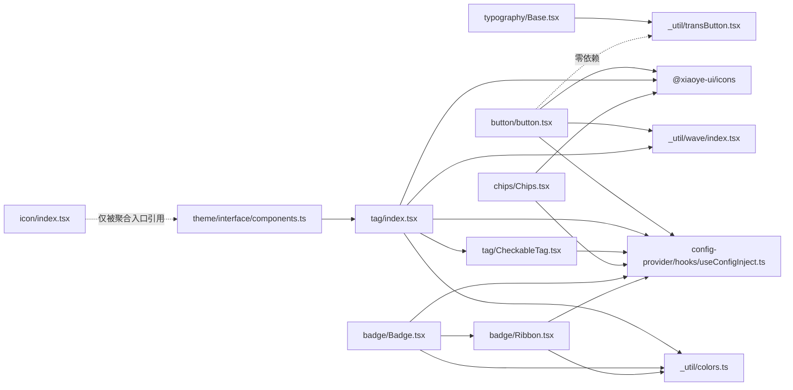
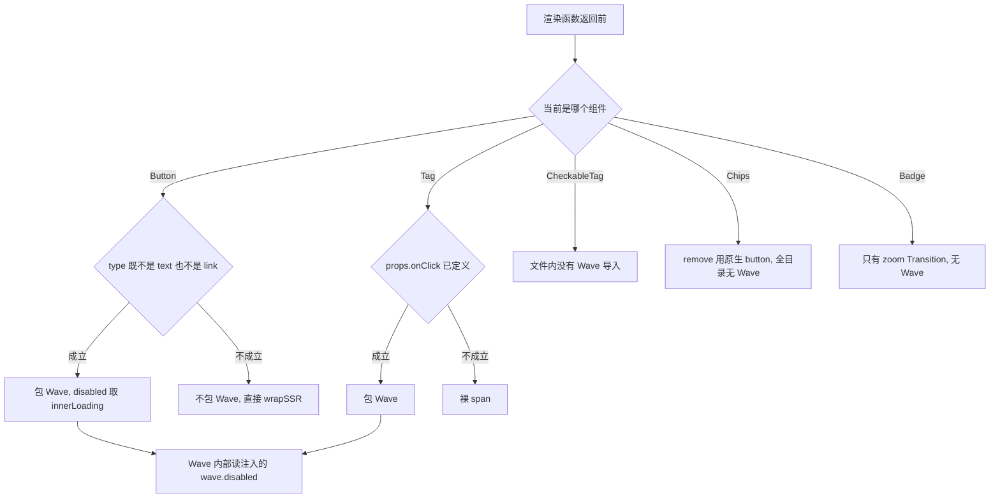
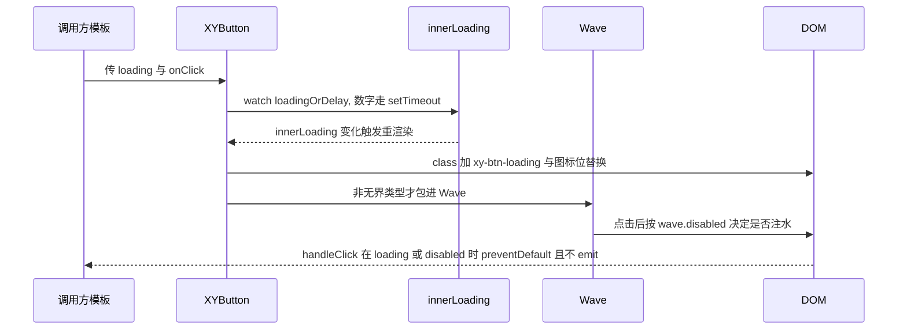
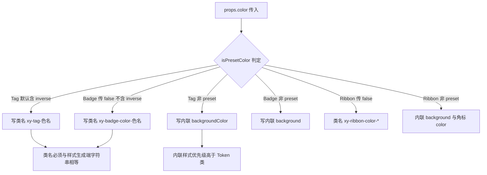

# C01-00 类横写：button/icon/tag/chips/badge 的职责切分

> **本篇解决**：通用基础这五个组件到底按什么维度切开——哪些能力属于「可点击的容器」、哪些属于「图形」、哪些属于「状态标记」，以及它们在源码层共用了什么、又在什么地方各走各的路。
> **前置**：A06 Props 体系与类型工具、A07 交互基础设施总览：一个浮层是怎么拼起来的　**读者坐标**：`03-components/01-general` 第 0/7 篇（本类横写篇）

## 一、职责与边界

本篇要切开的不是「这五个组件各自怎么用」，而是**同一条交互链上的五段职责被谁拿走**。通用基础这一类在文档站里像一族：都是行内元素、都能带图标、看起来都能点。但把五个目录的 import 清单摊开，它们并不共享任何一条抽象——连最像的 Tag 与 Chips 之间也是零复用。切分维度是三组正交问题：点击语义由谁提供、图形由谁提供、状态标记由谁承载。

五个组件在这三组问题上的落点是：

- **Button** 是终末的点击容器：自己渲染 `<button>` 或 `<a>`（`packages/xiaoye-ui/src/button/button.tsx:217-231`），不把「按钮基座」交给别的组件继承，也不渲染任何图标内容——它只把调用方递进来的 VNode 原样放进 DOM（`button.tsx:202-211`）。Button 作为单组件的完整实现（props 全表、loading 延迟的具体写法、`<a>` 与 `<button>` 分叉的全部细节）见 C01-01《Button 按钮》；本篇只取它与其余四个组件的分界处。
- **Icon** 是不渲染任何东西的占位哨兵（`packages/xiaoye-ui/src/icon/index.tsx:4-7` 直接返回 `null`），真实图形全部在 `@xiaoye-ui/icons` 包里，本类其余组件各自命名导入。它的定性见 C01-02 论点 1、图形供给链见 I15，本篇不重复论证，只补本类内部的落点差异。
- **Tag** 是内容容器，外加两个可选能力：关闭（`tag/index.tsx:117-128`）与勾选——勾选被拆成独立组件 `CheckableTag`（`tag/CheckableTag.tsx:20-53`），由 Tag 以静态属性挂载（`tag/index.tsx:163`）。
- **Chips** 名字与视觉都在标记族，源码依赖却是输入控件：它持有原生 `<input>` 的 ref（`chips/Chips.tsx:29`）、自己实现容器与输入框两套键盘分派（`chips/Chips.tsx:140-182`、`:218-256`），而文件头部的 import 清单里没有 `../tag`（`chips/Chips.tsx:1-10`）。
- **Badge** 不持有内容，只把一个计数字附着到 `children` 上（`badge/Badge.tsx:217-233`）。因此它必须处理「没有 children」这一分支：`-not-a-wrapper` 类名（`Badge.tsx:188`）与 status 场景的提前 return（`Badge.tsx:196-206`）。这是「标记」与「容器」在渲染层最直白的分界。

明确不负责的部分同样重要，因为它们是本类最常见的误判来源：

- Button 不负责图标渲染，只负责在 loading 时把图标位换成自己的私有 `LoadingIcon`（`button.tsx:202-211`、`button/LoadingIcon.tsx:26-68`）。
- Tag 不负责禁用：`tagProps` 里没有 `disabled` 字段（`tag/index.tsx:19-35`），`useConfigInject('tag', props)` 虽然会返回 `disabled`（`config-provider/hooks/useConfigInject.ts:43`），但 Tag 只解构了 `prefixCls` 与 `direction`（`tag/index.tsx:51`）。
- Badge 不负责内容排版，也不负责图形：整个 badge 目录没有一处 `@xiaoye-ui/icons` 导入。
- Chips 不负责值的合法性，只做去重与上限（`chips/Chips.tsx:87`、`:54-56`），校验语义留给表单层。
- Icon 什么都不负责。

被谁依赖与本类依赖谁，构成本篇的静态结构（图见 §三）：

- 本类内部零复用边：Button、Tag、Chips、Badge 在本类内部互不引用（Badge 对同目录 Ribbon 的引用是装配性质，见 §三）。
- Button 被主库 10 个文件 import：`_util/ActionButton.tsx:3`、`modal/Modal.tsx:8`、`popconfirm/index.tsx:9`、`input/Search.tsx:6`、`transfer/operation.tsx:3`、`qrcode/index.tsx:8`、`split-button/SplitButton.tsx:3`、`dropdown/dropdown-button.tsx:3`、`date-picker/PickerButton.tsx:3`、`tour/panelRender.tsx:9`。它是全库的点击语义终点，但这是「被 import」而不是「被继承」。
- Tag 只有一个复用方：`date-picker/PickerTag.tsx:2`。Badge 有一个：`float-button/FloatButton.tsx:4`。Chips 与 Icon 在主库内零组件 importer，仅出现在生成物 `src/components.ts:72-74`、`:164-165` 与 Token 登记表 `theme/interface/components.ts:13`。
- 向下依赖的公共设施只有五类：`useConfigInject`（五个入口文件各一处）、`useStyle` + `genComponentStyleHook`（各自 `style/index.ts`）、`Wave`（`button.tsx:235`、`tag/index.tsx:158`）、`@xiaoye-ui/icons`（`button/LoadingIcon.tsx:2`、`tag/index.tsx:5`、`chips/Chips.tsx:7`）、`isPresetColor`（`tag/index.tsx:94`、`badge/Badge.tsx:105`、`badge/Ribbon.tsx:31`）。
- A07 讲的浮层三件套（vc-trigger / vc-align / portal / zIndexManager）在本类五个目录里**一处都没有出现**，唯一的痕迹是 `badge/index.test.js:47-52` 那段被注释掉的「与 Tooltip 组合」用例。也就是说本类全部就地渲染，不做定位、不做层级、不做焦点收口。

## 二、源码地图

| 文件 | 行数 | 职责 | 关键导出 |
| --- | --- | --- | --- |
| `packages/xiaoye-ui/src/button/button.tsx` | 244 | 主实现：loading 计时、两字中文插空格、Wave 挂载、a/button 分叉 | `default`（`XYButton`）、`buttonProps` 再导出（`:34`） |
| `packages/xiaoye-ui/src/button/buttonTypes.ts` | 47 | Props 与 `convertLegacyProps` 遗留映射 | `buttonProps`（`:21`）、`ButtonType`（`:8`） |
| `packages/xiaoye-ui/src/button/button-group.tsx` | 61 | `GroupSizeContext` 提供者 | `GroupSizeContext`（`:18`）、`XYButtonGroup` |
| `packages/xiaoye-ui/src/button/LoadingIcon.tsx` | 68 | 私有 loading 图形，内部命名导入 `LoadingOutlined` | `default`（name 为 `LoadingIcon`，`:28`） |
| `packages/xiaoye-ui/src/button/index.ts` | 26 | 装配 `Button.Group` 与 install | `default`、`ButtonGroup` |
| `packages/xiaoye-ui/src/button/style/index.ts` | 525 | `genComponentStyleHook('Button')`（`:496`） | 默认导出样式 hook |
| `packages/xiaoye-ui/src/button/style/group.ts` | 80 | 组样式，被 Button 样式文件引入（`style/index.ts:4`） | 默认导出，在 `style/index.ts:4` 以 `genGroupStyle` 名绑定 |
| `packages/xiaoye-ui/src/icon/index.tsx` | 11 | 占位哨兵，渲染 `null` | `withInstall(Icon)`（`:11`） |
| `packages/xiaoye-ui/src/tag/index.tsx` | 176 | 主实现：preset 色判定、关闭、Wave 条件挂载 | `tagProps`（`:19`）、`XYTag`、`CheckableTag` |
| `packages/xiaoye-ui/src/tag/CheckableTag.tsx` | 55 | 勾选态标签，无 Wave、无图标、无 disabled | `XYCheckableTag` |
| `packages/xiaoye-ui/src/tag/style/index.ts` | 183 | `genComponentStyleHook('Tag')`（`:156`）、preset 色类生成（`:43-55`） | 默认导出样式 hook |
| `packages/xiaoye-ui/src/chips/Chips.tsx` | 354 | 输入控件本体：两套键盘分派、粘贴分词、item DOM | `default`（`XYChips`） |
| `packages/xiaoye-ui/src/chips/interface.ts` | 15 | Props，只有值语义字段，无 color/icon/disabled 之外的外观项 | `chipsProps`（`:4`） |
| `packages/xiaoye-ui/src/chips/style/index.ts` | 167 | `genComponentStyleHook('Chips')`（`:157`） | 默认导出样式 hook |
| `packages/xiaoye-ui/src/badge/Badge.tsx` | 239 | 附着逻辑：三组可见性计算、status 早返回、Transition + ScrollNumber | `badgeProps`（`:18`）、`XYBadge` |
| `packages/xiaoye-ui/src/badge/Ribbon.tsx` | 62 | 缎带，复用 Badge 的样式 hook 但用自己的 prefixCls | `ribbonProps`（`:10`）、`XYBadgeRibbon` |
| `packages/xiaoye-ui/src/badge/ScrollNumber.tsx` + `SingleNumber.tsx` | 86 + 133 | 数字滚动动画，独立组件名 `scroll-number` | — |
| `packages/xiaoye-ui/src/badge/style/index.ts` | 378 | `genComponentStyleHook('Badge')`（`:337`），同文件内生成 ribbon 样式（`:73-74`） | 默认导出样式 hook |
| `packages/xiaoye-ui/src/_util/colors.ts` | 34 | `isPresetColor`（`:24`）/`isPresetStatusColor`（`:32`），本类三个调用方 | — |
| `packages/xiaoye-ui/src/_util/transButton.tsx` | 102 | 「行为是按钮、外观不是按钮」的旁路实现，Button 不用它 | `TransButton`（`:17`） |
| `packages/xiaoye-ui/src/theme/interface/components.ts` | — | Token 登记表：Button/Tag/Chips 走 import（`:6`、`:56`、`:13`），Badge 写空对象（`:75`），Icon 无条目 | `ComponentTokenMap` |

主实现入口分别是 `button/button.tsx:35`、`tag/index.tsx:39`、`chips/Chips.tsx:12`、`badge/Badge.tsx:39`、`icon/index.tsx:4`。五个组件的测试分布不均：`button/index.test.js`（285 行）与 `badge/index.test.js`（206 行）覆盖较厚，`tag/index.test.js` 只有 88 行，`chips/__tests__/chips.test.js` 115 行，`icon/` 最薄；`icon/index.tsx` 无任何测试文件。按 `packages/xiaoye-ui/vitest.config.mts:33` 的 glob，上述文件都会被执行。

## 三、架构与数据流

### 3.1 静态结构：五个目录真正相连的边只有一条



这张图要说清的是**边的稀疏程度**。五个组件目录之间只剩一条真实边：`Tag` 挂 `CheckableTag`（`tag/index.tsx:13` 导入、`:163` 挂载）。`Badge` 对 `Ribbon` 的引用是装配性质的（`badge/Badge.tsx:9`），两者运行时互不调用。虚线两条都是「缺失」的标记：Button 与 TransButton 之间没有边（`button.tsx:1-24` 的 import 清单里没有它，而真正的两个消费方是 `typography/Base.tsx:3`、`transfer/ListItem.tsx:7`）；`icon/index.tsx` 除聚合入口 `src/components.ts:164-165` 外没有任何引用者。

向下收敛到四个公共点：`useConfigInject`（五个入口各调一次，前缀分别是 `btn`、`tag`、`chips`、`badge`、`ribbon`）、`Wave`（只有两处）、`isPresetColor`（三处，但三处的调用参数不同，见论点 4）、`@xiaoye-ui/icons`（三处命名导入）。`theme/interface/components.ts` 那条边是**类型层**的：它 `import type` 了 Button/Tag/Chips 的 `ComponentToken`（`theme/interface/components.ts:6`、`:56`、`:13`），对 Badge 直接写空对象字面量（`:75`），对 Icon 完全没有条目。Token 层的这套登记差异归 A03 与 A02 解释，本篇只指出：**同类的五个组件在类型登记表里的待遇是三等（规范登记 / 空对象 / 缺席）**。

### 3.2 点击反馈的分派：挂不挂 Wave 是各组件自己决定的



这张分支图解释的是**同一个需求（点击要有涟漪）为什么有五种答案**。Button 的闸门是「外观类型」：`isUnBorderedButtonType(type)` 为假才包 Wave（`button/button.tsx:233-239`），即 primary/default/dashed/ghost 有涟漪，text/link 没有。Tag 的闸门是「调用方是否给了点击处理器」：`const isNeedWave = props.onClick !== undefined`（`tag/index.tsx:145`），随后 `wrapSSR(isNeedWave ? <Wave>{tagNode}</Wave> : tagNode)`（`:158`）。两个闸门语义完全不同——前者问「长得像不像按钮」，后者问「是不是可点」。CheckableTag 明明是可点的（`tag/CheckableTag.tsx:31-36` 里有 `handleClick`），但它连 `Wave` 都没导入（`CheckableTag.tsx:1-6`），所以勾选标签永远没有涟漪。Chips 的删除键是原生 `<button>`（`chips/Chips.tsx:310-320`），Badge 只有进出场 `Transition`（`badge/Badge.tsx:220`）。

而全局开关 `wave.disabled` 与挂载判定无关：它是在 Wave 内部读的（`_util/wave/index.tsx:29` 解构出 `wave`、`_util/wave/useWave.ts:15` 判 `wave?.value?.disabled`）。所以本类的涟漪语义实际是**两级门**：组件决定是否包（各写各的），Wave 决定包了以后开不开（统一）。两级门的好处是组件不用重复读配置，代价是「这个组件有没有点击反馈」无法从任何一处清单看出。ripple 与 wave 的机制细节见 C12-05，本篇不展开。

### 3.3 一次点击的数据回流：Button 与 Tag 的两条闭环



Button 的闭环里有一个**内部状态**（`innerLoading`，`button.tsx:56`）和一处**故意吞事件**的收口：`handleClick` 在 `innerLoading.value || mergedDisabled.value` 时 `preventDefault()` 后直接 return，`emit('click')` 根本不发（`button.tsx:128-134`）。这意味着 loading 期间的点击对调用方是不可见的，不需要调用方自己挡。

Tag 的闭环短得多，而且分了两条：主标签的点击只 `emit('click', e)`（`tag/index.tsx:106-108`），没有任何拦截条件；关闭按钮则先 `e.stopPropagation()` 再依次 `emit('update:visible', false)` 与 `emit('close', e)`，然后检查 `e.defaultPrevented` 决定是否自毁（`tag/index.tsx:72-83`）。也就是说**「能不能阻止 Tag 关闭」靠调用方在 close 处理器里调用 preventDefault**，而 Button 的「阻止点击」是自己内部判状态。两种契约方向相反：一个是「调用方否决」，一个是「组件否决」。CheckableTag 更极端，一次点击同时发三个事件：`update:checked`、`change`、`click`（`CheckableTag.tsx:33-35`），且没有 preventDefault 检查。Chips 走第三条路：删除项直接 `emit('update:value', values)` 加 `emit('remove', {...})`（`chips/Chips.tsx:103-107`），值由组件自己算好整包回传，调用方只能接住。

### 3.4 颜色语义的分派：同一个字符串在三个组件里走不同分支



图里最关键的不是分支多，而是**两条出口的性质不同**：走类名的那条依赖样式生成端恰好发出同名类（Tag 端写 `xy-tag-${color}`（`tag/index.tsx:99`），样式端在 `tag/style/index.ts:43-55` 用 `genPresetColor` 生成 `${componentCls}-${colorKey}`），两边靠字符串对齐、没有类型约束；走内联样式的那条完全绕开 Token 体系（`tag/index.tsx:130-132`、`badge/Badge.tsx:212-215`、`badge/Ribbon.tsx:44-46`）。判定函数是同一个（`_util/colors.ts:24-30`），但三个调用点传参不一致：Tag 用默认 `includeInverse = true`（`tag/index.tsx:94` 调用未传第二参），Badge 与 Ribbon 显式传 `false`（`badge/Badge.tsx:105`、`badge/Ribbon.tsx:31`）。`red-inverse` 因此在 Tag 里是内部色（走类名），在 Badge 里不是（走内联），详见论点 4。Token 的四层派生本身归 A03，本篇只标注「内联样式这条出口不在 Token 体系内」。

## 四、核心机制精读

### 论点 1：「可点击容器」有两套互不调用的实现，Button 是终点而不是基座

**断言**：需要「点了就触发一次操作」这件事时，源码里有两个选择——用 `XYButton`，或者用 `_util/transButton.tsx`。两者渲染的元素、禁用方式、键盘合同、是否挂 Wave 全都不同，且**彼此零引用**：Button 不基于 TransButton 实现，TransButton 也不复用 Button 的任何逻辑。所谓「按钮基座」在本库并不存在。

先看 TransButton 的渲染出口（`packages/xiaoye-ui/src/_util/transButton.tsx:66-99`）：

```tsx
// packages/xiaoye-ui/src/_util/transButton.tsx:66
    return () => {
      const { noStyle, disabled, ...restProps } = props;

      let mergedStyle: CSSProperties = {};

      if (!noStyle) {
        mergedStyle = {
          ...inlineStyle,
        };
      }

      if (disabled) {
        mergedStyle.pointerEvents = 'none';
      }
      return (
        <div
          role="button"
          tabindex={0}
          ref={domRef}
          {...restProps}
          {...attrs}
          onClick={onClick}
          onKeydown={onKeyDown}
          onKeyup={onKeyUp}
          style={{
            ...mergedStyle,
            ...((attrs.style as object) || {}),
          }}
        >
```

它的「禁用」是把 `pointerEvents` 设成 `none`（`:77-79`），键盘合同只有 Enter 两个处理器（`onKeyDown` 在 Enter 时 `preventDefault`，`onKeyUp` 在 Enter 时补发 click，`:29-41`），样式来自文件顶部一个硬编码对象字面量 `inlineStyle`（`:9-15`），既不走 `useConfigInject` 也不走 `useStyle`——整个文件没有一处 prefixCls。

再看 Button 的渲染出口（`packages/xiaoye-ui/src/button/button.tsx:217-241`）：

```tsx
// packages/xiaoye-ui/src/button/button.tsx:217
      if (href !== undefined) {
        return wrapSSR(
          <a {...buttonProps} href={href} target={target} ref={buttonNodeRef}>
            {iconNode}
            {kids}
          </a>,
        );
      }

      let buttonNode = (
        <button {...buttonProps} ref={buttonNodeRef} type={htmlType}>
          {iconNode}
          {kids}
        </button>
      );

      if (!isUnBorderedButtonType(type)) {
        buttonNode = (
          <Wave ref="wave" disabled={!!innerLoading.value}>
            {buttonNode}
          </Wave>
        );
      }

      return wrapSSR(buttonNode);
```

Button 渲染真实 `<button>`，禁用靠原生 `disabled` 属性（并且在不禁用时把该属性从对象上删掉，`button.tsx:189-201`），带 `type=htmlType`、带 Wave、带 `wrapSSR`。两者对外的命令式接口是各自手写的同一对方法：`focus`/`blur` 在 `button.tsx:166-175` 定义并 `expose`，在 `transButton.tsx:45-65` 又定义并 `expose` 一遍。

这套分叉的后果是可访问性合同不一致。`<button>` 原生支持空格键激活，`<div role="button">` 不支持，必须自己实现 `keydown` 上的 Space 处理；而 TransButton 的键盘分支只判了 `KeyCode.ENTER`（`transButton.tsx:31`、`:38`）。同时它的禁用态对读屏不可见——`pointerEvents: none` 不产生任何 `aria-disabled`，而 Button 那条路至少留下了原生语义。TransButton 的两个真实消费方就是这条缺口的暴露面：`typography/Base.tsx:419`、`:447`（可编辑图标与复制图标两个触发器）与 `transfer/ListItem.tsx:56`（列表项的移除按钮）。值得一提的是这三个调用点全部手工补了 `aria-label`（`typography/Base.tsx:423`、`typography/Base.tsx:453`、`transfer/ListItem.tsx:59`），相当于消费方在替这层缺失的语义打补丁。

还有一点容易误判：OUTLINE 里把 `transButton` 写成 Button 的「底层」，源码不支持这个说法。可用一条命令复核（排除 `dist` 与 `node_modules`，两种导入写法一起统计）：

```bash
grep -rn "transButton\|TransButton" packages apps --include='*.tsx' --include='*.ts' \
  | grep -v node_modules | grep -v "/dist/"
```

结果里 `button/` 目录零命中；命中的只有 TransButton 自身的两份文件、`_util/index.ts:56` 与已废弃副本目录桶导出 `_util/components/index.ts:11`，以及上述两个消费方。顺带说明：`_util/transButton.tsx` 在 `_util/components/transButton.tsx` 有一份机械副本，`diff` 只差第 7 行的 KeyCode 相对路径，两份都是 102 行——该目录的定性与归属判断见 A06，本篇不重复论证，只提示「改一份会留一份」。

**回扣职责切分**：Button 在本类的定位是「一个把点击渲染成原生按钮的终点组件」。它被 10 个外部文件 import（§一 清单），说明它承担的是**复用终点**而不是**继承基类**。真正想做「无外观按钮」的组件走的是另一条完全不同的实现，两边没有共享任何一行逻辑，包括那个最该共享的 `focus`/`blur`。

### 论点 2：点击反馈的挂载判据是三套互不相干的规则，而不是一个「可点即有涟漪」的约定

**断言**：本类里「要不要包 Wave」由每个组件自己写一条布尔式，三条规则（Button 看外观类型、Tag 看有没有 onClick、CheckableTag/Chips/Badge 根本不包）语义互不相容，导致「可点但没有反馈」成为默认结果而不是显式选择。

Button 侧的判据来自一个三行的小函数（`button/button.tsx:31-33`）：

```tsx
// packages/xiaoye-ui/src/button/button.tsx:31
function isUnBorderedButtonType(type: ButtonType | undefined) {
  return type === 'text' || type === 'link';
}
```

这个谓词同时喂给三处决策：类名 `-background-ghost`（`button.tsx:103`）、是否需要插入两字中文空格（`button.tsx:181`）、是否包 Wave（`button.tsx:233`）。也就是说**「有没有涟漪」在 Button 里是外观类型的副产品**，而不是交互属性——同一个 `type="text"` 的按钮点下去没有任何反馈，而 `type="link"` 走的是 `<a>` 分支（`button.tsx:217-224`）时，那条分支在 Wave 判定之前就直接 return 了，连包的机会都没有。

Tag 侧的判据完全是另一种东西（`tag/index.tsx:144-158`）：

```tsx
// packages/xiaoye-ui/src/tag/index.tsx:144
      const isNeedWave = props.onClick !== undefined;
      const tagNode = (
        <span
          {...attrs}
          onClick={handleClick}
          class={[tagClassName.value, attrs.class]}
          style={[tagStyle, attrs.style as CSSProperties]}
        >
          {kids}
          {renderCloseIcon()}
        </span>
      );

      return wrapSSR(isNeedWave ? <Wave>{tagNode}</Wave> : tagNode);
```

这里问的是「调用方传没传 `onClick`」，与外观无关。它和样式层给出的可点提示是两套互不参照的机制：Tag 的 `cursor: pointer` 只挂在两个类上——关闭图标 `-close-icon`（`tag/style/index.ts:93-97`）与勾选态 `-checkable`（`:113-116`），普通 Tag 即便写了 `color="purple"` 也不会变成手型。于是「看起来可点」由样式类名决定，「点了有涟漪」由 JS 侧 `props.onClick !== undefined` 决定，两者没有任何一致性约束。而 `onClick` 在 `tagProps` 里是用 `eventType<(e: MouseEvent) => void>()` 声明的（`tag/index.tsx:31`），Vue 会把模板上的 `@click` 编译成 `onClick` prop，因此这条判据依赖的是 A06 描述的「事件即 prop」约定——换成纯 `inheritAttrs` 透传写法就会失效，因为组件已经声明 `inheritAttrs: false`（`tag/index.tsx:42`）。

再看两个「可点却无反馈」的实例。CheckableTag 的点击处理与渲染（`tag/CheckableTag.tsx:31-51`）：

```tsx
// packages/xiaoye-ui/src/tag/CheckableTag.tsx:31
    const handleClick = (e: MouseEvent) => {
      const { checked } = props;
      emit('update:checked', !checked);
      emit('change', !checked);
      emit('click', e);
    };

    const cls = computed(() =>
      classNames(prefixCls.value, hashId.value, {
        [`${prefixCls.value}-checkable`]: true,
        [`${prefixCls.value}-checkable-checked`]: props.checked,
      }),
    );

    return () => {
      return wrapSSR(
        <span {...attrs} class={[cls.value, attrs.class]} onClick={handleClick}>
          {slots.default?.()}
        </span>,
      );
    };
```

它无条件绑定 `onClick`、无条件切换 `checked`，是全类里最像「按钮」的东西，但文件顶部只有五行 import（`CheckableTag.tsx:1-5`），**没有 Wave**。同一个目录下的兄弟组件（`tag/index.tsx:6`）却导入了 Wave。Chips 的删除键走第三种答案：直接写原生 `<button type="button">`（`chips/Chips.tsx:310-320`），既不用 `XYButton` 也不用 Wave，禁用靠 `disabled={mergedDisabled.value}`（`:315`）。Badge 是第四种：整个渲染出口只有一个进出场 `Transition`（`badge/Badge.tsx:220`），它不响应点击（`badgeProps` 里没有 onClick 字段，`Badge.tsx:18-35`）。

统一的那一层只在 Wave 内部。Wave 自己读配置注入的 `wave`（`_util/wave/index.tsx:29`）并把它交给 `useWave`（`:35-38`），后者在每次触发时先判配置（`_util/wave/useWave.ts:12-19`）：

```ts
// packages/xiaoye-ui/src/_util/wave/useWave.ts:12
  function showWave() {
    const node = findDOMNode(instance);
    stopWave?.();
    if (wave?.value?.disabled || !node) {
      return;
    }
    stopWave = showWaveEffect(node, className.value);
  }
```

另外 Wave 还会跟随 `props.disabled` 重绑监听器（`_util/wave/index.tsx:50-60`），Button 正是利用这一点在 loading 期间摘掉涟漪（`button.tsx:235` 传 `disabled={!!innerLoading.value}`），而 Tag 传 `<Wave>` 时没有给任何 props（`tag/index.tsx:158`），因此 Tag 的涟漪不受任何状态抑制。

**结论**：本类的点击反馈是**两级门**结构——第一级「包不包」由各组件手写且规则不一致（三套 + 两个不包），第二级「包了开不开」由 Wave 统一读配置（`useWave.ts:15`）。要新增一个通用基础组件，没有清单可查，只能回头对齐 `button.tsx:233` 或 `tag/index.tsx:145`；ripple/wave 的效果实现归 C12-05，本类不再展开。

### 论点 3：图形供给在本类有四种互不兼容的 API 形态

**断言**：「给组件配一个图标」这个需求，在 button / tag / chips / badge 四个目录里对应四种互不兼容的 API 形态——VNode 型 prop、插槽覆盖加内置默认、纯插槽、完全不支持。四种写法都不经过 `src/icon/`（那是个渲染 `null` 的哨兵，`icon/index.tsx:4-7`），组件层与图标包之间的唯一纽带是 `@xiaoye-ui/icons` 的命名导入。跨组件层的四套分派全景见 C01-02 论点 5，本论点只钉本类内部的落点。

第一种，VNode 型 prop，Button 是代表（`button/buttonTypes.ts:37` 与 `button.tsx:177-211`）：

```tsx
// packages/xiaoye-ui/src/button/button.tsx:177
    return () => {
      const { icon = slots.icon?.() } = props;
      const children = flattenChildren(slots.default?.());

      isNeedInserted = children.length === 1 && !icon && !isUnBorderedButtonType(props.type);

      const { type, htmlType, href, title, target } = props;

      const iconType = innerLoading.value ? 'loading' : icon;
      const buttonProps = {
        ...attrs,
        title,
        disabled: mergedDisabled.value,
        class: [
          classes.value,
          attrs.class,
          { [`${prefixCls.value}-icon-only`]: children.length === 0 && !!iconType },
        ],
        onClick: handleClick,
        onMousedown: handleMousedown,
      };
```

`icon: PropTypes.any`（`buttonTypes.ts:37`）意味着类型层对「传什么」不设防：任何 VNode、字符串、组件定义对象都能通过校验，而实现只保证了「VNode 直接进 children」这一条路径（`button.tsx:202-211`）。`button.tsx:178` 的 `icon = slots.icon?.()` 又让插槽成为第二来源，且是**默认值语义**——`props.icon` 为 `undefined` 时才看插槽，传 `null` 就把插槽封死了。`-icon-only` 类名依赖 `iconType`（`:193`），而 `iconType` 在 loading 时被写成字符串 `'loading'`（`:185`），于是同一个类名在两种来源下成立条件不同。

第二种，插槽覆盖 + 内置默认组件，Tag 是代表。`icon` 与 `closeIcon` 都是 `PropTypes.any`（`tag/index.tsx:25`、`:33`），但关闭图标多了一层兜底（`tag/index.tsx:117-128`）：

```tsx
// packages/xiaoye-ui/src/tag/index.tsx:117
      const renderCloseIcon = () => {
        if (closable) {
          return closeIcon ? (
            <span class={`${prefixCls.value}-close-icon`} onClick={handleCloseClick}>
              {closeIcon}
            </span>
          ) : (
            <CloseOutlined class={`${prefixCls.value}-close-icon`} onClick={handleCloseClick} />
          );
        }
        return null;
      };
```

注意两个分支的**DOM 层级不一样**：自定义 `closeIcon` 被包进一个 `<span>`，事件挂在 span 上；默认的 `CloseOutlined` 不包壳，`class` 与 `onClick` 直接作为 attrs 落到图标根元素——`times/TimesIcon.vue:2` 的根就是 `<span class="xyicon">`，而该文件 `defineOptions` 只声明了 name（`:22`）、没有关 `inheritAttrs`，所以 attrs 合到根 span 上。两条路都能点，但选择器 `.xy-tag-close-icon` 在两种情况下的宿主不同（一个是包装 span，一个是图标 span）。这里还有一处尺寸来源差异：图标包里的 svg 自带 `width="14" height="14"`（`times/TimesIcon.vue:4-5` 起），而 Tag 样式对 `-close-icon` 另外写了 `fontSize: token.tagIconSize`（`tag/style/index.ts:93-98`），后者对固定宽高的 svg 不起作用。

第三种，纯插槽，Chips 是代表。`chips/interface.ts:4-13` 的 props 里**没有任何图标字段**，删除图形只在模板上决定（`chips/Chips.tsx:306-320`）：

```tsx
// packages/xiaoye-ui/src/chips/Chips.tsx:306
                ) : (
                  <>
                    <span class={`${prefixCls.value}-item-label`}>{val}</span>
                    <button
                      type="button"
                      class={`${prefixCls.value}-item-remove`}
                      disabled={mergedDisabled.value}
                      onClick={(e: Event) => {
                        e.stopPropagation();
                        removeItem(e, i);
                      }}
                    >
                      {slots.removeIcon ? slots.removeIcon() : <CloseOutlined />}
                    </button>
                  </>
                )}
```

`CloseOutlined` 在这里不带任何 attrs（`:321`），样式全部由外层 `<button class="xy-chips-item-remove">` 承担（对应样式 `chips/style/index.ts:97-107`）。也就是说 Tag 与 Chips 用了**同一个图标组件**，却走了两种包裹协议：Tag 把交互与类名交给图标，Chips 把交互与类名交给外壳按钮。

第四种，不支持：Badge 与 Ribbon 整个目录零图标导入（`badge/Badge.tsx:1-16` 与 `badge/Ribbon.tsx:1-8` 的 import 清单可查），它的可扩展内容是 `count` 插槽配合 `cloneElement`（`Badge.tsx:173-182`），把调用方给的任意 VNode 克隆并注入 `style`，因此「用一个图形当计数」在这条路上是支持的，但它不是图标 API 而是自定义内容 API。

**这四种形态之间没有一个是彼此的超集**，把它们统一起来的公共层在本库里不存在——图标包负责图形，`src/icon/` 负责占位，中间那一层「组件如何消费图形」没人管。图标包自身的生成链与兼容层见 I15。

### 论点 4：颜色职责被一个 11 行的判定函数切成两条出口，三个调用点参数还不一致

**断言**：本类里「传一个颜色」有两条出口——命中 preset 就走 CSS-in-JS 生成的类名（在 Token 体系内），没命中就走内联 style（在 Token 体系外）。决定走哪条的是同一个函数 `isPresetColor`，但三个调用点传参不同，导致同一个颜色字符串在 Tag 与 Badge 里落到不同出口。

判定函数全文只有 11 行（`packages/xiaoye-ui/src/_util/colors.ts:24-34`）：

```ts
// packages/xiaoye-ui/src/_util/colors.ts:24
export function isPresetColor(color?: any, includeInverse = true) {
  if (includeInverse) {
    return [...inverseColors, ...PresetColors].includes(color);
  }

  return PresetColors.includes(color);
}

export function isPresetStatusColor(color?: any): color is PresetStatusColorType {
  return PresetStatusColorTypes.includes(color);
}
```

`inverseColors` 是对 `PresetColors` 逐个加 `-inverse` 后缀派生的（`colors.ts:4-5`），`PresetStatusColorTypes` 是五个状态词的 `as const` 元组（`colors.ts:7-13`）。这两个数组的来源是主题层（`PresetColors` 从 `theme/interface` 导入，`colors.ts:1-2`），所以判定结果与 Token 登记表是同一批数据——这部分机制归 A03，本篇只关心它的**消费方式**。

Tag 的消费（`tag/index.tsx:93-105` 与 `:130-132`）：

```tsx
// packages/xiaoye-ui/src/tag/index.tsx:93
    const isInternalColor = computed(
      () => isPresetColor(props.color) || isPresetStatusColor(props.color),
    );

    const tagClassName = computed(() =>
      classNames(prefixCls.value, hashId.value, {
        [`${prefixCls.value}-${props.color}`]: isInternalColor.value,
        [`${prefixCls.value}-has-color`]: props.color && !isInternalColor.value,
        [`${prefixCls.value}-hidden`]: !visible.value,
        [`${prefixCls.value}-rtl`]: direction.value === 'rtl',
        [`${prefixCls.value}-borderless`]: !props.bordered,
      }),
    );
```

```tsx
// packages/xiaoye-ui/src/tag/index.tsx:130
      const tagStyle = {
        backgroundColor: color && !isInternalColor.value ? color : undefined,
      };
```

`isPresetColor(props.color)` 没传第二个参数，因此 `includeInverse` 取默认的 `true`（`colors.ts:24`），Tag 认定的内部色集合比 Badge 大一倍（多出全部 `-inverse` 变体）。同时 Tag 把状态色也纳入内部色（`|| isPresetStatusColor(...)`，`:94`），Badge 完全没有这一步。写进 DOM 的类名是 `xy-tag-${color}` 这种**裸拼接**（`:99`），它的对端在样式文件里（`tag/style/index.ts:42-55`）：

```ts
// packages/xiaoye-ui/src/tag/style/index.ts:42
const genPresetStyle = (token: TagToken) =>
  genPresetColor(token, (colorKey, { textColor, lightBorderColor, lightColor, darkColor }) => ({
    [`${token.componentCls}-${colorKey}`]: {
      color: textColor,
      background: lightColor,
      borderColor: lightBorderColor,

      // Inverse color
      '&-inverse': {
        color: token.colorTextLightSolid,
        background: darkColor,
        borderColor: darkColor,
      },
```

两端都是模板字符串产出的类名，中间**没有任何编译期约束**：`genPresetColor` 发出哪些 `colorKey` 由主题层决定（机制归 A03），组件侧写 `xy-tag-${props.color}` 时无从校验这个名字是否真被生成。判定函数与生成函数用了同一份 `PresetColors`，所以正常情况下能对齐；一旦有人只改判定（比如给 Badge 也加上 `includeInverse`），类名就会写出但样式不存在，表现为「颜色传了但没效果」，且没有告警。

Badge 与 Ribbon 的消费刻意避开了 inverse（`badge/Badge.tsx:105` 与 `badge/Ribbon.tsx:31` 都写成 `isPresetColor(props.color, false)`），随后：

```tsx
// packages/xiaoye-ui/src/badge/Badge.tsx:105
    const isInternalColor = computed(() => isPresetColor(props.color, false));
    // Shared styles
    const statusCls = computed(() => ({
      [`${prefixCls.value}-status-dot`]: hasStatus.value,
      [`${prefixCls.value}-status-${props.status}`]: !!props.status,
      [`${prefixCls.value}-color-${props.color}`]: isInternalColor.value,
    }));

    const statusStyle = computed(() => {
      if (props.color && !isInternalColor.value) {
        return { background: props.color, color: props.color };
      } else {
        return {};
      }
    });
```

出口形态与 Tag 不同：Badge 的类名带一段 `-color-`（`Badge.tsx:110`、`:128`），而 Tag 的类名直接是色名（`tag/index.tsx:99`），两侧样式端也各自对应（`badge/style/index.ts:76-83` 用 `${componentCls}-color-${colorKey}`，`tag/style/index.ts:44` 用 `${componentCls}-${colorKey}`）。Badge 的非 preset 分支更激进：它一次写两个属性 `{ background, color }`（`Badge.tsx:115`），而 `statusStyle.color` 随后被当作**状态文案的文字色**再次取出（`Badge.tsx:197` 的 `const statusTextColor = mergedStyle.color;`，用于 `:201` 的文字 span）。一个 `color` prop 在 Badge 里同时是底色与文字色的来源，在 Tag 里只是底色。

Chips 不参与这套分派：`chips/interface.ts:4-13` 里没有 `color` 字段，它的配色全由 Chips Token 决定（`chips/style/index.ts:157-165` 的 `mergeToken`）。

**结论**：颜色这条职责的边界是「preset 判定 + 两条出口」，而判定函数的**参数选择被每个组件自己决定**（Tag 默认含 inverse，Badge/Ribbon 不含；`tag/index.tsx:94` vs `badge/Badge.tsx:105`、`badge/Ribbon.tsx:31`）。因此 `color="red-inverse"` 在 Tag 上是内部色、走类名，在 Badge 上不是内部色、走内联 style——同一字符串两种 DOM。这是 §七 坑 5 的成因。

### 论点 5：内容归属切成「容器 / 附着 / 值集合」三种写法

**断言**：同样一个「调用方给点东西进来」的需求，本类实际写了三种互不同构的实现——Tag 与 CheckableTag 是容器（`slots.default` 直接进 DOM），Badge 是自带状态缓存的附着（内容不属于自己的渲染树，需要克隆与快照），Chips 是值集合（不接受内容，只接受 `string[]` 并自己生成 DOM）。容器与值集合的边界很清楚；附着这一形态在本类只有 Badge 一例，它的全部复杂度（三个快照 ref 加一次克隆）都来自「渲染的内容不全归它管」。

先看 Badge 的附着模式（`badge/Badge.tsx:184-206`）：

```tsx
// packages/xiaoye-ui/src/badge/Badge.tsx:184
      const badgeClassName = classNames(
        pre,
        {
          [`${pre}-status`]: hasStatus.value,
          [`${pre}-not-a-wrapper`]: !children,
          [`${pre}-rtl`]: direction.value === 'rtl',
        },
        attrs.class,
        hashId.value,
      );

      // <Badge status="success" />
      if (!children && hasStatus.value) {
        const statusTextColor = mergedStyle.color;
        return wrapSSR(
          <span {...attrs} class={badgeClassName} style={mergedStyle}>
            <span class={statusCls.value} style={statusStyle.value} />
            <span style={{ color: statusTextColor }} class={`${pre}-status-text`}>
              {text}
            </span>
          </span>,
        );
      }
```

`children` 的来源是 `flattenChildren(slots.default?.())` 再被判空（`Badge.tsx:137-138`），一旦为空就打 `-not-a-wrapper`。注意这里的分支不是「渲染差异」而是**组件形态差异**：无 children 且带 status 时，函数在此处直接 return，产出的是「圆点 + 文案」的独立标记（`:199-204`）；有 children 时才走后面的「内容 + Transition + ScrollNumber」结构（`Badge.tsx:217-233`）。附着件本身还要缓存状态，避免离场动画期间数字抖动，源码用了三个 `ref` 做快照（`Badge.tsx:85-103`：`livingCount`、`displayCount`、`isDotRef`，由同一个 watch 维护）。这是 Badge 特有的复杂度来源——它渲染的东西不全归它管。另外附着件的宿主标签是可换的：`component` 在 `badge/ScrollNumber.tsx:13` 声明为 String，在 `:34` 被解构成 JSX 标签变量 `Tag` 并默认成 `'sup'`。

对照另外两种内容模式。Tag 是容器：`const children = slots.default?.()`（`tag/index.tsx:135`），有 icon 时把 children 包一层 span（`:136-143`），除此之外不加工，也不缓存任何东西（它的内部状态只有一个 `visible`，`tag/index.tsx:55`）。CheckableTag 更纯粹，渲染体就是 `<span>{slots.default?.()}</span>`（`CheckableTag.tsx:46-50`）。Chips 则不接受内容：它的 item 完全由 `props.value: string[]` 生成（`chips/Chips.tsx:271`、`:289`），调用方唯一能替换整段 item 结构的入口是 `chip` 插槽，并且组件把删除函数作为插槽参数回传（`chips/Chips.tsx:300-305`）：

```tsx
// packages/xiaoye-ui/src/chips/Chips.tsx:300
                {slots.chip ? (
                  slots.chip({
                    value: val,
                    index: i,
                    removeCallback: (event: Event) => removeItem(event, i),
                  })
                ) : (
```

**结论**：本类的内容职责不是「有没有插槽」，而是三种模式各占一角——容器（Tag/CheckableTag）、附着且自带状态缓存（Badge）、值集合且把删除能力作为插槽参数下发（Chips）。Ribbon 是第四个变体：它自己就是包装器，`{slots.default?.()}` 外加一层 `-wrapper` div（`badge/Ribbon.tsx:49-58`），却复用 Badge 的 Token 命名空间（`useRibbonStyle`，`:30`）。改 Badge 的根类名或前缀派生方式时，需要同时检查 Ribbon 一处，它的耦合落在样式 hook 的引用上。

### 论点 6：装配层四件事各写各的——复合子组件挂载、install 来源、emits 声明、全局类型登记

**断言**：公开面（`XYXxx` 组件名 / `xy-xxx` 标签 / 样式入口 / 全局类型声明）也是职责切分的结果，而本类在四个装配动作上没有统一写法：`Button.Group` 与 `Tag.CheckableTag` 用赋值挂载、`Badge.Ribbon` 靠组件选项对象上的一个野键、Chips 的 `install` 写了两次、Icon 走 `withInstall`。四种写法都不会报错，所以差异只能靠人记住。

显式赋值那种（`button/index.ts:12-19`）：

```ts
// packages/xiaoye-ui/src/button/index.ts:12
Button.Group = ButtonGroup;

/* istanbul ignore next */
Button.install = function (app: App) {
  registerComponent(app, Button);
  registerComponent(app, ButtonGroup);
  return app;
};
```

Tag 同构（`tag/index.tsx:163-169`：`Tag.CheckableTag = CheckableTag;` 紧跟一个注册两个组件的 `install`）。Badge 用的是第三种（`badge/Badge.tsx:39-44`）：

```tsx
// packages/xiaoye-ui/src/badge/Badge.tsx:39
export default defineComponent({
  compatConfig: { MODE: 3 },
  name: 'XYBadge',
  Ribbon,
  inheritAttrs: false,
  props: badgeProps(),
```

`Ribbon` 不是 Vue 认识的选项名。它在运行时能出现在导出对象上，本仓库内的可验证证据是两处：入口的类型断言声明了 `readonly Ribbon: typeof Ribbon`（`badge/index.ts:15-18`），而测试正按这个属性取值 `mountTest(Badge.Ribbon)`（`badge/index.test.js:136`）；至于为什么「选项对象里的野键会留在组件对象上」，那是 Vue 运行时 `defineComponent` 对对象入参的恒等返回行为，不在本仓库源码内，本篇不为它挂 file:line。要紧的是后果：**这条链没有任何编译期保护**，把 Badge 改写成 `withInstall(...)` 包装（Icon 的写法，`icon/index.tsx:11`；`withInstall` 见 `_util/type.ts:39-46`，其定性归 A06）之后，类型断言依然成立，`Badge.Ribbon` 却变成 `undefined`。

Chips 的 `install` 定义了两次：文件末尾一次（`chips/Chips.tsx:348-351`），入口对同一对象再赋值一次（`chips/index.ts:8-13`）。两处内容相同（都是 `registerComponent(app, Chips)`），当前无副作用，但「改 install 行为」有两个可编辑点，后执行者生效。emits 声明同样分裂：只有 Chips 写了白名单 `emits: ['update:value', 'add', 'remove', 'focus', 'blur']`（`chips/Chips.tsx:17`），Button、Tag、CheckableTag 的 emits 行都还留在源码里但被注释掉（`button/button.tsx:45`、`tag/index.tsx:44`、`tag/CheckableTag.tsx:25`），三者依赖「事件即 prop」的约定（机制归 A06）。于是拼错的事件名在 Chips 上会被 Vue 警告，在 Button/Tag 上不会。

登记面的缺口是可数的。`typings/global.d.ts` 里本类只有父组件条目：`XYBadge`（`:12`）、`XYButton`（`:15`）、`XYChips`（`:22`）、`XYIcon`（`:44`）、`XYTag`（`:88`）；`XYButtonGroup`、`XYCheckableTag`、`XYBadgeRibbon` 三条都不存在，可用下面命令复核（零命中即成立）：

```bash
grep -n "XYButtonGroup\|XYCheckableTag\|XYBadgeRibbon" packages/xiaoye-ui/typings/global.d.ts
```

而运行时它们确实被注册了：`registerComponent` 按组件 `name` 反推标签（`_util/registerComponent.ts:6-11` 的 `toXYTagName`、`:15-27` 的注册体），所以 `XYCheckableTag` 得到 `xy-checkable-tag`、`XYBadgeRibbon` 得到 `xy-badge-ribbon`，文档示例也在这样用（`apps/docs/examples/badge/ribbon.vue:3`）。缺的只是模板类型提示，用户写 `<xy-checkable-tag>` 能跑，但编辑器不认。样式入口侧同理：`src/components.ts` 给 Button/Tag/Chips/Badge 都发了 `import './<dir>/style'`（`:46`、`:350`、`:74`、`:34`），只有 Icon 有导出、无样式行（`:164-165`），成因是 `src/icon/` 没有 `style/` 目录，这一条已由 C01-02 论点 3 论证，生成器行为归 A02。

最后一处对应关系容易混：**标签名与类名前缀不同源**。`XYButtonGroup` 的标签是 `xy-button-group`（由 `name` 推导，`_util/registerComponent.ts:6-11`），但它的类面前缀是 `btn-group`（`button/button-group.tsx:26`）；`XYBadgeRibbon` 的标签是 `xy-badge-ribbon`，类面前缀却是 `ribbon`（`badge/Ribbon.tsx:29`）。写覆盖样式或端到端选择器时，两套拼法要分别推导。

## 五、对外契约如何生效

本节只讲四条契约在本类里的**流动路径**，属性清单见 [apps/docs/components/button.md](../../../apps/docs/components/button.md) 等手册页。

**前缀契约**：四个组件都接受 `prefixCls`（`button/buttonTypes.ts:22`、`tag/index.tsx:20`、`chips/interface.ts:5`、`badge/Badge.tsx:26`），路径统一是「组件传入 → `useConfigInject` 第 14 行（`config-provider/hooks/useConfigInject.ts:14`）→ `getPrefixCls`（`config-provider/index.tsx:70-75`）→ 类名数组」。另有一处「合规但不一致」：ButtonGroup 的前缀写成 `btn-group`（`button/button-group.tsx:26`），与它自己的标签名 `xy-button-group` 由两套规则产出（`_util/registerComponent.ts:6-11`）。

**禁用契约**：本类只有两个组件接得住禁用。来源有两处提供者——`config-provider/index.tsx:218` 的 `useProviderDisabled(componentDisabled)` 与 `form/Form.tsx:142` 的 `useProviderDisabled(disabled)`。Button 直接读上下文：`const disabledContext = useInjectDisabled()`，再 `props.disabled ?? disabledContext.value`（`button/button.tsx:50-51`）。Chips 走 `useConfigInject` 返回的 `disabled` 字段（`chips/Chips.tsx:26` 解构成 `configDisabled`），然后在 `:37` 又做一次 `props.disabled ?? configDisabled.value`。两次表达语义相同，因为 `useConfigInject.ts:43` 内部已经做过同样的 `??`——这是同一份回落公式的两条路径，字段级回落规则不一致这件事由 A05 论证过，本篇只登记本类的两个实例。Tag、CheckableTag、Badge 对禁用**无响应**：`tag/index.tsx:51` 只解构 `prefixCls` 与 `direction`，`badge/Badge.tsx:51` 同理。所以 `<xy-form disabled>` 里的 Tag 不会变灰，这不算 bug，但它是「谁负责禁用」的边界结果。

**尺寸契约**：Button 是唯一做三层合并的——`compactSize.value || groupSizeContext?.size || size.value`（`button/button.tsx:91`），三层各自来源明确：compact 来自 `useCompactItemContext`（`:60`）、group 来自 `GroupSizeContext.useInject()`（`:49`，提供者是 `button/button-group.tsx:28-32`）、注入 size 来自 `useConfigInject`（`:47`）。Badge 走相反方向：它自己声明 `size: 'default' | 'small'`（`badge/Badge.tsx:29`），与全局 `SizeType`（`'small' | 'middle' | 'large' | undefined`，`config-provider/context.ts:48`）不是同一套词表，且**不接任何注入**（`Badge.tsx:51` 未解构 size）。Chips 与 Tag 没有尺寸概念。结论是：本类不存在「统一的尺寸档位」，跨组件对齐尺寸要靠调用方。

**插槽与命令式接口**：`slots` 声明覆盖度不一致——Button 声明 `icon`/`default`（`button/button.tsx:41-44`）、Tag 声明 `closeIcon`/`icon`/`default`（`tag/index.tsx:45-49`）、Chips 声明带参数的 `chip`（`chips/Chips.tsx:18-22`）、Badge 声明 `text`/`count`/`default`（`Badge.tsx:45-49`），而 CheckableTag **没有 `slots` 选项**（`tag/CheckableTag.tsx:20-27`），只在 `setup` 里用 `slots.default`。`expose` 更稀疏：Button 暴露 `focus`/`blur`（`button/button.tsx:166-175`），Chips 暴露 `addItem`/`removeItem`/`input`/`inputValue`（`chips/Chips.tsx:264-269`，注意后两项是把 `ref` 对象本身交出去，调用方能直接改内部状态），Tag、CheckableTag、Badge、Ribbon 全部没有 `expose` 调用（`grep -rn "expose" packages/xiaoye-ui/src/tag packages/xiaoye-ui/src/badge packages/xiaoye-ui/src/icon` 零命中，可作为复核命令）。

**事件契约的方向差异**见 §3.3：Button 在内部状态下吞事件（`button.tsx:128-134`），Tag 让调用方用 `preventDefault` 否决（`tag/index.tsx:72-83`），CheckableTag 一次发三个事件（`tag/CheckableTag.tsx:33-35`），Chips 整包回传新值（`chips/Chips.tsx:103-107`），Badge/Ribbon 不发任何事件（`badge/Badge.tsx:50` 与 `badge/Ribbon.tsx:28` 的 `setup` 形参里都没有 `emit`）。

## 六、设计取舍

**取舍一：反馈挂载留在组件里，而不是收进一个 `useClickable` 抽象。** 现在的形状是 Button 与 Tag 各写一条布尔式（`button/button.tsx:233`、`tag/index.tsx:145`），CheckableTag、Chips、Badge 干脆不引 Wave。被放弃的那条路（把「可点 + 涟漪 + 禁用 + 焦点」收成一个组合式函数，五个组件都走它）换来的是：不挂 Wave 的组件不会把它的依赖链拉进包——`_util/wave/index.tsx:10-14` 那里挂着 `vc-util/Dom/isVisible`、`props-util` 的 `findDOMNode` 与 Wave 自己的样式 hook，按需引入 `<xy-chips>` 或 `<xy-badge>` 时这些都不进依赖图。赔上的是规则一致性：三个组件三种判定，外加「可点但无反馈」成为 CheckableTag 的现状（`tag/CheckableTag.tsx:1-5` 无 Wave 导入）。从源码看这笔账是划得来的——真正需要复用的其实只有「包不包」这一句，而它只有两行，抽象成本高于收益。

**取舍二：Badge 用克隆与状态快照，而不是纯 CSS 定位。** Badge 的做法要付三 `ref` 快照的复杂度（`badge/Badge.tsx:85-103`）和一次 `cloneElement`（`:173-182`），目的是支持 `overflowCount`、`dot`、离场动画期间数字不跳——这三件事都是一层纯 CSS 的静态定位给不了的，复杂度是买来的而不是白付的。

**取舍三：Chips 不复用 Tag。** 视觉几乎同构，源码零复用（`chips/Chips.tsx:1-10` 无 `../tag`）。可复用的候选确实不够格：CheckableTag 只有 `checked` 一个状态、没有禁用、没有键盘导航（`tag/CheckableTag.tsx:7-17`、`:31-36`），而 Chips 需要容器级 `role="listbox"`（`chips/Chips.tsx:276-287`）、焦点索引与两个键盘分派（`:141-183`、`:218-256`）。强行复用会让 Tag 背上输入控件的状态，收益是少写约 30 行 item 模板，赔上是给一个纯展示组件加 ARIA 语义。这笔复用债在这里是合理的，但**删除图标的两套包裹协议**（`tag/index.tsx:117-128` 把 class 交给图标，`chips/Chips.tsx:306-320` 把 class 交给外壳 button）不属于合理范围，它只是没人统一。

**取舍四：preset 色走类名、自定义色走内联。** 这是 CSS-in-JS 的必然——任意十六进制色无法在构建期生成类（机制归 A04），只能内联（`tag/index.tsx:130-132`、`badge/Badge.tsx:113-119`）。真实代价不是多写一个 style，而是**两条出口的主题联动性不同**：preset 类跟着 Token 与算法走（`tag/style/index.ts:42-55` 由 `genPresetColor` 派生），内联值是死值，切暗色时不变。而组件把这两条出口的选择权交给了一个判定函数的第二个参数（`_util/colors.ts:24`），三个调用点填得不一样（`tag/index.tsx:94` 用默认 `true`，`badge/Badge.tsx:105`、`badge/Ribbon.tsx:31` 传 `false`），于是「同一个颜色字符串在不同组件走不同出口」成了产品行为差异，而不是实现细节。

**取舍五：公开面用空哨兵占位。** `src/icon/` 渲染 `null`（`icon/index.tsx:4-7`）这一决策已由 C01-02 论点 1 定性（占位、告警、`withInstall`），本类只补一条它对本类的影响：因为 `icon/index.tsx` 存在且导出名是 `XYIcon`，`typings/global.d.ts:44` 就为它发了 `XYIcon` 条目，模板里 `<xy-icon>` 能通过类型检查——类型层的完备性与运行时能力的空缺在这里正好错开。

**没有取舍、只是缺口的一处**：`Badge.Ribbon` 靠野键生效（`badge/Badge.tsx:42`）而 Button/Tag 用显式赋值（`button/index.ts:12`、`tag/index.tsx:163`）。这不是权衡，是同一目的的两种实现之一失去了约束（断言归 §七 坑 3）。

## 七、坑与改动指南

1. **坑 1：给 Badge 或 Ribbon 传自定义 `prefixCls`，scroll-number 与 ribbon 的样式整条切断。**
   触发：为做样式隔离给 `<xy-badge prefix-cls="my-badge">`（Ribbon 同理）。
   症状：数字滚动穿帮（相邻数位同时可见）、缎带与折角失去全部样式；组件自身的根类名与 badge 段样式正常。
   原因：`badge/style/index.ts:72-74` 的 `numberPrefixCls`/`ribbonPrefixCls`/`ribbonWrapperPrefixCls` 用 `rootCls`（全局根前缀）拼接，不跟随组件级前缀覆写（`rootCls` 来源 `theme/util/genComponentStyleHook.ts:96`），运行时类名与样式类名分家。
   定位：`packages/xiaoye-ui/src/badge/style/index.ts:72-74`；对照 Badge 的类名来源 `badge/Badge.tsx:51` → `config-provider/hooks/useConfigInject.ts:14`。机制展开与改法见 C01-05 坑 6。

2. **坑 2：想给 Tag 加 `disabled` 不生效，改动会落空两次。**
   触发：`<xy-tag disabled>`，或在 `<xy-form disabled>` 里放 Tag。
   症状：无禁用样式、无禁用行为；`disabled` 作为未声明的属性走 attrs，被 `{...attrs}` 原样写进根 `span`（`tag/index.tsx:147-152`），而 span 上的 `disabled` 既不产生视觉效果也不拦截点击。
   原因：`tagProps` 里没有 `disabled` 字段（`tag/index.tsx:19-35`），且组件没接禁用上下文——`useConfigInject('tag', props)` 的返回值里其实有 `disabled`（`config-provider/hooks/useConfigInject.ts:43`），但 Tag 只解构了 `prefixCls` 与 `direction`（`tag/index.tsx:51`）。
   定位：`tag/index.tsx:19-35`（加字段）、`tag/index.tsx:51`（解构）、`tag/index.tsx:97-105`（类名里加禁用态），样式端需补 `-disabled`。整个 `tag/` 目录连 `disabled` 这个词都没出现过，可用 `grep -rn "disabled" packages/xiaoye-ui/src/tag` 复核（零命中即成立），`tag/index.test.js` 也没有 disabled 用例，**该分支当前无测试保护**。

3. **坑 3：把 Badge 改写成 `withInstall(...)`，`Badge.Ribbon` 变成 undefined。**
   触发：为了统一装配风格，把 `badge/Badge.tsx:39-44` 的 `defineComponent({ ..., Ribbon, ... })` 改成 `export default withInstall(Badge)`（Icon 的写法，`icon/index.tsx:11`）。
   症状：`<Badge.Ribbon>` 写法在 TSX 里运行时报「invalid vnode type」或渲染空；模板里的 `<xy-badge-ribbon>` 反而不受影响（它靠 `badge/index.ts:9` 的注册）；类型检查全程不报错。
   原因：`Badge.Ribbon` 依赖的是组件选项对象上一个非标准键原样保留（`badge/Badge.tsx:42`），入口的类型断言 `readonly Ribbon: typeof Ribbon`（`badge/index.ts:15-18`）只是宣称，不校验实现。
   定位：`badge/Badge.tsx:42`、`badge/index.ts:15-18`。这条链唯一的行为保护是 `badge/index.test.js:136` 的 `mountTest(Badge.Ribbon)`，改装配方式时必须连带把它跑起来。

4. **坑 4：改 Chips 的 Backspace 行为，只改一处会双删或删不掉。**
   触发：把删除条件从「输入框为空」改成「任意时刻」，或反过来加限制；输入框内按退格。
   症状：一次退格删掉两个 chip，或者焦点在最后一个 chip 上时删不掉。
   原因：Backspace 在两个处理器里各写了一遍——输入框自己的 `onKeyDown`（`chips/Chips.tsx:140-154`）与容器 `ul` 的 `onContainerKeyDown` → `onBackspaceKeyOn`（`:226-228`、`:253-256`）。键事件先在 target 处理再冒泡到容器，两条都会跑到；当前不会重复删除，靠的是 `removeItem` 顺手把 `focusedIndex` 清成 `null` 的副作用（`:103`），而 `onBackspaceKeyOn` 的进入条件正是 `focusedIndex.value !== null`（`:254`）。
   定位：`chips/Chips.tsx:146-154`、`:253-256`、`:103`。测试端 `chips/__tests__/chips.test.js` 只覆盖了 Enter 增删（`:25`）与点击移除（`:43`），**键盘导航分支（`:218-256`）无测试保护**。

5. **坑 5：`color="red-inverse"` 在 Tag 上有主题联动，在 Badge 上变成死值。**
   触发：给 Tag 与 Badge 传同一个 inverse 色名，然后切暗色主题。
   症状：Tag 的颜色随 Token 变（它命中 preset 出口，写 `xy-tag-red-inverse` 类），Badge 的颜色不变（它没命中 preset，走内联 `background`/`color`）。
   原因：`isPresetColor` 的第二个参数 `includeInverse` 默认 `true`（`_util/colors.ts:24-27`），Tag 调用时不传（`tag/index.tsx:94`），Badge 与 Ribbon 显式传 `false`（`badge/Badge.tsx:105`、`badge/Ribbon.tsx:31`）。两侧样式端也只生成了 Badge 需要的键（`badge/style/index.ts:76-83`）。
   定位：`_util/colors.ts:24-30` 与三个调用点。改任何一处都要同时确认另一侧的类名生成端存在，见论点 4 的字符串耦合。

6. **坑 6：模板里用 `<xy-checkable-tag>`、`<xy-button-group>`、`<xy-badge-ribbon>` 能通过运行但没有类型提示。**
   触发：在 SFC 模板写这三个标签，编辑器报「未知元素」或无属性补全。
   症状：运行时正常（注册来自各 index 的 `registerComponent`，`button/index.ts:17`、`tag/index.tsx:167`、`badge/index.ts:9`），类型层缺失。
   原因：`typings/global.d.ts` 只登记了父组件（`:12`、`:15`、`:22`、`:44`、`:88`），三个子组件没有条目；标签名由 `name` 反推（`_util/registerComponent.ts:6-11`、`:15-27`），两套来源不同步。
   定位：该文件是 `pnpm gen:entries` 的生成物，禁止手改（登记规则与生成器归 A02）；改动入口是生成器扫描逻辑，不是这三行。

7. **坑 7：`closeIcon` 传 `null` 关不掉关闭图标。**
   触发：`<xy-tag closable :close-icon="null">` 想用默认结构但去掉图标。
   症状：图标照常出现，且没有任何警告。
   原因：关闭图标的分支是三元真值判断而不是「字段是否存在」（`tag/index.tsx:118-127`），`null` 落入 falsy 分支拿到内置 `CloseOutlined`。想去掉只能不开 `closable`（`:24` 默认 `false`）。
   定位：`tag/index.tsx:117-128`。同类写法在 Chips 侧是 `slots.removeIcon ? ... : <CloseOutlined />`（`chips/Chips.tsx:318`），用插槽规避了这个问题——传 `null` 的插槽反而能真的空掉。C01-02 论点 5 记录了组件层这种分派不统一的更全样本。

8. **坑 8：Chips 的每个条目都报告「已选中」。**
   触发：读屏工具或自动化检查扫 `<xy-chips>`。
   症状：所有 chip 的无障碍状态都是 selected，无法区分焦点项。
   原因：`role="option"` 的元素上写死了 `aria-selected="true"`（`chips/Chips.tsx:290`、`:298`），焦点态只落在 `data-focused` 与类名上（`:295`、`:301`）。容器侧的 `aria-activedescendant` 用的是 `focusedOptionId`（`:58-60`、`:283`），这条是对的。
   定位：`chips/Chips.tsx:286-299`。**该问题当前无测试**（`chips/__tests__/chips.test.js` 未断言 ARIA 属性）。

**测试现状。** 本类五个目录里四个有测试文件，只有 `icon/` 一个都没有：`button/index.test.js`（285 行）、`button/wave.test.js`（28 行，只走 `transitionstart`/`animationend` 的清理路径，即涟漪效果本身而非「挂不挂涟漪」的判定）、`badge/index.test.js`（206 行）、`tag/index.test.js`（88 行）、`chips/__tests__/chips.test.js`（115 行）。按 `packages/xiaoye-ui/vitest.config.mts:33` 的 include glob，这些文件全部会被执行。上面坑 2、坑 4、坑 8 标注的分支都在现有用例覆盖之外。

**改动安全边界。** 三条硬线：一是**别动 Badge 的根类名生成方式**，`badge/style/index.ts:73-74`（ribbon 类名从 `rootCls` 派生）也依赖它，改前缀或改 `componentCls` 拼法要同时回归 Ribbon；二是**别把 preset 判定收敛成一处**，`_util/colors.ts:24` 的第二参数目前被三个调用点有意用成两种值，统一即换产品行为（见坑 5）；三是**新增本类组件时，点击反馈与图标供给要显式选择**，没有默认实现可继承——参照点分别是 `button/button.tsx:233` 或 `tag/index.tsx:145`（涟漪），以及论点 3 的四种图标形态。改完的最小验证集（脚本定义见 `packages/xiaoye-ui/package.json:40` 与 `:36`、根 `package.json:28`）：

```bash
pnpm --filter xiaoye-ui test:unit -- badge chips tag button
pnpm check:entries   # 仅在动过组件目录结构时需要，生成物规则归 A02
pnpm typecheck
```

## 附：本篇可证伪的三个检查点

1. **「本类只有两个组件挂 Wave，且判据不同」**——跑 `grep -rn "Wave" packages/xiaoye-ui/src/button packages/xiaoye-ui/src/tag packages/xiaoye-ui/src/chips packages/xiaoye-ui/src/badge --include='*.tsx'`，期望恰好 6 行命中，分布在 `button/button.tsx:12`、`:235`、`:237` 与 `tag/index.tsx:6`、`:145`、`:158`；`tag/CheckableTag.tsx`、`chips/`、`badge/` 零命中。若某天 CheckableTag 也出现在结果里，论点 2 的「三套规则」就要改写。
2. **「scroll-number 与 ribbon 的样式键从 `rootCls` 拼接、不跟随组件级前缀覆写」**——跑 `grep -n "PrefixCls = " packages/xiaoye-ui/src/badge/style/index.ts`，期望命中 `:72`、`:73`、`:74` 三行，且都是 `` `${rootCls}-…` `` 形式（`rootCls` 定义在 `theme/util/genComponentStyleHook.ts:96`，取全局根前缀）。若哪天这三行改由组件传入的前缀派生，坑 1 与 C01-05 坑 6 的前提就一起消失。
3. **「Badge.Ribbon 不是显式赋值得来的」**——跑 `grep -n "Ribbon" packages/xiaoye-ui/src/badge/Badge.tsx`，期望只有 `:9`（import）与 `:42`（选项对象里的裸键）两行。再跑 `grep -rn "Badge\.Ribbon = \|Button\.Group = " packages/xiaoye-ui/src`，期望只命中 `button/index.ts:12` 与 `float-button/index.ts:26` 两条赋值、Badge 侧零命中——这说明「显式赋值」才是库内常规写法（Tag 的同类写法在 `tag/index.tsx:163`），Badge 是唯一的例外。若将来 Badge 里出现 `Badge.Ribbon = Ribbon`，论点 6 与坑 3 的前提就不成立了。
