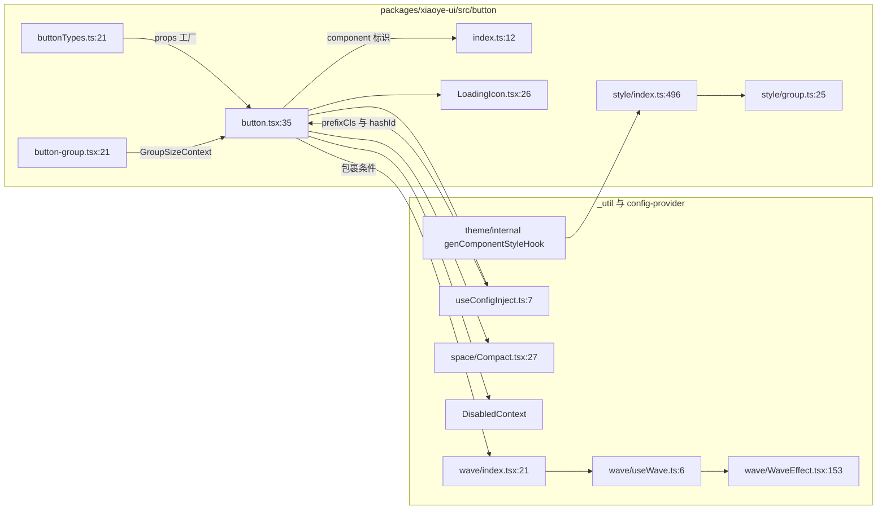
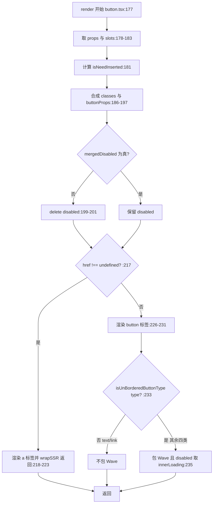
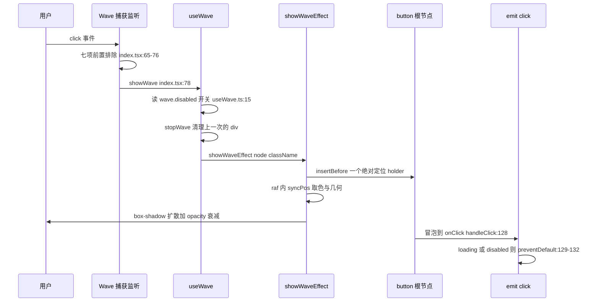

# C01-01 Button 按钮

> **本篇解决**：`type`/`shape`/`size`/`danger`/`ghost` 五个外观维度如何被折叠成一串类名、`href` 存在时组件为何换了标签、`loading` 的延迟与防抖由谁计时、点击涟漪（wave）在哪一行接到组件外——以及改这四处分别要付什么代价。
> **前置**：A03《Design Token 四层体系》、A05《ConfigProvider 注入链与 Size/Disabled Context》、A06《Props 体系与类型工具》、A07《交互基础设施总览：一个浮层是怎么拼起来的》、I09《动画与 motion 体系》　**读者坐标**：`03-components/01-general` 第 1/7 篇（本类共性抽象由 C01-00《类横写：button/icon/tag/chips/badge 的职责切分》承担，本篇只讲 Button 的特有机制，涉及共性处一律引用不重证）

## 一、职责与边界

`XYButton` 负责三件事：把五个外观维度（`type` / `shape` / `size` / `danger` / `ghost`）折叠成一组互斥后缀类名、在 `href` 存在时把根元素从 `button` 换成 `a`、把 `loading` 的 `boolean | { delay }` 归一成一个内部响应式量并据此接管点击。它不负责的事情同样明确：**不定义任何颜色与尺寸数值**（全部经 `genComponentStyleHook('Button', …)` 从 Token 取，见 A03），**不决定尺寸继承的上游语义**（`ConfigProvider` 的 `SizeContext` 注入链见 A05），**不实现涟漪动画本体**（`_util/wave` 是共享基础设施，横向总览见 A07，本篇只讲 Button 侧的接缝），**不做 URL 协议白名单**（`href` 直接落到 `a` 标签的 `href` 属性，`packages/xiaoye-ui/src/button/button.tsx:219`）。

依赖清单（Button 侧真实 import，逐条对应 `packages/xiaoye-ui/src/button/button.tsx:12-24`）：

- `_util/wave`（`button.tsx:12`）—— 点击涟漪的条件包裹；
- `_util/props-util` 的 `flattenChildren` 与 `initDefaultProps`（`button.tsx:14`）—— 插槽扁平化与 Props 默认值注入，契约见 A06；
- `config-provider/hooks/useConfigInject`（`button.tsx:15`）与 `config-provider/DisabledContext`（`button.tsx:16`）—— 纵向注入；
- `vc-util/devWarning`（`button.tsx:17`）—— 开发期告警，归 I14；
- `./LoadingIcon`（`button.tsx:18`）、`./style`（`button.tsx:19`）、`./button-group`（`button.tsx:22`）、`space/Compact`（`button.tsx:23`）。

**一处需要纠正的边界认知**：队列把 `transButton` 列为 Button 的底层，但 `packages/xiaoye-ui/src/button/` 目录下没有任何文件引用它（`grep -rn "transButton" packages/xiaoye-ui/src/button/` 无输出）。`TransButton`（`packages/xiaoye-ui/src/_util/transButton.tsx:17`）的真实消费者是 `transfer/ListItem.tsx:7`、`typography/Base.tsx:3`——它是「让非按钮元素伪装成按钮」的独立工具，与 `XYButton` 是并列关系而非上下游关系。两套「可点击容器」的切分理由由 C01-00 论点 1 论证，本篇不重复，只在论点 3 与「设计取舍」取舍六里记录落在 Button 身上的直接后果。

## 二、源码地图

| 文件 | 行数 | 职责 | 关键导出 / 锚点 |
| --- | --- | --- | --- |
| `packages/xiaoye-ui/src/button/index.ts` | 26 | 包内入口：挂 `Button.Group`、注册 `install` | `default`（`index.ts:23`）、`ButtonGroup`（`index.ts:21`） |
| `packages/xiaoye-ui/src/button/button.tsx` | 244 | 主实现：类名合成、标签切换、loading 归一、两字中文 | `defineComponent` 起于 `button.tsx:35`，`setup` 起于 `button.tsx:46` |
| `packages/xiaoye-ui/src/button/buttonTypes.ts` | 47 | Props 工厂与 `ButtonType` / `ButtonShape` 联合类型 | `buttonProps`（`buttonTypes.ts:21`）、`convertLegacyProps`（`buttonTypes.ts:14`） |
| `packages/xiaoye-ui/src/button/LoadingIcon.tsx` | 68 | 加载图标的宽度进出场 | `default`（`LoadingIcon.tsx:26`）、`getCollapsedWidth`（`LoadingIcon.tsx:3`） |
| `packages/xiaoye-ui/src/button/button-group.tsx` | 61 | `XYButtonGroup` 与 `GroupSizeContext` 提供者 | `GroupSizeContext`（`button-group.tsx:18`）、`buttonGroupProps`（`button-group.tsx:10`） |
| `packages/xiaoye-ui/src/button/style/index.ts` | 525 | CSS-in-JS 样式：共享/尺寸/类型/分组/紧凑 | `genComponentStyleHook('Button', …)`（`style/index.ts:496`）、`ButtonToken`（`style/index.ts:12`） |
| `packages/xiaoye-ui/src/button/style/group.ts` | 80 | 组内相邻按钮的边框合并 | `genGroupStyle`（`group.ts:25`） |
| `packages/xiaoye-ui/src/button/index.test.js` | 285 | 类名、loading、ghost 告警、href 的行为测试 | `describe('Button')`（`index.test.js:11`） |
| `packages/xiaoye-ui/src/button/wave.test.js` | 28 | 涟漪在卸载后仍派发热量的回归用例 | `describe('click wave effect')`（`wave.test.js:5`） |
| `packages/xiaoye-ui/src/_util/wave/index.tsx` | 101 | 涟漪的宿主组件：不渲染 DOM，只挂捕获监听 | `props.disabled`（`index.tsx:24-26`）、`showWave`（`index.tsx:35`） |
| `packages/xiaoye-ui/src/_util/wave/useWave.ts` | 25 | 涟漪入口与总开关早退 | `useWave`（`useWave.ts:6`）、开关判断（`useWave.ts:15`） |
| `packages/xiaoye-ui/src/_util/wave/WaveEffect.tsx` | 170 | 涟漪 div 的定位、着色与回收 | `showWaveEffect`（`WaveEffect.tsx:153`）、`syncPos`（`WaveEffect.tsx:32`） |
| `packages/xiaoye-ui/src/_util/wave/util.ts` | 35 | 从目标计算元素取涟漪色 | `getTargetWaveColor`（`util.ts:23`）、`isValidWaveColor`（`util.ts:10`） |
| `packages/xiaoye-ui/src/_util/wave/style.ts` | 38 | `xy-wave` 的几何与 `wave-motion-appear` 过渡 | `genWaveStyle`（`style.ts:9`） |
| `packages/xiaoye-ui/src/_util/transButton.tsx` | 102 | 与 Button 并列的「div 伪装按钮」工具，不被 Button 引用 | `TransButton`（`transButton.tsx:17`） |

主实现入口是 `packages/xiaoye-ui/src/button/button.tsx:35`；样式入口是 `packages/xiaoye-ui/src/button/style/index.ts:498`；涟漪接缝有两处，组件侧 `packages/xiaoye-ui/src/button/button.tsx:233` 与基础设施侧 `packages/xiaoye-ui/src/_util/wave/index.tsx:82`。

组件目录内**没有** `demo/` 子目录——八个示例落在文档侧 `apps/docs/examples/button/`（`basic` `block` `button-group` `danger` `disabled` `ghost` `icon` `loading` `multiple` `size`），属性清单见 `apps/docs/components/button.md`。测试执行与否按 `packages/xiaoye-ui/vitest.config.mts:33` 的 glob 判断，`index.test.js` 与 `wave.test.js` 都在 `src/**/*.test.js` 覆盖范围内。

## 三、架构与数据流

### 3.1 静态结构：Button 只有两个「写出类名」的地方



这张图要读出一个关键约束：**类名有两个产地，且互不相交**。`button.tsx:86` 的 `classes` computed 只产出「状态后缀」（`-primary` / `-sm` / `-loading` / `-dangerous` 这类），它们本身不带任何视觉定义；真正的颜色与几何全部由 `style/index.ts:496` 生成的规则提供，通过 `hashId` 这个哈希类把两套体系绑在一起（`button.tsx:97` 把 `hashId.value` 当成一个布尔键写进 class 对象）。所以「改按钮的圆角」与「改按钮有哪些状态类」是两件不同的事，分别落在 `style/index.ts:111`（`genCircleButtonStyle`）和 `button.tsx:99`，改动时不要串门。`LoadingIcon` 与 `Wave` 都不向 Button 回写状态，是单向被组装的关系。

### 3.2 渲染分支：一次 render 里的三个判定



三个判定的存在理由：`mergedDisabled` 分支（`button.tsx:199`）对应源码里那句 `// fix: delete disabled prop when not disabled`（`button.tsx:198`），作用是把 `disabled` 从渲染属性对象里整个摘掉，而不是留一个 `false`——本仓库的属性白名单筛选器 `pickAttrs` 只判断键名是否在名单内、不判断值真假（`packages/xiaoye-ui/src/_util/pickAttrs.ts:70-72`），因此这类「不要留下假值」的责任只能由组件自己在拼装 `buttonProps` 对象时承担，这条 `delete` 就是该责任的位置；它为什么必要（而非 Vue 渲染器是否已能处理 `false`）在源码与测试里都没有记录，本篇不臆测。`href` 分支（`button.tsx:217`）是标签唯一开关，注意它 **早于** Wave 判定返回，因此 `href` 按钮永远不会被包进 `Wave`；`isUnBorderedButtonType` 分支（`button.tsx:233`）把 `text` 与 `link` 两类「无边框按钮」排除在涟漪之外，而 `isValidWaveColor`（`packages/xiaoye-ui/src/_util/wave/util.ts:10`）确实把 `transparent` 与全透明 rgba 判为无效色（`util.ts:18-19`），二者相互印证。

### 3.3 一次点击的闭环：从捕获监听到涟漪 DOM 回收



这条链路里有两个容易忽略的时序事实。其一，`Wave` 用 **capture** 阶段注册监听（`_util/wave/index.tsx:82` 第三个参数为 `true`），所以涟漪先于业务 `onClick` 触发；即使 `handleClick` 因为 loading 而 `preventDefault` 并 `return`（`button.tsx:129-132`），涟漪也已经在捕获阶段被排除或播放过了——排除靠的是 `index.tsx:70-72` 对 `disabled` 属性与 `disabled` 类名的检查。其二，涟漪 div 的生命周期不在 Vue 的组件树里：它由 `render()` 手工挂进宿主节点（`WaveEffect.tsx:159`、`WaveEffect.tsx:161`），靠 `onTransitionend` 判断 `propertyName === 'opacity'` 来删除（`WaveEffect.tsx:110-113`），并额外有一条 5 秒兜底删除（`WaveEffect.tsx:86-88`）。任何让 opacity 过渡不触发的改动（例如把 `opacity` 的 transition 去掉）都不会报错，只会让每次点击泄漏一个 div。

## 四、核心机制精读

### 论点 1：五个外观维度在 TSX 侧被刻意拆成互不相干的单维后缀，维度交叉全部下沉到 CSS 的复合选择器里，`ghost` 是唯一在 JS 侧就被类型否决的维度

`packages/xiaoye-ui/src/button/button.tsx:86-110` 是类名的唯一合成点：

```tsx
// packages/xiaoye-ui/src/button/button.tsx:86
    const classes = computed(() => {
      const { type, shape = 'default', ghost, block, danger } = props;
      const pre = prefixCls.value;

      const sizeClassNameMap = { large: 'lg', small: 'sm', middle: undefined };
      const sizeFullname = compactSize.value || groupSizeContext?.size || size.value;
      const sizeCls = sizeFullname ? sizeClassNameMap[sizeFullname] || '' : '';

      return [
        compactItemClassnames.value,
        {
          [hashId.value]: true,
          [`${pre}`]: true,
          [`${pre}-${shape}`]: shape !== 'default' && shape,
          [`${pre}-${type}`]: type,
          [`${pre}-${sizeCls}`]: sizeCls,
          [`${pre}-loading`]: innerLoading.value,
          [`${pre}-background-ghost`]: ghost && !isUnBorderedButtonType(type),
          [`${pre}-two-chinese-chars`]: hasTwoCNChar.value && autoInsertSpace.value,
          [`${pre}-block`]: block,
          [`${pre}-dangerous`]: !!danger,
          [`${pre}-rtl`]: direction.value === 'rtl',
        },
      ];
    });
```

逐段看：`button.tsx:87` 在解构处给 `shape` 补了 `'default'` 默认值，而 `button.tsx:99` 的条件又是 `shape !== 'default' && shape`，两件事合起来才让「不写 shape」与「写 `shape="default"`」得到同一个结果——只输出 `xy-btn-default` 之类的其他类，不输出 `xy-btn-default-shape` 这种后缀。`button.tsx:100` 把 `type` 的字符串值本身当作真假判断，配合 `button.tsx:40` 的 `initDefaultProps(buttonProps(), { type: 'default' })`，意味着 **每个按钮必然带一个类型类**（`xy-btn-default` / `xy-btn-primary` / …）。`button.tsx:90` 的 `sizeClassNameMap` 里 `middle: undefined`，再加上 `button.tsx:92` 的 `|| ''`，中号按钮不带尺寸后缀——这是后面论点 2 要用的伏笔。`button.tsx:97` 把 `hashId.value` 当成一个普通类名键写入，这是 CSS-in-JS 的哈希作用域类，机制本体见 A03 与 A04，本篇只指出它在 Button 里的落点。`button.tsx:103` 是唯一的例外：`ghost` 的后缀类被 `&& !isUnBorderedButtonType(type)` 拦了一道，而这个判断就是文件顶部 `button.tsx:31-33` 那三行——`type === 'text' || type === 'link'`。

其余四个维度的交叉完全不在这里。看 `danger` 与 `type` 的交叉实现，`packages/xiaoye-ui/src/button/style/index.ts:214-237`：

```ts
// packages/xiaoye-ui/src/button/style/index.ts:214
  [`&${token.componentCls}-dangerous`]: {
    color: token.colorError,
    borderColor: token.colorError,

    ...genHoverActiveButtonStyle(
      {
        color: token.colorErrorHover,
        borderColor: token.colorErrorBorderHover,
      },
      {
        color: token.colorErrorActive,
        borderColor: token.colorErrorActive,
      },
    ),

    ...genGhostButtonStyle(
      token.componentCls,
      token.colorError,
      token.colorError,
      token.colorTextDisabled,
      token.colorBorder,
    ),
    ...genSolidDisabledButtonStyle(token),
  },
```

这段在 `genDefaultButtonStyle`（`style/index.ts:185`）内部，展开后得到的选择器是 `.xy-btn-default.xy-btn-dangerous`，即 `danger` 不是第六种 `type`，而是**挂在每个类型块内部的补丁**。更关键的是 `style/index.ts:227-233`：`dangerous` 块里又调了一次 `genGhostButtonStyle`，而该函数在 `style/index.ts:142` 生成的键是 `&` 拼 `btnCls` 拼 `-background-ghost`，三层嵌套的结果就是 `.xy-btn-default.xy-btn-dangerous.xy-btn-background-ghost` —— **三维交叉由 CSS 生成器的嵌套展开得到，JS 侧始终只写单维后缀**。同理，`shape` 与 `size` 的交叉靠 `style/index.ts:453` 那种把 `componentCls` 连写两次再接 `sizePrefixCls` 的模板键，注释在 `style/index.ts:451` 直说是「patch prefixCls again to override solid border radius style」，属于用选择器权重解决覆盖顺序，而不是靠生成顺序。

类型维度本身的入口在 `style/index.ts:383-395`：

```ts
// packages/xiaoye-ui/src/button/style/index.ts:385
const genTypeButtonStyle: GenerateStyle<ButtonToken> = token => {
  const { componentCls } = token;

  return {
    [`${componentCls}-default`]: genDefaultButtonStyle(token),
    [`${componentCls}-primary`]: genPrimaryButtonStyle(token),
    [`${componentCls}-dashed`]: genDashedButtonStyle(token),
    [`${componentCls}-link`]: genLinkButtonStyle(token),
    [`${componentCls}-text`]: genTextButtonStyle(token),
    [`${componentCls}-disabled`]: genDisabledButtonStyle(token),
  };
};
```

回扣结论：`ButtonType` 联合里有六个值（`buttonTypes.ts:8` 的 `'link' | 'default' | 'primary' | 'ghost' | 'dashed' | 'text'`），但 `style/index.ts:387-392` 只有五个类型块加一个 `-disabled`——**`ghost` 根本不在类型映射里**，它只能通过 `-background-ghost` 后缀叠加到别的类型上。这解释了 `buttonTypes.ts:13-19` 的 `LegacyButtonType` / `convertLegacyProps`：老写法 `type="danger"` 被折算成 `{ danger: true }`，也就是「把曾经的类型降级成正交布尔」这一历史动作在类型层留下的接口。改这处的正确顺序是：新增一个外观维度时，先决定它是「类型」（改 `style/index.ts:383` 的映射 + `ButtonType`）还是「后缀」（在 `button.tsx:94-109` 加一键 + 在每个类型块里补 `&${pre}-xxx` 补丁）；后者要改的是 5 个函数，前者只需 1 个映射项，这个不对称是本项目给「后缀」方案付出的真实代价。

### 论点 2：`size` 不是一个 prop 而是四级取值链的结果，且链上两个 Context 在「没有提供者」时返回的是空对象而非 `undefined`，导致源码里的可选链从不生效

Button 在 `setup` 顶部一次性把四条来源都取回来，`packages/xiaoye-ui/src/button/button.tsx:47-60`：

```tsx
// packages/xiaoye-ui/src/button/button.tsx:47
    const { prefixCls, autoInsertSpaceInButton, direction, size } = useConfigInject('btn', props);
    const [wrapSSR, hashId] = useStyle(prefixCls);
    const groupSizeContext = GroupSizeContext.useInject();
    const disabledContext = useInjectDisabled();
    const mergedDisabled = computed(() => props.disabled ?? disabledContext.value);
    const buttonNodeRef = shallowRef<HTMLElement>(null);
    const delayTimeoutRef = shallowRef(undefined);
    let isNeedInserted = false;

    const innerLoading = shallowRef<Loading>(false);
    const hasTwoCNChar = shallowRef(false);

    const autoInsertSpace = computed(() => autoInsertSpaceInButton.value !== false);
    const { compactSize, compactItemClassnames } = useCompactItemContext(prefixCls, direction);
```

`button.tsx:47` 拿到的 `size` 已经是两级合并的结果——`packages/xiaoye-ui/src/config-provider/hooks/useConfigInject.ts:39` 写的是 `props.size as SizeType || sizeContext.value`，即「组件自身 prop 优先于 `SizeContext`」（该文件对 `SizeContext` / `DisabledContext` 的汇合语义见 A05，此处只取它在 Button 尺寸链上的那一级）。`button.tsx:49` 取 Group 级，`button.tsx:60` 取 Compact 级。四级真正串起来的地方是 `button.tsx:91`：`compactSize.value || groupSizeContext?.size || size.value`，优先级从上到下是 Space 紧凑 > ButtonGroup > 组件 prop > SizeContext。

链上第一处与直觉相反的实现在 `GroupSizeContext.useInject()`。`packages/xiaoye-ui/src/button/button-group.tsx:18-20` 建的是 `createContext<{ size: SizeType }>()`，**没有传 defaultValue**，而工厂的实现是：

```ts
// packages/xiaoye-ui/src/_util/createContext.ts:13
  const useInject = () => {
    return inject(contextKey, defaultValue as T) || ({} as T);
  };
```

`packages/xiaoye-ui/src/_util/createContext.ts:13-15`。因此在裸用的 `<xy-button>` 上，`groupSizeContext` 拿到的是 `{}` 而不是 `undefined`，`button.tsx:91` 的 `?.` 永远不会短路，真正起作用的是 `{}` 上读 `.size` 得到 `undefined` 后再 `||` 到下一级。Space 侧同理：`packages/xiaoye-ui/src/space/Compact.tsx:25` 用 `createContext<SpaceCompactItemContextType | null>(null)`，默认值 `null` 经 `||` 后同样变成 `{}`，`Compact.tsx:45` 的 `compactItemContext?.compactSize` 也是永不短路的可选链；那里之所以还能正确返回空类名，靠的是 `Compact.tsx:31` 的 `isEmpty(compactItemContext)` 兜底，而不是可选链。这个区别有实际后果：**任何人想用 `groupSizeContext === undefined` 来判断「我是否在一个 ButtonGroup 里」都会得到 false**，因为两种情况下它都是对象。

链上第二处不对称在 Group 自己这边。`packages/xiaoye-ui/src/button/button-group.tsx:28-49`：

```tsx
// packages/xiaoye-ui/src/button/button-group.tsx:28
    GroupSizeContext.useProvide(
      reactive({
        size: computed(() => props.size),
      }),
    );
    const classes = computed(() => {
      const { size } = props;
      let sizeCls = '';
      switch (size) {
        case 'large':
          sizeCls = 'lg';
          break;
        case 'small':
          sizeCls = 'sm';
          break;
        case 'middle':
        case undefined:
          break;
        default:
          // eslint-disable-next-line no-console
          devWarning(!size, 'Button.Group', 'Invalid prop `size`.');
      }
```

Group 用 `reactive` 包一个 `computed` 再交给 `useProvide`（配合 `createContext.ts:8-10` 的 `watchEffect` + `Object.assign`），子组件读到的 `size` 已是解包后的字符串，这条本身没问题；问题是它把 `large`/`small` 映射成 `lg`/`sm` 的工作**又用 `switch` 实现了一遍**（`button-group.tsx:36-49`），而 Button 侧用的是 `button.tsx:90` 的 `sizeClassNameMap` 对象字面量。同一个 `SizeType` 联合（`packages/xiaoye-ui/src/config-provider/context.ts:48`，注意它把 `undefined` 也写进了类型）因此存在两份映射代码，且两处的兜底分支不同：Button 侧 `sizeClassNameMap[sizeFullname] || ''`（`button.tsx:92`）对非法值静默给空串，Group 侧 `button-group.tsx:47-48` 会走 `default` 报警。

链的末端是样式侧：尺寸后缀不带数值语义，数值由三套 Token 派生——`packages/xiaoye-ui/src/button/style/index.ts:411-412` 的 `paddingVertical` / `paddingHorizontal` 是纯算术式，`style/index.ts:463-468` 的 `genSizeSmallButtonStyle` 用 `mergeToken` 覆盖 `controlHeight: token.controlHeightSM` 与 `buttonPaddingHorizontal: 8`（`style/index.ts:467` 的注释 `// Fixed padding` 承认这是一个硬编码例外），`style/index.ts:474-479` 的大号则覆盖 `controlHeightLG` 与 `fontSizeLG`。因为中号没有后缀类，`style/index.ts:461` 的 `genSizeBaseButtonStyle` 生成的 `.xy-btn` 基础块同时充当「中号样式」和「所有尺寸的公共底」，这两重身份靠选择器权重区分，也正是坑 1 的成因。

### 论点 3：`href !== undefined` 是标签切换的唯一判据，这个「早退」一次性带来三个连带差异——跳过涟漪、丢掉 `htmlType`、把 `disabled` 写成 `a` 上的无效属性，而 `href` 本身没有走仓库里已有的 URL 白名单

先看渲染函数的尾部，`packages/xiaoye-ui/src/button/button.tsx:213-241`：

```tsx
// packages/xiaoye-ui/src/button/button.tsx:213
      const kids = children.map(child =>
        insertSpace(child, isNeedInserted && autoInsertSpace.value),
      );

      if (href !== undefined) {
        return wrapSSR(
          <a {...buttonProps} href={href} target={target} ref={buttonNodeRef}>
            {iconNode}
            {kids}
          </a>,
        );
      }

      let buttonNode = (
        <button {...buttonProps} ref={buttonNodeRef} type={htmlType}>
          {iconNode}
          {kids}
        </button>
      );

      if (!isUnBorderedButtonType(type)) {
        buttonNode = (
          <Wave ref="wave" disabled={!!innerLoading.value}>
            {buttonNode}
          </Wave>
        );
      }

      return wrapSSR(buttonNode);
```

判据是 `href !== undefined` 而不是 `href` 真值（`button.tsx:217`），意味着 `href=""` 也会渲染成 `a` 标签；`index.test.js:206` 那条 `should not render as link button when href is undefined` 用显式 `href={undefined}` 守的正是这个边界，而不是守「空串」。`button.tsx:218` 直接 `return`，因此 `button.tsx:233` 之后的 Wave 判定对 `a` 分支**永远不可达**——带 `href` 的按钮没有涟漪，无论它是 `primary` 还是 `default`。这不是样式问题而是可感知的行为差异：同一颗 `type="primary"` 按钮，加不加 `href` 会得到不同的点击反馈。测试对此没有覆盖：`index.test.js:174-184` 的 `should support link button` 函数体里只有 `mount`，没有任何断言，该分支无测试保护。

第二个差异在 `button.tsx:227` 与 `button.tsx:219` 的对比上：只有 `button` 分支写了 `type={htmlType}`。`htmlType` 的默认值是 `'button'`（`buttonTypes.ts:24`），它的存在意义是防止按钮在 `form` 内被当作隐式 submit；`a` 分支不需要它，但代码也没把 `htmlType` 从 `buttonProps` 里剔出去，而 `buttonProps` 是 `{...attrs}` 起手（`button.tsx:186-197`）——用户手写的 `type` 属性经由 attrs 透传到 `a` 上时，会被解释成链接的 MIME type 提示，这是标签切换的静默副作用之一。

第三个差异最值得警惕。`button.tsx:186-201`：

```tsx
// packages/xiaoye-ui/src/button/button.tsx:186
      const buttonProps = {
        ...attrs,
        title,
        disabled: mergedDisabled.value,
        class: [
          classes.value,
          attrs.class,
          { [`${prefixCls.value}-icon-only`]: children.length === 0 && !!iconType },
        ],
        onClick: handleClick,
        onMousedown: handleMousedown,
      };
      // fix: delete disabled prop when not disabled
      if (!mergedDisabled.value) {
        delete buttonProps.disabled;
      }
```

`disabled` 在 `mergedDisabled` 为真时留在对象里，随后被 `{...buttonProps}` 展开到 `a` 标签（`button.tsx:219`）。按浏览器标准（此处不是本仓库源码断言，源码里也没有相应注释），`a` 元素不识别 `disabled` 属性，因此该属性不会阻止跳转的默认行为；组件侧唯一的拦截点是 JS：

```tsx
// packages/xiaoye-ui/src/button/button.tsx:128
    const handleClick = (event: Event) => {
      if (innerLoading.value || mergedDisabled.value) {
        event.preventDefault();
        return;
      }
      emit('click', event);
    };
    const handleMousedown = (event: Event) => {
      emit('mousedown', event);
    };
```

`button.tsx:129-132` 的 `preventDefault` 是 `href` + `disabled` 组合下唯一的拦截点，`index.test.js:267-284` 的 `should not redirect when button is disabled` 覆盖的就是这条（断言 `onClick` 未被调用）。要注意这条断言只验证了「组件回调不发出」，并没有验证跳转是否真被 `preventDefault` 取消——jsdom 里 `preventDefault` 对导航无实际效果，测试环境无法证伪它；一旦 `handleClick` 的判定顺序被改成先 `emit` 再判禁用，禁用态的 `href` 按钮会立刻变成「能跳转但不能触发业务」，而现有测试仍会通过。同时键盘路径没人管：`a` 标签回车触发的是浏览器的默认导航，`preventDefault` 只在 click 事件里生效。

第四点，也是本篇没在源码里找到实现的一点：`button.tsx:219` 把 `href` 原样写进 DOM，而仓库已经有统一的协议白名单工具——`packages/xiaoye-ui/src/_util/safeUrl.ts:25-42` 的 `isSafeUrl` / `safeUrl` 会剔除空白与控制字符后按 `SAFE_PROTOCOLS`（`safeUrl.ts:10`）判定，`javascript:` 会被换成空串（`packages/xiaoye-ui/src/_util/safeUrl.test.ts:48` 断言了这一点）。同类组件确实调用了它：`packages/xiaoye-ui/src/anchor/AnchorLink.tsx:96` 写的是 `href={safeUrl(href)}`，`packages/xiaoye-ui/src/upload/UploadList/ListItem.tsx:202`、`packages/xiaoye-ui/src/mega-menu/MegaMenu.tsx:268` 同样。Button 侧没有任何引用（`grep -rn "safeUrl" packages/xiaoye-ui/src/button/` 无输出，`grep -c "safeUrl" button.tsx` 为 0，两种方法交叉验证）。`safeUrl.ts:4-6` 的注释声称要「统一收敛到此处做白名单校验，避免各组件各写一套」，Button 的 `href` 不在这条收敛线上——这是文档化意图与实际接入面的缺口，本篇按事实记录，不推断是否构成漏洞利用面。

顺带交代 `TransButton` 的位置：它与 `XYButton` 是并列而非上下游关系（见本篇「一、职责与边界」末段），两套「可点击容器」的切分由 C01-00 论点 1 负责论证；本篇只保留一条与 `href` 直接相关的观察——`TransButton` 处理禁用用的是 `pointerEvents: 'none'`（`packages/xiaoye-ui/src/_util/transButton.tsx:77-79`），而 `XYButton` 的 `a` 分支既没有属性效力也没有指针屏蔽，只剩 `button.tsx:129-132` 一处 JS 拦截。

### 论点 4：`loading` 的延迟是**单向**的——只有「变亮」会被 `setTimeout` 推迟，「变灭」永远同步生效；实现只用了两条语句：一个将三种入参归一为 `boolean | number` 的 computed，和一个每次触发都先 `clearTimeout` 的 watch

外部类型与内部类型不是一套。`packages/xiaoye-ui/src/button/buttonTypes.ts:29-32` 声明的 prop 是 `boolean | { delay?: number }`，而组件内部维护的是 `packages/xiaoye-ui/src/button/button.tsx:26-40`：

```tsx
// packages/xiaoye-ui/src/button/button.tsx:26
type Loading = boolean | number;

const rxTwoCNChar = /^[\u4e00-\u9fa5]{2}$/;
const isTwoCNChar = rxTwoCNChar.test.bind(rxTwoCNChar);

function isUnBorderedButtonType(type: ButtonType | undefined) {
  return type === 'text' || type === 'link';
}
export { buttonProps };
export default defineComponent({
  compatConfig: { MODE: 3 },
  name: 'XYButton',
  inheritAttrs: false,
  __XY_BUTTON: true,
  props: initDefaultProps(buttonProps(), { type: 'default' }),
```

`Loading` 允许 `number`，是因为延时路径上写回内部状态的就是那个延时毫秒数本身（见下方 `button.tsx:75`），而不是 `true`。归一与调度集中在 `packages/xiaoye-ui/src/button/button.tsx:63-84`：

```tsx
// packages/xiaoye-ui/src/button/button.tsx:63
    const loadingOrDelay = computed(() =>
      typeof props.loading === 'object' && props.loading.delay
        ? props.loading.delay || true
        : !!props.loading,
    );

    watch(
      loadingOrDelay,
      val => {
        clearTimeout(delayTimeoutRef.value);
        if (typeof loadingOrDelay.value === 'number') {
          delayTimeoutRef.value = setTimeout(() => {
            innerLoading.value = val;
          }, loadingOrDelay.value);
        } else {
          innerLoading.value = val;
        }
      },
      {
        immediate: true,
      },
    );
```

三点必须逐句读。第一，`button.tsx:64` 的 `props.loading.delay` 参与了「是否走延时分支」的判定，且用的是真值判断，所以 `loading={{ delay: 0 }}` 与 `loading={{}}` 都落进 `: !!props.loading`（对象恒真）→ **立即点亮**；`button.tsx:65` 的 `|| true` 看起来像兜底，实际上永不可达——能进到这个三元分支说明 `delay` 已为真值，`delay || true` 必然等于 `delay`。第二，`button.tsx:72` 的 `clearTimeout` 在回调第一行，任何一次 `loadingOrDelay` 变更都会先取消挂起的定时器，这既是防抖（连续赋值只保留最后一次），也让「关闭」不可能被排队——`val` 为 `false` 时 `button.tsx:78` 走 `else` 同步赋值。`button.tsx:82` 的 `immediate: true` 保证首屏 `loading` 初值也走同一条路，而不是等第一次变更。第三，定时器写在 `shallowRef` 里（`button.tsx:53` 的 `delayTimeoutRef`），并在 `button.tsx:162-164` 的 `onBeforeUnmount` 里再清一次：

```tsx
// packages/xiaoye-ui/src/button/button.tsx:162
    onBeforeUnmount(() => {
      delayTimeoutRef.value && clearTimeout(delayTimeoutRef.value);
    });
```

否则延时未到期就卸载，定时器回调仍会对已销毁实例的 `shallowRef` 赋值；`index.test.js:234-236` 用 `expect(() => wrapper.unmount()).not.toThrow()` 守的正是这条清理路径（源码本身没有注释说明动机，此处以测试意图佐证）。`index.test.js:218-237` 是这条链的完整回归：先 `loading: true` 立刻有 `xy-btn-loading`，再 `loading: { delay: 50 }` 后**断言仍然没有** loading 类（`index.test.js:226-228`），`sleep(50)` 后才出现（`index.test.js:229-230`），最后 `loading: false` 立即清除并断言 `unmount` 不抛错（`index.test.js:231-236`）。`index.test.js:131-159` 的 `should change loading state with delay` 只断言了「点击后延时期间不出现 loading」，是同一机制的弱覆盖。

`innerLoading` 是 `number` 而非 `boolean` 这件事，对下游三处消费者都有隐含要求：`button.tsx:102` 的类对象靠真值判断所以 `1000` 与 `true` 等价；`button.tsx:209` 与 `button.tsx:235` 都显式写了 `!!innerLoading.value` 才交给子组件。`button.tsx:235` 的 `disabled={!!innerLoading.value}` 正是 loading 与涟漪的接缝——加载中不给涟漪，机制见论点 5。

图标侧还有一个和直觉不同的分支，`packages/xiaoye-ui/src/button/LoadingIcon.tsx:36-58`：

```tsx
// packages/xiaoye-ui/src/button/LoadingIcon.tsx:36
      const { existIcon, prefixCls, loading } = props;
      if (existIcon) {
        return (
          <span class={`${prefixCls}-loading-icon`}>
            <LoadingOutlined />
          </span>
        );
      }
      const visible = !!loading;
      return (
        <Transition
          name={`${prefixCls}-loading-icon-motion`}
          onBeforeEnter={getCollapsedWidth}
          onEnter={getRealWidth}
          onAfterEnter={resetStyle}
          onBeforeLeave={getRealWidth}
          onLeave={(node: HTMLSpanElement) => {
            setTimeout(() => {
              getCollapsedWidth(node);
            });
          }}
          onAfterLeave={resetStyle}
        >
```

`button.tsx:202-211` 传的是 `existIcon={!!icon}`，因此**带 `icon` 的按钮在 loading 时直接短路返回静态 span，没有 `Transition`、没有宽度动画**；只有不带 `icon` 的按钮才走下面的动画分支。而这个动画的实现方式值得单独说：`LoadingIcon.tsx:47` 给的 `name` 会派生出 `xy-btn-loading-icon-motion-enter-active` 一类类名，但仓库里没有任何 CSS 规则使用它们——`grep -rn "loading-icon-motion"` 在排除 `dist` 与 `node_modules` 后只命中 `LoadingIcon.tsx:47` 这一处（即只有生产者、没有消费者）。动画真正的来源是 JS 钩子写内联样式 + 元素自身的 `transition` 声明：`LoadingIcon.tsx:3-9` 的 `getCollapsedWidth` 把 `width` 设为 `0px`、`LoadingIcon.tsx:10-18` 的 `getRealWidth` 在 `nextTick` 里把它设为 `scrollWidth`，而 `packages/xiaoye-ui/src/button/style/index.ts:443-444` 给 `.xy-btn-loading-icon` 声明了 `transition: width … , opacity …`。换句话说，**删掉 `LoadingIcon.tsx:47` 的 `name` 属性动画不受影响，删掉 `style/index.ts:441` 那条 `transition` 动画才会退化成瞬间跳变**。`LoadingIcon.tsx:19-25` 的 `resetStyle` 用 `node.style.width = null` 清内联值，把控制权交还给 CSS。

状态类本身只改透明度与光标，`style/index.ts:436-438` 的 `opacity: token.opacityLoading`（该 Alias Token 在 `packages/xiaoye-ui/src/theme/interface/alias.ts:93` 声明、`packages/xiaoye-ui/src/theme/util/alias.ts:94` 取值 `0.65`），并**没有**在 loading 时加 `pointer-events: none`——拦截完全依赖 `button.tsx:129` 的 JS 判断，这也是 `index.test.js:160-173` 那条 `should not clickable when button is loading` 存在的原因。

### 论点 5：`_util/wave` 是一个「零 DOM 输出」的包装组件，涟漪的接入靠渲染期条件包裹 + 挂载期捕获监听两段拼接；因此 Button 侧少包一层、或多包一层，都不会有报错，只会静默改变交互反馈

接缝的 Button 侧只有一处判断（`button.tsx:233-239`，已在论点 3 的摘录里完整出现）：`if (!isUnBorderedButtonType(type))` 才用 `<Wave ref="wave" disabled={!!innerLoading.value}>` 包住 `buttonNode`。这里 `ref="wave"` 是字符串模板 ref，但 `setup` 的返回函数没有返回任何对象、也没有用到 `refs.wave`，因此这个 ref 在组件内没有被消费（`grep -n "refs" packages/xiaoye-ui/src/button/button.tsx` 无输出）。

基础设施侧先看宿主组件，`packages/xiaoye-ui/src/_util/wave/index.tsx:27-45`：

```tsx
// packages/xiaoye-ui/src/_util/wave/index.tsx:27
  setup(props, { slots, expose }) {
    const instance = getCurrentInstance();
    const { prefixCls, wave, csp } = useConfigInject('wave', props);

    // ============================== Style ===============================
    const [, hashId] = useStyle(prefixCls);

    // =============================== Wave ===============================
    const showWave = useWave(
      computed(() => classNames(prefixCls.value, hashId.value)),
      wave,
    );

    expose({
      get csp() {
        return csp.value;
      },
    });
    let onClick: (e: MouseEvent) => void;
```

`index.tsx:29` 用 `useConfigInject('wave', props)` 取到的 `wave` 就是全局开关，链路是：`packages/xiaoye-ui/src/config-provider/context.ts:108-110` 定义 `wave: objectType<{ disabled?: boolean }>()` → `packages/xiaoye-ui/src/config-provider/index.tsx:139` 做 `props.wave ?? parentContext.wave?.value` 的逐级合并并在 `config-provider/index.tsx:178` 注入 → `packages/xiaoye-ui/src/config-provider/hooks/useConfigInject.ts:45-47` 暴露为 computed → `useWave.ts:15` 早退。I09 论点 6 已论证这是本库唯一的「关动画」开关，本篇不重复展开，只把它在 Button 上的**第二个开关**指出来：`button.tsx:235` 的 `disabled={!!innerLoading.value}` 是组件级开关，走的是另一条路径——`packages/xiaoye-ui/src/_util/wave/index.tsx:50-79`：

```tsx
// packages/xiaoye-ui/src/_util/wave/index.tsx:50
    onMounted(() => {
      watch(
        () => props.disabled,
        () => {
          clear();
          nextTick(() => {
            const node: HTMLElement = findDOMNode(instance);
            node?.removeEventListener('click', onClick, true);
            if (!node || node.nodeType !== 1 || props.disabled) {
              return;
            }

            // Click handler
            onClick = (e: MouseEvent) => {
              // Fix radio button click twice
              if (
                (e.target as HTMLElement).tagName === 'INPUT' ||
                !isVisible(e.target as HTMLElement) ||
                // No need wave
                !node.getAttribute ||
                node.getAttribute('disabled') ||
                (node as HTMLInputElement).disabled ||
                node.className.includes('disabled') ||
                node.className.includes('-leave')
              ) {
                return;
              }

              showWave();
            };
```

注意这段整体被包在 `onMounted` 里（`index.tsx:50`），且 `watch` 带 `immediate: true` 与 `flush: 'post'`（`index.tsx:85-88`）——挂载前它不监听任何东西。每当 `props.disabled` 变化，先 `clear()` 再 `nextTick` 里重新绑定；`clear()` 只调 `removeEventListener`（`index.tsx:46-49`），因此 loading 切换会让监听器完整拆装一次。真正的涟漪触发点在 `index.tsx:82` 的 `node.addEventListener('click', onClick, true)`，第三参数 `true` 表示捕获阶段。而 `node` 从哪来？`packages/xiaoye-ui/src/_util/props-util/index.ts:90-96` 的 `findDOMNode` 取 `instance.vnode.el` 并沿 `nextSibling` 找到第一个有 `tagName` 的节点——因为 `Wave` 自己**不产生任何 DOM**：

```tsx
// packages/xiaoye-ui/src/_util/wave/index.tsx:91
    onBeforeUnmount(() => {
      clear();
    });

    return () => {
      // ============================== Render ==============================
      const children = slots.default?.()[0];
      return children;
    };
  },
});
```

`index.tsx:97` 的 `slots.default?.()[0]` 只取**第一个**子节点并原样返回。这条约束直接决定了 Button 侧的写法：`button.tsx:234-238` 必须把已经合成好的单个 `buttonNode` 作为唯一子节点传进去；如果哪天有人给它加第二个子节点（比如为了加一个隐藏的 `input`），那一个子节点会被静默丢弃而不是报错。`index.tsx:73` 的 `node.className.includes('-leave')` 则把「正在退场」的节点排除掉，与 I09 描述的进出场类名约定相衔接。

开关判定在 `packages/xiaoye-ui/src/_util/wave/useWave.ts:12-24`：

```ts
// packages/xiaoye-ui/src/_util/wave/useWave.ts:12
  function showWave() {
    const node = findDOMNode(instance);
    stopWave?.();
    if (wave?.value?.disabled || !node) {
      return;
    }
    stopWave = showWaveEffect(node, className.value);
  }
  onBeforeUnmount(() => {
    stopWave?.();
  });

  return showWave;
```

`useWave.ts:14` 的 `stopWave?.()` 在开关判断**之前**执行，所以即使这次被开关拦掉了，上一次的涟漪 DOM 也已被回收——连点不会叠加。`useWave.ts:15` 是全局开关的唯一读取点。`showWaveEffect` 的实现在 `packages/xiaoye-ui/src/_util/wave/WaveEffect.tsx:153-168`：

```tsx
// packages/xiaoye-ui/src/_util/wave/WaveEffect.tsx:153
function showWaveEffect(node: HTMLElement, className: string) {
  // Create holder
  const holder = document.createElement('div');
  holder.style.position = 'absolute';
  holder.style.left = `0px`;
  holder.style.top = `0px`;
  node?.insertBefore(holder, node?.firstChild);

  render(<WaveEffect target={node} className={className} />, holder);
  return () => {
    render(null, holder);
    if (holder.parentElement) {
      holder.parentElement.removeChild(holder);
    }
  };
}
```

这里用原生 `document.createElement` + `insertBefore(holder, node.firstChild)`（`WaveEffect.tsx:159`）把涟漪层塞进按钮的**第一个子节点位置**，再用 Vue 的 `render()` 手工挂载（`WaveEffect.tsx:161`），完全绕开了组件树。正因如此，`xy-btn` 必须有定位上下文：`packages/xiaoye-ui/src/button/style/index.ts:25` 的 `position: 'relative'` 就是为它准备的，删掉这一行不会让 TS 报错，但涟漪层会相对最近的定位祖先（极端情况是文档）来摆放。涟漪层的几何与配色由 `WaveEffect.tsx:32-64` 的 `syncPos` 在 `requestAnimationFrame` 里读取：位置取决于目标 `position` 是否为 `static`（`WaveEffect.tsx:39-44`，非 static 时用负的边框宽度做补偿），颜色来自 `packages/xiaoye-ui/src/_util/wave/util.ts:23-35` 的 `getTargetWaveColor`（依次尝试 `borderTopColor` → `borderColor` → `backgroundColor`，全被 `isValidWaveColor` 拒掉时返回 `null`）。最后 `packages/xiaoye-ui/src/_util/wave/style.ts:12-20` 给 `xy-wave` 定了 `pointerEvents: 'none'`（`style.ts:15`）与 `color: var(--wave-color, ${colorPrimary})`（`style.ts:17`），涟漪本身不吃点击，视觉扩散由 `style.ts:23-32` 的 `wave-motion-appear` 过渡（`box-shadow 0.4s` + `opacity 2s`）驱动——这两个时长是硬编码字面量，没有走 `motionDuration*` Token，属于 A03 Token 覆盖面上的一处例外，改主题动画时长不会影响涟漪速度。

### 论点 6：两个汉字之间的空格是在渲染期直接改写文本节点得到的，`-two-chinese-chars` 类在本仓库没有任何 CSS 消费者；而「是否需要插空格」这个判定结果被存在一个 setup 作用域的 `let` 里，写在渲染函数、读在挂载回调，是跨渲染阶段的隐式耦合

先把插空格的执行体摆出来，`packages/xiaoye-ui/src/button/button.tsx:139-149`：

```tsx
// packages/xiaoye-ui/src/button/button.tsx:139
    const insertSpace = (child: VNode, needInserted: boolean) => {
      const SPACE = needInserted ? ' ' : '';
      if (child.type === Text) {
        let text = (child.children as string).trim();
        if (isTwoCNChar(text)) {
          text = text.split('').join(SPACE);
        }
        return <span>{text}</span>;
      }
      return child;
    };
```

`button.tsx:141` 用 `child.type === Text` 精确匹配 Vue 的文本 VNode 常量（`button.tsx:8` 从 `vue` 导入 `Text`），这意味着**只有纯文本子节点才会被处理**：`index.test.js:89-97` 那个 `<Button><span>按钮</span></Button>` 的 `wrapper6` 就是刻意构造的反例，而针对它的断言在 `index.test.js:99` 是被注释掉的。`button.tsx:144` 的 `text.split('').join(SPACE)` 直接把字符用空格连起来，所以「按钮」在 DOM 里就是「按 钮」两个字符中间夹一个真空格字符——`index.test.js:38` 的 `expect(wrapper.text()).toBe('按 钮')` 证实这一点。这也是「用 CSS `letter-spacing` 实现」这条替代路线被放弃后的落地形态：文本层面的改动可被复制、可被搜索、可被屏幕阅读器按普通文本读出，代价是**用户写的文案与渲染出的文案不一致**，任何对 slot 文本做长度统计或正则匹配的下游逻辑都会看到多出来的空格。

判定条件由调用点给出，`button.tsx:213-215` 传入的是 `isNeedInserted && autoInsertSpace.value`，而 `isNeedInserted` 的赋值发生在渲染函数体内。读取它的一侧是：

```tsx
// packages/xiaoye-ui/src/button/button.tsx:112
    const fixTwoCNChar = () => {
      // Fix for HOC usage like <FormatMessage />
      const node = buttonNodeRef.value!;
      if (!node || autoInsertSpaceInButton.value === false) {
        return;
      }
      const buttonText = node.textContent;

      if (isNeedInserted && isTwoCNChar(buttonText)) {
        if (!hasTwoCNChar.value) {
          hasTwoCNChar.value = true;
        }
      } else if (hasTwoCNChar.value) {
        hasTwoCNChar.value = false;
      }
    };
```

`button.tsx:118` 读的是**真实 DOM 的 `textContent`**，而不是 slot 内容；`button.tsx:113` 的注释 `// Fix for HOC usage like <FormatMessage />` 说明了为什么必须读 DOM——包裹在国际化高阶组件里的文本在 VNode 层看不出来。`fixTwoCNChar` 由 `button.tsx:159-160` 的 `onMounted` 与 `onUpdated` 调用。于是形成一条不显眼的跨阶段依赖：`isNeedInserted` 是 `button.tsx:54` 的 `let isNeedInserted = false;`（setup 作用域、非响应式），在 `button.tsx:181` 被渲染函数每次写入，又在 `button.tsx:120` 被生命周期回调读取。它不参与任何 computed 依赖，所以**不会因为有组件依赖它而触发重渲染**，只是碰巧在「渲染之后、更新钩子之前」被写好。`button.tsx:181` 的表达式 `children.length === 1 && !icon && !isUnBorderedButtonType(props.type)` 同时解释了 `index.test.js:61-88` 那几条注释（`should not insert space when there is icon`、`should insert space while loading`）背后的规则——loading 不会取消插空格，因为判定里只看 `icon` prop 是否存在，不看 `innerLoading`。`button.tsx:59` 的 `autoInsertSpace` 与 `button.tsx:115` 的 `autoInsertSpaceInButton.value === false` 是同一个全局开关的两处读取，前者控制类名、后者控制 DOM 读取是否执行，全局开关的定义在 `packages/xiaoye-ui/src/config-provider/context.ts:82`，经 `packages/xiaoye-ui/src/config-provider/hooks/useConfigInject.ts:18` 透出。

最后一件事必须如实记录：`button.tsx:104` 输出的 `${pre}-two-chinese-chars` 类，在本仓库**没有任何样式规则消费它**。检索范围与结论可复现：`grep -rn "two-chinese-chars" --include='*.ts' --include='*.tsx' --include='*.js' --include='*.vue' --include='*.less' --include='*.css' --include='*.md' .` 排除 `dist` 与 `node_modules` 后只命中两处，`button.tsx:104`（产出）与 `index.test.js:99`（被注释掉的断言）。也就是说 `hasTwoCNChar` 这个 `shallowRef`（`button.tsx:57`）、`fixTwoCNChar` 的整个 DOM 读取分支、以及 `button.tsx:104` 的类名写入，三者对**本库自身的视觉效果没有影响**；它们唯一残留的对外契约是「这个类名会出现在 DOM 上」，可能被站点自定义 CSS 依赖。这属于历史机制退役后留下的表面积：删掉它不会让文档示例发生变化，但会改变导出的 DOM 结构，属于破坏性变更。

## 五、对外契约如何生效

**标签名契约**。`button.tsx:37` 的 `name: 'XYButton'` 是唯一的注册依据：`index.ts:15-18` 的 `install` 把组件交给 `registerComponent`，后者用 `toXYTagName`（`packages/xiaoye-ui/src/_util/registerComponent.ts:6-11`）把 `XY` 前缀换成 `xy-` 再按大小写边界插连字符，得到 `xy-button`；`button-group.tsx:23` 的 `XYButtonGroup` 同理得 `xy-button-group`。`registerComponent.ts:23` 的 `if (!app.component(tagName))` 是单参调用形式（取值而非注册），用来防止重复覆盖。这条链意味着：**改 `name` 就是改公开标签名**，而 `index.ts:16-17` 一次注册两个组件，所以 `Button.install` 会连带把 Group 装进全局。

**attrs 透传契约**。`button.tsx:38` 的 `inheritAttrs: false` 关闭了 Vue 的自动挂载，改由 `button.tsx:187` 手工 `{...attrs}` 展开到根元素。这带来一个必须注意的顺序问题：`button.tsx:190-194` 的 `class` 写的是 `[classes.value, attrs.class, {...}]`，即**组件内部类名在前、外部类名在后、图标单类名最后**，同名类后者胜出；而 `style/index.ts` 侧靠复合选择器提权（论点 1），两者共同决定了覆写难度。`button.tsx:195-196` 又把 `onClick` / `onMousedown` 绑成组件自己的 `handleClick` / `handleMousedown`，因此外部经 attrs 落进来的同名监听不会覆盖它们（`onClick` 已被声明为 prop，见 `buttonTypes.ts:41-42`，不会进入 `attrs`）。

**事件契约的非常规之处**。`button.tsx:45` 的 `emits: ['click', 'mousedown']` 是**被注释掉的**，组件依赖 `buttonTypes.ts:41-42` 用 `eventType<MouseEventHandler>()` 声明的两个 prop（`packages/xiaoye-ui/src/_util/type.ts:50` 把它定义成 `[Function, Array]`，因此允许传数组）。实际发出点是 `button.tsx:133` 与 `button.tsx:136`，而 DOM 上绑定的是组件自己的 `handleClick` / `handleMousedown`（`button.tsx:195-196`）。因为 `onClick` / `onMousedown` 已声明为 prop，它们不会出现在 `attrs` 里，用户传的处理函数由 `emit` 送达而不是由 DOM 直接送达——这条路径的可观察后果是：**事件多了一道组件内部的闸门**（`button.tsx:129-132`），而这道闸门只装在 `click` 上。`button.tsx:135-137` 的 `handleMousedown` 是无条件 `emit`，不做 loading 与 disabled 判断，所以禁用态与加载态的按钮**仍会发出 `mousedown`**，只有 `click` 被拦。补齐 `emits` 声明不会改变这一点，要改变必须动 `handleMousedown` 的判定；这也是排查「禁用按钮仍触发了按下副作用」时的第一个落点。

**slot 契约**。`button.tsx:41-44` 用 `CustomSlotsType` 声明 `icon` 与 `default`。`icon` 的处理方式是「插槽降级为 prop」：`button.tsx:178` 写的是 `const { icon = slots.icon?.() } = props;`，即 props 优先、slot 兜底，二者都不传时 `icon` 为 `undefined`，`button.tsx:193` 据此决定是否加 `-icon-only`；`default` 走 `flattenChildren(slots.default?.())`（`button.tsx:179`，`_util/props-util/index.ts:50` 的实现会递归扁平化并过滤空节点），随后 `children.length` 同时服务于 `-icon-only`（`button.tsx:193`）与插空格判定（`button.tsx:181`）。**slot 内容因此被测量了两次**，这就是 `index.test.js:186-204` 那条 `{0}` / `0` / `{false}` 回归用例存在的原因——它们影响 `children.length` 与 `child.type === Text` 的判定结果。

**expose 契约**。`button.tsx:172-175` 只暴露 `focus` 与 `blur`，两者都直接打向 `buttonNodeRef`（`button.tsx:52`），而该 ref 在 `button.tsx:219` 与 `button.tsx:227` 两个分支里都被绑定，所以 `href` 与否都能取焦；`index.test.js:14` 的 `focusTest(Button)` 覆盖的就是这条。涟漪侧的 `expose` 是另一回事：`wave/index.tsx:40-44` 暴露了一个 `csp` getter，但 `button.tsx:235` 用的是字符串 `ref="wave"`，而组件的 `setup` 从未读取 `refs.wave`（`grep -n "refs" packages/xiaoye-ui/src/button/button.tsx` 无输出），因此这个 `csp` 从 Button 实例上不可达——它是为 `Wave` 被直接使用时准备的。

**样式契约**。`button.tsx:48` 的 `[wrapSSR, hashId] = useStyle(prefixCls)` 与 `style/index.ts:496` 的 `genComponentStyleHook('Button', …)` 对接，`hashId` 在 `button.tsx:97` 进类名、`wrapSSR` 在 `button.tsx:218` 与 `button.tsx:241` 包住两个分支的返回值——**两条 return 路径都各自调了一次 `wrapSSR`**，新增第三个分支时若漏掉它，SSR 样式收集会静默缺一块（引擎机制见 A04，Button 侧的落点就是这两行）。`prefixCls` 作为 prop（`buttonTypes.ts:22`）经 `useConfigInject.ts:14` 的 `getPrefixCls(name, props.prefixCls)` 参与命名，但 `hashId` 由 Token 哈希决定、不受 `prefixCls` 影响。

**禁用契约**。`button.tsx:50-51` 绕过 `useConfigInject` 直接 `useInjectDisabled()` 取 `DisabledContext`，自己合成 `mergedDisabled = props.disabled ?? disabledContext.value`。`useConfigInject.ts:43` 其实返回了同名语义的 `disabled`（也是 `?? ` 同一表达式），Button 没有用它，属于两条并行路径；差异在于 `useConfigInject` 的返回值是随 `props` 的通用包装，而 Button 需要的 `mergedDisabled` 还要参与 `button.tsx:189` 与 `button.tsx:200` 的渲染决策。纵向注入的整体设计归 A05，此处只指出：`disabled` 语义在本组件里有两处独立取值点，改其中一处不会让另一处失效，但会让类名与行为不一致。

## 六、设计取舍

**取舍一：单维后缀类 + CSS 复合选择器，而不是 JS 侧生成组合类名。** 被放弃的路是「`type` × `danger` × `ghost` 组合出 `xy-btn-primary-dangerous-ghost` 这类名字」。选现在这条路的收益是 DOM 上的类名集合可预测、与 props 一一对应，SSR 与快照稳定，且 CSS 侧可以用嵌套生成器复用同一段 ghost 逻辑（`style/index.ts:227-233` 在 danger 块里直接展开 ghost）；赔上的代价是**维度数量与类型块数量成乘积关系**：新增一个后缀维度要在 5 个 `gen*ButtonStyle` 里各补一次补丁（`style/index.ts:185`/`239`/`307`/`313`/`344`），漏掉任何一个就会得到「某类型下该维度静默无效」，而这类缺失不会有类型报错，也不会有测试失败——`index.test.js` 对 ghost 只测了告警（`index.test.js:239-265`），没有测 ghost 在各类型下的实际生效。

**取舍二：`loading` 的延时放在组件内部，而不是要求调用方自己 `setTimeout`。** 收益是接入方一行 `loading={{ delay: 1000 }}` 就能得到「快请求不闪」的效果，代价是内部状态类型被拓宽成 `boolean | number`（`button.tsx:26`），于是每个消费者都得自己判断真值（`button.tsx:102`/`209`/`235`），并且**延时语义是单向且不可配置的**——`button.tsx:78` 让关闭永远同步生效，想做「淡出延时」必须改这个 watch 的结构。同时 `button.tsx:64` 用真值判断挑选延时值，把 `delay: 0` 变成了「不延时」而不是「延时 0 毫秒」，这是把配置对象当判别式的必然摩擦。

**取舍三：涟漪做成「零 DOM 输出的包装组件 + 手工 DOM 注入」，而不是组件树内的一个子组件。** 收益很明显：任何组件只要套一层 `<Wave>`（`button.tsx:235`）就能获得一致点击反馈，涟漪层自身用 `pointerEvents: 'none'`（`wave/style.ts:15`）保证不吃事件。赔上三项：其一，注入的 div 在 `node.firstChild` 位置（`WaveEffect.tsx:159`），宿主必须提供定位上下文（`style/index.ts:25`），这个约束**没有任何类型或运行时提示**；其二，DOM 脱离 Vue 生命周期，回收只能靠 `transitionend` 匹配 `opacity`（`WaveEffect.tsx:110-113`）加 5 秒兜底（`WaveEffect.tsx:86-88`）；其三，SSR 拿不到涟漪，`wrapSSR` 包的是按钮本体（`button.tsx:241`），涟漪是纯客户端产物——这是选择该方案的合理代价，但要求「水合后首屏点击」这条路径被理解清楚。

**取舍四：`href` 分支早退，不与 `button` 分支共享 Wave 包裹逻辑。** 让 `a` 也套 Wave 技术上只需把 `wrapSSR(...)` 前移到分支外，现在写成 `button.tsx:218` 直接返回，换来的是 `a` 的 DOM 结构最简（不多包组件层），代价是同一颗按钮因 `href` 有无而产生两种点击反馈，且 `index.test.js:174-184` 的 link 用例没有任何断言。

**取舍五：`autoInsertSpace` 走文本改写而不是 CSS `letter-spacing`。** 收益是复制/搜索/朗读都拿到同一份文本；代价是渲染函数必须测量 slot（`button.tsx:179`、`button.tsx:181`）、需要一次 DOM 回读来覆盖 HOC 场景（`button.tsx:118`），并最终留下一个没人消费的 `-two-chinese-chars` 类（`button.tsx:104`）。这三者构成的复杂度已经超过该特性本身的价值，是「保留行为、清理实现」优先级最高的一处。

**取舍六：Button 自己渲染 `button` / `a`，而不是坐在 `TransButton` 这类「div 伪装按钮」的基座上。** 「可点击容器」在本类存在两套互不调用的实现，其切分理由与代价由 C01-00 论点 1 论证，本篇不重复；只记录 Button 侧的直接后果：`transButton.tsx:81-96` 的 `div` + `role="button"` + `tabindex={0}` 拿不到原生 `button` 的表单提交语义与 `disabled` 语义，所以 `button.tsx:226-231` 选择直接渲染原生标签，禁用因此走属性 + JS 拦截（`button.tsx:189`、`button.tsx:129-132`）而不是 `TransButton` 的 `pointerEvents: 'none'`（`transButton.tsx:77-79`）。两套写法各自留下键盘可达性的缺口：`transButton.tsx:29-41` 只在 `keyup` 时把 Enter 折算成 click，`XYButton` 的 `a` 分支则完全不处理键盘（`button.tsx:217-224`）。

## 七、坑与改动指南

**坑 1：给 `.xy-btn` 基块直接加尺寸或内边距声明，会同时改掉三种尺寸。**
触发：为了「让按钮更透气」在 `genSizeButtonStyle` 的公共块里改 `padding` 或 `height`。症状：`large` 与 `small` 的尺寸差异变小甚至消失，但只在你没写 `size` 的时候看起来正常。原因：中号没有后缀类（`button.tsx:90` 把 `middle` 映射成 `undefined`、`button.tsx:92` 再兜成空串），于是 `style/index.ts:397` 的 `genSizeButtonStyle(token)` 在 `sizePrefixCls` 取默认空串时，`style/index.ts:417` 生成的 `.xy-btn` 块既当中号样式用、又当三套尺寸的公共底用；小号与大号只是在同一个函数里带着后缀再跑一遍（`style/index.ts:471` 传 `-sm`、`style/index.ts:481` 传 `-lg`），得到 `.xy-btn.xy-btn-sm` 这种双类名以取得更高权重。定位：`packages/xiaoye-ui/src/button/style/index.ts:399-419` 与 `packages/xiaoye-ui/src/button/style/index.ts:463`。改法：尺寸差异一律进 `mergeToken` 分支（`style/index.ts:463-468` / `style/index.ts:474-479`），不要动 `style/index.ts:409-410` 的公共算术式。

**坑 2：`href` + `disabled` 组合下禁用不生效，而现有测试仍是绿的。**
触发：把按钮做成 `<xy-button href="..." disabled>`。症状：外观变灰（`style/index.ts:125-131` 的 `genDisabledStyle`），但点击仍会跳转，或反过来在某些改动后变成「既不跳转也没有回调」。原因：`button.tsx:189` 的 `disabled` 被展开到 `a` 标签（`button.tsx:219`），而该标签不识别这个属性；唯一拦截是 `button.tsx:129-132` 的 `preventDefault`。测试 `index.test.js:267-284` 断言的只是「`onClick` 未被调用」，在 jsdom 里无法证伪跳转。定位：`packages/xiaoye-ui/src/button/button.tsx:217-224`、`packages/xiaoye-ui/src/button/button.tsx:128-134`。改法：若要在 `a` 分支上真禁用，需要在 `button.tsx:219` 处同时省略 `href` 并加 `aria-disabled`，这属于行为变更。

**坑 3：同一颗按钮，加 `href` 就没有点击涟漪。**
触发：给已有按钮补 `href` 做导航。症状：涟漪消失，且没有任何报错或告警。原因：`button.tsx:217` 的分支在 `button.tsx:233` 的 Wave 判定之前就 `return` 了。定位：`packages/xiaoye-ui/src/button/button.tsx:217-224` 与 `packages/xiaoye-ui/src/button/button.tsx:233-239`。该分支无测试保护——`index.test.js:174-184` 的 `should support link button` 只 `mount` 不 `expect`。

**坑 4：`loading={{}}` 与 `loading={{ delay: 0 }}` 都会立即点亮 loading。**
触发：以为传对象就是「按 delay 延时」，或把 `delay` 从配置里透传成一个可能为 0 的值。症状：快请求仍然闪烁。原因：`button.tsx:64` 的判别式对 `delay` 做真值判断，`0` 与 `undefined` 都落进 `: !!props.loading`（对象恒真）。定位：`packages/xiaoye-ui/src/button/button.tsx:63-67`。同一处的第二个后果是 `innerLoading` 会被写成毫秒数（`button.tsx:75`），任何把它当严格 `=== true` 比较的消费者都会失配，而当前三处消费者（`button.tsx:102`、`button.tsx:209`、`button.tsx:235`）都靠真值或显式 `!!`，新增第四处时要沿用同样写法。

**坑 5：用 `groupSizeContext === undefined` 判断「是否在 ButtonGroup 内」恒为假。**
触发：想为组内按钮加特殊行为而检查 Context 是否存在。症状：分支永远走「不在组里」。原因：`createContext` 的 `useInject` 用 `inject(key, defaultValue) || ({} as T)` 兜底（`packages/xiaoye-ui/src/_util/createContext.ts:13-15`），无提供者时返回空对象；`GroupSizeContext` 创建时还没传 defaultValue（`button-group.tsx:18`）。定位：`packages/xiaoye-ui/src/button/button.tsx:49` 与 `packages/xiaoye-ui/src/_util/createContext.ts:14`。Space 侧同样的坑由 `Compact.tsx:31` 的 `isEmpty` 兜住，可作为写法参考。

**坑 6：想关掉 loading 图标的宽度过渡，删错了地方。**
触发：为了去掉「按钮变宽」的抖动而删掉 `LoadingIcon.tsx:47` 的 `name` 属性。症状：动画照旧。原因：该 `name` 派生的类名在本库没有任何 CSS 消费者（全仓库检索只命中 `LoadingIcon.tsx:47` 一处），过渡实际由 `style/index.ts:441-442` 的 `transition: width … , opacity …` 与 JS 内联宽度（`LoadingIcon.tsx:3-18`）共同产生。定位：`packages/xiaoye-ui/src/button/style/index.ts:443`。顺带一条相关分支：**带 `icon` 的按钮没有这个动画**，因为 `existIcon` 直接短路返回静态 span（`LoadingIcon.tsx:37-43`，判据来自 `button.tsx:207`）。

**坑 7：改动涟漪的过渡属性会让它泄漏 DOM 节点。**
触发：调整 `xy-wave` 的动画，比如把 `opacity 2s` 删掉或改属性名。症状：内存与节点数缓慢增长，每次点击后按钮里多留一个绝对定位 div。原因：`WaveEffect.tsx:110-113` 只在 `e.propertyName === 'opacity'` 时 `removeDom()`，属性来自 `wave/style.ts:24-27` 声明的两条 transition（`box-shadow 0.4s` 与 `opacity 2s`）；两条都不触发时只剩 `WaveEffect.tsx:86-88` 的 5 秒兜底。定位：`packages/xiaoye-ui/src/_util/wave/style.ts:23-32` 与 `packages/xiaoye-ui/src/_util/wave/WaveEffect.tsx:110-113`。另注意这两条时长是字面量、没走 `motionDuration*` Token，所以改主题动画时长不会改变涟漪速度。

**坑 8：`Wave` 只渲染第一个子节点，给它加第二个子节点会被静默丢弃。**
触发：为按钮补充隐藏元素（如用于表单提交的 `input`）而写进 `Wave` 的默认插槽。症状：新增节点在 DOM 里不存在，且无警告。原因：`packages/xiaoye-ui/src/_util/wave/index.tsx:97` 返回 `slots.default?.()[0]`。定位：该行加上 Button 侧的唯一子节点用法 `packages/xiaoye-ui/src/button/button.tsx:234-238`。正确位置是把额外节点放进 `button` 元素内部（`button.tsx:226-231`）。

**坑 9：涟漪层依赖宿主的定位上下文，而这条依赖不在类型里。**
触发：重构共享样式时删掉 `position: 'relative'`。症状：涟漪出现在错误位置（相对最近定位祖先，极端情况相对文档），无报错。原因：`WaveEffect.tsx:155-159` 造的 holder 用 `position: absolute` 加 `left/top` 数值，而这些数值由 `WaveEffect.tsx:43-44` 依据目标 `position` 是否为 `static` 计算。定位：`packages/xiaoye-ui/src/button/style/index.ts:25` 与 `packages/xiaoye-ui/src/_util/wave/WaveEffect.tsx:39-46`。

**坑 10：`__XY_BUTTON` 是跨组件契约，不只是内部标记。**
触发：清理组件上的自定义标记。症状：Tooltip 系的浮层在禁用按钮上的触发行为改变（不弹或行为退化），单测里没有 Button 用例会红。原因：`packages/xiaoye-ui/src/tooltip/Tooltip.tsx:169` 用 `elementType.__XY_BUTTON === true || elementType === 'button'` 判断是否需要包一层可聚焦容器，标记定义在 `packages/xiaoye-ui/src/button/button.tsx:39`，另有伪造处 `packages/xiaoye-ui/src/dropdown/dropdown-button.tsx:22`。定位：上述三行。

**坑 11：`buttonTypes.ts` 被包外深链引用，改名或搬目录会波及多个组件。**
触发：把 Props 文件重命名以统一约定（例如改成 `ButtonTypes.ts`）。症状：多个组件构建失败。原因：除 `split-button/SplitButton.tsx:3`、`dropdown/dropdown-button.tsx:3`、`_util/ActionButton.tsx:3`、`input/Search.tsx:6`、`popconfirm/index.tsx:9`、`transfer/operation.tsx:3`、`qrcode/index.tsx:8`、`date-picker/PickerButton.tsx:3`、`tour/panelRender.tsx:9`、`modal/Modal.tsx:8` 这 10 处从 `'../button'` 导入之外，还有 4 处直接深链到 `../button/buttonTypes`：`packages/xiaoye-ui/src/dropdown/props.ts:4`、`packages/xiaoye-ui/src/_util/ActionButton.tsx:5-6`、`packages/xiaoye-ui/src/popconfirm/index.tsx:6-7`、`packages/xiaoye-ui/src/modal/Modal.tsx:9-10`，其中 `convertLegacyProps`（`buttonTypes.ts:14-19`）被 ActionButton、popconfirm、modal 三家共用，是 `type="danger"` 老写法唯一的兼容出口。定位：上述行。

**测试现状与验证命令。** Button 侧的自动化保护集中在两个文件：`packages/xiaoye-ui/src/button/index.test.js`（285 行，覆盖类名、中文空格、loading 即时与延时、ghost 告警、href 禁用、`mountTest` / `focusTest`）与 `packages/xiaoye-ui/src/button/wave.test.js`（28 行，只有 1 条用例，且它派发的 `transitionstart` / `animationend` 与实现所依赖的 `transitionend` 并非同一事件——见 `wave.test.js:10-12` 对照 `WaveEffect.tsx:110-111`，所以涟漪的实际回收路径**没有有效测试**）。无测试保护的分支至少有三条：`href` 分支的涟漪缺失（`button.tsx:217-224`）、`WaveEffect.tsx:86-88` 的 5 秒兜底、`LoadingIcon.tsx:37-43` 的 `existIcon` 短路。改动本模块的安全边界与推荐验证顺序：

```bash
# 1. 常规三门（改 Button 本体或样式后必跑）
pnpm --filter xiaoye-ui test:unit    # 即 vitest run，见 packages/xiaoye-ui/package.json:40
pnpm typecheck
pnpm lint

# 2. 只有动过组件目录（新增/改名/删除）才需要：校验三处生成物是否新鲜
pnpm gen:entries && pnpm check:entries

# 3. 涟漪与 loading 宽度过渡属于纯客户端效果，测试无法覆盖回收路径，
#    需要在文档站人工点击确认
pnpm dev
```

## 附：本篇可证伪的三个检查点

1. **`-two-chinese-chars` 在本库没有任何样式消费者，两字之间的空格来自文本本身。** 在仓库根执行：

   ```bash
   grep -rn "two-chinese-chars" packages/xiaoye-ui/src | grep -v "/dist/"
   ```

   预期恰好两条命中：`packages/xiaoye-ui/src/button/button.tsx:104`（类名产出）与 `packages/xiaoye-ui/src/button/index.test.js:99`（被注释掉的断言）。只要 `packages/xiaoye-ui/src/button/style/index.ts` 出现在结果里，本篇论点 6 的最后一段即被证伪。反证「空格来自 CSS」的方法另有一条：`packages/xiaoye-ui/src/button/index.test.js:38` 断言的是 `wrapper.text()` 等于「按 钮」，纯 CSS 方案无法让文本节点内容发生变化。

2. **带 `href` 的按钮走不到 Wave 包裹。** 在仓库根执行：

   ```bash
   grep -n "if (href !== undefined)\|<Wave\|return wrapSSR" packages/xiaoye-ui/src/button/button.tsx
   ```

   预期输出四个行号，且 `217`、`218` 出现在 `235`、`241` 之前（实测即此顺序）。这证明 `a` 分支在自己的 `return` 里就结束了控制流，`button.tsx:235` 的 `<Wave>` 只对 `button` 分支生效。若有人把 `href` 分支改成不 `return` 而是赋值后落到 `button.tsx:233`，本条即被证伪，同时坑 3 失效。

3. **`loading` 归一化把 `delay: 0` 与缺省 `delay` 都判成「立即点亮」。** 把 `packages/xiaoye-ui/src/button/button.tsx:63-67` 的表达式原样搬到 node 里求值：

   ```bash
   node -e "const f=(l)=>(typeof l==='object'&&l.delay? l.delay||true : Boolean(l)); console.log(JSON.stringify([f({delay:0}), f({}), f({delay:500}), f(false), f(true)]))"
   ```

   预期输出 `[true,true,500,false,true]`（本篇实测即此值）。前两个 `true` 就是坑 4 的内容；第三个元素是 `500` 而非 `true`，对应 `button.tsx:75` 把毫秒数写进 `innerLoading` 这条路径，也就是论点 4 里「内部状态类型是 `boolean | number`」的直接证据。若输出变成 `[false,false,500,false,true]`，说明判别式已改用 `delay !== undefined`，坑 4 与论点 4 的第一段同时需要改写。
