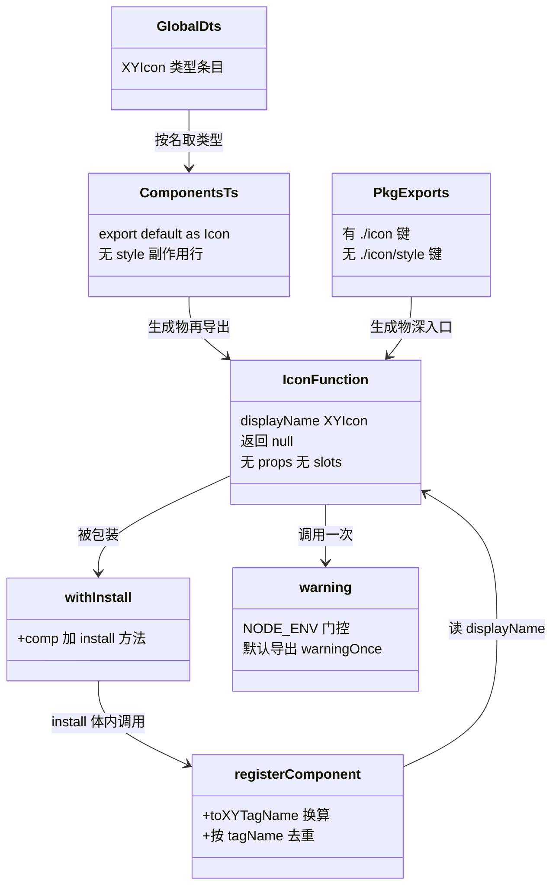
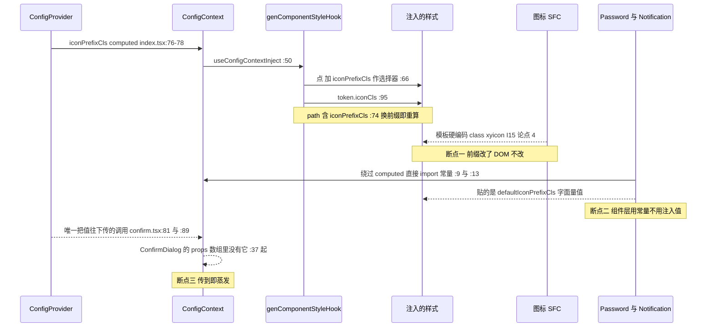
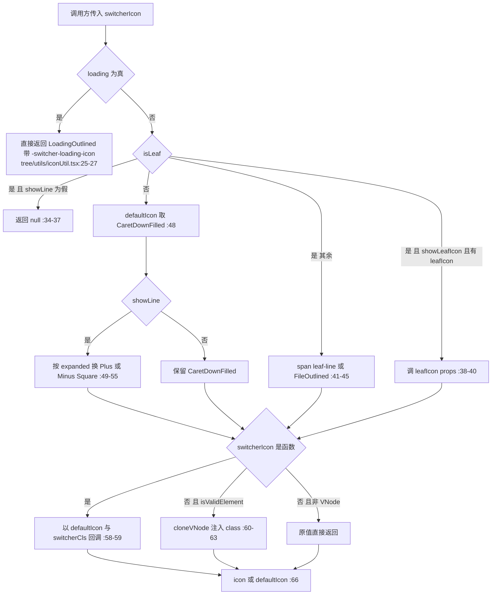

# C01-02 Icon 图标

> **本篇解决**：`packages/xiaoye-ui/src/icon/` 只有 11 行且渲染 `null`，那「Icon 组件」到底在哪儿？图标名字、属性、类名三条通道各自从哪个文件流到 DOM，改哪一处会让 96 个引用点同时出问题。
> **前置**：`I15 icons 包生成链与兼容层`（已完成，`docs/column/02-infrastructure/15-icons-package-包生成链与兼容层.md`）　**读者坐标**：`03-components/01-general` 第 2/7 篇
> 边界：`packages/icons` 的三包结构、两份 barrel 的名字漂移、目录级 `package.json` 垫片、`vite.config.mts` 构建链、`xyicon` 硬编码与 `resetIcon()` 的 CSS 级联压制——**I15 已论证完毕，本篇一律只引用不重述**。本篇的主语是**消费接缝**：主库这一侧的 `src/icon/` 空壳、`iconPrefixCls` 注入链、组件层各自的 icon 分派函数、以及 96 处引用在组件里落地时的实际形状。同类共性（button/icon/tag 的职责切分）归 `C01-00`（横写篇，并行撰写中），本篇不预判其结论。

## 一、职责与边界

`src/icon/` 的职责是**占住 `Icon` 这个名字与 `<xy-icon>` 这个标签**，并在被误用时发一条告警。它不负责渲染任何图形。全目录只有一个 11 行文件：

```tsx
// packages/xiaoye-ui/src/icon/index.tsx:1
import warning from '../_util/warning';
import { withInstall } from '../_util/type';

const Icon = () => {
  warning(false, 'Icon', 'Empty Icon');
  return null;
};

Icon.displayName = 'XYIcon';

export default withInstall(Icon);
```

因此本篇实际覆盖四层东西，它们的真源分散在四个不同目录：

| 层 | 真源位置 | 与本篇的关系 |
| --- | --- | --- |
| 组件名与标签占位 | `packages/xiaoye-ui/src/icon/index.tsx` | 唯一实现，11 行 |
| 类名前缀的注入链 | `config-provider` + `theme/util/genComponentStyleHook.ts` | 组件侧唯一的可配置图标样式通道 |
| 图标的实际渲染 | `@xiaoye-ui/icons` 的 SFC | 见 I15，本篇只取消费侧形状 |
| 「传一个图标」的解析协议 | 各组件自己的 `utils/iconUtil` | 没有共享实现，见论点 4 |

明确不负责：图标的 svg 数据（无）、运行时基类（无，`extends Icon` 只活在类型层，I15 论点 3）、`spin`/`rotate` 的行为（无人读取，I15 坑 4；本篇只补消费侧还在传它的证据）、自动导入与文档站注册（归 `A08`）、Token 四层与 `hashId`（归 `A03`）。

依赖方向（逐条实测）：

| 方向 | 对象 | 证据 |
| --- | --- | --- |
| 被依赖 | 包根聚合导出 `Icon` | `packages/xiaoye-ui/src/components.ts:164-165` |
| 被依赖 | Vue `GlobalComponents` 类型 `XYIcon` | `packages/xiaoye-ui/typings/global.d.ts:44` |
| 被依赖 | 深入口 `./icon` | `packages/xiaoye-ui/package.json:340-343` |
| 依赖 | `_util/warning`（dev 期才生效的告警） | `packages/xiaoye-ui/src/_util/warning.ts:10` |
| 依赖 | `_util/type` 的 `withInstall` | `packages/xiaoye-ui/src/_util/type.ts:39-46` |
| 依赖 | `_util/registerComponent`（标签名换算） | `packages/xiaoye-ui/src/_util/registerComponent.ts:6-11` |
| 依赖 | `@xiaoye-ui/icons`（组件层的真实图标来源） | `packages/xiaoye-ui/src/tree/utils/iconUtil.tsx:1-7` |

**空壳不依赖图标包**：`src/icon/index.tsx` 的两行 import 全在 `_util` 内部，它连 `@xiaoye-ui/icons` 都没引用。也就是说「Icon 组件」和「图标」这两件事在源码里是**彻底断开**的——这是本篇所有其余论证的前提。

## 二、源码地图

| 文件 | 行数 | 职责 | 关键导出 |
| --- | --- | --- | --- |
| `packages/xiaoye-ui/src/icon/index.tsx` | 11 | 空壳本体，唯一实现 | 默认导出（`withInstall` 包装后带 `install`） |
| `packages/xiaoye-ui/src/_util/type.ts` | `:39-46` | `withInstall` 挂 `install` | `withInstall` |
| `packages/xiaoye-ui/src/_util/registerComponent.ts` | 35 | `XYXxx → xy-xxx` 换算与去重注册 | `toXYTagName`、`registerComponent` |
| `packages/xiaoye-ui/src/_util/warning.ts` | 21 | 按 `NODE_ENV` 决定告警是否实装 | 默认导出、`resetWarned` |
| `packages/xiaoye-ui/src/vc-util/warning.ts` | 42 | 真正打 `console.error` 的那层 | `warningOnce`（`:41` 默认导出） |
| `packages/xiaoye-ui/src/components.ts` | `:172-173` | 生成物：`Icon` 进包根，**无** style 副作用行 | — |
| `packages/xiaoye-ui/package.json` | `:340-343` | 生成物：`./icon` 双入口中**缺** `./icon/style` | — |
| `packages/xiaoye-ui/typings/global.d.ts` | `:46` | 生成物：`XYIcon` 全局类型 | — |
| `packages/xiaoye-ui/src/config-provider/context.ts` | `:14` | `defaultIconPrefixCls = 'xyicon'` | `defaultIconPrefixCls` |
| `packages/xiaoye-ui/src/config-provider/hooks/useConfigInject.ts` | 74 | 把 `iconPrefixCls` 递到组件 setup | `iconPrefixCls`（`:16`、`:68`） |
| `packages/xiaoye-ui/src/theme/util/genComponentStyleHook.ts` | `:61-68`、`:95` | 注 `.xyicon` reset + 发 `iconCls` token | `iconCls` |
| `packages/xiaoye-ui/src/tree/utils/iconUtil.tsx` | 67 | 树折叠图标的三方分派 | 默认导出 `renderSwitcherIcon` |
| `packages/xiaoye-ui/src/select/utils/iconUtil.tsx` | 65 | 选择器四组图标的缺省表 | 默认导出 `getIcons` |
| `packages/xiaoye-ui/src/_util/props-util/index.ts` | `:253`、`:270-278` | 分派用的 `isValidElement` 判定 | `isValidElement` |
| `packages/xiaoye-ui/src/vc-tree/interface.tsx` | `:45` | `export type IconType = any` | `IconType` |
| `packages/xiaoye-ui/src/notification/index.tsx` | `:23` | 另一个 `IconType`（字符串联合） | `IconType` |

主实现入口就在 `packages/xiaoye-ui/src/icon/index.tsx:4`（那个函数）。**本篇范围内没有 `*Types.ts`、没有 `style/index.ts`、没有测试文件**——这不是我没找到，而是三者都不存在，且「不存在」本身是可机器验证的（见 §附 检查点 1）。缺 style 文件会顺着生成器规则一路传导到 `components.ts` 与 `package.json`，构成论点 3 的完整证据链。

`src/icon/` 目录的完整文件清单可用一条命令复核：

```bash
find packages/xiaoye-ui/src/icon -type f
# packages/xiaoye-ui/src/icon/index.tsx
```

## 三、架构与数据流

### 3.1 静态结构：一个「组件」如何在不渲染任何东西的前提下成立



这张图的重点是**没有任何一条边指向图标**。`src/icon/index.tsx` 的全部依赖都在 `_util` 里（`:1-2`），它和真正渲染图标的 SFC 之间不存在 import、不存在 context、不存在类型关系。把它拉进公开 API 面的是三个生成物（`components.ts:172-173`、`package.json:340-343`、`typings/global.d.ts:44`），而这三处都由 `pnpm gen:entries` 扫描目录得到——也就是说，**只要目录存在，空壳就会被发布**，生成器不知道它是空的。

### 3.2 `iconPrefixCls` 这条通道：配置端全通，落地端各走各的



三处断点合起来解释了一个现象：**改 `iconPrefixCls` 不会改到任何图标的样式匹配**。注入链本身是通的（`useConfigInject.ts:16` 把 props 与 context 合并、`:68` 导出），但它下游没有任何一个消费者真正按这个值去贴类名——唯二贴类名的地方（`input/Password.tsx:75`、`notification/index.tsx:190`）都直接 import 了常量 `defaultIconPrefixCls`（分别为 `:9` 与 `:13`），而唯一把注入值往下传的调用（`modal/confirm.tsx:81`、`:89`）在接收端根本没有声明这个 prop。

### 3.3 组件层「传一个图标」的分派决策



这条决策树只在 **tree 一家**成立。`select/utils/iconUtil.tsx:10-16` 用的是另一套（`props.x || slots.x()` 的二选一，没有函数分支），`mega-menu/MegaMenu.tsx:227` 是第三套，`result/index.tsx:50-60` 是第四套。库内没有共享的「图标解析器」，见论点 5。

## 四、核心机制精读

### 论点 1：`src/icon/` 不是「没写完的组件」，而是一个刻意占住名字的哨兵；它的身份全靠 `withInstall` 与 `displayName` 两个机制撑起来

断言：这个 11 行文件之所以能被当成组件发布，不是因为它实现了组件契约，而是因为 `withInstall` 给它挂了 `install`、`displayName` 给它提供了标签名；两者都不需要 `props`、`setup` 或渲染结果存在。

```tsx
// packages/xiaoye-ui/src/icon/index.tsx:1
import warning from '../_util/warning';
import { withInstall } from '../_util/type';

const Icon = () => {
  warning(false, 'Icon', 'Empty Icon');
  return null;
};

Icon.displayName = 'XYIcon';

export default withInstall(Icon);
```

```ts
// packages/xiaoye-ui/src/_util/type.ts:39
export const withInstall = <T>(comp: T) => {
  const c = comp as any;
  c.install = function (app: App) {
    registerComponent(app, c);
  };

  return comp as T & Plugin;
};
```

```ts
// packages/xiaoye-ui/src/_util/registerComponent.ts:6
export const toXYTagName = (name: string): string => {
  return name
    .replace(/^XY/, 'xy-')
    .replace(/([a-z0-9])([A-Z])/g, '$1-$2')
    .toLowerCase();
};

// ...

export const registerComponent = (app: App, component: Component, customName?: string): App => {
  const comp = component as any;
  const name = customName || comp.displayName || comp.name;
  if (!name) {
    return app;
  }
  const tagName = toXYTagName(name);
  if (!app.component(tagName)) {
    app.component(tagName, component);
  }
  return app;
};
```

逐段看：

**`:4-7` 是一个函数式组件（functional component）**。它没有 `props` 声明，所以调用方写 `<xy-icon :size="20" />` 时 `size` 不是 prop；它返回 `null`，所以连一个根元素都没有，Vue 的自动属性继承无处可落——传进去的一切（class、style、事件、插槽）都会被静默丢弃。这不是遗漏：`warning(false, 'Icon', 'Empty Icon')`（`:5`）表明作者意图是「渲染 nothing + 说明为什么是 nothing」。

**`:9` 用的是 `displayName` 而不是 `name`**。`registerComponent.ts:18` 的读取顺序是 `customName || displayName || name`，所以 `displayName` 足够让全局注册成功。我实跑了换算函数确认标签名：

```bash
node -e 'const f=n=>n.replace(/^XY/,"xy-").replace(/([a-z0-9])([A-Z])/g,"$1-$2").toLowerCase();process.stdout.write(["XYIcon","XYButton"].map(f).join(" ")+"\n")'
# xy-icon xy-button
```

（注意引号方向：外层必须用单引号，否则 shell 会把 `$1-$2` 当位置参数吃掉，替换串变成空字符串，得到错误结果。）

但 `displayName` 换不来的东西是**组件自引用**：Vue 的递归渲染与 devtools 树按 `name` 匹配，而这里 `name` 是 `undefined`。这是一个只在「用模板字符串 `<xy-icon>`」路径下才成立的正确性——`withInstall` 的注册路径不需要 `name`，运行时解析路径也不需要。

**`:11` 的 `withInstall` 在改一个函数对象的属性**。`type.ts:41` 往 `c` 上写 `install`，而 `c` 就是那个箭头函数本身（不是 `defineComponent` 出来的对象）。副作用是：这个模块的默认导出与被 `components.ts:173` 再导出的 `Icon` 是**同一个函数实例**，`install` 是全局可变状态——两处 `app.use()` 会命中同一个 `warned`/注册去重逻辑（`registerComponent.ts:23` 的 `if (!app.component(tagName))`），这是它没炸的原因。

**结论回扣**：`Icon` 的公开契约是「一个能被解析、但渲染不出任何东西的名字」。它的价值不在功能而在**占位**：`typings/global.d.ts:44` 因此写上了 `XYIcon`，`package.json:340` 因此有 `./icon` 入口，用户写 `<xy-icon>` 得到的是告警而不是「组件不存在」的硬错误。要不要保留这个占位，是 §六 的第一条权衡。

### 论点 2：那条「Empty Icon」告警在生产包里恒为静默，且开发包内也只打一次

断言：空壳唯一的可观测行为（告警）被两层门控消掉——一层是 `NODE_ENV`，一层是消息去重表——所以生产环境下 `<xy-icon>` 与一个不存在的标签在可观测性上完全等价。

```ts
// packages/xiaoye-ui/src/_util/warning.ts:6
type Warning = (valid: boolean, component: string, message?: string) => void;

// eslint-disable-next-line import/no-mutable-exports
let warning: Warning = noop;
if (process.env.NODE_ENV !== 'production') {
  warning = (valid, component, message) => {
    vcWarning(valid, `[xiaoye-ui: ${component}] ${message}`);

    // StrictMode will inject console which will not throw warning in React 17.
    if (process.env.NODE_ENV === 'test') {
      resetWarned();
    }
  };
}

export default warning;
```

```ts
// packages/xiaoye-ui/src/vc-util/warning.ts:18
export function resetWarned() {
  warned = {};
}

export function call(
  method: (valid: boolean, message: string) => void,
  valid: boolean,
  message: string,
) {
  if (!valid && !warned[message]) {
    method(false, message);
    warned[message] = true;
  }
}

// ...

export default warningOnce;
```

三点机制。其一，`_util/warning.ts:9` 把 `warning` 初始化成 `noop`（同文件 `:4` 导出），只有 `:10` 的条件为真才被替换；`_util/warning.ts:1` 的 import 是**默认导入**，命中的是 `vc-util/warning.ts:41` 的 `export default warningOnce`——即真正执行的是「一次性」版本，去重键是 `` `[xiaoye-ui: Icon] Empty Icon` `` 这个字符串本身。其二，`vc-util/warning.ts:4-8` 内层**又**判了一次 `NODE_ENV`，而且用的是 `console.error`（不是 `warn`）。其三，`_util/warning.ts:15-17` 在 `NODE_ENV === 'test'` 时调 `resetWarned()`，所以单测里每次调用都能看到告警，而浏览器 dev 里只看到第一次。

推论（可验证）：打包器把 `process.env.NODE_ENV` 替成 `"production"` 后，`_util/warning.ts:10` 整块是死代码，`warning` 恒等于 `noop`，于是 `icon/index.tsx:5` 这次调用连字符串拼接都不发生。此时 `<xy-icon>` 的行为是「静默渲染 null」。也就是说，**这个哨兵只在 dev/test 有效**。要自证：

```bash
grep -n "NODE_ENV" packages/xiaoye-ui/src/_util/warning.ts packages/xiaoye-ui/src/vc-util/warning.ts
# 三处门控一目了然
```

顺带纠正一个容易写错的统计：想数「谁用了 `withInstall`」不能用 `grep "\.install"`——它会同时漏掉 `withInstall(` 的调用点和对象字面量里的 `install:` 写法（例如 `packages/xiaoye-ui/src/table/index.tsx:47`）。`_util/icon*` 也不存在：

```bash
find packages/xiaoye-ui/src/_util -type f | grep -i icon   # 空
grep -rln "withInstall" packages/xiaoye-ui/src --include='*.ts' --include='*.tsx' | wc -l
```

### 论点 3：`src/icon/` 没有 `style/` 目录，这件事被生成器忠实地翻译成了「公开面上少一个入口」，而且没有任何一处会报错

断言：`icon` 是 102 个聚合条目里仅有的 6 个「没有样式副作用导入」的条目之一（2026-10-02 移除批次前为 112 个条目；无样式名单现为 `auto-complete`、`icon`、`locale-provider`、`table-core`、`time-picker`、`watermark`）；这不是错误，而是目录扫描的必然结果——它意味着按需样式这条主链路对 `Icon` 根本不存在。

```js
// packages/xiaoye-ui/scripts/entry-generator.mjs:310
    const dirPath = join(root, name);
    const entry = findEntry(dirPath);
    if (!entry) continue;
    const collected = collectModuleNames(entry, root);
    modules.push({
      name,
      entry,
      hasStyle: Boolean(findEntry(join(dirPath, 'style'))),
      values: collected.values,
      types: collected.types,
      own: new Set(collected.own),
      hasDefault: collected.hasDefault,
      unparsed: collected.unparsed,
      pascalName: toPascalCase(name, pascalOverrides),
```

```js
// packages/xiaoye-ui/scripts/entry-generator.mjs:409
    lines.push(`export * from './${mod.name}';`);
    if (mod.hasDefault && pascalOwner.get(mod.pascalName) === mod.name) {
      lines.push(`export { default as ${mod.pascalName} } from './${mod.name}';`);
    }
    if (mod.hasStyle) lines.push(`import './${mod.name}/style';`);
    lines.push('');
  }
```

```js
// packages/xiaoye-ui/scripts/entry-generator.mjs:469
    exports[`./${mod.name}`] = {
      types: `./src/${relative(root, mod.entry)}`,
      import: `./src/${relative(root, mod.entry)}`,
    };
    if (mod.hasStyle) {
      const styleEntry = findEntry(join(root, mod.name, 'style'));
      exports[`./${mod.name}/style`] = `./src/${relative(root, styleEntry)}`;
    }
```

三处 `hasStyle` 判断（`:317` 计算、`:406` 写 `components.ts`、`:466-469` 写 `package.json`）都以 `src/icon/style/` 是否存在为唯一依据。实测产出：

```bash
sed -n '340,343p' packages/xiaoye-ui/package.json
#     "./icon": {
#       "types": "./src/icon/index.tsx",
#       "import": "./src/icon/index.tsx"
#     },
```

对照邻居 `grid`（`package.json:300` 的 `"./grid/style"`）与 `image`（`:309` 的 `"./image/style"`）都有这一条，`icon` 没有。聚合入口同理，`components.ts:164-165` 两行（icon 的 `export *` 与具名导出）之后直接空行接 `image`（`:167` 起），而 `grid`/`image` 各带一行 `import './<name>/style';`（`:162`、`:169`）。

用两条命令可复现「6 个没有样式的条目」这个计数（完整可跑版本见 §附 检查点 2）：

```bash
grep -cE "^export \* from '\./[a-z0-9-]+';" packages/xiaoye-ui/src/components.ts   # 112
grep -oE "^export \* from '\./[a-z0-9-]+';" packages/xiaoye-ui/src/components.ts \
  | sed -E "s|^export \* from '\./||; s|';$||" \
  | while read n; do grep -q "import './$n/style';" packages/xiaoye-ui/src/components.ts || echo "no-style: $n"; done
# no-style: auto-complete / icon / locale-provider / table-core / time-picker / watermark
```

要点在于**静默**：`hasStyle` 为假不会告警、不会失败，`pnpm check:entries` 也只会校验「生成物与目录是否一致」而不会校验「组件是否应该有样式」。对 `Icon` 恰好正确（空壳没有样式），但这意味着将来有人给 `src/icon/` 补一个真实现时，**忘记建 `style/` 目录不会有任何提示**——`components.ts` 与 `package.json` 会安静地长成现在这样，而自动导入插件按 `xy-icon` → `xiaoye-ui/icon/style` 补样式时会拿到一个不存在的入口（自动导入侧的行为归 `A08`，本篇不展开）。

### 论点 4：`iconPrefixCls` 的注入链是完整的，但组件层没有任何一个消费者按它贴类名——真实贴类名的两处反而绕过它用常量

断言：从 `ConfigProvider` 到 CSS 的四段链路都能跑通，断点全部集中在**最后一米**：图标 SFC 硬编码（I15 论点 4 已证），组件层则直接 import 常量，唯一把注入值往下传的调用在接收端被丢弃。

先看链路本身存在：

```ts
// packages/xiaoye-ui/src/config-provider/context.ts:14
export const defaultIconPrefixCls = 'xyicon';
```

```ts
// packages/xiaoye-ui/src/config-provider/hooks/useConfigInject.ts:16
  const iconPrefixCls = computed(() => props.iconPrefixCls ?? configProvider.iconPrefixCls.value);
```

```ts
// packages/xiaoye-ui/src/theme/util/genComponentStyleHook.ts:61
    useStyleRegister(sharedInfo, () => [
      {
        // Link
        '&': genLinkStyle(token.value),
        // Global icon reset to make @xiaoye-ui/icons scale with parent font-size
        [`.${iconPrefixCls.value}`]: resetIcon(),
      },
    ]);
```

```ts
// packages/xiaoye-ui/src/theme/util/genComponentStyleHook.ts:92
          {
            componentCls,
            prefixCls: prefixCls.value,
            iconCls: `.${iconPrefixCls.value}`,
            rootCls: `.${rootPrefixCls.value}`,
          },
```

到这里为止一切都是响应式的：`:74` 把 `iconPrefixCls.value` 放进 `path`，所以换前缀会让该组件的样式重新计算；`:95` 把 `iconCls` 做成 Token 字段供样式函数使用。**断点发生在 DOM 侧。**

第一个断点：组件层贴类名的两处不用注入值，用常量。

```tsx
// packages/xiaoye-ui/src/input/Password.tsx:9
import { defaultIconPrefixCls } from '../config-provider/context';

// ...

// packages/xiaoye-ui/src/input/Password.tsx:75
        <span class={classNames(defaultIconPrefixCls, `${prefixCls}-icon`)} {...iconProps}>
```

```tsx
// packages/xiaoye-ui/src/notification/index.tsx:13
import { defaultIconPrefixCls } from '../config-provider/context';

// ...

// packages/xiaoye-ui/src/notification/index.tsx:187
          const Icon = typeToIcon[type];
          iconNode = () => (
            <span
              class={classNames(
                defaultIconPrefixCls,
                `${prefixCls}-icon`,
                `${prefixCls}-icon-${type}`,
              )}
            >
              <Icon />
            </span>
          );
```

`input/Password.tsx:58` 的 `getIcon` 与 `notification/index.tsx:188` 都在**手工合成一个 `.xyicon` 的宿主元素**：它们不是图标组件，而是 `<span class="xyicon ...">` 包一个图标或插槽内容。这两处读的是模块级常量（编译期即固化为 `'xyicon'`），不是 `useConfigInject` 返回的 computed。因此 `<ConfigProvider :icon-prefix-cls="'myicon'">` 之后：`genComponentStyleHook.ts:66` 生成的选择器变成 `.myicon`，而这两处 DOM 仍是 `.xyicon`——组件自己贴的类也一起失效。

第二个断点更微妙，在同一文件里：`notification/index.tsx:184` 处理「调用方传了 `icon`」的分支——

```tsx
// packages/xiaoye-ui/src/notification/index.tsx:182
        let iconNode = null;
        if (icon) {
          iconNode = () => <span class={`${prefixCls}-icon`}>{renderHelper(icon)}</span>;
        } else if (type) {
```

自定义 `icon` 时宿主 `<span>` **只有** `-notice-icon`，没有 `defaultIconPrefixCls`；内置 `type` 时才有。同一个视觉槽位，图标来源不同 → DOM 形状不同 → 是否吃到 `resetIcon()` 的 `inline-flex`/`vertical-align: -0.125em`（`packages/xiaoye-ui/src/style/index.ts:28` 起，I15 论点 5 已展开其级联后果）也不同。这是「传 icon 的通告比传 type 的通告偏一位」这类反馈的直接来源。

第三个断点：全库唯一把 `iconPrefixCls` 当作 **prop** 显式往下传的调用，在接收端没有对应的 props 声明。

```tsx
// packages/xiaoye-ui/src/modal/confirm.tsx:77
  const Wrapper = (p: ModalFuncProps) => {
    const global = globalConfigForApi;
    const rootPrefixCls = global.prefixCls;
    const prefixCls = p.prefixCls || `${rootPrefixCls}-modal`;
    const iconPrefixCls = global.iconPrefixCls;
    const runtimeLocale = getConfirmLocale();
    return (
      <ConfigProvider {...(global as any)} prefixCls={rootPrefixCls}>
        <ConfirmDialog
          {...p}
          rootPrefixCls={rootPrefixCls}
          prefixCls={prefixCls}
          iconPrefixCls={iconPrefixCls}
          locale={runtimeLocale}
          cancelText={p.cancelText || runtimeLocale.cancelText}
        ></ConfirmDialog>
      </ConfigProvider>
    );
  };
```

`confirm.tsx:81` 从全局配置取值、`:89` 作为 prop 传入。接收端：

```tsx
// packages/xiaoye-ui/src/modal/ConfirmDialog.tsx:16
interface ConfirmDialogProps extends ModalFuncProps {
  afterClose?: () => void;
  close?: (...args: any[]) => void;
  autoFocusButton?: null | 'ok' | 'cancel';
  rootPrefixCls: string;
  iconPrefixCls?: string;
```

```tsx
// packages/xiaoye-ui/src/modal/ConfirmDialog.tsx:35
  name: 'ConfirmDialog',
  inheritAttrs: false,
  props: [
    'icon',
    'onCancel',
    'onOk',
    'close',
    'closable',
```

`iconPrefixCls` 只出现在类型接口（`:21`），**不在 `:37` 起的运行时 props 数组里**；同文件里 `rootPrefixCls` 两栖都有（接口 `:20`、数组 `:68`），形成鲜明对照。于是它落进 `$attrs`，而 `ConfirmDialog.tsx:36` 声明了 `inheritAttrs: false`，`setup` 里只从 `attrs` 取了两样东西（`:146` 的 `attrs.style`、`:157` 的 `attrs.class`），渲染时也没有 `{...attrs}` 整体透传。结论：**这个 prop 传进去就被静默丢弃，且没有任何类型错误**——因为接口里声明它是可选的。

要补一句限定，免得把这条断点写成「整条链都没用」：同一个 `Wrapper` 在 `confirm.tsx:77` 还做了 `<ConfigProvider {...(global as any)} prefixCls={rootPrefixCls}>`，把包括 `iconPrefixCls` 在内的全局字段铺成了 context，所以**样式端**（`genComponentStyleHook.ts:66`）对确认框内的图标是有效的；死掉的只有那个显式 prop。也就是说这里的问题是「传了两份、丢了一份」的冗余，而不是通道缺失——这类冗余在改动时最容易被当成必要代码保留下来。

第四个断点：主库其实已经为「命令式 API 拿不到注入」这件事准备了正确的取值函数，但它零调用者。

```ts
// packages/xiaoye-ui/src/config-provider/globalConfig.ts:14
function getGlobalIconPrefixCls() {
  return globalConfigForApi.iconPrefixCls || defaultIconPrefixCls;
}
```

```ts
// packages/xiaoye-ui/src/config-provider/globalConfig.ts:147
  getIconPrefixCls: getGlobalIconPrefixCls,
```

```ts
// packages/xiaoye-ui/src/config-provider/globalConfig.ts:142
export const globalConfig = () => ({
  getPrefixCls: (suffixCls?: string, customizePrefixCls?: string) => {
    if (customizePrefixCls) return customizePrefixCls;
    return suffixCls ? `${getGlobalPrefixCls()}-${suffixCls}` : getGlobalPrefixCls();
```

同一条 `globalConfig()` 返回对象的字段表里就有 `getIconPrefixCls`（`:147`）。`:19-21` 的 `globalConfigForApi` 是 `reactive({})`，`:23-28` 的 `watchEffect` 每轮都把 `globalConfigBySet.iconPrefixCls || defaultIconPrefixCls` 写回它（`:28`），而 `globalConfigBySet` 由设置入口在 `:132` 填充——所以 `getGlobalIconPrefixCls()` 读到的是**可被全局配置改掉的响应式值**，正是 `notification`、`message` 这类脱离组件树渲染的 API 该用的东西。

讽刺的是 `notification` 已经在调这个工厂了：

```tsx
// packages/xiaoye-ui/src/notification/index.tsx:93
  const { getPrefixCls } = globalConfig();
```

`:93` 只解构了 `getPrefixCls`，同一对象上的 `getIconPrefixCls` 被留在原地；等到真正要贴图标类名时（`:190`），它改用 `:13` 那个 import 进来的不可变常量。实测 `getIconPrefixCls` 在整个仓库里零调用者（两种方法：`grep -rn "getIconPrefixCls" packages/xiaoye-ui/src apps/docs` 只命中 `globalConfig.ts:147` 的定义行；`grep -rl "getIconPrefixCls" packages apps` 只命中 `globalConfig.ts` 一个文件）。对照第三条断点里的 `modal/confirm.tsx:81`——它读的是 `global.iconPrefixCls` 字段（能拿到响应式值），却在下游被丢弃。**两条路径各自都差一步，谁也没走完。**

顺带一条同类残留：`config-provider/style/index.ts:20` 生成的选择器是

```ts
// packages/xiaoye-ui/src/config-provider/style/index.ts:18
        [`.${iconPrefixCls.value}`]: {
          ...resetIcon(),
          [`.${iconPrefixCls.value} .${iconPrefixCls.value}-icon`]: {
            display: 'block',
          },
        },
```

`.xyicon .xyicon-icon { display: block }` 这条规则在本仓库里**没有任何 DOM 能匹配**：图标 SFC 的根节点类名只有 `xyicon` 一个词（`packages/icons/src/spinner/SpinnerIcon.vue:2`，238 个文件同形，见 I15 论点 4），而组件层自造的 `-icon` 类名前面挂的是各自组件前缀而非 `xyicon-icon`（`Password.tsx:75`、`notification/index.tsx:184`）。两种方法交叉验证：

```bash
grep -rn "xyicon-icon" packages apps --include='*' | grep -v node_modules | grep -v "/dist/"
# 无输出（0 命中）
grep -rn "xyicon" packages/icons/src --include='*.vue' | grep -c 'class="xyicon"'
# 238
```

这条是死 CSS。它不构成故障（没人依赖 `display: block`），但它是「配置端机制完整、消费端从未对齐」的第三种形态，也是判断 `iconPrefixCls` 是否真被实现过时最容易误读成「已实现」的一处证据。

### 论点 5：「调用方传一个图标」这件事在组件层没有共享协议——四套互不兼容的分派实现，加上三个同名不同物的 `IconType`

断言：库内不存在 `_util/iconUtil` 之类的统一入口（实测 `find packages/xiaoye-ui/src/_util -type f | grep -i icon` 为空，见论点 2 末尾命令）。每个组件自己决定 `icon` 能是什么，因此同一个 prop 名在不同组件上的合法取值集合不同。

第一套，tree 的折叠图标——三方分派，最完整：

```tsx
// packages/xiaoye-ui/src/tree/utils/iconUtil.tsx:58
  if (typeof switcherIcon === 'function') {
    icon = switcherIcon({ ...props, defaultIcon, switcherCls });
  } else if (isValidElement(icon)) {
    icon = cloneVNode(icon, {
      class: switcherCls,
    });
  }

  return icon || defaultIcon;
```

```ts
// packages/xiaoye-ui/src/_util/props-util/index.ts:253
function isValidElement(element: any) {
  if (Array.isArray(element) && element.length === 1) {
    element = element[0];
  }
  return element && element.__v_isVNode && typeof element.type !== 'symbol'; // remove text node
}
```

`isValidElement` 判的是 Vue 的 `__v_isVNode` 品牌标记（`:257`），所以「函数返回 VNode」和「直接给 VNode」走的是两条不同分支：前者拿到 `{ defaultIcon, switcherCls }` 回调参数（`:59`），后者被 `cloneVNode` 强制改 class（`:61-63`）。注意 `:257` 的第二个条件把 `type === 'symbol'`（Fragment/Teleport 等）排除在外——这意味着传 `<Teleport>` 包住的图标会被当作「非有效元素」，落到 `return icon || defaultIcon`（`:66`）原样返回、不加 class。

第二套，select 的四组图标——只做 prop/slot 二选一，**没有函数分支**：

```tsx
// packages/xiaoye-ui/src/select/utils/iconUtil.tsx:10
export default function getIcons(props: any, slots: any = {}) {
  const { loading, multiple, prefixCls, hasFeedback, feedbackIcon, showArrow } = props;
  const suffixIcon = props.suffixIcon || (slots.suffixIcon && slots.suffixIcon());
  const clearIcon = props.clearIcon || (slots.clearIcon && slots.clearIcon());
  const menuItemSelectedIcon =
    props.menuItemSelectedIcon || (slots.menuItemSelectedIcon && slots.menuItemSelectedIcon());
  const removeIcon = props.removeIcon || (slots.removeIcon && slots.removeIcon());
  // Clear Icon
  const mergedClearIcon = clearIcon ?? <CloseCircleFilled />;
```

这里有个与第一套相反的细节：`:18` 用的是 `??`（空值合并），而 `:12-16` 用的是 `||`。也就是说除 `clearIcon` 外，传 `null` 或 `false` 想「关掉某个图标」在这些字段上会被当成「没传」而回落到缺省值；`clearIcon` 传 `null` 才是真关掉。同一个函数内两种语义。

第三套，mega-menu——**唯一接受字符串类名**的一套：

```tsx
// packages/xiaoye-ui/src/mega-menu/MegaMenu.tsx:227
    function renderIcon(icon: any, className?: string): VNode | null {
      if (!icon) return null;
      if (typeof icon === 'string') {
        return <span class={[`${prefixCls.value}-item-icon`, icon]} />;
      }
      // 支持 VNode 或渲染函数
      const content = typeof icon === 'function' ? icon() : icon;
      return <span class={[`${prefixCls.value}-item-icon`, className]}>{content}</span>;
    }
```

`icon` 为字符串时，它被当作**CSS 类名**渲染成一个空 `<span>`（`:230`）；而 `tree` 那套里字符串会走到 `return icon || defaultIcon`（`iconUtil.tsx:66`）——一个字符串被当作子节点文本渲染出来。同一种输入在两个组件里的结果分别是「图标字体类名」和「渲染出一段文字」。这是四套协议里最容易踩的差异。

第四套，result——按 `status` 查表，`icon` 只是覆盖项：

```tsx
// packages/xiaoye-ui/src/result/index.tsx:50
const renderIcon = (prefixCls: string, { status, icon }) => {
  if (ExceptionStatus.includes(`${status}`)) {
    const SVGComponent = ExceptionMap[status];
    return (
      <div class={`${prefixCls}-icon ${prefixCls}-image`}>
        <SVGComponent />
      </div>
    );
  }
  const IconComponent = IconMap[status];
  const iconNode = icon || <IconComponent />;
  return <div class={`${prefixCls}-icon`}>{iconNode}</div>;
};
```

```ts
// packages/xiaoye-ui/src/result/index.tsx:20
export const IconMap = {
  success: CheckCircleFilled,
  error: CloseCircleFilled,
  info: ExclamationCircleFilled,
  warning: WarningFilled,
};
```

`result/index.tsx:20` 的 `IconMap` 是**带 `export` 的运行时值**，经 `packages/xiaoye-ui/src/components.ts:274` 的 `export * from './result'` 直接进入包根公开面——它是这四个图标组件的映射表，改任何一个键等于改 `Result` 的默认视觉，而且用户可以直接从 `xiaoye-ui` 拿到它。

类型面同样是散的。`IconType` 这个名字在仓库里有三处定义，语义互不相干：

| 定义处 | 内容 | 是否进包根 |
| --- | --- | --- |
| `packages/xiaoye-ui/src/notification/index.tsx:23` | `'success' \| 'info' \| 'error' \| 'warning'` | 是（`components.ts:242`） |
| `packages/xiaoye-ui/src/notification/interface.ts:7` | 同上（平行副本） | 否（未被 `index.tsx` 再导出） |
| `packages/xiaoye-ui/src/vc-tree/interface.tsx:45` | `any` | 否（`components.ts` 中 `vc-` 命中数为 0） |

```ts
// packages/xiaoye-ui/src/vc-tree/interface.tsx:45
export type IconType = any;
```

三处里只有第一处进包根，所以 `import type { IconType } from 'xiaoye-ui'` 拿到的是「四种通告类型」，而 `vc-tree` 的 `icon?: IconType`（`:10`）与 `switcherIcon?: IconType`（`:13`）里的同名类型实际是 `any`——即树系的图标 props **在类型层不设约束**。`vc-tree-select/LegacyContext.tsx:21`、`:23` 把这个 `any` 继续透传成 context 字段类型。这两套 `IconType` 之所以没触发 `TS2308`，只是因为 `vc-*` 整体不进聚合入口（实测计数为 0），不是因为有消歧机制。

结论回扣：想「给图标 prop 定一个统一的类型」在当前结构下做不到——协议在组件层是四套、类型在库内是三份、其中一份是 `any`。

### 论点 6：同一个 `spin` 传进两个不同的 loading 图标，命运完全相反——一个变成 DOM 属性，一个被静默吞掉

断言：主库有 4 处仍在给图标传 `spin`，而它们分别落在两代不同形状的图标 SFC 上（代际划分见 I15 论点 3，此处只取消费后果）；由于两代对「未声明属性」的处理相反，同一个 prop 在两个组件里连 DOM 表现都不一致。

先看消费侧的四条（完整枚举，排除 `spin` 组件自身的样式命中）：

```tsx
// packages/xiaoye-ui/src/cascader/index.tsx:263
          <LoadingOutlined spin />

// packages/xiaoye-ui/src/select/utils/iconUtil.tsx:31
    mergedSuffixIcon = getSuffixIconNode(<LoadingOutlined spin />);

// packages/xiaoye-ui/src/tree-table/BodyCell.tsx:149
          toggleIcon = <SpinnerIcon spin class={`${prefixCls.value}-node-toggle-icon`} />;

// packages/xiaoye-ui/src/tree-table/TreeTable.tsx:911
                  <SpinnerIcon spin class={`${prefixCls.value}-loading-icon`} />
```

复现命令（排除 `spin/` 自身与样式里的 token 名）：

```bash
grep -rn "spin" packages/xiaoye-ui/src --include='*.tsx' | grep "<" | grep -i icon
```

再看两个接收端的形状差异。

```vue
<!-- packages/icons/src/loading/LoadingIcon.vue:25 -->
defineProps({
  size: {
    type: [Number, String],
    default: 14,
  },
});
```

```vue
<!-- packages/icons/src/spinner/SpinnerIcon.vue:24 -->
const props = defineProps<BaseIconProps>();
```

`LoadingOutlined` 这个名字经兼容层绑到 `./loading`（`packages/icons/src/index.js:1059-1060`，映射规则本身见 I15 论点 6）。`loading/LoadingIcon.vue:25-30` 只声明了 `size`，因此 `spin` **不是 prop**：按 Vue 的属性继承规则，它会落进 `$attrs`，同时被根节点 `<span class="xyicon">` 自动继承、又被模板里的 `v-bind="$attrs"`（`packages/icons/src/loading/LoadingIcon.vue:9`）二次铺到 `<svg>` 上——最终在 DOM 里留下一个 `spin="true"` 的无意义属性。`spinner/SpinnerIcon.vue:24` 声明的 `BaseIconProps` 含 `spin`（`packages/core/src/composables/index.ts:5-10`），于是 `spin` 被当作 prop 收下、`useBaseIcon(props)` 从不读它（I15 论点 4/坑 4 已证），**连 `$attrs` 都进不去**，DOM 上什么都不留。

（这两条 DOM 结论是从两代模板的声明形状与 Vue 的属性继承规则推出来的，两处源码形状我逐字核对过；我没有在浏览器里 dump 实际 DOM 来确认 `spin="true"` 真的出现在属性列表里。）

而两者的**视觉结果相同：都不转**。主库样式里与图标旋转相关的关键帧为空：

```bash
grep -rn "@keyframes" packages/xiaoye-ui/src --include='*.ts' --include='*.tsx' --include='*.less'
# 仅命中 useStyleRegister 的注入机制一处、ripple 一处（原 galleria 两处与 rich-text-editor 一处已随组件移除消失）
```

唯一给 `-loading-icon` 定尺寸的规则也只做静态盒模型，没有 animation：

```ts
// packages/xiaoye-ui/src/tree-table/style/index.ts:85
      '&-loading-icon': { fontSize: '2rem', width: '2rem', height: '2rem' },
```

所以级联里没有任何一层能让 `cascader/index.tsx:263` 与 `select/utils/iconUtil.tsx:31` 的加载图标动起来——`tree-table/style/index.ts:85` 那三行反而把它放大成 2rem 的**静止**方块，比不传 `spin` 更显眼。全仓唯一真正转得起来的图标动画是某个消费组件自己写 CSS 打 `.xyicon` 实现的（I15 坑 4 定位到 `packages/xiaoye-ui/src/dark-mode-toggle/style/index.ts:78`、`:82-83`），与 `spin` 无关。

结论回扣：`spin` 在**类型层是合法的**（`BaseIconProps` 有它，`packages/icons/src/baseicon/BaseIcon.d.ts:3-6` 的 `IconProps` 也有它），在**运行时是死的**，在**DOM 上是两种形状**。这三者叠起来才是它在消费侧的完整语义，单看任何一层都会得出错误结论——这也是 §七 坑 4 的成因。

## 五、对外契约如何生效

`Icon` 有四条对外通道，它们全部生效，但没有一条通向图形。

**名字通道**：`src/icon/index.tsx:11` 的 `withInstall(Icon)` 是包根 `Icon` 的唯一来源。`components.ts:173` 写 `export { default as Icon } from './icon'`，`index.ts:7` 再 `export * from './components'`，于是 `import { Icon } from 'xiaoye-ui'` 拿到空壳。同时 `index.ts:4` 用 `import * as components` 把同一份命名空间留作运行时对象，`:12-16` 遍历它的键并对「有 `install` 属性」的项调 `app.use`：

```ts
// packages/xiaoye-ui/src/index.ts:16
export const install = function (app: App) {
  Object.keys(components).forEach(key => {
    const component = components[key];
    if (component.install) {
      app.use(component);
    }
  });
```

因为 `withInstall`（`_util/type.ts:41`）确实给函数对象挂了 `install`，这个 `if` 为真，`app.use(Icon)` 被执行，`registerComponent` 按 `displayName`（`icon/index.tsx:9`）算出 `xy-icon` 并注册（`registerComponent.ts:18-25`）。**结论：全量注册之后 `<xy-icon>` 是一个能被解析的真实全局组件**，它不是「未注册的标签」，而是「注册了但渲染 null 的组件」。这一点决定了删除它的代价（见 §六 第一条）。

注意 `index.ts:14` 的判据是 `component.install` 这个**属性存在**，不校验组件是否声明 props、是否返回 VNode——空壳在契约层面「合法」，正因为校验只看这一个字段。

**类型通道**：`typings/global.d.ts:44` 写的是 `XYIcon: (typeof import('xiaoye-ui'))['Icon']`，即类型直接取自上面那条名字链。于是在任何 `.vue` 模板里写 `<xy-icon>` 都能通过 `vue-tsc` 的组件解析检查——**类型层没有任何机制能表达「这个组件不渲染东西」**。而由于 `icon/index.tsx:4` 没有声明 `props` 选项，调用方得不到「可以传什么属性」的任何提示：传什么都不会成为 prop（`_util/type.ts:45` 的返回类型只额外交叉了一个 `Plugin`，没有引入 props 形状）。

**属性与插槽通道**：全断。`icon/index.tsx:4` 是函数式组件且没有 `props` 选项，`slots` 也没声明；返回 `null` 意味着 Vue 没有根元素可以承接 `$attrs` 继承。因此 `class`、`style`、`onClick`、默认插槽的内容一律消失。和真正的图标 SFC 相比，这是行为差异最大的一类断口：给图标 SFC 传 `class` 至少会落到 `<span class="xyicon">`（I15 §五·属性通道 已述两代差异），给这个空壳传就什么都不剩。

**样式通道**：不存在。`components.ts:172-173` 之间没有 `import './icon/style'`（`entry-generator.mjs:413` 的 `hasStyle` 为假），`package.json:340-343` 也没有 `./icon/style` 键（`entry-generator.mjs:473-476` 同理）。所以按需引入 `xiaoye-ui/icon` 时不会有任何样式被拉进来——对空壳来说正确，但这条「正确」是扫描目录的副产品，不是设计决定（论点 3）。

**与文档/LLM 契约的接缝**：这是本篇最需要在「契约」层面记下来的一条。`apps/docs/components/icon.md` 通篇描述的是 `@xiaoye-ui/icons` 那个上游 `Icon`（支持 `component`、`createFromIconfontCN`、`getTwoToneColor`，见 I15 论点 7），它的示例也确实从图标包取：

```vue
<!-- apps/docs/examples/icon/custom.vue:66 -->
import { Icon, HomeOutlined } from '@xiaoye-ui/icons';
```

也就是说文档页里那个 `Icon` 与 `src/icon/index.tsx` 从未见过面。但对外机器索引不看示例，它看文件名：

```js
// scripts/generate-llms-txt.mjs:129
      tag: `xy-${toKebab(name)}`,
      importPath: `xiaoye-ui/${name}`,
```

`:117-120` 的组件清单来自 `readdirSync(docsDir)` 对 `apps/docs/components/*.md` 的扫描，`:129-130` 纯粹按文件名拼字符串，既不查 `src/<name>/` 是否存在、也不查它渲染什么。产物因此写着：

```text
apps/docs/public/llms.txt:45
- [Icon 图标](/components/icon.html) — 标签 `<xy-icon>`，导入 `xiaoye-ui/icon`
```

同文件 `:534` 又重复一次 `- 标签：\`<xy-icon>\``。这两条承诺在**技术上都没错**——`xiaoye-ui/icon` 确实能导入（`package.json:340`）、`<xy-icon>` 确实能解析（`index.ts:12-16`）——错的是它们暗示「这里有一个图标组件」。任何按 `llms.txt` 生成代码的模型都会写出一个渲染空白的 `<xy-icon>`，而且拿不到任何错误（告警在生产为静默，论点 2）。这条接缝值得单独记：**机器可读契约由文档文件名驱动，与源码实现之间没有校验关系**。

## 六、设计取舍

**保留空壳 vs 删掉 `src/icon/`。** 删掉的直接后果不是「少一个没用的组件」，而是契约面同时塌三处：`import { Icon } from 'xiaoye-ui'` 变成类型错误加运行时 `undefined`；`typings/global.d.ts:44` 的 `XYIcon` 变成指向不存在成员的悬空引用；`<xy-icon>` 从「注册成功的空组件」退化为 Vue 的 `Failed to resolve component` 警告。而**对外承诺不会跟着消失**——`llms.txt` 那两行是按 `apps/docs/components/icon.md` 的文件名生成的（`generate-llms-txt.mjs:117-130`），删目录不删 md，于是删完之后机器索引继续宣称有一个 `<xy-icon>`，但连「能解析」都做不到了。所以现状的取舍是：**用一个渲染 null 的哨兵换命名空间的占位与一条（仅 dev 有效的）告警**。赔上的是：`Icon` 这个名字在主包里被永久占用且语义为空，任何未来真正的 Icon 基座都要先处理这个同名占位；同时它让「主库有 Icon 组件」这件事在目录树、生成物、全局类型三个层面都成立，只在渲染结果上不成立——这种「三真一假」的状态比彻底没有更容易被误信。

第三条路（把空壳做成真基座，接受 `component` prop 渲染任意 svg，对齐上游 `Icon` 的 API）在当前分层下**可行且成本最低**：主库已经依赖图标包（`packages/xiaoye-ui/package.json:55`，方向由 I15 §一 实测），不存在循环问题；需要的设计决定是「主库的 `Icon` 与图标包的 `Icon` 是同一个东西还是两个东西」。今天它们是两个（I15 论点 7），篇内证据是 `src/icon/index.tsx` 的两行 import 全在 `_util`（`:1-2`）、而文档示例绕到图标包去取 `Icon`（`custom.vue:66`）。

**`iconPrefixCls`：建了完整机制，但不修最后一米。** 配置端已经做到响应式极致——`:74` 把前缀塞进样式 `path` 让缓存随前缀失效，`:95` 把 `iconCls` 发成 Token 字段供样式函数消费，`useConfigInject.ts:16` 把它递到每个组件 setup。但组件层贴类名时读的是常量（`input/Password.tsx:9` 与 `:75`、`notification/index.tsx:13` 与 `:190`），往下传的那一处又落进 `inheritAttrs: false` 的组件里消失（`modal/confirm.tsx:89` → `modal/ConfirmDialog.tsx:21` 对比 `:37` 的 props 数组，论点 4）。为什么不收口：真正把这两处改成 `useConfigInject` 返回值是**几行的小改动**，代价几乎为零；不做的后果是「看起来可配置」。真正贵的部分在图标包那一侧——SFC 里的 `class="xyicon"` 是硬编码字面量、且依赖方向禁止图标包反向读 context，这条断裂的论证归 I15 论点 4 与 §六，本篇不重复；本篇要补的是：**即使图标包修好了，主库这两处常量引用仍会独立地失效**。收口顺序必须先是消费侧，否则修上游也拿不到正确的 DOM 类名。

**图标分派协议：四套并存 vs 抽 `_util/renderIcon`。** 抽出来的收益是所有组件都能接受「字符串类名 / VNode / 渲染函数」三种输入；成本是各家现在写进 DOM 的类名语义并不一样——tree 用 `cloneVNode` 把 `switcherCls` **覆盖**到用户 VNode 上（`tree/utils/iconUtil.tsx:61-63`），mega-menu 是把图标**包进**一个带 `-item-icon` 的 `<span>`（`mega-menu/MegaMenu.tsx:234`），result 也包 `<span>`/`<div>` 但不带 icon 前缀（`result/index.tsx:54`、`:61`），notification 包 `<span>` 且**只在内置 type 时**带 `xyicon`（`notification/index.tsx:184` 对比 `:190`）。这五种 DOM 形状都被各自的样式表依赖着，统一成一个函数等于同时改五个组件的公开 DOM。放弃统一换来的是每个组件可以按自己的样式需要决定宿主元素；赔上的是调用方的心智——`switcherIcon="my-class"` 在 tree 上会渲染出文字，在 mega-menu 上会渲染出图标字体（论点 5）。这是**分层耦合**代价的教科书样本：不是没人能写这个函数，而是写出来要连带改样式层。

**`IconMap` 留在包根导出面。** `result/index.tsx:20` 的 `export const IconMap` 经 `components.ts:302` 进了 `xiaoye-ui` 根。收益是调用方可以自己按同一张表画状态图标；成本是这张表把 `success/error/info/warning` 四个状态**全部钉死在兼容层别名上**——实测四个名字无一例外都带着「无 Filled 变体」的自白注释：`packages/icons/src/index.js:1245-1246`（`CheckCircleFilled` → `./circle-check`）、`:1248-1249`（`CloseCircleFilled` → `./circle-x`）、`:1266-1267`（`ExclamationCircleFilled` → `./circle-alert`）、`:1326-1327`（`WarningFilled` → `./exclamationtriangle`）。也就是说 `Result` 的四个状态图标**没有一个**是本库自研的 Filled 形状，而这张表是公开 API，换图标等于改公开值（别名机制与「近似映射」的整体后果归 I15 论点 6，此处只取 `IconMap` 这一个消费侧样本）。想收回只能靠 deprecation，因为没有 `owns` 声明能把它从 `export *` 里摘出去（该规则依据是根 `AGENTS.md` 对 `ownership-pins.mjs` 的说明与 A02，本篇未实测 pin 的行为）。

## 七、坑与改动指南

### 坑 1：模板里写了 `<xy-icon>`，页面上什么都没有，生产环境连报错都没有

- 触发：照 `apps/docs/public/llms.txt:45` 或 `:534` 给出的标签写 `<xy-icon>`，或 `import { Icon } from 'xiaoye-ui'` 后当作图标基座用。
- 症状：DOM 里该位置是一个空注释节点（Vue 渲染 `null` 的产物）。开发环境第一次渲染会看到一条 `console.error`，形如 `Warning: [xiaoye-ui: Icon] Empty Icon`；生产环境什么都没有。
- 原因：组件本体就是返回 `null` 的哨兵（`packages/xiaoye-ui/src/icon/index.tsx:4-7`），而告警被 `NODE_ENV` 门控（`packages/xiaoye-ui/src/_util/warning.ts:10`）并且按消息文本去重（`packages/xiaoye-ui/src/vc-util/warning.ts:22-31` 里 `call()` 的 `warned[message]` 判断，默认导出在 `:41`）。
- 定位：`packages/xiaoye-ui/src/icon/index.tsx:5`、`packages/xiaoye-ui/src/_util/warning.ts:9-10`、`packages/xiaoye-ui/src/vc-util/warning.ts:41`。
- 测试现状：**该分支无测试保护**。`src/icon/` 目录里只有 `index.tsx` 一个文件，没有任何测试；`packages/xiaoye-ui/vitest.config.mts:33` 的 `include` 收 `src/**/*.test.{js,ts,jsx,tsx}`，而这个 glob 在本篇范围内匹配数为 0。
- 正路：需要「渲染一个图标」就直接用 `@xiaoye-ui/icons` 的具名组件（`packages/xiaoye-ui/src/tree/utils/iconUtil.tsx:1-7` 是全库的标准写法）；需要自定义 svg 的基座，见 §六 第三条路。

### 坑 2：改 `iconPrefixCls` 会把主库自己贴的图标类名一起废掉

- 触发：`<ConfigProvider :icon-prefix-cls="'myicon'">`。
- 症状：`Input.Password` 的眼睛图标、`Notification` 的状态图标失去 `inline-flex` 居中与 `vertical-align: -0.125em` 基线补偿，视觉上与文字错位；所有图标 SFC 同样错位（那条归 I15 坑 2，不重复）。
- 原因：这两处贴类名时读的是模块级常量而不是注入值——`packages/xiaoye-ui/src/input/Password.tsx:9` 导入常量、`:75` 用它拼 class；`packages/xiaoye-ui/src/notification/index.tsx:13` 导入、`:190` 使用。而选择器端由注入值生成（`packages/xiaoye-ui/src/theme/util/genComponentStyleHook.ts:66`）。
- 定位：上述四处 + 两个「本来该用」的取值口：`packages/xiaoye-ui/src/config-provider/hooks/useConfigInject.ts:16`（组件内，返回值在 `:68`）与 `packages/xiaoye-ui/src/config-provider/globalConfig.ts:147` 的 `getIconPrefixCls`（命令式 API，实测零调用者）。
- 安全改法：`Password.tsx:75` 换成 `useConfigInject` 的 `iconPrefixCls`——该文件已在 `:80` 调用 `useConfigInject('input-password', props)`，只是当时没解构这个字段，属于一行改动；`notification/index.tsx:190` 换成 `globalConfig()` 的 `getIconPrefixCls()`——该文件已在 `:93` 调用 `globalConfig()`，同样只差解构。改完必须跑一次全量样式抽取测试（`packages/xiaoye-ui/src/_util/static-style-extract/index.test.js`）确认没有快照连带变化。

### 坑 3：同一个 `Notification`，传 `icon` 和传 `type` 得到的 DOM 不一样

- 触发：`notification.open({ type: 'success' })` 与 `notification.open({ icon: h(SearchIcon) })` 对比。
- 症状：只有前者带 `xyicon` 类，后者不带；两者的宿主 `<span>` 尺寸/对齐规则因此不同（`resetIcon()` 的级联只命中前者）。
- 原因：两条分支分开写——`packages/xiaoye-ui/src/notification/index.tsx:184` 自定义图标分支只给 `${prefixCls}-icon`，`:187-193` 内置 type 分支才 `classNames(defaultIconPrefixCls, ...)`。
- 定位：`packages/xiaoye-ui/src/notification/index.tsx:182-194`。
- 备注：`resetIcon()` 内容见 `packages/xiaoye-ui/src/style/index.ts:28` 起；它与 `size` 呈现属性的级联胜负已由 I15 论点 5 论证，本篇不重复。

### 坑 4：`spin` 在两代图标上的 DOM 形态相反，但都不转

- 触发：`<LoadingOutlined spin />`（`packages/xiaoye-ui/src/cascader/index.tsx:263`、`packages/xiaoye-ui/src/select/utils/iconUtil.tsx:31`）或 `<SpinnerIcon spin />`（`packages/xiaoye-ui/src/tree-table/BodyCell.tsx:149`、`packages/xiaoye-ui/src/tree-table/TreeTable.tsx:911`）。
- 症状：图标不动。前者会留下一个 `spin="true"` 的 DOM 属性，后者什么都不留。
- 原因：接收端 props 声明不同——`packages/icons/src/loading/LoadingIcon.vue:25-30` 只声明 `size`，`spin` 落进 `$attrs` 并被模板 `v-bind="$attrs"`（同文件 `:9`）二次铺到 `<svg>`；`packages/icons/src/spinner/SpinnerIcon.vue:24` 声明的是 `BaseIconProps`（含 `spin`），于是 `spin` 被当 prop 收下后无人读取（`packages/core/src/composables/index.ts:19-28`，见 I15 论点 4）。
- 定位：上述两代形状 + `packages/xiaoye-ui/src/tree-table/style/index.ts:85`（给 `-loading-icon` 放大到 2rem 却没有 animation）。全库关键帧清点命令：`grep -rn "@keyframes" packages/xiaoye-ui/src --include='*.ts' --include='*.tsx' --include='*.less'`（实测只有 `ripple` 与 cssinjs 注入机制自身——原 `galleria`、`rich-text-editor` 两处已随 2026-10-02 移除批次消失，没有任何图标旋转帧）。
- 该分支无测试保护：仓库里没有任何断言「loading 图标会旋转」的测试。要真的动起来，只能在消费组件的样式里自己写 `animation`（现存的唯一先例是 `packages/xiaoye-ui/src/dark-mode-toggle/style/index.ts:78`、`:82-83`），不要再往图标上塞 `spin`——那只会多一个死 prop。

### 坑 5：`icon` 传字符串的结果在两个组件里完全不同

- 触发：把 `MegaMenu` 的写法（`icon: 'my-iconfont-class'`）搬到 `Tree` 的 `switcherIcon` 或 `Select` 的 `suffixIcon`。
- 症状：`MegaMenu` 渲染出一个带该类名的空 `<span>`（图标字体生效）；`Tree` 把字符串当子节点渲染出**一行文字** `my-iconfont-class`；`Select` 同（无字符串分支）。
- 原因：`packages/xiaoye-ui/src/mega-menu/MegaMenu.tsx:229-231` 显式支持字符串；`packages/xiaoye-ui/src/tree/utils/iconUtil.tsx:58-66` 的分派只有函数 / VNode / 原值三种，字符串落到 `return icon || defaultIcon`；`packages/xiaoye-ui/src/select/utils/iconUtil.tsx:12` 是 prop/slot 二选一，连类型分支都没有。
- 定位：上述三处 + 类型面 `packages/xiaoye-ui/src/vc-tree/interface.tsx:45` 的 `IconType = any`（所以 TS 不会拦你）。
- 判断某个组件支持哪种输入，只能去读它自己的 iconUtil；库内没有 `_util` 级实现（`find packages/xiaoye-ui/src/_util -type f | grep -i icon` 为空）。

### 坑 6：`suffixIcon`/`removeIcon` 传 `null` 关不掉，`clearIcon` 能关

- 触发：想用 `null` 显式移除选择器的后缀箭头。
- 症状：箭头仍在，`null` 被当成「没传」。
- 原因：同一个函数里两种合并语义——`packages/xiaoye-ui/src/select/utils/iconUtil.tsx:12` 到 `:16` 全是 `||`，而 `:18` 的 `mergedClearIcon` 用 `??`。
- 定位：`packages/xiaoye-ui/src/select/utils/iconUtil.tsx:10-19`。
- 规避：要关掉就走 `showArrow`（同文件 `:11` 解构、`:22` 使用），不要靠传 `null`。

### 坑 7：`Icon`、`IconMap`、`defaultIconPrefixCls` 三个名字被快照冻住，动它们必然让 CI 变红

- 触发：删掉 `src/icon/`、改 `Result` 的状态图标表、或把 `'xyicon'` 常量改名。
- 症状：`pnpm --filter xiaoye-ui test:unit` 在 `packages/xiaoye-ui/tests/index.test.js:25-27` 那条「包根导出面与提交内容一致」的用例上失败，提示快照不匹配。
- 原因：这三条名字都在快照里——`packages/xiaoye-ui/tests/__snapshots__/index.test.js.snap:76`（`"Icon"`）、`:77`（`"IconMap"`）、`:258`（`"defaultIconPrefixCls"`），而 `packages/xiaoye-ui/src/index.ts:7` 的 `export * from './components'` 把它们全量抬到包根。`IconMap` 的声明处是 `packages/xiaoye-ui/src/result/index.tsx:20`，`defaultIconPrefixCls` 的公开出口是 `packages/xiaoye-ui/src/config-provider/index.tsx:49`。
- 定位：上述五个位置。
- 定性：这是本篇范围内**唯一真正生效的机器保护**。它只保证「名字集合不变」，不保证任何行为——空壳照样渲染 `null`、常量照样是死的。所以别把它当成「Icon 这块有测试覆盖」。

### 坑 8：给 `src/icon/` 补真实现时忘记建 `style/` 目录，公开面会静默少一个入口

- 触发：把空壳换成真组件并写了样式，但样式文件放在组件目录里而不是 `style/index.ts`。
- 症状：`xiaoye-ui/icon/style` 这个深入口不存在，按需样式引入拿不到东西；聚合入口也没有样式副作用行。
- 原因：生成器只看 `src/<name>/style/` 有没有入口——`packages/xiaoye-ui/scripts/entry-generator.mjs:317`（`hasStyle`）、`:406`（决定是否写 `import`）、`:466-469`（决定是否写 `exports` 键）。
- 定位：上述三行，以及当前产物 `packages/xiaoye-ui/src/components.ts:164-165`、`packages/xiaoye-ui/package.json:340-343`。
- 验证：`pnpm gen:entries` 后 `pnpm check:entries`；生成物规则与漂移检测的完整机制归 A02，本篇不展开。

**本篇范围的安全改动边界**：`src/icon/index.tsx` 是 11 行的孤立文件，不被任何源码 import（实测：`grep -rn "from '\.\./icon'\|from './icon'" packages/xiaoye-ui/src apps/docs --include='*.ts' --include='*.tsx' --include='*.vue' --include='*.js'` 只命中 `packages/xiaoye-ui/src/components.ts:164-165` 两行），所以改它不会波及任何组件；但它一改就动公开名字面，必须同步 §七 坑 7 的快照。相反，`iconUtil` 那两个文件（`tree/utils/iconUtil.tsx`、`select/utils/iconUtil.tsx`）被跨目录复用：`tree-select/index.tsx:19-21` 同时 import 了 select 与 tree 的两份实现，改签名会一次影响三个组件。改 `iconPrefixCls` 相关链路的顺序应当是「先消费侧常量（坑 2）→ 再 `ConfirmDialog` 的 props 数组（`packages/xiaoye-ui/src/modal/ConfirmDialog.tsx:37` 起）→ 最后才谈图标包侧」，前两步是主库内部可控的小改动，第三步受依赖方向约束（I15 §六）。

**验证命令（改完至少跑这三条）**：

```bash
pnpm --filter xiaoye-ui test:unit           # 覆盖 tests/index.test.js 的包根快照
pnpm gen:entries && pnpm check:entries      # 覆盖 components.ts / global.d.ts / exports 三处生成物
pnpm typecheck
```

## 附：本篇可证伪的三个检查点

1. **`Icon` 是无样式、无实现的占位**（论点 1、论点 3、§五 样式通道）。

   ```bash
   find packages/xiaoye-ui/src/icon -type f
   grep -c "icon/style" packages/xiaoye-ui/src/components.ts packages/xiaoye-ui/package.json
   ```

   实测：第一条只输出 `packages/xiaoye-ui/src/icon/index.tsx` 一行；第二条两个文件的命中数都是 0（`components.ts` 里没有任何 `icon/style` 字符串，`package.json` 里也没有）。**推翻条件**：一旦出现第二个文件（`*Types.ts` 或 `style/index.ts`），或两个计数变成非 0，则「空壳 + 无样式入口」的定性失效，本篇 §二 与论点 3 需重写。

2. **`icon` 是「没有样式副作用导入」的 6 个聚合条目之一，总数是 112**（论点 3）。

   ```bash
   grep -cE "^export \* from '\./[a-z0-9-]+';" packages/xiaoye-ui/src/components.ts
   grep -oE "^export \* from '\./[a-z0-9-]+';" packages/xiaoye-ui/src/components.ts \
     | sed -E "s|^export \* from '\./||; s|';$||" \
     | while read n; do grep -q "import './$n/style';" packages/xiaoye-ui/src/components.ts || echo "no-style: $n"; done
   ```

   实测：`112`，随后 6 行 `no-style: auto-complete / icon / locale-provider / table-core / time-picker / watermark`。**推翻条件**：`icon` 从这 6 行里消失（说明补了 style 目录），或总数不再是 112（说明组件目录增删过而本篇 §二 的表没跟着更新）。这条同时能验证 `table-core`、`locale-provider` 是否真的该被当成组件条目收录——那是 A02 的话题，此处只作对照。

3. **三个图标相关的公开名被快照冻结**（§七 坑 7）。

   ```bash
   grep -n '"Icon",\|"IconMap",\|"defaultIconPrefixCls",' packages/xiaoye-ui/tests/__snapshots__/index.test.js.snap
   ```

   实测：命中三行——`:76 "Icon"`、`:77 "IconMap"`、`:258 "defaultIconPrefixCls"`。**推翻条件**：任一行消失即表示包根导出面已经换掉，届时坑 7 的「CI 会红」需要改成「无保护」；三行都在但 `packages/xiaoye-ui/tests/index.test.js` 里那条 `toMatchSnapshot()` 用例被删，则快照保护也不成立，需要重跑 `pnpm --filter xiaoye-ui test:unit` 确认它真在 `vitest.config.mts:33` 的 `include` 范围内被执行。
