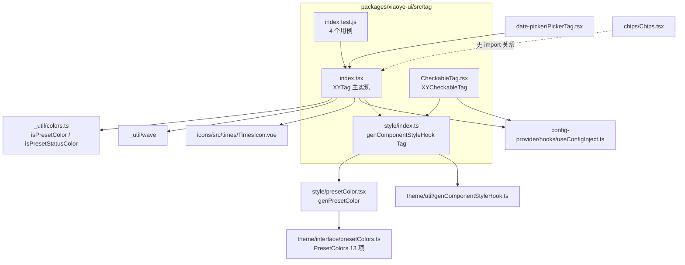
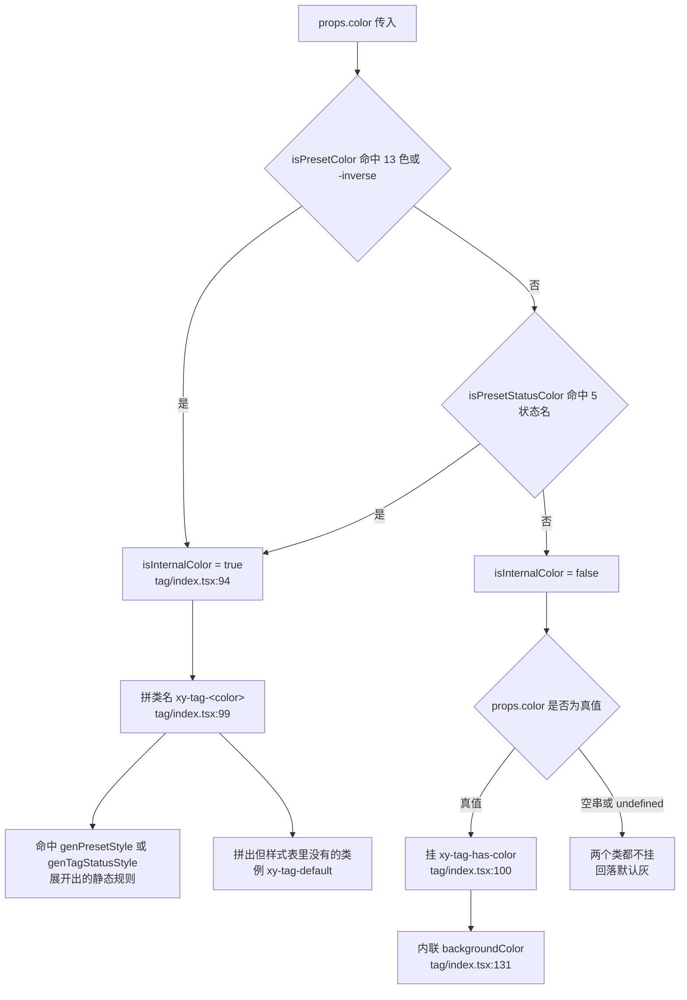
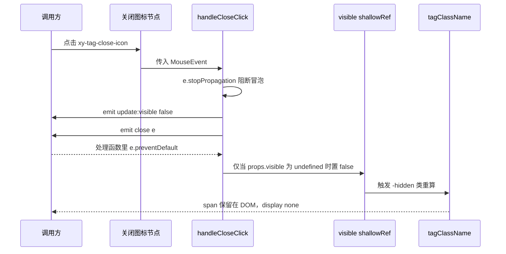

# C01-03 Tag 标签

> **本篇解决**：Tag 的颜色定制为什么会在源码里分成两条完全不同的出口，以及可点击标签（CheckableTag）与 Chips 的分工接缝在哪里。
> **前置**：C01-00《类横写：button/icon/tag/chips/badge 的职责切分》　**读者坐标**：`03-components/01-general` 第 4/7 篇

## 一、职责与边界

`XYTag` 负责**一枚信息片段的静态呈现与它自己的可见性**：一个 `<span>` 里放下内容、可选的前置图标、可选的关闭按钮，并按 `color` 决定这枚片段用预设色还是自定义背景色。它明确不负责四件事：选择集合（多选一/多选多的值管理交给 `XYChips`）、表单录入（`XYChips` 自带输入框与键盘导航）、禁用态（本目录零 `disabled` 实现）、以及进出场动画（本目录零 motion 依赖）。

C01-00《类横写：button/icon/tag/chips/badge 的职责切分》已经从类级别证明了颜色职责被判定函数切成两条出口、点击反馈的挂载判据是三套互不相干的规则、`tag/` 全目录零 `disabled` 字样。本篇不重述这三条结论，只做两件横写篇不做的事：一是把两条颜色出口**各自如何被物化**（一条走样式生成器的循环展开，一条走内联样式）读到 CSS 文本层面；二是把 `CheckableTag` 与 `Chips` 的分工落到「谁 import 谁、谁共用哪个类名前缀」这种可 grep 的接缝上。

依赖清单（Tag 用得到的）：

- 类名合并：`packages/xiaoye-ui/src/_util/classNames.ts`，用于 `tagClassName`（`packages/xiaoye-ui/src/tag/index.tsx:97`）。
- 颜色白名单：`isPresetColor` 与 `isPresetStatusColor`（`packages/xiaoye-ui/src/_util/colors.ts:32`、`packages/xiaoye-ui/src/_util/colors.ts:32`），在 `packages/xiaoye-ui/src/tag/index.tsx:94` 被合成一个判定。
- 点击涟漪：`Wave`（导入在 `packages/xiaoye-ui/src/tag/index.tsx:6`，挂载判定在 `packages/xiaoye-ui/src/tag/index.tsx:145`）。
- 配置注入：`useConfigInject('tag', props)`（`packages/xiaoye-ui/src/tag/index.tsx:51`），只取 `prefixCls` 与 `direction` 两项，取法见 `packages/xiaoye-ui/src/config-provider/hooks/useConfigInject.ts:16`。
- 样式：`useStyle(prefixCls)`（`packages/xiaoye-ui/src/tag/index.tsx:53`，实现 `packages/xiaoye-ui/src/tag/style/index.ts:156`）。
- 默认关闭图标：`CloseOutlined`（导入在 `packages/xiaoye-ui/src/tag/index.tsx:5`，实体是 `packages/icons/src/times/TimesIcon.vue:2`，兼容层映射在 `packages/icons/src/index.js:994`）。
- 开发期告警：`warning`（`packages/xiaoye-ui/src/tag/index.tsx:59`）。
- 注册：`registerComponent`（`packages/xiaoye-ui/src/tag/index.tsx:166`，实现 `packages/xiaoye-ui/src/_util/registerComponent.ts:16`）。

被谁依赖：主库内 `Tag` 只有一个业务消费方——日期选择器的区间标签。`packages/xiaoye-ui/src/date-picker/PickerTag.tsx:2` 直接 import 默认导出，`packages/xiaoye-ui/src/date-picker/PickerTag.tsx:5` 用 `<Tag color="blue" {...props} {...attrs} v-slots={slots} />` 包了一层，`packages/xiaoye-ui/src/date-picker/generatePicker/index.tsx:11` 把它登记成 `Components.rangeItem`。也就是说**改 Tag 的 class 生成逻辑，第一个受影响的是 date-picker 的区间标签，而不是文档站的示例**。聚合入口侧的导出由生成物完成（`packages/xiaoye-ui/src/components.ts:348`、`packages/xiaoye-ui/src/components.ts:350`）。

## 二、源码地图

| 文件 | 行数 | 职责 | 关键导出/锚点 |
| --- | --- | --- | --- |
| `packages/xiaoye-ui/src/tag/index.tsx` | 176 | 主实现：props、可见性、两条颜色出口、关闭图标、Wave 挂载 | 组件定义 `:39`、`tagProps` `:19`、`install` `:165` |
| `packages/xiaoye-ui/src/tag/CheckableTag.tsx` | 55 | 可勾选标签：全受控、无 icon、无 closable、无 color | 组件定义 `:20`、`cls` `:38` |
| `packages/xiaoye-ui/src/tag/style/index.ts` | 183 | CSS-in-JS：基础/预设/状态/checkable/hidden/borderless | 导出 hook `:156`、`genPresetStyle` `:42`、`genTagStatusStyle` `:24` |
| `packages/xiaoye-ui/src/tag/index.test.js` | 88 | 4 个用例：可关闭、preventDefault、两个 visibility | `mountTest` `:7`、关闭断言 `:20` |
| `packages/xiaoye-ui/src/_util/colors.ts` | 34 | 颜色白名单判定（两条出口的裁判） | `isPresetColor` `:24`、`isPresetStatusColor` `:32` |
| `packages/xiaoye-ui/src/theme/interface/presetColors.ts` | 25 | 13 个预设色名 | `PresetColors` `:1` |
| `packages/xiaoye-ui/src/style/presetColor.tsx` | 35 | 预设色样式展开器 | `genPresetColor` `:20` |
| `packages/xiaoye-ui/src/date-picker/PickerTag.tsx` | 6 | 唯一库内消费方 | `:5` |
| `packages/xiaoye-ui/src/chips/Chips.tsx` | 354 | 分工对岸（本篇只取接缝证据） | `useConfigInject('chips')` `:27` |

主实现入口是 `packages/xiaoye-ui/src/tag/index.tsx:39` 的 `defineComponent`，没有 `*Types.ts` 单独文件——`tagProps`（`:19`）与 `TagProps`（`:37`）与组件同文件，这一点与 Button 的三文件拆分不同；`CheckableTagProps` 同理在 `packages/xiaoye-ui/src/tag/CheckableTag.tsx:18`。样式侧没有独立入口层，`packages/xiaoye-ui/src/tag/style/index.ts:156` 的默认导出就是 `genComponentStyleHook('Tag', …)` 的返回值。测试文件叫 `index.test.js` 而非 `__tests__/tag.test.tsx`，但按 `packages/xiaoye-ui/vitest.config.mts:33` 的 glob（`src/**/*.test.{js,ts,jsx,tsx}`）它确实会被执行。

## 三、架构与数据流

### 3.1 静态结构：Tag 目录只有两个组件文件，但颜色判定横跨四个模块



这张图要说清的边有两条容易被忽略。第一条是 `CheckableTag.tsx` 与 `index.tsx` **平行**引用同一个样式模块（`packages/xiaoye-ui/src/tag/CheckableTag.tsx:5` 与 `packages/xiaoye-ui/src/tag/index.tsx:17` 都是 `import useStyle from './style'`），两者拿到的 `prefixCls` 都来自 `useConfigInject('tag', props)`（`packages/xiaoye-ui/src/tag/CheckableTag.tsx:27`、`packages/xiaoye-ui/src/tag/index.tsx:51`），因此 `-checkable`、`-rtl`、`-hidden` 这些规则**共享同一个 CSS 命名空间**，改样式文件会同时改两个组件。第二条是虚线：`chips/Chips.tsx` 与 Tag 目录之间没有任何 import（`grep -rn "tag" packages/xiaoye-ui/src/chips --include='*.tsx' --include='*.ts'` 在本目录零命中），Chips 自己走 `useConfigInject('chips', props)`（`packages/xiaoye-ui/src/chips/Chips.tsx:26`），两者只是**外观相似**而不是同一套实现。

### 3.2 颜色判定：一个 computed 决定走「类名」还是走「内联样式」



分支 `I` 与 `M` 是这张图的价值所在：判定函数只回答「是不是内部色」，不回答「这个内部色有没有对应规则」。`PresetStatusColorTypes` 的五个成员里含 `default`（`packages/xiaoye-ui/src/_util/colors.ts:7`），而样式侧只为四个状态生成规则（`packages/xiaoye-ui/src/tag/style/index.ts:178`），所以 `color="default"` 会走类名出口却拿不到任何声明。`M` 分支则来自两处真值判断的不对称：类名条件用了 `props.color &&`（`packages/xiaoye-ui/src/tag/index.tsx:100`），而内联值条件用的是三元表达式里的 `color &&`（`packages/xiaoye-ui/src/tag/index.tsx:131`）。

### 3.3 一次关闭点击的完整回流



三条边界值得单独指出。第一，`stopPropagation` 在派发事件之前（`packages/xiaoye-ui/src/tag/index.tsx:73`），所以点关闭按钮**不会**触发同一枚标签的 `onClick`（`packages/xiaoye-ui/src/tag/index.tsx:120`）——这是「整枚可点 + 角标可删」能共存的全部机制，没有别的协调层。第二，`preventDefault` 的读取发生在 emit 之后（`packages/xiaoye-ui/src/tag/index.tsx:77`），依赖 Vue 的 `emit` 同步调用监听器这一前提；它是唯一能拦截自隐的协议，且**这条分支的断言在测试里被注释掉了**（`packages/xiaoye-ui/src/tag/index.test.js:56`）。第三，最终效果不是卸载而是隐藏：类名 `-hidden`（`packages/xiaoye-ui/src/tag/index.tsx:101`）对应 `display: 'none'`（`packages/xiaoye-ui/src/tag/style/index.ts:140`），组件与 `Wave` 容器都还在树里。

## 四、核心机制精读

### 论点 1：两条颜色出口不是「两种写法」，而是两套完全不同的物化机制——一条靠构建期展开的静态规则，一条靠运行期内联样式，且后者只覆盖 `backgroundColor` 一个属性

判定只有一处，消费有两处。判定是 `isInternalColor`，两个消费者分别是类名计算与内联样式对象：

```tsx
// packages/xiaoye-ui/src/tag/index.tsx:93
    const isInternalColor = computed(
      () => isPresetColor(props.color) || isPresetStatusColor(props.color),
    );

    const tagClassName = computed(() =>
      classNames(prefixCls.value, hashId.value, {
        [`${prefixCls.value}-${props.color}`]: isInternalColor.value,
        [`${prefixCls.value}-has-color`]: props.color && !isInternalColor.value,
        [`${prefixCls.value}-hidden`]: !visible.value,
        [`${prefixCls.value}-rtl`]: direction.value === 'rtl',
        [`${prefixCls.value}-borderless`]: !props.bordered,
      }),
    );
```

出口 A 的产物是**类名**：把 `props.color` 原样拼进 `xy-tag-<color>`。这条拼接之所以能对上样式，是因为样式侧按同一份名单循环生成了同名规则，两边用的是同一个真源 `PresetColors`：

```tsx
// packages/xiaoye-ui/src/style/presetColor.tsx:20
export function genPresetColor<Token extends TokenWithCommonCls<AliasToken>>(
  token: Token,
  genCss: GenCSS,
): CSSObject {
  return PresetColors.reduce((prev: CSSObject, colorKey: PresetColorKey) => {
    const lightColor = token[`${colorKey}-1`];
    const lightBorderColor = token[`${colorKey}-3`];
    const darkColor = token[`${colorKey}-6`];
    const textColor = token[`${colorKey}-7`];

    return {
      ...prev,
      ...genCss(colorKey, { lightColor, lightBorderColor, darkColor, textColor }),
    };
  }, {} as CSSObject);
}
```

Tag 的回调把展开结果写成 `${componentCls}-${colorKey}`，并顺手在里面嵌了一个 `&-inverse`（`packages/xiaoye-ui/src/tag/style/index.ts:44`）：

```ts
// packages/xiaoye-ui/src/tag/style/index.ts:43
const genPresetStyle = (token: TagToken) =>
  genPresetColor(token, (colorKey, { textColor, lightBorderColor, lightColor, darkColor }) => ({
    [`${token.componentCls}-${colorKey}`]: {
      color: textColor,
      background: lightColor,
      borderColor: lightBorderColor,

      // Inverse color
      '&-inverse': {
        color: token.colorTextLightSolid,
        background: darkColor,
        borderColor: darkColor,
      },
      [`&${token.componentCls}-borderless`]: {
        borderColor: 'transparent',
      },
    },
  }));
```

`'&-inverse'` 的相对嵌套正好把出口 A 的第二半补齐了：`color="pink-inverse"` 拼出的类名是 `xy-tag-pink-inverse`，而 `isPresetColor` 的白名单里也确实包含 13 个 `-inverse` 变体——`inverseColors` 由 `PresetColors.map` 生成（`packages/xiaoye-ui/src/_util/colors.ts:5`），判定函数把它们和正色一起摊平成数组成员（`packages/xiaoye-ui/src/_util/colors.ts:26`）。所以「拼类名」与「生成类名」是同一份名单在两处的两次展开，这是本组件最不能拆的一处耦合：预设色名单加一项，CSS 多 2 条规则、判定多 2 个成员，二者靠 `PresetColors` 单点同步（`packages/xiaoye-ui/src/theme/interface/presetColors.ts:1`）。

出口 B 的产物是**内联样式**，而且只有一个属性：

```tsx
// packages/xiaoye-ui/src/tag/index.tsx:130
      const tagStyle = {
        backgroundColor: color && !isInternalColor.value ? color : undefined,
      };
```

配套的唯一 CSS 是 `-has-color`：

```ts
// packages/xiaoye-ui/src/tag/style/index.ts:105
      [`&${componentCls}-has-color`]: {
        borderColor: 'transparent',

        [`&, a, a:hover, ${token.iconCls}-close, ${token.iconCls}-close:hover`]: {
          color: token.colorTextLightSolid,
        },
      },
```

逐段解释这三块的关系：出口 B 里内联样式负责背景、`-has-color` 负责把边框抹透明并把文字强推成白色（`token.colorTextLightSolid`，`packages/xiaoye-ui/src/tag/style/index.ts:109`），除此之外**没有任何 hover/active/过渡差异**。基础样式声明了 `transition: all`（`packages/xiaoye-ui/src/tag/style/index.ts:81`），但因为自定义色只有一条静态的白字规则，鼠标悬停时这枚标签的观感不会变化；预设色标签同理，只是它的四组颜色（文字/背景/边框/反色）都由规则给出。两条出口的差别不是「能不能自定义」，而是**自定义色得到的是单属性着色，预设色得到的是一整套语义配色**，包括 `lightColor` 背景 + `textColor` 文字 + `lightBorderColor` 边框三者的关系（`packages/xiaoye-ui/src/style/presetColor.tsx:25`、`:26`、`:28`）。

结论回扣：接缝的位置在 `isInternalColor` 这一个 computed（`packages/xiaoye-ui/src/tag/index.tsx:93`）——它把「一个字符串」二值化成「查表 or 直接用」。判定函数本身只有 11 行，且是纯数组包含判断：

```ts
// packages/xiaoye-ui/src/_util/colors.ts:24
export function isPresetColor(color?: any, includeInverse = true) {
  if (includeInverse) {
    return [...inverseColors, ...PresetColors].includes(color);
  }

  return PresetColors.includes(color);
}
```

这条 11 行的判定在 Badge 族被以 `includeInverse = false` 的另一种参数调用，三个调用点参数不一致这件事 C01-00 已论证，本篇不重复；本篇要补的是它的**大小写敏感**属性：`Array.includes` 是严格相等（`packages/xiaoye-ui/src/_util/colors.ts:26`），所以 `"Blue"` 判不进预设、直接落到出口 B，成为一个「看起来合法但完全变色」的输入。

### 论点 2：出口 A 把「白名单」同时当作拼类名的许可与注入守卫，但判定名单与规则名单是两份手工维护的清单，源码里没有任何一致性校验，`color="default"` 就是失配的活样本

判定侧的状态色名单有五项：

```ts
// packages/xiaoye-ui/src/_util/colors.ts:7
export const PresetStatusColorTypes = [
  'success',
  'processing',
  'error',
  'default',
  'warning',
] as const;
```

命中它就算「内部色」，于是被允许直接拼进 class：

```ts
// packages/xiaoye-ui/src/_util/colors.ts:32
export function isPresetStatusColor(color?: any): color is PresetStatusColorType {
  return PresetStatusColorTypes.includes(color);
}
```

规则侧却只生成四条状态样式，并且第四项 `default` 根本不在调用清单里：

```ts
// packages/xiaoye-ui/src/tag/style/index.ts:175
  return [
    genBaseStyle(tagToken),
    genPresetStyle(tagToken),
    genTagStatusStyle(tagToken, 'success', 'Success'),
    genTagStatusStyle(tagToken, 'processing', 'Info'),
    genTagStatusStyle(tagToken, 'error', 'Error'),
    genTagStatusStyle(tagToken, 'warning', 'Warning'),
  ];
});
```

`genTagStatusStyle` 的键完全由参数拼出，所以「传进来几个名字就有几条规则」，不存在兜底：

```ts
// packages/xiaoye-ui/src/tag/style/index.ts:24
const genTagStatusStyle = (
  token: TagToken,
  status: 'success' | 'processing' | 'error' | 'warning',
  cssVariableType: CssVariableType,
): CSSObject => {
  const capitalizedCssVariableType = capitalize(cssVariableType);
  return {
    [`${token.componentCls}-${status}`]: {
      color: token[`color${cssVariableType}`],
      background: token[`color${capitalizedCssVariableType}Bg`],
      borderColor: token[`color${capitalizedCssVariableType}Border`],
      [`&${token.componentCls}-borderless`]: {
        borderColor: 'transparent',
      },
    },
  };
};
```

于是 `color="default"` 的实际行为是：`isInternalColor` 为 `true`（`packages/xiaoye-ui/src/tag/index.tsx:94`），挂上 `xy-tag-default`，同时因为 `isInternalColor` 为真而不挂 `-has-color`、不写内联背景（`packages/xiaoye-ui/src/tag/index.tsx:100`、`:131`），最终渲染出的是基础样式那套灰底带边框的默认标签（`packages/xiaoye-ui/src/tag/style/index.ts:68`）。这个结果**恰好**与「不传 color」一致，所以肉眼看不出异常，但它意味着：DOM 上存在一个样式表里查无此名的类。复核命令是 `grep -rn "tag-default" packages/xiaoye-ui/src` —— 全仓只在 legacy Token 转换表里命中两个字符串 `'tag-default-bg'` / `'tag-default-color'`（`packages/xiaoye-ui/src/theme/convertLegacyToken.ts:671`、`packages/xiaoye-ui/src/theme/convertLegacyToken.ts:672`），那是 `tagDefaultBg`/`tagDefaultColor` 两个内部 Token 的旧 Less 变量名映射，与类名无关；这类「legacy 名单还在、消费方已迁走」的残留归 A03《Design Token 四层体系》登记，本篇不展开。

第二处只在样式侧存在的知识是状态名到语义 Token 的改名：`processing` 用的不是某个 `colorProcessing`，而是 `colorInfo` 一族（`packages/xiaoye-ui/src/tag/style/index.ts:179`），落到 `colorInfo` / `colorInfoBg` / `colorInfoBorder` 三个 Token 上（声明在 `packages/xiaoye-ui/src/theme/interface/seeds.ts:48`、`packages/xiaoye-ui/src/theme/interface/maps/colors.ts:307`、`packages/xiaoye-ui/src/theme/interface/maps/colors.ts:318`）。这层映射在判定函数与 props 类型里都不存在——`PresetStatusColorType`（`packages/xiaoye-ui/src/_util/colors.ts:17`）只是把数组成员类型化，没有任何「processing → Info」的记录点，所以想知道 `xy-tag-processing` 为什么是蓝的，只能读到 `tag/style/index.ts:179` 这一行。顺带一处冗余：`capitalize` 的实现是首字母大写其余原样（`packages/xiaoye-ui/src/_util/util.ts:29`），而 `CssVariableType` 的四个字面量本来就是大写开头（`packages/xiaoye-ui/src/tag/style/index.ts:22`），因此 `:29` 那行转换在这里是恒等，`color${cssVariableType}` 与 `color${capitalizedCssVariableType}Bg` 其实靠的是同一个大小写约定。

对调用方的直接后果是：出口 A 的守卫只挡「能不能变成类名」，不保证「变成类名后有样式」。颜色字符串到达出口 B 时也不再拼类名，其去向只有 `backgroundColor` 这一个键（`packages/xiaoye-ui/src/tag/index.tsx:131`），源码对它没有任何格式校验或 `safeUrl` 一类的消毒（`packages/xiaoye-ui/src/_util/safeUrl.ts` 未被 Tag 引用，`grep -n "safeUrl" packages/xiaoye-ui/src/tag/index.tsx` 零命中）。改这块的安全边界因此是：**动 `PresetStatusColorTypes` 或 `PresetColors` 必须同时动 `tag/style/index.ts:175` 这份数组**，否则新增的名字会静默落到「有类无规则」的状态。

### 论点 3：关闭是「隐藏」而不是「卸载」，而 `visible` 的 `default: undefined` 三态正是自隐逻辑唯一的接管判据

`visible` 被标了废弃注释，但它没有退化成兼容别名，而是同时承担三个角色：告警条件、watchEffect 的写入源、以及是否允许自隐的判据。

```tsx
// packages/xiaoye-ui/src/tag/index.tsx:24
  closable: { type: Boolean, default: false },
  closeIcon: PropTypes.any,
  /** @deprecated `visible` will be removed in next major version. */
  visible: { type: Boolean, default: undefined },
  onClose: {
    type: Function as PropType<(e: MouseEvent) => void>,
  },
  onClick: eventType<(e: MouseEvent) => void>(),
  'onUpdate:visible': Function as PropType<(vis: boolean) => void>,
```

```tsx
// packages/xiaoye-ui/src/tag/index.tsx:55
    const visible = shallowRef(true);

    // Warning for deprecated usage
    if (process.env.NODE_ENV !== 'production') {
      warning(
        props.visible === undefined,
        'Tag',
        '`visible` is deprecated, please use `<Tag v-show="visible" />` instead.',
      );
    }

    watchEffect(() => {
      if (props.visible !== undefined) {
        visible.value = props.visible!;
      }
    });
```

`visible: { type: Boolean, default: undefined }`（`packages/xiaoye-ui/src/tag/index.tsx:27`）这个写法是刻意的：声明了 `default` 但值为 `undefined`，Vue 的 prop 解析在「未传」时不会把布尔类型强制成 `false`（同逻辑在本仓自建的解析函数里保留了一份，见 `packages/xiaoye-ui/src/_util/util.ts:47`），于是 `props.visible` 保有「没接管 / 要求显示 / 要求隐藏」三态。第三态被 `watchEffect`（`packages/xiaoye-ui/src/tag/index.tsx:66`）写进内部 `shallowRef`（`packages/xiaoye-ui/src/tag/index.tsx:55`），第一态让自隐成立：

```tsx
// packages/xiaoye-ui/src/tag/index.tsx:72
    const handleCloseClick = (e: MouseEvent) => {
      e.stopPropagation();
      emit('update:visible', false);
      emit('close', e);

      if (e.defaultPrevented) {
        return;
      }
      if (props.visible === undefined) {
        visible.value = false;
      }
    };
```

这段的四行顺序都是契约，不能重排。`stopPropagation` 必须在最前（`packages/xiaoye-ui/src/tag/index.tsx:73`），否则关闭点击会顺带触发同一标签的 `handleClick`（`packages/xiaoye-ui/src/tag/index.tsx:106`）。`update:visible` 先于 `close`（`:74`、`:75`），意味着 `v-model:visible` 的写入在业务监听器执行前已经发生。`defaultPrevented` 的检查在 emit 之后（`:77`）才成立——它依赖调用方在 `onClose` 里同步调用 `e.preventDefault()`；一旦调用方改成异步（例如弹二次确认后再决定），这里读到的仍是 `false`，标签会立刻自隐。最后的 `props.visible === undefined` 判断（`:80`）就是三态的全部用处：**只要调用方曾经显式传过 `visible`（哪怕传的是 `true`），自隐通路就被永久关闭**，此时点关闭按钮只发事件、外观不变，必须靠调用方自己把 `v-model:visible` 接回去。

结果不是卸载。类名计算把内部 `visible` 反映成 `-hidden`（`packages/xiaoye-ui/src/tag/index.tsx:101`），样式侧只有一条声明：

```ts
// packages/xiaoye-ui/src/tag/style/index.ts:139
      [`&-hidden`]: {
        display: 'none',
      },
```

因此关闭后的节点仍留在 DOM 里（`packages/xiaoye-ui/src/tag/index.tsx:147` 那个 `<span>` 始终被返回），基样式里的 `opacity: 1`（`packages/xiaoye-ui/src/tag/style/index.ts:80`）与 `transition: all`（`packages/xiaoye-ui/src/tag/style/index.ts:81`）也就没有任何淡出实现来消费——`grep -rn "motion\|Transition" packages/xiaoye-ui/src/tag` 只命中这两行样式声明，组件文件里零 motion 依赖。把这三件事串起来看：废弃 `visible` 的迁移建议是 `<Tag v-show="visible" />`（`packages/xiaoye-ui/src/tag/index.tsx:62`），而组件自身的关闭路径依然是一个内部的 `v-show` 等价物，两者机制相同、只是所有权不同——这就是它「已废弃但删不掉」的真实原因。

测试这一侧只保护了非受控路径。`packages/xiaoye-ui/src/tag/index.test.js:20` 断言了关闭图标存在，`packages/xiaoye-ui/src/tag/index.test.js:30` 断言点击后出现 `xy-tag-hidden`；而 `preventDefault` 那条分支的用例里，真正的断言整段被注释掉了：

```js
// packages/xiaoye-ui/src/tag/index.test.js:54
      wrapper.find('.xy-tag-close-icon').trigger('click');
    });
    // await asyncExpect(() => {
    //   expect(
    //     wrapper.findAll('.xy-tag').filter(w => {
    //       const style = window.getComputedStyle(w.element, null);
    //       return style.display !== 'none';
    //     }).length,
    //   ).toBe(1);
    // });
  });
```

也就是说 `packages/xiaoye-ui/src/tag/index.tsx:77` 这个 `return` 现在没有任何有效断言守护；同理 `packages/xiaoye-ui/src/tag/index.test.js:66`、`packages/xiaoye-ui/src/tag/index.test.js:77` 两个受控可见性用例里，收尾那次 `asyncExpect` 的回调体是空的（`packages/xiaoye-ui/src/tag/index.test.js:74`、`packages/xiaoye-ui/src/tag/index.test.js:85`），只跑 `setProps` 不校验结果，而前面的关闭断言依赖的是 `xy-tag-hidden` 是否出现（`packages/xiaoye-ui/src/tag/index.test.js:28`）。

### 论点 4：`CheckableTag` 不是 `Tag` 的变体而是并列的第二套渲染出口，两者共用 `xy-tag` 类名前缀却各自实现事件与状态；而 `Chips` 与 Tag 目录之间没有任何 import，分工靠「谁拥有值集合」划开

`CheckableTag` 的事件回流只有一行逻辑，但它一次发三个事件，且不做任何本地状态：

```tsx
// packages/xiaoye-ui/src/tag/CheckableTag.tsx:31
    const handleClick = (e: MouseEvent) => {
      const { checked } = props;
      emit('update:checked', !checked);
      emit('change', !checked);
      emit('click', e);
    };

    const cls = computed(() =>
      classNames(prefixCls.value, hashId.value, {
        [`${prefixCls.value}-checkable`]: true,
        [`${prefixCls.value}-checkable-checked`]: props.checked,
      }),
    );
```

与 `Tag` 对照，差异是成体系的：`Tag` 有内部 `shallowRef` 因此能自隐（`packages/xiaoye-ui/src/tag/index.tsx:55`），`CheckableTag` 完全没有本地状态、`checked` 只从 props 读（`packages/xiaoye-ui/src/tag/CheckableTag.tsx:41`），因此它是**纯受控**——不接 `v-model:checked` 就永远停在原状，这与 Tag 的「不接也能关」正好相反。`Tag` 的渲染出口里有 icon、关闭图标与内联样式三段（`packages/xiaoye-ui/src/tag/index.tsx:134`、`:154`），`CheckableTag` 的出口只有一个 span 与默认插槽（`packages/xiaoye-ui/src/tag/CheckableTag.tsx:47`）：

```tsx
// packages/xiaoye-ui/src/tag/CheckableTag.tsx:45
    return () => {
      return wrapSSR(
        <span {...attrs} class={[cls.value, attrs.class]} onClick={handleClick}>
          {slots.default?.()}
        </span>,
      );
    };
```

props 面也印证了这条分工：`checkableTagProps` 只有 `prefixCls`/`checked`/`onChange`/`onClick`/`onUpdate:checked` 五项（`packages/xiaoye-ui/src/tag/CheckableTag.tsx:7`），既没有 `color` 也没有 `closable` 与 `icon`（对照 `packages/xiaoye-ui/src/tag/index.tsx:19`）。也就是说**可勾选标签无法自定义颜色**——它的配色完全由样式里那一段 `-checkable` 规则决定：未选中透明、悬停 `colorFillSecondary`、选中 `colorPrimary`、active `colorPrimaryActive`（`packages/xiaoye-ui/src/tag/style/index.ts:135`、`:118`、`:120`、`:128`、`:135`）。而 `Tag` 的两条颜色出口对 `CheckableTag` 一条都不开放，因为它连 `isInternalColor` 都不计算（判定只存在于 `packages/xiaoye-ui/src/tag/index.tsx:93`）。

不对称还有两处容易被漏掉，都在样式与类名的接缝上。第一，`direction` 只有 `Tag` 消费：类名计算挂了 `-rtl`（`packages/xiaoye-ui/src/tag/index.tsx:102`），规则在 `packages/xiaoye-ui/src/tag/style/index.ts:85`，而 `CheckableTag` 的 `cls` 只拼 `-checkable` 与 `-checkable-checked`（`packages/xiaoye-ui/src/tag/CheckableTag.tsx:40`），并且它从 `useConfigInject` 只解构了 `prefixCls`（`packages/xiaoye-ui/src/tag/CheckableTag.tsx:27`）——同一份 `-rtl` 规则对可勾选标签永远不生效。第二，`-checkable` 系列规则是嵌在 `[componentCls]` 里写的（`packages/xiaoye-ui/src/tag/style/index.ts:68` 起、`:113` 处嵌套），意味着它必须先命中 `.xy-tag` 这个基类的样式上下文；`CheckableTag` 确实输出 `xy-tag` 基类（`packages/xiaoye-ui/src/tag/CheckableTag.tsx:39`），所以能吃到，但它同时无条件吃 `resetComponent` 与基础边框（`packages/xiaoye-ui/src/tag/style/index.ts:69`、`:78`）——这就是那段规则要用 `backgroundColor: 'transparent'` 与 `borderColor: 'transparent'` 先把基础样式抹平的原因（`packages/xiaoye-ui/src/tag/style/index.ts:114`、`:115`）。

与 `Chips` 的分界线不在外观而在**所有权**。`Chips` 的值是数组，并自带输入与禁用：

```ts
// packages/xiaoye-ui/src/chips/interface.ts:4
export const chipsProps = () => ({
  prefixCls: String,
  value: arrayType<string[]>(),
  disabled: booleanType(),
  max: Number,
  // ...
});
```

```tsx
// packages/xiaoye-ui/src/chips/Chips.tsx:26
    const { prefixCls, direction, disabled: configDisabled } = useConfigInject('chips', props);
    const [wrapSSR, hashId] = useStyle(prefixCls);

    const inputRef = ref<HTMLInputElement | null>(null);
    const containerRef = ref<HTMLElement | null>(null);

    const inputValue = ref('');
    const focused = ref(false);
    const focusedIndex = ref<number | null>(null);

    const mergedDisabled = computed(() => props.disabled ?? configDisabled.value);
```

`Chips` 的前缀是 `'chips'`（`packages/xiaoye-ui/src/chips/Chips.tsx:26`）而不是 `'tag'`，它有 `-disabled` 类（`packages/xiaoye-ui/src/chips/Chips.tsx:39`）与键盘焦点索引（`packages/xiaoye-ui/src/chips/Chips.tsx:32` 的 `focusedIndex`），删除动作走 `add`/`remove`/`update:value` 三个事件（`packages/xiaoye-ui/src/chips/Chips.tsx:61`、`:105`）。这些能力在 Tag 侧一件都没有：Tag 目录零 `disabled`（复核命令 `grep -rni "disabled" packages/xiaoye-ui/src/tag`，零命中），也没有 `focusedIndex` 之类的键盘状态。反过来，`Chips` 不复用 `Tag`：`grep -rn "tag" packages/xiaoye-ui/src/chips --include='*.tsx' --include='*.ts'` 零命中，`Chips` 自己渲染 `<li role="option">` 列表项与带 `disabled` 属性的移除按钮（`packages/xiaoye-ui/src/chips/Chips.tsx:288`、`:293`、`:314`、`:315`）。所以「一枚可删的标签」有两条实现路径：单枚、由调用方自己摆进布局、删除语义是隐藏 → 用 `XYTag`；一组、由组件管理增删与输入、删除语义是从值数组里移除 → 用 `XYChips`。`CheckableTag` 夹在中间，只负责「一组里的一枚被选中」这个状态呈现（`packages/xiaoye-ui/src/tag/CheckableTag.tsx:8`），既不管集合也不管删除。C01-04《Chips 选项 Chips》展开 `Chips` 内部的值管理，本篇不越界。

### 论点 5：「可点击」这件事在 Tag 上由三处互不衔接的声明拼出来——是否包 `Wave` 看 prop 存在性、光标样式只看类名、事件类型来自 HTML 而不是组件，所以一个可点的标签在视觉与类型两个层面都不像可点

涟漪挂载的判据只有一行：

```tsx
// packages/xiaoye-ui/src/tag/index.tsx:145
      const isNeedWave = props.onClick !== undefined;
      const tagNode = (
        <span
          {...attrs}
          onClick={handleClick}
          class={[tagClassName.value, attrs.class]}
          style={[tagStyle, attrs.style as CSSProperties]}
        >
          {kids}
          {renderCloseIcon()}
        </span>
      );

      return wrapSSR(isNeedWave ? <Wave>{tagNode}</Wave> : tagNode);
```

`Wave` 由 `packages/xiaoye-ui/src/tag/index.tsx:6` 导入，包裹发生在渲染返回值的最外层（`packages/xiaoye-ui/src/tag/index.tsx:158`），判据是 `props.onClick !== undefined` 而不是「内容是否可交互」。这套判据与 Button、Chips 各成一套，C01-00 的「点击反馈挂载判据是三套互不相干的规则」已经论证过整体格局，本篇只补 Tag 这一路的两个局部后果。后果一：`CheckableTag` 永远不包 `Wave`（`packages/xiaoye-ui/src/tag/CheckableTag.tsx:46` 直接返回 `wrapSSR(<span …>)`），尽管它同样声明了 `onClick`（`packages/xiaoye-ui/src/tag/CheckableTag.tsx:13`）——同为「可点击标签」，两种点击反馈机制，可勾选那条只有 CSS 悬停变色（`packages/xiaoye-ui/src/tag/style/index.ts:118`）。后果二：展开顺序决定了内部 handler 必胜——`{...attrs}` 写在 `onClick={handleClick}` 之前（`packages/xiaoye-ui/src/tag/index.tsx:148`、`packages/xiaoye-ui/src/tag/index.tsx:149`），后者的显式监听器覆盖前者；由于 `onClick` 已声明为 prop（`packages/xiaoye-ui/src/tag/index.tsx:31`），模板上的 `@click` 会进 props 而不是 attrs，因此不会双触发。

光标这件事完全由类名决定，而基础样式里没有 `cursor`：

```ts
// packages/xiaoye-ui/src/tag/style/index.ts:68
    [componentCls]: {
      ...resetComponent(token),
      display: 'inline-block',
      height: 'auto',
      marginInlineEnd: token.marginXS,
      paddingInline,
      fontSize: token.tagFontSize,
      lineHeight: `${token.tagLineHeight}px`,
      whiteSpace: 'nowrap',
      background: token.tagDefaultBg,
      border: `${token.lineWidth}px ${token.lineType} ${token.colorBorder}`,
      borderRadius: token.borderRadiusSM,
      opacity: 1,
      transition: `all ${token.motionDurationMid}`,
      textAlign: 'start',
```

整个基础块（`packages/xiaoye-ui/src/tag/style/index.ts:68` 至 `packages/xiaoye-ui/src/tag/style/index.ts:91`）没有 `cursor` 声明，本文件的 `cursor` 只出现在两处：关闭图标的 `pointer`（`packages/xiaoye-ui/src/tag/style/index.ts:97`）与 `-checkable` 的 `pointer`（`packages/xiaoye-ui/src/tag/style/index.ts:116`）。也就是说带 `onClick` 的 `XYTag` 悬停时鼠标仍是箭头——**「可点」在 CSS 层没有任何表达**，调用方要自己补 `cursor`。这条与「无禁用态」是同一处取舍的两面：`tag/` 目录零 `disabled`（复核命令见 §七），所以既没有禁用样式、也没有点击短路，`handleClick` 无条件 `emit('click', e)`（`packages/xiaoye-ui/src/tag/index.tsx:107`）。

类型面的表达同样不在组件自己手里。`emits` 声明整行被注释：

```tsx
// packages/xiaoye-ui/src/tag/index.tsx:39
const Tag = defineComponent({
  compatConfig: { MODE: 3 },
  name: 'XYTag',
  inheritAttrs: false,
  props: tagProps(),
  // emits: ['update:visible', 'close'],
  slots: Object as CustomSlotsType<{
    closeIcon: any;
    icon: any;
    default: any;
  }>,
  setup(props, { slots, emit, attrs }) {
```

`packages/xiaoye-ui/src/tag/index.tsx:44` 那行注释意味着 `update:visible` 与 `close` 两个事件不进类型面，调用方把事件名拼错（`@closed`）不会报错也不会告警；`onClick` 的类型之所以还存在，是因为 `TagProps` 与 HTML 属性做了交叉：`packages/xiaoye-ui/src/tag/index.tsx:37` 写成 `HTMLAttributes & Partial<ExtractPropTypes<…>>`，交叉的那一半来自 `packages/xiaoye-ui/src/tag/index.tsx:1` 的首个类型 import。`CheckableTag` 的 `emits` 也在注释状态（`packages/xiaoye-ui/src/tag/CheckableTag.tsx:25`），且它的 `CheckableTagProps` 没有交叉任何 HTML 类型（`packages/xiaoye-ui/src/tag/CheckableTag.tsx:18`），所以它的 `onClick` 类型只来自 `checkableTagProps` 自己（`packages/xiaoye-ui/src/tag/CheckableTag.tsx:13`）。`slots` 声明也不对称：`Tag` 声明了三个插槽（`packages/xiaoye-ui/src/tag/index.tsx:45`），`CheckableTag` 连 `slots` 选项都没有（`packages/xiaoye-ui/src/tag/CheckableTag.tsx:20`），只在渲染里读 `slots.default`（`packages/xiaoye-ui/src/tag/CheckableTag.tsx:48`）。

### 论点 6：Tag 的 Component Token 层是空的，而样式函数里那次二次 `mergeToken` 会把 `theme.components.Tag` 注入的同名键覆盖回去——调 Tag 的尺寸只能改样式文件

组件侧的 Token 接口是空对象：

```ts
// packages/xiaoye-ui/src/tag/style/index.ts:8
export interface ComponentToken {}

interface TagToken extends FullToken<'Tag'> {
  tagFontSize: number;
  tagLineHeight: CSSProperties['lineHeight'];
  tagDefaultBg: string;
  tagDefaultColor: string;
  tagIconSize: number;
  tagPaddingHorizontal: number;
  tagBorderlessBg: string;
}
```

`ComponentToken` 被主题接口收走（`packages/xiaoye-ui/src/theme/interface/components.ts:56` 的 import、`packages/xiaoye-ui/src/theme/interface/components.ts:127` 的 `Tag?: TagComponentToken;`），但它是 `{}`，于是 `ConfigProvider` 的 `theme.components.Tag` 在类型层面既没有可填的键、也没有校验。真正让注入失效的是样式函数末尾那次二次合并：

```ts
// packages/xiaoye-ui/src/tag/style/index.ts:165
  const tagToken = mergeToken<TagToken>(token, {
    tagFontSize,
    tagLineHeight,
    tagDefaultBg,
    tagDefaultColor,
    tagIconSize: fontSizeIcon - 2 * lineWidth, // Tag icon is much more smaller
    tagPaddingHorizontal: 8, // Fixed padding.
    tagBorderlessBg: token.colorFillTertiary,
  });
```

`mergeToken` 就是 `merge`（`packages/xiaoye-ui/src/theme/internal.ts:20` 的 import、`packages/xiaoye-ui/src/theme/internal.ts:43` 的再导出），生产环境下等价于 `Object.assign({}, ...objs)`（`packages/xiaoye-ui/src/theme/util/statistic.ts:11`、`packages/xiaoye-ui/src/theme/util/statistic.ts:14`），**后写者胜**。而 hook 已经在外层把用户给的组件 Token 合进来了：

```ts
// packages/xiaoye-ui/src/theme/util/genComponentStyleHook.ts:85
        const mergedComponentToken = { ...defaultComponentToken, ...token.value[component] };

        const componentCls = `.${prefixCls.value}`;
        const mergedToken = mergeToken<
          TokenWithCommonCls<GlobalTokenWithComponent<OverrideComponent>>
        >(
          proxyToken,
          {
            componentCls,
            prefixCls: prefixCls.value,
            iconCls: `.${iconPrefixCls.value}`,
            rootCls: `.${rootPrefixCls.value}`,
          },
          mergedComponentToken,
        );
```

`packages/xiaoye-ui/src/theme/util/genComponentStyleHook.ts:85` 合入的 `token.value[component]` 就是调用方在 `theme.components.Tag` 里写的那份，随后它作为最后一个参数铺进 `mergedToken`（`packages/xiaoye-ui/src/theme/util/genComponentStyleHook.ts:98`）。但 `packages/xiaoye-ui/src/tag/style/index.ts:165` 又在这份 token 之上重新覆盖了七个 `tag*` 键——七个键名与 `TagToken` 声明（`packages/xiaoye-ui/src/tag/style/index.ts:10`）完全同名，因此调用方无论传 `tagPaddingHorizontal` 还是 `tagDefaultBg`，都会在第二次合并里被样式函数算出的值抹掉。结果是一个很容易误判的现象：**`components: { Tag: { tagPaddingHorizontal: 16 } }` 看起来是合法配置，实际不生效**；而 `fontSizeSM`（`packages/xiaoye-ui/src/tag/style/index.ts:160`）这类全局别名 Token 的改动会生效，因为那七个值正是从全局 token 推导出来的（`packages/xiaoye-ui/src/tag/style/index.ts:157`）。附带一处同类残留：`tagPaddingHorizontal: 8` 后面跟着注释 `// Fixed padding.`（`packages/xiaoye-ui/src/tag/style/index.ts:171`），即水平内距被有意写死、不走 `paddingContentHorizontal` 一类的密度 Token，这是「组件层拒绝参与主题定制」的显式选择。

## 五、对外契约如何生效

**props 到 DOM 只有两条物理通道：类名与内联样式。** `tagProps()`（`packages/xiaoye-ui/src/tag/index.tsx:19`）被直接交给 `props` 选项（`packages/xiaoye-ui/src/tag/index.tsx:43`），没有经过 `initDefaultProps` 包装——默认值写在声明里（`packages/xiaoye-ui/src/tag/index.tsx:24`、`packages/xiaoye-ui/src/tag/index.tsx:27`、`packages/xiaoye-ui/src/tag/index.tsx:34`），这与仓库规范里 Button 的写法不同，读代码时不要去找那层包装。九个 prop 里真正影响 DOM 的路径是：`color` → `isInternalColor`（`packages/xiaoye-ui/src/tag/index.tsx:93`）→ 两条出口（`packages/xiaoye-ui/src/tag/index.tsx:99` 或 `packages/xiaoye-ui/src/tag/index.tsx:100` + `packages/xiaoye-ui/src/tag/index.tsx:131`）；`bordered` → `-borderless`（`packages/xiaoye-ui/src/tag/index.tsx:103`，规则 `packages/xiaoye-ui/src/tag/style/index.ts:148`）；`closable` → 关闭图标节点（`packages/xiaoye-ui/src/tag/index.tsx:117`）；`visible` → 内部 `shallowRef` → `-hidden`（`packages/xiaoye-ui/src/tag/index.tsx:101`）；`prefixCls` → `useConfigInject('tag', props)`（`packages/xiaoye-ui/src/tag/index.tsx:51`）决定所有类名的前缀，纵向注入路径见 A05《ConfigProvider 注入链与 Size/Disabled Context》；`direction` 只有 `-rtl` 一个消费者（`packages/xiaoye-ui/src/tag/index.tsx:102`）。`hashId` 也被塞进类名首位（`packages/xiaoye-ui/src/tag/index.tsx:98`），所以样式命中依赖 `hashId` 与 `xy-tag` 同时挂在节点上——这是 A04《cssinjs 样式引擎与 SSR 注水》那条链路的组件侧终点，两个组件都经 `wrapSSR` 收口（`packages/xiaoye-ui/src/tag/index.tsx:158`、`packages/xiaoye-ui/src/tag/CheckableTag.tsx:46`）。

**attrs 是手工合并的，顺序决定谁能覆盖谁。** `inheritAttrs: false`（`packages/xiaoye-ui/src/tag/index.tsx:42`）关掉了自动透传，`{...attrs}` 由渲染函数自己展开（`packages/xiaoye-ui/src/tag/index.tsx:148`），`class` 与 `style` 各写了一次显式合并：`class={[tagClassName.value, attrs.class]}`（`packages/xiaoye-ui/src/tag/index.tsx:150`）与 `style={[tagStyle, attrs.style as CSSProperties]}`（`packages/xiaoye-ui/src/tag/index.tsx:151`）。数组里 `attrs.style` 在后，因此调用方的内联 `background-color` **能盖掉出口 B 的 `backgroundColor`**，这是「传了十六进制色但仍想微调」的唯一可行通道；反之出口 A 的预设色由类规则给出，被内联样式覆盖需要调用方显式写内联。`CheckableTag` 只合并了 `class`（`packages/xiaoye-ui/src/tag/CheckableTag.tsx:47`），它没有 `style` 的手工展开，于是走 attrs 的自动合并路径——两个组件在这件事上也不一致。

**插槽是 prop 的兜底而不是替代，且兜底发生在渲染期的解构层。**

```tsx
// packages/xiaoye-ui/src/tag/index.tsx:110
      const {
        icon = slots.icon?.(),
        color,
        closeIcon = slots.closeIcon?.(),
        closable = false,
      } = props;
```

`slots` 的声明（`packages/xiaoye-ui/src/tag/index.tsx:45`）只是类型面装饰，运行时真正的读取在这一段解构里（`packages/xiaoye-ui/src/tag/index.tsx:111`、`packages/xiaoye-ui/src/tag/index.tsx:113`）：只有当 `props.icon` / `props.closeIcon` 为 `undefined` 时插槽才被调用，因此「同名 prop 优先」是硬规则。解构默认值这一层为何是唯一能读到 slots 的默认值层，归 A06《Props 体系与类型工具》论证，本篇不重复；这里要记的是它的副作用：显式传 `null` 不会触发兜底（详见 §七 坑 2）。内容本身走 `slots.default?.()`（`packages/xiaoye-ui/src/tag/index.tsx:135`），并且只有存在 `icon` 时才会被再包一层 `<span>`（`packages/xiaoye-ui/src/tag/index.tsx:139`），这决定了 `> ${iconCls} + span` 那条内距规则能否命中（`packages/xiaoye-ui/src/tag/style/index.ts:144`）。

**事件与注册面。** `onClick` 在 `handleClick` 里同步 emit（`packages/xiaoye-ui/src/tag/index.tsx:106`），关闭路径 emit 两个事件且顺序固定（`packages/xiaoye-ui/src/tag/index.tsx:74`、`packages/xiaoye-ui/src/tag/index.tsx:75`）；`CheckableTag` 一次发三个（`packages/xiaoye-ui/src/tag/CheckableTag.tsx:33`、`:34`、`:35`）。装配侧 `Tag.CheckableTag = CheckableTag`（`packages/xiaoye-ui/src/tag/index.tsx:163`）支撑点号写法，`install` 里注册两次（`packages/xiaoye-ui/src/tag/index.tsx:166`、`packages/xiaoye-ui/src/tag/index.tsx:167`），标签名由 `name` 推导——`toXYTagName` 把 `XYTag` / `XYCheckableTag` 变成 `xy-tag` / `xy-checkable-tag`（`packages/xiaoye-ui/src/_util/registerComponent.ts:6`），并有重复注册保护（`packages/xiaoye-ui/src/_util/registerComponent.ts:23`）。包级导出面是生成物：聚合入口两行加样式副作用（`packages/xiaoye-ui/src/components.ts:348`、`packages/xiaoye-ui/src/components.ts:349`、`packages/xiaoye-ui/src/components.ts:350`），双入口映射在 `packages/xiaoye-ui/package.json:533` 与 `packages/xiaoye-ui/package.json:537`，新增/改名组件后由 `pnpm gen:entries` 重写，手工编辑属禁止项。库内唯一消费方的契约是覆盖顺序：`PickerTag` 把 `color="blue"` 写在 `{...props}` 之前（`packages/xiaoye-ui/src/date-picker/PickerTag.tsx:5`），所以 date-picker 侧一旦把 `color` 放进传给 `rangeItem` 的 props，预设蓝就被替换，且替换后仍走出口 A（只要那个值在名单里）。

## 六、设计取舍

**取舍一：出口 A 用「名单拼类名」，而不是「查表取类名」或「CSS 变量注入」。** 现状是一个模板串（`packages/xiaoye-ui/src/tag/index.tsx:99`）配一份展开器（`packages/xiaoye-ui/src/style/presetColor.tsx:24`），换来的是零映射代码、预设色与反色共享同一份 `PresetColors` 真源、以及样式在生成期就能定形（13 色 × 正反对 = 26 组，`packages/xiaoye-ui/src/theme/interface/presetColors.ts:1` + `packages/xiaoye-ui/src/tag/style/index.ts:50`）。赔上的是两份名单的人工同步：判定侧五个状态名（`packages/xiaoye-ui/src/_util/colors.ts:7`）与规则侧四次调用（`packages/xiaoye-ui/src/tag/style/index.ts:178`）已经不一致，失配的后果静默（见 §七 坑 4）。第三条路——把颜色写成 CSS 变量注入到一条通用规则里——能同时吃掉预设色与自定义色，但会放弃 `lightColor`/`textColor`/`lightBorderColor` 的四件套关系（`packages/xiaoye-ui/src/style/presetColor.tsx:25`），而那套关系正是「浅底深字」可读性的来源。

**取舍二：`visible` 保留内部状态而不是彻底受控。** 组件自己持有一个 `shallowRef`（`packages/xiaoye-ui/src/tag/index.tsx:55`）并在关闭时自隐（`packages/xiaoye-ui/src/tag/index.tsx:81`），代价是它同时变成三态判据、迁移成本高（废弃提示建议改 `v-show`，`packages/xiaoye-ui/src/tag/index.tsx:62`），且受控/非受控两条语义在同一个 ref 上交汇（`packages/xiaoye-ui/src/tag/index.tsx:66`）。若改成纯受控（无内部状态），`closable` 就要求调用方必须接 `v-model:visible`，这会破坏「一枚静态可删标签」的基本用法；若保持非受控但卸载节点，则 `wrapSSR`/`Wave` 的挂载上下文会随点击拆装，涟漪在删除瞬间丢失。所以选了隐藏：`display: 'none'`（`packages/xiaoye-ui/src/tag/style/index.ts:140`），节点常驻。

**取舍三：`CheckableTag` 独立成组件而不是 `Tag` 上的一个布尔 prop。** 好处是这个 55 行文件不含任何颜色判定、图标判定与可见性状态（`packages/xiaoye-ui/src/tag/CheckableTag.tsx:7`），读起来没有分支；代价是同前缀双实现带来的三处不对称：`-rtl` 不生效（`packages/xiaoye-ui/src/tag/CheckableTag.tsx:27`）、不包 `Wave`（`packages/xiaoye-ui/src/tag/CheckableTag.tsx:46`）、`style` 不手工合并（`packages/xiaoye-ui/src/tag/CheckableTag.tsx:47`）。另一条路（把 `checkable` 做成 Tag 的 prop）会让 `tag/index.tsx` 的渲染函数再叠一层分支，并让 `-checkable` 那 25 行规则（`packages/xiaoye-ui/src/tag/style/index.ts:113`）与基础块的耦合更难拆解，当前实现显然更在意「主文件行数」。

**取舍四：不声明 `emits`、不声明 `ComponentToken`。** 两处都写成注释或空对象（`packages/xiaoye-ui/src/tag/index.tsx:44`、`packages/xiaoye-ui/src/tag/style/index.ts:8`），换来的是零维护成本——事件仍能被 props 捕获，Token 接口留空不影响生成。赔掉的是契约可检查性：事件名拼错没有类型反馈，`theme.components.Tag` 看起来可填实则被样式函数二次覆盖（`packages/xiaoye-ui/src/tag/style/index.ts:165` + `packages/xiaoye-ui/src/theme/util/genComponentStyleHook.ts:85`）。这两处都在「不影响当下功能、只影响未来改动者」的象限里，属于历史包袱而非设计意图，如实登记。

## 七、坑与改动指南

**坑 1：`color` 拼错大小写或写非法值，得到的是白底白字，而不是回落默认色。**
触发：`<xy-tag color="Blue">`、`color="brandBlue"`、`color="#zzz"`。症状：标签背景看不见（非法值被浏览器丢弃）、文字变成白色、边框透明，在浅色页面上等同空白。原因：判定是数组严格相等（`packages/xiaoye-ui/src/_util/colors.ts:26`、`packages/xiaoye-ui/src/_util/colors.ts:33`），任何不命中名单的值都走出口 B（`packages/xiaoye-ui/src/tag/index.tsx:100`），而出口 B 无条件把文字推成 `colorTextLightSolid`（`packages/xiaoye-ui/src/tag/style/index.ts:109`），源码不校验颜色字符串格式（`packages/xiaoye-ui/src/tag/index.tsx:131` 直接塞进 `backgroundColor`）。定位：`packages/xiaoye-ui/src/tag/index.tsx:99-100` 与 `packages/xiaoye-ui/src/tag/style/index.ts:105-111`。该分支无测试保护——`grep -c "color" packages/xiaoye-ui/src/tag/index.test.js` 为 `0`。改法二选一：给出口 B 加 `color` 合法性判定，或让 `-has-color` 的文字色跟随背景亮度。

**坑 2：`closeIcon` 传 `null` 关不掉关闭图标，传空插槽反而多出一块可点区域。**
触发：想只去掉 × 图标但保留 `closable`，写 `:close-icon="null"`，或写一个空的 `#closeIcon` 模板。症状：默认 × 照常出现，删除仍生效；空插槽情形下图标没了但仍有一块能点、能收 hover 变色的区域。原因：解构默认值只在 prop 为 `undefined` 时生效（`packages/xiaoye-ui/src/tag/index.tsx:113`），`null` 会原样进入下一层的真值判断，于是落到默认分支（`packages/xiaoye-ui/src/tag/index.tsx:119`、`packages/xiaoye-ui/src/tag/index.tsx:124`）；而插槽一旦被声明就会被调用（`packages/xiaoye-ui/src/tag/index.tsx:113`），其返回值的真值性决定走自定义分支——自定义分支会把内容包进带 `onClick` 的 span（`packages/xiaoye-ui/src/tag/index.tsx:120`）。C01-00 的坑 7 登记了这一事实，本篇复核结论是**成立**，并补一条：默认分支与自定义分支的 DOM 层级不同这一件事 C01-00 已论证，不重复。定位：`packages/xiaoye-ui/src/tag/index.tsx:117-128`。唯一可靠的关闭方式是 `closable` 置假（`packages/xiaoye-ui/src/tag/index.tsx:24`、`packages/xiaoye-ui/src/tag/index.tsx:118`）。

**坑 3：自定义色标签上的关闭图标不是白色，因为为其准备的白色规则是个死选择器。**
触发：`<xy-tag color="#1890ff" closable>`. 症状：× 保持灰色（`colorTextDescription`），与白字标签内容不成对比，hover 时才变深。原因：`-has-color` 的选择器列表里写的是 `${token.iconCls}-close`（`packages/xiaoye-ui/src/tag/style/index.ts:108`），`iconCls` 由 `iconPrefixCls` 拼成 `.xyicon`（`packages/xiaoye-ui/src/theme/util/genComponentStyleHook.ts:95`、默认值 `packages/xiaoye-ui/src/config-provider/context.ts:14`），于是需要的类名是 `xyicon-close`；而图标根节点只有 `class="xyicon"`（`packages/icons/src/times/TimesIcon.vue:2`），Tag 侧额外挂的是 `xy-tag-close-icon`（`packages/xiaoye-ui/src/tag/index.tsx:124`）。复核命令：`grep -rn "xyicon-close" packages --include='*.vue' --include='*.tsx' --include='*.ts' | grep -v dist | wc -l` 为 `0`，且 `useBaseIcon` 不生成任何类名（`packages/core/src/composables/index.ts` 内零 `class` 输出）。定位：`packages/xiaoye-ui/src/tag/style/index.ts:108`。改法：把该选择器改成 `${token.iconCls}, ${componentCls}-close-icon`，或直接给 `-close-icon` 在 `-has-color` 下补一条。

**坑 4：`color="default"` 会在 DOM 上留下一个样式表里不存在的类。**
触发：把状态色当成枚举遍历（`success | processing | error | default | warning`）传给 `color`。症状：外观与不传 `color` 完全相同，但 DOM 上是 `class="xy-tag xy-tag-default"`，排查样式时容易误以为规则被覆盖。原因：`default` 在判定名单里（`packages/xiaoye-ui/src/_util/colors.ts:11`）而不在规则生成清单里（`packages/xiaoye-ui/src/tag/style/index.ts:178`、`:179`、`:180`、`:181` 只四次调用）。定位：`packages/xiaoye-ui/src/tag/index.tsx:94` 与 `packages/xiaoye-ui/src/tag/style/index.ts:175`。改动名单时两处一起改；想验证失配可跑 `grep -rn "tag-default" packages/xiaoye-ui/src`。

**坑 5：只要显式传过一次 `visible`，标签就再也无法自己关闭。**
触发：写 `<xy-tag closable :visible="true">` 或 `v-model:visible` 初始值为 `true`，然后点 ×。症状：事件照发、外观不变；同时控制台有一条已废弃告警（`packages/xiaoye-ui/src/tag/index.tsx:59`）。原因：自隐只在 `props.visible === undefined` 时执行（`packages/xiaoye-ui/src/tag/index.tsx:80`），而 `watchEffect` 会把任何非 `undefined` 的值写回内部状态（`packages/xiaoye-ui/src/tag/index.tsx:66`）。定位：`packages/xiaoye-ui/src/tag/index.tsx:72-83`。这不是缺陷而是受控语义，但它是**隐式**的：`emits` 未声明（`packages/xiaoye-ui/src/tag/index.tsx:44`），类型面看不出必须接 `update:visible`。另注意 `preventDefault` 拦截只在同一个同步 tick 内有效（`packages/xiaoye-ui/src/tag/index.tsx:77`），在 `onClose` 里做异步判断无法阻止关闭，而这条分支的断言已被注释（`packages/xiaoye-ui/src/tag/index.test.js:56`）。

**坑 6：`theme.components.Tag` 的配置项被样式函数覆盖，改尺寸必须改样式文件。**
触发：给 `ConfigProvider` 传 `theme: { components: { Tag: { tagPaddingHorizontal: 16 } } }`。症状：无任何变化，也不报错。原因：hook 先把用户组件 Token 合入（`packages/xiaoye-ui/src/theme/util/genComponentStyleHook.ts:85`），但 `tag/style/index.ts:165` 又用七个同名键二次覆盖（`packages/xiaoye-ui/src/tag/style/index.ts:166` 至 `packages/xiaoye-ui/src/tag/style/index.ts:172`），`mergeToken` 是 `Object.assign` 语义、后写者胜（`packages/xiaoye-ui/src/theme/util/statistic.ts:14`）。定位：`packages/xiaoye-ui/src/tag/style/index.ts:165`。改法：把这些值改成「读已有值再兜底」，例如 `tagPaddingHorizontal: token.tagPaddingHorizontal ?? 8`，同时给 `ComponentToken` 补上声明（当前是空对象，`packages/xiaoye-ui/src/tag/style/index.ts:8`）。注意 `tagPaddingHorizontal: 8` 带着 `// Fixed padding.` 注释（`packages/xiaoye-ui/src/tag/style/index.ts:171`），改成可配是一次行为变更。

**坑 7：样式的数组顺序参与层叠决胜，重排 `return` 数组会改变 `borderless` 与预设色的胜负。**
触发：把 `genPresetStyle` 挪到 `genBaseStyle` 之前，或给状态样式再加一组。症状：`bordered` 为假的标签底色被 `tagBorderlessBg` 抢掉，或预设色的边框不再透明。原因：`.xy-tag-borderless` 是**独立选择器**而非嵌套在基类下（`packages/xiaoye-ui/src/tag/style/index.ts:148`），特异性与预设色规则相同（都是单类，`packages/xiaoye-ui/src/tag/style/index.ts:44`），胜负由输出顺序决定，而顺序就是数组顺序（`packages/xiaoye-ui/src/tag/style/index.ts:175`）；预设与状态规则是靠各自的嵌套 `-borderless` 分支自保的（`packages/xiaoye-ui/src/tag/style/index.ts:55`、`packages/xiaoye-ui/src/tag/style/index.ts:35`）。定位：`packages/xiaoye-ui/src/tag/style/index.ts:148-151`。同时注意 `-has-color` 的 `borderColor: 'transparent'`（`packages/xiaoye-ui/src/tag/style/index.ts:106`）走的是双类名，特异性更高，不受顺序影响。

**坑 8：带 `onClick` 的标签没有 `cursor: pointer`，也没有禁用态，二者都不是样式疏漏而是同一处约定。**
触发：把 Tag 当筛选项点击入口。症状：鼠标始终是箭头，且没有「不可点」的表达；调用方补 `disabled` 属性完全无效。原因：基础块不含 `cursor`（`packages/xiaoye-ui/src/tag/style/index.ts:68` 至 `packages/xiaoye-ui/src/tag/style/index.ts:91`），本文件两处 `cursor` 分别只服务关闭图标与 `-checkable`（`packages/xiaoye-ui/src/tag/style/index.ts:97`、`packages/xiaoye-ui/src/tag/style/index.ts:116`）；`tagProps` 里也没有 `disabled`（`packages/xiaoye-ui/src/tag/index.tsx:19`），`handleClick` 无条件 emit（`packages/xiaoye-ui/src/tag/index.tsx:106`）。复核命令：`grep -rni "disabled" packages/xiaoye-ui/src/tag | wc -l` 为 `0`（与 C01-00 的结论一致）。定位：需要禁用视觉与短路时，要同时改 `packages/xiaoye-ui/src/tag/index.tsx:19` 的 props 与 `packages/xiaoye-ui/src/tag/style/index.ts:68` 的基块，并考虑走 `DisabledContext` 注入（`packages/xiaoye-ui/src/chips/Chips.tsx:36` 是同类组件里已有做法，可作写法参考）。

**测试现状。** 本篇范围内只有一个测试文件 `packages/xiaoye-ui/src/tag/index.test.js`（88 行、4 个 `it`），按 `packages/xiaoye-ui/vitest.config.mts:33` 的 glob 它会被执行。覆盖面：关闭图标存在与非隐藏（`packages/xiaoye-ui/src/tag/index.test.js:20`）、点击后出现 `xy-tag-hidden`（`packages/xiaoye-ui/src/tag/index.test.js:28`）、`onClose` 被调用（`packages/xiaoye-ui/src/tag/index.test.js:26`）。**未覆盖**：两条颜色出口全部（`grep -c "color" packages/xiaoye-ui/src/tag/index.test.js` 为 `0`）、`bordered`/`-borderless`、`icon` 与两个插槽、`preventDefault` 分支的可见结果（断言被注释，`packages/xiaoye-ui/src/tag/index.test.js:56`）、`CheckableTag` 的三个事件与 `-checkable` 样式（只在 `packages/xiaoye-ui/src/tag/index.test.js:8` 被 `mountTest` 挂了个空壳）、以及 `xy-tag-default` 这类「有类无规则」的失配。

**改动安全边界。** 四件事动之前要按顺序确认：（1）`isInternalColor`（`packages/xiaoye-ui/src/tag/index.tsx:93`）是全组件唯一的颜色裁判，改它同时影响类名与内联样式两处；（2）类名清单是 `packages/xiaoye-ui/src/tag/index.tsx:97-105`——两个固定项（`prefixCls` 与 `hashId`）加五个条件项，其中 `-hidden`/`-rtl`/`-borderless` 都有样式消费者，`-has-color` 有一条，`-<color>` 只在命中名单时才有对应规则；（3）`-checkable` 那一段嵌在基类块里（`packages/xiaoye-ui/src/tag/style/index.ts:113`），任何对基块 `background`/`border` 的改动都会先落到可勾选标签上；（4）`PickerTag` 依赖出口 A（`packages/xiaoye-ui/src/date-picker/PickerTag.tsx:5`），把 `blue` 改成非名单值会让 date-picker 的区间标签连带变色。改完的验证命令：

```bash
pnpm exec vitest run src/tag                         # 在 packages/xiaoye-ui 目录下跑，只跑本组件
node docs/column/tools/verify-refs.mjs --excerpt docs/column/03-components/01-general/C01-03-tag-标签.md
grep -rn "xy-tag" packages/xiaoye-ui/src --include='*.tsx' --include='*.ts' | grep -v src/tag | head
```

第一条当前结果是 1 个文件、6 个用例全绿（4 个 `it` 之外，`mountTest` 会为 `Tag` 与 `Tag.CheckableTag` 各补一个渲染用例）。注意 `pnpm --filter xiaoye-ui test:unit -- src/tag` 这种写法**不会**按路径过滤，它会跑完整 148 个测试文件，用作回归没问题但反馈慢。

第三条用来确认库内还有哪些地方硬编码了 `xy-tag` 字面类名，当前期望是**空输出**——date-picker 只通过组件 props 依赖 Tag（`packages/xiaoye-ui/src/date-picker/PickerTag.tsx:5`），不写死类名，所以改类名不会波及它，改 `color` 语义才会。

## 附：本篇可证伪的三个检查点

1. **Tag 目录不存在任何禁用态实现。** 跑 `grep -rni "disabled" packages/xiaoye-ui/src/tag | wc -l`，期望输出 `0`。若非 `0`，说明 §论点 5 与 §七 坑 8 的前提已变。
2. **`-has-color` 里为关闭图标准备的白色规则命中不了任何节点。** 跑 `grep -rn "xyicon-close" packages --include='*.vue' --include='*.tsx' --include='*.ts' | grep -v dist | wc -l`，期望 `0`；再确认选择器来源 `packages/xiaoye-ui/src/tag/style/index.ts:108` 与图标根类名 `packages/icons/src/times/TimesIcon.vue:2` 仍是 `.xyicon`。若将来图标包改成 `xyicon-<name>` 命名，坑 3 即失效。
3. **`visible` 的三态由 prop 声明本身保证，与「未传布尔 prop 得到 `false`」的直觉相反。** 跑下面这条命令（不写任何文件，用 SSR 渲染读回解析结果）：

```bash
node --input-type=module -e "
import { createSSRApp, h } from 'vue';
import { renderToString } from '@vue/server-renderer';
const C = { props: { visible: { type: Boolean, default: undefined },
                     closable: { type: Boolean, default: false },
                     bordered: { type: Boolean, default: true } },
  setup(p){ return () => h('span', JSON.stringify({ v: p.visible === undefined ? 'UNDEF' : p.visible,
                                                    c: p.closable, b: p.bordered })); } };
console.log(await renderToString(createSSRApp({ render: () => h(C) })));
"
```

期望输出含 `"v":"UNDEF"`，即 §论点 3 所说的三态成立；若变成 `"v":false`，则 `packages/xiaoye-ui/src/tag/index.tsx:80` 的自隐判据会永久失效，本组件的受控语义需要重写。
