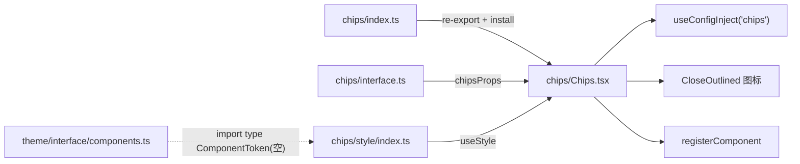
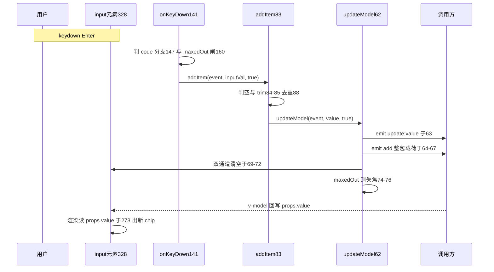
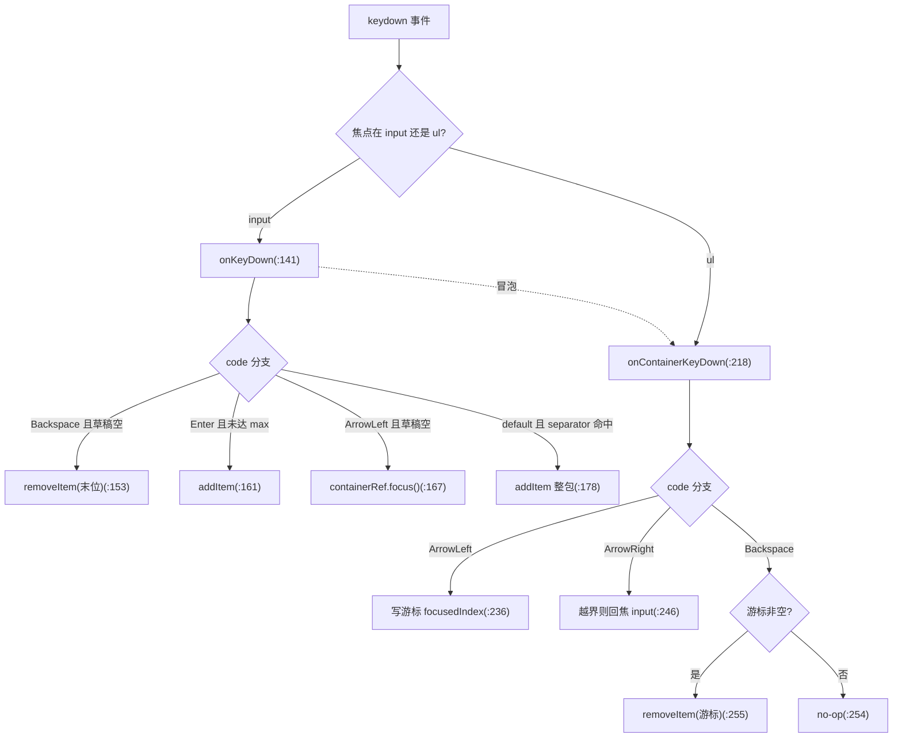

# C01-04 Chips 选项 Chips

> **本篇解决**：`Chips` 这个「看起来是 Tag 的集合版」的组件，内部到底如何持有值集合、如何分派键盘与粘贴、删除为什么走整包回传——以及哪些 props 是活的、哪些是死的。
> **前置**：C01-03 Tag 标签　**读者坐标**：`03-components/01-general` 第 4/7 篇

## 一、职责与边界

`Chips` 负责一件事：把「一个字符串数组 + 一个就地输入框」渲染成可增删的标签行，并把全部变更以整包数组的形式退回给调用方。它与 Tag 的分工（谁拥有值集合、为何零复用）在 C01-03 论点 4 已经论证完毕，本篇不重新推导，只接管 `Chips` 内部的值管理、键盘分派与事件契约。明确不负责的事：值的合法性校验（C01-00 职责清单里已划给表单层）、颜色与外观语义（Tag 的两条颜色出口一条都不存在，`interface.ts` 里连 `color` 字段都没有）、涟漪等点击反馈（删除键是原生 `button`，全目录无 `Wave`，见 C01-00 的 Wave 分派图）、下拉候选（那是 Select 的领地）。主库内的组件 importer 为零：除生成物 `packages/xiaoye-ui/src/components.ts:72-74` 与类型登记 `packages/xiaoye-ui/src/theme/interface/components.ts:13` 之外，`grep -rn "from 'xiaoye-ui/chips'" packages apps`（排除 dist）仅一个命中，且是文档页对 Props 类型的引用（`apps/docs/components/chips.md:89`），不是组件级复用；`grep -rn -e "from '../chips'" -e "from './chips'" packages/xiaoye-ui/src` 也只命中 `components.ts` 的生成行。向下依赖：`useConfigInject`、`useStyle`、`classNames`、`initDefaultProps`、`registerComponent`、`@xiaoye-ui/icons` 的 `CloseOutlined`（六条 import 全在 `packages/xiaoye-ui/src/chips/Chips.tsx:1-10`）。

## 二、源码地图

| 文件 | 行数 | 职责 | 关键导出/入口 |
| --- | --- | --- | --- |
| `packages/xiaoye-ui/src/chips/Chips.tsx` | 354 | 组件本体：两套键盘分派、粘贴分词、item DOM、事件回传 | `defineComponent` 起于 `:12`，渲染函数起于 `:272`，默认导出在 `:354` |
| `packages/xiaoye-ui/src/chips/interface.ts` | 15 | 全部 8 个 props 的函数式声明 | `chipsProps`（`:4`）、`ChipsProps`（`:15`） |
| `packages/xiaoye-ui/src/chips/index.ts` | 15 | 导出入口与第二份 install 拷贝 | `XYChips.install`（`:10`） |
| `packages/xiaoye-ui/src/chips/style/index.ts` | 167 | CSS-in-JS 样式 hook | `genComponentStyleHook('Chips')`（`:157`）、空 `ComponentToken`（`:6`） |
| `packages/xiaoye-ui/src/chips/__tests__/chips.test.js` | 115 | 6 个 `it` + `mountTest`，只覆盖渲染/Enter/删除/`max`/去重 | — |

主实现入口是 `packages/xiaoye-ui/src/chips/Chips.tsx:12`。测试会被执行：`packages/xiaoye-ui/vitest.config.mts:33` 的 include glob 覆盖 `src/**/*.test.{js,ts,jsx,tsx}`，`.js` 后缀不在盲区。

## 三、架构与数据流

### 3.1 静态结构：五份文件、四条向边、一条类型虚线



边数很少但每条都有话讲。`interface.ts → Chips.tsx` 是唯一的 props 供给边，默认值却在 `Chips.tsx:15-16` 被 `initDefaultProps` 二次改写，声明与消费的默认值语义分属两个文件（论点 3 的死链就断在这次改写里）。`style/index.ts → Chips.tsx` 只供给 `wrapSSR/hashId` 两个句柄（`packages/xiaoye-ui/src/chips/Chips.tsx:26`），类名修饰串却有一半在样式文件里找不到规则（论点 6）。`index.ts` 那份「re-export + install」与 `Chips.tsx:348-351` 自带的 install 是并联的两条注册路径，指向同一个 `registerComponent`（`packages/xiaoye-ui/src/chips/index.ts:11`、`packages/xiaoye-ui/src/chips/Chips.tsx:348`）。类型虚线是单向的：Token 登记表引样式文件的 `ComponentToken`，反向不认识组件文件。

### 3.2 一次 Enter 加值的闭环：从击键到重渲染，中间没有本地状态



图里唯一的分叉在 `P-->>IN` 这条回写虚线：它存在，闭环才合得上；调用方没接 `update:value` 时，`emit` 两行照常执行、输入框照常清空、`props.value` 照常不变——新 chip 不出现，草稿文本消失，整条链以「吞字」告终（论点 1）。值得对照的是这条链上没有任何一处写本地数组：`inputValue` 只是草稿，与值集合互不相干（`packages/xiaoye-ui/src/chips/Chips.tsx:32`）。

### 3.3 键盘分派的判定树：焦点位置决定语义，冒泡负责缝合



这张图的重点是那条虚线：`input` 内的击键**一定**会再进一次容器分派器，两套 switch 不是「按焦点二选一」而是「焦点选第一站、冒泡保证第二站」。机制能运转依赖三个巧合：空文本 Backspace 在第二站因 `removeItem` 已把游标置空而免遭二次删除（虚线两侧各删一次的事故被 `:103` 的副作用挡下）；ArrowLeft 的「搬焦点」与「写游标」恰好一前一后分在两站完成；`Enter` 不在容器 switch 里，加值才没有双触发。三个巧合没有一个有注释声明，这就是论点 4 判定「双分派靠副作用缝合」的根据。

## 四、核心机制精读

### 论点 1：`Chips` 内部不存在值的镜像——渲染直读 `props.value`，三条写路径共用一条出口，但「清空输入框」发生在调用方确认之前，所以没接 `v-model` 时会得到「字消失了、chip 没加上」的单向断裂

`Chips` 的 setup 里与「值」相关的响应式源只有输入框草稿 `inputValue`（`packages/xiaoye-ui/src/chips/Chips.tsx:32`），没有第二份数组状态。渲染函数每帧直接读 props：

```tsx
// packages/xiaoye-ui/src/chips/Chips.tsx:271
    return () => {
      const chipList = props.value || [];

      return wrapSSR(
        <div class={rootClassName.value}>
```

所有写路径最终收敛到 `updateModel` 一个出口，这个出口同时干了三件事——回传整包新数组、发 `add` 事件、清空输入框：

```tsx
// packages/xiaoye-ui/src/chips/Chips.tsx:61
    const updateModel = (event: Event, value: string[], preventDefault?: boolean) => {
      emit('update:value', value);
      emit('add', {
        originalEvent: event,
        value,
      });

      if (inputRef.value) {
        inputRef.value.value = '';
      }
      inputValue.value = '';

      if (maxedOut.value) {
        focused.value = false;
      }

      if (preventDefault) {
        event.preventDefault();
      }
    };
```

三个细节值得逐段拆。第一，清空输入框走了**两条通道**：`inputRef.value.value = ''` 是对真实 DOM 的直接写入（`packages/xiaoye-ui/src/chips/Chips.tsx:68-70`），`inputValue.value = ''` 是对响应式草稿的重置（`packages/xiaoye-ui/src/chips/Chips.tsx:69`），而 `<input>` 本身是受控绑定 `value={inputValue.value}`（`packages/xiaoye-ui/src/chips/Chips.tsx:331`）。DOM 直写绕过了 Vue 的补丁流程，属于同一效果的冗余保险——只要响应式通道正常，前一条不成立也不会出问题，但它的存在说明作者不信任单通道。第二，`emit('add', ...)` 的载荷是**新整包数组**而不是新增的那一枚（`packages/xiaoye-ui/src/chips/Chips.tsx:62-65`），与 `remove` 事件的载荷（单个被删值，`packages/xiaoye-ui/src/chips/Chips.tsx:104-107`）不对称；整包回传的第三条闭环在 C01-00「一次点击的数据回流」（§三 3.3）已经划过线，本篇不展开。第三，`maxedOut` 的检查放在**清空之后**（`packages/xiaoye-ui/src/chips/Chips.tsx:73-75`），即「本次提交使长度恰好达到上限」时输入框会失焦——但此刻 `emit('update:value')` 已经发出，父组件还没可能确认，见下一段的断裂场景。

断裂场景是这样发生的：`emit('update:value', value)` 只是通知，值的所有权在调用方（`packages/xiaoye-ui/src/chips/Chips.tsx:61`）；如果调用方没有监听 `update:value` 或没用 `v-model:value` 接住，`props.value` 保持旧数组，渲染的 `chipList` 不变（`packages/xiaoye-ui/src/chips/Chips.tsx:271`），可是输入框里的文字已经被 `updateModel` 清掉了（`packages/xiaoye-ui/src/chips/Chips.tsx:68-71`）。用户视角就是「按了回车，字消失了，什么也没加上去」。组件没有任何「调用方是否接住」的探测，这与 Tag 的关闭按钮形成对照——Tag 的自隐逻辑至少检查 `e.defaultPrevented` 来给调用方否决权（见 C01-03 论点 3），`Chips` 的 `preventDefault` 参数（`packages/xiaoye-ui/src/chips/Chips.tsx:77-79`）防的是**浏览器**的默认行为，不是调用方的否决。

删除路径 `removeItem` 是另一个出口，结构上有一个和 `addItem` 不对称的守卫差异：

```tsx
// packages/xiaoye-ui/src/chips/Chips.tsx:94
    const removeItem = (event: Event, index: number) => {
      if (mergedDisabled.value) {
        return;
      }

      const values = [...props.value];
      const [removedItem] = values.splice(index, 1);

      focusedIndex.value = null;
      inputRef.value?.focus();
      emit('update:value', values);
```

`addItem` 对 `props.value` 未定义做了兜底（`packages/xiaoye-ui/src/chips/Chips.tsx:83` 的 `props.value ? [...props.value] : []`），`removeItem` 却直接展开 `props.value`（`packages/xiaoye-ui/src/chips/Chips.tsx:99`）。在纯渲染路径上这个差异碰不到——`value` 为 `undefined` 时列表里根本没有删除按钮（`packages/xiaoye-ui/src/chips/Chips.tsx:286` 的 `chipList.map` 为空数组）——但 `removeItem` 通过 `expose` 暴露给了模板 ref 调用方（`packages/xiaoye-ui/src/chips/Chips.tsx:264-269`），外部在 `value` 未传时调用 `removeItem(0)` 会在展开处抛 `TypeError`。同时越界 index 会把 `removedItem` 定为 `undefined` 并照常发 `remove` 事件（`packages/xiaoye-ui/src/chips/Chips.tsx:99`、`:106-109`），事件载荷没有任何校验。`removeItem` 内部「先清 `focusedIndex` 再抢焦点回输入框」（`packages/xiaoye-ui/src/chips/Chips.tsx:102-103`）这个顺序还有副作用，论点 4 处理双分派时会回来。

### 论点 2：`max` 不是不变量而是四路加值中一条分支的门闩——Enter 路径查它，分隔符路径、粘贴路径和 `addItem` 本体都不查，且等值判定让闸门在越界后自动失效

`max` 的全部运行时存在感来自一个 computed 和两个消费点。computed 本体：

```tsx
// packages/xiaoye-ui/src/chips/Chips.tsx:53
    const maxedOut = computed(
      () => props.max !== undefined && props.value && props.max === props.value.length,
    );
```

第一个消费点是输入框的 `disabled` 绑定：

```tsx
// packages/xiaoye-ui/src/chips/Chips.tsx:325
              <input
                ref={inputRef}
                type="text"
                class={`${prefixCls.value}-input-field`}
                disabled={mergedDisabled.value || maxedOut.value}
```

第二个消费点是 `onKeyDown` 的 Enter 分支（`packages/xiaoye-ui/src/chips/Chips.tsx:157`）：

```tsx
// packages/xiaoye-ui/src/chips/Chips.tsx:157
        case 'Enter':
        case 'NumpadEnter':
          if (inputVal && inputVal.trim().length && !maxedOut.value) {
            addItem(event, inputVal, true);
          }
          break;
```

关键在于 `addItem` 自己不看 `max`——它的守卫只有「非空 + 去重」两条（`packages/xiaoye-ui/src/chips/Chips.tsx:82-92`）：

```tsx
// packages/xiaoye-ui/src/chips/Chips.tsx:82
    const addItem = (event: Event, item: string, preventDefault?: boolean) => {
      if (item && item.trim().length) {
        const trimmedItem = item.trim();
        const value = props.value ? [...props.value] : [];

        if (props.allowDuplicate || value.indexOf(trimmedItem) === -1) {
          value.push(trimmedItem);
          updateModel(event, value, preventDefault);
        }
      }
    };
```

也就是说 `max` 的把关责任被放在了**调用 `addItem` 的地方**，而调用方有四个：Enter 分支查了（`packages/xiaoye-ui/src/chips/Chips.tsx:157`）、分隔符击键分支没查（`packages/xiaoye-ui/src/chips/Chips.tsx:176` 直接 `addItem(event, inputVal, true)`）、`onBlur` 的 `addOnBlur` 分支没查（`packages/xiaoye-ui/src/chips/Chips.tsx:132`）、粘贴分支根本没走 `addItem` 也没查（`packages/xiaoye-ui/src/chips/Chips.tsx:202` 直接 `updateModel`）。正常操作下输入框会在达到上限时被禁用（`packages/xiaoye-ui/src/chips/Chips.tsx:329`）挡住前两条，但这个防线本身有个洞：`maxedOut` 用的是**严格相等** `props.max === props.value.length`（`packages/xiaoye-ui/src/chips/Chips.tsx:53`）。一旦值因为任何原因越过上限——粘贴是唯一能一口气越过的路径（`packages/xiaoye-ui/src/chips/Chips.tsx:195-202`）——`length > max` 让等式不成立，`maxedOut` 回落为假，输入框**重新启用**，Enter 分支的 `!maxedOut.value` 也随之放行（`packages/xiaoye-ui/src/chips/Chips.tsx:157`），调用方可以继续加到更多。闸门不是「≥」而是「==」，越界后反而开门。

第三条调用点 `addOnBlur`（props 声明见 `packages/xiaoye-ui/src/chips/interface.ts:12`）的分支体：

```tsx
// packages/xiaoye-ui/src/chips/Chips.tsx:128
    const onBlur = (event: FocusEvent) => {
      focused.value = false;
      focusedIndex.value = null;

      if (props.addOnBlur) {
        const target = event.target as HTMLInputElement | null;
        if (target) addItem(event, target.value, false);
      }

      emit('blur', event);
    };
```

失焦时读的是 `target.value`（DOM 现值，`packages/xiaoye-ui/src/chips/Chips.tsx:132`）而不是响应式的 `inputValue.value`——两者在 `onInput` 后本应同步（`packages/xiaoye-ui/src/chips/Chips.tsx:115-120`），但 `updateModel` 的 DOM 直清（`packages/xiaoye-ui/src/chips/Chips.tsx:68-70`）与响应式清空（`packages/xiaoye-ui/src/chips/Chips.tsx:69`）是两个通道，一旦某一通道失败，blur 提交就会拿到和界面不一致的草稿。这是论点 1 双通道问题的下游消费者。

粘贴路径除了无 `max` 检查，还绕过了 `addItem` 的全部三项守卫。它的过滤逻辑长这样：

```tsx
// packages/xiaoye-ui/src/chips/Chips.tsx:195
          let value = props.value || [];
          let pastedValues = pastedData.split(separatorRegex);

          pastedValues = pastedValues.filter(
            val => props.allowDuplicate || value.indexOf(val) === -1,
          );
          value = [...value, ...pastedValues];
          updateModel(event, value, true);
```

`filter` 的判据 `value.indexOf(val)` 里 `value` 是被过滤数组的**同一个引用**（`packages/xiaoye-ui/src/chips/Chips.tsx:195`、`:200-202`），过滤过程中从不把已通过的项加回去——粘贴 `'foo,foo'` 且 `allowDuplicate: false`、现值不含 `foo` 时，两个 `foo` 都通过过滤并一起进入结果（`packages/xiaoye-ui/src/chips/Chips.tsx:200`）。同时粘贴项不 `trim`（`addItem` 路径在 `packages/xiaoye-ui/src/chips/Chips.tsx:82` 有 `trim`）、不过滤空串（`addItem` 在 `packages/xiaoye-ui/src/chips/Chips.tsx:82` 有 `item.trim().length` 判空），粘贴 `'a,,b'` 会得到含空字符串 chip 的结果。测试文件对这四条路径只覆盖了 Enter 一条的 `max` 行为（`packages/xiaoye-ui/src/chips/__tests__/chips.test.js:63-80`），`separator`、`onPaste`、`addOnBlur` 在整个测试里一次都没出现（复核命令 `grep -c -e separator -e paste -e blur packages/xiaoye-ui/src/chips/__tests__/chips.test.js`，输出 `0`），所以上述行为没有回归网。

### 论点 3：`disabled` 的注入链在组件自己的默认值处断掉——`booleanType()` 给出的 `undefined` 被 `initDefaultProps` 覆写成 `false`，两层 `??` 从此不会放行，`ConfigProvider` 与 `Form` 的全局禁用对 Chips 不生效

> **2026-09-29 已修**：`initDefaultProps` 里的 `disabled: false` 已删除（现 `Chips.tsx:15` 起的覆写块不再含该键），两层 `??` 重新可达，全局禁用对 Chips 生效。本节以下内容与摘录为**修复前快照**。

先立结论：`Chips.tsx:26` 从 `useConfigInject` 解构出的 `disabled: configDisabled`、以及 `Chips.tsx:36` 的合并表达式，是**一段常规用法下不可达的死代码**。链条有四环，逐环取证。

第一环，props 声明。`interface.ts` 里 `disabled` 用 `booleanType()` 无参调用：

```ts
// packages/xiaoye-ui/src/chips/interface.ts:4
export const chipsProps = () => ({
  prefixCls: String,
  value: arrayType<string[]>(),
  disabled: booleanType(),
  max: Number,
  allowDuplicate: booleanType(true),
  placeholder: stringType(),
  separator: someType<string | RegExp>([String, RegExp]),
  addOnBlur: booleanType(),
});
```

`booleanType` 的实现（`packages/xiaoye-ui/src/_util/type.ts:58-60`）：

```ts
// packages/xiaoye-ui/src/_util/type.ts:58
export function booleanType(defaultVal?: boolean) {
  return { type: Boolean, default: defaultVal as boolean };
}
```

不传参时 `default` 就是 `undefined`——这正是 Vue 里「用户没传」与「用户传了 false」还能区分的唯一办法，`useConfigInject` 内部也依赖它（见第三环）。

第二环，默认值覆写。组件注册 props 时套了一层 `initDefaultProps`：

```tsx
// 修复前快照（修后覆写块无 disabled 一行，见 Chips.tsx:15 起）
  props: initDefaultProps(chipsProps(), {
    disabled: false,
    allowDuplicate: true,
    addOnBlur: false,
  }),
```

而 `initDefaultProps` 的分支判定是「有 `type` 或有 `default` 就直接覆写」：

```ts
// packages/xiaoye-ui/src/_util/props-util/initDefaultProps.ts:16
  const propTypes: T = { ...types };
  Object.keys(defaultProps).forEach(k => {
    const prop = propTypes[k] as VueTypeValidableDef;
    if (prop) {
      if (prop.type || prop.default) {
        prop.default = defaultProps[k];
      } else if (prop.def) {
        prop.def(defaultProps[k]);
      } else {
        propTypes[k] = { type: prop, default: defaultProps[k] };
      }
    } else {
      throw new Error(`not have ${k} prop`);
    }
  });
```

`disabled` 的 `prop.type` 是 `Boolean`（truthy），走 `initDefaultProps.ts:20-21` 分支，`default: undefined` 被就地改成 `default: false`。注意 `{ ...types }`（`packages/xiaoye-ui/src/_util/props-util/initDefaultProps.ts:16`）只浅拷贝了 props 容器，每个 prop 描述对象本身仍是 `chipsProps()` 返回的同一引用，覆写是原地发生的。副作用连带 `allowDuplicate`：`interface.ts:9` 的 `booleanType(true)` 已经给了默认 `true`，`Chips.tsx:16` 又写了一遍 `allowDuplicate: true`——两处默认值来源，改一处不动另一处不会报错，但下一个读者不知道该信谁。

第三环，消费点的双重短路。`useConfigInject` 内部本来就做了一次空值合并：

```ts
// packages/xiaoye-ui/src/config-provider/hooks/useConfigInject.ts:43
    const disabled = computed<boolean>(() => props.disabled ?? disabledContext.value);
```

其中 `disabledContext` 来自 `useInjectDisabled()`（`packages/xiaoye-ui/src/config-provider/hooks/useConfigInject.ts:9`）。而 Chips 拿到这个结果后又自己合了一次：

```tsx
// packages/xiaoye-ui/src/chips/Chips.tsx:36
    const mergedDisabled = computed(() => props.disabled ?? configDisabled.value);
```

两行的判据都是 `??`——只对 `null`/`undefined` 放行。第二环已经把「省略 `disabled`」的解析结果钉死为 `false`，于是 `useConfigInject.ts:43` 与 `Chips.tsx:36` 两层 `??` 同时变成死支：`false ?? x` 恒为 `false`。`mergedDisabled` 消费了四处（根类名 `packages/xiaoye-ui/src/chips/Chips.tsx:39`、`removeItem` 守卫 `packages/xiaoye-ui/src/chips/Chips.tsx:94`、移除按钮 `disabled` 属性 `packages/xiaoye-ui/src/chips/Chips.tsx:312`、输入框 `disabled` 属性 `packages/xiaoye-ui/src/chips/Chips.tsx:329`），这四处全部只响应组件级 prop。

第四环，上游是活的。禁用上下文确实有人提供：`ConfigProvider` 在 `packages/xiaoye-ui/src/config-provider/index.tsx:218` 调 `useProviderDisabled(componentDisabled)`，`Form` 在 `packages/xiaoye-ui/src/form/Form.tsx:142` 调 `useProviderDisabled(disabled)`，provider 本体在 `packages/xiaoye-ui/src/config-provider/DisabledContext.ts:10-16` 用空值合并逐级继承父级上下文。链条的每一段都存在，唯独被第二环的默认值掐断。症状是：外层 `<xy-config-provider :disabled="true">` 或禁用态 `xy-form` 里放 `xy-chips`，输入框照样能打字、删除按钮照样能点。理论上只剩一条逃生门——调用方显式传 `:disabled="null"` 且该值未被 Vue 的 Boolean 类型转换改写为 `false` 时，`??` 才会放行；这条路径属框架层行为，未在本仓源码或测试中找到任何用例佐证（`packages/xiaoye-ui/src/chips/__tests__/chips.test.js` 全文没有挂载 `ConfigProvider` 的用例，唯一的 `disabled` 字样是 `packages/xiaoye-ui/src/chips/__tests__/chips.test.js:72` 断言 `max` 触发的输入框禁用属性，与 context 通路无关），应视为未证实。对照组：`Input` 不经 `mergedDisabled` 二级合并，直接 `const disabled = useInjectDisabled()`（`packages/xiaoye-ui/src/input/Input.tsx:45`）并在渲染处 `props.disabled ?? disabled.value`（`packages/xiaoye-ui/src/input/Input.tsx:166`），且没有在 `initDefaultProps` 里钉 `disabled: false`，context 通路是活的。所以这是共则里「API 面存活、实现死亡」缺陷族的一个完整标本：prop、computed、context、provider 四级全在，语义在第二环蒸发。

### 论点 4：键盘被「焦点在 `input` 还是焦点在 `ul`」切成两套互不调用的分派器，而事件冒泡让同一个键先走输入侧再走容器侧——双删除不炸全靠 `removeItem` 的副作用，输入侧那条高亮删除分支实际不可达

两个分派器各自绑在真实 DOM 节点上：`onKeyDown` 绑在 `<input>`（`packages/xiaoye-ui/src/chips/Chips.tsx:335`），`onContainerKeyDown` 绑在作为列表容器的 `<ul>`（`packages/xiaoye-ui/src/chips/Chips.tsx:284`，该节点 `tabindex="-1"`、`role="listbox"`，见 `packages/xiaoye-ui/src/chips/Chips.tsx:277-278`）。容器侧的入口只有三个键：

```tsx
// packages/xiaoye-ui/src/chips/Chips.tsx:217
    const onContainerKeyDown = (event: KeyboardEvent) => {
      switch (event.code) {
        case 'ArrowLeft':
          onArrowLeftKeyOn(event);
          break;
        case 'ArrowRight':
          onArrowRightKeyOn(event);
          break;
        case 'Backspace':
          onBackspaceKeyOn(event);
          break;
        default:
          break;
      }
    };
```

三个处理函数构成一个水平游标 `focusedIndex` 的完整生命周期——左移从末尾开始（`packages/xiaoye-ui/src/chips/Chips.tsx:233-235`）、右移越过末位时归还焦点并清空（`packages/xiaoye-ui/src/chips/Chips.tsx:241-243`）、Backspace 删除游标项（`packages/xiaoye-ui/src/chips/Chips.tsx:252-255`）：

```tsx
// packages/xiaoye-ui/src/chips/Chips.tsx:233
    const onArrowLeftKeyOn = (_event: KeyboardEvent) => {
      if (inputValue.value.length === 0 && props.value && props.value.length > 0) {
        focusedIndex.value =
          focusedIndex.value === null ? props.value.length - 1 : focusedIndex.value - 1;
        if (focusedIndex.value < 0) focusedIndex.value = 0;
      }
    };
```

而输入侧的 `onKeyDown` 里同样有一套 Backspace 与 ArrowLeft（`packages/xiaoye-ui/src/chips/Chips.tsx:146-153`、`:165-168`），并且也引用了 `focusedIndex`：

```tsx
// packages/xiaoye-ui/src/chips/Chips.tsx:146
        case 'Backspace':
          if (inputVal.length === 0 && props.value && props.value.length > 0) {
            if (focusedIndex.value !== null) {
              removeItem(event, focusedIndex.value);
            } else {
              removeItem(event, props.value.length - 1);
            }
          }
          break;
```

这套双分派有三个可断言的后果。**其一，`packages/xiaoye-ui/src/chips/Chips.tsx:148-149` 的「按游标删」输入侧分支在可达状态图上走不到。** 判据是穷举写点：全文件把 `focusedIndex` 写成非 `null` 的只有两处——`packages/xiaoye-ui/src/chips/Chips.tsx:234-235` 与 `packages/xiaoye-ui/src/chips/Chips.tsx:246`，都只在容器侧分派器里执行；而焦点回到 `<input>` 的全部通道都顺带清空了游标——点击容器走 `onWrapperClick` 聚焦输入框（`packages/xiaoye-ui/src/chips/Chips.tsx:111-113`）触发 `onFocus` 清空（`packages/xiaoye-ui/src/chips/Chips.tsx:122`），游标右移越界时先清空再聚焦（`packages/xiaoye-ui/src/chips/Chips.tsx:243-244`），删除后先清空再聚焦（`packages/xiaoye-ui/src/chips/Chips.tsx:102-103`）。于是「输入框持有焦点且游标非空」这个分支前提无法成立，`:150` 实际是容器逻辑往输入侧的一次复制粘贴。**其二，冒泡使 Backspace 连过两道闸，不重复删除靠的是副作用而不是设计。** DOM 事件从 `<input>` 冒泡到 `<ul>`，输入框内的击键先走 `onKeyDown` 再走 `onContainerKeyDown`。空文本 Backspace 时：输入侧删掉末位（`packages/xiaoye-ui/src/chips/Chips.tsx:151`），`removeItem` 内部把游标置空（`packages/xiaoye-ui/src/chips/Chips.tsx:102`），冒泡进容器侧 `onBackspaceKeyOn` 时判据 `focusedIndex.value !== null` 已为假（`packages/xiaoye-ui/src/chips/Chips.tsx:252`），二次删除被这个副作用挡下。ArrowLeft 同理——输入侧分支先把焦点搬去容器（`packages/xiaoye-ui/src/chips/Chips.tsx:165`），冒泡后容器侧再写入游标（`packages/xiaoye-ui/src/chips/Chips.tsx:233`），「迁移焦点 + 高亮末位」是两个处理函数按固定顺序各做一半拼出来的，任何一半单独看都不完整。**其三，游标清空的不变式被冗余实现了七次**：`packages/xiaoye-ui/src/chips/Chips.tsx:102`、`:120`、`:125`、`:131`、`:214`、`:245`、`:261` 每个都写 `focusedIndex.value = null`，其中 `watch(focused)`（`packages/xiaoye-ui/src/chips/Chips.tsx:258-262`）与 `onBlur`/`onContainerBlur`（`:131`、`:214`）职责完全重叠——改失焦行为要同时核对七处，这是「同一逻辑多份拷贝」缺陷族在本篇的落点。

ARIA 面把双分派的接缝暴露了出来。`aria-activedescendant` 只在 `focused.value` 为真时给游标 id（`packages/xiaoye-ui/src/chips/Chips.tsx:280`，id 生成在 `packages/xiaoye-ui/src/chips/Chips.tsx:57-59`），但每枚 chip 的 `aria-selected` 无条件硬编码 `"true"`（`packages/xiaoye-ui/src/chips/Chips.tsx:295`）——游标在哪个选项上，屏幕阅读器读不出来，因为所有选项都「已选中」。游标高亮同时走类名与属性双通道（`packages/xiaoye-ui/src/chips/Chips.tsx:292` 与 `:301`）。此外包住 `<input>` 的 `<li>` 也标了 `role="option"`（`packages/xiaoye-ui/src/chips/Chips.tsx:325`），listbox 里混进一个包裹可交互控件的伪选项。删除按钮则完全没进键盘导航环：游标只能停 chip 上，Tab 序里它是可达的，但容器 `tabindex="-1"`（`packages/xiaoye-ui/src/chips/Chips.tsx:277`）不承诺这条路径有焦点样式（样式文件里按钮只有 `:hover` 与 `:disabled` 态，`packages/xiaoye-ui/src/chips/style/index.ts:110-117`）。

### 论点 5：`separator` 的字符串形态被「只转义首字符」的拼接法升格成正则，两处构建点都不缓存、不校验语义——`'||'` 这类取值让每一次击键都命中加分支，用户提供带 `g` 标志的正则则让分隔符命中检测本身变成有状态的

分隔符能力横跨两条路径（击键加值与粘贴分词），两条路径各自现场重建同一份正则，逻辑是两份一字不差的拷贝。击键侧：

```tsx
// packages/xiaoye-ui/src/chips/Chips.tsx:170
        default:
          if (props.separator) {
            const separatorRegex =
              typeof props.separator === 'string'
                ? new RegExp(`\\${props.separator}`)
                : props.separator;
            if (separatorRegex.test(event.key)) {
              addItem(event, inputVal, true);
            }
          }
          break;
```

粘贴侧（`packages/xiaoye-ui/src/chips/Chips.tsx:191-194`）是同一段三元表达式，只是消费方式从 `test(event.key)` 换成 `pastedData.split(separatorRegex)`（`packages/xiaoye-ui/src/chips/Chips.tsx:196`）。props 声明允许 `string | RegExp` 二选一（`packages/xiaoye-ui/src/chips/interface.ts:11`，`someType` 本体在 `packages/xiaoye-ui/src/_util/type.ts:91-93`），但对字符串的处理只有一步模板拼接：在前缀加一个反斜杠。这等于假定「分隔符永远是单个字符」，而类型系统没有阻止任何人传多字符串。拼接结果的可执行验证（不依赖任何本仓代码，node 直接跑）：

```bash
node -e 'for (const s of [",", "..", "||"]) { const r = new RegExp("\\" + s); console.log(s, "=>", r.source); }'
# , => \,   .. => \..   || => \||
```

`','` 得到 `\,`，恰好无害；`'..'` 得到 `\..`，第一个点被转义、第二个点是通配符，粘贴 `'a.b aXb'` 时 `'X'` 前的位置也会被切开；`'||'` 得到 `\||`——字面竖线与**空分支**的或，空分支匹配一切字符串，于是 `separatorRegex.test(event.key)` 对 switch 的 `default` 兜到的每一种键（即除 Backspace、Enter、NumpadEnter、ArrowLeft 之外，连 ArrowRight 也在内）都为真（`packages/xiaoye-ui/src/chips/Chips.tsx:175`），配合第三参数 `preventDefault`（经 `packages/xiaoye-ui/src/chips/Chips.tsx:87` 传到 `packages/xiaoye-ui/src/chips/Chips.tsx:77-79`）意味着**输入框被锁死**：每敲一键就提交一次当前草稿并阻止字符落框。这不是编译期问题、不是类型问题，纯字符串拼接的正则注入没有任何守卫能接住它。

第二个状态陷阱在 `RegExp` 形态的输入侧。`test()` 对带 `g` 标志的正则使用并推进 `lastIndex`，这是 ECMAScript 的既定语义；本组件把同一个用户正则对象存在 props 里跨击键复用（`packages/xiaoye-ui/src/chips/Chips.tsx:174` 的非字符串分支不做任何复制），行为可用一行复现：

```bash
node -e 'const re = /,/g; console.log(re.test(","), re.test(","), re.test(","));'
# true false true
```

也就是说传 `separator: /,/g` 的用户会观察到「逗号有时能加分隔符、有时不能」的交替故障；而粘贴路径用的 `split()` 不受 `lastIndex` 影响（`packages/xiaoye-ui/src/chips/Chips.tsx:196`），两条路径对这个坑的表现还不一致。附带一提，字符串形态的每次击键都 `new RegExp`（`packages/xiaoye-ui/src/chips/Chips.tsx:171-174` 处于 `default` 分支热路径内），无缓存——这是浪费但不致错的那类问题，列出来是为了阻止「顺手把它改成模块级缓存」的重构：正则一旦提到组件外就重新引入了跨实例共享 `lastIndex` 的问题，缓存必须与 `g` 标志的有无绑定才安全。

第三条缝在命中后的取值：`addItem(event, inputVal, true)`（`packages/xiaoye-ui/src/chips/Chips.tsx:176`）提交的是**整个草稿**而不是分隔符前的片段。人手击键时 keydown 先于字符落框，草稿里通常不含分隔符，看不出问题；但草稿可以被别的路径塞进分隔符——`expose` 暴露的 `inputValue` 写通道（`packages/xiaoye-ui/src/chips/Chips.tsx:264-269`）或测试里的 `setValue` 都行——此时按下一个分隔符键会连同内嵌的分隔符一起入账，产出一枚内含分隔符的 chip。粘贴分支没有这个问题，因为它先 `split` 再入账（`packages/xiaoye-ui/src/chips/Chips.tsx:196`）。两个入口对「分隔符意味着什么」的理解不一致：击键侧把它当「提交信号」，粘贴侧把它当「切分符」。

最后，击键分派的匹配判据用的是 `event.key`（`packages/xiaoye-ui/src/chips/Chips.tsx:175`）而非其余分支用的 `event.code`（`packages/xiaoye-ui/src/chips/Chips.tsx:146`）。`key` 随布局与 Shift 状态变化：美式布局下 Shift+逗号产出 `key = ','` 能命中 `','` 分隔符，但中文输入法合成态的击键在很多浏览器里 keydown 携带 `key === 'Process'`——`process` 匹配不了任何常见分隔符字面量，输入法路径下靠分隔符键加分支基本失灵，加值要退到 Enter（`packages/xiaoye-ui/src/chips/Chips.tsx:157-162`）。`Process` 行为属浏览器层约定，本仓源码没有对应处理分支（`grep -rn -e Process -e compositionstart -e compositionend packages/xiaoye-ui/src/chips` 零命中），也没有任何合成事件监听，这一点写进「附：检查点 2」供读者自验。

### 论点 6：`inheritAttrs: false` 却没有任何一处展开 `attrs`——调用方写在组件标签上的 `class`、`style`、`id`、`data-*` 全部静默蒸发；同族三件「声明了但不消费」的东西（`default` 插槽、`-filled` 与 `-input-focused` 类名）则一起构成这个组件的哑配件清单

先看最重的一条。组件声明了放弃自动透传：

```tsx
// packages/xiaoye-ui/src/chips/Chips.tsx:12
const Chips = defineComponent({
  name: 'XYChips',
  inheritAttrs: false,
  props: initDefaultProps(chipsProps(), {
```

修复前的 setup 第二个参数只解构了三样东西，`attrs` 连名字都不在：

```tsx
// packages/xiaoye-ui/src/chips/Chips.tsx:22
    setup(props, { slots, emit, expose, attrs }) {
```

> **2026-09-29 已修复**：本条描述的两半里，**`attrs` 未解构**与**根节点没有 `{...attrs}` 落点**都已改掉（根 div 现在写 `<div {...attrs} class={[rootClassName.value, attrs.class]}>`），所以「`<xy-chips class="my-chips">` 之后 DOM 上没有该属性」这个症状不再成立。仍成立的是历史取证：修复前全文检索该文件，展开语法只出现在三处数组拷贝（`packages/xiaoye-ui/src/chips/Chips.tsx:83`、`:100`、`:203`），没有一处 `{...attrs}`。两个半边的效果叠加：Vue 不再自动把剩余属性挂到根节点（被 `inheritAttrs: false` 关掉），手工挂载也不存在。调用方写 `<xy-chips class="mine" id="c1" data-testid="chips">`，这三个属性在最终 DOM 里一个都不会出现——复核命令 `grep -rni "attrs" packages/xiaoye-ui/src/chips` 只命中 `Chips.tsx:14` 的 `inheritAttrs` 一行自身（`Attr**s**` 需大小写不敏感才查得到，setup 与渲染里连 `attrs` 这个词都不存在）。

第二件是 `slots` 类型声明里的 `default`（`packages/xiaoye-ui/src/chips/Chips.tsx:19`），但渲染函数只消费 `slots.chip`（`packages/xiaoye-ui/src/chips/Chips.tsx:300-305`）与 `slots.removeIcon`（`packages/xiaoye-ui/src/chips/Chips.tsx:318`）；复核命令 `grep -n "slots\." packages/xiaoye-ui/src/chips/Chips.tsx` 共三个命中行（`:303`、`:304`、`:321`），不存在 `slots.default` 调用点。类型层面告诉调用方「有默认插槽」，运行时写了也没画面——`CustomSlotsType` 只做类型标注不报错。

第三、四件是两个生成了但全仓没有规则消费的类名。根类名拼装处：

```tsx
// packages/xiaoye-ui/src/chips/Chips.tsx:38
    const rootClassName = computed(() =>
      classNames(hashId.value, prefixCls.value, {
        [`${prefixCls.value}-rtl`]: direction.value === 'rtl',
        [`${prefixCls.value}-disabled`]: mergedDisabled.value,
        [`${prefixCls.value}-focused`]: focused.value,
        [`${prefixCls.value}-filled`]: (props.value && props.value.length) || !!inputValue.value,
      }),
    );
```

输入容器类名拼装处：

```tsx
// packages/xiaoye-ui/src/chips/Chips.tsx:47
    const inputClassName = computed(() =>
      classNames(`${prefixCls.value}-input`, {
        [`${prefixCls.value}-input-focused`]: focused.value,
      }),
    );
```

四个修饰类里，`-disabled`（`packages/xiaoye-ui/src/chips/style/index.ts:69`）与 `-focused`（`packages/xiaoye-ui/src/chips/style/index.ts:63`）有对应规则；`-filled`（生成点 `packages/xiaoye-ui/src/chips/Chips.tsx:41`）与 `-input-focused`（生成点 `packages/xiaoye-ui/src/chips/Chips.tsx:47`）在样式文件全文 167 行里一次都没出现，也不在仓内任何其他 ts/tsx/less/css/vue 文件里被引用（两种查法：目录内 `grep -rn -e filled -e input-focused packages/xiaoye-ui/src/chips` 只命中生成行；全仓 `grep -rln -e chips-filled -e chips-input-focused packages apps` 排除 dist 后零命中）。这是共则缺陷族里「生成但从不渲染的类名」的标准样本——组件维护者会误以为存在「有值时的视觉态」这个钩子，样式作者则会发现选了个不存在的类。顺带注意 `-focused` 的视觉其实有两条独立通道：JS 类名（`Chips.tsx:40`）与 CSS 伪类 `:focus-within`（`packages/xiaoye-ui/src/chips/style/index.ts:63` 的第二个选择器），后者不依赖组件状态也能点亮边框——写测试断言聚焦样式时两条通道都可能命中，别把伪类的功劳记给 state。

第五件在类型与装配层。`ComponentToken` 是空接口（`packages/xiaoye-ui/src/chips/style/index.ts:6`），但 `theme/interface/components.ts:13` 仍把它登记进 `ComponentTokenMap`（`packages/xiaoye-ui/src/theme/interface/components.ts:69` 的 `Chips?:`），配合 `genComponentStyleHook('Chips', ...)` 里那次二次 `mergeToken`（`packages/xiaoye-ui/src/chips/style/index.ts:157-164`），「用 `theme.components.Chips` 调 Chips」是不存在的通道——空接口加二次合并的完整机制 C01-03 论点 6 已论证，此处只登记 Chips 同病。同一个 mergeToken 调用里还钉着两个字面值：`chipsItemPaddingBlock: 2` 与 `chipsInputMinWidth: 60`（`packages/xiaoye-ui/src/chips/style/index.ts:162-163`）——仓库规范（AGENTS.md「样式开发（强制）」）要求用 Token 而非硬编码值，这两处是间距类裸数，尺寸想跟随 `controlHeight` 一族时必须改样式文件。最后是装配层的重复：`install` 的实现存在两份一字不差的拷贝，`packages/xiaoye-ui/src/chips/index.ts:10-13` 与 `packages/xiaoye-ui/src/chips/Chips.tsx:348-351` 都调 `registerComponent(app, Chips)`，且后者还自己 `export default`（`packages/xiaoye-ui/src/chips/Chips.tsx:353`）——入口文件包了一层同名安装逻辑，删任何一份都不影响行为，但两份并存让「谁是有意的」无从判断。

## 五、对外契约如何生效

把「调用方能碰到的每一个口」按数据流向排一遍，本篇的关键判断是：这个组件的契约面比它的消费面大。

props 侧八个声明全部有运行时读取点（这与很多组件「声明但不读」的毛病不同）：`prefixCls` 经 `useConfigInject('chips', props)` 变成实际前缀（`packages/xiaoye-ui/src/chips/Chips.tsx:26`）；`value` 是渲染与全部判定的唯一值源（`packages/xiaoye-ui/src/chips/Chips.tsx:271`、`:55`、`:86`、`:100`、`:149`、`:235`、`:243`）；`disabled` 有四处消费但语义半死（论点 3）；`max` 只活在两处读取（`packages/xiaoye-ui/src/chips/Chips.tsx:53-55`、`:332`），`addItem` 本体不看它（论点 2）；`allowDuplicate` 有两个裁决点且两处的去重口径不一致——击键路径 `indexOf` 现值（`packages/xiaoye-ui/src/chips/Chips.tsx:87`）、粘贴路径对过滤中不变的数组（`packages/xiaoye-ui/src/chips/Chips.tsx:199-201`）；`placeholder` 直绑输入框（`packages/xiaoye-ui/src/chips/Chips.tsx:330`）；`separator` 是两个分支的总开关（`packages/xiaoye-ui/src/chips/Chips.tsx:170`、`:186`）；`addOnBlur` 只在一个分支里被读（`packages/xiaoye-ui/src/chips/Chips.tsx:132-134`）。

emits 侧五个声明都有触发点，是本篇确认「活着」的清白名单：`update:value`（`packages/xiaoye-ui/src/chips/Chips.tsx:61`、`:105`）、`add`（`:64`）、`remove`（`:106`）、`focus`（`:126`）、`blur`（`:138`），声明行在 `packages/xiaoye-ui/src/chips/Chips.tsx:17`。但注意语义分层：`add`/`remove` 是**已到账通知**（发生在 `emit('update:value')` 之后的同一函数体内），不是否决点——调用方没有任何途径阻止一次加值，能做的只有不回写值（然后得到论点 1 的断链现象）。

slots 侧只有两个真实消费点：`chip` 插槽拿到 `{ value, index, removeCallback }` 三元组（`packages/xiaoye-ui/src/chips/Chips.tsx:302-306`），其中 `removeCallback` 是闭包捕获了索引的 `removeItem` 包装（`packages/xiaoye-ui/src/chips/Chips.tsx:304`）——插槽内容整体替换默认 label 与删除按钮，`removeIcon` 插槽只替换默认图标（`packages/xiaoye-ui/src/chips/Chips.tsx:318`，默认值 `CloseOutlined`，导入在 `packages/xiaoye-ui/src/chips/Chips.tsx:7`）。`default` 插槽是声明性死面（论点 6）。

expose 侧四件套：`addItem`、`removeItem`、`input`（输入框 DOM 元素的 ref）、`inputValue`（草稿字符串的 ref），在 `packages/xiaoye-ui/src/chips/Chips.tsx:264-269`。前两个绕过了所有键盘路径直达 `updateModel`/`removeItem`，但签名以 `Event` 为首参（`packages/xiaoye-ui/src/chips/Chips.tsx:82`、`:95`）——外部调用需要自备一个事件对象塞进 `originalEvent` 载荷（`packages/xiaoye-ui/src/chips/Chips.tsx:62-65`），这是一个为内部键盘流设计、未对外接口化收敛的签名。

attrs 与 fall-through 面：如上论点 6，声明层是 `inheritAttrs: false`，消费层是零展开，契约在类型上完全隐形（`attrs` 不出现在任何 d.ts），调用方只能靠 `.xy-chips` 选择器做外层定制。样式生效链路本身是标准三件套：`useStyle(prefixCls)` 返回的 `wrapSSR` 包裹整棵树（`packages/xiaoye-ui/src/chips/Chips.tsx:26`、`:275`），`hashId` 进根类名（`packages/xiaoye-ui/src/chips/Chips.tsx:38`），样式 hook 在 `packages/xiaoye-ui/src/chips/style/index.ts:157` 注册——Token 层的定制通道存在但空转（论点 6）。

## 六、设计取舍

**取舍一：纯受控单源，放弃仓里现成的非受控通道。** 本仓有 `packages/xiaoye-ui/src/_util/hooks/useMergedState.ts`，`tabs`、`calendar`、`vc-tree-select` 都在用它做「有 `value` 听 `value`、没有就自己存」的双模合并；`Chips` 一条都没接——`props.value` 是唯一值源（`packages/xiaoye-ui/src/chips/Chips.tsx:271`），组件内不建数组镜像。换来的是零状态同步问题：不存在「外部改 `value` 后内部旧副本残留」这类经典 bug，删除与新增的数组永远从当帧 props 现算（`packages/xiaoye-ui/src/chips/Chips.tsx:83`、`:100`）。赔上的是失败模式的隐蔽性：受控半边没有兜底，调用方漏接 `update:value` 时组件不报错、不警告，只把草稿吞掉（论点 1）；以及 `expose` 出去的 `addItem/removeItem` 带着内部事件语义（`Event` 首参），外部调用者反而要自备事件对象（`packages/xiaoye-ui/src/chips/Chips.tsx:82`）。

**取舍二：自带双分派键盘，不借任何 vc-* 基座。** 本仓的标签输入类需求没有现成 vendor 层可复用（`vc-select` 系是下拉弹层链路，与就地标签行不同形），`Chips` 于是直接监听原生 `<input>` 与 `<ul>` 的 keydown（`packages/xiaoye-ui/src/chips/Chips.tsx:335`、`:287`）。换来零额外运行时依赖——全文件 import 只有六条公共设施（`packages/xiaoye-ui/src/chips/Chips.tsx:1-10`），tree-shaking 边界干净。赔上的是论点 4 的全部接缝：两套 switch 靠冒泡顺序与 `removeItem` 副作用缝合，游标不变式冗余七处，ARIA 状态与真实焦点态脱节。

**取舍三：清空走「DOM 直写 + 响应式重置」双通道。** `updateModel` 同时 `inputRef.value.value = ''` 与 `inputValue.value = ''`（`packages/xiaoye-ui/src/chips/Chips.tsx:68-71`），而输入框本是受控绑定（`packages/xiaoye-ui/src/chips/Chips.tsx:331`）。合理动机只能推断为「让清空在重渲染帧前先落到 DOM」：条件成立时它是优化，不成立时它是保险——两行代码都是实物，缺的只是注释说明它防谁，此处如实按条件句处理，不当作已证实的设计意图。真正的代价是 `onBlur` 的 `addOnBlur` 分支改读 `target.value`（`packages/xiaoye-ui/src/chips/Chips.tsx:132`）后，「界面显示的草稿」与「提交用的草稿」分属两个通道，同步性靠约定不靠结构（论点 2 末段）。

**取舍四：事件面选择「通知」而非「否决」。** `add`/`remove` 都在值变更已成事实后发出（`packages/xiaoye-ui/src/chips/Chips.tsx:61`、`:106`），调用方唯一的否决形式是不回写 `value`——但那会触发取舍一的隐蔽失败。对照 Tag 的 `close` 用 `e.defaultPrevented` 给出真否决权（见 C01-03 论点 3），`Chips` 是反方向的选择：简单、单向、不可拦截。对表单集成方，这意味着校验必须在回写侧做，组件内没有插入点（值的合法性归表单层这条边界，C01-00 已划）。

## 七、坑与改动指南

**坑 1：只写 `<xy-chips :value="tags">` 忘了 `v-model:value`，回车像「吞字」。**
触发：调用方绑定 `:value` 但不接 `update:value`（或用 `:value` 却漏写 `v-model` 语法糖）。症状：按 Enter 后草稿文本消失，列表不新增；粘贴、`addOnBlur` 同理。原因：`updateModel` 无条件清空输入框（`packages/xiaoye-ui/src/chips/Chips.tsx:68-71`），而渲染只认 `props.value`（`packages/xiaoye-ui/src/chips/Chips.tsx:271`），组件不检测回写是否发生。定位：`packages/xiaoye-ui/src/chips/Chips.tsx:61-80`。测试文件里所有用例都只断言 `emitted`、从不回传值（`packages/xiaoye-ui/src/chips/__tests__/chips.test.js:25-41`），所以这个坑没有回归网。

**坑 2：粘贴可以一次性冲破 `max`，破完闸门反而重新开门。**
触发：配置了 `separator` 与 `max`，粘贴一段超量文本；或调用方外部把超量数组回写进 `value`。症状：`value.length > max` 后输入框从禁用变回可用，还能继续加。原因：粘贴分支不查 `max`（`packages/xiaoye-ui/src/chips/Chips.tsx:195-202`），`maxedOut` 用严格等式 `props.max === props.value.length`（`packages/xiaoye-ui/src/chips/Chips.tsx:53`），超限即回落为假，连带输入框 `disabled`（`packages/xiaoye-ui/src/chips/Chips.tsx:329`）与 Enter 闸（`packages/xiaoye-ui/src/chips/Chips.tsx:157`）同时失效。定位：`packages/xiaoye-ui/src/chips/Chips.tsx:53-55`。改法应是 `>=` 并把检查下沉进 `addItem`，但注意这会改变 `updateModel` 里失焦分支的触发面（`packages/xiaoye-ui/src/chips/Chips.tsx:73-75`）。

**坑 3：`separator` 传 `'..'`、`'||'` 或带 `g` 标志的 RegExp，加分支行为整体失真。**
触发：想用「双点」当分隔符，或习惯性写 `/[,;]/g`。症状：前者把 `aXb` 中间的 `X` 也当分隔符切开；后者让输入框每敲一键就提交一次并阻止字符落框；带 `g` 的正则在击键路径时灵时不灵、在粘贴路径却正常。原因：字符串只转义首字符（`packages/xiaoye-ui/src/chips/Chips.tsx:172-173` 模板拼接），`'||'` 编译出含空分支的正则；`test()` 对有 `g` 标志的正则推进 `lastIndex`（`packages/xiaoye-ui/src/chips/Chips.tsx:175`）。定位：`packages/xiaoye-ui/src/chips/Chips.tsx:170-180` 与 `:193-198` 两份拷贝都要改；复现命令见「附」检查点 3。

**坑 4：全局禁用（`ConfigProvider` / 禁用态 `Form`）对 Chips 完全无效。**
触发：外层 `<xy-config-provider :disabled="true">` 包 `xy-form`，内放 `xy-chips`，`disabled` prop 不显式传。症状：输入框能打字、删除键能点，`-disabled` 类不出现。原因：`initDefaultProps` 把 `booleanType()` 的默认 `undefined` 覆写成 `false`（`packages/xiaoye-ui/src/_util/props-util/initDefaultProps.ts:20-21` 与 `packages/xiaoye-ui/src/chips/Chips.tsx:15-16`），`props.disabled ?? configDisabled.value` 的左值恒为 `false`（`packages/xiaoye-ui/src/chips/Chips.tsx:36`），`useConfigInject` 内部同型合并同样短路（`packages/xiaoye-ui/src/config-provider/hooks/useConfigInject.ts:43`）。定位：论点 3 四环全链。**2026-09-29 已按该最小修法落地**（删 `disabled: false` 并跑过上述断言），本坑不再复现，保留作修前记录与同类缺陷的判据样本。

**坑 5：组件标签上的 `class`、`style`、`data-*` 静默丢失，样式覆盖与 E2E 定位都落空。**
触发：`<xy-chips class="my-chips">` 或给测试挂 `data-testid`。症状：DOM 上没有该属性，选择器 `.my-chips .xy-chips-item` 找不到节点。原因：`inheritAttrs: false`（`packages/xiaoye-ui/src/chips/Chips.tsx:14`）关闭了自动继承，而 setup 没有解构 `attrs`、渲染没有展开（`packages/xiaoye-ui/src/chips/Chips.tsx:26`，全文展开语法仅 `:86`、`:100`、`:203` 三处数组拷贝）。定位：根节点在 `packages/xiaoye-ui/src/chips/Chips.tsx:276`，补 `{...attrs}` 时记得像 `CheckableTag` 那样合并类名（`packages/xiaoye-ui/src/tag/CheckableTag.tsx:47`），否则 `rootClassName` 会被覆盖。

**坑 6：`allowDuplicate: false` 挡不住粘贴带来的重复项与空串项。**
触发：`allowDuplicate: false` 下粘贴 `'foo,foo'` 或 `'a,,b'`。症状：值里出现重复的 `foo` 或一枚空白 chip，与键盘路径的去重观感矛盾。原因：粘贴过滤拿固定引用的现值做 `indexOf`，过滤途中不累加（`packages/xiaoye-ui/src/chips/Chips.tsx:195-200`），且不 `trim`、不判空（对照 `addItem` 的 `packages/xiaoye-ui/src/chips/Chips.tsx:82-83`）。定位：`packages/xiaoye-ui/src/chips/Chips.tsx:184-206`；修复方向是让粘贴复用 `addItem` 而不是绕开它。

**坑 7：删除任意一枚 chip 会让它后面所有 chip 的 DOM 节点整体重建。**
触发：点击删除或键盘删除非末位项。症状：后续标签上的 CSS transition 从起始帧重跑、`:hover` 中断、绑定在 item 上的组件态（如插槽内自持状态）被清空。原因：`li` 的 key 拼进了索引（`packages/xiaoye-ui/src/chips/Chips.tsx:288` 的 `` key={`${i}_${val}`} ``），中间删除使每个后继项的 key 前移一位，Vue 按 key 判异致卸载重挂。定位：`packages/xiaoye-ui/src/chips/Chips.tsx:286-298`。改成按值本身做 key 会与「允许重复值」正面冲突（默认 `allowDuplicate: true`），这是当初拼索引的可能动机——文中如实登记为「动机不可考」。

**测试现状与改动安全边界。** 唯一测试文件 `packages/xiaoye-ui/src/chips/__tests__/chips.test.js`（115 行、6 个 `it`，另含 `mountTest`）覆盖渲染、Enter 加值、点击删除、`max`-Enter、去重、重复默认六面；`separator`、`onPaste`、`addOnBlur`、方向键游标、`chip`/`removeIcon` 插槽、`expose` 成员、全局 disabled 透传全部零覆盖（复核见论点 2 与「附」检查点 2）。按 `packages/xiaoye-ui/vitest.config.mts:33` 的 glob，该文件确会执行。改动安全边界：其一，动 `focusedIndex` 任何一处写点前，先对照论点 4 的七处清单，漏改任意一处都会让「冒泡免二次删」的巧合失效；其二，`focusedIndex.value = null` 与 `inputRef.value?.focus()` 在 `removeItem` 内的先后顺序（`packages/xiaoye-ui/src/chips/Chips.tsx:102-103`）被容器分派器隐式依赖，调换即出双删；其三，删改 `-filled`、`-input-focused` 两个死类名前跑一遍全仓检索（论点 6 的两条命令），确认没有外部样式在选它们。验证命令：`pnpm --filter xiaoye-ui test:unit -- chips`、`pnpm typecheck`。

## 附：本篇可证伪的三个检查点

1. **`attrs` 消费为零。** 跑 `grep -rni "attrs" packages/xiaoye-ui/src/chips`，期望恰好 1 行命中且就是 `Chips.tsx:14` 的 `inheritAttrs` 声明本身。若将来出现第四处展开或 setup 解构（论点 6 判据），坑 5 即失效。
2. **输入路径与测试盲区。** 跑 `grep -c -e separator -e paste -e blur packages/xiaoye-ui/src/chips/__tests__/chips.test.js`，期望输出 `0`；再跑 `grep -rn -e Process -e compositionstart -e compositionend packages/xiaoye-ui/src/chips`，期望同样零命中（论点 5 末段与论点 2 的「无回归网」都以此为前提，补测试或加合成事件处理后需回改）。
3. **分隔符拼接只转义首字符。** 跑 `node -e 'for (const s of [",", "..", "||"]) console.log(s, "=>", new RegExp("\\" + s).source)'`，期望输出 `\,`、`\..`、`\||` 三行（复现 `packages/xiaoye-ui/src/chips/Chips.tsx:172-173` 的构造）。若源码改为完整转义或只接受 RegExp，论点 5 的坑 3 需要重写。
