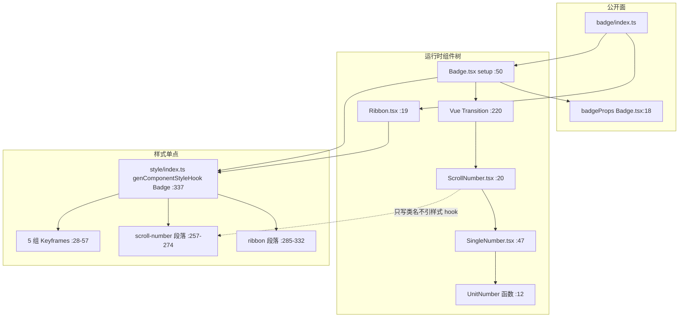
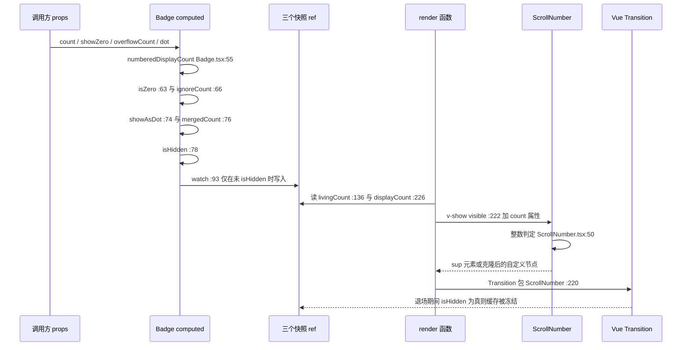
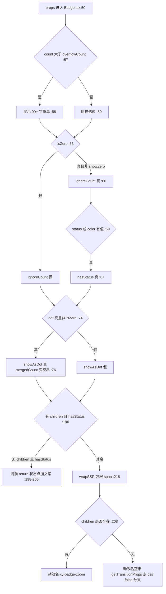

# C01-05 Badge 徽标

> **本篇解决**：`<xy-badge>` 只有一行用法，源码里为什么需要 4 个组件文件、3 层可见性计算和 3 个缓存 ref；数字滚动到底由谁驱动；改 `count`/`status`/`offset` 的哪一行会让样式静默失效。
> **前置**：C01-00《类横写：button/icon/tag/chips/badge 的职责切分》（本类职责切分已在该篇论证，本篇不重复展开）、C01-02《Icon 图标》、A03《Design Token 四层体系》、A05《ConfigProvider 注入链与 Size/Disabled Context》、A06《Props 体系与类型工具》、I09《动画与 motion 体系》
> **读者坐标**：`03-components/01-general` 第 5/7 篇

## 一、职责与边界

Badge 负责把**一个可数的标记**（数字、点、自定义 VNode）附着到调用方给的内容右上角，或者在调用方不给内容时独立渲染一个状态点。它**不持有内容**：`children` 只是被原样放进根节点（`badge/Badge.tsx:219`），徽标本身是根节点的第二个子元素（`:220-233`）。这条边界在渲染层的直接后果是「有没有 children」必须被当成一等状态处理，而不是靠 props 猜：`-not-a-wrapper` 类名（`Badge.tsx:188`）、status 场景的提前 return（`:196-206`）、动效名的选择（`:208`）三处都分支在这一个布尔值上。

明确不负责的事：

- **不负责内容排版**。徽标只写 `position: absolute` 到右上角（`badge/style/index.ts:150-155`），父容器给不给留位置不由它管。
- **不负责图形**。整个 `badge/` 目录没有一处 `@xiaoye-ui/icons` 导入（`Badge.tsx:1-16`、`Ribbon.tsx:1-8` 的 import 清单可查），「用一个图标当计数」走的是 `count` VNode + `cloneElement`（`:173-182`），不是图标 API。这一点 C01-00 论点 3 已展开，本篇不重复。
- **不负责浮层与定位**。`badge/` 内没有 `vc-trigger`、`zIndexManager`、portal 的任何引用，全部就地渲染；`style/index.ts:342` 把 `badgeZIndex` 直接定为字符串 `'auto'`，即徽标**主动放弃**层级管理，交给父级的层叠上下文。
- **不负责数字的语义**。`count` 是 `PropTypes.any`（`Badge.tsx:20`），字符串、小数、负数、VNode 都收；只有「整数」这一类会触发滚动动画（`ScrollNumber.tsx:50`），其余分支原样渲染。
- **不负责注册 Ribbon 的兄弟组件命名空间**。`Badge.Ribbon` 的可访问性来自组件选项对象上的一个野键（`Badge.tsx:42`），成因与四种装配写法对比见 C01-00 论点 6。

依赖清单（`Badge.tsx:1-16` 逐行）：`_util/vue-types`、`./ScrollNumber`、`_util/classNames`、`_util/props-util`（`getPropsSlot`、`flattenChildren`）、`_util/vnode`（`cloneElement`）、`_util/transition`（`getTransitionProps`）、`./Ribbon`、`config-provider/hooks/useConfigInject`、`_util/isNumeric`、`./style`、`theme/interface`（类型）、`_util/type`（类型）、`_util/colors`（`isPresetColor`）。其中只有前缀注入（`useConfigInject`）与样式 hook（`useStyle`）两件是跨组件公共设施，其余都是 badge 私有。被依赖方：`tree-table/HeaderCell.tsx:6` 与 `data-table/HeaderCell.tsx:19` 以 `xiaoye-ui/badge` 路径直接导入，另有 `float-button/FloatButton.tsx:4` 一个组件级消费方（边关系见 C01-00）。

## 二、源码地图

| 文件 | 行数 | 职责 | 关键导出 / 主入口 |
| --- | --- | --- | --- |
| `badge/Badge.tsx` | 239 | 可见性判定、状态快照、两条渲染出口、动效装配 | `badgeProps`（`:18`）、`XYBadge`（`:41`、`:39`） |
| `badge/ScrollNumber.tsx` | 86 | 计数的宿主元素：整数拆位、`borderColor` 伪造、自定义内容覆写 | `ScrollNumber`（`:22`） |
| `badge/SingleNumber.tsx` | 133 | 单个数位的滚动条：单元列表、位移计算、过渡收尾 | `SingleNumber`（`:49`）、内部函数 `UnitNumber`（`:12`） |
| `badge/Ribbon.tsx` | 62 | 缎带：复用 badge 样式 hook，但用自己的 prefixCls | `ribbonProps`（`:10`）、`XYBadgeRibbon`（`:21`） |
| `badge/style/index.ts` | 409 | 5 组 Keyframes + badge/scroll-number/status/ribbon 全部样式 | `genComponentStyleHook('Badge', ...)`（`:401`） |
| `badge/index.ts` | 18 | 装配与注册：两个组件一起注册、`Ribbon` 改名导出 | `Badge`（默认导出，`:15`） |
| `badge/index.test.js` | 206 | 9 条 Badge 用例 + 4 组 Ribbon 用例（断言密度见 §七 坑 6） | — |
| `_util/components/transition.tsx` | — | `getTransitionProps` 的实现在这里，已删除的 `_util/transition.ts` 曾只是转发（2026-09-29） | `getTransitionProps`（`:21`） |

主实现入口是 `badge/Badge.tsx:39`（`defineComponent`）与 `:50`（`setup`）；样式 hook 的唯一实例是 `badge/style/index.ts:337`，四个运行时文件里 `Badge.tsx:52` 与 `Ribbon.tsx:30` 各调一次 `useStyle`，`ScrollNumber.tsx` 与 `SingleNumber.tsx` **完全不调样式 hook**——它们只写类名，样式由 Badge 那份 hook 里的 `${rootCls}-scroll-number` 段落提供（`style/index.ts:72`、`:257-274`）。这是本组件一个值得记住的错位：出样式的文件与出类名的文件不是同一个，且两边的前缀来源不同（论点 6）。

`index.ts:15-18` 把默认导出断言成 `Plugin & { readonly Ribbon: typeof Ribbon }`，但整个文件里没有任何 `Badge.Ribbon = Ribbon` 的赋值语句（对比 `tag/index.tsx:163` 的显式赋值）——类型断言所指的那个属性，实际由 `Badge.tsx:42` 的野键提供。

## 三、架构与数据流

### 3.1 静态结构：四个运行时文件与一份样式产物



这张图要传达的重点是**两处断裂**。第一处：`ScrollNumber` / `SingleNumber` / `UnitNumber` 三层只有 `ScrollNumber` 被 `Badge.tsx:2` 直接导入，`SingleNumber` 由 `ScrollNumber.tsx:7` 导入，`UnitNumber` 则连组件都不是——它是 `SingleNumber.tsx:12` 的一个普通函数，被 `:90` 和 `:108` 当函数调用直接返回 VNode（论点 3）。第二处：样式只在 `style/index.ts:337` 一个 hook 里生成，却被三个运行时前缀消费（`xy-badge`、`xy-scroll-number`、`xy-ribbon`），后两个不是由各自的组件推导而来，而是由 `style/index.ts:72-74` 用 `rootCls` 字符串拼出来的（论点 6）。

### 3.2 数据流：props 到 DOM 再到退场回流



闭环的后半段是这篇的关键：**快照 ref 只在元素可见时被刷新**（`Badge.tsx:93-103`）。`watch` 的源是 `[() => props.count, mergedCount, showAsDot]` 三个，但回调体被 `if (!isHidden.value)` 包住（`:96`）。也就是说，一旦徽标进入隐藏态，来自 props 的新值不再写入 `livingCount` / `displayCount` / `isDotRef`；退场动画播放期间元素仍然在 DOM 里（Vue 的 `Transition` 会保留离场节点直到动画结束），此时它显示的仍是**上一次可见时的数字**，而不是已经变成 `null` 的新 `count`。源码注释把这三行意图写得很直白（`:84`、`:87`、`:90`）。论点 1 逐行拆这段。

### 3.3 关键分支：谁决定渲染出口



出口 `M` 与出口 `N` 是**互斥的两套 DOM**：状态形态渲染 `<span class="xy-badge-status-dot">` + 文案 span（`:200-203`），计数形态渲染 `<Transition>` 包 `ScrollNumber`（`:220-233`）。判定用的 `hasStatus` 里含 `ignoreCount`（`:67-72`），所以「同时传 `count` 和非零数字 + `status`」会从出口 `N` 离开，此时状态类名仍被写进 sup 的 class（`:127-128`），但对应样式选择器拿不到——这就是 §七 坑 3 的成因，也是本篇论点 4 的主题。

## 四、核心机制精读

### 论点 1：徽标的可见性不是「count 有没有值」，而是四层派生加三个快照 ref，且快照只在可见时被刷新

断言：`Badge` 的显示内容来自 `livingCount` / `displayCount` / `isDotRef` 三个 `ref`，而不是直接来自 props；这三个 ref 由一个带 `if (!isHidden.value)` 守卫的 `watch` 写入，因此「进入隐藏态」这个事件本身会把缓存冻结在最后一次可见的值上。这不是多余的设计，而是退场动画的必要条件——`Transition` 在离场期间仍然保留 DOM 节点，如果内容跟着 props 一起变空，用户会看到徽标在缩小的过程中数字先消失。

```tsx
// packages/xiaoye-ui/src/badge/Badge.tsx:84
    // Count should be cache in case hidden change it
    const livingCount = ref(props.count);

    // We need cache count since remove motion should not change count display
    const displayCount = ref(mergedCount.value);

    // We will cache the dot status to avoid shaking on leaved motion
    const isDotRef = ref(showAsDot.value);

    watch(
      [() => props.count, mergedCount, showAsDot],
      () => {
        if (!isHidden.value) {
          livingCount.value = props.count;
          displayCount.value = mergedCount.value;
          isDotRef.value = showAsDot.value;
        }
      },
      { immediate: true },
    );
```

逐段看：

- `:85` 的 `livingCount` 初值取 `props.count`，`raw` 值，不经过 `overflowCount` 截断。它只被渲染体读一次（`:136` `const count = livingCount.value;`），用途是两件事——`titleNode` 的兜底（`:165-166`）和「count 是不是 VNode」的分支判定（`:174`）。也就是说**标题与自定义内容走的是缓存值**，而数字显示走另一个缓存。
- `:88` 的 `displayCount` 初值取 `mergedCount.value`，也就是已经过 `overflowCount` 截断、并在 dot 形态下被压成空串的值（`:74-76`）。它只喂给 `ScrollNumber` 的 `count`（`:226`）。
- `:91` 的 `isDotRef` 只被 `scrollNumberCls` 消费（`:122-126`），决定 sup 上写 `-dot` 还是 `-count`。注释里说的 shaking 指的是：如果离场时 dot/数字来回切，绝对定位盒子的宽高会跳变。
- `:93-103` 的 watch 源里同时放了 `() => props.count`（getter，追踪 props 变化）、`mergedCount` 与 `showAsDot`（两个 computed）。后两个是必要的，因为 `overflowCount`、`dot`、`showZero` 任何一个变化都会改变 `mergedCount`，而回调体只写 `props.count` 与 `mergedCount.value`。
- 守卫 `if (!isHidden.value)`（`:96`）读的是**当前**的 `isHidden`（`:78-82`）。因为 `isHidden` 依赖的是 `mergedCount` / `isZero` / `showZero` / `showAsDot` 这一串 computed，而 computed 在被 watch 回调读取时会拿到本轮已更新后的值，所以「变成隐藏」的那一次变化**不会**写入缓存，「从隐藏变回可见」的那一次会立刻写入。行为等价于：可见时同步，隐藏时冻结。

结论回扣到数据流：`visible`（`:140`）用的是**实时**的 `isHidden`，而内容是**冻结**的 ref——一个用实时值控制显隐、一个用冻结值控制内容，是这段代码唯一的正确读法。想把它「简化」成直接用 `mergedCount.value` 渲染，会同时弄坏 `ScrollNumber.tsx:43` 写出的 `data-show` 属性和退场动画期间的显示内容。

### 论点 2：`overflowCount` 的截断与「是否滚动」的判定是两个互不知情的系统，分界线是 JS 关系运算符与 `Number() % 1`

断言：Badge 对 `count` 只做一次算术处理（`:55-61` 的 `>` 比较），是否逐位拆分则由 `ScrollNumber` 独立判定（`ScrollNumber.tsx:50`），两处判定使用不同的强制转换规则，因此 `count` 的四类取值会走出三条不同通路。

```tsx
// packages/xiaoye-ui/src/badge/Badge.tsx:55
    const numberedDisplayCount = computed(() => {
      return (
        (props.count as number) > (props.overflowCount as number)
          ? `${props.overflowCount}+`
          : props.count
      ) as string | number | null;
    });

    const isZero = computed(
      () => numberedDisplayCount.value === '0' || numberedDisplayCount.value === 0,
    );
    const ignoreCount = computed(() => props.count === null || (isZero.value && !props.showZero));
```

- `:57` 写的是 `props.count as number > props.overflowCount as number`，`as` 只是类型断言，运行时是裸的 `>`。JS 的关系运算符在两侧不同时为字符串时会做数值转换，所以 `count="105"`（字符串）确实会被截断成 `"99+"`；但 `count="1,024"` 转成 `NaN`，任何与 `NaN` 的比较都是 `false`，于是原样落到 `:59`。默认值 `overflowCount: 99` 来自 props 声明本身（`:23`），不是 `initDefaultProps`。
- `:63-65` 的 `isZero` 必须同时比 `'0'` 和 `0`，因为截断分支产出模板字符串、透传分支产出原值，类型不收敛。同理 `isHidden` 里的空判定（`:79-81`）列了 `null`、`undefined`、`''` 三种，而 `0` 不在其中——所以 `<Badge :count="0" show-zero />` 能显示，`count={0}` 默认不显示（`:66` 的 `ignoreCount` 与 `:81`）。
- 第二处判定在下一个文件里：

```tsx
// packages/xiaoye-ui/src/badge/ScrollNumber.tsx:48
      // Only integer need motion
      let numberNodes: any = count;
      if (count && Number(count) % 1 === 0) {
        const numberList = String(count).split('');

        numberNodes = numberList.map((num, i) => (
          <SingleNumber
            prefixCls={prefixCls.value}
            count={Number(count)}
            value={num}
            key={numberList.length - i}
          />
        ));
      }
```

`count &&` 的前置说明 `0` 与 `null` 直接不进拆分分支，走 `:49` 的原样赋值；`Number(count) % 1 === 0` 把小数（`3.5`）、`'99+'`（`Number('99+')` 是 `NaN`）、`'1,024'` 全部挡在动画之外。注意 `:51` 用的是 `String(count).split('')`，即按**字符**拆分而不是按位权拆分，所以负数会拆出 `'-'` 这个符号位（`index.test.js:113-124` 正好覆盖了 `-10` 这条通路，但没有断言）。`key={numberList.length - i}`（`:58`）让**右侧个位的 key 恒小**，配合下文的 `prevIndex` 对齐，保证个位节点在 count 从 9 变到 10 时不被复用错位。

结论：`overflowCount` 与滚动动画是两套判定，改任何一处都要同时想另一处。想让 `99+` 也滚动，就得在 `:50` 放行 `NaN`；而放行后 `SingleNumber` 的 `Number(value)` 会变成 `NaN`，被 `SingleNumber.tsx:88` 的短路挡成静态渲染——不会出现动画，只会多出一次无效拆分。

### 论点 3：数位滚动不是 `transition` 换文本，而是每个数位渲染一竖列数字后用 `translateY` 位移；收尾靠 `transitionend` 加一个 1 秒定时器双保险

断言：`SingleNumber` 在值变化时把 11 个 `<p>` 单元铺成一列，用 `top: ${offset}00%` 给每个单元定位、用容器的 `transform: translateY(...)` 把「上一个值」滚到「新值」，并在过渡结束后才把 `prevValue` 提交进 `reactive` 状态；因为 `transitionend` 在部分环境不触发，另有一个 1000ms 的 `setTimeout` 兜底。位移量与步长都是**字符串拼接**出来的，没有数值单位换算。

```tsx
// packages/xiaoye-ui/src/badge/SingleNumber.tsx:12
function UnitNumber({ prefixCls, value, current, offset = 0 }: UnitNumberProps) {
  let style: CSSProperties | undefined;

  if (offset) {
    style = {
      position: 'absolute',
      top: `${offset}00%`,
      left: 0,
    };
  }

  return (
    <p
      style={style}
      class={classNames(`${prefixCls}-only-unit`, {
        current,
      })}
    >
      {value}
    </p>
  );
}
```

- `:18` 的 `top: `${offset}00%``：`offset` 是整数，模板串把它当十进制前缀，`00%` 补上两位小数位与百分号。`offset = 2` 得到 `"200%"`，`offset = -1` 得到 `"-100%"`，`offset = 0` 时整个 `if` 不进（`:15` 的 `if (offset)` 对 `0` 为假），单元留在文档流里。这要求每一格的高度**恰好等于容器高度**，对端样式在 `style/index.ts:259-271`：`-only` 与 `> p-…-only-unit` 都被设成 `height: ${badgeHeight}px` 同一表达式，两者必须同步改。
- `UnitNumber` 不是组件：它在 `:90` 与 `:108` 被当普通函数直接调用并把返回值当 VNode 用（`unitNodes = [UnitNumber({ ...props, current: true })]`）。因此它没有实例、没有 props 校验、不能被 `ref`，`{ ...props, value: singleUnit }`（`:109-110`）的**键序**就是覆盖语义——后写的 `value`/`offset`/`current` 覆盖前面展开的 `props`。把它改成真正的子组件需要同时补 `key`，因为当前每个单元的身份由数组下标决定。

```tsx
// packages/xiaoye-ui/src/badge/SingleNumber.tsx:94
        unitNodes = [];

        // Fill basic number units
        const end = value + 10;
        const unitNumberList: number[] = [];
        for (let index = value; index <= end; index += 1) {
          unitNumberList.push(index);
        }

        // Fill with number unit nodes
        const prevIndex = unitNumberList.findIndex(n => n % 10 === state.prevValue);
        unitNodes = unitNumberList.map((n, index) => {
          const singleUnit = n % 10;
          return UnitNumber({
            ...props,
            value: singleUnit,
            offset: index - prevIndex,
            current: index === prevIndex,
          } as UnitNumberProps);
        });

        // Calculate container offset value
        const unit = state.prevCount < originCount.value ? 1 : -1;
        offsetStyle = {
          transform: `translateY(${-getOffset(state.prevValue, value, unit)}00%)`,
        };
```

- `:98-102` 生成从 `value` 到 `value + 10` 共 11 个数，`:107` 取 `% 10` 得到实际显示的数字，因此无论目标值是多少，列里总能凑出 0-9 各一次加一个重复值。`prevIndex`（`:105`）找的是「上一个数字」在这列里的位置，`offset: index - prevIndex`（`:111`）即相对上一个位置的格数，`current` 标记占位那一格。
- `:117` 的方向由**计数绝对值**变大变小决定（`originCount` 在 `:57` 做了 `Math.abs`），而不是由数字本身决定：9 → 10 是变大，所以个位从 9 向上滚到 0（跨过 10），而不是向下倒回。`getOffset`（`:35-45`）用 `(index + 10) % 10 !== end` 做环形步进，最多走 9 格，返回的是带符号的格数；`-getOffset(...)` 再取反写进 `translateY`，因为容器位移与单元排列方向相反。
- 收尾有两个通道：`:126` 在容器上挂 `onTransitionend`，回调 `onTransitionEnd`（`:64-67`）把 `state.prevValue` / `prevCount` 提交为新值；`:70-79` 另开一个 `watch(originValue, …, { flush: 'post' })`，每次值变化都 `clearTimeout` 再起一个 1000ms 定时器作为「过渡事件不支持」的兜底，并在 `:80-82` 的 `onUnmounted` 里清理。

结论：动画的全部状态就是 `reactive` 里的两个字段（`:58-61`）。1000ms 这个常量比 `motionDurationSlow`（对端 `style/index.ts:222`、`:228` 用的都是它）长得多，所以连续改 `count` 时会出现「上一次过渡早就结束、`prevValue` 却还停在旧值」的窗口；这段窗口里新的一次渲染会用错的起点计算 `prevIndex` 与 `translateY`。这也是 `index.test.js:62-85` 那条用例为什么以 100ms 间隔连改 5 次却不写任何断言——它只能验证「不抛错」。

### 论点 4：状态形态与计数形态是两条互斥的渲染出口，而状态类名会被无条件写进 sup——样式端却只在状态根类下才有对端规则

断言：`hasStatus` 的定义里含一个 `ignoreCount`，导致「有非零计数 + 有状态」时状态形态被静默降级为计数形态；但状态类名 `-status-<值>` 的写入条件只是 `!!props.status`，于是 DOM 上会出现一组在样式表里没有任何对端选择器的类名。

先看判定：`ignoreCount`（`Badge.tsx:66`）为真的条件是「`count` 是 `null`」或「是 0 且未开 `showZero`」，`hasStatus`（`:67-72`）要求 `status` 或 `color` 有值**并且** `ignoreCount` 为真。也就是说 `status` 只在「没有计数要显示」时才成立。

```tsx
// packages/xiaoye-ui/src/badge/Badge.tsx:195
      // <Badge status="success" />
      if (!children && hasStatus.value) {
        const statusTextColor = mergedStyle.color;
        return wrapSSR(
          <span {...attrs} class={badgeClassName} style={mergedStyle}>
            <span class={statusCls.value} style={statusStyle.value} />
            <span style={{ color: statusTextColor }} class={`${pre}-status-text`}>
              {text}
            </span>
          </span>,
        );
      }
```

这条出口有三个容易被忽略的细节。第一，它同时要求 `!children`（`:196`），所以 `<Badge status="processing"><a/></Badge>` 不会走这里——`children` 分支和 `status` 分支是 AND 关系，不是优先级关系。第二，`{...attrs}` 在前、`style` 与 `class` 在后（`:199`），配合组件声明的 `inheritAttrs: false`（`:43`），意味着调用方写在标签上的 `class`/`style` 在这里被 `badgeClassName`（内部已合并 `attrs.class`，见 `:191`）与 `mergedStyle` 接管。第三，状态文案的文字色取自 `mergedStyle.color`（`:197`），而 `mergedStyle` 的来源是 `attrs.style`（`:133`）加上 `offset` 合成（`:143-161`），所以外层 `style="color: red"` 会被当作状态文字色二次消费。

```tsx
// packages/xiaoye-ui/src/badge/Badge.tsx:107
    const statusCls = computed(() => ({
      [`${prefixCls.value}-status-dot`]: hasStatus.value,
      [`${prefixCls.value}-status-${props.status}`]: !!props.status,
      [`${prefixCls.value}-color-${props.color}`]: isInternalColor.value,
    }));
```

`statusCls` 只在出口一的状态点 span 上用（`:200`）。真正制造失配的是另一份类名表：

```tsx
// packages/xiaoye-ui/src/badge/Badge.tsx:121
    const scrollNumberCls = computed(() => ({
      [`${prefixCls.value}-dot`]: isDotRef.value,
      [`${prefixCls.value}-count`]: !isDotRef.value,
      [`${prefixCls.value}-count-sm`]: props.size === 'small',
      [`${prefixCls.value}-multiple-words`]:
        !isDotRef.value && displayCount.value && displayCount.value.toString().length > 1,
      [`${prefixCls.value}-status-${props.status}`]: !!props.status,
      [`${prefixCls.value}-color-${props.color}`]: isInternalColor.value,
    }));
```

`:127-128` 两行的写入条件与 `hasStatus` 无关。当 `count={5} status="success"` 时，主出口 `:217-233` 渲染的 sup 上会带 `xy-badge-status-success`。但状态色的样式全部嵌在一个需要根类 `-status` 的块里：

```css
/* packages/xiaoye-ui/src/badge/style/index.ts:163 */
      [`&${componentCls}-status`]: {
        lineHeight: 'inherit',
        verticalAlign: 'baseline',

        [`${componentCls}-status-dot`]: {
```

展开后是 `.xy-badge.xy-badge-status .xy-badge-status-success`（`:177-212` 一整段都在这个块内）。根类 `xy-badge-status` 只在 `hasStatus.value` 为真时才写（`Badge.tsx:187`），而此刻它恰好为假——**选择器永不成立，类名白写**。同一段里能命中的只有 `-color-<色名>`，因为它不在状态块内，而是在 `colorPreset` 块（`style/index.ts:76-83`），条件由 `isInternalColor`（`Badge.tsx:105`，注意第二个参数是 `false`，与 Tag 的取值差异见 C01-00 论点 4）决定。

结论：`status` 是一个「只在无计数时有意义」的 prop，而它的类名却跨出口存在。任何想用 `status` 给计数徽标配色的改动，都必须同时改 `hasStatus`（含 `ignoreCount`）与 `style/index.ts:163` 那个块的嵌套层级，二者改其一即失配。

### 论点 5：`count` 传自定义 VNode 时，`ScrollNumber` 退化成克隆器——它自己装配的 `title`、`data-show`、`style`、类名四样全部被丢弃

断言：`ScrollNumber` 的主输出是 `<Tag {...newProps}>`，`newProps` 里装着 `title`、`data-show`、合并后的 class 与 style；但只要 Badge 传进来 children（即自定义计数），函数就在拿到 `newProps` 之后**原路返回克隆节点**，`newProps` 整包作废。

Badge 侧的唯一注入点：

```tsx
// packages/xiaoye-ui/src/badge/Badge.tsx:172
      // >>> Display Component
      const displayNode =
        typeof count === 'object' || (count === undefined && slots.count)
          ? cloneElement(
              count ?? slots.count?.(),
              {
                style: mergedStyle,
              },
              false,
            )
          : null;
```

这里 `cloneElement` 的第三个参数显式传 `false`。它的语义要看工具函数本体：

```ts
// packages/xiaoye-ui/src/_util/vnode.ts:9
export function cloneElement<T, U>(
  vnode: VNode<T, U> | VNode<T, U>[],
  nodeProps: NodeProps = {},
  override = true,
  mergeRef = false,
): VNode<T, U> {
  let ele = vnode;
  if (Array.isArray(vnode)) {
    ele = filterEmpty(vnode)[0];
  }
  if (!ele) {
    return null;
  }
  const node = cloneVNode(ele as VNode<T, U>, nodeProps as any, mergeRef);

  // cloneVNode内部是合并属性，这里改成覆盖属性
  node.props = (override ? { ...node.props, ...nodeProps } : node.props) as any;
```

`:22` 的 `cloneVNode` 已经做过一次属性合并（Vue 内部对 `class` 是拼接、对 `style` 是浅合并），`:25` 才决定要不要用裸 `nodeProps` 把结果盖掉。传 `false` 就是**只要合并、不要覆盖**，所以自定义节点自己的 `class` 与内联 `style` 能保留，Badge 的 `offset` 位移被并进去。同一个 `false` 也出现在 ScrollNumber 的自定义分支里（`ScrollNumber.tsx:79`），两处一致。

被丢弃的部分在这一段：

```tsx
// packages/xiaoye-ui/src/badge/ScrollNumber.tsx:63
      // allow specify the border
      // mock border-color by box-shadow for compatible with old usage:
      // <Badge count={4} style={{ backgroundColor: '#fff', color: '#999', borderColor: '#d9d9d9' }} />
      if (style && style.borderColor) {
        newProps.style = {
          ...(style as CSSProperties),
          boxShadow: `0 0 0 1px ${style.borderColor} inset`,
        };
      }
      const children = filterEmpty(slots.default?.());
      if (children && children.length) {
        return cloneElement(
          children,
          {
            class: classNames(`${prefixCls.value}-custom-component`),
          },
          false,
        );
      }

      return <Tag {...newProps}>{numberNodes}</Tag>;
```

`newProps` 在 `:40-46` 就已经组装完（含 `data-show`、`title`、`style`、`prefixCls` 类名），`:66-71` 甚至刚为它写入了 `boxShadow` 伪造的边框，`:72-81` 却整包不再使用。因此自定义计数下会同时失去四样东西：外层 `borderColor` 转 `boxShadow` 的兼容（`:66-71`，只服务数字与点）、`title`（`:45`，本来也只在数字上有意义，见 `Badge.tsx:165-166` 的类型守卫）、`data-show` 属性（`:43`，写在这个元素上的显隐标记只服务于外部选择器与调试，本库里没有任何样式规则读它——两条检索交叉验证：`grep -rn "data-show" packages apps --exclude-dir=node_modules --exclude-dir=dist` 全仓只有两处写入，`badge/ScrollNumber.tsx:43` 与 `alert/index.tsx:187`，且 `grep -rn "\[data-show" packages apps` 无任何命中）、以及 Badge 精心算出的 `scrollNumberCls` 与 `numberStyle`（`Badge.tsx:211` 把 `numberStyle` 合进 `scrollNumberStyle` 再传给 ScrollNumber 的 `style`，最终在 `:74-80` 被丢掉）。

对端样式在 `style/index.ts:150` 与 `:247-255`：`-custom-component` 与 `-count`、`-dot` 共享同一条绝对定位规则，但**没有** `-count` 的背景、圆角、行高，也没有 `badgeHeight` 相关尺寸。也就是说自定义图形的盒模型完全由调用方负责，徽标只提供定位原点。想让自定义图形继承数字样式，目前唯一的通路是继续传 `class` 而不是指望 `numberStyle`。

### 论点 6：进出场动画只属于「有 children 的徽标」；无 children 时 `getTransitionProps` 走空名分支返回 `css: false`，样式文件里为它备好的第二套 keyframes 是死代码

断言：`Badge` 只把 `children` 是否存在这一个布尔喂给动效装配（`Badge.tsx:208`），而 `getTransitionProps` 对空名的处理不是「不换名字」，而是**关掉整个 CSS 过渡**。于是 `style/index.ts:43-50` 的两个 `xyNoWrapperZoomBadge*` 关键帧与 `:233-243` 的 `-not-a-wrapper` 动效覆盖规则在当前实现下不可能被命中。

```tsx
// packages/xiaoye-ui/src/badge/Badge.tsx:208
      const transitionProps = getTransitionProps(children ? `${pre}-zoom` : '', {
        appear: false,
      });
      let scrollNumberStyle: CSSProperties = { ...mergedStyle, ...(props.numberStyle as object) };
      if (color && !isInternalColor.value) {
        scrollNumberStyle = scrollNumberStyle || {};
        scrollNumberStyle.background = color;
      }
```

`children` 在这里是 `flattenChildren(slots.default?.())` 的结果并做过空数组归一（`:137-138`），所以 `<Badge><span/></Badge>` 与 `<Badge> </Badge>` 走不同分支。`pre` 是 `prefixCls.value`（`:135`），即 `xy-badge`，故动效名是 `xy-badge-zoom`。

```ts
// packages/xiaoye-ui/src/_util/components/transition.tsx:21
export const getTransitionProps = (transitionName: string, opt: TransitionProps = {}) => {
  const transitionProps: TransitionProps = transitionName
    ? {
        name: transitionName,
        appear: true,
        // type: 'animation',
        // appearFromClass: `${transitionName}-appear ${transitionName}-appear-prepare`,
        // appearActiveClass: `xy-base-transition`,
        // appearToClass: `${transitionName}-appear ${transitionName}-appear-active`,
        enterFromClass: `${transitionName}-enter ${transitionName}-enter-prepare ${transitionName}-enter-start`,
        enterActiveClass: `${transitionName}-enter ${transitionName}-enter-prepare`,
        enterToClass: `${transitionName}-enter ${transitionName}-enter-active`,
        leaveFromClass: ` ${transitionName}-leave`,
        leaveActiveClass: `${transitionName}-leave ${transitionName}-leave-active`,
        leaveToClass: `${transitionName}-leave ${transitionName}-leave-active`,
        ...opt,
      }
    : { css: false, ...opt };
  return transitionProps;
};
```

三点结论：

- **空名分支（`:38`）** 返回 `{ css: false, appear: false }`（`opt` 在 `:209` 传入的 `appear: false` 被合并进来）。`<Transition>` 拿到 `css: false` 且没有任何 JS 钩子（`Badge.tsx:220-233` 只包了 `<ScrollNumber>`，没有 `@enter`/`@leave`），等于**显式声明不做过渡**。这就是「独立徽标消失时是瞬间不见、包在内容上的徽标会缩小淡出」的真实原因，而 `style/index.ts:232-243` 那段专为 `-not-a-wrapper` 写的 zoom 覆盖规则读起来正好像是在为后者做适配——两者对不上。
- **类名表与样式表只对上一半。** `:30-35` 会发出 `-zoom-enter-prepare`、`-zoom-enter-start`、`-zoom-enter-active`、`-zoom-leave-active` 四类名字，而 badge 的样式里只有 `-zoom-enter` 与 `-zoom-leave` 两个选择器（`style/index.ts:220`、`:226`）；`grep -n "prepare\|enter-active\|leave-active" packages/xiaoye-ui/src/badge/style/index.ts` 无输出。也就是说这套三段式类名表是从别处沿用来的，badge 只消费其中两个。
- **`-appear` 状态在这条链路上不存在。** `:27-29` 三行 appear 类名是注释状态，`getTransitionProps` 从不发出 `-appear` 后缀；组件又在 `:209` 传 `appear: false`。因此 `style/index.ts:220` 与 `:233` 里 `-zoom-appear` 这个选择器（与 `-zoom-enter` 用逗号并列）永远不会出现在 DOM 上。

另外 `:33` 的 `leaveFromClass` 模板串以**一个空格开头**（`` ` ${transitionName}-leave` ``），本库没有对它做规整，能否正常工作取决于 Vue 侧对 class 串的裁剪处理。这一处不影响功能判断，但改这段代码时值得注意——它是全库共享的 util，改坏会影响所有用 `getTransitionProps` 的组件；这套类名表本身的由来与 motion 家族的其它成员由 I09《动画与 motion 体系》负责，本篇只钉 badge 这一段的消费结果。

### 论点 7：一份 378 行的样式被注册两次，且其中两段用 `rootCls` 拼类名、绕开了组件自己的前缀通道

> **2026-09-29 已修**：`badge/style/index.ts` 现在把那段大函数按 key 拆成 `genBadgeStyle`（`:344`）与 `genRibbonStyle`（`:350`）两个选择器段，默认导出只注册 badge 段（`:401`），新增具名 `useRibbonStyle` 只注册 ribbon 段（`:407`），`Ribbon.tsx:30` 改用后者。组件名仍是 `'Badge'`，所以 `theme.components.Badge` 的覆写面不变。回归断言在 `src/_util/__tests__/style-token.regression.test.tsx`（只读本次新注入的 `<style>`，避免同文件内前一用例的样式残留把断言变成假探针）。下面的取证描述的是修复前状态。

断言：`badge/style/index.ts:337` 的单个 hook 被 `Badge.tsx:52` 与 `Ribbon.tsx:30` 各调一次，两次传入的 `prefixCls` 不同（`xy-badge` / `xy-ribbon`），而注册缓存键包含这个前缀，因此同一份 `genSharedBadgeStyle` 产出被**完整生成两遍**；文件内部又用 `rootCls` 硬拼出 `-scroll-number` 与 `-ribbon` 两段类名，这两段的对端运行时前缀来自 `useConfigInject`，不是来自样式 hook 的入参。

```ts
// packages/xiaoye-ui/src/badge/style/index.ts:72
  const numberPrefixCls = `${rootCls}-scroll-number`;
  const ribbonPrefixCls = `${rootCls}-ribbon`;
  const ribbonWrapperPrefixCls = `${rootCls}-ribbon-wrapper`;

  const colorPreset = genPresetColor(token, (colorKey, { darkColor }) => ({
    [`&${componentCls} ${componentCls}-color-${colorKey}`]: {
      background: darkColor,
      [`&:not(${componentCls}-count)`]: {
        color: darkColor,
      },
    },
  }));

  const statusRibbonPreset = genPresetColor(token, (colorKey, { darkColor }) => ({
    [`&${ribbonPrefixCls}-color-${colorKey}`]: {
      background: darkColor,
      color: darkColor,
    },
  }));
```

`:72-74` 三个变量的来源是 token 的 `rootCls`，而它的装配在主题层：

```ts
// packages/xiaoye-ui/src/theme/util/genComponentStyleHook.ts:87
        const componentCls = `.${prefixCls.value}`;
        const mergedToken = mergeToken<
          TokenWithCommonCls<GlobalTokenWithComponent<OverrideComponent>>
        >(
          proxyToken,
          {
            componentCls,
            prefixCls: prefixCls.value,
            iconCls: `.${iconPrefixCls.value}`,
            rootCls: `.${rootPrefixCls.value}`,
          },
          mergedComponentToken,
        );
```

`componentCls` 跟着调用方给的 `prefixCls` 走（`:87`），`rootCls` 跟着 `getPrefixCls()` 的无参结果走（`:96`，其值来自 `:51`）。注册身份见 `:74` 的 `path: [component, prefixCls.value, iconPrefixCls.value]`——前缀不同即不同缓存项，这就是「两次调用生成两份 CSS」的依据。

于是三种覆写路径的行为各不相同：

1. **`ConfigProvider` 的 `prefixCls`**：`config-provider/index.tsx:70-75` 里 `getPrefixCls(suffix, customize)` 会先取组件级 `customizePrefixCls`，否则用 `mergedPrefixCls` 拼 `-${suffix}`（这条注入链的整体机制归 A05《ConfigProvider 注入链与 Size/Disabled Context》）。根前缀和组件前缀同源，`${rootCls}-scroll-number` 与 `useConfigInject('scroll-number')`（`ScrollNumber.tsx:26`）仍然一致。这条路径安全。
2. **组件 props 上的 `prefixCls`**：`Badge.tsx:26` 声明了它，`useConfigInject` 的第 14 行把它作为 `customizePrefixCls` 传入（`config-provider/hooks/useConfigInject.ts:14`），`index.tsx:72` 遇到它**直接返回、不拼根前缀**。此时 `componentCls` 变成覆写值，badge 自身的 `-count` / `-dot` / 状态段全部跟着改名（它们都以 `componentCls` 为键），但 `:72-74` 的 `numberPrefixCls`、`ribbonPrefixCls` 仍指向全局根前缀 → 数字容器的 `overflow: hidden`（`:257-259`）与整段 ribbon 样式（`:285-332`）失配。
3. **`scrollNumberPrefixCls`**：`Badge.tsx:27` 声明、`:223` 透传给 `ScrollNumber` 的 `prefixCls`，等于第 2 种路径的局部版本——只让 `-scroll-number` 这一段断链，`-only` / `-only-unit` 的 `height` 与 `overflow: hidden` 全部失效，滚动数位会互相穿帮。

`Ribbon.tsx` 的情况还要再加一层：它 `useConfigInject('ribbon', props)`（`:29`）拿到 `xy-ribbon` 作为 componentCls，然后 `useStyle(prefixCls)`（`:30`）把 **badge 的整份共享样式**以 `.xy-ribbon` 为根再生成一遍，包括 `.xy-ribbon .xy-ribbon-count`、`.xy-ribbon-status-*` 这些运行时永远不会出现的悬空选择器；同时 `:285-332` 的真 ribbon 段因为在两个注册里都用 `rootCls`，被输出了两次。DOM 侧的后果写在 `Ribbon.tsx:49-57`：外层 `-wrapper` 用拼接字符串（`${prefixCls.value}-wrapper`）而不是 classNames 数组，`class` 与 `hashId` 靠模板串相加；`genSharedBadgeStyle` 的根块（`style/index.ts:93-98`：`position: relative`、`display: inline-block`、`width: fit-content`、`lineHeight: 1`）此刻也落在 `.xy-ribbon` 上，与 ribbon 段自己的 `position: absolute`（`:288`）竞争同一批元素，先后顺序由两份 CSS 的插入顺序决定。

结论：badge 的样式契约不是「一个组件一个前缀」，而是「一个 hook、两个前缀、三个类名来源」。改 `style/index.ts:72-74` 任意一行，或改 `Ribbon.tsx:29` 的前缀名，都必须同时验证第 2、3 条路径，否则得到的是「样式看起来在、类名对不上」这种最难排查的失配形态。

## 五、对外契约如何生效

属性清单见 `apps/docs/components/badge.md`。这里只走「一个值进来后经过哪些手」这条路。

**props 的默认值不走 `initDefaultProps`。** `Badge.tsx:44` 直接 `props: badgeProps()`，与根目录 `AGENTS.md` 里「Props 必须经 `initDefaultProps` 初始化」的写法不同（这套 props 工具链本身归 A06《Props 体系与类型工具》）：默认值内联在声明里，`:23` 的 `overflowCount: { type: Number, default: 99 }`、`:29` 的 `size: { ..., default: 'default' }` 由 Vue 自己补，而 `:21` `showZero`、`:25` `dot`、`:33` `numberStyle` 的默认是 `undefined`——这三项因此保留**三态**（未传 / 真 / 假），`:66` 的 `!props.showZero` 与 `:74` 的 `props.dot &&` 都建立在这个三态上。`count` 的默认 `null` 来自 `PropTypes.any.def(null)`（`:20`），是「不传计数就整体隐藏」这条契约的实现点（`:66` → `:78-82`）。

**四个插槽，读取方式三种不同。** `text` 走 `getPropsSlot(slots, props, 'text')`（`:134`，实现是 `props[prop] ?? slots[prop]?.()`，`_util/props-util/index.ts:260-262`），所以 `text` prop 优先于同名插槽；`count` 走裸 `slots.count?.()`（`:176`），并且只在 `count === undefined` 时才被取用（`:174`），但它的**存在性**却参与另一条判定 `visible = !!(!isHidden.value || slots.count)`（`:140`）——传了 `count` 插槽就让徽标恒可见；`default` 走 `flattenChildren(slots.default?.())`（`:137`）后还要过一道 `children.length ? children : null`（`:138`），把「只有注释节点/空白」归一到 `null`，从而让 `-not-a-wrapper`（`:188`）、动效名（`:208`）、状态出口（`:196`）三处判定拿到同一个布尔。`slots` 的运行时声明在 `:45-49`，列出 `text`/`count`/`default` 三个，`Ribbon.tsx:24-27` 只列 `text`/`default`。

**`attrs` 被消费了两次，这是最容易被忽略的一条路径。** 组件声明 `inheritAttrs: false`（`:43`），渲染体里先取 `const style = attrs.style as CSSProperties`（`:133`）参与 `mergedStyle` 合成（`:143-161`），随后主出口又 `<span {...attrs} class={badgeClassName}>`（`:218`）。因为 `style` 仍在 `attrs` 里、没有被解构剔除，同一份内联样式既落在根 span（通过 `...attrs`），又落在 sup（通过 `:228` 的 `style={scrollNumberStyle}`）。状态出口那条路径更直白：`{...attrs}` 与 `style={mergedStyle}` 同时写在同一个 span 上（`:199`）。契约层面的意思是：**Badge 不接受「只作用于外层容器」的 style**，`style` 里的位移属性会叠加到徽标自身。

**没有事件、没有 expose、没有 provide。** `badgeProps` 里没有任何 `onXxx` 字段（`:18-35`），组件的可点性完全来自 `children` 自己；`setup` 的解构只取了 `slots` 与 `attrs`（`:50`），既没有 `emit` 也没有 `expose`，所以 `ref` 拿到实例后没有公开方法可调用；组件也不 `provide` 任何 context，只从 `useConfigInject('badge', props)` 单向读取 `prefixCls` 与 `direction`（`:51`）。`direction` 的三个消费点是 `:151-155`（rtl 时 `offset` 的横向位移改用 `left` 且不取反）、`:189`（根加 `-rtl` 类）、`Ribbon.tsx:36`。`size` 是普通 prop 而非 `SizeContext` 注入（`:29`、`:124`），徽标不参与全局尺寸联动。

## 六、设计取舍

**数位滚动：选「每位一列 + 容器位移」，放弃「文本切换 + CSS 过渡」。** 现方案（`SingleNumber.tsx:94-121`）能做到的是一件文本切换做不到的事——**每一位按自己的方向与格数独立滚动**，因为每一位是一个独立容器（`:122-130`），起点由 `state.prevValue` 记住（`:58-61`）。代价是三层的：DOM 上每个数位固定渲染 11 个单元（`:100-102`），动画状态需要一个 `reactive` 加一个 1000ms 兜底定时器（`:68-82`），高度必须由样式精确锁定为 `badgeHeight` 才能出现「滚动」的错觉（`style/index.ts:259-271`）。如果改成「只渲染两个数字、用 `translateY` 做进出」，`getOffset`（`:35-45`）与 `prevIndex`（`:105`）都可以删掉，但 9 → 10 这类跨位变化会失去逐位错位感。**取舍点其实是「动画质感」换「每秒重排 11 个节点」。**

**可见性：选「缓存快照」，放弃「Vue 钩子持旧值」。** `<Transition>` 本身可以在 `@leave` 钩子里冻结内容，但 Badge 选择在组件内自建三个 ref（`:84-103`）。换来的是不依赖 `<Transition>` 的钩子时序、SSR 友好（`wrapSSR` 与 hashId 都在 hook 外拿，`:52`）、以及 `-dot`/`-count` 类名在离场期间稳定；赔上的是 `isHidden` 同时被当作「是否显示」和「是否冻结」两用，读代码时必须靠三行注释才能明白（`:84`、`:87`、`:90`）。

**层级：主动放弃 `zIndexManager`。** `badgeZIndex` 被定为字符串 `'auto'`（`style/index.ts:364`，拆表前在 `:342`），并写进 `-count` 与 `-dot`（`:101`、`:139`）。徽标不是浮层，不参与层级计数——`badge/` 全目录对 `vc-trigger`、`zIndexManager`、`Portal`、`getPopupContainer` 四个名字零引用（两条检索交叉验证：`grep -rn` 在这四个词上无命中；`grep -rh "from '\.\./" packages/xiaoye-ui/src/badge/*.ts*` 去重后的 16 行 import 清单里也没有它们），好处是嵌套时不制造新的层叠上下文、文档流内的兄弟元素能自然压住它；代价是在弹层里叠放时需要调用方自己给父容器建层叠上下文。

**Ribbon：借用 Badge 的组件 Token 命名空间，但用自己的样式 hook。** 收益仍是 `theme/interface/components.ts` 只需登记 `Badge`（且是空对象，见 C01-00 §二 的登记表对照），ribbon 的 Token 直接借用 `badgeRibbonOffset` 等派生字段（`style/index.ts:392`）。原先的代价——同一份 CSS 注册两次、`.xy-ribbon` 上挂着整份 badge 的悬空规则——已在 2026-09-29 用 `useRibbonStyle` 拆表消掉：默认导出（`style/index.ts:401`）只注册 badge 段，`useRibbonStyle`（`:407`）只注册 `-ribbon-wrapper` 与 `-ribbon` 两键。第三项旧账（badge 根写 `position: relative`，`:95`）**仍在**，但它如今只服务 Badge 自己——`-count`/`-dot` 的绝对定位（`:150-155`）以它为锚点；此前 OverlayBadge 曾靠在与它的特异性对决中取胜来定位，该组件已于 2026-10-02 移除，今天动这一行只影响 Badge 自身的角标锚定，不再牵扯任何下游组件。

**状态与计数：选「互斥」，放弃「可组合」。** `hasStatus` 把 `ignoreCount` 写进定义（`:67-72`）而不是让调用方自己判断，语义上「状态点」与「计数徽标」占据同一个物理位置（`style/index.ts:150-155` 的同一个绝对定位锚点），因此互斥是合理的物理约束；不合理的部分是类名写入没有跟着互斥（`:127-128`），于是 API 表面上允许组合、实现上只认一种。要改成可组合，最小改动面是 `status` 分支的样式层级（把状态色从 `&${componentCls}-status` 块里提出来）加上 `hasStatus` 的判定，两者缺一不可。

## 七、坑与改动指南

**坑 1：`count` 与 `status` 同时传，状态整条通路被吞，且没有任何告警。**
触发：写 `<xy-badge :count="5" status="success" text="已完成" />`，期望「数字加一个绿色状态点」或「状态色作用于数字底」。症状：只剩一个默认红色数字徽标，`text` 也不出现。原因：`hasStatus` 的定义要求 `ignoreCount` 为真（`packages/xiaoye-ui/src/badge/Badge.tsx:67-72`），而 `ignoreCount` 只在 `count === null` 或「0 且未开 `showZero`」时为真（`:66`），非零计数直接把它压成假；状态出口 `:196` 因变量为假不进入，`statusTextNode` 又额外要求 `!visible`（`:169-170`），可见时文案被丢弃。定位：`badge/Badge.tsx:66-72`、`:169-170`、`:196-206`。**该组合无测试保护**——`badge/index.test.js` 全文没有 `count` 与 `status` 同时出现的用例。

**坑 2：状态类名写进 DOM 但对端选择器永不成立。**
触发：想用 `.xy-badge-status-success` 覆写状态色，或在测试里 `findAll('.xy-badge-status-success')`。症状：类名肉眼可见、规则不生效，或断言拿到元素却拿不到样式。原因：`scrollNumberCls` 写状态类只看 `!!props.status`（`Badge.tsx:127`），而样式里五个状态色块全部嵌在 `&${componentCls}-status` 之下（`packages/xiaoye-ui/src/badge/style/index.ts:163-212`），根类 `xy-badge-status` 又只在 `hasStatus.value` 时写（`Badge.tsx:187`）——即坑 1 的同一个 `hasStatus`。定位：`badge/style/index.ts:163` 与 `badge/Badge.tsx:127`、`:187`。改法：要么把状态色块提出去并接受与 `-count` 的权重冲突，要么在 `:127` 补 `&& hasStatus.value`，后者是行为变更（会移除现有的悬空类名）。

**坑 3：`count` 传自定义 VNode 时，`numberStyle` 与 `borderColor` 兼容层同时失效。**
触发：`<xy-badge :count="iconVNode" :number-style="{ width: '20px' }" style="border-color: #d9d9d9" />`。症状：宽高、背景、边框全无，徽标看起来「样式没吃到」。原因：`Badge.tsx:211-215` 算出的 `scrollNumberStyle` 交给 `ScrollNumber` 后进入 `newProps.style`（`packages/xiaoye-ui/src/badge/ScrollNumber.tsx:40-46`），`borderColor` 转 `boxShadow` 的兼容也在 `newProps` 上（`:66-71`），但 `:72-81` 只要检测到 children 就提前 `return cloneElement(...)`，`newProps` 整包不用。定位：`badge/ScrollNumber.tsx:63-83`。附带一条：这条分支下 `title` 与 `data-show` 也一并消失（`:43-45`）。

**坑 4：外层 `style` 会同时落到根 span 与 sup 两个元素上。**
触发：不传 `offset`，改用 `style="margin-top: 40px"` 或 `style="background: #fff"` 微调徽标位置。症状：包装容器与数字胶囊一起位移，或背景被同时染到 sup 上导致圆角出现两块。原因：`attrs.style` 先被读进 `mergedStyle`（`Badge.tsx:143`、`:143-161`）并写进 `scrollNumberStyle`（`:211`）、最终给 sup（`:228`），而 `{...attrs}` 又把这同一份 `style` 应用在根 span 上（`:218`，配合 `inheritAttrs: false` 于 `:43`）。定位：`badge/Badge.tsx:133`、`:218`、`:228`。状态出口同样有这个问题，只是那里根与样式在同一个元素上（`:199`）。

**坑 5：`offset` 的两个分量走两套转换，且会被 `style` 静默覆盖。**
触发：`offset={['50%', 10]}`，或同时传 `offset` 与含同名属性的 `style`。症状：纵向 10px 正常、横向变成 50px 而非 50%；或 offset 完全不生效。原因：`offset[1]` 走 `isNumeric` 判定后才补 `px`（`Badge.tsx:149`，判定实现 `_util/isNumeric.ts:1-5`），而 `offset[0]` 无条件 `parseInt(...) + 'px'`（rtl 分支 `:152`、ltr 分支 `:154`，`parseInt('50%')` 得 50）；ltr 还要取反（`-parseInt`）。返回时顺序是 `{ ...offsetStyle, ...style }`（`:157-160`），因此外层 `style` 的同名属性优先级更高。定位：`badge/Badge.tsx:143-161`。props 声明写的是 `[number | string, number | string]`（`:32`），类型层看不出这个不对称。

**坑 6：覆写 `prefixCls` 或 `scrollNumberPrefixCls` 会切断 scroll-number 与 ribbon 的样式。**
触发：为了做样式隔离给徽标传 `prefixCls="my-badge"`，或传 `scrollNumberPrefixCls="my-num"`。症状：数字滚动穿帮（相邻数位同时可见）、`-count` 的定位还在但高度塌陷。原因：`style/index.ts:72-74` 的 `numberPrefixCls` / `ribbonPrefixCls` 用 `rootCls` 拼接（rootCls 来源 `packages/xiaoye-ui/src/theme/util/genComponentStyleHook.ts:96`），不跟随组件级覆写；而 `overflow: hidden` 与数位高度只挂在 `-scroll-number` 段（`packages/xiaoye-ui/src/badge/style/index.ts:257-271`）。`config-provider/index.tsx:72` 对 `customizePrefixCls` 是直接返回、不拼根前缀，于是运行时类名与样式类名分家。定位：`badge/style/index.ts:72-74` 与 `badge/Badge.tsx:26-27`、`:223`。

**坑 7：无 children 的徽标根本没有进出场动画，而第二套 keyframes 是死代码。**
触发：给独立徽标（`<xy-badge :count="5" />`，不包内容）加/改动 zoom 动画，或以为 `-not-a-wrapper` 有专属动效。症状：改了 `xyNoWrapperZoomBadgeIn/Out` 毫无反应。原因：`Badge.tsx:208` 在没有 children 时传**空串**，`getTransitionProps` 的空名分支返回 `{ css: false, ...opt }`（`packages/xiaoye-ui/src/_util/components/transition.tsx:38`），`<Transition>` 于是完全不加类名。定位：`badge/Badge.tsx:208-210`、`_util/components/transition.tsx:21-40`、`badge/style/index.ts:43-50` 与 `:232-243`。同一处的连带死码：`-zoom-appear`（`style/index.ts:220`、`:233`）与 `-zoom-enter-prepare`/`-enter-start`/`-active` 一类类名，前者因 `:27-29` 三行被注释且 `appear: false`（`Badge.tsx:209`）而永不出现，后者在 badge 样式里没有对端（`grep -c "prepare\|enter-active\|leave-active" packages/xiaoye-ui/src/badge/style/index.ts` 输出 0）。

**坑 8：`Ribbon` 的 `prefix` prop 是死的。**
触发：照 props 声明写 `<xy-badge-ribbon prefix="Hippies">`。症状：什么都不发生，文字空白。原因：`ribbonProps` 声明了 `prefix: String`（`packages/xiaoye-ui/src/badge/Ribbon.tsx:11`），但 `setup` 里只读 `color`（`:44`）、`placement`（`:34`）、`text`（`:55`）与经 `useConfigInject` 用到的 `prefixCls`（`:29`），从未读 `props.prefix`（`grep -n "props.prefix\b" badge/Ribbon.tsx` 无命中）。定位：`badge/Ribbon.tsx:11`。

**测试现状。** Badge 的保护集中在 `packages/xiaoye-ui/src/badge/index.test.js`（206 行，会被执行——`packages/xiaoye-ui/vitest.config.mts:33` 的 `include` 含 `src/**/*.test.{js,ts,jsx,tsx}`，`.js` 在列）。但断言密度很低：`describe('Badge')` 的 9 条用例里只有 `:7-14`、`:27-34`、`:36-45` 三条带 `expect`，而 `:13` 那条断言的类名是 `.xy-card-multiple-words`——badge 从不产出这个类（多字类名是 `${pre}-multiple-words`，`Badge.tsx:125-126`），所以它恒等于 0，属于**假通过**；`:15-26`（float number）、`:87-98`（borderColor）、`:100-112`（VNode 加 offset）、`:113-124`（负数）、`:126-132`（VNode text）五条只 `mount` 不 `expect`；`:47-60` 的 Tooltip 组合用例整段被注释。Ribbon 侧相对结实：`index.test.js:150`、`:161`、`:176`、`:191`、`:203` 是真断言。用例总数 14 = Badge 9 + Ribbon 5，其中 Ribbon 只贡献 1 条通用挂载用例（`tests/shared/mountTest.js:4` 的 `it('component could be updated and unmounted without errors')`），另外 4 条是 Ribbon 自己的。完全没有测试保护的分支至少四条：坑 1 的 `count+status` 组合、`SingleNumber.tsx:64-67` 的 `getOffset` 环形数学（无直接单测）、`SingleNumber.tsx:70-82` 的 1000ms 兜底定时器、`ScrollNumber.tsx:34` 的 `component` 覆写（`Badge` 从不传这个 prop）。

**改动安全边界与验证命令。** 改可见性判定（`Badge.tsx:55-103`）与改样式类名（`style/index.ts` 的 `componentCls` 系）是两类不同风险的改动：前者会同时影响退场动画期间内容与 `data-show`，后者会同时影响 Ribbon 这个下游（缝合面见 C01-00）。

```bash
# 1. 只跑 badge 目录的 14 条用例（9 条 Badge + 5 条 Ribbon），实测 1.3s
cd packages/xiaoye-ui && npx vitest run src/badge/index.test.js

# 2. 三门：全量单测、类型检查、生成物新鲜度
pnpm test:unit
pnpm typecheck
pnpm check:entries
```

注意第 1 条不能用 `pnpm --filter xiaoye-ui test:unit -- badge/index.test.js` 这种写法——`test:unit` 是 `vitest run`（`packages/xiaoye-ui/package.json:40`），追加的过滤参数在 pnpm 透传后不生效，实测会跑完全部 148 个测试文件。

## 附：本篇可证伪的三个检查点

1. **`Badge.tsx:42` 的 `Ribbon` 是组件选项对象上的野键，不是注册语句。** 命令：`grep -rn "components:" packages/xiaoye-ui/src/badge/ ; grep -n "Ribbon" packages/xiaoye-ui/src/badge/Badge.tsx`。预期前者无输出（badge 全目录不存在 `components` 选项），后者只有 `9:import Ribbon from './Ribbon'` 与 `42:  Ribbon,` 两行。若前者出现命中，本篇 §二 关于「类型断言所指属性由野键提供」的说法即需修正。
2. **badge 的动效类名表只有一半对端。** 命令：`grep -c "prepare\|enter-active\|leave-active" packages/xiaoye-ui/src/badge/style/index.ts`。预期输出 `0`；而 `grep -n "zoom-enter\|zoom-leave" packages/xiaoye-ui/src/badge/style/index.ts` 只命中 `:220`、`:226`、`:233`、`:239` 四行。若哪天有人给 badge 补上 `-enter-active` 之类的规则，论点 6 的第二条结论要改写。
3. **状态通路的全部四个消费点都由同一个 `hasStatus` 把关，只有 sup 上的状态类名例外。** 命令：`grep -n "hasStatus" packages/xiaoye-ui/src/badge/Badge.tsx`。预期恰好四行——`:67`（定义）、`:108`（`statusCls` 的 `-status-dot`）、`:187`（根类 `-status`）、`:196`（状态出口），而 `grep -n "status-\${props.status}" packages/xiaoye-ui/src/badge/Badge.tsx` 会额外命中 `:109` 与 `:127` 两处不看 `hasStatus` 的写入。坑 1 与坑 2 成立与否，看的就是这个不对称。
