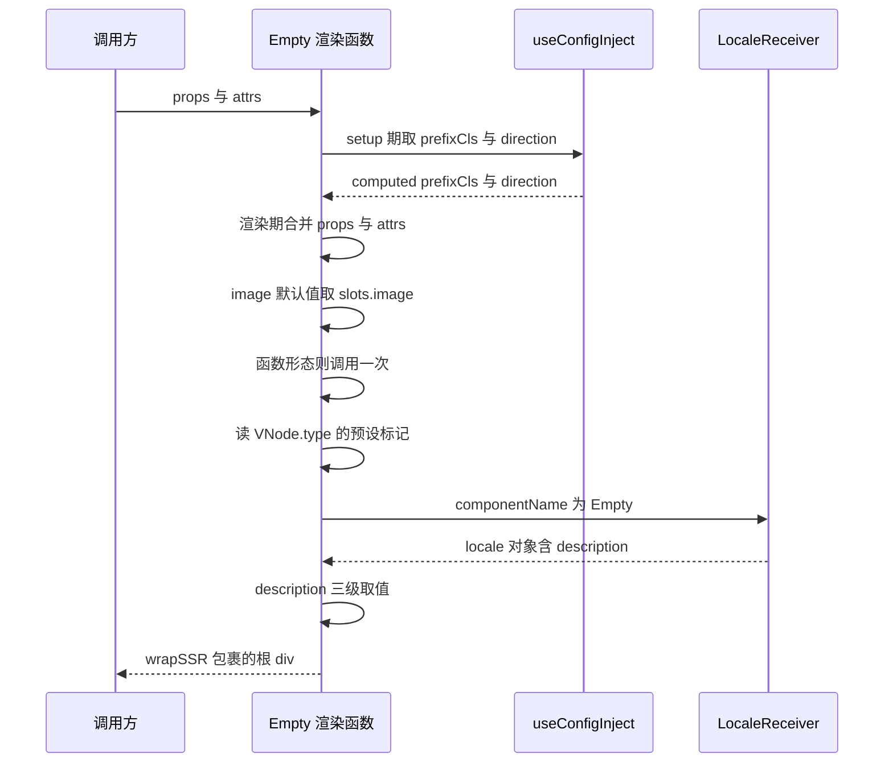
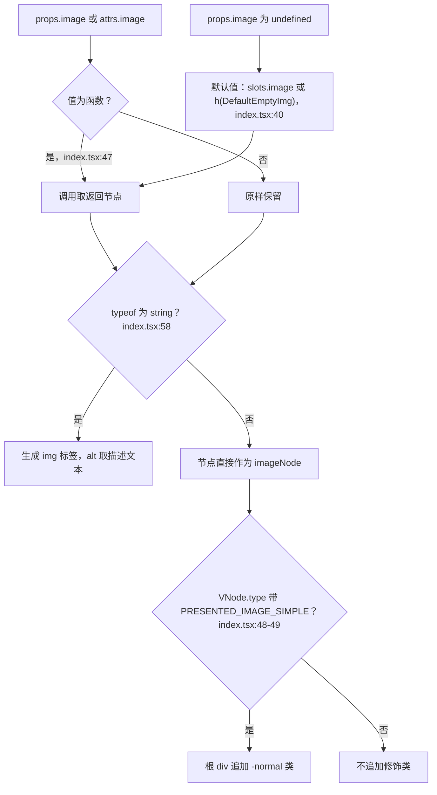
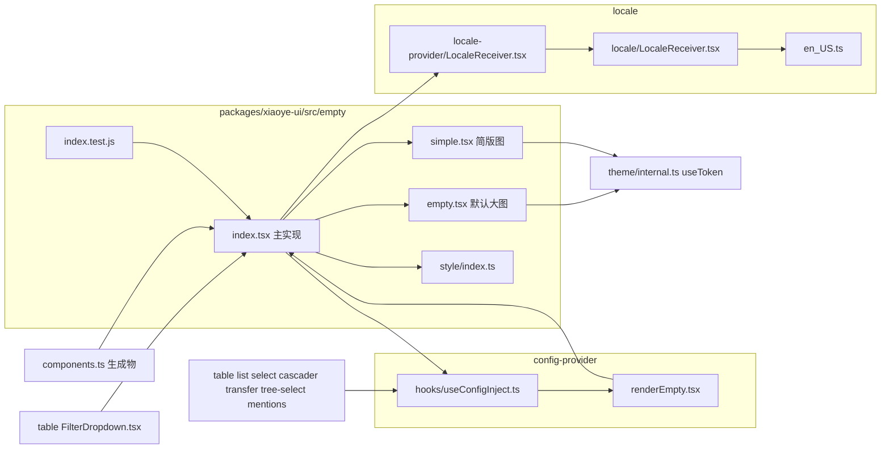

# C01-07 Empty 空状态

> **本篇解决**：Empty 组件自身的 `image` / `preset` 描述符是如何被解析成最终渲染物的；`PRESENTED_IMAGE_SIMPLE` / `PRESENTED_IMAGE_DEFAULT` 作为公开常量到底暴露了什么；以及 ConfigProvider 的 `renderEmpty` 覆盖在 Empty 内部究竟从哪一行落地。
> **前置**：A05《ConfigProvider 注入链与 Size/Disabled Context》、A06《Props 体系与类型工具》、I11《多语言体系》；已论证过本篇所依赖的 `renderEmpty` 四级解析链的是 C12-02《ConfigProvider 全局配置》，本篇不重述　**读者坐标**：`03-components/01-general` 第 7 篇

## 一、职责与边界

`Empty` 只负责一件事：**把一个已经被判定为「无内容」的区域渲染成静态块**（插图 + 描述 + 可选底部操作区）。它自己不做任何「是否为空」的判定——`packages/xiaoye-ui/src/empty/index.tsx:37` 的渲染函数里没有任何与数据相关的条件分支，整个 `setup`（`index.tsx:32-85`）也不创建本地状态：按 `ref(`、`reactive(`、`watch(`、`onMounted` 四个标识统计，`index.tsx` 命中数为 0（复现命令见文末检查点 1）。这是一个**纯渲染组件**，没有受控/非受控问题，也因此不受 I13《响应式内核 hooks》的那套 `useMergedState` 约定约束。

它明确**不负责**的四件事：

- **触发条件**：Table 的空数据（`table/Table.tsx:631`）、Select 的无匹配项（`select/index.tsx:246`）、筛选面板的无筛选项（`table/hooks/useFilter/FilterDropdown.tsx:372`）都由调用方各自判定，`Empty` 侧零知情。
- **`renderEmpty` 的解析与优先级**：`props.renderEmpty` → `slots.renderEmpty` → `parentContext.renderEmpty` → 默认实现这条四级链，以及它和 `useConfigInject`、`empty` 构成的三模块循环，已由 C12-02《ConfigProvider 全局配置》完整论证。本篇只讲**这条链的产物如何变成 Empty 的入参**（见 §三与 §五 论点 3），不重述解析过程。
- **语言包的装载与合并**：`Empty` 只声明消费一个 locale 键 `componentName="Empty"`（`index.tsx:52`），兜底值来自 `locale/en_US.ts:71-73`；60+ 语言包的装载路径归 I11《多语言体系》。
- **样式注水**：`genComponentStyleHook` 的缓存、`hashId` 与 SSR 注水归 A04；本篇只读 `empty/style/index.ts` 里 Empty 自己声明了什么、没声明什么。

**依赖清单**（`index.tsx:1-12` 共 11 条 import 语句，其中 `:2` 与 `:8` 是 type-only）：

- 向下依赖 8 个模块：`_util/classNames`（`:3`）、`locale-provider/LocaleReceiver`（`:4`）、两张内联 SVG 组件 `./empty` 与 `./simple`（`:5-6`）、`_util/props-util` 的 `filterEmpty`（`:7`）、`_util/type` 的 `anyType / objectType / withInstall`（`:9`）、`config-provider/hooks/useConfigInject`（`:10`）、`./style`（`:12`）、`vue` 的 `defineComponent / h`（`:1`）。
- 被谁依赖：以 `from '…/empty'` 形式直接引入 Empty 运行时值的业务文件只有两处——`config-provider/renderEmpty.tsx:1` 与 `table/hooks/useFilter/FilterDropdown.tsx:7`；另外 `theme/interface/components.ts:25` 是 type-only 引入其 `ComponentToken`，`components.ts:136-137` 是生成物聚合。

「几乎没人直接用它，但人人间接经过它」这个形状，正是下面论点 3 的出发点。

## 二、源码地图

| 文件 | 行数 | 职责 | 关键导出与标记 |
| --- | --- | --- | --- |
| `packages/xiaoye-ui/src/empty/index.tsx` | 91 | 主实现；预设静态挂载点 | `emptyProps`（`:18`）、`EmptyProps`（`:25`）、`PRESENTED_IMAGE_DEFAULT`（`:88`）、`PRESENTED_IMAGE_SIMPLE`（`:89`）、默认导出（`:91`） |
| `packages/xiaoye-ui/src/empty/empty.tsx` | 76 | 默认大图，`184×152` 内联 SVG | `name: 'EmptyDefault'`（`:8`）、静态标记 `PRESENTED_IMAGE_DEFAULT = true`（`:74`） |
| `packages/xiaoye-ui/src/empty/simple.tsx` | 41 | 简版图，`64×41` 内联 SVG，颜色由 Token 派生 | `name: 'EmptySimple'`（`:7`）、静态标记 `PRESENTED_IMAGE_SIMPLE = true`（`:40`） |
| `packages/xiaoye-ui/src/empty/style/index.ts` | 80 | `EmptyToken` 与四条规则 | `ComponentToken`（`:6`，空接口）、`EmptyToken`（`:8`）、`genComponentStyleHook('Empty')`（`:69`） |
| `packages/xiaoye-ui/src/empty/index.test.js` | 25 | 2 个用例 + `mountTest` | 无导出；被 `vitest.config.mts:33` 的 glob 覆盖 |

主实现入口是 `empty/index.tsx:27` 的 `defineComponent`，公开组件由 `:91` 的 `withInstall(Empty)` 产出。

组件目录之外、但参与 Empty 运行时形状的文件：

| 文件 | 行数 | 与 Empty 的关系 |
| --- | --- | --- |
| `packages/xiaoye-ui/src/config-provider/renderEmpty.tsx` | 35 | `DefaultRenderEmpty`（`:9`）按 `componentName` 分派 Empty 的三种预设形态 |
| `packages/xiaoye-ui/src/config-provider/hooks/useConfigInject.ts` | 74 | `:12` 的注入兜底工厂把 `DefaultRenderEmpty` 包成 `renderEmpty`；`:19` 原样透传 |
| `packages/xiaoye-ui/src/locale/LocaleReceiver.tsx` | 86 | `:36` 注入 `localeData`、`:43` 按组件名取键，Empty 的默认文案经此到达 |
| `packages/xiaoye-ui/src/locale-provider/LocaleReceiver.tsx` | 5 | 纯转发 shim（`:1-3`），Empty 的 import 走的是它 |
| `packages/xiaoye-ui/src/locale/en_US.ts` / `zh_CN.ts` | — | `Empty.description` 分别见 `en_US.ts:71-73` 与 `zh_CN.ts:70-72` |
| `packages/xiaoye-ui/src/_util/type.ts` | — | `withInstall`（`:39-46`）、`objectType`（`:54-56`）、`anyType`（`:66-78`） |
| `packages/xiaoye-ui/src/_util/props-util/index.ts` | — | `filterEmpty`（`:230-242`）与它依赖的 `isEmptyElement`（`:213`） |
| `packages/xiaoye-ui/src/theme/interface/components.ts` | — | `:25` type-only 引入、`:101` 挂成可选槽位 `Empty?: EmptyComponentToken` |

## 三、架构与数据流

### 3.1 一次渲染的完整闭环



这条链上有三个时间点值得钉住。**第一**，`useConfigInject` 只在 `setup` 期调用一次（`index.tsx:33`），拿到的是两个 `computed`（`useConfigInject.ts:14-15`），渲染函数每次执行时读 `.value`（`index.tsx:38`、`index.tsx:68`）——这是 Empty 里唯一的响应式来源，也解释了为什么 `prefixCls` 在 `<xy-config-provider prefixCls="my">` 下会变。**第二**，所有 props 的合并、插槽的求值、预设函数的调用、类型标记的探测都发生在**渲染函数体内**（`index.tsx:39-49`），不是 `setup` 期一次算好：`slots.image?.()`（`:40`）与 `mergedImage()`（`:47`）都是每次重渲染重新执行。对纯静态内容无所谓，但对「插槽里返回了带副作用的节点」这种写法，执行次数等于渲染次数。**第三**，`LocaleReceiver` 不是外部数据源而是一个**渲染期回调容器**：`index.tsx:51-53` 把整棵子树塞进它的 `children` 函数 prop，`locale/LocaleReceiver.tsx:59-61` 决定 `props.children || slots.default` 后调用，所以描述文案的求值发生在 locale computed 之后。

### 3.2 `image` 描述符的解析分支



图里最要紧的是**两条判定彼此独立**：`:47` 决定「拿到什么节点」，`:48-49` 决定「根 div 长什么类」。一个自定义 SVG 组件即使被当作 `image` 传入，只要它的 `type` 上没有 `PRESENTED_IMAGE_SIMPLE` 静态属性，就永远拿不到 `-normal` 类；反过来 `Empty.PRESENTED_IMAGE_SIMPLE` 之所以能同时做到「渲染出简版图」和「加上 `-normal` 类」，是因为它同时命中了这两条支路——函数形态命中 `:47`，返回的 VNode 的 `type` 命中 `:48`。论点 2 展开。

### 3.3 静态结构：Empty 的文件与外部消费面



结构上有三点必须讲清，否则读者会误判改动半径。**其一**，`UCI --> RRE` 与 `RRE --> IDX`、`IDX --> UCI` 构成一个环，这个环的存在理由与它是如何不被 TDZ 炸掉的，C12-02 已经论证过，本篇不重复；本篇关心的是环上 Empty 一侧的接口形状：`index.tsx:33` 只从 `useConfigInject` 的 20 多个返回字段里取了 `direction` 与 `prefixCls` 两个（`useConfigInject.ts:50-73`），**没有取 `renderEmpty`**——这一点决定了 §四 论点 3 的全部内容。**其二**，`DEF`/`SMP` 两张 SVG 直接依赖 `theme/internal` 的 `useToken`（`empty.tsx:1`、`simple.tsx:3` → `theme/internal.ts:107`），也就是说不经过 `EmptyToken`，它们自己就会触发一次主题求值。**其三**，`CONS` 那一组业务组件从不直连 `IDX`，它们只调 `renderEmpty`；唯一绕过分派表直接 `import Empty` 的业务文件是 `table/hooks/useFilter/FilterDropdown.tsx:7`，它手写 `<Empty image={Empty.PRESENTED_IMAGE_SIMPLE} description={locale.filterEmptyText}>`（`:371-373`），因此不受 ConfigProvider 的 `renderEmpty` 覆盖影响——这是个容易被忽略的行为差异，见坑 5。

## 四、核心机制精读

### 论点 1：`image` 有三种输入形态，解析靠渲染期的两条独立判定，props 声明本身不提供任何运行时约束

**断言**：`image` 的 prop 类型是 `anyType<VueNode>()`，它在运行时展开成一个**没有 `type` 字段**的描述符，因此 Vue 不会做任何类型校验；真正把「函数 / VNode / 字符串」三种形态分流的是 `index.tsx:46-47` 与 `index.tsx:58-62` 两条互不认识的判定，字符串分支还依赖 `:55` 先算出的 `alt`。

props 声明（`packages/xiaoye-ui/src/empty/index.tsx:18`）：

```tsx
// packages/xiaoye-ui/src/empty/index.tsx:18
export const emptyProps = () => ({
  prefixCls: String,
  imageStyle: objectType<CSSProperties>(),
  image: anyType<VueNode>(),
  description: anyType<VueNode>(),
});
```

`anyType` 的实现（`packages/xiaoye-ui/src/_util/type.ts:66`）：

```ts
// packages/xiaoye-ui/src/_util/type.ts:66
export function anyType<T = any>(defaultVal?: T, required?: boolean) {
  const type = { validator: () => true, default: defaultVal as T } as unknown;
  return required
    ? (type as {
        type: PropType<T>;
        default: T;
        required: true;
      })
    : (type as {
        default: T;
        type: PropType<T>;
      });
}
```

逐段拆开看。`:67` 造出的**运行时对象只有 `validator` 与 `default` 两个键**，返回类型里的 `type: PropType<T>` 是 `as` 断言，编译期存在、运行期不存在。这意味着：`image` 传字符串、传数组、传组件选项对象、传 `null`，Vue 一律接受且不告警；`validator: () => true` 恒真，等于关掉校验。`default` 被显式写成 `undefined`（`:67` 的 `defaultVal` 未传），其效果是让 `hasOwn(opt, 'default')` 为真但取值仍是 `undefined`，于是 `index.tsx:40` 的**解构默认值**才成为真正的兜底层——Empty 的默认值机制不在 props 层，而在渲染函数的解构层。

解析主体（`packages/xiaoye-ui/src/empty/index.tsx:39`）：

```tsx
// packages/xiaoye-ui/src/empty/index.tsx:39
      const {
        image: mergedImage = slots.image?.() || h(DefaultEmptyImg),
        description = slots.description?.() || undefined,
        imageStyle,
        class: className = '',
        ...restProps
      } = { ...props, ...attrs };
      const image =
        typeof mergedImage === 'function' ? (mergedImage as () => VueNode)() : mergedImage;
```

`:45` 先把 props 与 attrs 合成一个对象再解构，`props` 在前 `attrs` 在后，所以**同名键 attrs 覆盖 props**；由于 `image/description/imageStyle/prefixCls` 都是声明过的 prop，正常写法下它们只会出现在 `props` 里，`attrs` 覆盖这条只对「用 `v-bind` 整体绑定一个含 `image` 键的对象」这类非常规写法生效。`:40` 的默认值链是 `slots.image?.() || h(DefaultEmptyImg)`：注意用的是 `||` 而非 `??`，插槽返回空字符串、`0`、`false` 或 `null` 时都会继续回落到默认大图。`:46-47` 是第一条分流：**值是函数就调用一次**，这既服务于 `Empty.PRESENTED_IMAGE_SIMPLE` 这种工厂函数，也意味着用户若传入一个「渲染函数式的组件对象」会被误当作工厂调用。

第二条分流在 `packages/xiaoye-ui/src/empty/index.tsx:56`：

```tsx
// packages/xiaoye-ui/src/empty/index.tsx:56
            let imageNode: EmptyProps['image'] = null;

            if (typeof image === 'string') {
              imageNode = ;
            } else {
              imageNode = image;
            }
```

`alt` 来自 `:55` 的 `typeof des === 'string' ? des : 'empty'`——只有字符串描述才能进 `alt`，插槽或 VNode 描述会退成硬编码字面量 `'empty'`。这段代码的位置值得强调：它在 `LocaleReceiver` 的回调内部（`:53` 起），所以 `image` 的解析结果 `:47` 与它消费的描述 `:54` 分别在容器构造前与容器构造后求值，跨过了一个组件边界。

**回扣**：`image` 的契约不写在类型里，写在渲染函数的两条 `typeof` 判定里。改任何一条都不会有 TypeScript 报错兜底，也不会有 Vue 运行时告警——`anyType` 把这两道闸都关掉了。

### 论点 2：`PRESENTED_IMAGE_*` 是两条正交通道——公开面是工厂函数，内部面是组件静态标记，而后者才是修饰类的唯一开关

**断言**：`Empty.PRESENTED_IMAGE_SIMPLE`（`index.tsx:89`）暴露的是一个**返回 VNode 的函数**，它本身不参与任何判定；真正驱动 `-normal` 类的是渲染产物 VNode 的 `type` 上那个 `PRESENTED_IMAGE_SIMPLE = true` 静态标记（`simple.tsx:40`）。同名标识在库里存在**两个不同类型、不同用途、不同文件**的实例，而 `PRESENTED_IMAGE_DEFAULT` 那一侧的标记（`empty.tsx:74`）没有任何读取点。

公开面的挂载（`packages/xiaoye-ui/src/empty/index.tsx:88`）：

```tsx
// packages/xiaoye-ui/src/empty/index.tsx:88
Empty.PRESENTED_IMAGE_DEFAULT = () => h(DefaultEmptyImg);
Empty.PRESENTED_IMAGE_SIMPLE = () => h(SimpleEmptyImg);

export default withInstall(Empty);
```

内部标记（两张 SVG 各自的文件末尾）：

```tsx
// packages/xiaoye-ui/src/empty/simple.tsx:40
Simple.PRESENTED_IMAGE_SIMPLE = true;
export default Simple;
```

```tsx
// packages/xiaoye-ui/src/empty/empty.tsx:74
Empty.PRESENTED_IMAGE_DEFAULT = true;

export default Empty;
```

判定只读 SIMPLE，不读 DEFAULT（`packages/xiaoye-ui/src/empty/index.tsx:48`）：

```tsx
// packages/xiaoye-ui/src/empty/index.tsx:48
      const isNormal =
        typeof image === 'object' && 'type' in image && (image.type as any).PRESENTED_IMAGE_SIMPLE;
```

`:49` 的表达式在 VNode 上找 `type` 属性并要求其**构造器对象**带 `PRESENTED_IMAGE_SIMPLE`。把 `:88-89`、`:48-49`、`simple.tsx:40` 三处串起来，`<Empty image={Empty.PRESENTED_IMAGE_SIMPLE} />` 的实际执行序列是：`:40` 拿到函数（props 未定义时才走插槽链）→ `:47` 调用函数得到 `h(SimpleEmptyImg)` 这个 VNode → `:49` 读 `VNode.type`（即 `Simple` 组件对象）上的标记为 `true` → `:67` 输出 `${prefixCls}-normal`。三处缺一不可，这是一次「用函数形态传内容 + 用类型标记传语义」的双通道设计，两条通道互相不认识：`:47` 不看标记，`:49` 不看函数。

这条设计有三个可直接验证的后果。

1. **`-normal` 这个名字与实际语义相反**。`index.tsx:48` 变量叫 `isNormal`，命中条件是「用了 SIMPLE 简版图」，`:67` 输出的类名是 `xy-empty-normal`，而 `style/index.ts:47-54` 给它的规则是 `marginBlock: marginXL` + 图片高度 `emptyImgHeightMD`。也就是说 `xy-empty-normal` 标注的是「简版图态」，默认大图态反而**没有**任何修饰类。读样式文件时按字面理解「normal = 默认」会得出相反结论。
2. **外部无法伪造这个身份**。带标记的组件对象 `Simple` 只存在于 `empty/simple.tsx` 内部，而 `packages/xiaoye-ui/package.json:261-265` 只暴露 `./empty` 与 `./empty/style` 两个入口，**没有** `./empty/simple`；所以调用方能拿到的只有 `Empty.PRESENTED_IMAGE_SIMPLE` 这个工厂。副作用是：任何「自己画的简版图」——无论是 `h(MySvg)` 生成的 VNode 还是 `#image` 插槽返回的节点——都不会带 `PRESENTED_IMAGE_SIMPLE` 标记，`:49` 判定失败，`-normal` 类与 `style/index.ts:47-54` 那组 `marginBlock: marginXL` + `emptyImgHeightMD` 全部不生效，而视觉上两张图可能几乎一样。判据是**身份**而不是**外观**，`anyType`（论点 1）不会给出任何提示。
3. **`PRESENTED_IMAGE_DEFAULT` 的内部标记是死代码**。源码侧对这个名字的命中只有两处：`index.tsx:88` 的公开工厂与 `empty.tsx:74` 的 `= true` 标记；`index.tsx:48-49` 只读 SIMPLE，全库没有任何一处读 DEFAULT 标记。用法手册在 2026-10-02 的文档重构后已不再把它列进公开面（旧版手册曾列出），但导出面仍发这个常量，构成「导出面存活、内部实现死亡」的同型残留：`empty.tsx:74` 属于 OUTLINE.md 已知待办登记的那批「API 面存活、实现死亡」家族。另外要注意它和 `index.tsx:88` **同名不同类型**（一个是 `true`，一个是函数），排查时极易误判成「DEFAULT 也参与判定」。

**回扣**：预设不是「一张图的别名」，而是「工厂函数 + 类型标记」的成对约定。要新增一个预设（例如 `-small` 之外的高度档位），必须同时改三处：在 SVG 组件上挂新标记、在 `index.tsx:88-89` 旁挂新工厂、在 `index.tsx:48` 的判定里加读新标记；只挂工厂不加标记，图会变但外边距不变，且没有任何报错。

### 论点 3：Empty 从不读 `renderEmpty`——覆盖发生在调用方，`componentName` 是裸字符串契约，分派表里有两个 case 全库无调用点

**断言**：`empty/index.tsx:33` 从 `useConfigInject` 的返回对象里只解构了 `direction` 与 `prefixCls` 两个字段，`renderEmpty`（`useConfigInject.ts:19` 取出、`:61` 返回）在 Empty 内部**零读取**。所以 `<xy-config-provider :render-empty="fn">` 不会改变页面上任何一个显式写出的 `<xy-empty>`，它只改变那些调用 `renderEmpty(...)` 的组件渲染出什么。这条链唯一的参数是字符串 `componentName`，而 `renderEmpty.tsx:12-24` 的六个 case 中，`'TreeSelect'` 与 `'Mentions'` 在全库没有任何调用点。

分派表（`packages/xiaoye-ui/src/config-provider/renderEmpty.tsx:9`）：

```tsx
// packages/xiaoye-ui/src/config-provider/renderEmpty.tsx:9
export const DefaultRenderEmpty = (props: RenderEmptyProps) => {
  const { prefixCls } = useConfigInject('empty', props);
  const renderHtml = (componentName?: string) => {
    switch (componentName) {
      case 'Table':
      case 'List':
        return <Empty image={Empty.PRESENTED_IMAGE_SIMPLE} />;
      case 'Select':
      case 'TreeSelect':
      case 'Cascader':
      case 'Transfer':
      case 'Mentions':
        return <Empty image={Empty.PRESENTED_IMAGE_SIMPLE} class={`${prefixCls.value}-small`} />;
      default:
        return <Empty />;
    }
  };
  return renderHtml(props.componentName);
};
```

逐段读。`:10` 说明 `DefaultRenderEmpty` 是个普通函数而不是 `defineComponent`，它自己也调一次 `useConfigInject('empty', props)`，拿 `prefixCls` 的唯一目的是在 `:21` 拼出 `-small` 后缀——这个后缀是字符串拼接而非 `classNames` 调用，所以它依赖 `prefixCls` 与 Empty 根类名前缀**完全一致**这一事实（`getPrefixCls` 的默认实现见 `config-provider/context.ts:166-169`，`xy-${suffixCls}`）。`:13-15` 与 `:16-21` 都用 SIMPLE 预设，差别只在 `:21` 多一个 `class`；`:22-23` 的 default 分支是唯一产出 184×152 大图的路径。

把论点 2 的结论接上，可以得到一个容易被误判的推论：**分派表永远产不出「大图 + `-normal`」**，因为 `-normal` 只由 `PRESENTED_IMAGE_SIMPLE` 标记触发（`index.tsx:48-49`）。所以 `DefaultRenderEmpty` 的三种产物实际是：大图无修饰类、简版图 + `-normal`、简版图 + `-normal` + `-small`，三档里两档走 SIMPLE。

调用侧的实际字符串（排除 `dist` 与 `node_modules`，全量列举）：

| 调用点 | 传入字符串 | 命中分支 |
| --- | --- | --- |
| `table/Table.tsx:631` | `'Table'` | `renderEmpty.tsx:13` |
| `list/index.tsx:313` | `'List'` | `:14` |
| `select/index.tsx:246` | `'Select'` | `:16` |
| `cascader/index.tsx:253` | `'Cascader'` | `:18` |
| `transfer/index.tsx:165` | `'Transfer'` | `:19` |
| `tree-select/index.tsx:261` | `'Select'` | `:16` |
| `mentions/index.tsx:189` | `'Select'` | `:16` |

七个调用点、五种字符串。`tree-select` 与 `mentions` 都传 `'Select'`（各自 `:261`、`:193`），而不是自己同名的 `'TreeSelect'` / `'Mentions'`；这两个 case 标签（`renderEmpty.tsx:17`、`:20`）因此**不可达**。它们不是 bug——两组标签在同一 `case` 块里 fall through 到同一行 `:21`，行为与 `'Select'` 完全等价，所以历史上改名不会暴露问题。但它们是死分支：任何人把 `:16-21` 拆开、给 `'TreeSelect'` 单独一档，都不会被现有调用点触发，也不会有测试报警。

第二个断言点是**这个字符串没有类型保护**。`RenderEmptyProps.componentName?: string`（`renderEmpty.tsx:6`）与 `RenderEmptyHandler`（`:33`，即 `typeof renderEmpty`，`:29` 的入参是 `componentName?: string`）都是裸 `string`。库内其实存在一个更严格的类型 `LocaleComponentName = Exclude<keyof Locale, 'locale'>`（`locale/LocaleReceiver.tsx:5`），但 `renderEmpty` 没有复用它。后果很直接：业务方自定义 `renderEmpty` 时把 `'treeSelect'` 写错大小写，会静默落到 `:22` 的 default 分支，渲染出**大图**而不是简版图——形态突变，无告警。用户自定义函数拿到的也是这个原始字符串，因为 `config-provider/index.tsx:93` 只是 `renderEmpty(name)` 原样转发。

第三个断言点关于**兜底的双重性**。`select/index.tsx:246` 写的是 `renderEmpty?.('Select') || <DefaultRenderEmpty componentName="Select" />`。这里的 `||` 在 select 这条路上不可能命中：`renderEmpty` 取自 `useConfigInject('select', props)`（`select/index.tsx:162`），而 `useConfigInject.ts:10-13` 的 `inject` 兜底对象显式补了 `renderEmpty`，真实 provide 方 `config-provider/index.tsx:167` 也无条件装配。它防的是**另一个注入入口**：`useConfigContextInject`（`context.ts:175-177`）的兜底是 `defaultConfigProvider`（`:165-173`），那个对象只有 `getPrefixCls`、`iconPrefixCls`、`getPopupContainer`、`direction` 四个字段，**没有 `renderEmpty`**。也就是说同一个「取配置」动作在库里有两套兜底表，字段集不同，组件写法混用时才需要 `?.` 与 `||` 双保险。

**回扣**：`renderEmpty` 的落地方式不是「Empty 内部读取一个全局配置」，而是「调用方换成另一个 Empty 实例」。要改空状态的默认形态，改 `renderEmpty.tsx:12-24`；要改 Empty 本身，改 `index.tsx`；两者互不生效——这是本篇与 C12-02 的分工线。

### 论点 4：两张内置 SVG 的主题响应能力不对称，`EmptyToken` 四个成员里一个是死的，三个高度档位全部借自 `controlHeightLG`

**断言**：简版图的三种颜色由 Token 经 `TinyColor` 与背景色混合后重算（`simple.tsx:11-21`），默认大图的填充色是**写死的 hex 字面量**、对主题唯一的响应是整体透明度（`empty.tsx:12-22`）；两者都调 `useToken`（`empty.tsx:10`、`simple.tsx:9`），所以这不是能力缺失而是实现选择。同时 `EmptyToken`（`style/index.ts:8-13`）声明的四个成员里 `emptyImgCls` 无任何读取点，另外三个高度全部从表单控件高度别名 Token 派生（`:74-76`）。

简版图的着色（`packages/xiaoye-ui/src/empty/simple.tsx:11`）：

```tsx
// packages/xiaoye-ui/src/empty/simple.tsx:11
    const color = computed(() => {
      const { colorFill, colorFillTertiary, colorFillQuaternary, colorBgContainer } = token.value;

      return {
        borderColor: new TinyColor(colorFill).onBackground(colorBgContainer).toHexString(),
        shadowColor: new TinyColor(colorFillTertiary).onBackground(colorBgContainer).toHexString(),
        contentColor: new TinyColor(colorFillQuaternary)
          .onBackground(colorBgContainer)
          .toHexString(),
      };
    });
```

`:12` 一次取四个别名 Token，`:15-19` 每次都做 `onBackground(colorBgContainer)` 混合后再 `toHexString()`，因此换 `darkAlgorithm`、换 `colorFill` 系列或换容器背景 Token，这张图的描边、投影、内芯三块都会跟着变；`fill={color.value.*}` 出现在 `:26`、`:31`，是**属性级**的动态值。

默认大图的着色（`packages/xiaoye-ui/src/empty/empty.tsx:12`）：

```tsx
// packages/xiaoye-ui/src/empty/empty.tsx:12
    const themeStyle = computed<CSSProperties>(() => {
      const bgColor = new TinyColor(token.value.colorBgBase);

      // Dark Theme need more dark of this
      // ...
      if (bgColor.toHsl().l < 0.5) {
        return {
          opacity: 0.65,
        };
      }
      return {};
    });
```

`:13` 只读一个 Token（`colorBgBase`），`:16` 用 HSL 亮度阈值 0.5 判定是否暗色，命中就返回 `opacity: 0.65`（`:19`），否则返回空对象。整张图其余的着色全是字面量属性：`fill="#F5F5F7"`（`:36`、`:53`）、`fill="#AEB8C2"`（`:44`）、`fill="#DCE0E6"`（`:62`）、`fill="#FFF"`（`:64`），还有 `fill-opacity=".8"`（`:35`）。这些值不经过任何 Token，`useToken` 拿到的 `token.value` 在 `empty.tsx` 里只被 `:13` 用过一次。

结论是可观测的：暗色主题下简版图会重新配色，大图仍是那一组浅灰填充，只是整体半透明；如果外层容器不是纯 `colorBgBase`，`l < 0.5` 的判定还可能判错，因为它看的是全局背景基色而不是插画所在容器的颜色（对比 `simple.tsx:15` 用的是 `colorBgContainer`）。

再看样式侧的 Token 面（`packages/xiaoye-ui/src/empty/style/index.ts:69`）：

```ts
// packages/xiaoye-ui/src/empty/style/index.ts:69
export default genComponentStyleHook('Empty', token => {
  const { componentCls, controlHeightLG } = token;

  const emptyToken: EmptyToken = mergeToken<EmptyToken>(token, {
    emptyImgCls: `${componentCls}-img`,
    emptyImgHeight: controlHeightLG * 2.5,
    emptyImgHeightMD: controlHeightLG,
    emptyImgHeightSM: controlHeightLG * 0.875,
  });

  return [genSharedEmptyStyle(emptyToken)];
});
```

`:70` 从传入的 token 里只取两样东西，`:73-76` 造出四个成员。其中 `emptyImgCls` 在整个仓库只出现两次——接口声明 `:9` 与赋值 `:73`——`genSharedEmptyStyle`（`:16-65`）从未读它，用第二种方法交叉验证：全仓（排除 `dist`/`node_modules`）搜索 `xy-empty-img` 这个类名字符串，命中 0 处。所以它是一个「算了但没用」的 Token 成员，删掉不影响任何输出。

更值得注意的是高度基准。`:74-76` 三个档位分别是大图 `controlHeightLG × 2.5`、`-normal` 档 `× 1`、`-small` 档 `× 0.875`；而 `controlHeightLG` 是尺寸类 Map Token，语义是「较高的组件高度」（`packages/xiaoye-ui/src/theme/interface/maps/size.ts:63-67`，JSDoc 为 `@nameZH 较高的组件高度`），把它当插画尺寸基准意味着：调 `controlHeightLG` 会同时改变大号控件高度与空状态插画高度，而组件层没有逃逸口——`export interface ComponentToken {}` 是**空接口**（`style/index.ts:6`），`theme/interface/components.ts:97` 的 `Empty?: EmptyComponentToken`（`:25` type-only 引入）因此是一个永远为空的可选槽位，业务方无法通过主题 `components` 覆盖给 Empty 增加任何 Token。唯一的实用逃逸口是 `imageStyle` prop：`index.tsx:72` 把它挂在图片容器上，测试 `index.test.js:11-14` 正是用 `imageStyle={{ height: '20px' }}` 断言 `.xy-empty-image` 的高度而不是去改 Token——测试的写法本身就在说明「Token 路径不通」。

透明度也有两条独立通道叠加：容器 `opacity: token.opacityImage`（`style/index.ts:30`，Seed 声明见 `theme/interface/seeds.ts:172`，默认值 `theme/themes/seed.ts:71` 为 `1`）与大图自身的 `opacity: 0.65`（`empty.tsx:19`）。暗色主题下两者相乘，而简版图只能吃到容器那一条。

### 论点 5：描述文案的取值以 `undefined` 为唯一分界线，`null` 与空串会吞掉整行而不回落语言包

**断言**：Empty 的描述有 prop、插槽、语言包三个来源，但决定「用不用语言包」的不是真假而是**严格 `undefined` 判定**（`index.tsx:54`），因此 `:description="null"` 这种「看起来像没传」的写法会走「已定义」分支、再在 `:75` 的 `des &&` 处被判定为无内容，整行描述直接消失。插槽链用的是 `||`（`:41`），与公共工具 `getPropsSlot` 的 `??`（`_util/props-util/index.ts:260-262`）语义不同。

取值三行（`packages/xiaoye-ui/src/empty/index.tsx:53`）：

```tsx
// packages/xiaoye-ui/src/empty/index.tsx:53
          children={(locale: Locale) => {
            const des = typeof description !== 'undefined' ? description : locale.description;
            const alt = typeof des === 'string' ? des : 'empty';
```

`description` 来自 `:41` 的 `description = slots.description?.() || undefined`：这一行有两层。外层是解构默认值，只有 `props.description === undefined` 时才求右侧；内层 `|| undefined` 把插槽返回的假值统一压成 `undefined`。所以「插槽存在但返回空串」等价于「没有插槽」，而「prop 传空串」完全不会执行插槽函数。随后 `:54` 的 `typeof !== 'undefined'` 只看 prop/插槽合并后的最终值，`:75` 的 `des && <p …>` 再做一次真假判定——两次判定用的口径不一样，这就是 `null` 陷阱的来源。

语言包一侧的合并逻辑在 `packages/xiaoye-ui/src/locale/LocaleReceiver.tsx:37`：

```tsx
// packages/xiaoye-ui/src/locale/LocaleReceiver.tsx:37
    const locale = computed(() => {
      const { componentName = 'global', defaultLocale } = props;
      const locale =
        defaultLocale || (defaultLocaleData as LocaleInterface)[componentName || 'global'];
      const { antLocale } = localeData;

      const localeFromContext = componentName && antLocale ? antLocale[componentName] : {};
      return {
        ...(typeof locale === 'function' ? locale() : locale),
        ...(localeFromContext || {}),
      };
    });
```

Empty 没有传 `defaultLocale`（`index.tsx:51-53` 只给了 `componentName` 与 `children`），所以 `:40` 取 `defaultLocaleData['Empty']`，即 `locale/en_US.ts:71-73` 的 `{ description: 'No data' }`；`:43` 再从注入的 `antLocale` 里按同名键取业务侧语言包，`:44-47` 做**浅合并**。浅合并意味着只要当前语言包提供了 `Empty.description`，它就覆盖英文；没提供则逐字段回落英文而不是整包回落。`:36` 的 `inject('localeData', {})` 在没有任何 locale provider 时得到空对象，`:43` 的 `antLocale` 为 `undefined` → `localeFromContext = {}` → 结果恒为英文兜底，这是 `<xy-empty>` 在裸 app 下显示 `No data` 的原因。

关于 `alt`：`:55` 只在 `des` 是字符串时复用它，否则退回硬编码字面量 `'empty'`，最终进 `:59` 的 ``。也就是说**只有字符串 URL 形态的 image 才有 alt**（论点 1 的第二条分流），两张内置 SVG 没有 alt 也没有 `role`/`aria-*` 属性（`empty.tsx:25-31`、`simple.tsx:24` 的 svg 根节点属性只有 `width`/`height`/`viewBox`/`xmlns`），可访问性完全依赖描述文本；一旦用 `:description="null"` 把描述删掉，这个空状态对读屏就是**完全不可见**的空白块。

顺带说明 Empty 用的是 `children` 函数 prop 而不是默认插槽：`LocaleReceiver.tsx:59` 的 `const children = props.children || slots.default;` 决定了优先取 prop，Empty 在 `index.tsx:53` 传的是 `children={(locale) => …}` 形式，因此 `:61` 调用的是那个箭头函数。这类写法在 Vue 3 里会让 `LocaleReceiver` 的 props 变化触发重渲染，`props.children` 每次渲染都是新函数（`:53` 的字面量箭头函数），所以这个容器组件没有可缓存的 props 面。

**回扣**：描述文案的三层来源不是「优先级链」而是「两套判定 + 一次浅合并」，边界值 `null`、`''`、`false` 在两层判定里得到相反结论。

### 论点 6：`inheritAttrs: false` 之后靠手工三段式转发，代价是 prop 面与 DOM 面没有隔离，且两个「样式」落在两个不同节点

**断言**：Empty 关掉自动透传（`index.tsx:30`）后，用「合并 → 摘 `class` → 展开剩余」三步自己实现 attrs 转发（`:43-45`、`:70`），没有走 A06《Props 体系与类型工具》描述的 `pickAttrs` 隔离；直接后果是未摘出的 `prefixCls` 会进入 DOM 属性面，以及 `imageStyle` 与用户 `style` 分别作用于两个不同节点。

渲染出口（`packages/xiaoye-ui/src/empty/index.tsx:64`）：

```tsx
// packages/xiaoye-ui/src/empty/index.tsx:64
            return (
              <div
                class={classNames(prefixCls, className, hashId.value, {
                  [`${prefixCls}-normal`]: isNormal,
                  [`${prefixCls}-rtl`]: direction.value === 'rtl',
                })}
                {...restProps}
              >
                <div class={`${prefixCls}-image`} style={imageStyle}>
                  {imageNode}
                </div>
                {des && <p class={`${prefixCls}-description`}>{des}</p>}
                {slots.default && (
                  <div class={`${prefixCls}-footer`}>{filterEmpty(slots.default())}</div>
                )}
              </div>
            );
```

`:66` 的四元 `classNames` 是理解这个组件类名面的关键：`prefixCls`（来自 `useConfigInject.ts:14`，默认实现 `context.ts:168` 产出 `xy-empty`）、`className`（用户在组件上写的 class，`:43` 摘出，默认 `''`）、`hashId.value`（样式引擎的哈希类，归 A04）、以及两个修饰键。`style/index.ts:26` 与 `:42` 的两行注释「原来 `&-image` 没有父子结构，现在为了外层承担我们的 hashId，改成父子结果」说的正是同一件事：`hashId` 只挂在根 div 上（`:66`），所以 `-image`、`-footer` 这些子节点必须写成后代选择器才能命中，这解释了样式文件里 `:27` 与 `:43` 为什么是 `[`${componentCls}-image`]` 嵌套而不是 `&-image` 平铺。

`{...restProps}` 在 `:70` 位于 `class` 之后。JSX 展开按对象顺序覆盖同名键，因此这段代码的安全性完全依赖 `:39-45` 的摘取清单是否穷尽。对照声明的四个 prop（`:19-22`）：`image`、`description`、`imageStyle` 都被摘走，**`prefixCls` 没有**。它一定存在于合并对象里（值通常是 `undefined`），于是随 `restProps` 一起写到根 div 上。属性是否落到 DOM 由 Vue 运行时的 `patchAttr` 决定——那是第三方产物（本机路径 `node_modules/@vue/runtime-dom/dist/runtime-dom.cjs.js`，不作为本专栏的 `file:line` 证据），其规则是值为 `null/undefined` 时调 `removeAttribute`，否则 `setAttribute`。所以默认情况下这个键不显形；但一旦有人显式写 `prefixCls="my-empty"`——这本来就是 `:19` 声明的公开 prop、也是 `useConfigInject.ts:14` 消费它的入口——根 div 上会同时出现一个语义化的类名前缀和一个 `prefixcls="my-empty"` 属性。不是崩溃，但属于「prop 面与 DOM 面没隔离」的可观测泄漏；库内其它组件用 `pickAttrs` 过滤（A06 的主题），Empty 这里没有。

两个样式的落点也要钉住：`imageStyle`（`:42` 摘出）只作用于 `:72` 的图片容器 div，而用户写在 `<xy-empty>` 上的 `style` 留在 `restProps` 里作用于根 div。`index.test.js:14` 断言的 `wrapper.find('.xy-empty-image').element.style.height` 证明前者的路径是通的，但这个用例同时也说明「改图片高度」在这个组件里根本没有走 Token 或 class（论点 4）。

`filterEmpty(slots.default())`（`:77`）是最后一个陷阱点：`:76` 的条件只检查**插槽函数是否存在**，不检查它返回的内容，过滤发生在内部。`_util/props-util/index.ts:230-241` 会把数组与 Fragment 摊平后用 `isEmptyElement`（`:213-220`，判定 Comment、空 Fragment、纯空白 Text）剔除空节点。因此 `#default` 里只放一个注释（`<!-- 暂无操作 -->`）时，footer 的 `<div class="xy-empty-footer">` 依然渲染，只是内容为空，并带上 `style/index.ts:43-45` 的 `marginTop: margin`——页面上多出一段无意义的外边距。同目录的 `isEmptySlot`（`:222-224`，`c().every(isEmptyElement)`）恰好能解决这件事，但 `index.tsx:7` 只导入了 `filterEmpty`，没导入它。

## 五、对外契约如何生效

**标签名怎么来的**：组件的 `name: 'XYEmpty'`（`index.tsx:28`）经 `withInstall`（`index.tsx:91` → `_util/type.ts:39-46`）在对象上挂一个 `install`（`type.ts:41-43`），`install` 内部转交 `registerComponent(app, c)`（`type.ts:42`）；后者从 `comp.displayName || comp.name` 取名（`_util/registerComponent.ts:18`），用 `toXYTagName` 把 `XY` 前缀换成 `xy-` 并整体小写（`registerComponent.ts:6-10`，`:8` 是前缀替换），得到 `xy-empty`，再用 `:23` 的存在性判断防重复注册。类型侧由生成物 `typings/global.d.ts:37` 的 `XYEmpty: (typeof import('xiaoye-ui'))['Empty']` 补齐 `GlobalComponents`，该文件由 `pnpm gen:entries` 产出，不改组件目录就不用手写（A02 的主题）。

**静态属性怎么透出**：`PRESENTED_IMAGE_*` 挂在组件对象上（`index.tsx:88-89`），而 `withInstall` 的返回是 `comp as T & Plugin`（`_util/type.ts:45`），返回的是**同一个对象引用**，不是包装体，所以 `import { Empty } from 'xiaoye-ui'` 之后 `Empty.PRESENTED_IMAGE_SIMPLE` 直接可用。聚合入口是两行生成物：`components.ts:136` 的 `export * from './empty'` 只透出 `emptyProps`（`index.tsx:18`）与 `EmptyProps`（`:25`）这两个具名符号，`components.ts:137` 的 `export { default as Empty }` 才透出组件。包级入口同样只有两条：`package.json:295`（`./empty`）与 `:299`（`./empty/style`）。

**四条契约路径的实际走向**：

- props → 渲染：`index.tsx:31` 挂上 `emptyProps()`，渲染函数在 `:39-45` 把 props 与 attrs 合并后解构，没有中间状态层（论点 1）。
- slots → 兜底：`setup` 形参写的是 `{ slots = {}, attrs }`（`:32`），给 `slots` 加了空对象默认值，因此 `:40-41` 的 `slots.image?.()` 在零插槽时安全返回 `undefined` 而不是抛错。三个插槽里 `image`、`description` 是**对应 prop 的兜底**（只有 prop 为 `undefined` 才求值），`default` 是唯一没有 prop 对应物的区域，落在 `:76-77` 的 `-footer`。
- context → 两个键：`index.tsx:33` 从 `useConfigInject` 只接 `direction` 与 `prefixCls`（对应 `useConfigInject.ts:14-15`）。`prefixCls` 进 `:66` 的根类名首位，`direction.value === 'rtl'` 进 `:68` 的修饰键。
- events / expose：**不存在**。`setup` 的解构里没有 `emit`（`:32`），`emptyProps` 的四个键里没有 `eventType`（`:19-22`，对照 `_util/type.ts:50-52`），全文件也没有 `expose(` 调用。也就是说 Empty 既不上抛事件也不暴露方法，交互只能靠 `#default` 插槽里放调用方自己的按钮。

`-rtl` 这一条要单独提醒：`index.tsx:68` 会输出 `xy-empty-rtl`，但 `empty/style/index.ts` 全文没有 `rtl` 字样，`theme/util/genComponentStyleHook.ts` 里也没有 rtl 的自动派生逻辑，在源码与样式文件（`ts/tsx/vue/less/css`）中搜索 `empty-rtl` 的命中为 0。它不出问题的原因是这个组件的间距全部写成 CSS 逻辑属性——`marginInline`（`style/index.ts:21`）与 `marginBlock`（`:48`、`:57`）——加上 `textAlign: 'center'`（`:24`）与方向无关。所以 `-rtl` 是一个**保留钩子而不是已有行为**：指望它带来翻转效果会落空，但它确实给了业务方一条不需要改组件的覆盖路径。

## 六、设计取舍

**「覆盖发生在调用方」而不是「组件内读全局」**。最自然的实现是让 Empty 自己在 `setup` 里读 `renderEmpty`，由它决定「我是否被换成别的渲染」。库选的是反方向：`index.tsx:33` 的解构里没有 `renderEmpty`，而由 7 个调用点各自决定传什么字符串（论点 3）。换来的是两点：一是 Empty 不可能自我递归（自读 `renderEmpty` 会命中 `useConfigInject.ts:12` 的默认实现，而默认实现又 `h(Empty)`，这是必须避开的环）；二是不同组件能在不改 Empty 的前提下拿到不同形态（`renderEmpty.tsx:13-23` 的三档）。赔上的是**一致性**：`FilterDropdown.tsx:7` 与 `:371-373` 绕过整条链直接 `import Empty` 并硬编码预设，于是它成为唯一一处「用户自定义 `renderEmpty` 管不到」的空状态；同时页面上显式写的 `<xy-empty>` 也不受全局配置影响，这两个反直觉点只能靠文档约束。

**「工厂函数 + 类型标记」而不是字符串枚举**。若把 API 设计成 `image="simple"`，`:48-49` 的 `VNode.type` 探测就不需要存在，`-normal` 也能被自定义图复用。现方案的收益是**预设可以被替换**：`index.tsx:88-89` 用 `h()` 现场构造节点，内置图与外部图在同一条 `:47` 路径上汇入，`EmptyProps['image']` 也因此能容纳字符串 URL（`:58-59`）。代价是三条：身份判定不可伪造也不可扩展（`package.json:295-299` 没暴露 `./empty/simple`，外部拿不到带标记的组件对象）；同名标识出现两种类型（`empty.tsx:74` 的 `true` 与 `index.tsx:88` 的函数）；新增预设要改三处文件（论点 2 回扣）。而 `anyType`（`_util/type.ts:66-78`）把 props 校验整条关掉，是为了这套多形态付出的第二笔账——类型层与运行时层同时失去约束。

**两张内置 SVG 内联在组件目录，而不是走 `@xiaoye-ui/icons` 或 ``**。收益是可证实的三点：无网络请求、SSR 直出（`empty.tsx:25-69` 的节点是纯静态 JSX）、以及简版图能做属性级着色（`simple.tsx:26`、`:31`）。代价同样明确：大图那 40 余行填充色是字面量（`empty.tsx:36-66`），主题化能力被实现选择卡死（论点 4）；两张图会被 `renderEmpty` 的值导入拉进每一条经过 `useConfigInject` 的依赖链，无法只取其一（这个传递面大小由 C12-02 量化，本篇不重复）；并且 `empty.tsx` 与 `simple.tsx` 都不在任何包级 `exports` 条目里（`package.json:295-299`），想换图只能整包替换 `image`。

**插画高度借道 `controlHeightLG`**。`style/index.ts:74-76` 的三档全以「较高的组件高度」这个尺寸 Map Token（`theme/interface/maps/size.ts:63-67`）为基数，同时 `ComponentToken` 是空接口（`style/index.ts:6`）、`theme/interface/components.ts:97` 的槽位可选且恒空，等于把「空状态插画尺寸」这个纯视觉维度绑死在控件尺寸族上。这条耦合没有注释说明理由，可推断的动机是复用既有 Map Token 以避免新增 Component Token（此处为推断，源码未记载取舍过程），代价是业务方调插画尺寸时只有 `imageStyle`（`index.tsx:72`）一条路——测试 `index.test.js:11-14` 用的正是这条路。

**惰性的 `compatConfig`**。`index.tsx:29`、`empty.tsx:7`、`simple.tsx:6` 三处都写 `compatConfig: { MODE: 3 }`，这是 Vue 2 兼容构建的开关；而 `@vue/compat` 这个包名在整个仓库的 `package.json` 与 `packages`、`apps` 下的 `ts/mts/js/json` 文件中命中 0 处（既没有依赖声明，也没有把 `vue` 别名指向兼容层），因此这三个字段在当前构建里不产生任何行为。留着它的成本是新人会以为组件仍在做迁移适配。

## 七、坑与改动指南

**坑 1：把 `description` 传成 `null` 或空串，整行描述消失**

- 触发：`<xy-empty :description="null">`，或用 `:description="''"` 想表达「先留空」。
- 症状：`xy-empty-description` 这个 `<p>` 完全不渲染；如果 `image` 是字符串 URL，`alt` 还会退成硬编码的 `empty`。用户预期通常是「回落到默认文案」。
- 原因：`index.tsx:54` 用 `typeof description !== 'undefined'` 决定是否回落语言包，`null` 与 `''` 都算「已定义」；随后 `:75` 的 `des && <p …>` 又按真假把这一行砍掉。两层判定口径不一致。
- 定位：`packages/xiaoye-ui/src/empty/index.tsx:41`、`:54`、`:55`、`:75`。只有 `false` 这条被测试锁定（`packages/xiaoye-ui/src/empty/index.test.js:17-23`），`null` 与 `''` 分支无测试保护。

**坑 2：自定义 `image` 拿不到 `-normal`，外边距与插画高度和内置简版图不一致**

- 触发：用 `#image` 插槽或 `:image="h(MySvg)"` 传一张自己的简笔插画。
- 症状：图形正确，但上下外边距和容器高度与 `Empty.PRESENTED_IMAGE_SIMPLE` 不一样，页面里几种空状态视觉不齐。
- 原因：`index.tsx:48-49` 的判据是 VNode `type` 上的 `PRESENTED_IMAGE_SIMPLE` 静态标记（`packages/xiaoye-ui/src/empty/simple.tsx:40`），不是外观；而带标记的组件对象不在包的 `exports` 面上（`packages/xiaoye-ui/package.json:261-265`），外部无法合法取得。
- 定位：`index.tsx:48-49`、`:67` 与样式侧 `packages/xiaoye-ui/src/empty/style/index.ts:47-54`。

**坑 3：`image` 传空串渲染出一个 src 为空的 ``**

- 触发：把后端字段直接绑给 `image`，而字段可能是 `''`，例如 `:image="record.placeholderUrl"`。
- 症状：控制台无告警，页面上出现一张破图（浏览器会按当前 URL 解析空 `src`），并且默认大图不再出现。
- 原因：`index.tsx:40` 的解构默认值只在 `undefined` 时生效，`''` 会原样穿过 `:47`，再被 `:58` 的 `typeof image === 'string'` 判中并生成 ``（`:59`）；`anyType`（`packages/xiaoye-ui/src/_util/type.ts:66-78`）不会产生任何 prop 警告。
- 定位：`index.tsx:40`、`:46-47`、`:58-59`。该分支无测试保护。

**坑 4：以为 ConfigProvider 的 `renderEmpty` 能改掉页面上显式写的空状态**

- 触发：配了 `:render-empty`，然后发现 `<xy-empty>` 区域没变，或者反过来发现 Table 筛选面板没变。
- 症状：两种「不生效」方向相反，容易被误判成注入链坏了。
- 原因：`index.tsx:33` 只解构 `direction` 与 `prefixCls`，Empty 内部不读 `renderEmpty`，所以显式写的 `<xy-empty>` 永远不受全局覆盖；而 `table/hooks/useFilter/FilterDropdown.tsx:7` 又绕过 `renderEmpty` 直接 `import Empty` 并在 `:371-373` 硬编码预设与文案，所以它同样不受覆盖，但原因完全不同。
- 定位：`index.tsx:33`、`config-provider/renderEmpty.tsx:12-24`、`FilterDropdown.tsx:7` 与 `:371-373`。解析链本身的机制见 C12-02《ConfigProvider 全局配置》，本篇不重复。

**坑 5：`#default` 只放注释时，footer 仍然渲染并带来一段空白**

- 触发：模板里用 `<!-- 预留操作区 -->` 占位，或插槽内容被 `v-if` 全部门控掉。
- 症状：`.xy-empty-footer` 依然出现在 DOM 里，带 `marginTop`，视觉上多出一截间距。
- 原因：`index.tsx:76` 只判断 `slots.default` 是否存在，`filterEmpty` 在 `:77` 内部才起作用，过滤后是空数组也不会撤销外层 `<div>`。
- 定位：`index.tsx:76-77`、`packages/xiaoye-ui/src/_util/props-util/index.ts:213-220`（`isEmptyElement`）与 `:230-241`（`filterEmpty`）；`_util/props-util/index.ts:222-224` 的 `isEmptySlot` 是现成修法但没被引入（`index.tsx:7`）。

**坑 6：改 `controlHeightLG` 调插画尺寸，会连带改掉所有「大号」控件高度**

- 触发：主题里调 `token.controlHeightLG` 想让空状态插画变矮。
- 症状：大号输入框、按钮等控件高度一起变，空状态却仍不是期望的比例（三档系数硬编码在 `:74-76`）。
- 原因：`empty/style/index.ts:74-76` 三个高度全部由 `controlHeightLG` 乘系数得出，而这个 Token 的本义是「较高的组件高度」（`packages/xiaoye-ui/src/theme/interface/maps/size.ts:63-67`）；Empty 没有 Component Token 可供覆盖——`export interface ComponentToken {}` 是空接口（`style/index.ts:6`），`theme/interface/components.ts:97` 的 `Empty?: EmptyComponentToken` 因此恒空。
- 定位：`empty/style/index.ts:6`、`:70`、`:74-76`；安全做法是 `imageStyle`（`index.tsx:72`），已有测试用的就是它（`index.test.js:11-14`）。

**坑 7：给 `'TreeSelect'` / `'Mentions'` 单独设一档，不产生任何效果**

- 触发：想给树选择器换一个更小的插画，于是在 `renderEmpty.tsx` 把 `case 'TreeSelect'` 拆出去。
- 症状：改完没变化，也不知道为什么。
- 原因：`tree-select/index.tsx:261` 与 `mentions/index.tsx:189` 传的都是 `'Select'`，全库 `renderEmpty('…')` 的字面量参数只有 `Table`、`List`、`Select`、`Cascader`、`Transfer` 五种，`:17` 与 `:20` 两个 case 不可达。
- 定位：`packages/xiaoye-ui/src/config-provider/renderEmpty.tsx:16-21`、`tree-select/index.tsx:261`、`mentions/index.tsx:189`。要让分派表按真实组件生效，得先改调用点传的字符串。

**坑 8：暗色主题下默认大图不重新配色**

- 触发：切到暗色算法后检查空状态。
- 症状：简版图颜色正常跟随，默认大图仍是浅灰填充叠 65% 透明度，在非全局背景色的容器里会显得「发白」。
- 原因：`packages/xiaoye-ui/src/empty/empty.tsx:12-22` 只做 `colorBgBase` 的亮度判定并返回 `opacity`，图内所有 `fill` 都是字面量（`:36`、`:44`、`:53`、`:62`、`:64`）；对照 `packages/xiaoye-ui/src/empty/simple.tsx:11-21` 的三色 Token 派生。
- 定位：`empty.tsx:13-19`。要真做主题化，得把大图的 `fill` 改成 `token` 派生值，这是重写插画而不是调参。

**测试现状**。`packages/xiaoye-ui/src/empty/index.test.js` 共 25 行、2 个 `it` 加一次 `mountTest`（`:6`），断言面是「`imageStyle` 能改图片容器高度」（`:8-15`）与「`description={false}` 不渲染描述」（`:17-24`）。它会真被执行：`packages/xiaoye-ui/vitest.config.mts:33` 的 include 含 `src/**/*.test.{js,ts,jsx,tsx}`，`.js` 在列。未覆盖的分支包括：`PRESENTED_IMAGE_*` 两个静态预设（`index.tsx:88-89`）、`isNormal` 与 `-normal` 类（`:48-49`、`:67`）、`-small` 类的唯一产生点（`config-provider/renderEmpty.tsx:21`）、字符串 URL 分支（`:58-59`）、`LocaleReceiver` 的 locale 回落（`:54`）、`rtl` 类（`:68`）、以及 `filterEmpty` 的空 footer（`:76-77`）。全库对 `xy-empty-normal` / `xy-empty-small` 这两个类名的断言为 0。

**改动安全边界**。可以安全改的：`index.tsx:39-45` 的摘取清单（补 `prefixCls` 摘取即可消除论点 6 的 DOM 泄漏，但要注意 `useConfigInject.ts:14` 仍从 `props.prefixCls` 读值，摘取只影响转发不影响取值）；`renderEmpty.tsx:12-24` 的分派表（新增 case 安全，删除或改现有 case 影响 7 个调用点）；`style/index.ts:72-77` 的 `emptyImgHeight*` 系数。动之前要评估的：`index.tsx:48-49` 的判定式（改它等于改 `xy-empty-normal` 的语义，而 `-normal` 与 `-small` 是这个组件仅有的两个尺寸开关）；`simple.tsx:40` 的标记名（它与 `index.tsx:89` 的公开常量同名，改名会同时动公开 API 与内部判据）；`empty.tsx:74` 的 `PRESENTED_IMAGE_DEFAULT = true`（虽然零读取，删除仍属公开面变化，需与用法手册的 Empty 页一并核对——该页 2026-10-02 重构后已不再展示这个常量）。验证顺序：`pnpm --filter xiaoye-ui test:unit -- empty`、`pnpm typecheck`、`pnpm check:entries`（只有增删改组件目录时才需要 `pnpm gen:entries`）。

## 附：本篇可证伪的三个检查点

1. **Empty 没有本地状态，是纯渲染组件**。跑 `cd packages/xiaoye-ui && grep -c -E "ref\(|reactive\(|watch\(|onMounted" src/empty/index.tsx`，预期输出 `0`。若有人给 Empty 加了 `shallowRef` 或 `watch`，本篇 §一 与 §三 的「无状态、渲染期求值」结论即被推翻。
2. **`renderEmpty` 的字符串契约只有五种，两个 case 不可达**。跑 `grep -rho "renderEmpty('[A-Za-z]*')" packages/xiaoye-ui/src --include='*.ts' --include='*.tsx' | sort -u`，预期恰好 5 行输出：`renderEmpty('Cascader')`、`renderEmpty('List')`、`renderEmpty('Select')`、`renderEmpty('Table')`、`renderEmpty('Transfer')`；再对照 `packages/xiaoye-ui/src/config-provider/renderEmpty.tsx:17` 与 `:20` 的 `'TreeSelect'`、`'Mentions'`。若上面命令的输出里出现这两个字符串，论点 3 的「死分支」结论作废。
3. **`PRESENTED_IMAGE_DEFAULT` 只有两处源码命中且无读取点**。跑 `grep -rn "PRESENTED_IMAGE_DEFAULT" packages/xiaoye-ui/src`，预期只有 `empty/index.tsx:88`（公开工厂）与 `empty/empty.tsx:74`（`= true` 标记）两行；判定式 `empty/index.tsx:48-49` 读的是 `PRESENTED_IMAGE_SIMPLE`。若出现第三处读取，则 §六 关于「API 面存活、实现死亡」的判断需要更正。
