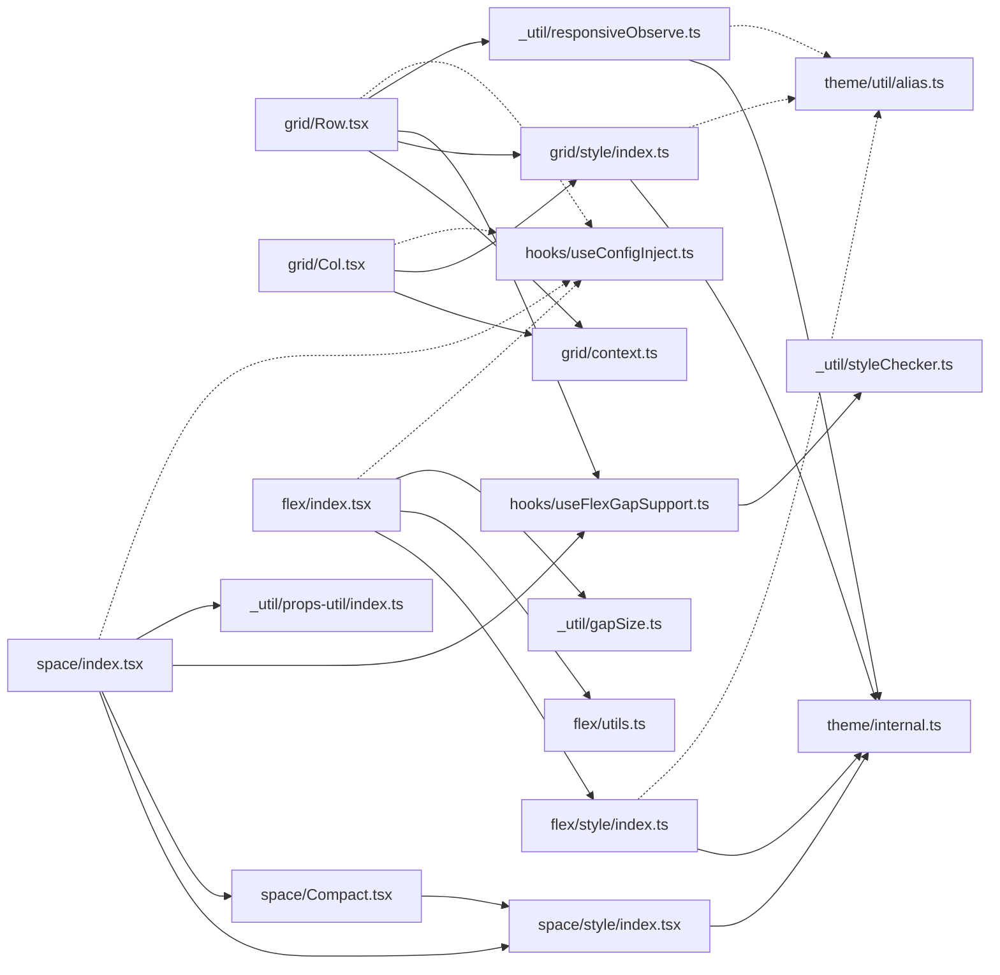
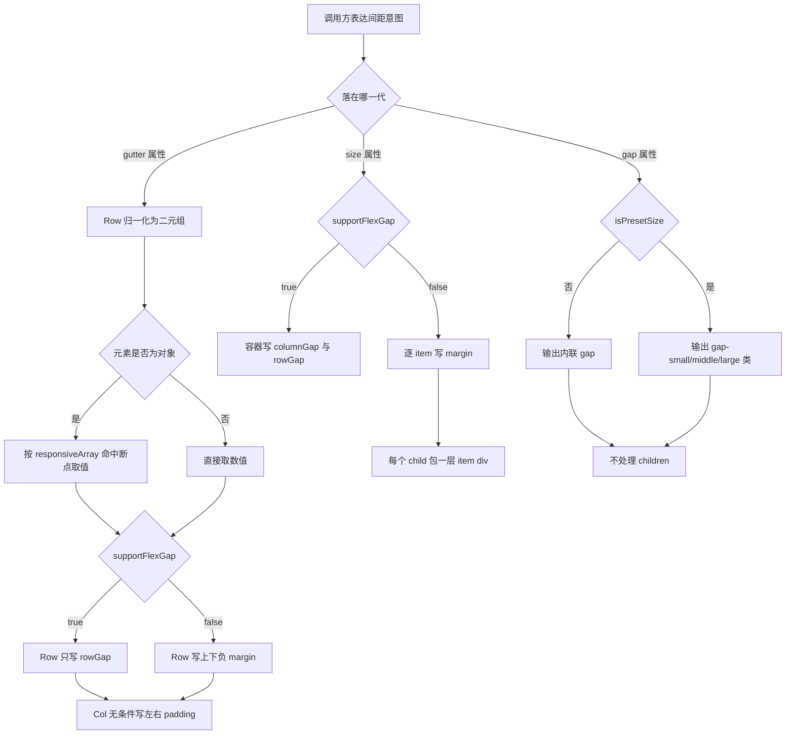
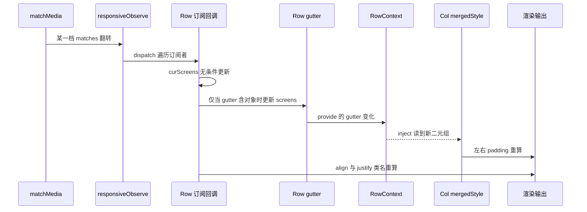
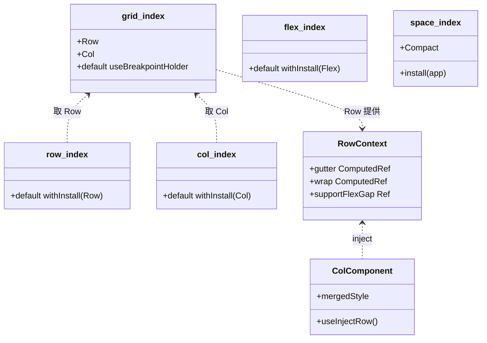

# C02-00 类横写：栅格/flex/space 三代布局的取舍

> **本篇解决**：为什么 XiaoyeUI 里同时存在 `grid`（栅格）、`flex`、`space`（间距）三代布局组件，它们各自的机制边界在哪里、共享哪些抽象、改哪一层会波及谁。
> **前置**：A04 cssinjs 样式引擎与 SSR 注水　**读者坐标**：`03-components/02-layout` 第 0 篇（类横写）

## 一、职责与边界

本篇是 C02 类的横写，负责回答一件事：`grid`、`space`、`flex` 三个目录都叫布局，但它们的间距、断点、子节点处理分别落在**三个不同的执行层**（CSS 静态规则 / JS 运行时分支 / 原生 gap），为什么同仓并存、共用哪些抽象、改动其中任何一层会波及谁。

负责的范围：

- `grid/Row.tsx`、`grid/Col.tsx`、`grid/context.ts`、`grid/style/index.ts` 构成的栅格实现（`packages/xiaoye-ui/src/grid/Row.tsx:47`、`packages/xiaoye-ui/src/grid/Col.tsx:69`）。
- `space/index.tsx` 的 item 包装与 gap/margin 双轨（`packages/xiaoye-ui/src/space/index.tsx:80`），以及 `space/Compact.tsx` 的紧凑广播（`packages/xiaoye-ui/src/space/Compact.tsx:27`）。
- `flex/index.tsx` 的 class 枚举加内联 gap（`packages/xiaoye-ui/src/flex/index.tsx:21`）。
- 三代共用的机制层：`_util/hooks/useFlexGapSupport.ts`、`_util/responsiveObserve.ts`、`_util/gapSize.ts`、`theme/util/alias.ts` 的断点与间距 token、`_util/props-util` 的子节点归一化。
- 入口与注册面的差异：`packages/xiaoye-ui/src/grid/index.ts:11`、`packages/xiaoye-ui/src/row/index.ts:6`、`packages/xiaoye-ui/src/flex/index.tsx:59`。

明确不负责：

- 单个组件的属性语义与用法（栅格归 C02-01《Grid 栅格》，`flex` 归 C02-02《Flex 弹性布局》，间距归 C02-04《Space 间距》，容器归 C02-03《Layout 布局》）。
- `layout`（`packages/xiaoye-ui/src/layout/`）、`splitter`、`scroll-panel` 的尺寸测量与拖拽分栏，它们与本篇的「间距」没有代码交集。
- 探测类 hook 自身的实现与缓存语义——`useFlexGapSupport` 每次新建 ref、模块级缓存在 `styleChecker`、首帧恒为「不支持」，这些结论 I13《响应式内核 hooks》已经论证，本篇只引用它们来解释三代的分叉，不重复展开。
- 样式注册与 SSR 注水链路（A04 cssinjs 样式引擎与 SSR 注水），Props 描述符体系（A06 Props 体系与类型工具），Design Token 四层派生（A03 Design Token 四层体系），`ConfigProvider` 注入链（A05 ConfigProvider 注入链）。

依赖清单：

| 方向 | 对象 | 证据 |
| --- | --- | --- |
| 依赖 | `useConfigInject` 取 `prefixCls`/`direction`/`space` | `packages/xiaoye-ui/src/grid/Row.tsx:53`、`packages/xiaoye-ui/src/space/index.tsx:48`、`packages/xiaoye-ui/src/flex/index.tsx:19` |
| 依赖 | `useFlexGapSupport` 决定是否走原生 gap | `packages/xiaoye-ui/src/grid/Row.tsx:103`、`packages/xiaoye-ui/src/space/index.tsx:50` |
| 依赖 | `responsiveObserve` 的 JS 断点订阅 | `packages/xiaoye-ui/src/grid/Row.tsx:5`、`packages/xiaoye-ui/src/grid/Row.tsx:58` |
| 依赖 | `genComponentStyleHook` 与 alias token | `packages/xiaoye-ui/src/grid/style/index.ts:154`、`packages/xiaoye-ui/src/flex/style/index.ts:98`、`packages/xiaoye-ui/src/space/style/index.tsx:51` |
| 依赖 | `props-util` 的子节点归一化 | `packages/xiaoye-ui/src/space/index.tsx:4`、`packages/xiaoye-ui/src/space/Compact.tsx:12` |
| 被依赖 | `list` 直接复用栅格 | `packages/xiaoye-ui/src/list/index.tsx:10`、`packages/xiaoye-ui/src/list/Item.tsx:4` |
| 被依赖 | `page-header` 复用间距组件 | `packages/xiaoye-ui/src/page-header/index.tsx:20` |
| 被依赖 | 8 个表单类组件复用紧凑 context（第 9 处命中是被注释掉的 import） | `packages/xiaoye-ui/src/input/Input.tsx:38`、`packages/xiaoye-ui/src/button/button.tsx:60`、`packages/xiaoye-ui/src/select/index.tsx:163` 等，明细见论点 4 |
| 被依赖 | `form` 只借用类型不复用实现 | `packages/xiaoye-ui/src/form/context.ts:3` |

## 二、源码地图

| 文件 | 行数 | 职责 | 关键导出与入口行号 |
| --- | --- | --- | --- |
| `grid/Row.tsx` | 198 | 栅格容器、gutter 解析、断点订阅 | 默认导出组件 `name: 'XYRow'`（`packages/xiaoye-ui/src/grid/Row.tsx:49`）、`rowProps`（`:37`） |
| `grid/Col.tsx` | 158 | 栅格单元、span/offset class 枚举 | `colProps`（`packages/xiaoye-ui/src/grid/Col.tsx:32`）、默认导出 `name: 'XYCol'`（`:71`） |
| `grid/context.ts` | 25 | Row→Col 的单向下发 | `RowContextKey`（`packages/xiaoye-ui/src/grid/context.ts:10`）、`useInjectRow`（`:16`） |
| `grid/style/index.ts` | 179 | 24 列 CSS 与 `@media` 断点表 | `useRowStyle`（`packages/xiaoye-ui/src/grid/style/index.ts:154`）、`useColStyle`（`:156`） |
| `grid/index.ts` | 11 | 聚合出口 | `Row`/`Col`（`packages/xiaoye-ui/src/grid/index.ts:9`）、默认导出 `{ useBreakpoint }`（`:11`） |
| `grid/index.test.js` | 33 | 三个用例，零断言 | `packages/xiaoye-ui/src/grid/index.test.js:8-32` |
| `space/index.tsx` | 163 | item 包装 + gap/margin 双轨 | `spaceProps`（`packages/xiaoye-ui/src/space/index.tsx:22`）、`name: 'XYSpace'`（`:40`） |
| `space/Compact.tsx` | 135 | 紧凑模式 context 广播 | `useCompactItemContext`（`packages/xiaoye-ui/src/space/Compact.tsx:27`）、`NoCompactStyle`（`:51`） |
| `space/style/index.tsx` | 54 | 仅排布方向与空节点隐藏 | `genComponentStyleHook('Space', ...)`（`packages/xiaoye-ui/src/space/style/index.tsx:51`） |
| `space/index.test.js` | 73 | 断言落在 margin 分支 | `packages/xiaoye-ui/src/space/index.test.js:27`、`:42` |
| `flex/index.tsx` | 58 | 纯容器，不碰 children | `name: 'XYFlex'`（`packages/xiaoye-ui/src/flex/index.tsx:14`）、`withInstall`（`:57`） |
| `flex/interface.ts` | 16 | props 工厂 | `flexProps`（`packages/xiaoye-ui/src/flex/interface.ts:5`） |
| `flex/utils.ts` | 68 | 三张 CSS 值表 → class | `createFlexClassNames`（`packages/xiaoye-ui/src/flex/utils.ts:60`） |
| `flex/style/index.ts` | 111 | gap 档位由 token 派生 | `genComponentStyleHook('Flex', ...)`（`packages/xiaoye-ui/src/flex/style/index.ts:98`） |
| `flex/index.test.js` | 58 | 覆盖内联 gap 与 stretch | `packages/xiaoye-ui/src/flex/index.test.js:22`、`:55` |
| `row/index.ts`、`col/index.ts` | 6 + 4 | 栅格的安装壳 | `withInstall(Row)`（`packages/xiaoye-ui/src/row/index.ts:6`）、`withInstall(Col)`（`packages/xiaoye-ui/src/col/index.ts:4`） |
| `row/style/index.ts`、`col/style/index.ts` | 4 + 4 | 空对象占位 | `packages/xiaoye-ui/src/row/style/index.ts:4` |
| `_util/gapSize.ts` | 13 | 预设档判定 | `isPresetSize`（`packages/xiaoye-ui/src/_util/gapSize.ts:3`） |
| `_util/responsiveObserve.ts` | 85 | JS 断点订阅器 | `responsiveArray`（`packages/xiaoye-ui/src/_util/responsiveObserve.ts:10`） |
| `_util/hooks/useFlexGapSupport.ts` | 11 | 原生 gap 探测时机 | `packages/xiaoye-ui/src/_util/hooks/useFlexGapSupport.ts:4` |
| `theme/util/alias.ts` | 201 | 断点与间距 alias 值 | `packages/xiaoye-ui/src/theme/util/alias.ts:27-33`、`:143-162` |

主实现入口是三处 `defineComponent`：`packages/xiaoye-ui/src/grid/Row.tsx:47`、`packages/xiaoye-ui/src/space/index.tsx:38`、`packages/xiaoye-ui/src/flex/index.tsx:13`。注意三者体量差了一个数量级（198 / 163 / 58 行），这个体量差本身就是三代机制复杂度的直接体现。

## 三、架构与数据流

### 图 1：静态结构——三代实现与它们各自的机制依赖面



实线是源码里的直接 import（`packages/xiaoye-ui/src/grid/Row.tsx:5-9`、`packages/xiaoye-ui/src/space/index.tsx:4-14`、`packages/xiaoye-ui/src/flex/index.tsx:3-11`），虚线是运行时才建立的依赖。三条虚线里最要紧的是最后三条：`responsiveObserve` 读断点 alias 值（`packages/xiaoye-ui/src/_util/responsiveObserve.ts:13-21`）、栅格样式读 `screenXXMin`（`packages/xiaoye-ui/src/grid/style/index.ts:161-167`）、`flex` 样式读 `paddingXS`/`padding`/`paddingLG`（`packages/xiaoye-ui/src/flex/style/index.ts:99-103`）——而 `space/style/index.tsx` 与 `alias` 之间**没有任何边**，因为它整个文件里不取任何数值 token（`packages/xiaoye-ui/src/space/style/index.tsx:14-48`）。这张图给出的第一个结论就是：三代接 token 的深度不一样，第四节的论点 3 会把它落到具体数字上。

### 图 2：间距落地的决策树——三条互不相通的路径



三个分支的差别不在结果而在**决策发生的时刻**。栅格分支里 `supportFlexGap` 只在纵向上决定写法（`packages/xiaoye-ui/src/grid/Row.tsx:175-181`），横向那一半被写死成「负 margin + padding」配对（`packages/xiaoye-ui/src/grid/Row.tsx:167-173` 与 `packages/xiaoye-ui/src/grid/Col.tsx:123-127`），整个 `grid` 目录里没有出现过 `columnGap`（可用 `grep -rn "columnGap" packages/xiaoye-ui/src/grid` 复核，输出为空）。`space` 分支是全量二选一：支持 gap 就完全不写 item 样式（`packages/xiaoye-ui/src/space/index.tsx:82-85` 与 `:116` 的取反），不支持才逐 item 打 margin（`packages/xiaoye-ui/src/space/index.tsx:117-128`）。`flex` 分支只区分「预设名还是数字」，从不问浏览器支不支持（`packages/xiaoye-ui/src/flex/index.tsx:27`、`:40-42`），因为 `gap` 对它而言是既定事实而不是能力探测项。

### 图 3：一次断点变化如何流到栅格的类名与内联样式



这条链上有两个「有条件的写入」，是栅格 JS 侧复杂度的真正来源。第一个在 `packages/xiaoye-ui/src/grid/Row.tsx:106-116`：订阅回调把 `screen` 无条件写进 `curScreens`（`:107`），但只有当 `gutter` 是对象或数组里含对象时才写进 `screens`（`:109-115`）。第二个是这次条件写入的结果被拆成两份 ref——`curScreens` 只服务 `align`/`justify` 的响应式（`packages/xiaoye-ui/src/grid/Row.tsx:87-95`），`screens` 只服务 gutter 数值（`packages/xiaoye-ui/src/grid/Row.tsx:129-134`）。也就是说，同一个 `screen` 对象在组件内被复制成两份，用途不同、更新条件不同。`Col` 侧完全不参与断点计算，它只消费 `RowContext` 里的最终数值（`packages/xiaoye-ui/src/grid/Col.tsx:75`），响应式的断点信息从不以「哪个断点」的形式传给 `Col`，只以「多少像素」的形式传。

### 图 4：入口层的三代化石



入口层的注册形态在这里分成三种：`row`/`col` 用 `withInstall` 就地给组件对象挂 `install`（`packages/xiaoye-ui/src/row/index.ts:2`、`packages/xiaoye-ui/src/_util/type.ts:39-45`），`flex` 同样用 `withInstall`（`packages/xiaoye-ui/src/flex/index.tsx:59`），`space` 手写 `install` 并顺带把 `Compact` 一起注册（`packages/xiaoye-ui/src/space/index.tsx:152-156`），而 `grid` 的默认导出根本不是组件——`packages/xiaoye-ui/src/grid/index.ts:11` 导出的是 `{ useBreakpoint }` 这个普通对象。`RowContext` 只有一行 `Symbol` 定义（`packages/xiaoye-ui/src/grid/context.ts:10`），消费者全库唯一，是 `Col`（`packages/xiaoye-ui/src/grid/Col.tsx:75`）。


## 四、核心机制精读

### 论点 1：间距的三代差异不在「用不用 gap」，而在「哪一半的间距允许用 gap」

栅格把横向间距永久锁在「容器负 margin + 单元 padding」的配对上，只有纵向间距受 `supportFlexGap` 分支控制；间距组件把两套写法完整保留在同一个渲染函数里，运行时二选一；`flex` 只保留 gap 一套，且不做任何探测。三段的差别是**保留了几条路径**，不是选了哪条路径。

先看栅格容器的样式生成，它是唯一同时出现两种间距语义的地方：

```tsx
// packages/xiaoye-ui/src/grid/Row.tsx:163
    const rowStyle = computed(() => {
      const gt = gutter.value;
      // Add gutter related style
      const style: CSSProperties = {};
      const horizontalGutter = gt[0] != null && gt[0] > 0 ? `${gt[0] / -2}px` : undefined;
      const verticalGutter = gt[1] != null && gt[1] > 0 ? `${gt[1] / -2}px` : undefined;

      if (horizontalGutter) {
        style.marginLeft = horizontalGutter;
        style.marginRight = horizontalGutter;
      }

      if (supportFlexGap.value) {
        // Set gap direct if flex gap support
        style.rowGap = `${gt[1]}px`;
      } else if (verticalGutter) {
        style.marginTop = verticalGutter;
        style.marginBottom = verticalGutter;
      }
      return style;
    });
```

`horizontalGutter` 的判定（`packages/xiaoye-ui/src/grid/Row.tsx:167`）在 `supportFlexGap` 分支之外，也就是说横向负 margin 无条件生效（`packages/xiaoye-ui/src/grid/Row.tsx:170-173`）；`if / else if` 这对分支（`packages/xiaoye-ui/src/grid/Row.tsx:175-181`）只管纵向。全仓核对方式：`grep -rn "columnGap" packages/xiaoye-ui/src/grid` 输出为空；`grep -rni "gap" packages/xiaoye-ui/src/grid/Row.tsx` 有八处命中（`:7`、`:27`、`:103`、`:124`、`:145`、`:175`、`:176`、`:177`），其中真正写进 CSS 的只有一行 `style.rowGap`，其余是 hook 名、类型别名 `Gap` 与注释。

配套的单元侧：

```tsx
// packages/xiaoye-ui/src/grid/Col.tsx:118
    const mergedStyle = computed(() => {
      const { flex } = props;
      const gutterVal = gutter.value;
      const style: CSSProperties = {};
      // Horizontal gutter use padding
      if (gutterVal && gutterVal[0] > 0) {
        const horizontalGutter = `${gutterVal[0] / 2}px`;
        style.paddingLeft = horizontalGutter;
        style.paddingRight = horizontalGutter;
      }

      // Vertical gutter use padding when gap not support
      if (gutterVal && gutterVal[1] > 0 && !supportFlexGap.value) {
        const verticalGutter = `${gutterVal[1] / 2}px`;
        style.paddingTop = verticalGutter;
        style.paddingBottom = verticalGutter;
      }
```

`Col` 的横向 padding（`packages/xiaoye-ui/src/grid/Col.tsx:123-127`）同样不看 `supportFlexGap`，与 `Row` 的负 margin 严格成对：容器减 `gutter/2`，每个单元加 `gutter/2`，相邻两单元之间凑出整整一个 `gutter`，首尾则由容器的负 margin 抵消。只有纵向 padding 带上了 `!supportFlexGap.value` 这个条件（`packages/xiaoye-ui/src/grid/Col.tsx:130`）。**结论**：`grid` 的 `supportFlexGap` 是一个「半生效」的开关——它把纵向从「负 margin + padding」迁到了 `rowGap`，横向一行都没动。顺带可以看清栅格对 flex 的依赖程度：容器侧是 `display: flex` 加 `flexFlow: row wrap` 与 `minWidth: 0`（`packages/xiaoye-ui/src/grid/style/index.ts:18-20`），单元侧在 `flex` 属性存在且 `wrap === false` 时还要再补一次 `minWidth: 0`，源码注释把它标为 Firefox 的尺寸修正（`packages/xiaoye-ui/src/grid/Col.tsx:136-142`）。也就是说，栅格早已是 flex 容器，只是间距机制没有跟着换。

间距组件是另一回事，它的两套写法都在，且都完整：

```tsx
// packages/xiaoye-ui/src/space/index.tsx:80
    const style = computed(() => {
      const gapStyle: CSSProperties = {};
      if (supportFlexGap.value) {
        gapStyle.columnGap = `${horizontalSize.value}px`;
        gapStyle.rowGap = `${verticalSize.value}px`;
      }
      return {
        ...gapStyle,
        ...(props.wrap && { flexWrap: 'wrap', marginBottom: `${-verticalSize.value}px` }),
      } as CSSProperties;
    });
```

容器侧只在支持时写 gap（`packages/xiaoye-ui/src/space/index.tsx:82-85`）；`props.wrap` 为真时额外吃掉一行 `marginBottom`（`packages/xiaoye-ui/src/space/index.tsx:88`），这一行与 gap 分支无关，两轨都要付。子节点侧是它的镜像：

```tsx
// packages/xiaoye-ui/src/space/index.tsx:115
            let itemStyle: CSSProperties = {};
            if (!supportFlexGap.value) {
              if (direction === 'vertical') {
                if (index < latestIndex) {
                  itemStyle = { marginBottom: `${horizontalSizeVal / (split ? 2 : 1)}px` };
                }
              } else {
                itemStyle = {
                  ...(index < latestIndex && {
                    [marginDirection.value]: `${horizontalSizeVal / (split ? 2 : 1)}px`,
                  }),
                  ...(wrap && { paddingBottom: `${verticalSize.value}px` }),
                };
              }
            }
```

三个要点：其一，整段被 `!supportFlexGap.value` 包住（`packages/xiaoye-ui/src/space/index.tsx:116`），支持 gap 时 `itemStyle` 恒为 `{}`，这是与栅格「半生效」相反的全量二选一。其二，`/ (split ? 2 : 1)` 的除法是必须的——`item` 与 `split` 两个节点共用同一份 `itemStyle`（`packages/xiaoye-ui/src/space/index.tsx:133` 与 `:137`），相邻两项之间会叠两段 margin，各取一半才等于用户声明的 `size`。其三，纵向分支（`packages/xiaoye-ui/src/space/index.tsx:117-119`）读的是 `horizontalSizeVal`，而 `horizontalSizeVal` 在 `packages/xiaoye-ui/src/space/index.tsx:102` 取自 `horizontalSize`，不是 `verticalSize`。由于 `size` 为标量时两者被赋成同一个值（`packages/xiaoye-ui/src/space/index.tsx:57-62`），这个取值错位只在 `size` 传数组且 `direction="vertical"` 时暴露为「纵向间距用横向档位」。

`flex` 则把探测整段删掉：

```tsx
// packages/xiaoye-ui/src/flex/index.tsx:34
      const mergedStyle: CSSProperties = {};

      if (flex) {
        mergedStyle.flex = flex;
      }

      if (gap && !isPresetSize(gap)) {
        mergedStyle.gap = `${gap}px`;
      }
```

预设名走类、其余走内联（`packages/xiaoye-ui/src/flex/index.tsx:27` 的 `xy-flex-gap-${gap}` 与 `:40-42`），判据是 `_util/gapSize.ts:3-5` 的 `isPresetSize`，这个函数只认 `'small' | 'middle' | 'large'` 三个字面量。**结论回扣**：三代的间距语义分别落在「CSS 结构约定 + JS 局部开关」「JS 全量开关 + 逐节点补偿」「纯 CSS 类枚举 + 内联兜底」上；`flex` 里没有 `useFlexGapSupport` 的 import（`packages/xiaoye-ui/src/flex/index.tsx:3-11` 的导入表可以核对），所以它是三代里唯一不依赖运行时探测的——这也是 I13《响应式内核 hooks》所说的「首帧恒为不支持」这条时序约束只影响 `grid` 与 `space`、不影响 `flex` 的原因。

### 论点 2：栅格的断点被实现了两遍，两遍的语义并不完全对齐

`span`/`offset`/`order` 这类响应式属性由 **CSS 媒体查询**决定；`gutter` 的对象写法和 `align`/`justify` 的对象写法由 **JS `matchMedia`** 决定。两条路都从同一批 alias 常量取数，但对「`xs` 是什么」的界定不同。

CSS 那条路的生成器：

```ts
// packages/xiaoye-ui/src/grid/style/index.ts:156
export const useColStyle = genComponentStyleHook('Grid', token => {
  const gridToken: GridColToken = mergeToken<GridColToken>(token, {
    gridColumns: 24, // Row is divided into 24 parts in Grid
  });

  const gridMediaSizesMap = {
    '-sm': gridToken.screenSMMin,
    '-md': gridToken.screenMDMin,
    '-lg': gridToken.screenLGMin,
    '-xl': gridToken.screenXLMin,
    '-xxl': gridToken.screenXXLMin,
  };

  return [
    genGridColStyle(gridToken),
    genGridStyle(gridToken, ''),
    genGridStyle(gridToken, '-xs'),
    Object.keys(gridMediaSizesMap)
      .map((key: keyof typeof gridMediaSizesMap) =>
        genGridMediaStyle(gridToken, gridMediaSizesMap[key], key),
      )
      .reduce((pre, cur) => ({ ...pre, ...cur }), {}),
  ];
});
```

`gridMediaSizesMap` 只有五个键（`packages/xiaoye-ui/src/grid/style/index.ts:161-167`），`-xs` 不在里面；它是在 `:172` 作为**无媒体查询**的一层直接生成的，和 `:171` 的「裸 `xy-col-<i>`」并列。返回数组的顺序就是声明顺序：先无断点层，再 `xs` 层，最后按 `sm → md → lg → xl → xxl` 升序铺媒体查询。由于 `.xy-col-md-6` 与 `.xy-col-12` 特异性相同（都是单类选择器），谁生效完全由这段顺序决定（`packages/xiaoye-ui/src/grid/style/index.ts:169-178`）。媒体查询本身由这个函数包出来：

```ts
// packages/xiaoye-ui/src/grid/style/index.ts:143
const genGridMediaStyle = (
  token: GridColToken,
  screenSize: number,
  sizeCls: string,
): CSSObject => ({
  [`@media (min-width: ${screenSize}px)`]: {
    ...genGridStyle(token, sizeCls),
  },
});
```

JS 那条路读的是另一组键名：

```ts
// packages/xiaoye-ui/src/_util/responsiveObserve.ts:10
export const responsiveArray: Breakpoint[] = ['xxxl', 'xxl', 'xl', 'lg', 'md', 'sm', 'xs'];
type SubscribeFunc = (screens: ScreenMap) => void;

const getResponsiveMap = (token: GlobalToken): BreakpointMap => ({
  xs: `(max-width: ${token.screenXSMax}px)`,
  sm: `(min-width: ${token.screenSM}px)`,
  md: `(min-width: ${token.screenMD}px)`,
  lg: `(min-width: ${token.screenLG}px)`,
  xl: `(min-width: ${token.screenXL}px)`,
  xxl: `(min-width: ${token.screenXXL}px)`,
  xxxl: `{min-width: ${token.screenXXXL}px}`,
});
```

两边取的是不同的 alias 名：CSS 用 `screenSMMin`（`packages/xiaoye-ui/src/grid/style/index.ts:162`），JS 用 `screenSM`（`packages/xiaoye-ui/src/_util/responsiveObserve.ts:15`）。它们数值相同，因为 alias 层就是把 `Min` 直接指向同一个常量（`packages/xiaoye-ui/src/theme/util/alias.ts:147`）。但 `xs` 一边是 `max-width: screenXSMax`（`packages/xiaoye-ui/src/_util/responsiveObserve.ts:14`，即 `screenSM - 1`，见 `packages/xiaoye-ui/src/theme/util/alias.ts:145`），一边是「没有媒体查询」——所以窄屏下 `xy-col-xs-6` 与 `xy-col-6` 谁赢，取决于样式表里的顺序而不是宽度；同时 `gutter={{ xs: 8 }}` 只在 `≤575px` 生效。两条路对同一档的界定方式不同，这是栅格内部的真实分叉。

JS 侧在组件里的落地只有两处，且都被条件包住：

```tsx
// packages/xiaoye-ui/src/grid/Row.tsx:105
    onMounted(() => {
      token = responsiveObserve.value.subscribe(screen => {
        curScreens.value = screen;
        const currentGutter = props.gutter || 0;
        if (
          (!Array.isArray(currentGutter) && typeof currentGutter === 'object') ||
          (Array.isArray(currentGutter) &&
            (typeof currentGutter[0] === 'object' || typeof currentGutter[1] === 'object'))
        ) {
          screens.value = screen;
        }
      });
    });
```

订阅注册在 `onMounted` 里（`packages/xiaoye-ui/src/grid/Row.tsx:105`），退订在 `onBeforeUnmount`（`packages/xiaoye-ui/src/grid/Row.tsx:119-121`），首帧 `screens` 的初值是**六档全 `true`**（`packages/xiaoye-ui/src/grid/Row.tsx:60-67`），`curScreens` 的初值是六档全 `false`（`packages/xiaoye-ui/src/grid/Row.tsx:69-76`）。这两个初值方向相反，后果也不同：`gutter` 的对象解析按「第一个 `true` 的档」取值（`packages/xiaoye-ui/src/grid/Row.tsx:129-134`），而 `responsiveArray` 是降序表（`packages/xiaoye-ui/src/_util/responsiveObserve.ts:10`），所以首帧会把对象里最宽的那一档当成当前档；`align`/`justify` 的解析同样从 `xxxl` 起遍历（`packages/xiaoye-ui/src/grid/Row.tsx:87-95`），但因为 `curScreens` 首帧全 `false`，它返回空串（`packages/xiaoye-ui/src/grid/Row.tsx:96`），首帧不输出对齐类名。类名与样式再合并的位置在：

```tsx
// packages/xiaoye-ui/src/grid/Row.tsx:149
    const classes = computed(() =>
      classNames(
        prefixCls.value,
        {
          [`${prefixCls.value}-no-wrap`]: props.wrap === false,
          [`${prefixCls.value}-${mergeJustify.value}`]: mergeJustify.value,
          [`${prefixCls.value}-${mergeAlign.value}`]: mergeAlign.value,
          [`${prefixCls.value}-rtl`]: direction.value === 'rtl',
        },
        attrs.class,
        hashId.value,
      ),
    );
```

单元侧的 class 是另一种枚举方式——六个断点档全在 JS 里拼：

```tsx
// packages/xiaoye-ui/src/grid/Col.tsx:84
      sizes.forEach(size => {
        let sizeProps: ColSize = {};
        const propSize = props[size];
        if (typeof propSize === 'number') {
          sizeProps.span = propSize;
        } else if (typeof propSize === 'object') {
          sizeProps = propSize || {};
        }

        sizeClassObj = {
          ...sizeClassObj,
          [`${pre}-${size}-${sizeProps.span}`]: sizeProps.span !== undefined,
          [`${pre}-${size}-order-${sizeProps.order}`]: sizeProps.order || sizeProps.order === 0,
          [`${pre}-${size}-offset-${sizeProps.offset}`]: sizeProps.offset || sizeProps.offset === 0,
          [`${pre}-${size}-push-${sizeProps.push}`]: sizeProps.push || sizeProps.push === 0,
          [`${pre}-${size}-pull-${sizeProps.pull}`]: sizeProps.pull || sizeProps.pull === 0,
          [`${pre}-rtl`]: direction.value === 'rtl',
        };
      });
```

`sizes` 是六个档的字面量元组（`packages/xiaoye-ui/src/grid/Col.tsx:68`），循环里为每档最多拼 5 个类名，这些类名对不对得上 CSS 完全靠字符串约定，没有任何一处做存在性校验。眼下恰好对得上：`sizes` 到 `xxl` 为止，CSS 侧生成的是 `xs` 加五个媒体查询档（`packages/xiaoye-ui/src/grid/style/index.ts:161-167`）。但这是巧合不是约束——`Breakpoint` 类型里存在 `xxxl`（`packages/xiaoye-ui/src/_util/responsiveObserve.ts:5`），一旦有人把它补进 `sizes`，`Col.tsx:93-101` 会照常拼出 `xy-col-xxxl-12`，而 CSS 侧不存在任何 `xxxl` 层，失效方式是静默的。断点侧的两处已知缺陷（`xxxl` 媒体查询写成花括号、订阅器被包在 `computed` 里导致 token 变更后订阅表重建）由 I13《响应式内核 hooks》的论点 7 与坑 7 给出定位与复现命令，本篇不重复论证，只补一条它没覆盖的事实：**CSS 那条路不吃 `responsiveArray`，因此 `xxxl` 花括号缺陷对 `span`/`offset` 无影响，只影响 `gutter`/`align`/`justify`**。

**结论回扣**：同一个「响应式」词，在栅格里对应两套并行机制、两组 alias 键名、两种首帧语义。判断某档是否生效之前，必须先确定该属性走的是哪条路——`span` 走 CSS，`gutter` 走 JS。

### 论点 3：三代接 Design Token 的深度是三档，而且「看起来接了」的那一档其实没接

`flex` 的间距档位是 token 派生的；`grid` 的断点是 alias token 但值来自函数内常量；`space` 的档位是与 token 无关的模块级字面量，数值与 token 恰好相同。三者对「换一套尺寸」的响应能力完全不同。

`flex` 侧完整链路的第一环：

```ts
// packages/xiaoye-ui/src/flex/style/index.ts:98
export default genComponentStyleHook<'Flex'>('Flex', token => {
  const flexToken = mergeToken<FlexToken>(token, {
    flexGapSM: token.paddingXS,
    flexGap: token.padding,
    flexGapLG: token.paddingLG,
  });
  return [
    genFlexStyle(flexToken),
    genFlexGapStyle(flexToken),
    genFlexWrapStyle(flexToken),
    genAlignItemsStyle(flexToken),
    genJustifyContentStyle(flexToken),
  ];
});
```

`flexGapSM/flexGap/flexGapLG` 是 Component Token，三个源是 Alias Token（`packages/xiaoye-ui/src/flex/style/index.ts:99-103`），Alias 又直接指向 Map 层（`packages/xiaoye-ui/src/theme/util/alias.ts:104`、`:106`、`:108`），Map 层由 seed 的两个数算出：

```ts
// packages/xiaoye-ui/src/theme/themes/shared/genSizeMapToken.ts:3
export default function genSizeMapToken(token: SeedToken): SizeMapToken {
  const { sizeUnit, sizeStep } = token;

  return {
    sizeXXL: sizeUnit * (sizeStep + 8), // 48
    sizeXL: sizeUnit * (sizeStep + 4), // 32
    sizeLG: sizeUnit * (sizeStep + 2), // 24
    sizeMD: sizeUnit * (sizeStep + 1), // 20
    sizeMS: sizeUnit * sizeStep, // 16
    size: sizeUnit * sizeStep, // 16
    sizeSM: sizeUnit * (sizeStep - 1), // 12
    sizeXS: sizeUnit * (sizeStep - 2), // 8
    sizeXXS: sizeUnit * (sizeStep - 3), // 4
  };
}
```

种子值 `sizeUnit: 4`、`sizeStep: 4`（`packages/xiaoye-ui/src/theme/themes/seed.ts:59-60`）代入，得 `sizeXS = 8`、`size = 16`、`sizeLG = 24`；这个函数被默认主题展开进 Map 层（`packages/xiaoye-ui/src/theme/themes/default/index.ts:40`）。

`space` 侧同一组数字的来源：

```ts
// packages/xiaoye-ui/src/space/index.tsx:17
const spaceSize = {
  small: 8,
  middle: 16,
  large: 24,
};
export const spaceProps = () => ({
  prefixCls: String,
  size: {
    type: [String, Number, Array] as PropType<SpaceSize | [SpaceSize, SpaceSize]>,
  },
  direction: PropTypes.oneOf(tuple('horizontal', 'vertical')).def('horizontal'),
  align: PropTypes.oneOf(tuple('start', 'end', 'center', 'baseline')),
  wrap: booleanType(),
});

export type SpaceProps = Partial<ExtractPropTypes<ReturnType<typeof spaceProps>>>;

function getNumberSize(size: SpaceSize) {
  return typeof size === 'string' ? spaceSize[size] : size || 0;
}
```

`spaceSize` 是模块级字面量（`packages/xiaoye-ui/src/space/index.tsx:17-21`），`getNumberSize` 只做一次查表（`packages/xiaoye-ui/src/space/index.tsx:34-36`），全程没有 token 参与；它的样式文件里也没有任何数值 token：

```ts
// packages/xiaoye-ui/src/space/style/index.tsx:14
const genSpaceStyle: GenerateStyle<SpaceToken> = token => {
  const { componentCls } = token;

  return {
    [componentCls]: {
      display: 'inline-flex',
      '&-rtl': {
        direction: 'rtl',
      },
      '&-vertical': {
        flexDirection: 'column',
      },
```

整个 54 行文件里从 `token` 解构出来的只有 `componentCls`（`packages/xiaoye-ui/src/space/style/index.tsx:15`），`SpaceToken` 的接口体是空的（`packages/xiaoye-ui/src/space/style/index.tsx:10-12`），`ComponentToken` 也是空的（`packages/xiaoye-ui/src/space/style/index.tsx:6-8`）。**结论**：把 seed 的 `sizeUnit` 改成 5，`flex` 的 `gap="small"` 从 8px 变 10px（因为链路是 seed → Map → Alias → Component Token 四跳），`space` 的 `size="small"` 仍是 8px。按 A03 Design Token 四层体系的分层口径，`spaceSize` 不属于其中任何一层——它既不是 seed，也不在 Map/Alias/Component 里出现，只是在组件模块里抄了一份与 `sizeXS`/`size`/`sizeLG` 相同的数字：**数值相同不代表同源**。`space` 唯一能改档位的入口是显式传数字，或者走 `ConfigProvider` 的 `space.size`（`packages/xiaoye-ui/src/space/index.tsx:51` 的回落链 `props.size ?? space?.value?.size ?? 'small'`，注入通道本身归 A05 ConfigProvider 注入链）。

`grid` 是第三档，也是最容易误判的一档。断点值形式上通过 `GlobalToken` 取出：

```ts
// packages/xiaoye-ui/src/theme/util/alias.ts:27
  const screenXS = 480;
  const screenSM = 576;
  const screenMD = 768;
  const screenLG = 992;
  const screenXL = 1200;
  const screenXXL = 1600;
  const screenXXXL = 2000;
```

```ts
// packages/xiaoye-ui/src/theme/util/alias.ts:143
    screenXS,
    screenXSMin: screenXS,
    screenXSMax: screenSM - 1,
    screenSM,
    screenSMMin: screenSM,
    screenSMMax: screenMD - 1,
    screenMD,
    screenMDMin: screenMD,
    screenMDMax: screenLG - 1,
```

它们不是 seed 派生，而是 `formatToken` 函数体内的常量（`packages/xiaoye-ui/src/theme/util/alias.ts:27-33`），写在 `{ ...mergedToken, ... }` **之后**（`packages/xiaoye-ui/src/theme/util/alias.ts:36-37` 起，常量赋值在 `:143` 起），所以后写覆盖先写：`theme.token.screenSM` 这类 alias 级覆盖会被常量吃掉。`screenSM` 也不在 seed 接口里（它只在 `packages/xiaoye-ui/src/theme/interface/alias.ts:110` 声明），而 alias 层还会把 seed 同名键从 override 里删掉（`packages/xiaoye-ui/src/theme/util/alias.ts:18-20`），所以本篇在源码里找不到一条「让调用方改全局断点」的通路。CSS 侧留了一个口子：组件级 override 会被摊进 `mergedToken`（`packages/xiaoye-ui/src/theme/util/genComponentStyleHook.ts:85`），于是 `theme.components.Grid.screenSMMin` 能改媒体查询阈值（`packages/xiaoye-ui/src/grid/style/index.ts:162` 读的就是这个名字）；但 JS 侧的 `responsiveObserve` 只拿全局 token（`packages/xiaoye-ui/src/_util/responsiveObserve.ts:24` 的 `useToken()`），不吃组件级 override。**结论回扣**：栅格的两条断点路（论点 2）不仅实现两遍，连「谁能改它」都不一样——组件级 override 只改得动其中一条，配出来的两侧阈值可以不一致且都不报错。另外 `gridColumns: 24` 也是同一个写法：形式上是 Component Token，实际是 `mergeToken` 里的字面量（`packages/xiaoye-ui/src/grid/style/index.ts:157-159`），改它需要改源码而不是改主题。

### 论点 4：布局信息的传递方式按代际分成三种——值传递、结构传递、context 广播

栅格用 `provide/inject` 传**已经算好的像素值**；间距不传任何东西，靠**给每个子节点包一层壳**来表达间距；紧凑模式反过来用 context 把布局意图广播给九个**非布局组件**。三种方式在同一个类目录里并存，而且用的是两套不同的 context 实现。

栅格这一套是全库最小的 context：

```ts
// packages/xiaoye-ui/src/grid/context.ts:4
export interface RowContext {
  gutter: ComputedRef<[number, number]>;
  wrap: ComputedRef<boolean>;
  supportFlexGap: Ref<boolean>;
}

export const RowContextKey: InjectionKey<RowContext> = Symbol('rowContextKey');

const useProvideRow = (state: RowContext) => {
  provide(RowContextKey, state);
};

const useInjectRow = () => {
  return inject(RowContextKey, {
    gutter: computed(() => undefined),
    wrap: computed(() => undefined),
    supportFlexGap: computed(() => undefined),
  });
};
```

三个字段全是 ref/computed（`packages/xiaoye-ui/src/grid/context.ts:4-8`），`useProvideRow` 把对象原样 `provide` 出去、不解包不复制（`packages/xiaoye-ui/src/grid/context.ts:12-14`），提供者只有 `Row` 一处（`packages/xiaoye-ui/src/grid/Row.tsx:143-147`），消费者也只有 `Col` 一处（`packages/xiaoye-ui/src/grid/Col.tsx:75`）：

```tsx
// packages/xiaoye-ui/src/grid/Col.tsx:75
    const { gutter, supportFlexGap, wrap } = useInjectRow();
```

关键在于**下发的是终值而不是意图**：断点解析、`responsiveArray` 遍历、除以 2，全在 `Row` 里做完（`packages/xiaoye-ui/src/grid/Row.tsx:123-141`），`Col` 拿到的是一个 `[number, number]`。脱离子级时靠 `inject` 的兜底对象保命（`packages/xiaoye-ui/src/grid/context.ts:16-22`），兜底值是 `computed(() => undefined)`，于是 `Col` 里的 `gutterVal && gutterVal[0] > 0` 短路成立（`packages/xiaoye-ui/src/grid/Col.tsx:123`），不写任何 padding。

`space` 完全不传东西，它把间距**物化成 DOM 结构**：

```tsx
// packages/xiaoye-ui/src/space/index.tsx:131
            return wrapSSR(
              <Fragment key={originIndex}>
                <div class={itemClassName} style={itemStyle}>
                  {child}
                </div>
                {index < latestIndex && split && (
                  <span class={`${itemClassName}-split`} style={itemStyle}>
                    {split}
                  </span>
                )}
              </Fragment>,
            );
```

每个子节点都要多一层 `div`（`packages/xiaoye-ui/src/space/index.tsx:133`），有 `split` 插槽时还要多一个 `span`（`packages/xiaoye-ui/src/space/index.tsx:136-140`）。这一层壳不是装饰：它是 margin 的载体（`packages/xiaoye-ui/src/space/index.tsx:115`），也是 `:empty` 规则的锚点（`packages/xiaoye-ui/src/space/style/index.tsx:41-45`）。代价随之而来——子节点数量要在 JS 里数出来：`items.length` 定下 `len`（`packages/xiaoye-ui/src/space/index.tsx:95`），`len - 1` 定下 `latestIndex`（`packages/xiaoye-ui/src/space/index.tsx:103`），而 `filterEmpty` 会剥掉注释节点、空 Fragment 与纯空白文本（`packages/xiaoye-ui/src/_util/props-util/index.ts:230-242` 与 `:213-220`），所以「渲染出的 item 数」与「源码里写的子节点数」可以不等；为了让 key 稳定，`packages/xiaoye-ui/src/space/index.tsx:111-113` 还要回到原始 `children` 数组里反查下标，查不到才退化成 `$$space-${index}` 字符串 key。A06 Props 体系与类型工具对 `flattenChildren` 一族的边界有完整论证，本篇只指出：`space` 的主文件用 `filterEmpty`（`packages/xiaoye-ui/src/space/index.tsx:4`），同一目录的 `Compact` 用 `flattenChildren`（`packages/xiaoye-ui/src/space/Compact.tsx:12`），一个组件家族里用了两套子节点归一化。

紧凑模式用的是另一套 context 工厂：

```tsx
// packages/xiaoye-ui/src/space/Compact.tsx:27
export const useCompactItemContext = (prefixCls: Ref<string>, direction: Ref<DirectionType>) => {
  const compactItemContext = SpaceCompactItemContext.useInject();

  const compactItemClassnames = computed(() => {
    if (!compactItemContext || isEmpty(compactItemContext)) return '';

    const { compactDirection, isFirstItem, isLastItem } = compactItemContext;
    const separator = compactDirection === 'vertical' ? '-vertical-' : '-';

    return classNames({
      [`${prefixCls.value}-compact${separator}item`]: true,
      [`${prefixCls.value}-compact${separator}first-item`]: isFirstItem,
      [`${prefixCls.value}-compact${separator}last-item`]: isLastItem,
      [`${prefixCls.value}-compact${separator}item-rtl`]: direction.value === 'rtl',
    });
  });

  return {
    compactSize: computed(() => compactItemContext?.compactSize),
    compactDirection: computed(() => compactItemContext?.compactDirection),
    compactItemClassnames,
  };
};
```

`SpaceCompactItemContext` 来自 `_util/createContext`（`packages/xiaoye-ui/src/space/Compact.tsx:25`），与栅格那套手写 `InjectionKey` 不同：它的 key 是工厂内部生成的匿名 `Symbol`（`packages/xiaoye-ui/src/_util/createContext.ts:4`），`useProvide` 会把 props **逐字段拷进一个 `reactive({})`，并在 `watchEffect` 里持续 `Object.assign`**（`packages/xiaoye-ui/src/_util/createContext.ts:5-12`），`useInject` 缺省返回 `{} as T`（`packages/xiaoye-ui/src/_util/createContext.ts:13-15`）。正因如此，`packages/xiaoye-ui/src/space/Compact.tsx:31` 那句 `isEmpty(compactItemContext)` 是必须的——脱离 `Compact` 时拿到的不是 `null` 而是空对象。两套实现的实质差别在传的到底是什么：栅格传的是 `ComputedRef` 对象本身，由消费方决定何时取值（`packages/xiaoye-ui/src/grid/context.ts:5-7`）；紧凑模式传的是**值拷贝**，拷贝时机由 `watchEffect` 的默认 pre 队列决定（这一时序后果 I13《响应式内核 hooks》的论点 6 已在受控 hook 上论证过），所以 `CompactItem` 改 props 与消费方看到新值之间隔一次调度。

广播的去向是 8 个非布局组件，它们的调用点分别是 `packages/xiaoye-ui/src/input/Input.tsx:38`、`packages/xiaoye-ui/src/button/button.tsx:60`、`packages/xiaoye-ui/src/select/index.tsx:163`、`packages/xiaoye-ui/src/input-number/index.tsx:67`、`packages/xiaoye-ui/src/cascader/index.tsx:159`、`packages/xiaoye-ui/src/tree-select/index.tsx:151`、`packages/xiaoye-ui/src/date-picker/generatePicker/generateSinglePicker.tsx:117`、`packages/xiaoye-ui/src/date-picker/generatePicker/generateRangePicker.tsx:108`。两条计数命令给出不同结果，必须都跑：

```bash
# 命中文件数：9
grep -rl "useCompactItemContext" packages/xiaoye-ui/src --include='*.tsx' --include='*.ts' | grep -v 'src/space/Compact.tsx' | wc -l
# 真实调用点数：8
grep -rn "= useCompactItemContext(" packages/xiaoye-ui/src --include='*.tsx' --include='*.ts' | grep -v 'src/space/Compact.tsx' | wc -l
```

差的那一个是 `packages/xiaoye-ui/src/float-button/FloatButton.tsx:11`——那行 import 已被注释掉，只剩注释。另外 `Compact` 家族还对外提供「退出紧凑」的 `NoCompactStyle`（`packages/xiaoye-ui/src/space/Compact.tsx:51-59`），它的消费方之一已经完全不属于布局类组件：`packages/xiaoye-ui/src/drawer/index.tsx:25`。而它们拿到的最终间距效果不是 JS 算的，是 CSS 的相邻选择器：

```ts
// packages/xiaoye-ui/src/style/compact-item.ts:26
  const { focusElCls, focus, borderElCls } = options;
  const childCombinator = borderElCls ? '> *' : '';
  const hoverEffects = ['hover', focus ? 'focus' : null, 'active']
    .filter(Boolean)
    .map(n => `&:${n} ${childCombinator}`)
    .join(',');
  return {
    [`&-item:not(${parentCls}-last-item)`]: {
      marginInlineEnd: -token.lineWidth,
    },
```

`marginInlineEnd: -token.lineWidth`（`packages/xiaoye-ui/src/style/compact-item.ts:33-35`）用负值叠边，靠 `:not(...-last-item)` 排除末项——这个 `-last-item` 类名正是上面 `useCompactItemContext` 拼出来的（`packages/xiaoye-ui/src/space/Compact.tsx:39`），JS 只负责打标，间距完全由 CSS 决定。**结论回扣**：同一份「两个元素之间隔多远」的意图，在栅格里是 JS 算完再 inject 的像素值，在 `space` 里是 JS 逐节点写的 margin 加一层 DOM 壳，在 `flex` 里是一个 CSS 属性，在紧凑模式里是 JS 打的类名加 CSS 负边距。改任何一处之前，先确认自己面对的是这四种里的哪一种。

### 论点 5：三代都靠「JS 拼类名 + CSS 枚举类名」的双表结构，但只有 `flex` 的两张表同源

栅格的值表写在组件里、样式表写在样式文件里，两份各自手写，已经出现三处失配；`flex` 把值表抽成一份导出、两侧共用，所以结构上不可能失配。这不是风格差异，是会不会漏的问题。

栅格组件侧的合法值：

```tsx
// packages/xiaoye-ui/src/grid/Row.tsx:12
const RowAligns = ['top', 'middle', 'bottom', 'stretch'] as const;
const RowJustify = [
  'start',
  'end',
  'center',
  'space-around',
  'space-between',
  'space-evenly',
] as const;
```

样式侧的对应实现：

```ts
// packages/xiaoye-ui/src/grid/style/index.ts:26
      '&-no-wrap': {
        flexWrap: 'nowrap',
      },

      // The origin of the X-axis
      '&-start': {
        justifyContent: 'flex-start',
      },

      // The center of the X-axis
      '&-center': {
        justifyContent: 'center',
      },

      // The opposite of the X-axis
      '&-end': {
        justifyContent: 'flex-end',
      },

      '&-space-between': {
        justifyContent: 'space-between',
      },

      '&-space-around ': {
        justifyContent: 'space-around',
      },

      '&-space-evenly ': {
        justifyContent: 'space-evenly',
      },
```

把两张表逐项对照，得到三处失配。第一，`RowAligns` 有 `'stretch'`（`packages/xiaoye-ui/src/grid/Row.tsx:12`），样式表里只有 `top`/`middle`/`bottom`（`packages/xiaoye-ui/src/grid/style/index.ts:67-69`），没有 `&-stretch`——核对命令 `grep -n "stretch" packages/xiaoye-ui/src/grid/Row.tsx packages/xiaoye-ui/src/grid/style/index.ts` 只命中前者一行。于是 `align="stretch"` 会拼出 `xy-row-stretch` 类（`packages/xiaoye-ui/src/grid/Row.tsx:155`），类型合法、类名输出、样式为空。第二，`'&-space-around '` 与 `'&-space-evenly '` 的键名各带一个尾随空格（`packages/xiaoye-ui/src/grid/style/index.ts:49`、`:53`），生成的选择器多出一个空白字符；本篇没有把它的渲染结果实跑验证，只能确认它与另外四个不带空格的兄弟键名写法不一致（同一段里 `:45`、`:58`、`:63`、`:67` 都没有尾随空格）。第三处不在类名与样式之间，而在**同一个文件的两套断点词表**之间：`Row.tsx:22` 自定义了 `Responsive = 'xxl' | 'xl' | 'lg' | 'md' | 'sm' | 'xs'`（六档，没有 `xxxl`）并用它约束 `align`/`justify` 的对象写法（`packages/xiaoye-ui/src/grid/Row.tsx:23-25`、`:30-31`），而 `gutter` 的类型用的是 `_util/responsiveObserve` 导出的 `Breakpoint`（`packages/xiaoye-ui/src/grid/Row.tsx:28` 与 `packages/xiaoye-ui/src/_util/responsiveObserve.ts:5`），那是七档、含 `xxxl`。同一个 `Row` 上，两个属性接受不同的断点集合；而 `xxxl` 这一档的 JS 判定本身是失效的（I13《响应式内核 hooks》坑 7）。也就是说，`Row.tsx:87-95` 的遍历从 `xxxl` 起跳，但 `props.align` 的类型里没有那一档，编译器与运行时给的词表并不是一份。

`flex` 的同一件事只有一份表：

```ts
// packages/xiaoye-ui/src/flex/utils.ts:5
export const flexWrapValues = ['wrap', 'nowrap', 'wrap-reverse'] as const;

export const justifyContentValues = [
  'flex-start',
  'flex-end',
  'start',
  'end',
  'center',
  'space-between',
  'space-around',
  'space-evenly',
  'stretch',
  'normal',
  'left',
  'right',
] as const;

export const alignItemsValues = [
  'center',
  'start',
  'end',
  'flex-start',
  'flex-end',
  'self-start',
  'self-end',
  'baseline',
  'normal',
  'stretch',
] as const;
```

组件侧用它拼类名（`packages/xiaoye-ui/src/flex/utils.ts:35-58` 三个 `genCls*` 函数、`:60-66` 汇总），样式侧用**同一份导出**铺规则：

```ts
// packages/xiaoye-ui/src/flex/style/index.ts:71
const genFlexWrapStyle: GenerateStyle<FlexToken> = token => {
  const { componentCls } = token;
  const wrapStyle: CSSInterpolation = {};
  flexWrapValues.forEach(value => {
    wrapStyle[`${componentCls}-wrap-${value}`] = { flexWrap: value };
  });
  return wrapStyle;
};

const genAlignItemsStyle: GenerateStyle<FlexToken> = token => {
  const { componentCls } = token;
  const alignStyle: CSSInterpolation = {};
  alignItemsValues.forEach(value => {
    alignStyle[`${componentCls}-align-${value}`] = { alignItems: value };
  });
  return alignStyle;
};

const genJustifyContentStyle: GenerateStyle<FlexToken> = token => {
  const { componentCls } = token;
  const justifyStyle: CSSInterpolation = {};
  justifyContentValues.forEach(value => {
    justifyStyle[`${componentCls}-justify-${value}`] = { justifyContent: value };
  });
  return justifyStyle;
};
```

导入点是 `packages/xiaoye-ui/src/flex/style/index.ts:5` 那一行 `import { alignItemsValues, flexWrapValues, justifyContentValues } from '../utils';`。三份表共 3 + 12 + 10 = 25 个值（`packages/xiaoye-ui/src/flex/utils.ts:5`、`:7-20`、`:22-33`），JS 与 CSS 各生成 25 个类名，天然一一对应。`flex` 也不做 `xxl` 这类跨层枚举，因为它没有断点概念——三代里只有栅格需要「值表 × 断点表」的笛卡尔积。

**结论回扣**：栅格的规则数量由 `gridColumns` 与断点层数相乘决定。按 `packages/xiaoye-ui/src/grid/style/index.ts:93` 的循环，`i` 从 24 递减到 0，`i > 0` 分支每档产出 5 个键（`:117-133`），`i === 0` 分支产出 7 个键（`:95-115`），单层 127 个；层数是 7（无断点、`xs`、五个媒体查询层，见 `packages/xiaoye-ui/src/grid/style/index.ts:169-178`），合计 889 个规则键——其中 `sizeCls` 为空串的那一层里，`:98` 与 `:104`、`:101` 与 `:107` 写的是同名键，去重后实际少两个。而 `flex` 的全部规则键是 25 + 3（gap 三档，`packages/xiaoye-ui/src/flex/style/index.ts:58-66`）+ 基础若干（`packages/xiaoye-ui/src/flex/style/index.ts:36-52`）。同一种「用类名表达布局意图」的做法，规模差了两个数量级，这就是 `flex` 用一份常量表而不是两份的原因。

### 论点 6：SSR 与首帧的一致性只有 `flex` 天然成立，栅格还额外带一个「首屏取最宽档」的初值

`useFlexGapSupport` 在 `onMounted` 里才写入探测结果、首帧恒为 `false`，这一点 I13《响应式内核 hooks》的论点 7 已经论证，包括「SSR 输出永远是不支持分支」这个结论。本篇要补的是三代在这个事实面前的**不对称**：`flex` 完全不受影响，`space` 受影响但只是样式换轨，`grid` 受影响并且自带一个会把首屏 gutter 算成最宽档的初值。

先看不受影响的：`packages/xiaoye-ui/src/flex/index.tsx` 与 `packages/xiaoye-ui/src/grid/Col.tsx`、`packages/xiaoye-ui/src/space/index.tsx` 三个文件里都没有 `onMounted`/`window` 的使用（核对命令 `grep -n "onMounted\|window\." packages/xiaoye-ui/src/flex/index.tsx` 输出为空），`flex` 的 gap 与类名全部在渲染函数里同步决定（`packages/xiaoye-ui/src/flex/index.tsx:21-42`）。它唯一的环境依赖是 `useConfigContextInject()` 拿 `direction`（`packages/xiaoye-ui/src/flex/index.tsx:18`），那是注入值而不是 DOM 读取。所以对 `flex` 而言，服务端渲染出的 class/style 与客户端首帧完全相同。

栅格这边，断点订阅的生命周期是组件自己的：

```tsx
// packages/xiaoye-ui/src/grid/Row.tsx:56
    let token: number;

    const responsiveObserve = useResponsiveObserve();

    const screens = ref<ScreenMap>({
      xs: true,
      sm: true,
      md: true,
      lg: true,
      xl: true,
      xxl: true,
    });

    const curScreens = ref<ScreenMap>({
      xs: false,
      sm: false,
      md: false,
      lg: false,
      xl: false,
      xxl: false,
    });
```

注意这两份初值的可枚举键只到 `xxl`（`packages/xiaoye-ui/src/grid/Row.tsx:60-76`），而 `responsiveArray` 的头一项是 `xxxl`（`packages/xiaoye-ui/src/_util/responsiveObserve.ts:10`）。`ScreenMap` 本身是 `Partial<Record<Breakpoint, boolean>>`（`packages/xiaoye-ui/src/_util/responsiveObserve.ts:7`），缺键就是 `undefined`，遍历时按假处理（`packages/xiaoye-ui/src/grid/Row.tsx:90`）。真正决定首屏行为的是这段：

```tsx
// packages/xiaoye-ui/src/grid/Row.tsx:123
    const gutter = computed(() => {
      const results: [Gap, Gap] = [undefined, undefined];
      const { gutter = 0 } = props;
      const normalizedGutter = Array.isArray(gutter) ? gutter : [gutter, undefined];
      normalizedGutter.forEach((g, index) => {
        if (typeof g === 'object') {
          for (let i = 0; i < responsiveArray.length; i++) {
            const breakpoint: Breakpoint = responsiveArray[i];
            if (screens.value[breakpoint] && g[breakpoint] !== undefined) {
              results[index] = g[breakpoint] as number;
              break;
            }
          }
        } else {
          results[index] = g;
        }
      });
      return results;
    });
```

`screens` 的初值是六档全 `true`（`packages/xiaoye-ui/src/grid/Row.tsx:60-67`），循环又是降序遍历加 `break`（`packages/xiaoye-ui/src/grid/Row.tsx:129-134`），因此服务端渲染与客户端首帧对一个对象型 `gutter` **一律取到对象里最宽的那一档**，直到 `onMounted` 的订阅回调把它覆盖成真实匹配结果（`packages/xiaoye-ui/src/grid/Row.tsx:106-116`）。手机竖屏上写 `:gutter="[{ xs: 8, xl: 24 }]"`，SSR 直出的 HTML 用的就是 24。这与 `useBreakpoint` 的初值 `{}`（`packages/xiaoye-ui/src/_util/hooks/useBreakpoint.ts:7`）方向相反：那个 hook 的使用者在首帧拿到「谁都不匹配」，`Row` 的使用者在首帧拿到「全都匹配」。`list`/`table`/`steps`/`pagination`/`avatar` 走前者，栅格走后者，两者的兜底策略在同一个仓库里不一致。

间距组件受影响的方式最直白：`packages/xiaoye-ui/src/space/index.tsx:50` 拿到首帧 `false` 的 `supportFlexGap`，于是服务端与首帧走 `packages/xiaoye-ui/src/space/index.tsx:116-129` 的 margin 分支，挂载后翻转成 `packages/xiaoye-ui/src/space/index.tsx:82-85` 的 gap 分支——item 上的内联 margin 被清空、容器上多出 `columnGap`。栅格的翻转更别扭：`packages/xiaoye-ui/src/grid/Row.tsx:175-181` 与 `packages/xiaoye-ui/src/grid/Col.tsx:130-134` 是**两个组件同时**换分支，容器去掉上下负 margin、单元去掉上下 padding，而横向那两行始终不动（论点 1）。**结论回扣**：三代里 `flex` 是唯一的「渲染结果与环境无关」，`grid` 与 `space` 的样式都带一次挂载后的重算；`grid` 还叠加了断点初值的方向问题。A04 cssinjs 样式引擎与 SSR 注水处理的是样式是否被注水，管不到这两个内联样式的分支翻转，这两件事叠在一起才是栅格 SSR 的完整图景。

## 五、对外契约如何生效

三代的契约面都只有 DOM，没有方法、没有事件。核对命令：`grep -rn "expose\|emit" packages/xiaoye-ui/src/grid/Row.tsx packages/xiaoye-ui/src/grid/Col.tsx packages/xiaoye-ui/src/space/index.tsx packages/xiaoye-ui/src/flex/index.tsx` 输出为空。四个组件同时都写了 `inheritAttrs: false`（`packages/xiaoye-ui/src/grid/Row.tsx:50`、`packages/xiaoye-ui/src/grid/Col.tsx:72`、`packages/xiaoye-ui/src/space/index.tsx:41`、`packages/xiaoye-ui/src/flex/index.tsx:15`），因此调用方写的 `class`/`style`/任何原生属性都必须被手工合并回元素，合并写法则三代不同。

栅格容器用「对象展开」合并：`{...attrs}` 先铺（`packages/xiaoye-ui/src/grid/Row.tsx:188`），随后 `class={classes.value}`，其中 `attrs.class` 被塞进 `classNames` 的最后一个参数（`packages/xiaoye-ui/src/grid/Row.tsx:158`），`style` 则是 `{ ...rowStyle.value, ...(attrs.style as CSSProperties) }`（`packages/xiaoye-ui/src/grid/Row.tsx:190`）——展开顺序决定**调用方的 style 优先级高于 gutter 计算出的负 margin**，所以手写 `style="margin-left: 0"` 能直接抵消第一代的间距机制。

栅格单元改用「数组」合并：`style={[mergedStyle.value, attrs.style as CSSProperties]}`（`packages/xiaoye-ui/src/grid/Col.tsx:152`）、`class={classes.value}`，而 `attrs.class` 同样在 `classNames` 尾部并入（`packages/xiaoye-ui/src/grid/Col.tsx:113`）。同一个 `Row`/`Col` 组合里两种 style 合并写法并存，效果一致（都是后者覆盖前者），但改一处不会带到另一处。

间距组件用数组、并且把 attrs 放在最外层：`{...attrs}` 在 `:106`，`class={[cn.value, attrs.class]}` 与 `style={[style.value, attrs.style]}` 在 `packages/xiaoye-ui/src/space/index.tsx:107-108`。它的插槽契约是渲染时读取的：`slots.default?.()` 每帧调用一次再交给 `filterEmpty`（`packages/xiaoye-ui/src/space/index.tsx:93-94`），`slots.split?.()` 同样是每帧读（`packages/xiaoye-ui/src/space/index.tsx:100`），两者都在返回的渲染函数体内，因此插槽内容变化会立刻参与间距计算；`len === 0` 时整个组件返回 `null`（`packages/xiaoye-ui/src/space/index.tsx:97-99`），容器类名也就不存在了。

`flex` 多一条标签选择权：`component` 属性默认 `'div'`（`packages/xiaoye-ui/src/flex/index.tsx:32`），测试确实覆盖了这点（`packages/xiaoye-ui/src/flex/index.test.js:33` 传 `component="span"`，`:37` 断言标签为 `SPAN`）。它同时用 `omit` 把 `justify`/`wrap`/`align`/`vertical` 从展开到 DOM 的属性里剔除（`packages/xiaoye-ui/src/flex/index.tsx:51`），因为这四个是声明式 props 而不是原生属性；`omit` 的实现是一次浅拷贝再逐键 `delete`（`packages/xiaoye-ui/src/_util/omit.ts:3-8`），每次渲染都会新建这个对象。

上下文的契约面在类型层是关闭的：`packages/xiaoye-ui/src/grid/context.ts` 的 `RowContextKey` 与 `RowContext` 只在 `Row.tsx:8` 与 `Col.tsx:5` 内部引用，`packages/xiaoye-ui/src/grid/index.ts` 没有把它们导出。因此第三方无法给 `Col` 注入一份 row context，`Col` 的间距能力只在真正处于 `Row` 子级时成立。类目录之外的一个对照样本：`packages/xiaoye-ui/src/descriptions/index.tsx:25` 引的是自己目录下的 `./Row`，并自己抄了一遍断点遍历（`packages/xiaoye-ui/src/descriptions/index.tsx:70-85`），没有复用栅格——它的行是渲染在 `<table><tbody>` 里的（`packages/xiaoye-ui/src/descriptions/index.tsx:235-238`），而栅格的 `Row` 输出的是 `div`（`packages/xiaoye-ui/src/grid/Row.tsx:185-194`），两者结构上不能互换；至于当初是否就为此各写一份，源码里没有记录。反过来，`Compact` 的 context 是导出的（`packages/xiaoye-ui/src/space/Compact.tsx:25`），并且被 8 个非布局组件消费（论点 4）。

注册链路是最后一段契约。三种形态都汇入 `registerComponent`（`packages/xiaoye-ui/src/_util/registerComponent.ts:16-27`），由 `toXYTagName` 把 `XYRow`/`XYCol`/`XYSpace`/`XYFlex` 折成 `xy-row`/`xy-col`/`xy-space`/`xy-flex`（`packages/xiaoye-ui/src/_util/registerComponent.ts:6-11`）；全量安装靠 `if (component.install)` 过滤（`packages/xiaoye-ui/src/index.ts:19`）。`Grid` 因为在 `packages/xiaoye-ui/src/grid/index.ts:11` 被赋成 `{ useBreakpoint }` 而没有 `install`，也确实没有出现在生成的全局类型里（`grep -c "XYGrid" packages/xiaoye-ui/typings/global.d.ts` 输出 0），但它的名字仍占着包根导出面（`packages/xiaoye-ui/tests/__snapshots__/index.test.js.snap:74`）。

## 六、设计取舍

**栅格为什么不整体迁到 `column-gap`。** 迁移动作本身很小——把 `Row.tsx:170-173` 的负 margin 与 `Col.tsx:123-127` 的 padding 换成 `columnGap`。赔上的东西在产物层：迁移后 DOM 上的内联样式集合会变（单元的左右 `padding` 消失、容器的 `columnGap` 出现），而这套内联样式是公开可见的结果，任何读它或快照它的代码都要跟着改；直接下游就是 `list`（`packages/xiaoye-ui/src/list/index.tsx:310` 把 `props.grid.gutter` 原样交给 `Row`，`packages/xiaoye-ui/src/list/Item.tsx:103` 用 `flex={1}` 的 `Col` 排条目）。而且横向迁移只解决一半问题：纵向已经迁过去了（`packages/xiaoye-ui/src/grid/Row.tsx:177`），换来的收益只是少一次除法。所以现在的形态是「新半截」——保留负 margin 时代的横向语义，只把纵向交给 gap。

**断点为什么要实现两遍。** CSS 媒体查询能表达「不同断点用不同的 span 类」，但表达不了「不同断点用不同的 gutter 数值」：媒体查询切换的是规则集，不是数值来源，而 `gutter` 是调用方给的任意对象（`packages/xiaoye-ui/src/grid/Row.tsx:28` 的 `Partial<Record<Breakpoint, number>>`），数值集合无界，无法预先枚举成 class。于是只能上 JS。代价是三份互不校验的表：`responsiveArray` 七档（`packages/xiaoye-ui/src/_util/responsiveObserve.ts:10`）、`Row` 自定义的六档 `Responsive`（`packages/xiaoye-ui/src/grid/Row.tsx:22`）、CSS 侧的七层（`packages/xiaoye-ui/src/grid/style/index.ts:169-178`）。论点 5 里的三处失配就是这三份表的直接产物。反过来看 `flex`：它没有数值型断点需求，所以一份常量表就够（`packages/xiaoye-ui/src/flex/utils.ts:5-33`），这也说明「两遍」不是布局组件的固有成本，而是 `grid` 的属性形状决定的。

**`space` 为什么不收敛成 `flex`。** `space` 有两件事 `flex` 做不到：`split` 插槽要在相邻项之间插入节点（`packages/xiaoye-ui/src/space/index.tsx:136-140`），以及「第几项」这件事必须在 JS 里定出来——间距只给非末项（`packages/xiaoye-ui/src/space/index.tsx:118`、`:123`），末项不给。CSS 的 `:empty` 只能隐藏已经渲染出来的空壳（`packages/xiaoye-ui/src/space/style/index.tsx:41-45` 正是这么用的），但换不掉计数：计数必须先剔除空节点，所以 `packages/xiaoye-ui/src/space/index.tsx:94` 交给 `filterEmpty`（`packages/xiaoye-ui/src/_util/props-util/index.ts:230-242`）。于是必须逐子节点渲染，一旦逐子节点，就同时需要旧浏览器路径（`packages/xiaoye-ui/src/space/index.tsx:116-128`）与新路径（`packages/xiaoye-ui/src/space/index.tsx:82-85`），两轨都留在代码里。换来的是 `split` 语义，赔上的是：一层额外 DOM、一次挂载后的样式翻转（论点 6）、以及 `size` 数组在纵向下取错档位的可能（论点 1）。

**`space` 的档位为什么不接 token。** 把 `spaceSize` 换成 `paddingXS`/`padding`/`paddingLG`（对应 `packages/xiaoye-ui/src/space/index.tsx:17-21` 与 `packages/xiaoye-ui/src/flex/style/index.ts:99-103` 的差）在技术上没有障碍，数值现在就是相同的。真正的代价是行为变更：默认主题下没有差异，但任何改过 `sizeUnit`/`sizeStep` 的使用者，其 `space` 间距会当场改变，而 `flex` 早就在跟随。这是当前代码的实际效果；它是有意的兼容还是遗漏，源码里没有记录——`packages/xiaoye-ui/src/space/index.tsx:17-21` 上方没有注释，`packages/xiaoye-ui/src/space/index.test.js:27` 断言的仍是具体像素。

**三代入口形态为什么不统一。** `row`/`col` 是 `withInstall` 壳（`packages/xiaoye-ui/src/row/index.ts:6`、`packages/xiaoye-ui/src/col/index.ts:4`），`grid` 是真实实现（`packages/xiaoye-ui/src/grid/index.ts:9`），`space` 手写 `install` 并带 `Compact`（`packages/xiaoye-ui/src/space/index.tsx:152-156`），`flex` 最晚出现所以直接 `withInstall`（`packages/xiaoye-ui/src/flex/index.tsx:59`）。要收敛就得同时动生成物与快照：`packages/xiaoye-ui/src/components.ts:160-162`、`:314-316` 由 `pnpm gen:entries` 产出（约束见根目录 `AGENTS.md` 的「生成物」小节），包根导出面又被 `packages/xiaoye-ui/tests/index.test.js:27-29` 的快照锁住、`:31-55` 还额外断言每个组件目录的默认导出可达且目录数为 111。三代并存不是因为没人发现，而是因为清理它要跨「生成物 + 快照 + 目录计数」三处，收益只是入口整齐。

## 七、坑与改动指南

**坑 1：`align="stretch"` 是类型合法、类名输出、样式为空的三不管档位。**
触发：`<xy-row align="stretch">`。症状：子项高度不变，也不报错，DevTools 里能看到 `xy-row-stretch` 这个类挂在容器上但没有规则。原因：`RowAligns` 元组包含 `'stretch'`（`packages/xiaoye-ui/src/grid/Row.tsx:12`），类名按它拼出来（`packages/xiaoye-ui/src/grid/Row.tsx:155`），而样式表的对齐层只写了 `top`/`middle`/`bottom`（`packages/xiaoye-ui/src/grid/style/index.ts:67-69`）。定位：`packages/xiaoye-ui/src/grid/style/index.ts:58`（应补 `&-stretch` 的那一段）。核对命令 `grep -n "stretch" packages/xiaoye-ui/src/grid/Row.tsx packages/xiaoye-ui/src/grid/style/index.ts` 只命中一行。该档位无测试保护。

**坑 2：对象型 `gutter` 在 SSR 与首帧一律取到最宽档。**
触发：`:gutter="[{ xs: 8, xl: 24 }]"`，服务端渲染或客户端首帧读取。症状：直出 HTML 的横向 margin 按 24 计算，挂载后突然换成 8，窄屏上出现一次可见的跳动。原因：`screens` 初值是六档全 `true`（`packages/xiaoye-ui/src/grid/Row.tsx:60-67`），取值循环按 `responsiveArray` 降序并 `break`（`packages/xiaoye-ui/src/grid/Row.tsx:129-134`），真实断点要等 `onMounted` 里的订阅回调覆盖（`packages/xiaoye-ui/src/grid/Row.tsx:106-116`）。定位：`packages/xiaoye-ui/src/grid/Row.tsx:60`。对照：`useBreakpoint` 的初值是 `{}`（`packages/xiaoye-ui/src/_util/hooks/useBreakpoint.ts:7`），两处兜底方向相反。

**坑 3：`space` 在纵向下用的是横向档位值，只在 `size` 为数组时暴露。**
触发：`<xy-space direction="vertical" :size="[8, 24]">`。症状：纵向间距是 8px 而不是 24px，横向单值用法完全正常。原因：纵向分支的 `marginBottom` 读的是 `horizontalSizeVal`（`packages/xiaoye-ui/src/space/index.tsx:117-119`），而该变量在 `packages/xiaoye-ui/src/space/index.tsx:102` 由 `horizontalSize.value` 赋值；`size` 为标量时 `horizontalSize` 与 `verticalSize` 被赋成同一个数（`packages/xiaoye-ui/src/space/index.tsx:57-62`），错位被掩盖。定位：`packages/xiaoye-ui/src/space/index.tsx:119`。测试只覆盖标量 `size`（`packages/xiaoye-ui/src/space/index.test.js:35` 传 `size={10}`），数组 + 纵向这一组合无用例。

**坑 4：标量 `gutter` 会拼出非数值的 `rowGap` 字符串，绕过同行的空值保护。**
触发：`<xy-row :gutter="16">` 且浏览器支持 flex gap。症状：这一行产生的是 `undefinedpx` 这样的字符串，本篇没有验证浏览器对它的实际处理结果；能确认的是它不该被生成。原因：归一化时第二位留空（`packages/xiaoye-ui/src/grid/Row.tsx:126` 的 `[gutter, undefined]`），`gt[1]` 因此在 gap 分支里仍是 `undefined`，而 `packages/xiaoye-ui/src/grid/Row.tsx:177` 的模板串不做 `!= null` 判断——同函数里只有 `verticalGutter` 那行做了（`packages/xiaoye-ui/src/grid/Row.tsx:168`）。定位：`packages/xiaoye-ui/src/grid/Row.tsx:177`。该分支无测试保护。

**坑 5：`space` 的 gap 分支在单测里根本不执行，改它不会有任何测试报警。**
触发：修改 `packages/xiaoye-ui/src/space/index.tsx:82-85` 的 gap 写入。症状：`pnpm --filter xiaoye-ui test:unit` 全绿。原因：现有断言全部落在 `marginRight`/`marginBottom` 上（`packages/xiaoye-ui/src/space/index.test.js:27`、`:42`），而这两个属性只在 `!supportFlexGap` 分支里被赋值（`packages/xiaoye-ui/src/space/index.tsx:116`），也就是说测试环境里探测结果必为假，gap 分支一次都没跑过。定位：`packages/xiaoye-ui/src/space/index.test.js:27`。探测本身的条件是 `scrollHeight === 1`（`packages/xiaoye-ui/src/_util/styleChecker.ts:56`），要覆盖 gap 分支必须在测试里替换 `detectFlexGapSupported`，仓库当前没有这种替换（`grep -rn "detectFlexGapSupported" packages/xiaoye-ui/src` 只有 `styleChecker.ts:35` 与 `useFlexGapSupport.ts:2`、`:7` 三处）。

**坑 6：`xiaoye-ui/row/style` 与 `xiaoye-ui/col/style` 是空对象，不是样式入口。**
触发：按需引入时写 `import 'xiaoye-ui/row/style'`。症状：该模块不产生任何副作用，样式全靠组件内部的 `useRowStyle` 在渲染时注册。原因：这两个文件的内容就是 `export default {}`（`packages/xiaoye-ui/src/row/style/index.ts:1-4`、`packages/xiaoye-ui/src/col/style/index.ts:1-4`），上方注释写着是给 `babel-plugin-import` 的兼容占位（`packages/xiaoye-ui/src/row/style/index.ts:1`），真实生成器在 `packages/xiaoye-ui/src/grid/style/index.ts:154`。定位：`packages/xiaoye-ui/src/row/style/index.ts:4`。连带影响：包根名 `Grid` 也不是组件——`packages/xiaoye-ui/src/grid/index.ts:11` 的默认导出是 `{ useBreakpoint }`，没有 `name`，`registerComponent` 会因为取不到名字直接返回（`packages/xiaoye-ui/src/_util/registerComponent.ts:18-21`），静态样式提取也把它列进黑名单（`packages/xiaoye-ui/src/_util/static-style-extract/index.tsx:7`）。

**坑 7：`theme.components.Grid` 改得动 CSS 那一侧断点，改不动 JS 那一侧。**
触发：`theme: { components: { Grid: { screenSMMin: 700 } } }`，同时使用 `span` 的响应式类与对象型 `gutter`。症状：`xy-col-sm-*` 在 700px 才生效，而 `gutter={{ sm: 16 }}` 仍在 576px 切换，同一行里两套断点错位。原因：组件级 override 会被摊进 `mergedToken`（`packages/xiaoye-ui/src/theme/util/genComponentStyleHook.ts:85`）并被样式生成器读到（`packages/xiaoye-ui/src/grid/style/index.ts:162`），而 JS 侧的订阅器只取全局 token（`packages/xiaoye-ui/src/_util/responsiveObserve.ts:24` 的 `useToken()`，查询串在 `packages/xiaoye-ui/src/_util/responsiveObserve.ts:13-21` 拼）。定位：`packages/xiaoye-ui/src/_util/responsiveObserve.ts:15`。全局侧改不动是另一件事：断点常量在 alias 生成里写在展开之后（`packages/xiaoye-ui/src/theme/util/alias.ts:27-33` 与 `:143-162`），见论点 3。

### 测试现状

- 三个组件各只有一个测试文件，全部与源码同目录：`packages/xiaoye-ui/src/grid/index.test.js`（33 行）、`packages/xiaoye-ui/src/flex/index.test.js`（58 行）、`packages/xiaoye-ui/src/space/index.test.js`（73 行）。它们**都在执行范围内**：`packages/xiaoye-ui/vitest.config.mts` 的 `include` 含 `src/**/*.test.{js,ts,jsx,tsx}`（`packages/xiaoye-ui/vitest.config.mts:33`），`.js` 也在列。
- **栅格的三条用例一条断言都没有**：`packages/xiaoye-ui/src/grid/index.test.js:8`、`:15`、`:19` 三个 `it` 只 `mount` 不 `expect`；整个文件里唯一的断言来自 `mountTest`（`packages/xiaoye-ui/tests/shared/mountTest.js:2-20`，只断言挂载与卸载不抛错）。等于栅格的 gutter、断点、类名三条机制完全没有回归保护。
- `space` 的断言只覆盖 margin 分支（坑 5），`flex` 的断言覆盖最全面：类名 `xy-flex`/`xy-flex-justify-center`（`packages/xiaoye-ui/src/flex/index.test.js:19-20`）、内联 gap（`:22`）、`component` 换标签（`:36-37`）、`vertical` 时补 `align-stretch`（`:55`）。
- 断点相关的唯一间接接触仍然是被 mock 掉的：`packages/xiaoye-ui/src/avatar/Avatar.test.js:4` 导入 `useBreakpoint` 后立刻 `vi.mock`，具体结论见 I13《响应式内核 hooks》的测试现状小节。

### 安全边界与验证命令

- **可以独立改**：`flex/utils.ts` 的三张值表——因为组件与样式共用同一份导出（`packages/xiaoye-ui/src/flex/style/index.ts:5`），加一个值两边同时生效；改完跑 `pnpm --filter xiaoye-ui test:unit -- flex` 即可。
- **改一处要同时核对两处**：栅格的值表。`Row.tsx:12-20` 与 `grid/style/index.ts:26-69` 是两份手抄清单（论点 5），任何一侧新增档位必须手工补另一侧，补漏的表现形式是「类名在、样式没有」。
- **不要动的三行**：`Row.tsx:167-173` 的横向负 margin 与 `Col.tsx:123-127` 的横向 padding 是一对，只改一边会直接改变整站栅格的实测宽度；`Row.tsx:177` 与 `Col.tsx:130-134` 是另一对，分支部位不同但联动同样紧密。
- **共享机制的辐射面**：`_util/styleChecker.ts:34` 的模块缓存牵动 `grid/Row` 与 `space`（`packages/xiaoye-ui/src/grid/Row.tsx:103`、`packages/xiaoye-ui/src/space/index.tsx:50`）；`_util/responsiveObserve.ts:13-21` 的查询表牵动栅格与 `table`/`list`/`steps`/`pagination`/`avatar`（调用点行号见 I13 论点 7）。
- **动过组件目录就要跑**：`pnpm gen:entries` 重新生成 `packages/xiaoye-ui/src/components.ts`、`typings/global.d.ts` 与 `package.json` 的 `exports`；`pnpm check:entries` 会做只读校验。若要清理坑 6 里的 `Grid` 名，必须同时更新包根导出面快照 `packages/xiaoye-ui/tests/__snapshots__/index.test.js.snap:74`，并按 `packages/xiaoye-ui/tests/index.test.js:31-55` 的目录断言复核。
- **提交前四件套**：`pnpm lint`、`pnpm typecheck`、`pnpm test:unit`、`pnpm build:packages`（要求见根目录 `AGENTS.md`）。

## 附：本篇可证伪的三个检查点

1. **栅格从不用 `columnGap`，只用一次 `rowGap`。** 跑：
   ```bash
   grep -rn "columnGap" packages/xiaoye-ui/src/grid | wc -l
   grep -rn "rowGap" packages/xiaoye-ui/src/grid
   ```
   预期第一条输出 `0`，第二条只有一行 `packages/xiaoye-ui/src/grid/Row.tsx:177: style.rowGap = ...`。若第一条不为 0，论点 1 的「横向永久锁在负 margin/padding」即被推翻。

2. **`flex` 与 `space` 的间距档位一个接 token、一个不接。** 跑：
   ```bash
   grep -n "flexGapSM" packages/xiaoye-ui/src/flex/style/index.ts
   grep -rnE "token\.(size|padding|margin|screen)" packages/xiaoye-ui/src/space/style/index.tsx
   grep -n "small: 8" packages/xiaoye-ui/src/space/index.tsx
   ```
   预期第一条命中 3 行（`:19`、`:59`、`:100`），第二条**输出为空**，第三条命中 `packages/xiaoye-ui/src/space/index.tsx:18`。若第二条出现 `token.padding*`，论点 3 的「`space` 不与 token 同源」即被推翻。

3. **`align="stretch"` 有类型无样式，且栅格样式层一共只有 10 个 `&-` 分支。** 跑：
   ```bash
   grep -n "stretch" packages/xiaoye-ui/src/grid/Row.tsx packages/xiaoye-ui/src/grid/style/index.ts
   grep -c "'&-" packages/xiaoye-ui/src/grid/style/index.ts
   ```
   预期第一条只命中 `Row.tsx:12` 一行，第二条输出 `10`（对应 `style/index.ts:26` 至 `:67` 的十个键）。若样式侧出现 `&-stretch`，坑 1 即失效。
