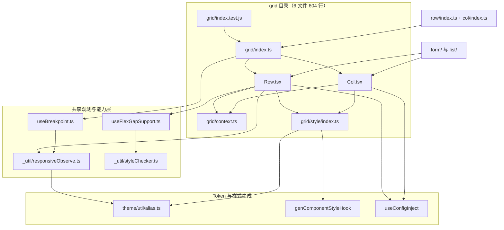
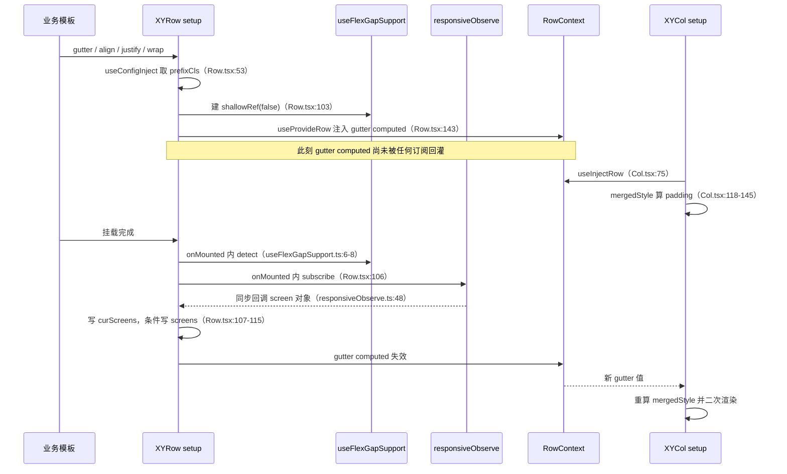
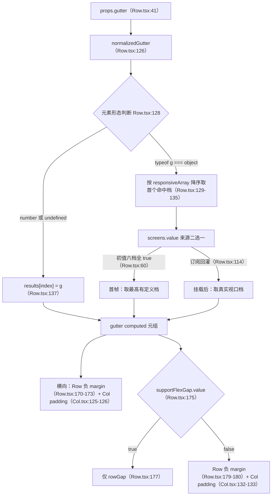

# C02-01 Grid 栅格

> **本篇解决**：C02-00 已经论证过栅格在「三代布局」里的横向 gutter 锁死与断点双实现；本篇不重复那条结论，只拆 `src/grid/` **组件层自己那部分实现**：Row/Col 的 props 如何流到 style、响应式观测如何回灌、以及这套实现的测试现状到底覆盖到哪里。

## 一、职责与边界

`grid/` 是 XiaoyeUI 里唯一直接暴露「24 分栏」这套坐标系的组件目录。它对外提供两个组件与一个 hook：`Row`（`packages/xiaoye-ui/src/grid/Row.tsx:47`）、`Col`（`packages/xiaoye-ui/src/grid/Col.tsx:69`）、`useBreakpoint`（经 `packages/xiaoye-ui/src/grid/index.ts:3` 再导出）。

负责的事只有三类：

1. 把 `gutter` / `align` / `justify` / `wrap` 四个 Row props 折算成一段行内 `style` 与一组类名（`Row.tsx:149-183`）。
2. 把 Row 折算出来的 `gutter` 与 `wrap` 通过 inject 递给子代 Col，由 Col 再生成自己那半的 `padding`（`Row.tsx:143-147` → `grid/context.ts:12-22` → `Col.tsx:75`）。
3. 把 `span` / `offset` / `push` / `pull` / `order` 与六个响应式档位翻译成 CSS 类名，交给 CSS-in-JS 生成期铺出来的媒体查询去生效（`Col.tsx:80-116`、`grid/style/index.ts:143-151`）。

明确**不**负责的事：断点数值本身来自 Design Token（`theme/util/alias.ts:28-33` 与 `:145-162`），媒体查询注册逻辑在 `_util/responsiveObserve.ts`，flex gap 能力探测在 `_util/hooks/useFlexGapSupport.ts` 与 `_util/styleChecker.ts`，`grid/` 只是这四个外部模块的最大消费者。

被谁依赖：`form/` 与 `list/` 直接吃 Row/Col 的实现——`form/FormItem.tsx:29` 导入 `Row`，`form/FormItemInput.tsx:2`、`form/FormItemLabel.tsx:2` 导入 `Col`，`form/context.ts:3`、`form/Form.tsx:25` 导入 `ColProps` 类型，`list/index.tsx:10`、`list/Item.tsx:4` 各导入一个。另有 `row/index.ts:1` 与 `col/index.ts:1` 两个纯转发目录把 Row/Col 重新包装成可全局注册的入口。也就是说 grid 的内部行为改动会直接牵动 Form 的 label/control 布局与 List 的响应式栅格。

依赖谁：`_util/classNames`、`_util/responsiveObserve`、`_util/hooks/useFlexGapSupport`、`_util/hooks/useBreakpoint`、`config-provider/hooks/useConfigInject`、`theme/internal`、`_util/cssinjs`、`_util/type`（`Row.tsx:3-10`、`Col.tsx:1-6`、`grid/index.ts:1-3`）。

> 与 C02-00《类横写：三代布局》的分工：那篇已经论证了「横向 gutter 永久锁在负 margin + padding」「断点被 CSS 与 JS 各实现一遍」这两条跨代结论，本篇不再重复推导，只补组件层**为什么**会锁成那样、以及锁住之后在 Row/Col 里留下的具体痕迹。

## 二、源码地图

| 文件 | 行数 | 职责 | 关键导出 |
| --- | --- | --- | --- |
| `grid/index.ts` | 11 | 聚合出口 | `Row`、`Col`、default `{ useBreakpoint }` |
| `grid/Row.tsx` | 198 | 行组件：gutter 折算、响应式订阅、负 margin | `rowProps`（`:37`）、`RowProps`（`:45`） |
| `grid/Col.tsx` | 158 | 列组件：类名翻译、padding 补偿、flex 解析 | `colProps`（`:32`）、`ColProps`（`:66`）、`ColSize`（`:12`） |
| `grid/context.ts` | 25 | Row→Col 的注入契约 | `RowContextKey`（`:10`）、`useProvideRow`、`useInjectRow`（`:24`） |
| `grid/style/index.ts` | 179 | CSS-in-JS 规则生成 | `useRowStyle`（`:154`）、`useColStyle`（`:156`） |
| `grid/index.test.js` | 33 | 唯一的 grid 测试文件 | 3 个 `it` |

主实现入口：`Row.tsx:52` 的 `setup`、`Col.tsx:74` 的 `setup`。

共享层（本篇范围，因为在 grid 内部被直接驱动）：

| 文件 | 被谁调用 | 作用 |
| --- | --- | --- |
| `_util/responsiveObserve.ts`（85 行） | `Row.tsx:58`、`_util/hooks/useBreakpoint.ts:9` | matchMedia 订阅/派发 |
| `_util/hooks/useFlexGapSupport.ts`（11 行） | `Row.tsx:103` | 每实例一个 `shallowRef(false)` |
| `_util/hooks/useBreakpoint.ts`（24 行） | `grid/index.ts:3`、pagination/steps/table/list | 第二套 screens 消费入口 |
| `_util/styleChecker.ts` | `useFlexGapSupport.ts:2` | `detectFlexGapSupported`（`:35`）带模块级缓存 |
| `row/index.ts` + `row/style/index.ts` | 包根 `Row` | `withInstall` 包装 + **空样式桩** |
| `col/index.ts` + `col/style/index.ts` | 包根 `Col` | 同上 |

两个容易踩空的定位信息：`_util/gapSize.ts` 虽被划在本篇主题范围内，但实测全仓只有 `flex/index.tsx:6` 一个消费者（另有 `_util/index.ts:28` 的桶转发），与 `grid/` 无任何引用关系——grid 的 gutter 不走 `isPresetSize`/`isValidGapNumber` 这套档位映射。`grid/` 目录下也**没有** `__tests__/` 子目录、没有 `demo/`、没有 `*Types.ts`（类型直接写在 `Row.tsx:22-45` 与 `Col.tsx:8-66` 里），组件本体只有上面那 6 个文件。

## 三、架构与数据流



图上三条线值得单独说明。第一，`Row.tsx` 与 `Col.tsx` 之间**没有直接 import**，父子关系完全靠 `context.ts` 的 `Symbol` key 建立，这是 Row 能被 `form/FormItem.tsx:29` 单独复用而不拖进 Col 的原因。第二，`Col` 到 `responsiveObserve` 是**断开的**——Col 完全不订阅媒体查询，它的响应式全部由 CSS 媒体查询承担，于是同一组件内出现「Row 用 JS 判档、Col 用 CSS 判档」的分叉。第三，`grid/index.test.js` 只连到 `grid/index.ts`，而 index 又只是再导出，测试没有任何一条边直接连到 Row 或 Col 的内部逻辑。



这条时序里最关键的是最后四行的**回流**：Col 的 `padding` 不是一次算定的，它先按 `Row.tsx:124` 的初值 `[undefined, undefined]` 渲染一遍，等 Row 在 `onMounted` 里订阅到真实档位后再生效。而 `supportFlexGap` 也在同一个 `onMounted` 窗口里从 `false` 翻成探测结果（`useFlexGapSupport.ts:5-8`），两个翻转挤在同一次挂载回调里，决定了首帧与第二帧用两套不同的 gutter 补偿策略。

## 四、核心机制精读

### 论点 1：Row 内部并存两个初值相反、更新条件不同的 screens 状态机，导致「首帧 gutter 偏大」与「首帧响应式 align/justify 全丢」是同一处设计缺陷的两副面孔

断言：`Row.tsx` 为同一份 matchMedia 派发结果维护了 `screens` 与 `curScreens` 两个 ref，`screens` 初值六档全 `true`、`curScreens` 初值六档全 `false`，且前者只在「gutter 呈对象形态」时才被回灌、后者无条件回灌；两者服务两条互不相干的解析循环。

先看两个 ref 的初值（`packages/xiaoye-ui/src/grid/Row.tsx:60`）：

```tsx
// packages/xiaoye-ui/src/grid/Row.tsx:60
    const screens = ref<ScreenMap>({
      xs: true,
      sm: true,
      md: true,
      lg: true,
      xl: true,
      xxl: true,
    });

    const curScreens = ref<ScreenMap>({
      xs: false,
      sm: false,
      md: false,
      lg: false,
      xl: false,
      xxl: false,
    });
```

两个 ref 在同一时刻被写入的路径完全不同（`packages/xiaoye-ui/src/grid/Row.tsx:105`）：

```tsx
// packages/xiaoye-ui/src/grid/Row.tsx:105
    onMounted(() => {
      token = responsiveObserve.value.subscribe(screen => {
        curScreens.value = screen;
        const currentGutter = props.gutter || 0;
        if (
          (!Array.isArray(currentGutter) && typeof currentGutter === 'object') ||
          (Array.isArray(currentGutter) &&
            (typeof currentGutter[0] === 'object' || typeof currentGutter[1] === 'object'))
        ) {
          screens.value = screen;
        }
      });
    });
```

`curScreens.value = screen` 在 `Row.tsx:107` 无条件执行；`screens.value = screen` 被 `Row.tsx:109-113` 的形态判断拦着——只有 `props.gutter` 是对象（或数组里套对象）时才写。这个判断读的是**订阅那一刻**的 props，而不是每次 gutter 变化时重估：回调函数只在 `onMounted` 里注册一次，如果业务把 `gutter` 从数字 `16` 动态改成 `{ xs: 8, md: 16 }`，`screens` 不会收到任何一次赋值，它继续留在初值。

消费侧的两条循环各自读一个 ref。`curScreens` 只被 `mergePropsByScreen` 读（`packages/xiaoye-ui/src/grid/Row.tsx:87`）：

```tsx
// packages/xiaoye-ui/src/grid/Row.tsx:87
        for (let i = 0; i < responsiveArray.length; i++) {
          const breakpoint: Breakpoint = responsiveArray[i];
          // if do not match, do nothing
          if (!curScreens.value[breakpoint]) continue;
          const curVal = props[oriProp][breakpoint];
          if (curVal !== undefined) {
            return curVal;
          }
        }
        return '';
```

首帧 `curScreens` 六档全 `false`，`Row.tsx:90` 的 `continue` 对七个档位全部命中（`responsiveArray` 有 7 项，见 `packages/xiaoye-ui/src/_util/responsiveObserve.ts:10`），循环走空、`Row.tsx:96` 返回空串；这个空串接着让 `Row.tsx:154-155` 的两个类名条件同时为假——因为 `classNames` 的对象语法里空串是 falsy：

```tsx
// packages/xiaoye-ui/src/grid/Row.tsx:153
          [`${prefixCls.value}-no-wrap`]: props.wrap === false,
          [`${prefixCls.value}-${mergeJustify.value}`]: mergeJustify.value,
          [`${prefixCls.value}-${mergeAlign.value}`]: mergeAlign.value,
```

结论：写成 `:justify="{ xs: 'start', lg: 'center' }"` 的行，**首帧连一个对齐类都不产生**，`justify` 直到 `onMounted` 回调把 `curScreens` 灌满之后才补上；而写成 `justify="center"` 的字符串形态在 `Row.tsx:80-82` 提前返回，完全不受影响。同一个 prop 的两种形态，一个走 `Row.tsx:80` 的同步路径、一个走 `Row.tsx:87` 的异步路径，这是本论点说的「两副面孔」的第一副。

`screens` 那条循环相反——它首帧不是全假而是全真（`packages/xiaoye-ui/src/grid/Row.tsx:128`）：

```tsx
// packages/xiaoye-ui/src/grid/Row.tsx:128
        if (typeof g === 'object') {
          for (let i = 0; i < responsiveArray.length; i++) {
            const breakpoint: Breakpoint = responsiveArray[i];
            if (screens.value[breakpoint] && g[breakpoint] !== undefined) {
              results[index] = g[breakpoint] as number;
              break;
            }
          }
        } else {
          results[index] = g;
        }
```

`responsiveArray` 是从大到小排的（`packages/xiaoye-ui/src/_util/responsiveObserve.ts:10`：`['xxxl', 'xxl', 'xl', 'lg', 'md', 'sm', 'xs']`），循环找到第一个「档位命中且有定义」的值就 `break`。首帧六档全 `true`、`xxxl` 键不存在（`Row.tsx:60-67` 没有初始化它），于是 `screens.value['xxxl']` 读到 `undefined` 被跳过，真正命中的是**调用方写出的最高那一档**。也就是说 `:gutter="{ xs: 8, md: 16 }"` 在 375px 视口的首帧会拿到 `16` 而不是 `8`，第二帧才回落到 `8`。这是同一个缺陷的第二副面孔：全 false 让 align/justify 首帧「什么都没有」，全 true 让 gutter 首帧「拿到错的值」，二者都是错的，但错的方向相反，所以很难在同一份 bug 报告里被一起发现。

`Row.tsx:124` 的 `const results: [Gap, Gap] = [undefined, undefined];` 还带来一个连带后果：`gutter` 只写一个数字时，`Row.tsx:126` 把它归一成 `[gutter, undefined]`，纵向那一位在 `supportFlexGap` 为真的分支里被直接拼进模板串——C02-00 已就 `Row.tsx:177` 生成的 `"undefinedpx"` 定过论，本篇只补一句：那个 `undefined` 的字面源头就是 `Row.tsx:124` 与 `Row.tsx:126`，不是 `Row.tsx:177` 本身。

### 论点 2：`useResponsiveObserve()` 返回的是每实例一份的 `computed`，一旦主题 token 变过，Row 卸载时的 `unsubscribe` 就打在新对象上，旧对象的七个媒体查询监听器永久泄漏

断言：`_util/responsiveObserve.ts` 没有模块级单例，`subscribers`/`subUid`/`screens` 三件套活在 `computed` 的求值闭包里；`Row.tsx` 存的 `token` 是**旧求值结果**的 key，而 `unsubscribe` 读的是**新求值结果**的方法。

工厂函数本体（`packages/xiaoye-ui/src/_util/responsiveObserve.ts:23`）：

```tsx
// packages/xiaoye-ui/src/_util/responsiveObserve.ts:23
export default function useResponsiveObserver() {
  const [, token] = useToken();

  return computed(() => {
    const responsiveMap: BreakpointMap = getResponsiveMap(token.value);
    const subscribers = new Map<Number, SubscribeFunc>();
    let subUid = -1;
    let screens = {};

    return {
```

`responsiveObserve.ts:28-30` 三行都在 `computed` 的回调体内，意味着每次重新求值都会新建一个 Map、把 `subUid` 重置成 `-1`、把 `screens` 清成 `{}`，并返回一个**全新的对象字面量**。订阅与退订逻辑（`packages/xiaoye-ui/src/_util/responsiveObserve.ts:44`）：

```tsx
// packages/xiaoye-ui/src/_util/responsiveObserve.ts:44
      subscribe(func: SubscribeFunc): number {
        if (!subscribers.size) this.register();
        subUid += 1;
        subscribers.set(subUid, func);
        func(screens);
        return subUid;
      },
      unsubscribe(paramToken: number) {
        subscribers.delete(paramToken);
        if (!subscribers.size) this.unregister();
      },
```

`responsiveObserve.ts:45` 的 `if (!subscribers.size) this.register()` 是唯一的注册入口，而 `register()`（`packages/xiaoye-ui/src/_util/responsiveObserve.ts:63`）对 `responsiveMap` 的 7 个键各做一次 `window.matchMedia` 与 `addListener`，把 handler 记进**该对象自己的** `matchHandlers`（`responsiveObserve.ts:74-77`）。

把两侧接起来看 Row：`Row.tsx:56` 声明 `let token: number`，`Row.tsx:106` 在 `onMounted` 里用 `responsiveObserve.value.subscribe(...)` 拿到返回值存进去，`Row.tsx:119-121` 在 `onBeforeUnmount` 里再读一次 `responsiveObserve.value.unsubscribe(token)`：

```tsx
// packages/xiaoye-ui/src/grid/Row.tsx:119
    onBeforeUnmount(() => {
      responsiveObserve.value.unsubscribe(token);
    });
```

两次 `.value` 之间只要 `token.value`（`responsiveObserve.ts:27` 读的那个 Design Token）变过一次，`computed` 就失效重算，第二次 `.value` 返回的是新对象：它的 `subscribers` 是空 Map，`delete` 落空，`responsiveObserve.ts:53` 的 `unregister()` 又是在这个从没注册过的新对象上调用。旧对象里的回调闭包持有 `screens.value = screen`（`Row.tsx:114`）这个 setter，旧对象的 7 个 `MediaQueryList` listener 仍挂在 window 上并引用着旧对象——**整条链回收不掉**，卸载一次漏一份。

三个连带事实：其一，因为没有单例，页面上 N 个 `<xy-row>` 就是 N 份 Map、N×7 个媒体查询监听器，`subUid` 每实例从 `-1` 重新自增，不同 Row 的 token 数字会重复，所以「按数字退订」这件事天然只在同一实例内成立。其二，`_util/hooks/useBreakpoint.ts:8` 用 `let token = null` 抄了同一套写法（`useBreakpoint.ts:12` 订阅、`useBreakpoint.ts:18` 退订），而它被 `pagination/Pagination.tsx:15`、`steps/index.tsx:9`、`table/Table.tsx:40`、`list/index.tsx:26` 消费，泄漏面比 grid 自身更宽。其三，`useBreakpoint` 用 `onUnmounted`、Row 用 `onBeforeUnmount`（`Row.tsx:119` 对 `useBreakpoint.ts:17`），两条退订时机不同但都在重算之后，所以两条路都堵不上。

`responsiveObserve.ts:28` 的 `Map<Number, ...>` 用的是装箱类型 `Number` 而非 `number`，配合 `subscribe` 的返回类型标注 `: number`（同文件 `:44`），TS2345 只是被 `subUid += 1` 的推断侥幸躲过。

本论点全部内容**没有任何测试保护**：`grid/index.test.js` 全文 33 行，三个 `it` 里没有一个 `expect`（详见第五节），也没有对 `window.matchMedia` 打桩。

### 论点 3：`xxxl` 是一个「类型允许、运行时无效、CSS 侧根本没有」的半接入档位，四组独立证据在三个文件里互相印证

断言：断点体系在 `_util/responsiveObserve.ts` 里是 7 档，但 `xxxl` 的媒体查询字符串被写成了花括号；CSS 生成侧与 Col 的 props 侧都不认识 `xxxl`；而 Row 的 `Gutter` 类型却把 `xxxl` 开放给了调用方。

观测侧的 7 档与那处花括号（`packages/xiaoye-ui/src/_util/responsiveObserve.ts:13`）：

```tsx
// packages/xiaoye-ui/src/_util/responsiveObserve.ts:13
const getResponsiveMap = (token: GlobalToken): BreakpointMap => ({
  xs: `(max-width: ${token.screenXSMax}px)`,
  sm: `(min-width: ${token.screenSM}px)`,
  md: `(min-width: ${token.screenMD}px)`,
  lg: `(min-width: ${token.screenLG}px)`,
  xl: `(min-width: ${token.screenXL}px)`,
  xxl: `(min-width: ${token.screenXXL}px)`,
  xxxl: `{min-width: ${token.screenXXXL}px}`,
});
```

`responsiveObserve.ts:14-19` 六行都是圆括号，只有 `responsiveObserve.ts:20` 这行是花括号。这串文本随后被原样交给 `window.matchMedia(matchMediaQuery)`（`packages/xiaoye-ui/src/_util/responsiveObserve.ts:72`），不是合法的 media feature 语法，返回的 `MediaQueryList` 恒不匹配；`responsiveObserve.ts:79` 又立刻用这个 mql 手动派发一次，于是 `screens.xxxl` 被写成 `false` 并永久停在 `false`（派发路径 `packages/xiaoye-ui/src/_util/responsiveObserve.ts:66-70`）。

档位定义确实是 7 个（`packages/xiaoye-ui/src/_util/responsiveObserve.ts:5`）：

```tsx
// packages/xiaoye-ui/src/_util/responsiveObserve.ts:5
export type Breakpoint = 'xxxl' | 'xxl' | 'xl' | 'lg' | 'md' | 'sm' | 'xs';
export type BreakpointMap = Record<Breakpoint, string>;
export type ScreenMap = Partial<Record<Breakpoint, boolean>>;
export type ScreenSizeMap = Partial<Record<Breakpoint, number>>;

export const responsiveArray: Breakpoint[] = ['xxxl', 'xxl', 'xl', 'lg', 'md', 'sm', 'xs'];
```

而 Row 把这套 7 档直接引进了自己的公开类型（`packages/xiaoye-ui/src/grid/Row.tsx:28`：`export type Gutter = number | undefined | Partial<Record<Breakpoint, number>>;`），却在同一个文件 `Row.tsx:22` 另写了一份只有 6 档的局部类型 `type Responsive = 'xxl' | 'xl' | 'lg' | 'md' | 'sm' | 'xs';`，再用它构造 `ResponsiveLike`（`Row.tsx:23-25`）去描述 `align`/`justify` 的响应式形态（`Row.tsx:30-31`）。结果是：**`gutter` 能写 `xxxl`（类型放行）但取不到值，`align`/`justify` 连类型都不接受 `xxxl`**。

CSS 侧的缺口更彻底（`packages/xiaoye-ui/src/grid/style/index.ts:161`）：

```tsx
// packages/xiaoye-ui/src/grid/style/index.ts:161
  const gridMediaSizesMap = {
    '-sm': gridToken.screenSMMin,
    '-md': gridToken.screenMDMin,
    '-lg': gridToken.screenLGMin,
    '-xl': gridToken.screenXLMin,
    '-xxl': gridToken.screenXXLMin,
  };
```

这个 map 只有 5 个键，`genGridMediaStyle`（`packages/xiaoye-ui/src/grid/style/index.ts:143`）按它逐个铺 `@media (min-width: ...)`，所以产物里**不存在任何 xxxl 媒体查询**；`xs` 之所以不在 map 里是有意为之——`style/index.ts:171-172` 分别用空 `sizeCls` 和 `'-xs'` 各生成一套无媒体查询的基线规则，`xs` 靠基线承担。`xxxl` 则是彻底的缺席。

Col 侧同样只有 6 档：六个响应式 prop 到 `xxl` 为止（`packages/xiaoye-ui/src/grid/Col.tsx:38` 起，`xs`/`sm`/`md`/`lg`/`xl`/`xxl` 六段结构完全重复，各带一个 `default: undefined`），类名循环用的 `sizes` 常量也是 6 档且顺序与 `responsiveArray` 相反（`packages/xiaoye-ui/src/grid/Col.tsx:68`：`const sizes = ['xs', 'sm', 'md', 'lg', 'xl', 'xxl'] as const;`）。因此 `<xy-col :xxxl="{ span: 4 }">` 连类名都不会生成——`Col.tsx:84` 的 `sizes.forEach` 根本不会迭代到 `xxxl`。

三条互不相干的证据链指向同一个结论：`xxxl` 在 JS 侧被拼错（`responsiveObserve.ts:20`）、在 CSS 侧没有被生成（`style/index.ts:161-167`）、在 Col 的 props 与类名循环里不存在（`Col.tsx:38-61`、`Col.tsx:68`）。而 token 层是齐的——`screenXXXL` 与 `screenXXXLMin` 都有定义（`packages/xiaoye-ui/src/theme/interface/alias.ts:125-126`），默认值为 2000（`packages/xiaoye-ui/src/theme/util/alias.ts:33`，并在 `theme/util/alias.ts:161-162` 同时喂给两个别名）。这说明 `xxxl` 不是「还没做完的档位」，而是「接进来了但在字符串模板里漏了一个字符」，加上 Row/Col 两侧本来就没跟上。

顺带值得记一笔的是断点取值的**双名同源**：JS 侧读 `token.screenSM`（`packages/xiaoye-ui/src/_util/responsiveObserve.ts:15`），CSS 侧读 `gridToken.screenSMMin`（`packages/xiaoye-ui/src/grid/style/index.ts:162`），默认构建下两者相等（`theme/util/alias.ts:146-147` 把 `screenSM` 与 `screenSMMin` 都指向同一个常量 `screenSM = 576`，见 `theme/util/alias.ts:28`），所以看不出问题；但它们是 `theme/interface/alias.ts:110-111` 里并列声明的两个独立别名，调用方只覆盖 `screenSM` 时 JS 判档点会移动而 CSS 媒体查询不动。C02-00 已经从生成期角度论证过「断点被 CSS 与 JS 实现两遍」，这里补的正是那两遍在 grid 里各自读哪个 token 名的落点。

### 论点 4：Row 与 Col 各自独立实现「间距的一半」这门算术，两侧靠除数互为相反数偶然对齐，中间没有任何共享常量、类型或守卫

断言：横向间距由 `Row.tsx:167` 的 `gt[0] / -2` 与 `Col.tsx:124` 的 `gutterVal[0] / 2` 两处算术相加而成，两式分属两个文件、由两套不同的条件守卫保护；`Col.tsx:123` 那个看似多余的 `gutterVal &&` 实际是孤立 `<xy-col>` 唯一的救命守卫。

列侧全部算术只有这四行（`packages/xiaoye-ui/src/grid/Col.tsx:118`）：

```tsx
// packages/xiaoye-ui/src/grid/Col.tsx:118
    const mergedStyle = computed(() => {
      const { flex } = props;
      const gutterVal = gutter.value;
      const style: CSSProperties = {};
      // Horizontal gutter use padding
      if (gutterVal && gutterVal[0] > 0) {
        const horizontalGutter = `${gutterVal[0] / 2}px`;
        style.paddingLeft = horizontalGutter;
        style.paddingRight = horizontalGutter;
      }

      // Vertical gutter use padding when gap not support
      if (gutterVal && gutterVal[1] > 0 && !supportFlexGap.value) {
        const verticalGutter = `${gutterVal[1] / 2}px`;
        style.paddingTop = verticalGutter;
        style.paddingBottom = verticalGutter;
      }
```

相邻两列之间的可视间距是 `gutterVal[0] / 2 + gutterVal[0] / 2`，行容器再用 `Row.tsx:170-173` 的负 margin 把最外侧多出来的两个 `gutterVal[0] / 2` 抵掉。这两处一次写作 `/ -2`（`packages/xiaoye-ui/src/grid/Row.tsx:167`）、一次写作 `/ 2`（`Col.tsx:124`），彼此从不引用同一个常量或同一个函数——`grep` 全仓找不到诸如 `halfGutter`、`gutterRatio` 的中间层。任何人把列侧的 `/ 2` 改成 `/ 3`，行侧不会报错、不会变红，只会让每行左右各多出一条 `gutter / 6` 的偏移，而且这个偏移在 `wrap` 为真时会被换行掩盖掉一半，肉眼很难定位。

两侧守卫也不对等。行侧写的是 `gt[0] != null && gt[0] > 0`（`Row.tsx:167`），先判空再判正；列侧写的是 `gutterVal && gutterVal[0] > 0`（`Col.tsx:123`），只判真值再判正。列侧这个 `gutterVal &&` 在 Row 存在时是永真的废条件——`Row.tsx:124` 的 `const results: [Gap, Gap] = [undefined, undefined];` 保证 `gutter.value` 恒为数组——但它在**没有 Row 包裹**的场合成为唯一的短路：`grid/context.ts:16-22` 的 `inject` 兜底值把三个字段全部换成了返回 `undefined` 的 computed。

```tsx
// packages/xiaoye-ui/src/grid/context.ts:16
const useInjectRow = () => {
  return inject(RowContextKey, {
    gutter: computed(() => undefined),
    wrap: computed(() => undefined),
    supportFlexGap: computed(() => undefined),
  });
};
```

也就是说孤立使用 `<xy-col span="12">` 时，`Col.tsx:120` 的 `gutterVal` 拿到 `undefined`，靠 `Col.tsx:123` 与 `Col.tsx:130` 的短路才没在 `gutterVal[0]` 处抛 TypeError。同时注意 `context.ts:18-20` 三个兜底值与 `context.ts:5-7` 声明的 `ComputedRef<[number, number]>`、`Ref<boolean>` 类型并不相容，是靠 `inject` 的默认值形参推断放过来的；`supportFlexGap: computed(() => undefined)`（`context.ts:20`）让孤立列的 `!supportFlexGap.value` 恒为 `true`（`Col.tsx:130`），语义上等于「孤立列永远假定浏览器不支持 flex gap」，只是因为 `gutterVal` 已经是 `undefined`，这条分支从没被执行过而已——两个缺陷互相掩盖。

`RowContext` 声明（`packages/xiaoye-ui/src/grid/context.ts:4`）与 `Row.tsx` 里那份同名概念的类型也各写了一份：`Row.tsx:33-35` 的 `export interface rowContextState { gutter?: [number, number]; }` 把 `gutter` 声明成裸元组而不是 `ComputedRef`，且全仓**没有任何引用**——`grep -rn "rowContextState" src` 只有它自己的定义行命中。真正生效的是 `context.ts:4-8` 那份。这是一份留在组件文件里的死类型。

### 论点 5：`supportFlexGap` 的初值把首帧永久钉在「padding 补偿」方案上，翻转发生在 `onMounted`，因此 flex gap 能力越强的浏览器越会看到一次纵向间距重排

断言：`useFlexGapSupport` 每实例新建 `shallowRef(false)`，只在 `onMounted` 里写入探测结果；Row 与 Col 都以这个 ref 作为纵向策略的分叉条件，于是纵向 gutter 在首帧与第二帧走两套不同实现。

hook 本体只有十一行（`packages/xiaoye-ui/src/_util/hooks/useFlexGapSupport.ts:4`）：

```tsx
// packages/xiaoye-ui/src/_util/hooks/useFlexGapSupport.ts:4
export default () => {
  const flexible = shallowRef(false);
  onMounted(() => {
    flexible.value = detectFlexGapSupported();
  });

  return flexible;
};
```

初值 `false` 出现在 `useFlexGapSupport.ts:5`，赋值只发生在 `useFlexGapSupport.ts:6-8` 的 `onMounted` 里。探测函数带模块级缓存，且服务端直接判 false（`packages/xiaoye-ui/src/_util/styleChecker.ts:34`）：

```tsx
// packages/xiaoye-ui/src/_util/styleChecker.ts:34
let flexGapSupported: boolean | undefined;
export const detectFlexGapSupported = () => {
  if (!canUseDocElement()) {
    return false;
  }

  if (flexGapSupported !== undefined) {
    return flexGapSupported;
  }
```

`styleChecker.ts:36-38` 的 `canUseDocElement()` 判空决定了 SSR 阶段恒为 `false`；`styleChecker.ts:40-42` 的缓存使多次探测只真正跑一次 DOM 试验。试验体本身是一次布局测量而不是样式读取（`packages/xiaoye-ui/src/_util/styleChecker.ts:56`）：

```tsx
// packages/xiaoye-ui/src/_util/styleChecker.ts:56
  document.body.appendChild(flex);
  flexGapSupported = flex.scrollHeight === 1; // flex container should be 1px high from the row-gap
  document.body.removeChild(flex);
```

它往 `document.body` 里临时插一个 `flex-direction: column` 且 `row-gap: 1px` 的两子元素容器（容器构造见 `styleChecker.ts:45-52`），用 `styleChecker.ts:57` 的 `scrollHeight === 1` 判断 `row-gap` 是否真的把两个子元素撑开——这意味着每个页面首次挂载 Row 时都会发生一次强制同步布局。

分叉点有两处，读的是同一个 ref，但极性相反。行侧（`packages/xiaoye-ui/src/grid/Row.tsx:175`）：

```tsx
// packages/xiaoye-ui/src/grid/Row.tsx:175
      if (supportFlexGap.value) {
        // Set gap direct if flex gap support
        style.rowGap = `${gt[1]}px`;
      } else if (verticalGutter) {
        style.marginTop = verticalGutter;
        style.marginBottom = verticalGutter;
      }
```

列侧则是 `Col.tsx:130` 的 `gutterVal[1] > 0 && !supportFlexGap.value`。把两处的时序摆出来：首帧 `supportFlexGap.value === false` → 行侧走 `Row.tsx:178-181` 的负 margin、列侧走 `Col.tsx:131-133` 的 padding；`onMounted` 之后若探测为真 → 行侧改写成 `Row.tsx:177` 的 `rowGap`、列侧的 padding 分支条件转假从而**撤掉**上下 padding。两帧之间纵向间距的实现从「margin+padding」整体切换成「rowGap」，这正是支持 `row-gap` 的现代浏览器必然经历的一次重排。

第三条分支路径值得单独画出来，因为它解释了为什么同一份 `gutter` 配置能派生出四种行内样式：



`Row.tsx:177` 的 `rowGap` 是**无条件**赋值的，它不像横向那样有 `> 0` 的前置判断，所以 `gt[1]` 为 `undefined` 时会拼出 `"undefinedpx"`；这一条 C02-00 已经定论，本图只把它标成 `V --> RG` 那条边的固有属性。

横向侧没有对应的第三条分支——`Row.tsx:170-173` 与 `Col.tsx:123-127` 两段代码在 `supportFlexGap.value === true` 时**照旧执行**，`columnGap` 在整个 grid 目录里一次都没出现过。这就是 C02-00 所说的「横向 gutter 永久锁在负 margin + padding」在组件层的原貌：纵向有开关，横向没开关。

### 论点 6：`grid/` 的导出面是三分裂的——目录内 default 是一个 hook 容器，包根的 Row/Col 来自另外两个 shim 目录，而 shim 的样式入口是返回空对象的桩

断言：`grid/index.ts:11` 把 default 导出写成了 `{ useBreakpoint }`；带 `install` 的公开组件由 `row/index.ts` 与 `col/index.ts` 通过 `withInstall` 就地变异产生；`row/style/index.ts` 与 `col/style/index.ts` 是四行空桩，真实样式注册点在 `grid/style/index.ts`。

出口文件全文十一行（`packages/xiaoye-ui/src/grid/index.ts:1`）：

```tsx
// packages/xiaoye-ui/src/grid/index.ts:1
import Row from './Row';
import Col from './Col';
import useBreakpoint from '../_util/hooks/useBreakpoint';

export type { RowProps } from './Row';

export type { ColProps, ColSize } from './Col';

export { Row, Col };

export default { useBreakpoint };
```

`index.ts:11` 的 default 是一个只含一个 hook 的对象字面量，既不是组件也没有 `install`。它经生成物 `components.ts:169` 的 `export { default as Grid } from './grid';` 原样提升到包根，于是 `import { Grid } from 'xiaoye-ui'` 拿到的是 `{ useBreakpoint }`——一个名字听起来像组件、实际是 hook 容器的导出。而 `grid/index.ts:9` 的具名 `Row`/`Col` 与 `components.ts:314-315`、`components.ts:76-77` 的具名导出在包根撞名，靠生成器的「显式 re-export 压过 `export *`」规则定主到 shim 目录上。

两个 shim 的写法（`packages/xiaoye-ui/src/row/index.ts:1`）：

```tsx
// packages/xiaoye-ui/src/row/index.ts:1
import { Row } from '../grid';
import { withInstall } from '../_util/type';

export type { RowProps } from '../grid';

export default withInstall(Row);
```

`col/index.ts:1-4` 是同一形状的复制。`withInstall` 并不新建对象，它把 `install` 方法直接挂到传入对象上再原样返回（`packages/xiaoye-ui/src/_util/type.ts:39`）：

```tsx
// packages/xiaoye-ui/src/_util/type.ts:39
export const withInstall = <T>(comp: T) => {
  const c = comp as any;
  c.install = function (app: App) {
    registerComponent(app, c);
  };

  return comp as T & Plugin;
};
```

所以「包根的 Row」与「`grid/Row.tsx` 的 Row」是同一个对象引用，`install` 是 `type.ts:41-43` 就地写进去的属性、`type.ts:45` 返回的是形参本身。这一点决定了撞名定主在这里不改变行为——但只在 `row/index.ts` 被 import 过时成立；若某个入口只引了 `grid` 而从未触达 `row`，拿到的对象上没有 `install`。`type.ts:42` 的 `registerComponent` 才是标签名 `xy-row` 的注册出口。

样式侧的分裂更隐蔽：`row/style/index.ts` 与 `col/style/index.ts` 两个文件内容完全相同，都是四行（`packages/xiaoye-ui/src/row/style/index.ts:1`）：

```tsx
// packages/xiaoye-ui/src/row/style/index.ts:1
// Compatible for babel-plugin-import

/* istanbul ignore next */
export default {};
```

注释 `row/style/index.ts:1` 说明了用途：仅为 `babel-plugin-import` 这类按需加载插件提供可解析的样式路径。它们不 `import` 任何 CSS-in-JS，真实注册发生在组件运行时——`Row.tsx:54` 的 `useRowStyle(prefixCls)` 与 `Col.tsx:78` 的 `useColStyle(prefixCls)`，定义在 `packages/xiaoye-ui/src/grid/style/index.ts:154` 与 `style/index.ts:156`，两者都叫 `genComponentStyleHook('Grid', ...)`，共用同一份 `FullToken<'Grid'>`（`style/index.ts:5` 与 `style/index.ts:7`）。生成物为此分别写了三条样式副作用导入：`components.ts:78` 的 `import './col/style'`、`components.ts:170` 的 `import './grid/style'`、`components.ts:316` 的 `import './row/style'`，三条里只有 `./grid/style` 那条会真正带入规则。

另外两个组件文件里的历史残留也归在这里一起记：`Row.tsx:47` 的组件**变量名**是 `ARow`（`const ARow = defineComponent({...})`，导出写的是 `export default ARow`，`Row.tsx:198`）——这个名字不合本库命名规范，此处仅作为待清理的残留反例引用，它不出现在任何标签、类名或公开组件名上，因为组件 `name` 已经是合规的 `XYRow`（`Row.tsx:49`）；`Row.tsx:48` 与 `Col.tsx:70` 各带一句 `compatConfig: { MODE: 3 }`。这个选项只被 `@vue/compat` 构建读取，而本包没有引入它：`grep -n "compat" packages/xiaoye-ui/package.json` 零命中，`grep -rn "vue/compat" ` 在仓库配置里也无别名，所以它在当前构建下不产生作用；`grep -rn "compatConfig" src | grep -v __mocks__ | wc -l` 得到 **221** 处，说明这是全库范围的迁移残留而非 grid 独有，清理时应整体处理。

## 五、对外契约如何生效

**props 的默认值落在两处**。`Row.tsx:51` 与 `Col.tsx:73` 都直接写 `props: rowProps()` / `props: colProps()`，**没有**经过仓库模板推荐的 `initDefaultProps`——`grep -rn "initDefaultProps" grid/` 结果是 0。默认值因此只能靠 prop 定义本体携带：`gutter` 用 `someType<...>([Number, Array, Object], 0)`（`Row.tsx:41`）把 `0` 作为第二个实参传进 `_util/type.ts:91` 的 `someType`，由 `type.ts:92` 组装成 `{ type, default }`；grid 里唯一一个用原生对象写法声明默认值的 prop 是 `wrap`，它写成 `{ type: Boolean, default: undefined }`（`Row.tsx:42`）。这个 `default: undefined` 是必需的而不是随笔——渲染分支用的是 `props.wrap === false`（`Row.tsx:153`）与 `wrap.value === false`（`Col.tsx:140`）这种严格比较，若默认值取 `true`，未显式传 `wrap` 的 Col 与显式 `wrap` 的 Col 就会落到不同分支上。

**attrs 的处理是手抄的三件事**。两个组件都声明 `inheritAttrs: false`（`Row.tsx:50`、`Col.tsx:72`），然后在渲染函数里自己把 attrs 铺回去，并且分三路处理：`{...attrs}` 作为元素属性基底展开（`Row.tsx:188`、`Col.tsx:150`）；`attrs.class` 被单独摘出来交给 `classNames` 合并（`Row.tsx:158`、`Col.tsx:113`）；`attrs.style` 单独合并进 style 绑定（`Row.tsx:190`、`Col.tsx:152`）。三路缺一不可，因为基底展开虽然会带上 class 与 style，但会被后面的显式 `class=`、`style=` 覆盖掉。值得注意的是**两个组件对 style 用了不同的合并通道**：Row 走对象展开 `{ ...rowStyle.value, ...(attrs.style as CSSProperties) }`（`Row.tsx:190`），Col 走数组 `[mergedStyle.value, attrs.style as CSSProperties]`（`Col.tsx:152`）。两者都让调用方胜出，但对象展开要求 `attrs.style` 是可枚举对象，数组形式则交给 Vue 自己的样式规范化处理；调用方若以字符串形态传入 style，两处的实际行为不再等价。这一点本篇只把差异定位到行号，字符串 style 在两条通道下的具体解析结果未在 grid 源码范围内证实。

**slots 与 expose 都没有声明**。`grep -n "expose\|emits\|slots:" grid/Row.tsx grid/Col.tsx` 无任何命中，两个组件都只用 `slots.default?.()` 渲染孩子（`Row.tsx:192`、`Col.tsx:154`），也没有 `setup` 第四参里的 `expose`（对比 `Row.tsx:52` 与 `Col.tsx:74` 的解构，只取了 `slots` 与 `attrs`）。因此 grid 不对外暴露任何实例方法，也没有事件契约——`Row.tsx:38-42` 的五个 prop 与 `Col.tsx:33-63` 的十三个 prop 里没有一个是 `onXxx`。

**跨组件契约靠一个 Symbol 传递三个响应式壳**。`Row.tsx:143-147` 提供 `{ gutter, supportFlexGap, wrap }`，key 是 `context.ts:10` 的 `Symbol('rowContextKey')`；`Col.tsx:75` 一次性解构三个。这条链上 `gutter` 与 `wrap` 是 `computed`、`supportFlexGap` 是 `shallowRef`（分别见 `Row.tsx:123`、`Row.tsx:146`、`Row.tsx:103`），三者的解包都发生在 `Col.tsx:120`、`Col.tsx:130`、`Col.tsx:140` 三个不同判断里。由于 provide 的是壳而不是值，嵌套 Row/Col 时内层 Row 会在自己的作用域重新 provide（`context.ts:13`），内层 Col 读到的永远是最近一个 Row 的 gutter。

**类名契约的另一半在 CSS 生成侧**，而且两侧对值域的假设不一致。Col 对 `span` 只判存在不判范围——`Col.tsx:106` 的条件是 `span !== undefined`，任何值都会拼出 `${pre}-${span}`；而生成规则的那段循环上界写死在 `style/index.ts:158` 的 `gridColumns: 24`，`genLoopGridColumnsStyle` 只铺 `i` 从 24 递减到 0 的选择器（`packages/xiaoye-ui/src/grid/style/index.ts:93`）：

```tsx
// packages/xiaoye-ui/src/grid/style/index.ts:89
const genLoopGridColumnsStyle = (token: GridColToken, sizeCls: string): CSSObject => {
  const { componentCls, gridColumns } = token;

  const gridColumnsStyle: CSSObject = {};
  for (let i = gridColumns; i >= 0; i--) {
```

于是 `<xy-col :span="30">` 会得到一个没有任何规则命中的 `xy-col-30` 类：列既不会占满也不会按比例分配，而是回落到 `Col` 基样式的 `max-width: 100%` 与 flex 默认值（`style/index.ts:80-84`），静默无效。同理 `gridColumns` 不是 token 而是 `style/index.ts:158` 里的字面量 24（旁边一句注释 `// Row is divided into 24 parts in Grid`），所以「改成 12 分栏」这条路必须动源码，不能靠 `ConfigProvider` 的主题配置完成。

`i === 0` 那个分支（`style/index.ts:94-115`）还留下一处不对称：它同时给 `push`/`pull` 生成了带 `sizeCls` 与不带 `sizeCls` 的两组键（`style/index.ts:98-103` 与 `style/index.ts:104-109`），而 `offset`/`order` 只生成带 `sizeCls` 的那一组（`style/index.ts:110-115`）。净效果是 `xy-col-display-none` 这类归零规则在响应式档位齐备、在非响应式的 `offset`/`order` 上缺席。

## 六、设计取舍

**为什么 Col 用 CSS 判档、Row 用 JS 判档**。这是 grid 最核心的一处不对称（依赖图上那条断开的边）。`span`/`offset`/`push`/`pull`/`order` 五个属性乘以七个档位是一个纯枚举空间，`style/index.ts:93` 的循环一次铺完就再也不需要运行时参与，浏览器自己会挑媒体查询——这条路的运行期成本是零，代价是 `Col` 只能感知视口宽度、永远无法感知父容器宽度。`gutter` 走不了这条路：它的值要参与除法并拼成具体 px（`Row.tsx:167`、`Col.tsx:124`），在 `columnGap` 不可用的前提下必须在 JS 侧得到一个确定的数。于是同一组件内部天然分裂成两种响应式模型，`Col.tsx:68` 与 `responsiveObserve.ts:10` 两份档位常量也就此各自演化（长度 6 对 7、顺序 xs→xxl 对 xxl→xs）。被放弃的第三条路是用 CSS 自定义属性把 gutter 下沉成 `calc(var(--xy-gutter) / 2)`，那样 Row/Col 都不再需要订阅，代价是要在 Design Token 与 CSS 变量之间再建一座桥，并且放弃行内 style 这一层可覆盖性。

**per-instance `computed` 换来 token 响应性，赔上监听器生命周期**。`responsiveObserve.ts:26` 把整个订阅容器包在 `computed` 里、并在 `responsiveObserve.ts:27` 用 `getResponsiveMap(token.value)` 现算媒体查询，唯一目的就是让主题里断点数值的变化能被下一份容器吸收。若按常规做法做成模块级单例，论点 2 描述的泄漏就不存在，代价是运行时改断点必须重建全站订阅。作者的取舍是把这条链交给每个组件实例自己管，`Row.tsx:56` 那个 `let token` 就是这套「实例自管」的记账凭据——问题是记账凭据是数字、账本却是会换的（`unsubscribe` 打在新对象上），于是取到了响应性却没取到可回收性。

**首帧故意保守**。`useFlexGapSupport.ts:5` 的初值 `false` 与 `styleChecker.ts:36-38` 的服务端短路，共同保证 SSR 产出的 HTML 与客户端首帧 HTML 一致：两边都用 padding 补偿。如果初值改成 `null` 表示「未知」并在首帧渲染时探测，服务端与客户端会产出两份不同的 style，代价从「一次重排」升级为「hydration 不匹配」。这是本篇认为是 grid 里做得最稳的一处取舍，尽管它的表现形式（现代浏览器仍先看到一次 margin/padding 布局）看起来像是缺陷。

**类型面保守、运行时面激进**。`Row.tsx:38-41` 四个 prop 里有三个用 `someType([String, Array, Object])` 这种宽类型（`align` 与 `justify` 甚至把「字符串形态」和「七档对象形态」合成同一个 prop），换来的是调用方写 `:gutter="[16, { xs: 8 }]"` 不会报类型错误；赔上的是 `Row.tsx:109-113` 必须在运行时反推形态，而这次反推只在挂载时做一次（论点 1）。与之相反的是 `Col.tsx:33-37` 五个数值 prop 全部写成 `[String, Number]` 的裸数组语法而不是 `someType`，导致 `span` 允许字符串却没有 `default`，只能靠 `span !== undefined`（`Col.tsx:106`）兜住——同一个目录里两种类定义风格并存。

## 七、坑与改动指南

### 坑 1：把 `justify`/`align` 写成响应式对象，首帧完全不生效

触发：`<xy-row :justify="{ xs: 'start', lg: 'center' }">`。症状：挂载瞬间行容器没有任何 `justify-content`，内容左贴边；调整一次窗口大小（触发 `responsiveObserve.ts:67` 的 listener 再次派发）后突然跳到正确对齐。原因：`curScreens` 初值六档全 `false`（`Row.tsx:69-76`），`Row.tsx:90` 的 `continue` 让 `Row.tsx:87-96` 的循环走空并返回空串，`Row.tsx:154` 的类名条件因空串 falsy 而不成立。定位：`packages/xiaoye-ui/src/grid/Row.tsx:69`、`Row.tsx:90`、`Row.tsx:154`。规避：需要首帧就正确的对齐时改用字符串形态，字符串走 `Row.tsx:80-82` 的同步返回。

### 坑 2：响应式 `gutter` 在首帧取到「最高有定义档」而不是当前视口档

触发：`<xy-row :gutter="{ xs: 8, md: 16 }">` 在 375px 视口。症状：首帧列间距按 16px 渲染、行容器负 margin 也是 8px，第二帧才收缩到 8px，移动端能看到一次明显的横向跳动。原因：`screens` 初值六档全 `true`（`Row.tsx:60-67`），`Row.tsx:129-134` 按 `responsiveArray` 的**降序**（`responsiveObserve.ts:10`）找第一个命中档就 `break`，全 true 时等价于取调用方写出的最高档。定位：`packages/xiaoye-ui/src/grid/Row.tsx:60`、`Row.tsx:131`、`packages/xiaoye-ui/src/_util/responsiveObserve.ts:10`。

### 坑 3：`span` 超出 24 静默无效，且分栏数改不动

触发：`<xy-col :span="30">`，或期望通过主题把栅格改成 12 分栏。症状：DOM 上有 `xy-col-30` 类，但列宽既不撑满也不按 30/24 计算，回落到基样式的 `max-width: 100%`；主题里改任何 token 都不影响分栏数。原因：类名侧只判存在（`Col.tsx:106` 的 `span !== undefined`），规则侧循环上界是 `style/index.ts:158` 写死的 `gridColumns: 24`，`style/index.ts:93` 的 `for (let i = gridColumns; i >= 0; i--)` 根本不会生成 `-30` 选择器。定位：`packages/xiaoye-ui/src/grid/Col.tsx:106`、`packages/xiaoye-ui/src/grid/style/index.ts:93`、`style/index.ts:158`。改动提示：`gridColumns` 目前是字面量而非 Component Token，`GridRowToken` 与 `GridColToken` 都是空壳继承（`style/index.ts:5`、`style/index.ts:7`），要让它可配需先给 `FullToken<'Grid'>` 补一份 Component Token 定义。

### 坑 4：`gutter` 类型接受 `xxxl`，运行时永远取不到

触发：`<xy-row :gutter="{ xxl: 24, xxxl: 32 }">`。症状：宽屏（≥2000px）下间距停在 24，改成 32 无效，且不报错、类型检查也过。原因三重叠加：媒体查询串被写成花括号 `{min-width: …}`（`responsiveObserve.ts:20`）导致该档恒不匹配；`Row.tsx:60-67` 的初值里根本没有 `xxxl` 键；CSS 侧 `style/index.ts:161-167` 没有 xxxl 媒体查询。定位：`packages/xiaoye-ui/src/_util/responsiveObserve.ts:20`、`packages/xiaoye-ui/src/grid/Row.tsx:28`（类型放行处）。同类受害面还包括 `list/index.tsx:37` 与 `list/index.tsx:49`、`descriptions/index.tsx:61`、`layout/Sider.tsx:45` 这些公开接受 `xxxl` 的地方——本篇只在 grid 路径上证实了后果，其余三处的实际表现未逐一验证。

### 坑 5：切换主题后再卸载 Row，媒体查询监听器不释放

触发：应用运行时改过 `theme.token`（暗色切换、`ConfigProvider` 重挂），随后卸载含 Row 的页面。症状：`window` 上 MediaQueryList 监听器随切换次数线性累积，长会话后 resize/断点变化时回调耗时上升，且已卸载组件的 `screens.value = screen`（`Row.tsx:114`）仍在被写。原因：订阅容器活在 `computed` 的求值闭包里（`responsiveObserve.ts:26-31`），token 一变即产生新容器，而 `Row.tsx:120` 的 `unsubscribe` 读的是新容器，旧容器的 `unregister`（`responsiveObserve.ts:55`）无人调用。定位：`packages/xiaoye-ui/src/grid/Row.tsx:119`、`packages/xiaoye-ui/src/_util/responsiveObserve.ts:26`。同构缺陷在 `_util/hooks/useBreakpoint.ts:18`，影响 `table/Table.tsx:212`、`steps/index.tsx:76`、`list/index.tsx:214`、`pagination/Pagination.tsx:95`。

### 坑 6：只覆盖 `screenSM` 会让 JS 判档点与 CSS 媒体查询分家

触发：`theme: { token: { screenSM: 640 } }`。症状：`Row` 的响应式 gutter 在 640px 换档，`Col` 的 `xy-col-sm-*` 规则却在 576px 换档，两者之间 64px 的窗口宽度里行内样式与列宽来自不同档位。原因：JS 侧读 `screenSM`（`responsiveObserve.ts:15`），CSS 侧读 `screenSMMin`（`style/index.ts:162`），默认构建下二者同源（`theme/util/alias.ts:146-147` 同时导出，值取自 `theme/util/alias.ts:28` 的 `576`），一旦调用方只覆盖其中一个别名就会分叉。定位：`packages/xiaoye-ui/src/_util/responsiveObserve.ts:15`、`packages/xiaoye-ui/src/grid/style/index.ts:162`、`packages/xiaoye-ui/src/theme/util/alias.ts:146`。这条与 C02-00 关于断点改不动的结论是两件事：那条讲生成期覆盖顺序，这条讲**即使覆盖成功，也要同时覆盖两个名字**。

### 坑 7：`offset`/`order`/`push`/`pull` 传 `0` 时，非响应式与响应式两条路判定相反

触发：`<xy-col :offset="0">` 与 `<xy-col :md="{ offset: 0 }">`。症状：前者不生成 `xy-col-offset-0` 类，后者生成 `xy-col-md-offset-0` 类。原因：`Col.tsx:107-110` 四个非响应式属性用裸真值做条件（`order`、`offset`、`push`、`pull` 都是 `0` 即 falsy），而 `Col.tsx:96-99` 的响应式版本专门补了 `|| sizeProps.offset === 0` 这一半保护，`span` 又第三种写法（`Col.tsx:95`、`Col.tsx:106` 的 `!== undefined`）。定位：`packages/xiaoye-ui/src/grid/Col.tsx:106`（`!== undefined`）、`Col.tsx:107-110`（裸真值）、`Col.tsx:96-99`（`=== 0` 保护）。当前净后果有限——CSS 里 `offset-0` 与无类同为 `margin-inline-start` 缺省，但 `style/index.ts:110-115` 只在响应式分支生成 0 档规则，一旦有人给非响应式 0 值补了规则而没补 `Col.tsx:107-110` 的条件，行为就会立刻分叉。

### 坑 8：`wrap="false"` 的 Firefox 塌陷补丁只在写了 `flex` 的列上生效

触发：`<xy-row :wrap="false"><xy-col :span="12">超长内容</xy-col></xy-row>`，未给列设 `flex`。症状：不换行的行里，内容超宽的列把整行撑破或自身塌陷。原因：`Col.tsx:140-142` 的 `style.minWidth = 0` 写在 `if (flex)` 块内部（块起于 `Col.tsx:136`），没有 `flex` prop 的列拿不到这条兜底；而行侧只加了 `xy-row-no-wrap` 类（`Row.tsx:153`）与 `flex-wrap: nowrap` 规则（`style/index.ts:26-28`）。定位：`packages/xiaoye-ui/src/grid/Col.tsx:136`、`Col.tsx:140`。绕过：给列显式写 `flex`，或自行加 `min-width: 0`。

### 坑 9：`import { Grid } from 'xiaoye-ui'` 拿到的不是组件

触发：按 `components.ts:169` 的导出名把 `Grid` 当组件用于 `<Grid>` 或 `app.component`。症状：Vue 警告组件定义不是有效的组件选项对象（拿到的是 `{ useBreakpoint }`）。原因：`grid/index.ts:11` 的 `export default { useBreakpoint }` 把 default 用成了 hook 容器。定位：`packages/xiaoye-ui/src/grid/index.ts:11`、`packages/xiaoye-ui/src/components.ts:161`。正确入口是 `Row`/`Col`，其中包根 `Row` 由 `row/index.ts:6` 的 `withInstall(Row)` 提供。

### 坑 10：`xiaoye-ui/row/style` 与 `xiaoye-ui/col/style` 是空模块

触发：手工 `import 'xiaoye-ui/row/style'` 期望拿到行样式。症状：样式表里没有新增任何规则，行容器退化成普通 `div` 的排布。原因：`row/style/index.ts:4` 与 `col/style/index.ts:4` 都是 `export default {}`，文件头注释 `row/style/index.ts:1` 标明只为 `babel-plugin-import` 留路径；真实规则在 `grid/style/index.ts`，且它本来就是运行时由 `useRowStyle`（`Row.tsx:54`）注册的 CSS-in-JS。定位：`packages/xiaoye-ui/src/row/style/index.ts:1`、`packages/xiaoye-ui/src/grid/style/index.ts:154`。

### 测试现状与安全边界

`packages/xiaoye-ui/src/grid/index.test.js` 是这个组件唯一的测试文件，`grep -c "expect(" grid/index.test.js` 结果为 **0**。它确实会被执行——`vitest.config.mts:33` 的 include glob 为 `['tests/**/*.test.{js,ts,jsx,tsx}', 'src/**/*.test.{js,ts,jsx,tsx}']`，`.js` 在列。但它不构成任何行为保护：三个 `it` 中 `should render Col`（`index.test.js:8-14`）挂载后不检查任何东西，`should render Row`（`index.test.js:15-17`）同样，`renders wrapped Col correctly`（`index.test.js:19-32`）连 `await wrapper` 都没有，而且它的 JSX 结构里把一个 `<div>` 直接塞进 Row 与 Col 之间（`index.test.js:24-26`），正好绕开了 `Col.tsx:75` 的 inject 链最该验证的形状。`mountTest(Row)` 与 `mountTest(Col)`（`index.test.js:6-7`）来自 `tests/shared/mountTest`，只覆盖「能挂载、能卸载」。**结论：本篇论点 1 至论点 5 描述的每一条分支——首帧档位选择、订阅退订、flex gap 三叉、`/2` 配对算术、`span` 越界——都没有测试保护**，改动它们不会有任何红灯提示。全仓对 Row/Col 的内部行为做断言的测试也不存在于 grid 之外（`form/`、`list/` 的测试只覆盖各自行为）。

改 grid 的安全边界因此只能靠人工核验：

```bash
cd /Users/xiaoye/Desktop/publish/xiaoye-ui-vue
pnpm --filter xiaoye-ui test:unit -- grid          # 现状：3 passed，但 0 个断言
pnpm typecheck                                     # 能挡住 context.ts:18-20 那类兜底值类型漂移
grep -rn "columnGap\|rowGap" packages/xiaoye-ui/src/grid/   # 改横向策略前先确认现状
```

动 `Row.tsx:163-183` 或 `Col.tsx:118-145` 之前，建议先补三条断言作为回归基线：字符串 `justify` 首帧类名、对象 `gutter` 首帧取档、`gutter={24}` 时行负 margin 与列 padding 的数值配对。这三条恰好覆盖本篇三个最容易回退的机制。

## 附：本篇可证伪的三个检查点

1. **`xxxl` 的媒体查询是花括号写的**。跑 `grep -n "min-width" packages/xiaoye-ui/src/_util/responsiveObserve.ts`，预期看到第 15-19 行是圆括号 `(min-width: …)`、第 20 行是花括号 `{min-width: ${token.screenXXXL}px}`；再跑 `grep -n "'-sm'\|'-xxl'\|'-xxxl'" packages/xiaoye-ui/src/grid/style/index.ts`，预期只匹到 `-sm`（`:162`）与 `-xxl`（`:166`）两个端点、`-xxxl` 零命中，即 CSS 侧的档位区间止于 xxl。
2. **横向 gutter 在 grid 里没有任何 gap 开关**。跑 `grep -rn "columnGap" packages/xiaoye-ui/src/grid/ | wc -l`，预期输出 `0`；对照 `grep -n "rowGap" packages/xiaoye-ui/src/grid/Row.tsx` 有 `:177` 一处命中，即纵向有 `supportFlexGap` 分支、横向没有。
3. **grid 的测试文件一条断言都没有**。跑 `grep -c "expect(" packages/xiaoye-ui/src/grid/index.test.js`，预期输出 `0`；再跑 `grep -n "it(" packages/xiaoye-ui/src/grid/index.test.js` 得 3 处命中（`:8`、`:15`、`:19`），说明三个用例子函数体都不含断言。
