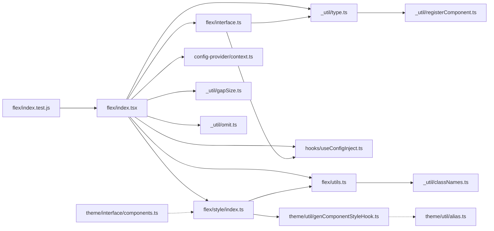
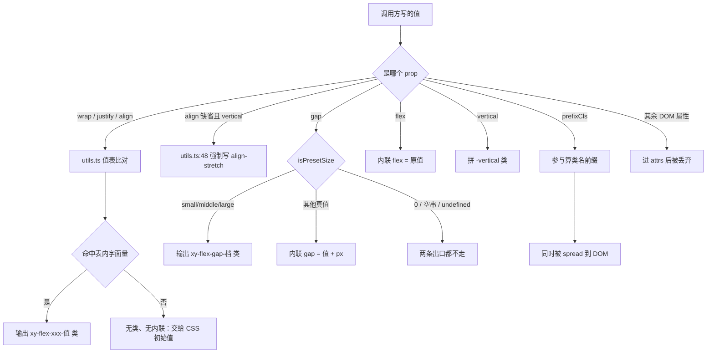
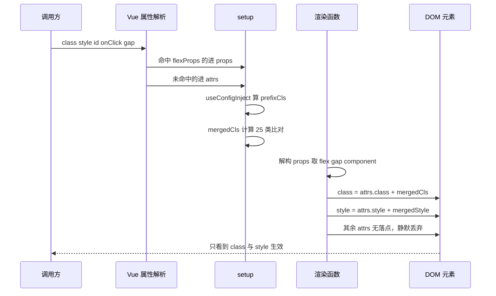

# C02-02 Flex 弹性布局

> **本篇解决**：`Flex` 只有 58 行实现体，为什么它仍会「传了属性没生效」——属性到 DOM 的哪两条通道是通的、哪三条是断的，以及 25 个工具类里为什么有一个值永远取不到。
> **前置**：C02-00《类横写：栅格/flex/space 三代布局的取舍》　**读者坐标**：`03-components/02-layout` 第 2 篇（组件实现篇）

## 一、职责与边界

`Flex` 只负责一件事：把 8 个声明式属性翻译成**容器元素自己的类名与内联样式**，不碰子节点。实现体 43 行（`packages/xiaoye-ui/src/flex/index.tsx:13-56`），加上 3 张 CSS 值表（`packages/xiaoye-ui/src/flex/utils.ts:5-33`）和 5 个样式生成器（`packages/xiaoye-ui/src/flex/style/index.ts:104-110`）。整个目录 5 个文件 311 行，没有 `onMounted`、没有 `ref`、没有 `emits`、没有对外 `expose`，也不向下 `provide`。

三代布局为什么并存、间距落在哪一层、`flex` 为什么不需要运行时探测，都由 C02-00《类横写：栅格/flex/space 三代布局的取舍》论证过，本篇不重复：那里已经确立 `flex` 是三代里唯一走满 seed → Map → Alias → Component 四层的（C02-00 论点 3）、组件侧值表与样式侧值表同源的（论点 5）、因不 import `useFlexGapSupport` 而首帧与环境无关的（论点 6）。本篇写的是这些结论**之下**的东西：属性到 DOM 的落点与三个断口（`packages/xiaoye-ui/src/flex/index.tsx:15` 的 `inheritAttrs: false`、`:48` 的 omit 名单、`packages/xiaoye-ui/src/flex/utils.ts:48` 的无条件覆写），以及 `gap` 这个属性上「一个函数、一个类型、三处字面量」互相不对齐的细节。

明确不负责：

- 子节点的间距补偿与空节点过滤 —— 那是 `space` 的 `filterEmpty` 路径，归 C02-04《Space 间距》。
- 断点、24 列与响应式订阅 —— 归 C02-01《Grid 栅格》。
- 页面级骨架分区 —— 归 C02-03《Layout 布局》。
- 样式注册、`hashId` 生成与 SSR 注水链路 —— 归 A04《cssinjs 样式引擎与 SSR 注水》。
- `useConfigInject` 与 `ConfigProvider` 的注入链本体 —— 归 A05《ConfigProvider 注入链与 Size/Disabled Context》，本篇只取它交给 `Flex` 的那一个值。

依赖清单：

| 方向 | 对象 | 证据 |
| --- | --- | --- |
| 依赖 | `useConfigContextInject` 读 `flex`/`direction` | `packages/xiaoye-ui/src/flex/index.tsx:3`、`packages/xiaoye-ui/src/config-provider/context.ts:175-177` |
| 依赖 | `useConfigInject` 算 `prefixCls` | `packages/xiaoye-ui/src/flex/index.tsx:19`、`packages/xiaoye-ui/src/config-provider/hooks/useConfigInject.ts:14` |
| 依赖 | `genComponentStyleHook('Flex')` 出样式与 `hashId` | `packages/xiaoye-ui/src/flex/style/index.ts:98`、`packages/xiaoye-ui/src/theme/util/genComponentStyleHook.ts:40` |
| 依赖 | `isPresetSize` 判预设档位 | `packages/xiaoye-ui/src/flex/index.tsx:6`、`packages/xiaoye-ui/src/_util/gapSize.ts:3-5` |
| 依赖 | `omit` 剔掉不出现在 DOM 的四个键 | `packages/xiaoye-ui/src/flex/index.tsx:7`、`packages/xiaoye-ui/src/_util/omit.ts:1-9` |
| 依赖 | `classNames` 把布尔表折成类名串 | `packages/xiaoye-ui/src/flex/utils.ts:1`、`packages/xiaoye-ui/src/_util/classNames.ts:16-21` |
| 依赖 | alias 的 `paddingXS`/`padding`/`paddingLG` | `packages/xiaoye-ui/src/flex/style/index.ts:100-102`、`packages/xiaoye-ui/src/theme/util/alias.ts:104` |
| 类型耦合 | `ComponentTokenMap['Flex']` | `packages/xiaoye-ui/src/flex/style/index.ts:8-10`、`packages/xiaoye-ui/src/theme/interface/components.ts:67` |
| 被依赖 | 包根聚合与按需样式入口 | `packages/xiaoye-ui/src/components.ts:140-142`、`packages/xiaoye-ui/package.json:271-275` |
| 被依赖 | 文档示例只用标签形式 | `apps/docs/examples/flex/gap.vue:12`、`apps/docs/examples/flex/align.vue:7` |
| 无人依赖 | 库内没有任何组件在运行时 import `flex` | 两种检索都只命中聚合入口与类型导入：`packages/xiaoye-ui/src/components.ts:140`、`packages/xiaoye-ui/src/theme/interface/components.ts:67` |

最后一行值得单独说：`Flex` 是全库少见的「纯对外组件」——它不被任何兄弟组件复用，所以它的行为变化只会以「用户页面变了」的方式暴露，库内没有第二处消费点帮忙兜住回归。

## 二、源码地图

| 文件 | 行数 | 职责 | 关键符号与入口 |
| --- | --- | --- | --- |
| `flex/index.tsx` | 58 | 组件本体：拼类名 + 拼内联样式 + 决定 DOM 落点 | `defineComponent`（`packages/xiaoye-ui/src/flex/index.tsx:13`）、`name: 'XYFlex'`（`:14`）、`inheritAttrs: false`（`:15`）、渲染函数（`:31`）、`withInstall`（`:57`） |
| `flex/interface.ts` | 16 | props 描述符与公开类型 | `flexProps`（`packages/xiaoye-ui/src/flex/interface.ts:5`）、`FlexProps`（`:16`） |
| `flex/utils.ts` | 68 | 三张 CSS 值表 + 值→类名 | `flexWrapValues`（`packages/xiaoye-ui/src/flex/utils.ts:5`）、`justifyContentValues`（`:7`）、`alignItemsValues`（`:22`）、`createFlexClassNames`（`:60`、默认导出 `:68`） |
| `flex/style/index.ts` | 111 | 5 个样式生成器 + 3 个 gap token | `ComponentToken`（`packages/xiaoye-ui/src/flex/style/index.ts:8`）、`FlexToken`（`:12`）、`genComponentStyleHook('Flex')`（`:98`） |
| `flex/index.test.js` | 58 | 3 个用例 | `mountTest`（`packages/xiaoye-ui/src/flex/index.test.js:6`）、内联 gap 断言（`:22`）、标签名断言（`:36-37`）、`align-stretch` 断言（`:55-56`） |
| `_util/gapSize.ts` | 13 | 预设档判定 | `isPresetSize`（`packages/xiaoye-ui/src/_util/gapSize.ts:3`）、`isValidGapNumber`（`:7`，全仓零调用点） |
| `_util/omit.ts` | 10 | 浅拷贝后删键 | `packages/xiaoye-ui/src/_util/omit.ts:3-8` |
| `_util/classNames.ts` | 27 | 字符串/数组/对象三形态折叠 | `packages/xiaoye-ui/src/_util/classNames.ts:16-21` |
| `tests/shared/mountTest.js` | 23 | 只测挂载/更新/卸载不抛错 | `packages/xiaoye-ui/tests/shared/mountTest.js:17-20` |

组件目录里**没有** `style/index.less`、没有 `demo/`、没有 `__tests__/`：示例与用法手册在文档站一侧（`apps/docs/components/flex.md:53-65`），测试与本仓另一个惯例不同——`flex/index.test.js` 与被测文件同级（`packages/xiaoye-ui/src/flex/index.test.js:2` 用 `import Flex from '.'` 直接引目录）。它仍会被执行，因为 `packages/xiaoye-ui/vitest.config.mts:33` 的 include 含 `src/**/*.test.{js,ts,jsx,tsx}`。

主实现入口是 `packages/xiaoye-ui/src/flex/index.tsx:13` 的 `defineComponent`；样式入口是 `packages/xiaoye-ui/src/flex/style/index.ts:98`；两者之间唯一的值表耦合在 `packages/xiaoye-ui/src/flex/style/index.ts:5`。

## 三、架构与数据流

### 图 1：静态结构——`flex` 目录与它的 9 个依赖面



实线是 `import` 边：`packages/xiaoye-ui/src/flex/index.tsx:3-11` 的 9 行导入表就是这个组件的全部直接依赖，其中 `packages/xiaoye-ui/src/flex/index.tsx:9-10` 两行都指向 `interface.ts`（一行取类型、一行取运行时工厂）。两条虚线是**反向**依赖：`packages/xiaoye-ui/src/theme/interface/components.ts:67` 从 `flex/style` 取 `ComponentToken` 类型来填 `ComponentTokenMap` 的 `Flex` 槽位（`packages/xiaoye-ui/src/theme/interface/components.ts:148`），而 `genComponentStyleHook` 又要求第一个参数是 `ComponentTokenMap` 的键（`packages/xiaoye-ui/src/theme/util/genComponentStyleHook.ts:40-42`）——所以给 `Flex` 加一个新 token 名，必须同时改样式文件和 token 映射表，否则类型不通。这张图解释了一个反直觉现象：`flex/utils.ts` 名义上是组件内部工具，实际是**样式层的公共依赖**（`packages/xiaoye-ui/src/flex/style/index.ts:5`），删除或重命名它的导出会同时打断组件与 CSS 两侧。

### 图 2：一次属性输入落到哪条出口



分支的存在理由：`wrap`/`justify`/`align` 走类是因为它们需要参与 Design Token 之外的静态枚举（`packages/xiaoye-ui/src/flex/utils.ts:35-58` 三次 `forEach`）；`gap`/`flex` 走内联是因为它们的取值域无界（`packages/xiaoye-ui/src/flex/index.tsx:36-42`）。两条 falsy 出口（`:27` 的 `isPresetSize` 与 `:40` 的 `gap &&`）共同决定「没写就没有这个类、也就没有这条声明」，这是组件不写默认值的直接后果（`packages/xiaoye-ui/src/flex/interface.ts:6-13` 八个 props 一个默认值都没有）。`O` 与 `P` 两个框是本篇论点 1 与论点 2 的主题，也是这个组件最容易「写了没反应」的两处。

### 图 3：`attrs` 与 `props` 在渲染期的合流



这张图里唯一需要解释的是第三条边与最后一条边为什么不对称：`packages/xiaoye-ui/src/flex/index.tsx:16` 声明的 props 只有 8 个键，其余全部落到 `attrs`；而 `:15` 关掉了 Vue 的默认透传，渲染函数又只从 `attrs` 里取了两个键（`packages/xiaoye-ui/src/flex/index.tsx:49-50`，全文件 `attrs` 只出现 3 次：`:17`、`:46`、`:47`）。合流点只有 class 与 style，其余属性在 `attrs` 里静静消失。

## 四、核心机制精读

### 论点 1：`Flex` 与外界只有 `class` 与 `style` 两条通路，其余 `attrs` 在渲染函数里没有任何落点

断言：`inheritAttrs: false`（`packages/xiaoye-ui/src/flex/index.tsx:15`）关掉 Vue 的默认透传之后，渲染函数只从 `attrs` 里取了 `class` 与 `style` 两个键，剩下的 `id`、`data-*`、`aria-*`、`on*` 事件监听**既不合并也不铺开**，属于「编译期不报错、运行期不出现」的静默丢弃。

```tsx
// packages/xiaoye-ui/src/flex/index.tsx:31
    return () => {
      const { flex, gap, component: Component = 'div', ...othersProps } = props;

      const mergedStyle: CSSProperties = {};

      if (flex) {
        mergedStyle.flex = flex;
      }

      if (gap && !isPresetSize(gap)) {
        mergedStyle.gap = `${gap}px`;
      }

      return wrapSSR(
        <Component
          class={[attrs.class, mergedCls.value]}
          style={[attrs.style as CSSProperties, mergedStyle]}
          {...omit(othersProps, ['justify', 'wrap', 'align', 'vertical'])}
        >
          {slots.default?.()}
        </Component>,
      );
    };
```

逐段看。`:32` 从 `props` 里取三个值并把剩下的装进 `othersProps`，注意这个 rest 收集的对象是 **props，不是 attrs**（`props` 来自 `:17` 的形参）。`:36-38` 与 `:40-42` 是仅有的两处内联样式产出。`:46` 把调用方的 `class` 放在数组第一位、组件自己算出的 `mergedCls` 放后面，`:47` 同理先 `attrs.style` 再 `mergedStyle`——两处都是「合并」而不是「覆盖」，所以调用方的类名一定在 DOM 上，但**同名属性的最终值由样式表决定，不由数组顺序决定**。`:48` 铺的是 `othersProps`，即 props 减去四个纯类名驱动键（`justify`/`wrap`/`align`/`vertical`），`flex`、`gap`、`component` 已在 `:32` 被解构走。整段 JSX 里 `attrs` 出现 3 次（`grep -n "attrs" packages/xiaoye-ui/src/flex/index.tsx` 得 `:17`、`:46`、`:47`），其中消费点只有两个。这就是「只有两条通路」的全部证据，它不需要读 Vue 源码就能确认：**没有第三处 `attrs` 引用**。

这条通道为什么被写成这样：如果 `:15` 不关 `inheritAttrs`，Vue 会把整份 `attrs` 自动挂到根元素上，组件作者选择自己接管，代价是要手工补每一类属性。补了两类（`class`/`style`），漏了一类（其它全部）。

同仓另有一种写法可以对照：`collapse/Collapse.tsx:40` 同样关掉 `inheritAttrs`，但它在根元素上铺开 `getDataAndAriaProps(attrs)`（`packages/xiaoye-ui/src/collapse/Collapse.tsx:194`），把 `data-*`/`aria-*` 两类挑出来透传（选择逻辑在 `packages/xiaoye-ui/src/_util/util.ts:57-63`，两个 `startsWith` 判断）。也就是说本仓对「关掉透传之后怎么办」已经有过一半的答案：`id` 与事件即使在那种写法下也仍然丢，但埋点常用的 `data-*` 能活。`Flex` 连这一半都没做，`packages/xiaoye-ui/src/flex/index.tsx:1-11` 的 9 行导入表里没有 `getDataAndAriaProps`。

**结论回扣**：给 `<xy-flex>` 写 `id`、`data-*` 或事件监听不是「优先级低」，而是**根本不进 DOM**；要做埋点或无障碍标注，必须自己在外面再套一层元素。这个判断和 C02-00 对三代布局的机制分层不冲突——那是讲间距落在哪一层，这里讲的是属性落在哪一层。

### 论点 2：`prefixCls` 是唯一会被 spread 到 DOM 元素上的公开 prop，因为 omit 名单漏了它

断言：`:48` 的剔除名单只有四个键，`prefixCls` 作为声明过的 prop（`packages/xiaoye-ui/src/flex/interface.ts:6`）留在 `othersProps` 里被一并铺开；而「spread props 到原生元素前必须剔除 `prefixCls`」是本仓既有约定，十余处组件显式执行了它。

```ts
// packages/xiaoye-ui/src/flex/interface.ts:5
export const flexProps = () => ({
  prefixCls: stringType(),
  vertical: booleanType(),
  wrap: stringType<CSSProperties['flex-wrap']>(),
  justify: stringType<CSSProperties['justify-content']>(),
  align: stringType<CSSProperties['align-items']>(),
  flex: someType<CSSProperties['flex']>([Number, String]),
  gap: someType<CSSProperties['gap'] | SizeType>([Number, String]),
  component: anyType(),
});
```

`prefixCls` 不是内部私有键，它和 `wrap`/`align` 一样是**公开可传的属性**，并被 `packages/xiaoye-ui/src/config-provider/hooks/useConfigInject.ts:14` 读来算前缀（`getPrefixCls(name, props.prefixCls)`，其默认实现见 `packages/xiaoye-ui/src/config-provider/context.ts:166-169`：传了就直接返回传的值）。也就是说，用户一旦传 `prefixCls="my-flex"`，`packages/xiaoye-ui/src/flex/index.tsx:21-30` 算出的类名会全部换成 `my-flex-*`，同时 `:48` 会把 `prefixCls: 'my-flex'` 铺到元素上。

对照写法（同一个 `omit` 工具、同一类 spread 场景）：

```tsx
// packages/xiaoye-ui/src/switch/index.tsx:170
    return () =>
      wrapSSR(
        <Wave>
          <button
            {...omit(props, [
              'prefixCls',
              'checkedChildren',
              'unCheckedChildren',
              'checked',
              'autofocus',
              'checkedValue',
              'unCheckedValue',
```

`switch/index.tsx:176-177` 把 `prefixCls` 放在剔除名单的**第一位**，`packages/xiaoye-ui/src/mentions/index.tsx:216` 与 `packages/xiaoye-ui/src/vc-input/Input.tsx:142` 同样显式剔除它（复现命令：`grep -rn "omit(" -A3 packages/xiaoye-ui/src --include='*.tsx' | grep "prefixCls'"`，另命中 `affix/index.tsx:263`、`select/index.tsx:263`、`vc-select/Select.tsx:599`、`vc-cascader/Cascader.tsx:491`、`vc-tree-select/TreeSelect.tsx:693`、`typography/Base.tsx:528`、`input/ResizableTextArea.tsx:141`）。`Flex` 是这批 spread 里不剔的那个，属于约定漏网。

要区分两件事：**「没有剔除」是可证的**（`packages/xiaoye-ui/src/flex/index.tsx:51` 的数组字面量只有四个字符串），**「Vue 会把未知属性写成元素属性」是运行时行为**，本仓库源码里没有对应实现可引。

> ⚠️ 未在源码中找到对应实现，此处为待核实推断：`prefixCls` 铺到原生元素后是否最终生成 `prefixcls` 属性，取决于 Vue 运行时对未知 prop 的处理规则；本篇只用同仓十余处「spread 前剔 `prefixCls`」的写法反证该风险成立，未在本篇范围内实测渲染产物。

**结论回扣**：`packages/xiaoye-ui/src/_util/omit.ts:3-6` 是「浅拷贝后逐键 delete」，性能上不构成任何限制，所以这不是取舍而是遗漏。修它只需在 `packages/xiaoye-ui/src/flex/index.tsx:51` 的数组里加 `'prefixCls'`；风险在于 `component` 允许传入自定义组件（`packages/xiaoye-ui/src/flex/interface.ts:13`），那种场景下自定义组件可能正指望从 props 里拿到 `prefixCls`，本库内没有这种用法（见图 1 的「无人依赖」行）。

### 论点 3：三张值表里的 `stretch` 是可达 CSS、不可达属性值——`utils.ts:48` 的无条件赋值把它盖掉了

断言：`alignItemsValues` 的 10 个值都会生成对应 CSS 规则，但其中 `'stretch'` 在组件侧永远拿不到类名，因为生成函数在枚举比对之后**无条件**又给同一个键赋了一次值。

```ts
// packages/xiaoye-ui/src/flex/utils.ts:22
export const alignItemsValues = [
  'center',
  'start',
  'end',
  'flex-start',
  'flex-end',
  'self-start',
  'self-end',
  'baseline',
  'normal',
  'stretch',
] as const;

const genClsWrap = (prefixCls: string, props: FlexProps) => {
  const wrapCls: Record<PropertyKey, boolean> = {};
  flexWrapValues.forEach(cssKey => {
    wrapCls[`${prefixCls}-wrap-${cssKey}`] = props.wrap === cssKey;
  });
  return wrapCls;
};

const genClsAlign = (prefixCls: string, props: FlexProps) => {
  const alignCls: Record<PropertyKey, boolean> = {};
  alignItemsValues.forEach(cssKey => {
    alignCls[`${prefixCls}-align-${cssKey}`] = props.align === cssKey;
  });
  alignCls[`${prefixCls}-align-stretch`] = !props.align && !!props.vertical;
  return alignCls;
};
```

三段结构完全对称（`genClsWrap` 于 `:35-41`、`genClsAlign` 于 `:43-50`、`genClsJustify` 于 `:52-58`），差别只有一处：`genClsAlign` 多写了 `:48`。这一行的本意是「垂直布局下交叉轴默认拉伸」——手册 `apps/docs/components/flex.md:55` 那句「水平模式下为向上对齐，在垂直模式下为拉伸对齐」说的就是它。但它的写法是**赋值**而不是**或运算**：当 `props.align` 是任意非空字符串时 `!props.align` 为 `false`，于是 `:46` 刚刚为 `align-stretch` 写下的 `true` 被改回 `false`。`packages/xiaoye-ui/src/flex/utils.ts:60-65` 用 `classNames` 折叠这张布尔表，而 `packages/xiaoye-ui/src/_util/classNames.ts:16-20` 只把真值键推进数组，`false` 的键直接消失。

结果是一条精确的等式：`-align-stretch` 类出现 ⟺ 没写 `align` 且写了 `vertical`。显式 `align="stretch"` 拿不到它，`vertical` + `align="stretch"` 也拿不到它。CSS 侧那条规则却在：样式生成器遍历同一张表逐值建规则（`packages/xiaoye-ui/src/flex/style/index.ts:80-87`），`align-stretch` 与另外 9 个值平级——**规则恒存在，触发条件永不成立**。这正是 C02-00 论点 5 所说的「两张表同源」的一个反面注脚：同源保证的是「值不会漏」，不保证「值取得到」。

测试只覆盖了派生分支：`packages/xiaoye-ui/src/flex/index.test.js:40-57` 两个断言分别是 `vertical` 不带 `align`（`:43`、断言 `:55`）和 `vertical` 带 `align="center"`（`:49`、断言 `:56`），后者命中的是 `:46` 的常规路径而不是 `:48` 的覆写路径。没有任何用例写过 `align="stretch"`，所以这个覆写在测试里是隐形的。该分支无测试保护。

**结论回扣**：改法是 `:48` 换成 `alignCls[k] = alignCls[k] || (!props.align && !!props.vertical)`，让显式值优先。但要注意这会**新启用一条现存但从未被触发的 CSS 规则**（`packages/xiaoye-ui/src/flex/style/index.ts:83-85`），对已经写了 `align="stretch"` 却依赖「无类名 → 浏览器默认」的页面是一次可见变更。

### 论点 4：`gap` 的两条出口之间没有同源表，三处字面量各自为政，而本该管住数字分支的函数零调用点

断言：25 个工具类靠 `import` 保证组件与样式同源，但 `gap` 的三个预设档位是**两套硬编码**；同时 `gap` 的内联分支用裸真值判断，同一个工具文件里那个更严谨的判定函数无人调用。

```ts
// packages/xiaoye-ui/src/_util/gapSize.ts:1
import type { SizeType } from '../config-provider/SizeContext';

export function isPresetSize(size?: SizeType | string | number): size is SizeType {
  return ['small', 'middle', 'large'].includes(size as string);
}

export function isValidGapNumber(size?: SizeType | string | number): size is number {
  if (!size) {
    // The case of size = 0 is deliberately excluded here, because the default value of the gap attribute in CSS is 0, so if the user passes 0 in, we can directly ignore it.
    return false;
  }
  return typeof size === 'number' && !Number.isNaN(size);
}
```

`isPresetSize`（`:3-5`）是运行时数组字面量，它管类型的那一位 `SizeType`（`packages/xiaoye-ui/src/config-provider/SizeContext.ts:3`，`'small' | 'middle' | 'large' | undefined`）是另一份声明，两者此刻一致但无机制绑定。同文件的 `isValidGapNumber`（`:7-13`）**全仓零调用点**：`grep -rn "isValidGapNumber" --include='*.ts' --include='*.tsx' --include='*.vue' packages apps | grep -v /dist/` 只输出它的声明行 `packages/xiaoye-ui/src/_util/gapSize.ts:7`。而 `:9` 那行注释恰好写明了「0 被刻意排除，因为 CSS 的 gap 默认就是 0」——这段语义没人执行，`Flex` 用的是 `packages/xiaoye-ui/src/flex/index.tsx:40` 的 `gap && !isPresetSize(gap)`。两条判断对 `0`、`''`、`undefined` 的结果一致，但对 `NaN` 与字符串不一致：`isValidGapNumber('1rem')` 为 `false`，`gap && !isPresetSize(gap)` 为 `true`。

于是内联分支变成一次字符串拼接：

```tsx
// packages/xiaoye-ui/src/flex/index.tsx:21
    const mergedCls = computed(() => [
      prefixCls.value,
      hashId.value,
      createFlexClassNames(prefixCls.value, props),
      {
        [`${prefixCls.value}-rtl`]: ctxDirection.value === 'rtl',
        [`${prefixCls.value}-gap-${props.gap}`]: isPresetSize(props.gap),
        [`${prefixCls.value}-vertical`]: props.vertical ?? ctxFlex?.value.vertical,
      },
    ]);
```

`:27` 用模板拼类名，`:40-42` 用模板拼 `${gap}px`。前者的合法域由 `isPresetSize` 限定，后者不做任何限定，因此 `gap="1rem"` 与 `gap="10px"` 这类**手册明确允许的写法**（`apps/docs/components/flex.md:64` 的类型列是 `small | middle | large | string | number`）会被拼成 `1rempx`、`10pxpx`：不合法的声明会被样式解析丢弃，表现为「间距设了但没有」。文档示例之所以看不出问题，是因为它只在预设名与纯数字之间切换：`apps/docs/examples/flex/gap.vue:12` 的三元表达式要么给出 `small`/`middle`/`large`（示例自己在 `:24` 抄了一份这三项的本地类型），要么给出滑块的数字值，两种都落在能工作的区间里，恰好绕开了「字符串带单位」这一格。

样式侧对应的是第三个副本：

```ts
// packages/xiaoye-ui/src/flex/style/index.ts:54
const genFlexGapStyle: GenerateStyle<FlexToken> = token => {
  const { componentCls } = token;
  return {
    [componentCls]: {
      '&-gap-small': {
        gap: token.flexGapSM,
      },
      '&-gap-middle': {
        gap: token.flexGap,
      },
      '&-gap-large': {
        gap: token.flexGapLG,
      },
    },
  };
};
```

`:58`、`:61`、`:64` 三个键是字面量，不来自 `isPresetSize` 的数组，也不来自 `SizeType`。三档的具体数值由 `packages/xiaoye-ui/src/flex/style/index.ts:100-102` 的 `mergeToken` 就地绑定到 `paddingXS`/`padding`/`paddingLG`（alias 层的定义见 `packages/xiaoye-ui/src/theme/util/alias.ts:104`、`:106`、`:108`）；四层链路本身归 C02-00 论点 3 与 A03 Design Token 四层体系，本篇只强调「三档 ↔ 三个 padding token」这层对应同样写在 `mergeToken` 的字面量里，没有表可复用。

**结论回扣**：`gap` 想加第四个预设档，最少要同步改 3 个地方——`packages/xiaoye-ui/src/_util/gapSize.ts:4` 的数组、`packages/xiaoye-ui/src/flex/style/index.ts:58-66` 的字面量键、`packages/xiaoye-ui/src/config-provider/SizeContext.ts:3` 的联合类型。只改数组会得到「有类名、无 CSS 规则」的空档，且因为 `isPresetSize` 已为真，内联分支也不再兜底（`packages/xiaoye-ui/src/flex/index.tsx:40`）：新档位下 `gap` 完全失效，这是三条出口里唯一「静默且无值」的一条。

### 论点 5：`'div'` 兜底不在 props 默认值里，`component` 也不在运行时校验里——公开类型却把两者都放行

断言：`component` 的默认标签是在渲染函数里用解构默认值补的（`packages/xiaoye-ui/src/flex/index.tsx:32`），props 描述符层没有任何默认值（`packages/xiaoye-ui/src/flex/interface.ts:13` 用的是 `anyType()`）；而导出的公开类型 `FlexProps` 与 `HTMLElement` 求交，使得「哪些属性能传」在类型层完全失去约束。

```ts
// packages/xiaoye-ui/src/_util/type.ts:66
export function anyType<T = any>(defaultVal?: T, required?: boolean) {
  const type = { validator: () => true, default: defaultVal as T } as unknown;
  return required
    ? (type as {
        type: PropType<T>;
        default: T;
        required: true;
      })
    : (type as {
        default: T;
        type: PropType<T>;
      });
}
```

`:67` 那行是全部：运行时的真实对象是 `{ validator: () => true, default: undefined }`，返回类型里的 `type: PropType<T>` 只是断言，编译后并不存在。Vue 的 props 校验会执行 `validator`，而它恒返回 `true`，所以 `component` 传任何值都不会得到一次运行时告警；错误要等到 `h(Component, ...)` 才浮现。默认值同理：`default` 键在、值为 `undefined`，于是「没传」时的 `undefined` 由 `packages/xiaoye-ui/src/flex/index.tsx:32` 的 `component: Component = 'div'` 兜住——解构默认值只在 `undefined` 时生效，`component=""` 或 `component={null}` 都绕过它，而这两种写法在 `anyType` 下既不报错也不兜底。

用例只覆盖了字符串标签这一条通路：

```jsx
// packages/xiaoye-ui/src/flex/index.test.js:25
  it('Component work', () => {
    const wrapper = mount({
      render() {
        return <Flex>test</Flex>;
      },
    });
    const wrapper2 = mount({
      render() {
        return <Flex component="span">test</Flex>;
      },
    });
    expect(wrapper.find('.xy-flex').element.tagName).toBe('DIV');
    expect(wrapper2.find('.xy-flex').element.tagName).toBe('SPAN');
  });
```

`:36-37` 两条断言证明默认是 `DIV`、传入即换标签，但也止步于此：没有任何用例传过组件对象、`null` 或空串，`component` 传自定义组件时 `class`/`style`/`prefixCls` 三条落点的语义差别（原生元素上是属性，组件上才是 props 与 attrs）完全无保护。

再看类型面：

```ts
// packages/xiaoye-ui/src/flex/interface.ts:16
export type FlexProps = Partial<ExtractPropTypes<ReturnType<typeof flexProps>> & HTMLElement>;
```

`& HTMLElement` 让 `id`、`title`、`onClick` 这些 DOM 成员全部进入合法集合，而论点 1 已证它们在实现里到不了 DOM。两处一起看，`component` 与 `FlexProps` 是同一个设计取向的两面：**把「像 div 一样能写属性」当成对外承诺，但只在 `class`/`style` 上兑现**。

**结论回扣**：`withInstall`（`packages/xiaoye-ui/src/flex/index.tsx:59` → `packages/xiaoye-ui/src/_util/type.ts:39-45`）只负责挂 `install`，注册名由 `packages/xiaoye-ui/src/_util/registerComponent.ts:6-11` 从 `name: 'XYFlex'`（`packages/xiaoye-ui/src/flex/index.tsx:14`）折算成 `xy-flex`，并在全局类型里以 `XYFlex` 出现（`packages/xiaoye-ui/typings/global.d.ts:39`）。标签名、组件名、类型名三者一致的链路是通的，唯一的例外是 `packages/xiaoye-ui/src/flex/index.tsx:13` 的局部变量名仍是上游实现遗留的 `A` 前缀写法，未随本仓 `XYXxx` 约定改名（约定见根目录 `AGENTS.md` 的「命名规范（强制）」）。它不出现在任何对外产物里——对外名字由 `:14` 的 `name` 决定——但按 `XYFlex` 全文检索会漏掉这个声明行，接手的人需要多一次跳转。

### 论点 6：`vertical` 的 context 回落分支是死代码，`ConfigProvider` 从来不提供 `flex` 这个键

断言：`packages/xiaoye-ui/src/flex/index.tsx:28` 的 `props.vertical ?? ctxFlex?.value.vertical` 右侧恒为 `undefined`，因为全仓唯一出现 `flex` 这个配置键的地方是类型声明，`ConfigProvider` 组装并 `provide` 的对象里没有它。

```tsx
// packages/xiaoye-ui/src/flex/index.tsx:17
    setup(props, { slots, attrs }) {
      const { flex: ctxFlex, direction: ctxDirection } = useConfigContextInject();
      const { prefixCls } = useConfigInject('flex', props);
      const [wrapSSR, hashId] = useStyle(prefixCls);
      const mergedCls = computed(() => [
        prefixCls.value,
        hashId.value,
        createFlexClassNames(prefixCls.value, props),
        {
          [`${prefixCls.value}-rtl`]: ctxDirection.value === 'rtl',
          [`${prefixCls.value}-gap-${props.gap}`]: isPresetSize(props.gap),
          [`${prefixCls.value}-vertical`]: props.vertical ?? ctxFlex?.value.vertical,
        },
      ]);
```

`:18` 与 `:19` 是**两个不同的 config 入口**：`useConfigContextInject`（`packages/xiaoye-ui/src/config-provider/context.ts:175-177`，直接 `inject` 原始 context 对象，缺省回落到 `defaultConfigProvider`，`packages/xiaoye-ui/src/config-provider/context.ts:165-173`）与 `useConfigInject`（`packages/xiaoye-ui/src/config-provider/hooks/useConfigInject.ts:7-14`，包一层计算属性）。为什么并用：`useConfigInject` 的返回对象里有 `direction`、`space`、`size`、`disabled` 等 22 个键（`packages/xiaoye-ui/src/config-provider/hooks/useConfigInject.ts:50-73`），但没有 `flex`。组件要读 `flex`，只能自己去 inject。

`flex` 的声明与实现两侧：

```ts
// packages/xiaoye-ui/src/config-provider/context.ts:156
  ripple?: ComputedRef<boolean>;
  componentProps?: ComputedRef<Record<string, Record<string, any>>>;
  flex?: ComputedRef<{
    vertical?: boolean;
  }>;
}
```

```ts
// packages/xiaoye-ui/src/config-provider/index.tsx:154
    const configProvider: ConfigProviderInnerProps = {
      csp,
      autoInsertSpaceInButton,
      locale,
      direction,
      space,
      virtual,
      // ...（中间 15 个键：dropdownMatchSelectWidth、getPrefixCls、iconPrefixCls、theme、renderEmpty、
      //      getTargetContainer、getPopupContainer、pageHeader、input、pagination、form、select、
      //      componentSize、componentDisabled、transformCellText）
      wave,
      ripple,
      componentProps,
    };
```

`context.ts:158-160` 定义了 `flex.vertical`，`config-provider/index.tsx:154-181` 逐项列出的 24 个键里没有 `flex`，`provide` 用的就是这个对象（`packages/xiaoye-ui/src/config-provider/index.tsx:215`）。第二种验证方法：`grep -rn "flex" packages/xiaoye-ui/src/config-provider` 在整个目录里只返回 1 行，即 `context.ts:158` 的声明本身——没有读取点，也没有写入点。

这条边为什么没断得更响：`ctxFlex?.value.vertical` 用了可选链，`ctxFlex` 为 `undefined` 时整式短路成 `undefined`，不会抛错；而 `props.vertical` 缺省同样是 `undefined`（`packages/xiaoye-ui/src/flex/interface.ts:7` 的 `booleanType()` 写的是 `default: undefined`，见 `packages/xiaoye-ui/src/_util/type.ts:58-60`），于是 `??` 整式取 `undefined`，`:28` 的键为假，不产出 `-vertical` 类。也就是说：**「在 ConfigProvider 上配 `flex: { vertical: true }` 让全站默认纵向」这个由类型面暗示的能力，实现里不存在**，症状是配了没反应，且不报错。顺带一提，`-vertical` 的样式只有一条 `flex-direction: column`（`packages/xiaoye-ui/src/flex/style/index.ts:41-43`），而它一旦被激活，还会通过论点 3 的 `:48` 联动出 `align-stretch` 类——两件事的共同上游都是这个恒假的分支。

**结论回扣**：`:28` 里唯一有效的输入是 `props.vertical`。要恢复 context 能力，补齐点在 `config-provider/index.tsx:154-181` 的对象里加一个由 `props` 折算的 `flex` 计算属性，而不是改 `flex/index.tsx`——后者已经在等它。

## 五、对外契约如何生效

`Flex` 的输入有四条来源，全部汇合到一次渲染里的三处出口。来源是：`props`（模板上写的 8 个键，`packages/xiaoye-ui/src/flex/interface.ts:5-14`）、`attrs`（未声明的一切，`packages/xiaoye-ui/src/flex/index.tsx:17`）、ConfigProvider 注入（`packages/xiaoye-ui/src/flex/index.tsx:18-19`）、默认插槽（`packages/xiaoye-ui/src/flex/index.tsx:53`）。出口是：元素类名（`:46`）、元素内联样式（`:47`）、以及 `wrapSSR` 注册出的那段动态样式表（`:44` 与 `:20`）。

值的前缀由注入链决定而不是组件决定：`packages/xiaoye-ui/src/config-provider/hooks/useConfigInject.ts:14` 把 `'flex'` 这个后缀和调用方传的 `prefixCls` 一起交给 `getPrefixCls`，缺省实现 `packages/xiaoye-ui/src/config-provider/context.ts:166-169` 在无自定义值时返回 `xy-flex`。此后 `packages/xiaoye-ui/src/flex/index.tsx:24-28` 的每一个类名模板、以及样式侧 `packages/xiaoye-ui/src/flex/style/index.ts:39` 的 `componentCls`，都从这同一个值派生，因此「改全局前缀」与「改本组件前缀」是同一件事的两个入口。`-rtl` 类（`packages/xiaoye-ui/src/flex/index.tsx:26`）对应的规则是 `direction: rtl`（`packages/xiaoye-ui/src/flex/style/index.ts:44-46`），它读的是 `ctxDirection`，绕过了 `useConfigInject` 那份带 `props.direction` 优先级的实现（`packages/xiaoye-ui/src/config-provider/hooks/useConfigInject.ts:15`）——因为 `flexProps` 没有 `direction` 这个键，两者对 `Flex` 恰好等价。

输出面有三件事值得钉住。第一，`hashId` 被放进类名数组（`packages/xiaoye-ui/src/flex/index.tsx:23`）而不是拼在标签上，这意味着动态样式作用域与工具类作用域同层，`.xy-flex-justify-center` 与哈希类是并列关系；哈希与注水的机制归 A04《cssinjs 样式引擎与 SSR 注水》。第二，组件不声明 `emits`、不解构 `expose`（`packages/xiaoye-ui/src/flex/index.tsx:17` 只取了 `slots` 与 `attrs`），也没有 `slots` 类型标注，插槽面只有一个 `default`（`:50`）——所以「Flex 有没有对外方法」的答案是没有，模板 ref 拿到的是普通实例。第三，按需引入面由生成物决定：包根聚合 `packages/xiaoye-ui/src/components.ts:140-142` 同时给出 `export * from './flex'`、`export { default as Flex }` 与样式副作用 `import './flex/style'`，双入口在 `packages/xiaoye-ui/package.json:271-275`（`./flex` 与 `./flex/style`），全局类型在 `packages/xiaoye-ui/typings/global.d.ts:39`。这三个文件都是 `pnpm gen:entries`（`packages/xiaoye-ui/package.json:35`）的产物，给 `flex` 目录增删文件后要重跑，手工改会被 `prebuild` 的 `--check` 拦下（`packages/xiaoye-ui/package.json:37`）。类型登记面还有一处：`packages/xiaoye-ui/src/theme/interface/components.ts:67` 与 `packages/metadata/src/components/index.ts:115`——前者把 `Flex` 接进 token 映射表，后者把组件名登记进元数据，两处都不是运行时依赖，但都在编译期把 `flex` 目录钉在原地。

## 六、设计取舍

**类枚举与内联样式的分工。** `wrap`/`justify`/`align` 走类名（`packages/xiaoye-ui/src/flex/utils.ts:35-58`），`gap`/`flex` 走内联（`packages/xiaoye-ui/src/flex/index.tsx:36-42`），判据是值域是否有界：前者三张表分别只有 3、12、10 个字面量（`packages/xiaoye-ui/src/flex/utils.ts:5`、`:7-20`、`:22-33`），后者是任意 CSS 长度与简写。走类的收益是组件与样式共用一张表（`packages/xiaoye-ui/src/flex/style/index.ts:5` 的 import 边），代价是加一个值必须改组件文件，且样式生成器要跟着遍历（`packages/xiaoye-ui/src/flex/style/index.ts:71-96` 的三个 `forEach`）。走内联的收益是零枚举，代价是**绕开 token 层**——`gap={16}` 与主题无关，换 seed 也不会动它，这正是预设三档存在的理由（`packages/xiaoye-ui/src/flex/style/index.ts:58-66`）。被放弃的第三条路是「全部内联」：那会让 `align`/`justify` 也无法参与 `theme.components` 作用域，且首屏 CSS 提取（`static-style-extract` 一类工具）拿不到任何排布规则。

**不做 gap 能力探测。** `grid` 与 `space` 都 import `useFlexGapSupport` 来决定走 gap 还是走逐子节点 margin 补偿，这个 hook 的取值要等 `onMounted`（`packages/xiaoye-ui/src/_util/hooks/useFlexGapSupport.ts:5-8`，探测实现 `packages/xiaoye-ui/src/_util/styleChecker.ts:35`）。`flex` 的 9 行导入表里没有它（`packages/xiaoye-ui/src/flex/index.tsx:1-11`）。换来的是「渲染结果与环境无关」：没有首帧不支持、二帧回填的抖动，SSR 与 hydration 天然一致（C02-00 论点 6 已从三代对比的角度给出这条结论）。赔上的是：在不支持 flex `gap` 的旧引擎上，`gap="middle"` 就是不生效，组件里没有任何 margin 兜底路径——因为 `:27` 只出类、`:40-42` 只写 `gap`，两条出口都不产生 `margin`。选这条路的隐含前提是「gap 的兼容性不再是问题」，这个前提在源码里没有对应的检测或降级来兜。

**props 全量 spread 而不是 attrs 全量 spread。** `packages/xiaoye-ui/src/flex/index.tsx:51` 铺的是 `othersProps`。若作者的本意是「让 `component` 换成任意标签时把 DOM 属性带过去」，正确写法是 `{...attrs}` 或对 attrs 做过滤（对照 `packages/xiaoye-ui/src/collapse/Collapse.tsx:194` 的 `getDataAndAriaProps(attrs)`）。现状是 props 侧多带了一个 `prefixCls`（论点 2），attrs 侧少带了除 `class`/`style` 外的一切（论点 1）。这条不写成取舍而写成缺陷更诚实：它没有换来任何可说明的收益。

**布尔属性不写默认值。** 八个 props 一个默认值都没有（`packages/xiaoye-ui/src/flex/interface.ts:6-13`），`packages/xiaoye-ui/src/flex/index.tsx:32-42` 全靠真值判断决定要不要出类、出样式。收益是「没写就不产生任何声明」，把默认语义交还给 CSS 初始值；代价是手册的「默认值」列写的其实是 CSS 初始值而非 props 默认值（`apps/docs/components/flex.md:60` 把 `wrap` 的默认记为 `nowrap`，`packages/xiaoye-ui/src/flex/utils.ts:5` 的表里有 `nowrap`，但 `wrap="nowrap"` 与不写走的是不同代码路径：前者出类、后者不出类）。

## 七、坑与改动指南

**坑 1：给 `<xy-flex>` 写 `id`、`data-*`、`@click` 全都不出现。** 触发：需要在弹性容器上挂埋点属性或事件。症状：DOM 上没有该属性，也不报错，Vue 开发者工具里 attrs 有值。原因：`inheritAttrs: false` 关掉透传后，渲染函数只消费 `attrs.class` 与 `attrs.style`，spread 的是 props 而非 attrs。定位：`packages/xiaoye-ui/src/flex/index.tsx:15`、`:46-47`、`:48`。规避：外面再套一层元素，或改用 `component` 传一个会转发 attrs 的组件。

**坑 2：`gap="1rem"` 或 `gap="10px"` 之后间距为 0。** 触发：照手册的类型列（`string`）写带单位的字符串。症状：内联样式里出现 `gap: 1rempx`，浏览器丢弃该声明，视觉上无间距。原因：非预设值一律拼 `px`，不判断是否已带单位。定位：`packages/xiaoye-ui/src/flex/index.tsx:40-42`；本该拦住它的 `packages/xiaoye-ui/src/_util/gapSize.ts:7-13` 无人调用。规避：`gap` 只写数字或三个预设名。

**坑 3：`align="stretch"` 拿不到 `align-items` 类名。** 触发：显式写 `align="stretch"`，尤其是配合 `vertical` 想强制拉伸。症状：DOM 上没有 `xy-flex-align-stretch`，覆盖上层样式时 stretch 不生效。原因：`packages/xiaoye-ui/src/flex/utils.ts:48` 用 `!props.align && !!props.vertical` 无条件覆盖了 `:46` 的枚举结果。定位：`packages/xiaoye-ui/src/flex/utils.ts:43-50`；CSS 规则本身在 `packages/xiaoye-ui/src/flex/style/index.ts:83-85` 且恒生成。该分支无测试保护（`packages/xiaoye-ui/src/flex/index.test.js:40-57` 未写过显式 `stretch`）。

**坑 4：传了 `prefixCls` 之后元素上多出一个无意义属性。** 触发：为了改前缀而显式传 `prefixCls`。症状：类名正常换成自定义前缀，同时 DOM 属性里出现 `prefixCls` 的值。原因：它是声明过的 prop，被 `:32` 的 rest 收进 `othersProps`，而 `:48` 的剔除名单只有四个键。定位：`packages/xiaoye-ui/src/flex/index.tsx:51`；正确写法对照 `packages/xiaoye-ui/src/switch/index.tsx:176-177`（首项即 `'prefixCls'`）与 `packages/xiaoye-ui/src/mentions/index.tsx:216`。

**坑 5：在 `ConfigProvider` 上配 `flex` 没有任何效果。** 触发：读 `packages/xiaoye-ui/src/config-provider/context.ts:158-160` 就以为可以全局设 `vertical`。症状：配了没反应，也不报错。原因：`config-provider/index.tsx:154-181` 组装的 24 个键里没有 `flex`，组件侧的 `??` 右侧恒为 `undefined`。定位：`packages/xiaoye-ui/src/flex/index.tsx:18`、`:28` 与 `packages/xiaoye-ui/src/config-provider/index.tsx:215`。这是「类型面存活、实现面为空」的一例，改实现要先确认 A05《ConfigProvider 注入链与 Size/Disabled Context》的键约定。

**坑 6：`theme.components.Flex` 覆写不了 gap 档位。** 触发：想只调 Flex 的 `small` 档间距。症状：类型上给不出 `flexGapSM`，给了也不生效。原因：`Flex` 的公共 component token 槽位是空接口（`packages/xiaoye-ui/src/flex/style/index.ts:8-10`，被 `packages/xiaoye-ui/src/theme/interface/components.ts:67` 引去填 `:155`），`flexGap*` 只活在内部 `FlexToken` 上（`packages/xiaoye-ui/src/flex/style/index.ts:12-34`），而它们在 `:99-103` 由 `mergeToken` 就地算出——`merge` 的两条分支都是后写覆盖前写（`packages/xiaoye-ui/src/theme/util/statistic.ts:14` 的 `Object.assign`、`:21-31` 用 `defineProperty` 对同名键重定义），`genComponentStyleHook` 传进来的覆写值（`packages/xiaoye-ui/src/theme/util/genComponentStyleHook.ts:85`）因此会被重新盖掉。可行路径是覆写 alias：`theme.components.Flex.paddingXS` 会先进入 token（`packages/xiaoye-ui/src/theme/interface/index.ts:4-6` 允许 `Partial<AliasToken>`），再被 `packages/xiaoye-ui/src/flex/style/index.ts:100` 读成 `flexGapSM`。

**坑 7：新增一个 gap 预设档只改一处。** 触发：把 `xlarge` 加进 `packages/xiaoye-ui/src/_util/gapSize.ts:4`。症状：`gap="xlarge"` 产出 `xy-flex-gap-xlarge` 类但没有任何规则，且因为 `isPresetSize` 为真，内联分支被跳过（`packages/xiaoye-ui/src/flex/index.tsx:40`），连兜底的 `xlargepx` 都没有。原因：三档类名在样式侧是字面量（`packages/xiaoye-ui/src/flex/style/index.ts:58-66`）。定位：改这一处要同步 `packages/xiaoye-ui/src/config-provider/SizeContext.ts:3` 的类型，否则 TS 侧传不进去。

**坑 8：`component` 传错值不会有任何告警。** 触发：`component=""`、`component={null}` 或传了一个未导入的变量。症状：`'div'` 兜底不生效（解构默认值只认 `undefined`，见 `packages/xiaoye-ui/src/flex/index.tsx:32`），渲染期才报错或渲染出意外节点。原因：`anyType()` 生成的描述符运行时只有 `{ validator: () => true, default: undefined }`（`packages/xiaoye-ui/src/_util/type.ts:67`），类型断言里的 `type` 键并不存在。定位：`packages/xiaoye-ui/src/flex/interface.ts:13`。

**坑 9：空内容的 `Flex` 直接不占位。** 触发：插槽内容由 `v-if` 控制且首帧为空，或父级没传插槽。症状：容器连高度都不留，布局塌陷（`:empty` 命中时 `display: none` 覆盖了 `display: flex`）。原因：`packages/xiaoye-ui/src/flex/style/index.ts:47-49` 有一条纯 CSS 规则，组件侧没有任何对应逻辑。定位：`packages/xiaoye-ui/src/flex/style/index.ts:39-49`。要不要占位由调用方的类名或 `style` 决定，`:46-47` 的合并顺序不改变优先级，得靠更高特异性的选择器。

**测试现状。** `Flex` 只有一个测试文件：`packages/xiaoye-ui/src/flex/index.test.js`，58 行、3 个 `it` 加 1 个 `mountTest`，共 8 条断言（`:19-22`、`:36-37`、`:55-56`）。它会被执行——`packages/xiaoye-ui/vitest.config.mts:33` 的 include 含 `src/**/*.test.{js,ts,jsx,tsx}`，该文件同级即命中。覆盖面是：基类名、`justify` 类、数字 gap 的内联值（`:22` 断言 `style.gap` 为 `100px`）、标签替换、`vertical` 派生的 stretch。`mountTest` 本身不设防：`packages/xiaoye-ui/tests/shared/mountTest.js:17-20` 只断言「强制更新并卸载不抛异常」。**未覆盖**：`attrs` 通路（坑 1）、`prefixCls` 泄漏（坑 4）、`align="stretch"` 显式值（坑 3）、字符串带单位的 gap（坑 2）、`-rtl` 分支（`packages/xiaoye-ui/src/flex/index.tsx:26`）、`:empty` 规则（坑 9）、`component` 传组件对象（坑 8）。

**改动安全边界。** 可以单改的：`packages/xiaoye-ui/src/flex/utils.ts:48`（加 `||` 保显式值）、`packages/xiaoye-ui/src/flex/index.tsx:51` 的剔除名单（加 `'prefixCls'`）、`packages/xiaoye-ui/src/flex/index.tsx:40-42` 的判定（换成 `isValidGapNumber` 会把字符串带单位的情况静默丢掉，属行为变更）。谨慎改的：`packages/xiaoye-ui/src/flex/interface.ts:5-14` 增删键（`FlexProps` 是公开类型，`:16` 的 `Partial<... & HTMLElement>` 一旦收窄会打断 `apps/docs/examples/flex/align.vue:7` 这类传 `:style` 的既有用法）、`packages/xiaoye-ui/src/flex/utils.ts:5-33` 三张表（样式侧同名遍历在 `packages/xiaoye-ui/src/flex/style/index.ts:71-96`，只改一侧会出现「有类无规则」或「有规则无类」）。禁止单改的：`packages/xiaoye-ui/src/config-provider/context.ts:158-160` 的 `flex` 键——它牵的是 ConfigProvider 的公共面，补齐写入点归 A05，不在本组件范围内。改动后的验证命令：

```bash
pnpm --filter xiaoye-ui vitest run src/flex/index.test.js
pnpm typecheck
node docs/column/tools/verify-refs.mjs --excerpt docs/column/03-components/02-layout/C02-02-flex-弹性布局.md
```

第一条只跑本组件的 3 个用例（文件名是 `.js`，不是 `.tsx`）。要注意它的证明力有限：现有 8 条断言不触及上面九个坑，测试变绿不代表行为未变，真正的判据是 `pnpm typecheck` 加上人工比对渲染出的类名——本篇未在本机执行这两条命令，读者请自行跑一次取基线。

## 附：本篇可证伪的三个检查点

1. `grep -n "attrs" packages/xiaoye-ui/src/flex/index.tsx` 应恰好输出 3 行（`:17` 形参、`:46` 取 `class`、`:47` 取 `style`）。论点 1 的全部依据是「不存在第三处 `attrs` 消费」；一旦哪天出现 `{...attrs}` 或 `getDataAndAriaProps(attrs)`，坑 1 与本篇结论同时作废。
2. `grep -rn "flex" packages/xiaoye-ui/src/config-provider` 应只输出 1 行（`context.ts:158` 的类型声明）。论点 6 与坑 5 断言 `ConfigProvider` 从不写入 `flex`；若输出里出现 `config-provider/index.tsx` 的某行，说明写入点已补齐，回落分支复活。
3. `grep -n "alignCls\[" packages/xiaoye-ui/src/flex/utils.ts` 应输出 2 行（`:46` 与 `:48`），且 `:48` 是裸赋值而不是 `||`。论点 3 的「`align="stretch"` 不可达」直接建立在这次覆盖上；若 `:48` 带上 `alignCls[k] ||` 前缀或整行消失，本篇的该结论即被推翻。

