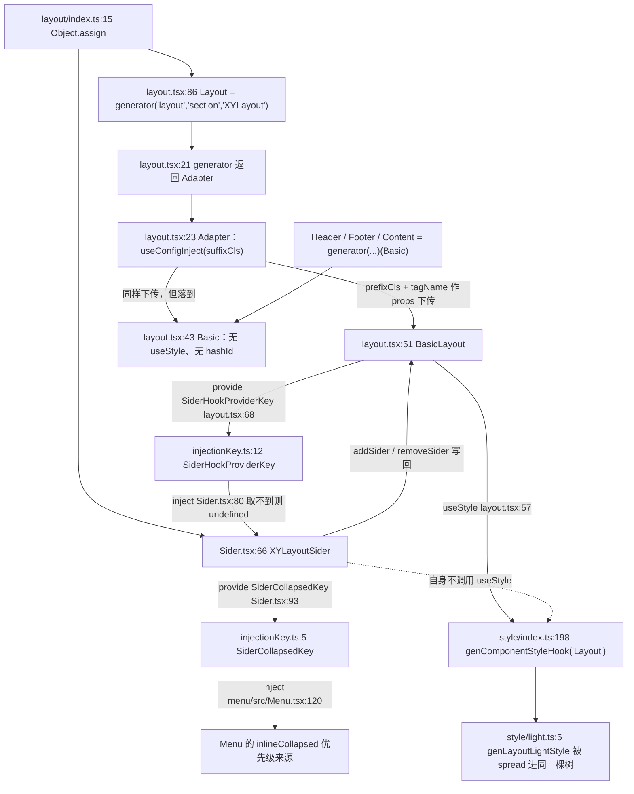
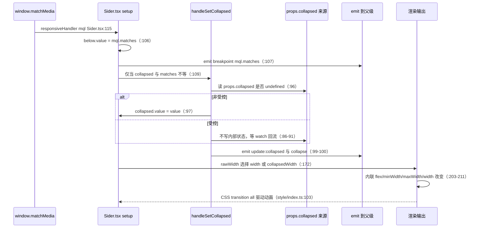
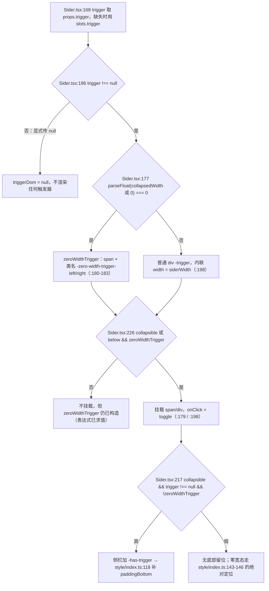

# C02-03 Layout 布局

> **本篇解决**：`xy-layout` 家族（Layout / Sider / Header / Footer / Content）为什么离开 `Layout` 就完全没有样式、侧栏折叠状态如何经父子协商与两条 provide 通道流动、`siderWidth` 相关 token 落在哪几行，以及受控与非受控 `collapsed` 在哪一处 `undefined` 判断上分岔。
> **前置**：C02-00《类横写：栅格/flex/space 三代布局的取舍》　**读者坐标**：`03-components/02-layout` 第 4/14 篇，本类中带内部状态与 provide 通道的骨架件

## 一、职责与边界

`Layout` 家族是**页面骨架级的 flex 容器**，它把「有没有侧栏」「侧栏多宽」「侧栏是否收起」这三件事变成一个可协商的状态，然后通过 DOM 类名与 Vue 的 provide/inject 广播出去。五个成员分工明确：`Layout` 负责 flex 方向与侧栏计数（`packages/xiaoye-ui/src/layout/layout.tsx:58-68`），`Sider` 是家族中唯一持有折叠状态的成员（`packages/xiaoye-ui/src/layout/Sider.tsx:81-101`），`Header` / `Footer` / `Content` 则是由同一个高阶函数生产的语法糖（`packages/xiaoye-ui/src/layout/layout.tsx:86-108`）。

明确**不负责**的事：栅格与断点计算（那是 `Row/Col` 与 `_util/responsiveObserve` 的领域，见 C02-00《类横写：栅格/flex/space 三代布局的取舍》）、`Space` 的间距注入（C02-00）、菜单的折叠渲染、滚动容器与固定定位的外部布局。`Layout` 自己也**不做** JS 侧的宽度计算——侧栏宽度全部落成内联样式，由 CSS 过渡驱动动画（`packages/xiaoye-ui/src/layout/Sider.tsx:203-211`）。

依赖清单（只列本篇取证到的）：

- 上游：`useConfigInject`（`packages/xiaoye-ui/src/layout/layout.tsx:3`、`packages/xiaoye-ui/src/layout/Sider.tsx:17`）、`genComponentStyleHook`（`packages/xiaoye-ui/src/layout/style/index.ts:3`）、`classNames`（`packages/xiaoye-ui/src/layout/Sider.tsx:1`）、`isNumeric`（`packages/xiaoye-ui/src/layout/Sider.tsx:15`）、`initDefaultProps`（`packages/xiaoye-ui/src/layout/Sider.tsx:14`）、三个图标 `BarsOutlined / RightOutlined / LeftOutlined`（`packages/xiaoye-ui/src/layout/Sider.tsx:16`）、`registerComponent`（`packages/xiaoye-ui/src/layout/index.ts:4`）。
- 下游反向依赖：`menu` 直接 import 了 `layout/injectionKey`（`packages/xiaoye-ui/src/menu/src/Menu.tsx:33`），并在 `packages/xiaoye-ui/src/menu/src/Menu.tsx:120` 注入侧栏折叠状态；`layout` 的样式表里也硬写了菜单类名（`packages/xiaoye-ui/src/layout/style/index.ts:78`、`packages/xiaoye-ui/src/layout/style/index.ts:112`）。**这是一对双向的跨组件耦合**，改动 `Layout` 的类名会同时打断菜单样式。

## 二、源码地图

整个模块 704 行，是组件层里少见的「小到能一次读完」的单元，但机制密度不低。

| 文件 | 行数 | 职责 | 关键导出 / 主入口 |
| --- | --- | --- | --- |
| `packages/xiaoye-ui/src/layout/index.ts` | 28 | 聚合导出与安装 | `Object.assign(Layout, { Header, Footer, Content, Sider, install })`（`:15-28`） |
| `packages/xiaoye-ui/src/layout/layout.tsx` | 112 | 高阶生产器 + 侧栏计数宿主 | `basicProps`（`:7`）、`generator`（`:21`）、`BasicLayout`（`:51`） |
| `packages/xiaoye-ui/src/layout/Sider.tsx` | 231 | 折叠状态机、响应式、触发器 DOM | `siderProps`（`:32`）、默认导出 `XYLayoutSider`（`:66`） |
| `packages/xiaoye-ui/src/layout/injectionKey.ts` | 12 | 两条 provide/inject 通道 | `SiderCollapsedKey`（`:5`）、`SiderHookProviderKey`（`:12`） |
| `packages/xiaoye-ui/src/layout/style/index.ts` | 225 | 全部样式，单棵嵌套树 | `LayoutToken`（`:12`）、`genLayoutStyle`（`:22`）、默认导出（`:198`） |
| `packages/xiaoye-ui/src/layout/style/light.ts` | 27 | 浅色侧栏覆写 | `genLayoutLightStyle`（`:5`） |
| `packages/xiaoye-ui/src/layout/index.test.js` | 69 | 3 个行为断言 + mountTest | `describe('Layout')`（`:8`） |

主实现入口是 `packages/xiaoye-ui/src/layout/layout.tsx:86`（`Layout` 在这里由 `generator` 造出）与 `packages/xiaoye-ui/src/layout/Sider.tsx:66`。两处值得先记住的反差：**`Layout` 走高阶函数、`Sider` 不走**；**只有 `BasicLayout` 一个文件调用 `useStyle`**（`packages/xiaoye-ui/src/layout/layout.tsx:57`），`Sider.tsx` 与 `Basic` 都没有——这个不对称决定了后面「样式由谁代持」的整条论证。

测试文件是 `.js` 而非 `.ts`，按 `packages/xiaoye-ui/vitest.config.mts:33` 的 glob（`src/**/*.test.{js,ts,jsx,tsx}`）确认它会被执行；但它只覆盖 `has-sider` 推导与 `has-trigger`（`packages/xiaoye-ui/src/layout/index.test.js:12`、`:50`），**折叠状态机与响应式分支没有任何测试保护**。

## 三、架构与数据流

### 图 1：静态结构（文件 × 符号 × 两条注入通道）



这张图里三条边是全部机制的来源：`Adapter → BasicLayout/Basic` 的 **props 下传**（决定类名从哪里来）、`Sider → BasicLayout` 的**注册回流**（决定 `flex-direction` 何时翻转）、`Sider → Menu` 的**状态广播**（决定折叠态的第二个消费者）。`Sider -.-> STY` 那条虚线是**故意不存在的依赖**，第五个论点会回到它。

### 图 2：一次响应式折叠的数据流



说明两个分支为什么存在：`emit('breakpoint')` 与 `emit('collapse')` 是**两条独立通知**，前者只报告「视口跨过了断点」，后者报告「折叠态建议变成什么」；受控分支必须把最终决定权交回调用方，否则 `v-model:collapsed` 会失去单一数据源。而动画走 CSS 而非 JS，是因为宽度写在 `aside` 的 style 上、由 `style/index.ts:103` 的 `transition: all` 统一接管，JS 侧不需要计时器。

## 四、核心机制精读

### 论点 1：`Header/Footer/Content` 不是四个独立组件，而是一个高阶函数造出的适配器；它们的样式由 `Layout` 根节点「代持」

**断言**：`Basic` 分支既不算样式 hash、也不注册样式表，`Header/Footer/Content/Sider` 的样式之所以生效，完全依赖祖先元素上同时存在 `hashId` 类与 `.xy-layout` 类。把 `Sider` 单独放在 `Layout` 外面用，它拿到的是一条 CSS 都不匹配的裸 DOM。

`packages/xiaoye-ui/src/layout/layout.tsx:21`：

```tsx
// packages/xiaoye-ui/src/layout/layout.tsx:21-41
function generator({ suffixCls, tagName, name }: GeneratorArgument) {
  return (BasicComponent: typeof BasicLayout) => {
    const Adapter = defineComponent({
      compatConfig: { MODE: 3 },
      name,
      props: basicProps(),
      setup(props, { slots }) {
        const { prefixCls } = useConfigInject(suffixCls, props);
        return () => {
          const basicComponentProps = {
            ...props,
            prefixCls: prefixCls.value,
            tagName,
          };
          return <BasicComponent {...basicComponentProps} v-slots={slots}></BasicComponent>;
        };
      },
    });
    return Adapter;
  };
}
```

四个生产调用只差三个参数（`packages/xiaoye-ui/src/layout/layout.tsx:86-108`），其中 `Layout` 传的是 `BasicLayout`、另外三个传的是 `Basic`：

```tsx
// packages/xiaoye-ui/src/layout/layout.tsx:43-49
const Basic = defineComponent({
  compatConfig: { MODE: 3 },
  props: basicProps(),
  setup(props, { slots }) {
    return () => createVNode(props.tagName, { class: props.prefixCls }, slots);
  },
});
```

逐段看：`Basic` 的渲染函数（`:47`）只写一个 `class: props.prefixCls`，**没有 `hashId`、没有 `wrapSSR`**，也没有 `name` 字段（对比 `BasicLayout` 的 `inheritAttrs: false` 与手工合 `attrs.class`，`packages/xiaoye-ui/src/layout/layout.tsx:53`、`:81`）；`class` 之外的属性靠 Vue 默认的 attrs 透传落到根元素。而 `Adapter` 的作用只是把 `useConfigInject(suffixCls, props)` 解析出的 `prefixCls` 和固定 `tagName` 注入下层，所以真正的类名字符串在这里就被决定了：`layout.tsx:93` 的 `suffixCls: 'layout-header'` 经 `getPrefixCls` 拼成 `xy-layout-header`（`packages/xiaoye-ui/src/config-provider/context.ts:166-170` 的默认实现：无自定义前缀时返回 `` `xy-${suffixCls}` ``）。

样式侧的证据链闭合了这条判断。整棵样式树挂在 `componentCls` 之下：

```ts
// packages/xiaoye-ui/src/layout/style/index.ts:44-45
    [componentCls]: {
      display: 'flex',

// packages/xiaoye-ui/src/layout/style/index.ts:70-75
      [`${componentCls}-header`]: {
        height: layoutHeaderHeight,
        paddingInline: layoutHeaderPaddingInline,
        color: layoutHeaderColor,
        lineHeight: `${layoutHeaderHeight}px`,
        background: colorBgHeader,
```

`componentCls` 就是 `.${prefixCls.value}`（`packages/xiaoye-ui/src/theme/util/genComponentStyleHook.ts:87`），所以生成的选择器是 `.xy-layout .xy-layout-header` 这样的**后代选择器**——`Header` 必须身处 `.xy-layout` 之内。另一半是 hash：`genComponentStyleHook` 返回的 `hashId` 只在 `BasicLayout` 的 `divCls` 里被挂上元素（`packages/xiaoye-ui/src/layout/layout.tsx:72`），而 cssinjs 会把 hash 注入到每条选择器的第一段之后（`packages/xiaoye-ui/src/_util/cssinjs/hooks/useStyleRegister/index.tsx:93-95`），默认 `hashPriority: 'low'` 时包成 `:where(.hash)`（`packages/xiaoye-ui/src/_util/cssinjs/hooks/useStyleRegister/index.tsx:85`、`packages/xiaoye-ui/src/_util/cssinjs/StyleContext.tsx:115`）。

结论与代价：这套「代持」让 `Sider` 与三个子组件省去五次 `useToken` 调用和五份样式注册，也让覆盖样式天然零特异性（`:where()`）；代价是**任何脱离 `Layout` 的用法都会静默失去样式**，并且 `Sider` 的样式根依赖 `Layout` 的 `useStyle` 被调用过一次——若将来有人为了 tree-shaking 把 `layout.tsx:57` 的 `useStyle` 挪走，`Sider` 不会报错，只会变成无样式。

### 论点 2：`flex-direction` 由子组件在 setup 期向父组件注册来推导，`hasSider` 只是逃生舱

**断言**：`Layout` 不检查自己的子节点类型，而是暴露一对 `addSider/removeSider` 回调让 `Sider` 自报家门；`hasSider` prop 的优先级高于计数，且计数的写入发生在子组件 setup 阶段，因此首帧必然多一次父组件重渲染。

宿主侧只有 11 行，但它是整个「父子协商」的锚点（`packages/xiaoye-ui/src/layout/layout.tsx:58`）：

```tsx
// packages/xiaoye-ui/src/layout/layout.tsx:58-68
    const siders = ref<string[]>([]);
    const siderHookProvider = {
      addSider: (id: string) => {
        siders.value = [...siders.value, id];
      },
      removeSider: (id: string) => {
        siders.value = siders.value.filter(currentId => currentId !== id);
      },
    };

    provide(SiderHookProviderKey, siderHookProvider);
```

```tsx
// packages/xiaoye-ui/src/layout/layout.tsx:69-78
    const divCls = computed(() => {
      const { prefixCls, hasSider } = props;
      return {
        [hashId.value]: true,
        [`${prefixCls}`]: true,
        [`${prefixCls}-has-sider`]:
          typeof hasSider === 'boolean' ? hasSider : siders.value.length > 0,
        [`${prefixCls}-rtl`]: direction.value === 'rtl',
      };
    });
```

注意 `:70` 读的是 `props.prefixCls` 而不是 `:56` 那个注入来的 `prefixCls`——两者只在「经过 `Adapter` 下传」这条唯一路径上相等（`layout.tsx:32` 显式把解析结果写进下层 props）。`BasicLayout` 未被导出，公开用法都走 `Adapter`，所以这个遮蔽不产生 bug，但它意味着**绕过 `Adapter` 直接实例化 `BasicLayout` 会渲染出字面量 `undefined` 类名**。

`hasSider` 声明为 `{ type: Boolean, default: undefined }`（`packages/xiaoye-ui/src/layout/layout.tsx:9`），正是为了让 `typeof hasSider === 'boolean'` 能区分「没传」与「传了 false」；`initDefaultProps` 也没有给它补默认值，`Layout` 侧连 `initDefaultProps` 都没用（`layout.tsx:54` 直接 `props: basicProps()`）。

子组件侧的注册是一次性的、且带守卫：

```tsx
// packages/xiaoye-ui/src/layout/Sider.tsx:58-64
const generateId = (() => {
  let i = 0;
  return (prefix = '') => {
    i += 1;
    return `${prefix}${i}`;
  };
})();

// packages/xiaoye-ui/src/layout/Sider.tsx:80-119（节选）
    const siderHook = inject(SiderHookProviderKey, undefined);
    // ...
    const uniqueId = generateId('xy-sider-');
    siderHook && siderHook.addSider(uniqueId);
```

```tsx
// packages/xiaoye-ui/src/layout/Sider.tsx:148-155
    onBeforeUnmount(() => {
      try {
        mql?.removeEventListener('change', responsiveHandler);
      } catch (error) {
        mql?.removeListener(responsiveHandler);
      }
      siderHook && siderHook.removeSider(uniqueId);
    });
```

`:119` 在 setup 同步阶段执行，不依赖挂载；`:80` 的默认值 `undefined` 配合 `:119`/`:154` 的 `&&` 守卫，让游离 `Sider` 只是不计数而非抛错。`injectionKey.ts:7-10` 把接口写成两个**可选**方法，也是为这个守卫服务的。

为什么必须靠注册而不是插槽扫描：`Sider` 可以嵌在任意层级。测试里就固化了这个语义——把 `Sider` 包进 `<div>` 仍然要翻转方向：

```jsx
// packages/xiaoye-ui/src/layout/index.test.js:30-47
  it('detect the sider inside the children', async () => {
    const wrapper = mount(
      {
        render() {
          return (
            <Layout>
              <div>
                <Sider>Sider</Sider>
              </div>
              <Content>Content</Content>
            </Layout>
          );
        },
      },
      { sync: false },
    );
    await sleep();
    expect(wrapper.find('.xy-layout').classes()).toContain('xy-layout-has-sider');
  });
```

两个后果写进设计取舍：一是**深度无关但祖先绑定**——inject 取的是最近一层 `BasicLayout`，所以两个并列 `Layout` 各自计数互不污染；二是 `await sleep()` 是必需的，因为「子组件 setup 写父组件 ref」会让 `divCls` 在首帧为 `column`、第二帧才变 `row`。

### 论点 3：受控与非受控的分歧点只有一行 `undefined` 判断，但事件是无条件发的

**断言**：`Sider` 没有使用 `useMergedState` 之类的通用受控工具，而是手写三处写入；受控模式下内部 ref 仍然被同步维持（并非放弃内部状态），且 `update:collapsed` 与 `collapse` 在受控模式下也照发。

```tsx
// packages/xiaoye-ui/src/layout/Sider.tsx:81-101
    const collapsed = shallowRef(
      !!(props.collapsed !== undefined ? props.collapsed : props.defaultCollapsed),
    );
    const below = shallowRef(false);

    watch(
      () => props.collapsed,
      () => {
        collapsed.value = !!props.collapsed;
      },
    );

    provide(SiderCollapsedKey, collapsed);

    const handleSetCollapsed = (value: boolean, type: CollapseType) => {
      if (props.collapsed === undefined) {
        collapsed.value = value;
      }
      emit('update:collapsed', value);
      emit('collapse', value, type);
    };
```

三处写入各自的角色：`:81-83` 只在 setup 求值一次，决定「初始是否受控」；`:86-91` 是受控回流通道，注意它**没有比较新旧值**，`props.collapsed` 一旦从 `true` 变回 `undefined`（调用方撤掉绑定），`!!undefined` 会把侧栏强制展开，`defaultCollapsed` 与期间的手动切换全部丢失；`:96-98` 是非受控自写。`collapsed` 用 `shallowRef` 而非 `ref`，因为值恒为布尔，省掉响应式代理（与 `AGENTS.md` 的 `shallowRef` 约定一致）。

事件面在 `:77` 声明：`emits: ['breakpoint', 'update:collapsed', 'collapse']`。`update:collapsed` 意味着 `v-model:collapsed` 可用，而 `:99-100` 位于 `if` 之外，所以**受控模式下也必须能收到通知**——否则父组件无法实现「点一下才改状态」的单向数据流。`CollapseType` 联合类型只有两个字面量：

```tsx
// packages/xiaoye-ui/src/layout/Sider.tsx:30
export type CollapseType = 'clickTrigger' | 'responsive';

// packages/xiaoye-ui/src/layout/Sider.tsx:157-159
    const toggle = () => {
      handleSetCollapsed(!collapsed.value, 'clickTrigger');
    };
```

即：**没有第三个来源**。外部通过 `v-model` 或 prop 改变折叠态时，`collapse` 事件不会补发，父组件拿不到「type 是什么」的信息；反过来，响应式自动折叠（`:109-111`）与手动点击共用同一出口，只能靠 `type` 区分。

状态还通过第二个通道外溢给 `Menu`：`:93` 的 `provide` 让任意后代读到这个 ref，`Menu` 注入后把它当作**高于自身 prop 的优先级**：

```tsx
// packages/xiaoye-ui/src/menu/src/Menu.tsx:120-126
    const siderCollapsed = inject(SiderCollapsedKey, ref(undefined));
    const inlineCollapsed = computed(() => {
      if (siderCollapsed.value !== undefined) {
        return siderCollapsed.value;
      }
      return props.inlineCollapsed;
    });
```

`packages/xiaoye-ui/src/menu/src/Menu.tsx:140` 甚至对「两者同时设置」发了 `devWarning`，并在 `packages/xiaoye-ui/src/menu/src/Menu.tsx:439` 把 `siderCollapsed` 继续往下 provide。这条链解释了为什么 `Layout.Sider` 的折叠必须用 `provide` 而不是 class 名传递：**`Menu` 需要的是布尔值本身，不是「有没有 collapsed 类」**。而 `SiderCollapsedKey` 的类型被定为 `Ref<boolean>`（`packages/xiaoye-ui/src/layout/injectionKey.ts:3`、`:5`），所以广播的是响应式引用、不是快照。

### 论点 4：响应式折叠不测量任何 DOM，用 `max-width` 媒体查询；监听器注册在 `onMounted` 内部，因此首帧与服务端一定「不折叠」

**断言**：`Sider` 的断点判定是**纯 `window.matchMedia` 查询**，全模块没有任何元素测量或 `ResizeObserver`；断点表是硬编码字面量，与主题 token 脱钩；且查询方向与栅格相反（这里是 `max-width`，栅格是 `min-width`）。

先给「不测量」这条负面结论的两种验证方法。方法一是内容搜索（在 `packages/xiaoye-ui/src/layout/` 下同时搜 `ResizeObserver`、`offsetWidth`、`clientWidth`、`getBoundingClientRect`、`responsiveObserve` 五个关键字，结果为空）；方法二是穷举文件——该目录只有 7 个文件、704 行，全部已读完（`packages/xiaoye-ui/src/layout/index.ts:1-28` 等）。两条一致，才敢下结论。

断点表与查询构造：

```tsx
// packages/xiaoye-ui/src/layout/Sider.tsx:20-28
const dimensionMaxMap = {
  xs: '479.98px',
  sm: '575.98px',
  md: '767.98px',
  lg: '991.98px',
  xl: '1199.98px',
  xxl: '1599.98px',
  xxxl: '1999.98px',
};
```

```tsx
// packages/xiaoye-ui/src/layout/Sider.tsx:121-146
    onMounted(() => {
      watch(
        () => props.breakpoint,
        () => {
          try {
            mql?.removeEventListener('change', responsiveHandler);
          } catch (error) {
            mql?.removeListener(responsiveHandler);
          }
          if (typeof window !== 'undefined') {
            const { matchMedia } = window;
            if (matchMedia! && props.breakpoint && props.breakpoint in dimensionMaxMap) {
              mql = matchMedia(`(max-width: ${dimensionMaxMap[props.breakpoint]})`);
              try {
                mql.addEventListener('change', responsiveHandler);
              } catch (error) {
                mql.addListener(responsiveHandler);
              }
              responsiveHandler(mql);
            }
          }
        },
        {
          immediate: true,
        },
      );
    });
```

`{ immediate: true }`（`:143-145`）负责首帧同步：注册完监听后立刻 `responsiveHandler(mql)`（`:139`）手动跑一次，把当前 `matches` 写进 `below` 并决定是否触发折叠。但整段被包在 `onMounted`（`:121`）里，于是产生三条可预测的行为：服务端渲染时 `below` 恒为 `false`（`:84` 的初值），窄屏页面首帧按展开宽度输出，客户端水合后第二帧才收拢；`typeof window !== 'undefined'`（`:130`）是这条 SSR 路径的显式护栏；`props.breakpoint` 在挂载前被改动也不会补注册。

`props.breakpoint in dimensionMaxMap`（`:132`）是唯一的有效性校验——**不在表里就静默什么都不做**，没有 `devWarning`。这一点值得和 `try/catch` 一起看：`:134-138` 与 `:149-153` 两处 `try` 是为了兼容只实现了 `addListener/removeListener` 的旧环境，而 `catch` 分支里的 `mql?.removeListener` 又用了可选链，即「新浏览器抛错」这种情况实际不会被处理。

`responsiveHandlerRef` 这一层函数间接值得单独指出：

```tsx
// packages/xiaoye-ui/src/layout/Sider.tsx:104-119
    const responsiveHandlerRef = shallowRef<(mql: MediaQueryListEvent | MediaQueryList) => void>(
      (mql: MediaQueryListEvent | MediaQueryList) => {
        below.value = mql.matches;
        emit('breakpoint', mql.matches);

        if (collapsed.value !== mql.matches) {
          handleSetCollapsed(mql.matches, 'responsive');
        }
      },
    );
    let mql: MediaQueryList;
    function responsiveHandler(mql: MediaQueryListEvent | MediaQueryList) {
      return responsiveHandlerRef.value!(mql);
    }
    const uniqueId = generateId('xy-sider-');
    siderHook && siderHook.addSider(uniqueId);
```

设计意图是「保持 `addEventListener` 传入的函数标识稳定，同时允许替换处理体」——`responsiveHandler`（`:115`）才是真正注册进事件表的引用。但整个文件里 `responsiveHandlerRef.value` **只被读一次（`:116`）、从未被赋值**（用 `grep -n "responsiveHandlerRef" packages/xiaoye-ui/src/layout/Sider.tsx` 只会得到 `:104` 与 `:116` 两行），所以这层可替换性在本库现状下是空置的；`!` 断言也因此恒真。真正的语义点在 `:109`：只有「当前折叠态 ≠ 断点命中态」才发通知，避免同一视口反复 emit；但代价是**用户手动展开一个已因响应式折叠的侧栏后，再次跨过同一断点边界才可能重新折叠**，媒体查询本身不会二次通知。

与栅格的对照是硬差异，不是风格差异。共享工具链的断点是**从 token 派生**的：

```ts
// packages/xiaoye-ui/src/_util/responsiveObserve.ts:13-21
const getResponsiveMap = (token: GlobalToken): BreakpointMap => ({
  xs: `(max-width: ${token.screenXSMax}px)`,
  sm: `(min-width: ${token.screenSM}px)`,
  md: `(min-width: ${token.screenMD}px)`,
  lg: `(min-width: ${token.screenLG}px)`,
  xl: `(min-width: ${token.screenXL}px)`,
  xxl: `(min-width: ${token.screenXXL}px)`,
  xxxl: `{min-width: ${token.screenXXXL}px}`,
});
```

两点结论：其一，方向相反——`Col` 的 `lg` 是「视口 ≥ 992 时生效」，`Sider` 的 `breakpoint="lg"` 是「视口 ≤ 991.98 时折叠」（`packages/xiaoye-ui/src/layout/Sider.tsx:133`）；两者数值同源但语义互补，写响应式布局时必须成对考虑。其二，`Sider.tsx:20-28` 是**抄来的常量**：改 `theme` 的 `screenXL` 之类 token，栅格跟着变、侧栏不变。断点集合本身（含本库自加的 `xxxl`）在两处保持一致，靠的是 `packages/xiaoye-ui/src/_util/responsiveObserve.ts:5`、`:10` 的字面量与 `packages/xiaoye-ui/src/layout/Sider.tsx:45` 的 `tuple(...)` 手工对齐；`xxxl` 的 token 边界是 `screenXXXL = 2000`（`packages/xiaoye-ui/src/theme/util/alias.ts:33`），与 `1999.98px` 相差 0.02px，方向和栅格那侧的 `screenXXLMax: screenXXXL - 1`（`packages/xiaoye-ui/src/theme/util/alias.ts:160`）也并不是同一套数。顺带记录一个**不属于本篇主题**的相邻缺陷：`responsiveObserve.ts:20` 的字符串里多了一个 `{`，生成的媒体查询是 `{min-width: 2000px}`，属非法语法；它在 `Row/Col` 的断点观测路径上，此处只登记事实、归 C02-01《Grid 栅格》展开。

### 论点 5：触发器是一棵三态决策树，零宽态靠「绝对定位逃逸 + 只裁子元素」实现

**断言**：`collapsedWidth === 0` 会切换到一条完全不同的 DOM 分支——普通触发器被彻底放弃，改渲染一个绝对定位在侧栏盒子之外的小方块；而让它在零宽容器里可见的关键，是裁剪只施加在子元素上、侧栏自身不 `overflow: hidden`。

```tsx
// packages/xiaoye-ui/src/layout/Sider.tsx:172-202
      const rawWidth = collapsed.value ? collapsedWidth : width;
      // use "px" as fallback unit for width
      const siderWidth = isNumeric(rawWidth) ? `${rawWidth}px` : String(rawWidth);
      // special trigger when collapsedWidth == 0
      const zeroWidthTrigger =
        parseFloat(String(collapsedWidth || 0)) === 0 ? (
          <span
            onClick={toggle}
            class={classNames(
              `${pre}-zero-width-trigger`,
              `${pre}-zero-width-trigger-${reverseArrow ? 'right' : 'left'}`,
            )}
            style={zeroWidthTriggerStyle}
          >
            {trigger || <BarsOutlined />}
          </span>
        ) : null;
      const iconObj = {
        expanded: reverseArrow ? <RightOutlined /> : <LeftOutlined />,
        collapsed: reverseArrow ? <LeftOutlined /> : <RightOutlined />,
      };
      const status = collapsed.value ? 'collapsed' : 'expanded';
      const defaultTrigger = iconObj[status];
      const triggerDom =
        trigger !== null
          ? zeroWidthTrigger || (
              <div class={`${pre}-trigger`} onClick={toggle} style={{ width: siderWidth }}>
                {trigger || defaultTrigger}
              </div>
            )
          : null;
```

三个判定层次分明：`:176-177` 的 `parseFloat(String(collapsedWidth || 0)) === 0` 决定「是否零宽分支」——写成 `String(...)` 再 `parseFloat` 是因为 `collapsedWidth` 允许是 `"0px"` 这类字符串（`packages/xiaoye-ui/src/layout/Sider.tsx:44` 的 `oneOfType([number, string])`），而 `|| 0` 又把 `undefined` 归零，即**没传 `collapsedWidth` 但 `collapsible` 为真时不会误入零宽分支**（`initDefaultProps` 已给出 80，见 `:70-76`）；`:196` 的 `trigger !== null` 是唯一的「彻底关掉触发器」开关；`:226` 决定渲染与否。注意 `zeroWidthTrigger || (...)` 的短路顺序：**零宽态优先，`trigger` 插槽的内容此时只是被塞进小方块的图标**（`:186`），而不是替换掉小方块本身。

挂载条件把响应式和可折叠绑在了一起：

```tsx
// packages/xiaoye-ui/src/layout/Sider.tsx:203-226
      const divStyle = [
        attrs.style as CSSProperties,
        {
          flex: `0 0 ${siderWidth}`,
          maxWidth: siderWidth, // Fix width transition bug in IE11
          minWidth: siderWidth,
          width: siderWidth,
        },
      ];
      const siderCls = classNames(
        pre,
        `${pre}-${theme}`,
        {
          [`${pre}-collapsed`]: !!collapsed.value,
          [`${pre}-has-trigger`]: collapsible && trigger !== null && !zeroWidthTrigger,
          [`${pre}-below`]: !!below.value,
          [`${pre}-zero-width`]: parseFloat(siderWidth) === 0,
        },
        attrs.class,
      );
      return (
        <aside {...attrs} class={siderCls} style={divStyle}>
          <div class={`${pre}-children`}>{slots.default?.()}</div>
          {collapsible || (below.value && zeroWidthTrigger) ? triggerDom : null}
        </aside>
      );
```

`:226` 的 `collapsible || (below.value && zeroWidthTrigger)` 意味着：**即使 `collapsible` 为假，只要命中断点且是零宽态，小方块照样出现，而且照样绑着 `onClick={toggle}`（`:179`）**。`:217` 的 `-has-trigger` 在零宽态被显式排除，因为该类的作用只是给容器补一段底部内边距，而零宽触发器不占底部空间。`:219` 的 `-zero-width` 判的是 `siderWidth`（当前生效宽度）而 `:177` 判的是 `collapsedWidth`（潜在宽度），两者不等价：`width={0}` 且不折叠时会得到 `-zero-width` 却没有零宽触发器。

支撑这段 DOM 的 CSS 有两处非直觉写法：

```ts
// packages/xiaoye-ui/src/layout/style/index.ts:117-136
        '&-has-trigger': {
          paddingBottom: layoutTriggerHeight,
        },
        // ...
        '&-trigger': {
          position: 'fixed',
          bottom: 0,
          zIndex: 1,
          height: layoutTriggerHeight,
          color: colorTextLightSolid,
          lineHeight: `${layoutTriggerHeight}px`,
          textAlign: 'center',
          background: colorBgTrigger,
          cursor: 'pointer',
          transition: `all ${motionDurationMid}`,
        },
```

```ts
// packages/xiaoye-ui/src/layout/style/index.ts:138-149
        '&-zero-width': {
          '> *': {
            overflow: 'hidden',
          },

          '&-trigger': {
            position: 'absolute',
            top: layoutHeaderHeight,
            insetInlineEnd: -layoutZeroTriggerSize,
            zIndex: 1,
            width: layoutZeroTriggerSize,
            height: layoutZeroTriggerSize,
```

普通触发器是 `position: fixed`（`:126`）——脱离侧栏的 flex 盒子，所以必须靠内联 `style={{ width: siderWidth }}`（`packages/xiaoye-ui/src/layout/Sider.tsx:198`）把宽度「手动续上」，否则宽度会塌成内容宽；同时它的 `paddingBottom: layoutTriggerHeight`（`packages/xiaoye-ui/src/layout/style/index.ts:118`）是给固定条留位的。零宽触发器则是 `position: absolute` + `insetInlineEnd: -layoutZeroTriggerSize`（`:146`），**主动溢出到零宽盒子之外**；这就是裁剪写成 `'> *'`（`:139-141`）而不是加在侧栏自身的原因——若给 `aside` 加 `overflow: hidden`，作为其子元素的绝对定位小方块会被一起裁掉（`aside` 本身是包含块，`packages/xiaoye-ui/src/layout/style/index.ts:98` 的 `position: relative`）。`borderStartStartRadius: 0` 与三个角半径的不对称赋值（`:156-159`）则是把方块做成「贴侧边的一半圆角」，`&-right` 分支再镜像一次（`:177-183`）。

### 图 3：触发器渲染决策树



这棵树解释了两件反直觉的事：`collapsedWidth` 为 0 时 `slots.trigger` 的内容只会被塞进小方块（走 `C → D`，永不到 `E`）；而 `collapsible={false}` 在响应式零宽态下**拦不住触发器**（`F` 的右支只看 `below && zeroWidthTrigger`）。

### 论点 6：宽度是一条 token → 内联样式的直路，而样式表里的 `min-width: 0` 是一条永不生效的死规则

**断言**：`Layout` 的组件 token 只有 6 个，全部服务于「高度/内边距/字号」，宽度本身**没有 token**；侧栏宽度从 prop 到像素再到内联样式一步完成，因此 CSS 侧任何针对侧栏尺寸的规则都会被内联样式压过。

```ts
// packages/xiaoye-ui/src/layout/style/index.ts:204-212
    const layoutToken = mergeToken<LayoutToken>(token, {
      // Layout
      layoutHeaderHeight: controlHeight * 2,
      layoutHeaderPaddingInline,
      layoutHeaderColor: colorText,
      layoutFooterPadding: `${controlHeightSM}px ${layoutHeaderPaddingInline}px`,
      layoutTriggerHeight: controlHeightLG + marginXXS * 2, // = item height + margin
      layoutZeroTriggerSize: controlHeightLG,
    });
```

`layoutHeaderPaddingInline` 在 `packages/xiaoye-ui/src/layout/style/index.ts:202` 由 `controlHeightLG * 1.25` 得到，`layoutFooterPadding` 复用它做横向内边距（`:209`）——所以页脚与页眉的左右留白是**同一个派生值**，改一处必同步另一处。三个组件级色值 token 走 `genComponentStyleHook` 的第三个参数：

```ts
// packages/xiaoye-ui/src/layout/style/index.ts:216-223
  token => {
    const { colorBgLayout } = token;

    return {
      colorBgHeader: '#001529',
      colorBgBody: colorBgLayout,
      colorBgTrigger: '#002140',
    };
  },
```

`colorBgHeader` 被硬编码为深色字面量（`:220`），`ComponentToken` 接口把三者声明为必填（`packages/xiaoye-ui/src/layout/style/index.ts:6-10`），因此它们是**可被 `theme.components.Layout` 覆盖的公共面**；而 `style/index.ts:174` 的 hover 提亮用了 `rgba(255, 255, 255, 0.2)`，上方注释本身就承认这是硬编码（原文为 `// FIXME: Hardcode, but seems no need to create a token for this`）。浅色主题的做法是**再挂一棵子树**而非换 token：

```ts
// packages/xiaoye-ui/src/layout/style/light.ts:9-14
    [`${componentCls}-sider-light`]: {
      background: colorBgContainer,

      [`${componentCls}-sider-trigger`]: {
        color: colorText,
        background: colorBgContainer,
      },
```

它被 spread 进主树的内部（`packages/xiaoye-ui/src/layout/style/index.ts:188` 的 `...genLayoutLightStyle(token)`），所以选择器仍是 `.xy-layout .xy-layout-sider-light`——又一次印证论点 1 的「后代绑定」。对应的类名由 `packages/xiaoye-ui/src/layout/Sider.tsx:214` 的 `` `${pre}-${theme}` `` 产出，`theme` 的默认值来自 vue-types 的 `.def('dark')`（`packages/xiaoye-ui/src/layout/Sider.tsx:46`），而 `initDefaultProps` 的清单里没有 `theme`（`packages/xiaoye-ui/src/layout/Sider.tsx:70-76`）——两条默认值通道并存，`initDefaultProps` 内部先探测 `prop.type || prop.default`、再退回 `prop.def`（`packages/xiaoye-ui/src/_util/props-util/initDefaultProps.ts:20-23`），对不存在的 key 直接抛错（`packages/xiaoye-ui/src/_util/props-util/initDefaultProps.ts:28`）。

宽度的死规则这一句要看两段的对撞：

```ts
// packages/xiaoye-ui/src/layout/style/index.ts:97-103
      [`${componentCls}-sider`]: {
        position: 'relative',

        // fix firefox can't set width smaller than content on flex item
        minWidth: 0,
        background: colorBgHeader,
        transition: `all ${motionDurationMid}, background 0s`,
```

`packages/xiaoye-ui/src/layout/Sider.tsx:203-211` 的 `divStyle` 是无条件构造的数组，`minWidth: siderWidth` 永远存在于内联样式里，内联优先级高于任何后代选择器，所以 `packages/xiaoye-ui/src/layout/style/index.ts:101` 这条「Firefox 修丁」在真实渲染路径上**从不生效**（`grep -n "minWidth" packages/xiaoye-ui/src/layout/Sider.tsx` 只命中 `:208` 一处，即每个 `Sider` 都会写）。同理，`flex: 0 0 ${siderWidth}` 已锁定弹性基准，`style/index.ts:101` 唯一可能的作用是给「不带内联样式的同名类」兜底——而组件里不存在这种路径。真正解决溢出问题的是另一处：

```ts
// packages/xiaoye-ui/src/layout/style/index.ts:58-64
      [`&${componentCls}-has-sider`]: {
        flexDirection: 'row',
        [`> ${componentCls}, > ${componentCls}-content`]: {
          // https://segmentfault.com/a/1190000019498300
          width: 0,
        },
      },
```

这才是 flex 布局里所谓「零宽测量」的正体：把侧栏兄弟的 `width` 归零、再配合 `flex: auto`（`packages/xiaoye-ui/src/layout/style/index.ts:90-95` 的 `${componentCls}-content`），让可用空间由 flex 算法分配而不是由内容撑开。**但它只匹配直接子元素中的 `.xy-layout` 与 `.xy-layout-content`**——论点 2 里那种「`Sider` 外面套 `<div>`」的写法，反过来作用在内容区就是：中间夹一层普通 `div` 的 `Content` 拿不到 `width: 0`，长内容会把布局撑破。`transition: all ${motionDurationMid}, background 0s`（`:103`）同时解释了为什么折叠动画不需要 JS：内联四件套里的每一个数值都在 `all` 的覆盖范围内，`background 0s` 单独把主题切换从动画里摘出去。

## 五、对外契约如何生效

契约面分五层，每层的落点不同，且有两处「类型面比实现面更宽」的泄漏。

**组件身份层**。`packages/xiaoye-ui/src/layout/index.ts:15-28` 用 `Object.assign` 把四个子成员挂到 `Layout` 上，同时挂一个 `install`，`install` 里逐个调用 `registerComponent`（`packages/xiaoye-ui/src/layout/index.ts:21-25`）。标签名不是手写的：`packages/xiaoye-ui/src/_util/registerComponent.ts:16-24` 取 `comp.displayName || comp.name`，交给 `toXYTagName`（`packages/xiaoye-ui/src/_util/registerComponent.ts:6`）做 `XY` → `xy-` 前缀替换与驼峰拆字，于是 `packages/xiaoye-ui/src/layout/Sider.tsx:68` 的 `XYLayoutSider` 变成 `xy-layout-sider`；`:23` 的存在性判断防止重复注册。这一层的现状是**不对称的**：全局类型声明里只有 `XYLayout` 一条（`packages/xiaoye-ui/typings/global.d.ts:52`），`XYLayoutSider`、`XYLayoutHeader`、`XYLayoutFooter`、`XYLayoutContent` 都没有条目——生成物由 `pnpm gen:entries` 产出、禁止手改，因此模板里用 `<xy-layout-sider>` 拿到的是 `any` 而非 `SiderProps`。

**props 与类型层**。`LayoutProps` 其实是 `BasicProps` 的改名导出（`packages/xiaoye-ui/src/layout/index.ts:6`），而 `basicProps()` 被 `Adapter`、`Basic`、`BasicLayout` 三处共用（`packages/xiaoye-ui/src/layout/layout.tsx:26`、`:45`、`:54`），结果是**公开类型里带着内部 prop `tagName`**（`packages/xiaoye-ui/src/layout/layout.tsx:10`）。调用方真的传了也没用：`packages/xiaoye-ui/src/layout/layout.tsx:30-34` 先展开 `...props` 再写 `tagName`，后者优先级更高并覆盖它，所以自定义 `tagName` 被静默丢弃。组件目录也没有独立的 `layoutTypes.ts` / `siderTypes.ts`，props 与实现同文件（`packages/xiaoye-ui/src/layout/layout.tsx:7`、`packages/xiaoye-ui/src/layout/Sider.tsx:32`）。

**前缀层**。`prefixCls` 走两跳：`packages/xiaoye-ui/src/layout/layout.tsx:28` 在 `Adapter` 里解析，`:32` 作为普通 prop 下传，`:71` 才变成类名。解析规则是「自定义优先、且直接短路掉后缀拼接」（`packages/xiaoye-ui/src/config-provider/index.tsx:70-74`，默认实现同构于 `packages/xiaoye-ui/src/config-provider/context.ts:166-170`）。这条路径决定了「样式代持」的另一半风险：给 `Layout` 单独传 `prefixCls` 时，`packages/xiaoye-ui/src/layout/style/index.ts:44` 的父选择器变成 `.foo`，而它期望匹配的后代是 `.foo-header`（`packages/xiaoye-ui/src/layout/style/index.ts:70`）；子成员的 `Adapter` 各自解析出自己的 `xy-layout-header`，两边对不上，样式全断。

**slots 层**。`Sider` 的默认插槽不是直接渲染在 `aside` 里，而是多包一层 `-children`（`packages/xiaoye-ui/src/layout/Sider.tsx:225`）——这层 div 有实际职责：`height: 100%` 的传递（`packages/xiaoye-ui/src/layout/style/index.ts:106`）和那对 `-0.1 / 0.1` 的外/内边距（`packages/xiaoye-ui/src/layout/style/index.ts:107-110`，注释自陈是为修 margin collapse），以及给折叠态菜单兜一条 `width: auto`（`packages/xiaoye-ui/src/layout/style/index.ts:112-114`）。`trigger` 插槽的生效条件很窄：`packages/xiaoye-ui/src/layout/Sider.tsx:168` 用解构默认值，只有 `props.trigger === undefined` 时才去取插槽，且拿到的是**内容而非替换节点**。

**事件与命令接口层**。`packages/xiaoye-ui/src/layout/Sider.tsx:77` 声明三条事件，`packages/xiaoye-ui/src/layout/Sider.tsx:47-48` 又以 prop 形式声明了 `onBreakpoint` / `onCollapse`，两条通道都指向 `emit`。整个 `layout` 目录**没有任何 `expose`**（在 `packages/xiaoye-ui/src/layout/` 下搜 `expose` 零命中），因此外部无法命令式地展开或收起侧栏，唯一写入口是 `v-model:collapsed`（依赖 `packages/xiaoye-ui/src/layout/Sider.tsx:99` 的 `update:collapsed`）。

**产物层**。生成聚合入口给这个组件写了三行——`packages/xiaoye-ui/src/components.ts:195-197`（`export * from './layout'`、`export { default as Layout }`、`import './layout/style'`），按需样式入口在 `packages/xiaoye-ui/package.json:340` 与 `packages/xiaoye-ui/package.json:344`（开发期指向 `src`）。`packages/xiaoye-ui/src/layout/index.ts:9` 的 `/* istanbul ignore next */` 则说明 `install` 分支被有意排除在覆盖率之外。

Props 与事件清单见 [apps/docs/components/layout.md](../../../apps/docs/components/layout.md)；本篇只标记该文档与实现的两处偏差：文档的 `breakpoint` 取值列到 `xxl` 为止（`apps/docs/components/layout.md:155`），实现与类型都包含 `xxxl`（`packages/xiaoye-ui/src/layout/Sider.tsx:27`、`:45`）；文档对 `hasSider` 的说明是「可用于服务端渲染时避免样式闪动」（`apps/docs/components/layout.md:145`），这与论点 2 的异步注册结论一致，属于**实现把选择权交给了调用方**。

## 六、设计取舍

**父子协商 vs 静态类名**。最直接的替代方案是叫调用方自己写 `hasSider`，或让 `Layout` 在渲染期扫描 `slots.default` 的子节点类型。扫描方案会被 `<div>` 包裹立刻击穿，而测试恰恰把「嵌在 div 里也要识别」写成断言（`packages/xiaoye-ui/src/layout/index.test.js:30`）；注入方案换来深度无关，赔上的是「子 setup 写父 ref」的**必然二帧**：首帧 `siders` 为空（`packages/xiaoye-ui/src/layout/layout.tsx:58`），第二帧才有 `row`。仓库为此留了逃生舱（`packages/xiaoye-ui/src/layout/layout.tsx:74-75` 的 `typeof hasSider === 'boolean'` 分支），并在文档里把它指向 SSR 场景。这是把一致性问题转成责任转移，不是解决。

**自建 `matchMedia` vs 复用 `useBreakpoint`**。仓库已有统一断点 hook：`packages/xiaoye-ui/src/_util/hooks/useBreakpoint.ts:6-21` 通过 `responsiveObserve` 订阅共享的 `MediaQueryList`（`packages/xiaoye-ui/src/_util/hooks/useBreakpoint.ts:12`），断点串从 token 生成（`packages/xiaoye-ui/src/_util/responsiveObserve.ts:13`）。`Sider` 没用它，而是每实例自己 `matchMedia`（`packages/xiaoye-ui/src/layout/Sider.tsx:133`）。换来的语义是「小于等于即折叠」的单值判断，不必对一组 `min-width` 布尔取反；赔上三样：与主题 token 脱钩（`packages/xiaoye-ui/src/layout/Sider.tsx:20-28` 是抄来的常量）、多侧栏时监听器数量随实例线性增长、以及绕开了 `responsiveObserve` 的订阅复用与清理逻辑。值得注意的是 `useBreakpoint` 本身也在 `onMounted` 才订阅（`packages/xiaoye-ui/src/_util/hooks/useBreakpoint.ts:11`），所以「首帧不折叠」不是 `Layout` 独有的缺陷，而是仓库响应式的共同起点。

**手写受控 vs `useMergedState`**。I13《响应式内核 hooks》登记的 `useMergedState` 正是为「受控/非受控」准备的统一实现。`Sider` 用三处手写达成同样目的（`packages/xiaoye-ui/src/layout/Sider.tsx:81-91`、`:96-98`），换来的是可以在响应式路径里插一条「状态已相等就不发通知」的判断（`packages/xiaoye-ui/src/layout/Sider.tsx:109`），代价则是丢掉统一实现里的边界处理，并引入 `props.collapsed` 变 `undefined` 时强制展开这个副作用（论点 3）。

**一棵样式树 vs 五个组件各一份**。`genComponentStyleHook('Layout', ...)` 只注册一次（`packages/xiaoye-ui/src/layout/style/index.ts:199`），子成员全部以后代选择器附着（`packages/xiaoye-ui/src/layout/style/index.ts:70`、`:83`、`:90`、`:97`）。省下四次 `useToken` 与四份样式表，也让 `:where()` 的零特异性方便业务覆盖（`packages/xiaoye-ui/src/_util/cssinjs/hooks/useStyleRegister/index.tsx:85`）；赔上的是「组件可独立使用」这条通常默认的契约——`Sider` 离开 `Layout` 就裸奔（论点 1）。

**CSS 过渡 vs JS 动画**。`transition: all ${motionDurationMid}, background 0s`（`packages/xiaoye-ui/src/layout/style/index.ts:103`）让折叠动画零 JS 成本，`background 0s` 把主题切换排除在外。`all` 的代价是侧栏上任何后续新增的可动画属性都会被顺带过渡；而为了让动画跨 IE11 生效写下的 `maxWidth` 注释（`packages/xiaoye-ui/src/layout/Sider.tsx:207`）与 `minWidth` 内联（`packages/xiaoye-ui/src/layout/Sider.tsx:208`），共同让样式表里那条 Firefox 修丁变成死代码（论点 6）——这是同一笔取舍在两个引擎上留下的痕迹。

## 七、坑与改动指南

**坑 1：把 `Sider` 或 `Content` 放在 `Layout` 外面用。**
触发：`<xy-layout-sider>` 直接出现在非 `.xy-layout` 容器下，或 `Layout` 被自定义前缀改造过。症状：DOM 结构在、内联宽度在，但背景色、`position: relative`、过渡、触发器定位全部消失，且不报错。原因：样式选择器是 `.xy-layout .xy-layout-sider` 这类后代式（`packages/xiaoye-ui/src/layout/style/index.ts:97`），而 `hashId` 只挂在 `BasicLayout` 元素上（`packages/xiaoye-ui/src/layout/layout.tsx:72`）。定位：`packages/xiaoye-ui/src/layout/style/index.ts:44`。验证：`grep -n "useStyle" packages/xiaoye-ui/src/layout/Sider.tsx` 无输出即证明 `Sider` 自身从不注册样式。该分支**无测试保护**。

**坑 2：只给 `Layout` 传 `prefixCls`。**
触发：`<xy-layout prefix-cls="foo">` 而子成员不传。症状：外层 flex 方向正常（`.foo` 匹配自己），四个子成员失样式，`hasSider` 翻转后的 `width: 0` 挤压也一起失效。原因：`getPrefixCls` 见 `customizePrefixCls` 立即返回、不拼后缀（`packages/xiaoye-ui/src/config-provider/index.tsx:70-72`），父选择器变成 `.foo` 而子元素类名仍是 `xy-layout-header`（`packages/xiaoye-ui/src/layout/layout.tsx:28`）。定位：`packages/xiaoye-ui/src/layout/style/index.ts:70`。改法要么五个成员一起传，要么改用 `ConfigProvider` 的统一前缀。

**坑 3：`props.collapsed` 从 `true` 改回 `undefined`。**
触发：`v-model:collapsed` 的绑定源被清空，或条件性 `:collapsed="cond ? true : undefined"`。症状：侧栏突然弹回展开，`defaultCollapsed` 与用户期间的点击结果一起丢失，且不会补发 `collapse` 事件。原因：`packages/xiaoye-ui/src/layout/Sider.tsx:86-91` 的 watch 无条件 `!!props.collapsed` 赋值。定位：`packages/xiaoye-ui/src/layout/Sider.tsx:89`。**无测试保护**（`packages/xiaoye-ui/src/layout/index.test.js` 全文不涉及 `collapsed`）。

**坑 4：`breakpoint` 传了不在表里的值。**
触发：`breakpoint="xxxl2"`、或从别处搬来 `md` 之外的自定义断点名。症状：响应式完全不动，`breakpoint` 事件也不发，控制台无警告。原因：唯一的校验是 `packages/xiaoye-ui/src/layout/Sider.tsx:132` 的 `props.breakpoint in dimensionMaxMap`，未命中即跳过整段注册。定位：`packages/xiaoye-ui/src/layout/Sider.tsx:20-28`。注意 `packages/xiaoye-ui/src/layout/Sider.tsx:45` 的 `tuple(...)` 只在 devtools 层做校验，运行时不拦截。

**坑 5：内容区外面夹一层普通 `div`，长内容把布局撑破。**
触发：`<Layout><div><Content>…` 或把 `Content` 换成裸 `div`（`Content` 的语义是 `<main>`，见 `packages/xiaoye-ui/src/layout/layout.tsx:104-108`）。症状：侧栏把主区挤到溢出、出现横向滚动条。原因：`width: 0` 的挤压只作用于**直接子元素**中的 `.xy-layout` 与 `.xy-layout-content`（`packages/xiaoye-ui/src/layout/style/index.ts:60-63`）。定位：同处 + `packages/xiaoye-ui/src/layout/style/index.ts:90-95`。反过来说，`Sider` 允许被包裹（`packages/xiaoye-ui/src/layout/index.test.js:30`），`Content` 不允许——这是同一家族里两条不对称的规则。

**坑 6：`collapsible={false}` 挡不住零宽触发器。**
触发：`collapsedWidth={0}` + `breakpoint` 命中，但未开 `collapsible`。症状：小方块照样出现、照样可点，点了真的会折叠。原因：挂载条件是 `collapsible || (below.value && zeroWidthTrigger)`（`packages/xiaoye-ui/src/layout/Sider.tsx:226`），而 `onClick={toggle}` 挂在 span 上（`packages/xiaoye-ui/src/layout/Sider.tsx:179`）与 `collapsible` 无关。定位：`packages/xiaoye-ui/src/layout/Sider.tsx:217`。想彻底不出触发器只能显式 `:trigger="null"`（`packages/xiaoye-ui/src/layout/Sider.tsx:196`）。

**坑 7：以为 `xy-layout-sider-below` 和 `xy-layout-sider-right` 有样式。**
触发：用 `below` 类做窄屏适配，或给右侧侧栏手工加 `xy-layout-sider-right` 期望它排到末尾。症状：类名在 DOM 上，视觉无变化。原因：`-below` 由 `packages/xiaoye-ui/src/layout/Sider.tsx:218` 产出，但样式表里没有对应规则（在 `packages/xiaoye-ui/src/layout/style/` 下搜 `below` 零命中）；`-right` 相反，样式 `order: 1` 存在于 `packages/xiaoye-ui/src/layout/style/index.ts:121-123`，而组件从不产出该类名（全仓搜 `layout-sider-right` 零命中）。两者都是「API 面存活、实现死亡」，右侧侧栏在实现上只能靠 DOM 顺序摆放。

**改动安全边界**。要动 `flex-direction` 或 `hasSider` 推导，先跑 `packages/xiaoye-ui/src/layout/index.test.js` 的两条 `has-sider` 断言（`:12`、`:30`），它们是这个模块唯一的自动化保护；要动类名，必须同步 `packages/xiaoye-ui/src/menu/src/Menu.tsx:120` 那条注入链与 `packages/xiaoye-ui/src/layout/style/index.ts:78`、`:112` 两处硬写的菜单类名，否则折叠态菜单会静默错位；要动宽度算法，注意内联样式优先级（`packages/xiaoye-ui/src/layout/Sider.tsx:203-211`）会让任何 CSS 侧修改无效；要动断点表，请连同 `packages/xiaoye-ui/src/_util/responsiveObserve.ts:13-21` 与 `packages/xiaoye-ui/src/theme/util/alias.ts:33` 一起看，三处数字目前只是巧合一致。`pnpm gen:entries` 在增删组件目录后必须执行，但**只改本模块内部实现不需要**。

## 附：本篇可证伪的三个检查点

1. **「样式代持」为真**：`Sider` 自身不调用 `useStyle`、也不输出 `hashId`，因此它的样式必然依附祖先 `Layout` 元素。命令：`grep -n "useStyle\|hashId" packages/xiaoye-ui/src/layout/Sider.tsx; echo "exit=$?"` —— 预期无输出且 `exit=1`；再对照 `packages/xiaoye-ui/src/layout/layout.tsx:57`（唯一一次 `useStyle`）与 `packages/xiaoye-ui/src/layout/style/index.ts:44`（整棵树挂在 `componentCls` 下）。
2. **`has-sider` 是异步协商而非同步推导**：模块里三条行为测试全部要等一帧。命令：`grep -c "await sleep" packages/xiaoye-ui/src/layout/index.test.js` —— 预期输出 `3`，且该文件三条 `it` 都涉及 sider/trigger 类名；若哪天有人把它改成同步可得，说明注册时机已从 setup 挪到了渲染前，论点 2 的首帧二帧结论即被推翻。
3. **折叠态的跨组件消费者只有一个**：`SiderCollapsedKey` 在全仓只有一处 `provide` 与一处 `inject`。命令：`grep -rn "SiderCollapsedKey" packages/xiaoye-ui/src --include='*.tsx' | grep -v dist` —— 预期恰为四行：`packages/xiaoye-ui/src/layout/Sider.tsx:18`、`packages/xiaoye-ui/src/layout/Sider.tsx:93`、`packages/xiaoye-ui/src/menu/src/Menu.tsx:33`、`packages/xiaoye-ui/src/menu/src/Menu.tsx:120`。出现第五个 inject 点，则本篇「`Menu` 是折叠态第二消费者」的边界描述过时。
