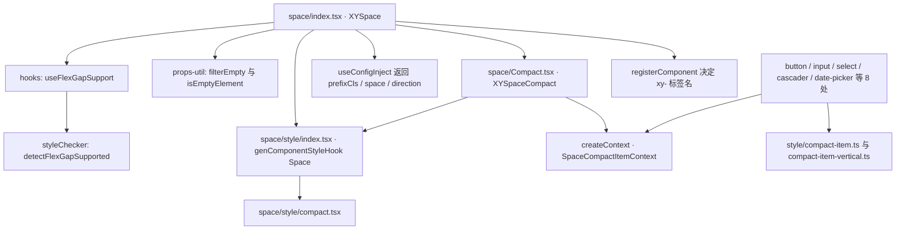
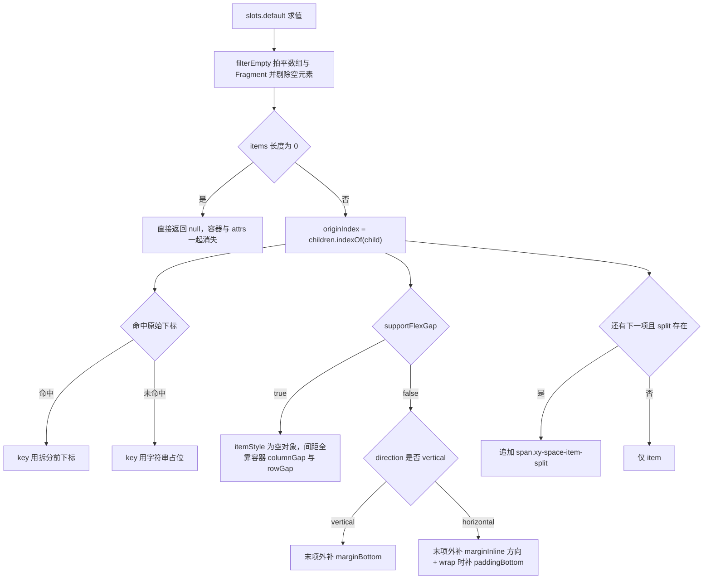
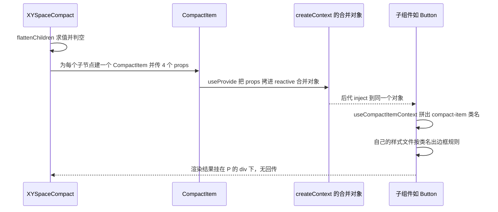

# C02-04 Space 间距

> **本篇解决**：`src/space/` 如何把「子节点之间的间距」拆成可维护的实现——children 拆分与拍平、对齐（align）计算、分隔符（split）注入，以及 flex gap 原生能力与「逐 child 包 div」两条路线的取舍。
> **读者**：要改 Space 行为、或要写「同类间距组件」的人。

## 一、职责与边界

`XYSpace` 只负责一件事：把默认插槽里的每个子节点包进一层 `xy-space-item` 容器，并在相邻两项之间插入用户声明的间距或分隔符（`packages/xiaoye-ui/src/space/index.tsx:110-143`）。它不负责响应式断点（那是 `grid` 的 `responsiveObserve`）、不负责 flex 容器的其余属性（那是 `flex`）、也不负责紧凑模式下的边框折叠样式——`Space.Compact` 只广播上下文与类名，真正画边框的规则在各消费方自己的样式文件里（`packages/xiaoye-ui/src/style/compact-item.ts:89-103`）。

明确不做的事还有三条：不做子节点类型识别（任何 VNode，包括纯文本节点，都会被包一层 `div`，见 `packages/xiaoye-ui/src/space/index.tsx:133`）；不做间距的 token 化（`spaceSize` 是写死的三个字面量，`packages/xiaoye-ui/src/space/index.tsx:17-21`，token 侧的空壳接口见 `packages/xiaoye-ui/src/space/style/index.tsx:6-8`）；不做首帧能力探测（`packages/xiaoye-ui/src/_util/hooks/useFlexGapSupport.ts:5-8` 决定首帧恒走补偿路径）。

依赖清单（入边）：`_util/props-util` 的 `filterEmpty`、`_util/hooks/useFlexGapSupport`、`_util/styleChecker`、`config-provider/hooks/useConfigInject`、`_util/classNames`、`_util/registerComponent`、`theme/internal` 的样式钩子。出边（被谁依赖）：`grep -rln "space/Compact'" packages/xiaoye-ui/src --include='*.ts*'` 得到 10 个 importer，其中 8 个引入并调用 `useCompactItemContext`（下列行号为各自的 import 语句）：`packages/xiaoye-ui/src/button/button.tsx:23`、`packages/xiaoye-ui/src/input/Input.tsx:16`、`packages/xiaoye-ui/src/select/index.tsx:23`、`packages/xiaoye-ui/src/cascader/index.tsx:27`、`packages/xiaoye-ui/src/tree-select/index.tsx:38`、`packages/xiaoye-ui/src/input-number/index.tsx:24`、`packages/xiaoye-ui/src/date-picker/generatePicker/generateSinglePicker.tsx:18`、`packages/xiaoye-ui/src/date-picker/generatePicker/generateRangePicker.tsx:26`；`drawer` 只用 `NoCompactStyle`（`packages/xiaoye-ui/src/drawer/index.tsx:25`），第 10 个 `packages/xiaoye-ui/src/float-button/FloatButton.tsx:11` 的 import 已被注释掉、不产生依赖。

任务书把 `vc-overflow` 列为本篇的相关模块，但**源码层面两者无关系**：`vc-overflow` 的 importer 只有 `packages/xiaoye-ui/src/menu/src/Menu.tsx:35`、`packages/xiaoye-ui/src/menu/src/SubMenu.tsx:26`、`packages/xiaoye-ui/src/menu/src/MenuItem.tsx:19` 与 `packages/xiaoye-ui/src/vc-select/Selector/MultipleSelector.tsx:10`；`grep -rn "overflow" packages/xiaoye-ui/src/space` 无命中。溢出收纳不是 Space 的职责，它连“放不下就折行”都只交给我一个 `flexWrap` 声明（`packages/xiaoye-ui/src/space/index.tsx:88`）。

## 二、源码地图

| 文件 | 行数 | 职责 | 关键导出 / 主入口行 |
| --- | --- | --- | --- |
| `src/space/index.tsx` | 163 | `XYSpace` 主实现：拆子节点、算尺寸、二选一落样式 | `spaceProps` `:22`、组件 `:38`、渲染 `:91` |
| `src/space/Compact.tsx` | 135 | `XYSpaceCompact` 与紧凑上下文（供全库消费） | `SpaceCompactItemContext` `:25`、`useCompactItemContext` `:27`、`NoCompactStyle` `:51` |
| `src/space/style/index.tsx` | 54 | Space 的 CSS-in-JS 规则与样式钩子 | `genSpaceStyle` `:14`、`genComponentStyleHook('Space')` `:51` |
| `src/space/style/compact.tsx` | 29 | 同一钩子里的第二组规则（靠传入的 prefixCls 决定作用域） | `genSpaceCompactStyle` `:11` |
| `src/space/index.test.js` | 73 | 唯一的 Space 单测，只覆盖传统 margin 补偿路径 | `mountTest` `:6`、断言 `:27-28`、`:42-43`、`:71` |

生成物侧的登记：`packages/xiaoye-ui/src/components.ts:310-312` 同时做了三件事——`export * from './space'`、`export { default as Space }`、样式副作用导入 `import './space/style'`；`packages/xiaoye-ui/package.json:484` 与 `:557` 提供 `./space` 与 `./space/style` 双入口；`packages/xiaoye-ui/typings/global.d.ts:79` 只声明了 `XYSpace` 一个全局组件名。

值得单独记住的是文件数量的不对称：主实现只有 163 行，但它的“对外面积”几乎全在 `Compact.tsx` 里——`index.tsx` 被外部引用的只有默认导出本身，而 `Compact.tsx` 提供的是被 8 个组件 import 的运行时契约。改 `index.tsx` 是改一个组件，改 `Compact.tsx:27-49` 是改全库的紧凑模式。

## 三、架构与数据流

### 图 1：静态结构——两个组件、一份样式钩子、一条被全库引用的 context



图 1 的三个分支对应三条独立的风险面。左侧 `A → C → D → E` 是“间距怎么落”的链路，其中 `E` 的探测结果只在挂载后可用，于是 `A` 必须同时维护两套写法。中部 `A → G → H` 与 `B → G` 是**同一个样式钩子被两个组件以不同 prefixCls 调用**（`packages/xiaoye-ui/src/space/index.tsx:49`、`packages/xiaoye-ui/src/space/Compact.tsx:91`），作用域由入参决定（`packages/xiaoye-ui/src/theme/util/genComponentStyleHook.ts:87`），所以 `compact.tsx` 里的 `&-block`、`&-vertical` 到底生成什么类名，取决于谁在调它——这是本篇最容易读错的一块。右侧 `B → I → J` 是跨组件契约：`J` 那 8 个消费方只依赖 `useCompactItemContext` 吐出的类名字符串与 `compactSize`，边框规则由它们各自的样式文件出（`K`）。

### 图 2：一次渲染里，一个子节点如何变成带样式的 item



图 2 里三个判定是彼此独立的层，不是一条流水线：`S3` 决定“渲染与否”，`S6` 决定“复用还是重建”，`S9`/`S11` 决定“间距由谁承担”，`S14` 决定“节点数翻倍与否”。其中 `S9` 的分支与 C02-00《类横写：三代布局》论点 1 所说的一致——Space 是**全量二选一**，这里不再展开，只补它没讲的三个分支：`S3` 的短路、`S6` 的键来源、`S14` 的分隔符节点。

### 图 3：紧凑模式的 context 广播（Space.Compact 的真实数据流）



图 3 强调一个容易被忽略的事实：`XYSpaceCompact` **不产生任何间距**。它产生的只有 context 与类名，视觉上“贴着排”是因为相邻元素的负 margin 把边距吃掉了（`packages/xiaoye-ui/src/style/compact-item.ts:33-34`）。这也解释了为什么 `Compact` 没有 `size`/`gap` 的处理代码（`packages/xiaoye-ui/src/space/Compact.tsx:61-69` 的 `size` 只往下传，不参与布局）。


## 四、核心机制精读

### 论点 1：子节点集合的拆分只有「一层数组 + Fragment 递归」的深度，而 key 取的是拆分前的原始下标——两件事共同决定了 item 的复用与错位行为

断言：`Space` 不识别子节点类型、也不做深度拍平；它把「哪些孩子算一项」完全交给 `filterEmpty`，再用 `children.indexOf(child)` 反查原始下标作为 key，因此**只有从 Fragment 里被递归提出来的节点会丢失原始下标**，退化成 `$$space-<序号>` 字符串键。

```tsx
// packages/xiaoye-ui/src/space/index.tsx:91
    return () => {
      const { wrap, direction = 'horizontal' } = props;
      const children = slots.default?.();
      const items = filterEmpty(children);
      const len = items.length;

      if (len === 0) {
        return null;
      }
      const split = slots.split?.();
      const itemClassName = `${prefixCls.value}-item`;
      const horizontalSizeVal = horizontalSize.value;
      const latestIndex = len - 1;
```

`children` 与 `items` 是两份数组，前者是插槽原始返回值（可能含嵌套数组、Fragment、注释节点、空白文本节点），后者才是参与布局的项。`len === 0` 时直接 `return null`（`packages/xiaoye-ui/src/space/index.tsx:97-99`），连根 `div` 都不产出——这意味着挂在 `Space` 上的 `class`、`style` 与模板 `ref` 在空态会整体消失，而不是留下一个零尺寸容器。

```tsx
// packages/xiaoye-ui/src/space/index.tsx:110
          {items.map((child, index) => {
            let originIndex = children.indexOf(child);
            if (originIndex === -1) {
              originIndex = `$$space-${index}`;
            }
```

这里的 `indexOf` 是身份比较，不是位置比较。`filterEmpty` 在两种情况下会「移动」节点：一是 `Array.isArray(child)` 时 `res.push(...child)`（`packages/xiaoye-ui/src/_util/props-util/index.ts:233-234`），数组元素本身仍留在 `children` 里，能反查到；二是 `child?.type === Fragment` 时 `res.push(...filterEmpty(child.children))`（`packages/xiaoye-ui/src/_util/props-util/index.ts:235-236`），被提出来的节点在 `children` 中**不存在**，`indexOf` 必然返回 `-1`。所以同一个 `Space` 里可能同时存在数字键与字符串键两套命名空间：`<Space><A /><><B /><C /></></Space>` 的三项键依次是 `0`、`$$space-1`、`$$space-2`。

```ts
// packages/xiaoye-ui/src/_util/props-util/index.ts:230
export function filterEmpty(children = []) {
  const res = [];
  children.forEach(child => {
    if (Array.isArray(child)) {
      res.push(...child);
    } else if (child?.type === Fragment) {
      res.push(...filterEmpty(child.children));
    } else {
      res.push(child);
    }
  });
  return res.filter(c => !isEmptyElement(c));
}
```

被剔除的判定在 `isEmptyElement`（`packages/xiaoye-ui/src/_util/props-util/index.ts:213-220`）：注释节点（`v-if` 为假的产物）、子节点为空的 Fragment、以及 `children.trim() === ''` 的文本节点。注意它**不剔除非空文本节点**——`<Space>text<A /></Space>` 里的 `text` 会作为一个 item 被包进 `div`，这正是单测 `packages/xiaoye-ui/src/space/index.test.js:59-71` 断言「invalidElement 也产出 3 个 `.xy-space-item`」的原因。机制后果是：裸文本一旦被包成 `div`，它与相邻的行内元素就不再共享同一基线，`align="baseline"` 也只能对齐到各自 `div` 内部的基线（`packages/xiaoye-ui/src/space/style/index.tsx:37-39`），这是「把文字直接写进 Space 会显得对不齐」的根因，而不是 CSS 优先级问题。

与同目录的 `Compact` 对照能看得更清楚：`Compact` 用的是 `flattenChildren(slots.default?.() || [])`（`packages/xiaoye-ui/src/space/Compact.tsx:102`），那个实现对数组和 Fragment 都是**递归到底**的，并且尊重 `skipFlattenKey` 这个 Symbol 逃生门（`packages/xiaoye-ui/src/_util/props-util/index.ts:49-61`）；而 `Space` 用的 `filterEmpty` 只在 Fragment 那一层递归、数组只展开一层，也没有 `skipFlattenKey` 判定。两者相邻放着、行为不同，说明 Space 的拆分逻辑是早期拷贝而非统一收口——**改动时不要假设把 `filterEmpty` 换成 `flattenChildren` 是等价重构**，后者会额外吃掉 `isValid` 分支里的非 VNode 值（`packages/xiaoye-ui/src/_util/props-util/index.ts:68-70`），并且会改变 key 反查的结果（全部变成 `-1`）。

结论回扣：`Space` 的「拆」只做三件事——展开一层、递归 Fragment、剔除三类空节点；剩下的「谁和谁不复用」由 `children.indexOf` 的下标语义决定。想理解 `Space` 在 `v-for` 列表下的行为，这两条比任何 API 表都重要。

### 论点 2：`align` 只有一个 JS 兜底点，CSS 侧的 `-align` 基类与 JS 侧无条件产出的 `-horizontal` 都是无规则的死类名

断言：对齐的实现是「一个 computed 决定类名后缀 + 一份 CSS 枚举」的双表结构（C02-00 论点 5 已给出三代横向对照，此处只补 Space 自身的两张表逐行核对），而两张表各有对不上的地方：JS 侧的 `cn` 无条件拼接 `-${props.direction}`，CSS 侧只定义了 `-vertical`；CSS 侧写了一个 `-align` 基类，JS 侧却永远只产出 `-align-<值>`。

```tsx
// packages/xiaoye-ui/src/space/index.tsx:67
    const mergedAlign = computed(() =>
      props.align === undefined && props.direction === 'horizontal' ? 'center' : props.align,
    );
    const cn = computed(() => {
      return classNames(prefixCls.value, hashId.value, `${prefixCls.value}-${props.direction}`, {
        [`${prefixCls.value}-rtl`]: directionConfig.value === 'rtl',
        [`${prefixCls.value}-align-${mergedAlign.value}`]: mergedAlign.value,
      });
    });

    const marginDirection = computed(() =>
      directionConfig.value === 'rtl' ? 'marginLeft' : 'marginRight',
    );
```

三个读法。第一，`mergedAlign`（`packages/xiaoye-ui/src/space/index.tsx:67-69`）的默认值条件是 `props.direction === 'horizontal'`，读的是 **props** 而不是 `useConfigInject` 返回的方向（该 hook 在此处只取了 `directionConfig`，用于 `-rtl` 类名 `:72` 与补偿方向的切换 `:77-79`）。第二，`classNames` 的对象写法 `[...align-${mergedAlign.value}]: mergedAlign.value`（`:73`）在 `mergedAlign` 为 `undefined` 时整个键不产出——所以「纵向 + 不写 align」的容器上没有任何 align 类，浏览器按 `align-items: stretch` 处理，此时 `xy-space-item` 会被拉满交叉轴。第三，`-horizontal` 这一项是**无条件字符串拼接**（`:71`，不在对象里，不受真值控制），永远出现在 class 列表中。

```tsx
// packages/xiaoye-ui/src/space/style/index.tsx:14
const genSpaceStyle: GenerateStyle<SpaceToken> = token => {
  const { componentCls } = token;

  return {
    [componentCls]: {
      display: 'inline-flex',
      '&-rtl': {
        direction: 'rtl',
      },
      '&-vertical': {
        flexDirection: 'column',
      },
      '&-align': {
        flexDirection: 'column',
        '&-center': {
          alignItems: 'center',
        },
        '&-start': {
          alignItems: 'flex-start',
        },
        // ...
      },
      [`${componentCls}-item`]: {
        '&:empty': {
          display: 'none',
        },
      },
    },
  };
};
```

把这张表和 JS 侧逐行对上，可以得到三个可验证的结论。其一，`style/index.tsx:14-48` 全文没有 `&-horizontal` 这个键，而 `:71` 一定会产出 `xy-space-horizontal`——横向布局其实只靠 `display: inline-flex`（`:19`）的默认 `flex-direction: row`，那个类名不携带任何声明。其二，`'&-align'`（`:26`）上挂着 `flexDirection: 'column'`，但它的选择器是 `.xy-space-align`，而组件从不产出裸 `-align` 类（`:73` 总带后缀），所以这条 `flex-direction` 声明在本仓当前实现下命中不了任何元素，四个 `align-*` 变体（`:28-39`）生效的只有 `align-items`。其三，`item` 的 `&:empty { display: none }`（`:41-45`）是第二道清理：`filterEmpty` 只看 VNode 层，无法预知一个组件渲染后是否什么都不产出，`CSS :empty` 恰好能兜住这种 item（注释节点不构成 `:empty` 的否定条件）。

顺带一个 RTL 的真实边界：`-rtl` 只切换 `direction`（`:20-22`）与补偿路径里 margin 的左右侧（`packages/xiaoye-ui/src/space/index.tsx:77-79`），**不影响** `align-items` 的四个取值，也不影响 gap（`columnGap` 是逻辑轴，浏览器自行处理）。也就是说在 `supportFlexGap` 为真时，`marginDirection` 这个 computed 虽然仍在计算，但它的唯一消费者 `itemStyle` 恒为空对象（`packages/xiaoye-ui/src/space/index.tsx:116`），RTL 的 margin 翻转只在传统路径下起作用。

### 论点 3：分隔符只从插槽进，且一次求值、多处复用——文档 API 表里的 `split` 参数没有对应的 prop 声明，写了只会变成一个 DOM 属性

断言：`split` 的实现入口只有 `slots.split?.()` 一处，`spaceProps()` 里根本没有这个键；分隔符节点被塞进同一个 `Fragment` 并复用 item 的样式对象，因此「有分隔符时间距要减半」这件事只能在补偿路径里靠除法维持（该除法本身已由 C02-00 论点 1 论证，此处不重复）。

```tsx
// packages/xiaoye-ui/src/space/index.tsx:131
            return wrapSSR(
              <Fragment key={originIndex}>
                <div class={itemClassName} style={itemStyle}>
                  {child}
                </div>
                {index < latestIndex && split && (
                  <span class={`${itemClassName}-split`} style={itemStyle}>
                    {split}
                  </span>
                )}
              </Fragment>,
            );
```

看三个结构事实。第一，分隔符是 `span`（`:136-140`）而 item 是 `div`（`:133`），两者是**兄弟**，都直接挂在容器这个 flex 轴上；`class` 为 `xy-space-item-split`，而这个类名在 `packages/xiaoye-ui/src/space/style/index.tsx:14-48` 里没有任何规则——分隔符的外观 100% 由插槽内容自带（示例给的是 `<xy-divider type="vertical" />`，`apps/docs/examples/space/split.vue:3-5`）。第二，条件是 `index < latestIndex && split`（`:136`），即 N 个 item 产出 N-1 个分隔符，`latestIndex` 来自 `items.length - 1`（`:103`），统计的是**过滤后**的项数。第三，`split` 为真会让这一轮渲染的 DOM 节点数从 N 变成 2N-1，并且 `Fragment key` 只挂在这一层（`:132`），分隔符自身没有 key。

```tsx
// packages/xiaoye-ui/src/space/index.tsx:22
export const spaceProps = () => ({
  prefixCls: String,
  size: {
    type: [String, Number, Array] as PropType<SpaceSize | [SpaceSize, SpaceSize]>,
  },
  direction: PropTypes.oneOf(tuple('horizontal', 'vertical')).def('horizontal'),
  align: PropTypes.oneOf(tuple('start', 'end', 'center', 'baseline')),
  wrap: booleanType(),
});
```

props 表（`packages/xiaoye-ui/src/space/index.tsx:22-30`）与手册 API 表（`apps/docs/components/space.md:102` 把 `split` 列成「参数」，类型写作 `VueNode / v-slot`）在这里出现了偏差：组件侧只有插槽入口，声明的插槽是 `split` 与 `default` 两个（`:43-46`）。因为组件设了 `inheritAttrs: false`（`:41`）又把 `attrs` 整体展开到根节点（`:106`），`<xy-space split="|">` 这种写法不会报 warn，而是**静默地把 `split="|"` 写成 div 的 DOM 属性**，同时 `slots.split` 为 `undefined`，分隔符一个都不出。判别方式很直接：渲染出的容器上有 `split` 属性就等于踩中了这条。

还有一个关于「一次求值」的细节需要标注证据边界。`split` 在每次渲染里只求值一次（`:100`），随后被同一个变量在 N-1 个位置渲染（`:138`），文件里没有 `cloneVNode`（`grep -n "cloneVNode" packages/xiaoye-ui/src/space/index.tsx` 无命中，全文只有 `Fragment` 与 `key` 两处 VNode 相关用法，`:2` 与 `:132`）。同一批 VNode 对象被挂载多次时，框架会用后一次的 `el` 覆盖前一次，这一点属于 Vue 3 渲染器的通用行为，本仓源码里没有对应实现可引。

> 未在源码中找到对应实现，此处为待核实推断：分隔符内容若在插槽里带了响应式状态，多份实例中只有最后一份能可靠地被后续 patch 命中；静态分隔符（如示例里的竖线 divider）不受影响。

### 论点 4：`size` 从入参到像素要走「computed → watch → 两个 ref」三跳，数组短写会漏出 `undefinedpx`，而全局配置的通道只允许标量

断言：尺寸解析没有做成单一 computed，而是用 `watch` 把一对值写进两个独立 `ref`；这个结构带来两个后果——数组短写时第二个值是 `undefined` 并被拼进 CSS 字符串，以及「配置只能给标量，数组只能来自组件自身 props」。

```tsx
// packages/xiaoye-ui/src/space/index.tsx:51
    const size = computed(() => props.size ?? space?.value?.size ?? 'small');
    const horizontalSize = ref<number>();
    const verticalSize = ref<number>();
    watch(
      size,
      () => {
        [horizontalSize.value, verticalSize.value] = (
          (Array.isArray(size.value) ? size.value : [size.value, size.value]) as [
            SpaceSize,
            SpaceSize,
          ]
        ).map(item => getNumberSize(item));
      },
      { immediate: true },
    );
```

优先级链在 `:51`：`props.size` 最高，其次是 `useConfigInject` 返回的 `space.value.size`（`packages/xiaoye-ui/src/config-provider/hooks/useConfigInject.ts:20` 只做透传，没有任何 props 兜底），最后才是字面量 `'small'`。这条链的源头在 `packages/xiaoye-ui/src/config-provider/index.tsx:107`，它把 `props.space` 与父级 context 做了 `??` 合并，所以嵌套 `ConfigProvider` 会继承 `space`，且写 `:space="undefined"` 的层级不会截断继承。

`watch` 的解构（`:57`）把数组第 1 项给横向、第 2 项给纵向，和 `grid` 的 `gutter` 顺序一致；但类型断言 `as [SpaceSize, SpaceSize]`（`:58-61`）只是骗过了编译器，运行时没有任何长度校验。传 `:size="[8]"` 时 `.map` 只产出一个元素，`verticalSize.value` 变成 `undefined`，于是容器样式里出现 `rowGap: "undefinedpx"`（`packages/xiaoye-ui/src/space/index.tsx:84`），传统补偿路径下同理出现 `paddingBottom: "undefinedpx"`（`:126`）。两者都是非法值，浏览器静默丢弃，症状是「纵向间距凭空消失且不报错」。

```tsx
// packages/xiaoye-ui/src/space/index.tsx:80
    const style = computed(() => {
      const gapStyle: CSSProperties = {};
      if (supportFlexGap.value) {
        gapStyle.columnGap = `${horizontalSize.value}px`;
        gapStyle.rowGap = `${verticalSize.value}px`;
      }
      return {
        ...gapStyle,
        ...(props.wrap && { flexWrap: 'wrap', marginBottom: `${-verticalSize.value}px` }),
      } as CSSProperties;
    });
```

`:88` 这一行是 wrap 场景唯一的容器侧补偿：多行布局的最后一行也带 `rowGap`，于是容器整体多出一格高度，用负 `marginBottom` 抵掉。它**不看 `supportFlexGap`**（与 `:82` 的条件形成对照），两轨都要付——这一「容器侧共同承担、子项侧分轨」的形状与 C02-00 论点 1 对栅格的观察同构，只是 Space 的负 margin 在纵向、栅格的在横向。

再看 `wrap` 的一个方向性缺口：容器侧的 `flexWrap` 无条件写（`:88`），但 item 侧的 `paddingBottom` 只在 `horizontal` 分支里加（`:122-127`），纵向分支（`:117-120`）压根不看 `wrap`。手册把这个行为写成「仅在 `horizontal` 时有效」（`apps/docs/components/space.md:103`），代码侧的落点就是这一对不对称的分支。

尺寸的字面量来源与「无 token」这件事由 C02-00 论点 3 论证过（`spaceSize` 常量 `packages/xiaoye-ui/src/space/index.tsx:17-21` 与 `getNumberSize` 的 `size || 0` 兜底 `:34-36`），本篇只补一条该结论的旁证：`packages/xiaoye-ui/src/theme/interface/components.ts:51` 把 `Space` 的组件 token 类型指向 `packages/xiaoye-ui/src/space/style/index.tsx:6-8`，而那里是一个空接口——即使调用方在 `theme.components.Space.token` 里写任何键，`packages/xiaoye-ui/src/theme/util/genComponentStyleHook.ts:85` 合并出来的 `mergedComponentToken` 也没有消费者。

全局配置通道的类型也印证了标量限制：`packages/xiaoye-ui/src/config-provider/context.ts:93` 声明 `space: objectType<{ size?: SizeType | number }>()`，`:122-124` 的 context 类型同样是标量 `size`，数组 `[水平, 垂直]` 在 props 类型里存在（`packages/xiaoye-ui/src/space/index.tsx:25` 的 `[SpaceSize, SpaceSize]`），但在全局配置里没有对应位置。

### 论点 5：紧凑模式的全部跨组件契约压在一个字符串分隔符上，`Compact` 自身不写任何布局样式；嵌套时的 first/last 判定是 AND 语义，内层会被外层吃掉

断言：`Space.Compact` 的输出只有两样——一个 context 对象和一段类名。类名的构造点只有一个三元式，横向/纵向两套 CSS 选择器全靠它对齐；而 first/last 标志在嵌套 `Compact` 中按 AND 合并，导致内层元素拿不到首尾类。

```tsx
// packages/xiaoye-ui/src/space/Compact.tsx:25
export const SpaceCompactItemContext = createContext<SpaceCompactItemContextType | null>(null);

export const useCompactItemContext = (prefixCls: Ref<string>, direction: Ref<DirectionType>) => {
  const compactItemContext = SpaceCompactItemContext.useInject();

  const compactItemClassnames = computed(() => {
    if (!compactItemContext || isEmpty(compactItemContext)) return '';

    const { compactDirection, isFirstItem, isLastItem } = compactItemContext;
    const separator = compactDirection === 'vertical' ? '-vertical-' : '-';

    return classNames({
      [`${prefixCls.value}-compact${separator}item`]: true,
      [`${prefixCls.value}-compact${separator}first-item`]: isFirstItem,
      [`${prefixCls.value}-compact${separator}last-item`]: isLastItem,
      [`${prefixCls.value}-compact${separator}item-rtl`]: direction.value === 'rtl',
    });
  });

  return {
    compactSize: computed(() => compactItemContext?.compactSize),
    compactDirection: computed(() => compactItemContext?.compactDirection),
    compactItemClassnames,
  };
};
```

注意这段代码住在 `space/` 目录，但 `prefixCls` 是**调用方自己的前缀**：`button` 传的是 `xy-btn`、`input` 传的是 `xy-input`（`packages/xiaoye-ui/src/button/button.tsx:60`、`packages/xiaoye-ui/src/input/Input.tsx:38`；前缀由 `packages/xiaoye-ui/src/config-provider/index.tsx:70` 的 `getPrefixCls` 生成，是**不带点号**的类名段）。产出的类名形如 `xy-input-compact-item`，与之配对的 CSS 由该组件自己的样式文件用 `genCompactItemStyle` 生成（`packages/xiaoye-ui/src/style/compact-item.ts:95` 的 `compactCls = ${componentCls}-compact`，那里的 `componentCls` 才带点号，见 `packages/xiaoye-ui/src/theme/util/genComponentStyleHook.ts:87`；选择器本体在 `packages/xiaoye-ui/src/style/compact-item.ts:33`）。这条字符串等式没有任何类型或构建期保护：`Compact.tsx:34` 的分隔符改成 `-v-`，纵向的边框折叠就会**同时**在所有消费方静默失效，因为纵向生成器用的是另一个键（`packages/xiaoye-ui/src/style/compact-item-vertical.ts:50` 的 `-compact-vertical`）。同一份逻辑还有一份 `_shared` 拷贝（`packages/xiaoye-ui/src/_shared/style/compact-item-vertical.ts:47`），改一处忘另一处的风险由目录结构而不是类型系统承担。

纵向只有 Button 有样式，这一点可以用 import 关系直接判定：`grep -rn "genCompactItemVerticalStyle" packages/xiaoye-ui/src` 的命中只有定义处与 `packages/xiaoye-ui/src/button/style/index.ts:7` 和 `:523`。其余七个消费方只挂了横向生成器，所以手册写「垂直方向的紧凑布局，目前仅支持 Button 组合」（`apps/docs/components/space.md:87`）不是功能宣言，而是 CSS 缺位的如实记录。

```tsx
// packages/xiaoye-ui/src/space/Compact.tsx:110
          {childNodes.map((child, i) => {
            const key = (child && child.key) || `${prefixCls.value}-item-${i}`;
            const noCompactItemContext = !compactItemContext || isEmpty(compactItemContext);

            return (
              <CompactItem
                key={key}
                compactSize={props.size ?? 'middle'}
                compactDirection={props.direction}
                isFirstItem={i === 0 && (noCompactItemContext || compactItemContext?.isFirstItem)}
                isLastItem={
                  i === childNodes.length - 1 &&
                  (noCompactItemContext || compactItemContext?.isLastItem)
                }
              >
                {child}
              </CompactItem>
            );
          })}
```

`CompactItem`（`packages/xiaoye-ui/src/space/Compact.tsx:73-81`）本身不渲染元素，它的 render 就是 `slots.default?.()`（`:79`），存在的唯一理由是 `useProvide(props)`（`:77`）。看 `createContext` 怎么落地这个 provide：

```ts
// packages/xiaoye-ui/src/_util/createContext.ts:3
function createContext<T extends Record<string, any>>(defaultValue?: T) {
  const contextKey = Symbol('contextKey');
  const useProvide = (props: T, newProps?: T) => {
    const mergedProps = reactive<T>({} as T);
    provide(contextKey, mergedProps);
    watchEffect(() => {
      Object.assign(mergedProps, props, newProps || {});
    });
    return mergedProps;
  };
  const useInject = () => {
    return inject(contextKey, defaultValue as T) || ({} as T);
  };
```

三个要点。第一，被 provide 的不是 props 代理本身，而是一个**恒定 identity 的 reactive 空对象**，靠 `watchEffect` 往里拷（`:8-10`）——所以后代注入到的永远是同一个对象引用，值变化不会导致 inject 方重建。第二，`useInject` 的兜底是 `|| ({} as T)`（`:14`），也就是「无 provider」与「provider 给了 null」都归一成一个空对象，这就是 `isEmpty` 判定（`Compact.tsx:31`、`:112`）能同时覆盖这两种情况的原因，`NoCompactStyle` 只需要 provide 一个 null（`packages/xiaoye-ui/src/space/Compact.tsx:51-59`）就能把整条链掐断——`drawer` 正是这样避免自己的内容被外层 Compact 染上类名（`packages/xiaoye-ui/src/drawer/index.tsx:415`）。第三，`Object.assign` 只加键不删键，因此 `isEmpty` 的语义是「有没有 CompactItem 在上面 provide 过」，而不是「值是否有意义」；一旦哪天 `spaceCompactItemProps` 少了某个声明，判定会连带改变。

`isFirstItem={i === 0 && (noCompactItemContext || compactItemContext?.isFirstItem)}`（`Compact.tsx:119`）是 AND：内层 `Compact` 若被放在外层 `Compact` 的非首位位置，外层注入的 `isFirstItem` 为假，内层所有 item 的首尾类全为空，圆角不折叠。这不是笔误而是让嵌套时边框仍然收在外层，但源码里没有任何注释说明这层意图，也没有测试保护（`grep -rn "Compact" packages/xiaoye-ui/src --include='*.test.*'` 只命中快照文件 `packages/xiaoye-ui/tests/__snapshots__/index.test.js.snap:41`，那是导出名清单，不是行为断言）。

### 论点 6：同一个样式钩子被两个组件以不同前缀调用，因此 `compact.tsx` 的规则作用域是「谁调用谁得到」；注册与导出面上则留下了两个类型缺口

断言：`space/style/compact.tsx` 里没有 `space-compact` 字样，它能命中 `xy-space-compact-*`，纯粹因为 `Compact` 拿自己的 prefixCls 去调了 `Space` 的钩子；而 `install` 注册了两个组件、包根导出了裸名 `Compact`，全局类型声明里却只有 `XYSpace`。

```tsx
// packages/xiaoye-ui/src/theme/util/genComponentStyleHook.ts:85
        const mergedComponentToken = { ...defaultComponentToken, ...token.value[component] };

        const componentCls = `.${prefixCls.value}`;
        const mergedToken = mergeToken<
          TokenWithCommonCls<GlobalTokenWithComponent<OverrideComponent>>
        >(
          proxyToken,
          {
            componentCls,
            prefixCls: prefixCls.value,
            iconCls: `.${iconPrefixCls.value}`,
            rootCls: `.${rootPrefixCls.value}`,
          },
          mergedComponentToken,
        );
```

`componentCls` 直接取自入参 ref（`packages/xiaoye-ui/src/theme/util/genComponentStyleHook.ts:87`），而 `Space` 与 `Compact` 各自 `useStyle(prefixCls)`（`packages/xiaoye-ui/src/space/index.tsx:49`、`packages/xiaoye-ui/src/space/Compact.tsx:91`）传的是不同前缀（`space` 与 `space-compact`，见 `:48` 与 `:88`）。于是同一个规则函数被登记两次，`path` 也按前缀分开（`packages/xiaoye-ui/src/theme/util/genComponentStyleHook.ts:74`）。

```tsx
// packages/xiaoye-ui/src/space/style/compact.tsx:11
const genSpaceCompactStyle: GenerateStyle<SpaceToken> = token => {
  const { componentCls } = token;

  return {
    [componentCls]: {
      display: 'inline-flex',
      '&-block': {
        display: 'flex',
        width: '100%',
      },
      '&-vertical': {
        flexDirection: 'column',
      },
    },
  };
};
```

把 `:88` 的前缀代进去，实际产出的是 `.xy-space-compact{display:inline-flex}`、`.xy-space-compact-block`、`.xy-space-compact-vertical`，与 `clx` 拼出的类名（`packages/xiaoye-ui/src/space/Compact.tsx:93-99`）逐条对得上，`block`（`:68` 的 prop）也确实有规则。但对不上的那一条是 `-rtl`：`clx` 会产出 `xy-space-compact-rtl`（`:95`），而本文件里没有 `&-rtl`，`space/style/index.tsx` 的 `&-rtl`（`:20-22`）在 `Space` 那次调用里只会生成 `.xy-space-rtl`。所以 **Compact 的 RTL 没有任何样式后果**，只有类名；`useCompactItemContext` 里那个 `-item-rtl` 后缀同理依赖各组件自己的 rtl 规则（`Compact.tsx:40`）。

```tsx
// packages/xiaoye-ui/src/space/index.tsx:150
Space.Compact = Compact;

Space.install = function (app: App) {
  registerComponent(app, Space);
  registerComponent(app, Compact);
  return app;
};

export { Compact };

export default Space as typeof Space &
  Plugin & {
    readonly Compact: typeof Compact;
  };
```

`registerComponent` 按组件 `name` 推标签（`packages/xiaoye-ui/src/_util/registerComponent.ts:16-27`），`XYSpaceCompact` 会被转成 `xy-space-compact`（转换式见 `:6-11`）。但 `packages/xiaoye-ui/typings/global.d.ts:79` 只声明了 `XYSpace` 一项，`grep -rn "XYSpaceCompact" packages/xiaoye-ui/src packages/xiaoye-ui/typings` 的唯一命中是实现里的 `packages/xiaoye-ui/src/space/Compact.tsx:84`——标签在运行时可解析、在模板类型层不可解析。另一个面是 `export { Compact }`（`:158`）经 `packages/xiaoye-ui/src/components.ts:310` 的 `export *` 变成包根的一个**裸名导出**，并被导出面快照钉住（`packages/xiaoye-ui/tests/__snapshots__/index.test.js.snap:41`）：改名或删除它都会让 `tests/index.test.js` 的快照失败，属于 AGENTS.md「避免裸名重名」清单里的一员。

## 五、对外契约如何生效

`Space` 没有事件、没有 `expose`：`grep -rn "expose\|emits:\|defineEmits" packages/xiaoye-ui/src/space` 全文无命中（含 `Compact.tsx`）。所有 `on*` 监听器只能靠属性透传落到容器上——组件声明了 `inheritAttrs: false`（`packages/xiaoye-ui/src/space/index.tsx:41`），又在根节点手工展开 `attrs`（`:106`），并把 `class` 与 `style` 各自拼成数组以免被覆盖（`:107-108`）。这条路径解释了为什么给 `Space` 写 `@click` 有效、写 `:style` 会与内部 gap 样式**合并而非替换**：内部样式在数组第 0 位、外部在第二位，后者胜出，但两者都留在同一行内样式声明里。

四条契约的流水线路径如下。`prefixCls`：props（`:23`）→ `useConfigInject('space', props)`（`:48`）→ `getPrefixCls`（`packages/xiaoye-ui/src/config-provider/index.tsx:70`）→ 类名（`:71`）与样式钩子作用域（`:49`），两处用的是同一个 ref，所以改前缀时类名和 CSS 一起改，不会出现「样式跟着默认前缀走」的经典错位。`size`：props 或全局 `space.size`（`packages/xiaoye-ui/src/config-provider/context.ts:93`，经 `packages/xiaoye-ui/src/config-provider/hooks/useConfigInject.ts:20` 透传）→ `:51` 的兜底链 → `:57` 拆成两个 ref → 容器 gap（`:83-84`）或 item margin（`:119`、`:124`）。`direction`/`align`/`wrap`：`direction` 与 `align` 走类名表，`wrap` 走内联样式（`:88`），因此换行行为会被写进根节点的行内 `style`、外部同名 CSS 类盖不动它（内联优先级更高），而 `align` 可以被外层样式表按注入顺序覆盖。`split`：只有插槽，见论点 3。

`Space` 的第二个对外契约是给 `Compact` 的：`packages/xiaoye-ui/src/space/index.tsx:150` 挂静态属性、`:154` 单独注册、`:158` 具名导出，三条路都能拿到同一个组件对象。`Compact` 的契约不在 props 表而在 context：`SpaceCompactItemContext`（`packages/xiaoye-ui/src/space/Compact.tsx:25`）由 `CompactItem` 提供（`:77`），由 `useCompactItemContext`（`:27`）在任意后代组件里消费，产出的 `compactItemClassnames` 由消费方拼进自己的 class（例如 `packages/xiaoye-ui/src/button/button.tsx:60` 解构后用于按钮类名表），`compactSize` 则参与尺寸档位（`packages/xiaoye-ui/src/input/Input.tsx:38`）。也就是说：**这个组件的公开 API 面有一半写在别人的文件里**。`NoCompactStyle`（`packages/xiaoye-ui/src/space/Compact.tsx:51-59`）是这条链上唯一的反向开关，它把 context 置为 null，使后代组件回到无类名状态（`:31`、`:112` 的空对象判定）。

## 六、设计取舍

**保留双轨（gap 与 margin 补偿）而不是只留 gap。** 收益是能力探测失败的老环境仍然有正确间距，且 SSR 首帧与客户端首帧都落在同一轨（探测只在 `onMounted` 里发生，`packages/xiaoye-ui/src/_util/hooks/useFlexGapSupport.ts:6-8`，这一点由 I13《响应式内核 hooks》与 C02-00 论点 6 分别论证过，本篇不重复）。赔上是两份实现：同一个 `size` 值要能被 `:83-84` 和 `:119-126` 两种写法消费，于是必须有 `horizontalSize`/`verticalSize` 这一对中间 ref（`:52-53`）而不是一个 computed；而补偿轨还额外背上了「item 与 split 共用同一份 `itemStyle`」的除法约束（`packages/xiaoye-ui/src/space/index.tsx:133` 与 `:137` 传的是同一个变量）。测试只覆盖了补偿轨（`packages/xiaoye-ui/src/space/index.test.js:27-28`、`:42-43`），gap 轨**无任何断言**。

**逐 child 包一层 div 而不是用 `gap` + 兄弟选择器。** 包层的收益是能对每一项单独控制（补偿 margin、`:empty` 隐藏 `packages/xiaoye-ui/src/space/style/index.tsx:41-45`）、能在两项之间插分隔符（`:136-140`）。赔上是 DOM 数量线性翻倍、裸文本被强制块化从而破坏基线（论点 1），以及「隐藏项仍占一格 gap」这种只能靠 CSS 兜的行为（坑 3）。同类的 `flex` 组件没有这个包袱，因为它的 gap 是容器级的单一入参。

**`align` 走类名枚举而不是内联样式。** 收益是与 `grid`/`layout` 一致的样式表结构（C02-00 论点 5 已就三代的类名表做过横向对照）；赔上是这张表允许与 JS 侧脱钩而不报错——`-align` 基类与 `-horizontal` 就是两个悬空键（论点 2），并且新增一种对齐值必须同时改 `PropTypes.oneOf` 的 tuple（`packages/xiaoye-ui/src/space/index.tsx:28`）与样式枚举（`packages/xiaoye-ui/src/space/style/index.tsx:28-39`），漏改一处只会在浏览器里静默无效果。

**`Compact` 用 context 而不是 CSS 后代选择器。** 如果只靠后代选择器，跨组件边界的第一个/最后一个元素、以及 `size` 档位继承都表达不了（消费方需要 `compactSize` 来同步自己的尺寸，`packages/xiaoye-ui/src/space/Compact.tsx:45`）。代价是 JS 与 CSS 之间只有一条字符串等式相连（论点 5），并且纵向这条等式目前只有 Button 单方面兑现（`packages/xiaoye-ui/src/button/style/index.ts:525`）。

## 七、坑与改动指南

**坑 1：把 `split` 当 prop 传。** 触发：`<xy-space split="|">`。症状：没有分隔符，容器 DOM 上多出一个 `split` 属性，且不报任何警告。原因：`spaceProps` 未声明该键（`packages/xiaoye-ui/src/space/index.tsx:22-30`），未声明的入参会进 `attrs` 并被整体展开（`:106`），而分隔符只读插槽（`:100`）。定位：`packages/xiaoye-ui/src/space/index.tsx:100`、`apps/docs/components/space.md:102`（手册把它列成参数，是这条坑的来源）。

**坑 2：`size` 数组短写。** 触发：`:size="[8]"` 或 `:size="[]"`。症状：纵向间距凭空为 0（换行后各行贴在一起），DevTools 里能看到 `rowGap: undefinedpx` 或 `padding-bottom: undefinedpx`。原因：解构与 `map` 长度不匹配、且没有任何运行时长度校验（`packages/xiaoye-ui/src/space/index.tsx:57-62`），值被模板串直接拼进 CSS（`:84`、`:126`）。定位：`packages/xiaoye-ui/src/space/index.tsx:57`。

**坑 3：用 `v-show` 收起某一项。** 触发：`<Space><A v-show="false" /><B /></Space>`。症状：A 不见了但仍留一段空白。原因：间距在容器上按 flex item 计数（`packages/xiaoye-ui/src/space/index.tsx:82-85`），`v-show` 只把子元素设为 `display:none`，`xy-space-item` 这层包裹仍然在场且不为空（`:133`），因此 `:empty` 规则救不了它（`packages/xiaoye-ui/src/space/style/index.tsx:41-45`）。定位：`packages/xiaoye-ui/src/space/index.tsx:131-135`。改用 `v-if` 会让 `filterEmpty` 剔除注释节点（`packages/xiaoye-ui/src/_util/props-util/index.ts:213-220`）从而不留空隙。

**坑 4：假设空 `Space` 仍占据容器。** 触发：渲染 `<xy-space class="x" ref="s">` 但子节点全为空，或在快照测试里断言外层容器存在。症状：整棵子树消失，类名、内联样式与 `ref` 一起丢失。原因：`len === 0` 时短路返回 null（`packages/xiaoye-ui/src/space/index.tsx:97-99`）。定位：同前一行的三行代码；对应的单测只验证「不抛异常」——`packages/xiaoye-ui/src/space/index.test.js:8-14` 里没有任何断言。

**坑 5：嵌套 `Compact` 后内层圆角不折叠。** 触发：`Space.Compact` 里再套一层 `Space.Compact`（如日期区间选择器嵌在表单组里）。症状：内层首尾元素仍带圆角。原因：`isFirstItem`/`isLastItem` 与外层 context 做 AND（`packages/xiaoye-ui/src/space/Compact.tsx:119-123`）。定位：`packages/xiaoye-ui/src/space/Compact.tsx:119`。

**坑 6：模板里写 `<xy-space-compact>`。** 触发：全局注册后用标签写 Compact。症状：运行时能解析（`packages/xiaoye-ui/src/space/index.tsx:154` + `packages/xiaoye-ui/src/_util/registerComponent.ts:22`），但 `vue-tsc` 在模板层报未知组件。原因：`grep -n "XYSpaceCompact" packages/xiaoye-ui/typings/global.d.ts` 无输出，全局声明只有 `packages/xiaoye-ui/typings/global.d.ts:79` 的 `XYSpace`；该文件是生成物，要靠 `pnpm gen:entries` 而非手改。定位：`packages/xiaoye-ui/src/space/Compact.tsx:84`。

**坑 7：把 `-vertical-` 分隔符当纯展示字符串。** 触发：为「统一命名」把 `Compact.tsx:34` 的分隔符改掉。症状：全库纵向紧凑布局的边框与圆角同时失效。原因：CSS 侧的选择器由另一个文件的模板串拼出（`packages/xiaoye-ui/src/style/compact-item.ts:95`、`packages/xiaoye-ui/src/style/compact-item-vertical.ts:50`）。定位：`packages/xiaoye-ui/src/space/Compact.tsx:34`。

**测试现状。** 本篇范围内只有 `packages/xiaoye-ui/src/space/index.test.js`（73 行、6 个用例，含 `mountTest` 提供的挂载/卸载用例，`packages/xiaoye-ui/tests/shared/mountTest.js:3-8`）。它按 `packages/xiaoye-ui/vitest.config.mts:33` 的 include glob 确实会被执行，`cd packages/xiaoye-ui && npx vitest run src/space/index.test.js` 当前 6 passed。该文件里出现的类名只有 `.xy-space-item`、出现的样式属性只有 `marginRight`/`marginBottom`：`grep -c "gap" packages/xiaoye-ui/src/space/index.test.js` 为 0，说明 gap 轨、`wrap`、`align`、`split`、`Compact`、`NoCompactStyle` 全部**无测试保护**。而且 `marginRight` 断言能过本身依赖 jsdom 下探测失败（`packages/xiaoye-ui/src/_util/styleChecker.ts:56` 读的是 `scrollHeight`，无布局引擎时为 0），因此补偿轨被绑定为「测试路径」、gap 轨被绑定为「真机路径」，快照测试在两种环境下的内联样式不同（`packages/xiaoye-ui/src/_util/hooks/useFlexGapSupport.ts:5-8`）。

**安全边界与验证命令。** 改 `packages/xiaoye-ui/src/space/index.tsx` 的样式落点时，两轨必须同步改并各自验证，任何一轨单独改动都会在另一半浏览器上露馅。改 `Compact.tsx` 时把它当 API 变更处理——`useCompactItemContext` 的返回结构由 8 处消费方解构。建议的最小验证序列：

```bash
cd packages/xiaoye-ui && npx vitest run src/space/index.test.js
grep -rn "useCompactItemContext\|NoCompactStyle" packages/xiaoye-ui/src --include='*.tsx' | grep -v space/
node docs/column/tools/verify-refs.mjs --excerpt docs/column/03-components/02-layout/C02-04-space-间距.md
```

## 附：本篇可证伪的三个检查点

1. `split` 只有插槽入口：执行 `grep -n "split" packages/xiaoye-ui/src/space/index.tsx`，命中应仅落在 `:44`（插槽声明）、`:100`（求值）、`:119`、`:124`（两处除数）、`:136`、`:137`、`:138`；再执行 `grep -n "split:" packages/xiaoye-ui/src/space/index.tsx`，应无输出——`spaceProps`（`:22-30`）里没有这个键，因此手册 `apps/docs/components/space.md:102` 的参数写法只能退化成 DOM 属性。
2. 纵向紧凑只有 Button 兑现：执行 `grep -rn "genCompactItemVerticalStyle" packages/xiaoye-ui/src --include='*.ts' --include='*.tsx'`，除两处定义文件（`packages/xiaoye-ui/src/style/compact-item-vertical.ts:47`、`packages/xiaoye-ui/src/_shared/style/compact-item-vertical.ts:47`）外，只应命中 `packages/xiaoye-ui/src/button/style/index.ts` 的 import 与调用。这与手册 `apps/docs/components/space.md:87` 的「仅支持 Button 组合」互相印证。
3. 现有单测只跑补偿轨：执行 `cd packages/xiaoye-ui && npx vitest run src/space/index.test.js`（应 6 passed），再执行 `grep -c "gap" src/space/index.test.js`（应为 0）。若哪天 `packages/xiaoye-ui/src/space/index.test.js:27` 的 `marginRight` 断言开始失败，先怀疑 `packages/xiaoye-ui/src/_util/hooks/useFlexGapSupport.ts` 的时序被改动，而不是 Space 的分支写错。
