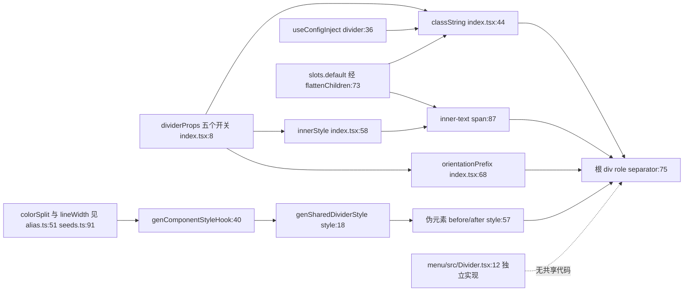
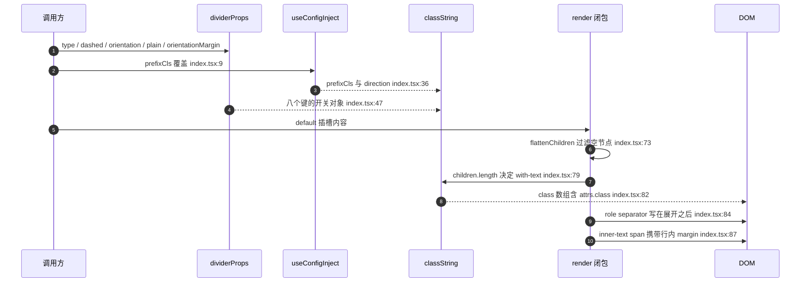
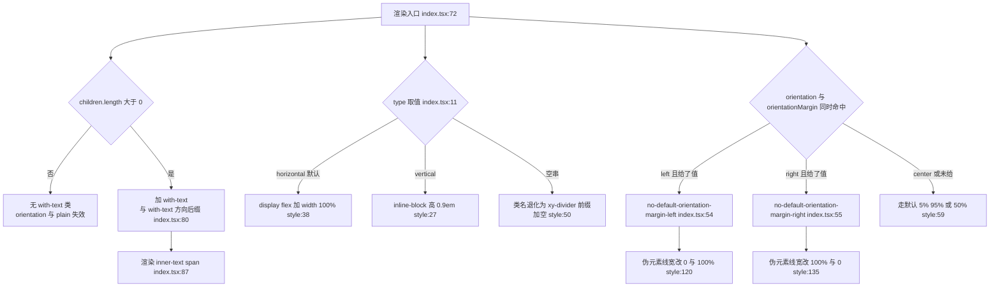

# C02-05 Divider 分割线

> **本篇解决**：一条看起来最没有技术含量的分割线，为什么需要两份文件共 264 行、8 个类名开关、10 处伪元素声明才能画出来；改哪一行会让水平/垂直/虚线/带文字这四种形态同时错位。
> **前置**：C02-00《类横写：三代布局》（已完成）　**读者坐标**：`03-components/02-layout` 第 5 篇

## 一、职责与边界

`Divider` 负责的是**排版层的视觉断句**：在块流里插一条水平线（可带居中标题文字），或在行内流里插一条垂直短线。它把「线」这件事压缩成一个 `div` 加零到两个伪元素，除此之外什么都不做。

明确不负责的四件事，都能在源码里找到反面证据：

- **不负责可交互的分隔**。同层里真正能拖的分隔条是 `Splitter`，它给同一个元素补了 `role="separator"`、`tabindex`、`aria-orientation`、`aria-valuenow` 与键盘事件（`packages/xiaoye-ui/src/splitter/Splitter.tsx:542` 与 `packages/xiaoye-ui/src/splitter/Splitter.tsx:545`）；`Divider` 只输出 `role="separator"` 一个属性（`packages/xiaoye-ui/src/divider/index.tsx:84`），没有任何交互语义。
- **不负责容器与高度**。组件根节点没有 `height`、没有 `padding`，线的粗细完全来自边框（`packages/xiaoye-ui/src/divider/style/index.ts:24`），所以它无法承载内容高度。
- **不负责菜单/面板内的分隔**。`Menu` 自己另写了一份 `MenuDivider`（`packages/xiaoye-ui/src/menu/src/Divider.tsx:12`），渲染成 `<li>`（`packages/xiaoye-ui/src/menu/src/Divider.tsx:25`），`PanelMenu` 又写了第三种（`packages/xiaoye-ui/src/panel-menu/PanelMenuSub.tsx:264`）。三者没有共享实现。
- **不负责文本截断或对齐策略**。带文字时它只做「左侧线宽 / 右侧线宽」的二元分配（`packages/xiaoye-ui/src/divider/style/index.ts:69`、`:79`），长文字一律靠 `whiteSpace: 'nowrap'` 顶开（`packages/xiaoye-ui/src/divider/style/index.ts:53`）。

它与布局体系的关系只有一句话：水平形态把自己撑满一行（`width`/`min-width` 见 `packages/xiaoye-ui/src/divider/style/index.ts:41-42`），垂直形态退回 `inline-block` 参与行内流（`:30`），除此之外不参与任何栅格或弹性分配。**三代布局（栅格 / flex / Space）之间的取舍不在本篇展开，见 C02-00《类横写：三代布局》。**

**依赖清单**（`Divider` 向上依赖的全部外部符号）：`flattenChildren`（`packages/xiaoye-ui/src/_util/props-util/index.ts:50`）、`withInstall`（`packages/xiaoye-ui/src/_util/type.ts:39`）、`useConfigInject`（`packages/xiaoye-ui/src/config-provider/hooks/useConfigInject.ts:7`）、`resetComponent`（`packages/xiaoye-ui/src/style/index.ts:15`）、`genComponentStyleHook` 与 `mergeToken`（`packages/xiaoye-ui/src/theme/util/genComponentStyleHook.ts:40`）。

**被依赖清单**：主库内**没有任何组件引用 `Divider` 这个组件**。取证时注意一个陷阱：`grep -rn "divider" packages/xiaoye-ui/src --include='*.ts' --include='*.tsx'` 会得到 34 行命中，剔除自身目录后仍剩 18 行噪声，其中大部分是 `Menu` 自己的 `-item-divider`（`packages/xiaoye-ui/src/menu/src/Divider.tsx:20`）、`SplitButton` 用的 `Menu.Divider`（`packages/xiaoye-ui/src/split-button/SplitButton.tsx:115`）、以及一份已经没人导入的旧变量表（`packages/xiaoye-ui/src/theme/convertLegacyToken.ts:278`）。真正能定论的是「有没有按路径导入本目录」：

```bash
cd /Users/xiaoye/Desktop/publish/xiaoye-ui-vue
grep -rn "from '\.\./divider\|from './divider\|from 'xiaoye-ui/divider" \
  packages/xiaoye-ui/src --include='*.ts' --include='*.tsx'
grep -rn "divider/style" packages/xiaoye-ui/src --include='*.ts' --include='*.tsx'
```

两条命令的全部命中分别是聚合入口 `packages/xiaoye-ui/src/components.ts:120`、`:125`、`:126` 与主题类型表 `packages/xiaoye-ui/src/theme/interface/components.ts:22`；`SplitButton` 那类同名命中全部落空，因为它拿的是 `Menu` 内部的分隔线（`packages/xiaoye-ui/src/split-button/SplitButton.tsx:20` 的 `Divider: any` 形参，实参在 `:115` 是 `Menu.Divider`）。也就是说：`Divider` 是一个纯叶子节点，改它不会波及库内其他组件，但**它在文档站里被大量当作排版胶水使用**（`apps/docs/examples/drawer/user-profile.vue:62`、`apps/docs/examples/checkbox/check-all.vue:11` 等），改动会以「文档站视觉回归」的形式暴露。

## 二、源码地图

| 文件 | 行数 | 职责 | 关键导出/符号 |
| --- | --- | --- | --- |
| `packages/xiaoye-ui/src/divider/index.tsx` | 97 | 组件实现与 props | `dividerProps`（`:8`）、`DividerProps`（`:28`）、默认导出 `withInstall(Divider)`（`:97`） |
| `packages/xiaoye-ui/src/divider/style/index.ts` | 167 | CSS-in-JS 样式与组件 token | `ComponentToken`（`:7`）、`genSharedDividerStyle`（`:18`）、默认导出样式 hook（`:154`） |
| `packages/xiaoye-ui/src/divider/index.test.js` | 6 | 只测挂载/卸载不抛错 | `mountTest(Divider)`（`:5`） |
| `packages/xiaoye-ui/src/menu/src/Divider.tsx` | 28 | 菜单专用第二实现（对照用） | `menuDividerProps`（`:5`）、`XYMenuDivider`（`:14`） |
| `packages/xiaoye-ui/src/version/token.json` | 530-544 | 机器生成的 token 依赖清单 | `Divider.global` 11 项、`Divider.component` 1 项 |

主实现入口是 `packages/xiaoye-ui/src/divider/index.tsx:30` 的 `defineComponent`，渲染函数从 `packages/xiaoye-ui/src/divider/index.tsx:72` 开始；样式的全部视觉规则集中在**一个**生成函数 `packages/xiaoye-ui/src/divider/style/index.ts:18` 里——没有按 type 拆函数、没有第二份 shared 样式，这与 `Button` 那种拆成 `genSharedButtonStyle` / `genTypeButtonStyle` 的写法不同，是它能被单文件读完的原因。

值得注意的是文件命名：组件实现直接叫 `index.tsx` 而不是 `Divider.tsx`，与根目录 `AGENTS.md` 的组件模板约定（`<Component>.tsx` + `index.ts` 入口）不一致；`menu/src/Divider.tsx` 反而符合模板。这个差异会让「按目录约定找主实现文件」的工具扑空——`find packages/xiaoye-ui/src/divider -name 'Divider*'` 返回空。

## 三、架构与数据流

### 3.1 静态结构：一次渲染会碰到哪些模块



这张图要说清一件事：**线的视觉结果由两个互不相干的源产出**。根 `div` 上的边框来自 `style/index.ts:24`，带文字时两条横线段来自伪元素规则 `style/index.ts:57`，而 `classString`（`packages/xiaoye-ui/src/divider/index.tsx:44`）唯一的职责就是**决定哪些复合选择器能匹配上**。组件的 JS 里没有任何一处写颜色或尺寸，样式里也没有任何一处读 props——两侧靠类名字符串这个唯一契约对接。虚线右下角的 `MenuDivider` 与 `Divider` 之间没有任何连线，这是刻意的分层结果，也是一个真实的双份维护点。

### 3.2 数据流：props 如何落到 DOM



注意第 6 步与第 7 步的**顺序耦合**：`orientation` 这个 prop 本身不产生任何输出，它只有在 `children.length > 0` 时才通过 `with-text-left` / `with-text-right` 两个类名进入 DOM（`packages/xiaoye-ui/src/divider/index.tsx:79`）。`plain` 与 `orientationMargin` 同理，样式侧的规则全部以 `${componentCls}-with-text` 为前件（`packages/xiaoye-ui/src/divider/style/index.ts:114`、`:120`）。

### 3.3 类名矩阵：一个 div 的形态由三道门串联



三道门（文字、类型、边距）是**并联**判定、**串联**命名的：任何一个 prop 单独成立都不会改变外观，必须与 `type` / `with-text` 组合成一条复合选择器才生效。这正是后面「论点 2」要展开的特异性阶梯。

## 四、核心机制精读

### 论点 1：水平线不是背景、不是 `hr`，而是容器的 `border-block-start`；带文字时这条容器边线被「只留宽度」的方式抑制，真正的线交给两个伪元素

这是全篇最容易被误解的一点，也是官方自定义示例会「画出一条双色线」的根因。

```ts
// packages/xiaoye-ui/src/divider/style/index.ts:22
    [componentCls]: {
      ...resetComponent(token),
      borderBlockStart: `${lineWidth}px solid ${colorSplit}`,
    // ...
      [`&-horizontal${componentCls}-with-text`]: {
        display: 'flex',
        alignItems: 'center',
        margin: `${token.dividerHorizontalWithTextGutterMargin}px 0`,
        color: token.colorTextHeading,
        fontWeight: 500,
        fontSize: token.fontSizeLG,
        whiteSpace: 'nowrap',
        textAlign: 'center',
        borderBlockStart: `0 ${colorSplit}`,

        '&::before, &::after': {
          position: 'relative',
          width: '50%',
          borderBlockStart: `${lineWidth}px solid transparent`,
          // Chrome not accept `inherit` in `border-top`
          borderBlockStartColor: 'inherit',
          borderBlockEnd: 0,
          transform: 'translateY(50%)',
          content: "''",
        },
      },
```

逐段解释：

- `packages/xiaoye-ui/src/divider/style/index.ts:24` 给根节点一条 `1px solid colorSplit` 的块起始边框。`lineWidth` 是 seed token，值为 `1`（`packages/xiaoye-ui/src/theme/interface/seeds.ts:91` 声明、`packages/xiaoye-ui/src/theme/themes/seed.ts:40` 赋默认值）；`colorSplit` 是 alias token，由 `colorBorderSecondary` 按 `colorBgContainer` 做透明度混合得出（`packages/xiaoye-ui/src/theme/util/alias.ts:51`，接口在 `packages/xiaoye-ui/src/theme/interface/alias.ts:25`）。这条边框就是「无文字水平线」的**全部实现**——组件 DOM 里既没有 `<hr>` 也没有任何子元素。
- 选择用逻辑属性 `borderBlockStart` 而不是 `borderTop`，目的是让 RTL 下线的语义轴向正确（对照 `-vertical` 用的是 `borderInlineStart`，`packages/xiaoye-ui/src/divider/style/index.ts:35`）。但注意 `packages/xiaoye-ui/src/divider/style/index.ts:34` 又用物理属性 `borderTop: 0` 去抵消上面的块起始边框，两者混用——逻辑轴与物理轴在这里恰好等价（横向书写模式下 block-start 即 top），一旦有人想支持 `writing-mode` 纵向排版，这行就会失效。
- `packages/xiaoye-ui/src/divider/style/index.ts:55` 是理解「带文字形态」的钥匙：`borderBlockStart: '0 <color>'`。这是 CSS 简写，只给了宽度与颜色，**没给线型**，于是 `border-style` 回落为初始值 `none`，容器自身的边框不再绘制。写成 `0 ${colorSplit}` 而不是直接 `none` 的动机源码里没有注释；从结果看，颜色分量是无效的——宽度为 0 且线型为 `none` 时它永远不会被看见。这是一个「语法合法但语义冗余」的写法。
- 容器线关掉后，两条横线段由 `&::before, &::after` 承担（`packages/xiaoye-ui/src/divider/style/index.ts:57`）。它们先被设成 `1px solid transparent`（`:60`），再用 `borderBlockStartColor: 'inherit'`（`:62`）把颜色接过来。`:61` 的注释「Chrome not accept `inherit` in `border-top`」说明了为什么要分两行写：直接在简写里放 `inherit` 在该浏览器上不生效，必须先声明一个合法颜色再单独覆盖 color 分量。
- `inherit` 在这里取的是**元素的 `color`**，也就是 `packages/xiaoye-ui/src/divider/style/index.ts:50` 的 `colorTextHeading`。后果是：带文字的分割线颜色随标题色走，而不是随 `colorSplit` 走——`:24` 与 `:62` 是两套色源，取值不同。至于这是有意让「带文字的线更醒目」还是迁移遗留，源码里没有注释说明。
- `transform: 'translateY(50%)'`（`:64`）把伪元素向下推半个线高，让线落在容器垂直中心而不是内容盒顶部；`borderBlockEnd: 0`（`:63`）显式关掉块末端边框。`:58` 的 `position: 'relative'` 没有配套的 `top`/`left` 偏移，因此本身不产生位移；它在这条规则里是否必要无法从源码判定（去掉后 `translateY` 的参考系是否变化需实测）。
- `width: '50%'`（`:59`）是居中形态下两条线段的分配值，左右形态把它改成 `5%`/`95%` 与 `95%`/`5%`（`packages/xiaoye-ui/src/divider/style/index.ts:71`、`:75`、`:81`、`:85`）。这两个数是百分比硬编码、不是 token，详见论点 7 末条与坑 10。

结论回扣：**「一条线」在这个组件里有两个绘制源**，容器边框（无文字）与伪元素边框（有文字），它们用不同的色 token、不同的粗细来源。所以任何「我想改分割线颜色」的需求，都必须先问「有没有传文字」——这正是坑 5 的内容。

### 论点 2：组件侧只做「拼类名字符串」这一件事，所有覆盖关系都靠**复合选择器的类个数阶梯**来保证，而不是靠 `!important` 或样式顺序

`classString` 是唯一的开关面板，八个键里六个是条件键：

```ts
// packages/xiaoye-ui/src/divider/index.tsx:44
    const classString = computed(() => {
      const { type, dashed, plain } = props;
      const prefixCls = prefixClsRef.value;
      return {
        [prefixCls]: true,
        [hashId.value]: !!hashId.value,
        [`${prefixCls}-${type}`]: true,
        [`${prefixCls}-dashed`]: !!dashed,
        [`${prefixCls}-plain`]: !!plain,
        [`${prefixCls}-rtl`]: direction.value === 'rtl',
        [`${prefixCls}-no-default-orientation-margin-left`]: hasCustomMarginLeft.value,
        [`${prefixCls}-no-default-orientation-margin-right`]: hasCustomMarginRight.value,
      };
    });
```

而真正的覆盖强度在样式侧由「选择器里叠了几个 class」决定。样式文件里 `&` 代表 `componentCls`（即 `.xy-divider`，见 `packages/xiaoye-ui/src/theme/util/genComponentStyleHook.ts:87` 的 `` const componentCls = `.${prefixCls.value}` ``），模板串把 `${componentCls}-xxx` 直接接在 `&-yyy` 后面，产出的不是后代选择器而是**同一元素上的多类复合选择器**：

```ts
// packages/xiaoye-ui/src/divider/style/index.ts:101
      [`&-horizontal${componentCls}-with-text${componentCls}-dashed`]: {
        '&::before, &::after': {
          borderStyle: 'dashed none none',
        },
      },

      [`&-vertical${componentCls}-dashed`]: {
        borderInlineStartWidth: lineWidth,
        borderInlineEnd: 0,
        borderBlockStart: 0,
        borderBlockEnd: 0,
      },

      [`&-plain${componentCls}-with-text`]: {
        color: token.colorText,
        fontWeight: 'normal',
        fontSize: token.fontSize,
      },
```

把它翻译成真实 CSS，得到的是一条严格递增的特异性阶梯（默认前缀 `xy` 来自 `packages/xiaoye-ui/src/config-provider/globalConfig.ts:8` 的 `defaultPrefixCls`，拼接规则在 `packages/xiaoye-ui/src/config-provider/context.ts:168`）。需要声明的是：下表的「生成的选择器」一列是按 `&` 替换规则（`packages/xiaoye-ui/src/theme/util/genComponentStyleHook.ts:87` 给出 `componentCls = .<prefixCls>`）与 CSS 对象语法的串接语义**推导**所得，本篇没有 dump 运行时实际注入的 CSS 文本做二次比对：

| 特异性 | 生成的选择器 | 源码位置 |
| --- | --- | --- |
| (0,1,0) | `.xy-divider` / `.xy-divider-dashed` / `.xy-divider-vertical` | `packages/xiaoye-ui/src/divider/style/index.ts:94`、`:27` |
| (0,2,0) | `.xy-divider-horizontal.xy-divider-with-text`、`.xy-divider-vertical.xy-divider-dashed` | `packages/xiaoye-ui/src/divider/style/index.ts:46`、`:107` |
| (0,3,0) | `.xy-divider-horizontal.xy-divider-with-text.xy-divider-dashed`、`…-with-text-left…-no-default-orientation-margin-left` | `packages/xiaoye-ui/src/divider/style/index.ts:101`、`:120` |

这套阶梯的作用只有一个：**让「形态叠加」的例外规则能压过基础规则，而不需要任何 `!important`**。以虚线为例，基础规则 `.xy-divider-dashed` 把 `border-width` 写成三值简写 `${lineWidth}px 0 0`（`packages/xiaoye-ui/src/divider/style/index.ts:98`，即 top 有宽、左右与 bottom 归零），这会顺手杀掉垂直线赖以存在的行内起始边框；于是 `.xy-divider-vertical.xy-divider-dashed` 必须用两级特异性把 `borderInlineStartWidth` 补回来（`:108`）。同理 `:110-111` 把 `borderBlockStart` 归零，避免垂直虚线顶端多出一截横线。

三点需要如实记录的风险：

1. **阶梯的成立依赖「同一元素」这个前提**。如果调用方通过 `attrs.class`（`packages/xiaoye-ui/src/divider/index.tsx:82`）传入的类名被某个工具挪到了包裹层，或有人用 `.xy-divider-dashed > span` 之类的后代选择器覆盖，特异性计算会整体失真，而这些失真不会有任何报错。
2. **`[hashId.value]: !!hashId.value`（`packages/xiaoye-ui/src/divider/index.tsx:49`）不参与阶梯**。CSS-in-JS 的 hash 类只用于样式作用域归因，它出现在选择器最前面时不会改变形态判定，但如果有人试图「靠 hash 类提高覆盖优先级」，会得到不稳定的结果——因为它随主题 token 变化而变（`packages/xiaoye-ui/src/theme/util/genComponentStyleHook.ts:49` 附近的 `useToken` 返回）。
3. **规则顺序仍然重要**。`.xy-divider` 根规则内部，`resetComponent(token)` 先展开（`packages/xiaoye-ui/src/divider/style/index.ts:23`，其中含 `margin: 0`，见 `packages/xiaoye-ui/src/style/index.ts:17`），随后 `-horizontal` 再写 `margin: ${marginLG}px 0`。同级特异性下靠后者胜出；把这两行顺序调换不会报错，只会让水平分割线全部失去上下外边距。

### 论点 3：`type` 承载「轴向」、`orientation` 承载「文字位置」，这两个词的名字与它们在 CSS/ARIA 里的标准语义正好相反；而且只有 `orientation` 有空串守卫，`type` 的空串是可达且无防御的

```ts
// packages/xiaoye-ui/src/divider/index.tsx:8
export const dividerProps = () => ({
  prefixCls: String,
  type: {
    type: String as PropType<'horizontal' | 'vertical' | ''>,
    default: 'horizontal',
  },
  dashed: {
    type: Boolean,
    default: false,
  },
  orientation: {
    type: String as PropType<'left' | 'right' | 'center'>,
    default: 'center',
  },
  plain: {
    type: Boolean,
    default: false,
  },
  orientationMargin: [String, Number],
});
```

把这段与渲染侧对照，可以读出四处不对称：

- **两个词都被「占用」了，但方向和标准语义相反**。CSS/ARIA 里 `orientation` 一词的通用含义是轴向（`aria-orientation` 的取值就是 `horizontal | vertical`），本库另一处正是这样用的：`packages/xiaoye-ui/src/mega-menu/MegaMenu.tsx:421` 与 `packages/xiaoye-ui/src/splitter/Splitter.tsx:545`。而在 `Divider` 里，`orientation` 表示文字靠哪边（`:18-21`），轴向反而交给了 `type`（`:10-13`）。`type` 在 HTML 里另有强语义（`button`/`input` 的提交类型），这使 `<xy-divider type="vertical">` 读起来像在设置表单类型。这个命名不是本库的新决定，而是随上游实现继承下来的历史包袱——文档站也照抄了这套语义：`apps/docs/components/divider.md:47` 把 `orientation` 解释为「分割线标题的位置」，`apps/docs/components/divider.md:50` 把 `type` 解释为「水平还是垂直类型」。
- **联合类型里的 `''` 只出现在 `type` 上（`:11`）**，`orientation` 的联合是三元闭集（`:19`）。但代码里带空串保护的偏偏是 `orientation`：

```ts
// packages/xiaoye-ui/src/divider/index.tsx:68
    const orientationPrefix = computed(() =>
      props.orientation.length > 0 ? '-' + props.orientation : props.orientation,
    );
```

防御写在了「类型上不可能为空」的那个 prop 上，而真正在类型里允许空串的那个没有任何保护——`packages/xiaoye-ui/src/divider/index.tsx:50` 是无条件模板拼接 `[`${prefixCls}-${type}`]: true`，`type=""` 会产出类名 `xy-divider-`（尾随一个连字符）。这个名字在样式表里不存在任何对应规则——`packages/xiaoye-ui/src/divider/style/index.ts` 的 12 个形态选择器键（`:27`、`:38`、`:46`、`:69`、`:79`、`:89`、`:94`、`:101`、`:107`、`:114`、`:120`、`:135`）全部带非空后缀，没有一个是「`&` 加裸连字符」的写法，可用 `grep -n "'&-'" packages/xiaoye-ui/src/divider/style/index.ts` 复核（返回空）。于是 `-horizontal` 带来的 `display: flex`、`width: 100%`、`min-width: 100%` 与上下外边距（`packages/xiaoye-ui/src/divider/style/index.ts:38-44`）全部丢失，只剩下根规则那条 `border-block-start`（`:24`）画出的满宽线。外观上「几乎还是对的」，但垂直对齐、`clear: both`（`:40`）与外边距节奏已经没了——这是一类最难在 CR 里发现的退化。
- **`''` 的可达性不是纯理论**。`DividerProps` 被导出成 `Partial<ExtractPropTypes<...>>`（`packages/xiaoye-ui/src/divider/index.tsx:28`），`Partial` 让 `type` 变成可省略而非可传空串，所以 TS 侧仍能拦住 `type=""`；但 Vue 的运行时 prop 校验只会告警不会拒绝，而模板里 `:type="someMaybeEmptyRef"` 这种写法完全绕开字面量检查。文档站的表格没有把 `''` 列为合法取值（`apps/docs/components/divider.md:50`），因此这是一个**API 面存活、语义未定义**的取值：`''` 在类型里合法、在文档里不存在、在样式里无对应规则。
- **两份实现的取舍不同**。`MenuDivider` 干脆不要轴向，只留 `prefixCls` 与 `dashed`（`packages/xiaoye-ui/src/menu/src/Divider.tsx:5-8`），类名也从 `xy-divider-*` 换成了 `${prefixCls}-item-divider`（`packages/xiaoye-ui/src/menu/src/Divider.tsx:20`）。它用 `useInjectMenu()` 拿前缀（`packages/xiaoye-ui/src/menu/src/Divider.tsx:17`）而不是 `useConfigInject('divider', props)`（`packages/xiaoye-ui/src/divider/index.tsx:36`），因此菜单里的分隔线连「用 `prefixCls` prop 单独改前缀」这个能力都不具备。

顺带把版本分层记下来，它解释了为什么 `orientation`/`type`/`dashed` 的语义没被整理过：文档表里 `plain` 标注 `2.2.0`（`apps/docs/components/divider.md:49`）、`orientationMargin` 标注 `3.0`（`apps/docs/components/divider.md:48`），而 `type`、`dashed`、`orientation` 三项没有版本列（`apps/docs/components/divider.md:46`、`:47`、`:50`）——它们是初代 API，后两个是在不动旧语义的前提下叠加的开关，于是「文字位置」这个概念最终被拆成了 `orientation` + `orientationMargin` + `plain` 三个 prop。

### 论点 4：`orientationMargin` 是 JS 与 CSS 的**双轨协作**——CSS 把伪元素线宽改成 0/100% 并抹掉文字内边距，JS 再用行内物理 margin 补位；两者用的是不同的属性体系

```ts
// packages/xiaoye-ui/src/divider/index.tsx:38
    const hasCustomMarginLeft = computed(
      () => props.orientation === 'left' && props.orientationMargin != null,
    );
    const hasCustomMarginRight = computed(
      () => props.orientation === 'right' && props.orientationMargin != null,
    );
    // ...
    const innerStyle = computed(() => {
      const marginValue =
        typeof props.orientationMargin === 'number'
          ? `${props.orientationMargin}px`
          : props.orientationMargin;
      return {
        ...(hasCustomMarginLeft.value && { marginLeft: marginValue }),
        ...(hasCustomMarginRight.value && { marginRight: marginValue }),
      };
    });
```

样式侧配套的是两条三级复合选择器，它们干了两件事：

```ts
// packages/xiaoye-ui/src/divider/style/index.ts:120
      [`&-horizontal${componentCls}-with-text-left${componentCls}-no-default-orientation-margin-left`]:
        {
          '&::before': {
            width: 0,
          },

          '&::after': {
            width: '100%',
          },

          [`${componentCls}-inner-text`]: {
            paddingInlineStart: sizePaddingEdgeHorizontal,
          },
        },
```

拆解这条链路，五个要点：

1. **两个开关都必须成立**。`hasCustomMarginLeft` 是一个「与」判定（`packages/xiaoye-ui/src/divider/index.tsx:39`），`orientation` 不是 `left` 时，即使传了 `orientationMargin` 也不会产出类名 `xy-divider-no-default-orientation-margin-left`（`:54`），`innerStyle` 同样返回空对象（`:64`）。文档只是把这件事写在说明栏里（`apps/docs/components/divider.md:48` 的「同时 `orientation` 必须为 `left` 或 `right`」），组件不告警。
2. **判据是 `!= null`，不是「有值」**。`packages/xiaoye-ui/src/divider/index.tsx:39` 用宽松不等，因此 `0`、空串 `''` 都算「用户接管了边距」。传 `orientationMargin="0px"` 是文档站示例里的正规用法（`apps/docs/examples/divider/with-text.vue:21`），而传空串会让开关成立、`marginValue` 为空串、行内 `marginLeft: ''` 被浏览器忽略，同时 CSS 侧已经把 `::before` 宽度改成 0 并把文字的 `paddingInlineStart` 抹成 0（`packages/xiaoye-ui/src/divider/style/index.ts:123`、`:131`）——最终效果是文字**紧贴容器左边缘**，而不是回落到默认间距。这是一个「开关判定用了真值语义之外的比较」造成的实际视觉差异。
3. **数字与字符串两套处理**。`:60-62` 只对 `typeof === 'number'` 补 `px`，字符串原样透传。于是 `orientationMargin={50}` 得到 `50px`，`orientationMargin="50px"` 同样得到 `50px`，但 `orientationMargin="50"` 得到非法值并被丢弃——Vue 的 prop 类型是 `[String, Number]`（`packages/xiaoye-ui/src/divider/index.tsx:26`），不做单位补全，也不告警。
4. **CSS 侧的作用不是「加边距」而是「拆掉默认边距」**。默认的 `inner-text` 有 `padding: '0 1em'`（`packages/xiaoye-ui/src/divider/style/index.ts:91`），这条三级选择器把起始方向的那一半替换成组件 token `sizePaddingEdgeHorizontal`，而它的默认值是 `0`（`packages/xiaoye-ui/src/divider/style/index.ts:165`，作为 `genComponentStyleHook` 的第三参传入）。也就是说：一旦启用 `orientationMargin`，文字左/右的 1em 气垫会被清零，间距完全由用户的 margin 提供。类名里的 `no-default-orientation-margin` 描述的正是这个「默认边距已被停用」的**状态**，而不是「用户想要更大边距」的意图——按类名去猜行为会得到相反结论。
5. **两套属性体系在 RTL 下会打架**。`innerStyle` 用的是物理属性 `marginLeft` / `marginRight`（`packages/xiaoye-ui/src/divider/index.tsx:64-65`），样式侧的 `paddingInlineStart` / `paddingInlineEnd` 用的是逻辑属性（`packages/xiaoye-ui/src/divider/style/index.ts:131`、`:146`）。而伪元素宽度分配同样是物理语义：`-with-text-left` 让 `::before` 变窄（`:70-72`）、`-with-text-right` 让 `::before` 变宽（`:80-82`），这套 5%/95% 分配并不随 `direction: rtl` 镜像。`ConfigProvider` 的 `direction` 只给根节点加了一个类名 `xy-divider-rtl`（`packages/xiaoye-ui/src/divider/index.tsx:53`），而样式文件里**没有任何一条 `-rtl` 规则**消费它——`grep -n "rtl" packages/xiaoye-ui/src/divider/style/index.ts` 返回空。这不是全库的统一做法，而是本组件的缺项：同层的 `Breadcrumb` 既产出这个类又为它写规则（`packages/xiaoye-ui/src/breadcrumb/style/index.ts:106` 的 `` [`&${token.componentCls}-rtl`] `` 与 `:107` 的 `direction: 'rtl'`），`Tabs` 亦然（`packages/xiaoye-ui/src/tabs/style/index.ts:615-616`）。结论：`<xy-divider orientation="left" orientation-margin="24">` 在 RTL 语境（文档站的对照用例是 `apps/docs/examples/config-provider/direction.vue:12`）下，文字会留在物理左侧、线在右侧，`paddingInlineStart` 被清零却仍有一个物理 `marginLeft` 在推它，四者语义不能对齐。组件本身没有为 RTL 做任何轴翻转，`-rtl` 类名是一个**产出但未被消费的悬空开关**。

### 论点 5：`dashed` 只有一个布尔开关，却要三处样式补丁才能覆盖全部形态——因为「线」有两个绘制源，而垂直形态的线在第三根轴上

```ts
// packages/xiaoye-ui/src/divider/style/index.ts:94
      '&-dashed': {
        background: 'none',
        borderColor: colorSplit,
        borderStyle: 'dashed',
        borderWidth: `${lineWidth}px 0 0`,
      },

      [`&-horizontal${componentCls}-with-text${componentCls}-dashed`]: {
        '&::before, &::after': {
          borderStyle: 'dashed none none',
        },
      },

      [`&-vertical${componentCls}-dashed`]: {
        borderInlineStartWidth: lineWidth,
        borderInlineEnd: 0,
        borderBlockStart: 0,
        borderBlockEnd: 0,
      },
```

组件侧为虚线只付出一个类名（`packages/xiaoye-ui/src/divider/index.tsx:51`），样式侧却必须写三条规则，原因是：

- **基础规则 `:94-99` 只对「无文字的水平线」正确**。它用 `borderStyle: 'dashed'` 把线型改掉，再用 `borderWidth: ${lineWidth}px 0 0` 限定「只有块起始方向有宽度」。三值简写的展开是 top = `lineWidth`、left/right = 0、bottom = 0，因此它顺手把垂直线赖以存在的 `border-inline-start` 宽度清零了。
- **伪元素不吃容器的 `borderStyle`**。带文字时线由 `::before`/`::after` 画（`packages/xiaoye-ui/src/divider/style/index.ts:57-66`），伪元素有自己独立的边框盒，所以必须补第二条规则把伪元素的 `border-style` 也改成 dashed（`:103`）。这条规则用了三级特异性（论点 2 的阶梯），才能压住 `:57-66` 里 `borderBlockStart` 简写带来的 `solid`。注意 `:103` 写的是 `borderStyle: 'dashed none none'`，即 top dashed、right/left none、bottom none——三值边框简写在 `border-style` 上的展开顺序与 `border-width` 一致。
- **垂直形态要在第三根轴上重新点亮**。第三条规则 `:107-112` 做两件事：把 `borderInlineStartWidth` 重新设为 `lineWidth`（`:108`）以恢复被基础规则清零的那条竖线，并把 `borderBlockStart`/`borderBlockEnd` 归零（`:110-111`）以去掉容器顶部那条横线。它的选择器是 `.xy-divider-vertical.xy-divider-dashed`（两级），刚好压过一级的 `.xy-divider-dashed`。
- **`:95` 的 `background: 'none'` 是一条空转规则**。整张 Divider 样式表里 `background` 只出现这一处（`grep -n "background" packages/xiaoye-ui/src/divider/style/index.ts` 只命中 `:95`），`resetComponent`（`packages/xiaoye-ui/src/style/index.ts:15-26`）也没有背景项，因此没有任何规则需要被它取消。它是「线曾经用背景色绘制」这一历史方案的残留——残留本身无害，但它证明了一条本可选择的实现路径（论点 1 已说明现行路径是边框）。
- **对照实现把这套复杂度砍到了零**。`MenuDivider` 的虚线只有一个类名加一条规则（`packages/xiaoye-ui/src/menu/src/Divider.tsx:21` 产出 `-item-divider-dashed`），因为菜单里的分隔线永远是水平线、永远不带文字，形态空间是 `2 × 1` 而不是 `2 × 2 × 3`。这从反面说明 `Divider` 的复杂度来自「一个组件承担四种形态」这个决定，而不是来自虚线本身。

一句话总结这套机制：**`dashed` 不是一个样式，而是「把三个绘制源同时改成虚线」的协调动作**。任何人想给 `Divider` 加第四种线型（比如 `dotted` 或自定义粗细），最小改动面是同时改 `:94`、`:101`、`:107` 三处，漏掉任何一处都不会报错，只会在某个形态下静默失效。

### 论点 6：「有没有文字」是这套形态机的总闸，而它的判据不是插槽存不存在，而是 `flattenChildren` 过滤之后的长度——纯空白文本同样算「没有文字」

```tsx
// packages/xiaoye-ui/src/divider/index.tsx:72
    return () => {
      const children = flattenChildren(slots.default?.());
      return wrapSSR(
        <div
          {...attrs}
          class={[
            classString.value,
            children.length
              ? `${prefixClsRef.value}-with-text ${prefixClsRef.value}-with-text${orientationPrefix.value}`
              : '',
            attrs.class,
          ]}
          role="separator"
        >
          {children.length ? (
            <span class={`${prefixClsRef.value}-inner-text`} style={innerStyle.value}>
              {children}
            </span>
          ) : null}
        </div>,
      );
    };
```

- **一个 boolean 决定两件事**。`children.length` 同时决定是否追加两个类名（`packages/xiaoye-ui/src/divider/index.tsx:79-81`）与是否渲染 `inner-text` 这个 `span`（`:86-90`）。没有第三条路径：不存在「有 span 但没 with-text 类」或反之的状态。这意味着 `orientation`、`plain`、`orientationMargin` 三个 prop 在没有文字时是**彻底空转**的——类名不会产出（`:80` 整段被三元跳过），行内样式没有宿主元素（`innerStyle` 只挂在 `:87` 的 span 上）。
- **判据来自 `flattenChildren`，而不是 `slots.default` 是否存在**。`packages/xiaoye-ui/src/divider/index.tsx:73` 先调 `slots.default?.()`（插槽不存在时得到 `undefined`，再由默认参数兜住），把结果交给 `flattenChildren`（实现见 `packages/xiaoye-ui/src/_util/props-util/index.ts:50`，导出在 `:282`）。该函数会递归展开数组与 `Fragment`（`:54-61`），并对 VNode 走 `isEmptyElement` 过滤（`:63`）。
- **`isEmptyElement` 的判据包含「纯空白文本」**：注释节点、无子节点的 Fragment，以及 `children.trim() === ''` 的文本节点都被视为空（`packages/xiaoye-ui/src/_util/props-util/index.ts:213-220`，空白判定在 `:218`）。因此 `<xy-divider>   </xy-divider>`（只有空格换行）与完全不传插槽得到**同样的 DOM**：没有 `with-text` 类、没有 `span`。反过来，模板里写成多行缩进形式（如 `apps/docs/examples/divider/with-text.vue:21-23` 那种把文字单独放一行的写法）之所以仍能识别为「有文字」，是因为真正的内容是那个非空文本节点，缩进产生的空白节点被 `:218` 剔除了。
- **`orientationPrefix` 的拼接产出了两个类名而不是一个**：`:80` 一行里同时给出 `-with-text` 与 `-with-text` + 前缀，中间用空格分隔，所以字符串模板里嵌的是「一个包含两个类名的空格串」。这让样式侧可以分别针对「有文字」与「有文字且靠左」写规则（`packages/xiaoye-ui/src/divider/style/index.ts:46` 与 `:69`），前者是通用规则、后者是分配规则。
- **`attrs` 的展开位置在 `class` 与 `role` 之前**（`packages/xiaoye-ui/src/divider/index.tsx:76`，随后是 `:77` 的 `class` 与 `:84` 的 `role`）。JSX 编译后是对象属性顺序决定的浅合并，因此：`class` 通过 `:82` 手工把 `attrs.class` 追加到数组末尾来「主动接收」外部类名，而 `role` 因为写在展开之后，调用方**无法**用 `attrs` 覆盖它。组件声明了 `inheritAttrs: false`（`packages/xiaoye-ui/src/divider/index.tsx:32`），所以这两条是仅有的两条 attrs 处理路径，其余未声明的属性一律原样落到 DOM。

一句话回扣：**这个组件的「形态」不是由 props 单独决定的，而是由 props 与插槽内容共同决定的**。`plain` 之类看起来是独立开关的 prop，实际上是 `with-text` 的前件，这也是坑 6 的来源。

### 论点 7：垂直分割线的几何完全用 `em` 字面量硬编码、不参与 token 体系；水平方向的节奏才走 token——于是 `Divider` 的 ComponentToken 只剩一个且默认值为 0

```ts
// packages/xiaoye-ui/src/divider/style/index.ts:154
export default genComponentStyleHook(
  'Divider',
  token => {
    const dividerToken = mergeToken<DividerToken>(token, {
      dividerVerticalGutterMargin: token.marginXS,
      dividerHorizontalWithTextGutterMargin: token.margin,
      dividerHorizontalGutterMargin: token.marginLG,
    });
    return [genSharedDividerStyle(dividerToken)];
  },
  {
    sizePaddingEdgeHorizontal: 0,
  },
);
```

- **只有三个中间 token，且全部是「外边距」**。`mergeToken` 造出的 `DividerToken` 声明了三个字段（`packages/xiaoye-ui/src/divider/style/index.ts:11-15`），映射关系是垂直间距→`marginXS`、带文字水平间距→`margin`、普通水平间距→`marginLG`（`:158-160`）。注意垂直线的左右间距 `dividerVerticalGutterMargin` 与水平线的 `margin` 用了两个不同的中间名，但都直接来自 map token，没有组件级的独立数值可调。
- **垂直线的几何是字面量**：`top: '-0.06em'`（`packages/xiaoye-ui/src/divider/style/index.ts:29`）、`height: '0.9em'`（`:31`）、`verticalAlign: 'middle'`（`:33`）。这些值不经过任何 token，所以「垂直分割线比文字高一点还是矮一点」这件事无法被主题调节；它随 `font-size` 缩放（`em` 单位），而 `font-size` 来自 `resetComponent` 的 `fontSize: token.fontSize`（`packages/xiaoye-ui/src/style/index.ts:20`）。结果是：**改 `fontSize` 会连带改线高，改 `lineHeight` 不会**（`resetComponent` 的 `lineHeight` 在 `packages/xiaoye-ui/src/style/index.ts:22`，而 `-vertical` 有固定 `height`，行高不参与），当主题把行高压到很小或拉到很大时，`0.9em` 的线与相邻文字的光学对齐会漂移，而没有任何 token 能补偿这个漂移。`-0.06em` 的 `top` 微调同理——它是给某一组默认字体度量配出来的经验值。
- **水平线的粗细反而可调，但只能通过全局 seed**。`lineWidth` 不是 Divider 的 ComponentToken，而是全局 seed（`packages/xiaoye-ui/src/theme/interface/seeds.ts:91`，默认 `packages/xiaoye-ui/src/theme/themes/seed.ts:40`），改它会同时改掉全库所有边框粗细。
- **组件级 token 面只有一个字段，且默认值是 `0`**。`ComponentToken` 接口只声明 `sizePaddingEdgeHorizontal`（`packages/xiaoye-ui/src/divider/style/index.ts:7-9`），它经由 `genComponentStyleHook` 的第三参提供默认值（函数签名见 `packages/xiaoye-ui/src/theme/util/genComponentStyleHook.ts:43`，合并发生在 `:85` 的 `{ ...defaultComponentToken, ...token.value[component] }`）。默认 0 的实际含义是「贴边时不给文字留气垫」，于是这个 token 存在的唯一价值是让用户**可选地**恢复气垫；机器生成的依赖清单如实记录了这件事——`packages/xiaoye-ui/src/version/token.json:530` 起的 `Divider` 块列了 11 个全局 token 依赖（`marginXS`、`margin`、`marginLG`、`colorSplit`、`lineWidth`、`colorText`、`fontSize`、`lineHeight`、`fontFamily`、`colorTextHeading`、`fontSizeLG`）与 1 个组件 token（`packages/xiaoye-ui/src/version/token.json:544`）。
- **类型面必须显式登记，否则 `Partial<>` 合不上**。组件 token 通过 `packages/xiaoye-ui/src/theme/interface/components.ts:22` 的类型导入接入 `ComponentTokenMap`，并在 `:98` 以 `Divider?: DividerComponentToken` 出现；`OverrideToken` 把每个组件 token 定义成「Partial 组件 token + Partial AliasToken」（`packages/xiaoye-ui/src/theme/interface/index.ts:4-5`）。也就是说，如果 `style/index.ts` 的 `ComponentToken` 接口改了名而 `components.ts` 没跟着改，类型检查会在 `genComponentStyleHook('Divider', …)` 的 `ComponentName extends OverrideComponent` 约束上失败（`packages/xiaoye-ui/src/theme/util/genComponentStyleHook.ts:40`），这是这个组件少数「改错会立刻红」的地方。

- **旧分割线 token 名整体躺在一张死表里**。`packages/xiaoye-ui/src/theme/convertLegacyToken.ts:278` 起有四个 `Divider` 的旧变量名——`divider-text-padding`、`divider-orientation-margin`、`divider-color`、`divider-vertical-gutter`（`:279-282`），值被**硬写成字面量** `'1em'`、`'5%'`、`'rgba(0, 0, 0, 6%)'`、`'8px'`，而同一个对象里邻居条目是引用 token 的（例如 `packages/xiaoye-ui/src/theme/convertLegacyToken.ts:125` 的 `'margin-xs': token.marginXS`）。这四个字面量与现行样式的对应关系非常直白：`1em` 就是 `packages/xiaoye-ui/src/divider/style/index.ts:91` 的 `padding: '0 1em'`，`5%` 就是 `:71`/`:75` 的伪元素宽度，`8px` 级别的垂直间距被换成了 `token.marginXS`（`:158`，该 alias 又由 `sizeXS` 派生，见 `packages/xiaoye-ui/src/theme/util/alias.ts:119`），只有 `divider-color` 的 `rgba(0, 0, 0, 6%)` 在现行实现里彻底消失——`grep -rn "6%" packages/xiaoye-ui/src/divider/` 无命中，颜色改走了 `colorSplit`。而这张表**当前没有任何导入方**：`grep -rn "convertLegacyToken" packages apps --include='*.ts' --include='*.tsx' --include='*.js' --include='*.mts' --include='*.json'` 只命中函数定义本身（`packages/xiaoye-ui/src/theme/convertLegacyToken.ts:4`），换用 `grep -rn "LegacyToken"` 这一更宽的模式复核，结果仍然是同一行。也就是说：主题系统迁移时，分割线的四个可调参数里有两个（文字气垫、边距比例）从「可配置的旧 token」退化成了「样式表里的字面量」，而唯一记录着它们曾经存在的映射表现在不会被执行。这直接解释了为什么 `Divider` 的 ComponentToken 面只剩一个字段（上一条），也解释了 `apps/docs/components/divider.md:44-50` 为什么没有「改边距比例」这类 API。

## 五、对外契约如何生效

这一节讲「契约的传导链路」，不讲参数清单（属性清单见 [apps/docs/components/divider.md](../../../apps/docs/components/divider.md)）。

**前缀链路：一个 `Ref` 同时喂给类名与样式**。`dividerProps` 声明了一个公开的 `prefixCls`（`packages/xiaoye-ui/src/divider/index.tsx:9`），它被 `useConfigInject('divider', props)` 消费（`packages/xiaoye-ui/src/divider/index.tsx:36`），后者内部只做一件事：`configProvider.getPrefixCls(name, props.prefixCls)`（`packages/xiaoye-ui/src/config-provider/hooks/useConfigInject.ts:14`）。`getPrefixCls` 的实现是「有后缀就拼 `xy-<suffix>`，没后缀返回 `xy`」（`packages/xiaoye-ui/src/config-provider/context.ts:168`，默认值定义在 `packages/xiaoye-ui/src/config-provider/globalConfig.ts:8`）。关键在于这个返回值是 `computed`：它既被 `classString` 读成字符串（`packages/xiaoye-ui/src/divider/index.tsx:46`），又被原样传给样式 hook（`packages/xiaoye-ui/src/divider/index.tsx:37` 的 `useStyle(prefixClsRef)` 传的是 Ref 而不是 `.value`），样式侧再把它转成选择器 `componentCls`（`packages/xiaoye-ui/src/theme/util/genComponentStyleHook.ts:87`）。因此 `prefixCls` 定制是**双向一致**的：不存在「类名改了但生成的 CSS 还指向旧选择器」的错配。这是本组件契约面最扎实的一环。

**样式的交付契约靠 `exports` 双入口，而不是靠组件自己 import**。组件文件里没有一行 `import './style'`（`packages/xiaoye-ui/src/divider/index.tsx:1-6` 的导入全是逻辑依赖）。样式副作用只出现在聚合入口 `packages/xiaoye-ui/src/components.ts:122`（`import './divider/style'`），而按需路径依赖包导出表的两条目：`packages/xiaoye-ui/package.json:246` 的 `./divider` 与 `packages/xiaoye-ui/package.json:250` 的 `./divider/style`。也就是说 **`import Divider from 'xiaoye-ui/divider'` 不会带样式**，必须额外引 `xiaoye-ui/divider/style`；这条约束由 `pnpm gen:entries` 生成保证（见根目录 `AGENTS.md` 的生成物章节），也是 `wrapSSR`（`packages/xiaoye-ui/src/divider/index.tsx:74`）在 SSR 下能正确抽出样式的前提——抽出的是 hook 生成的 CSS，而不是某个 side-effect import 的 CSS。

**插槽契约：只有一个 `default`，且没有声明式登记**。组件在 `packages/xiaoye-ui/src/divider/index.tsx:35` 直接解构 `{ slots, attrs }`，没有 `slots: Object as CustomSlotsType<…>` 声明，因此插槽的类型约束完全靠调用方自觉。它的运行时契约在 `packages/xiaoye-ui/src/divider/index.tsx:73` 已经说过：任何被 `isEmptyElement` 判空的节点等同于「没传插槽」。

**事件契约：组件不声明任何事件**。`dividerProps` 里没有 `onClick`、没有 `onChange`（`packages/xiaoye-ui/src/divider/index.tsx:8-27`），`setup` 也没有解构 `emit`（`:35`）。所以对外的事件面 100% 由 `attrs` 透传实现：`{...attrs}` 在 `packages/xiaoye-ui/src/divider/index.tsx:76` 展开到 `div` 上，`onClick` 之类会作为原生监听器绑定。**副作用是语义上的**：调用方给分割线绑点击，得到的是一个 `role="separator"`（`:84`）且不可聚焦的 `div`，键盘用户完全无法触发它。这与「`role` 写在展开之后、无法被覆盖」是同一个设计决定的两面。

**expose 契约：空**。组件没有调用 `expose`（`packages/xiaoye-ui/src/divider/index.tsx:35` 的参数列表里没有 `expose`），也没有内部标识字段——`grep -n "__XY_" packages/xiaoye-ui/src/divider/index.tsx` 返回空，而库内其他组件会用 `__XY_TAB_PANE`（`packages/xiaoye-ui/src/tabs/src/TabPanelList/TabPane.tsx:28`）、`__XY_MEGA_MENU`（`packages/xiaoye-ui/src/mega-menu/MegaMenu.tsx:25`）这类标记做「父组件识别子节点」的判断。`Divider` 既没有标记也没有 expose，等于对外宣告它**不可被任何父组件结构化识别**——这也解释了为什么 `Menu` 与 `PanelMenu` 必须各自重写一份分隔线，而不可能在运行时把 `<xy-divider>` 从菜单项里挑出来。

**注册契约：标签名由 `name` 反推**。`packages/xiaoye-ui/src/divider/index.tsx:97` 的 `withInstall(Divider)`（实现 `packages/xiaoye-ui/src/_util/type.ts:39-46`）把 `install` 委托给 `registerComponent`，后者用 `toXYTagName` 把 `XYDivider`（`packages/xiaoye-ui/src/divider/index.tsx:31`）转换成 `xy-divider`（`packages/xiaoye-ui/src/_util/registerComponent.ts:6-11`，去重检查在 `:23`）。因此 `name: 'XYDivider'` 这一行同时决定了 `<xy-divider>` 标签可用性与 `GlobalComponents` 类型面（`packages/xiaoye-ui/typings/global.d.ts:34`）。改 `name` 会静默改公开标签名，且包根导出面的快照（`packages/xiaoye-ui/tests/__snapshots__/index.test.js.snap:54` 的 `"Divider"` 与 `:264` 的 `"dividerProps"`）会立刻报漂移。

## 六、设计取舍

**取舍一：用伪元素画线，而不是用真实 DOM 节点。** 带文字形态选择了 `::before`/`::after`（`packages/xiaoye-ui/src/divider/style/index.ts:57`）而不是渲染两个空 `div`。收益是 DOM 里只多一个 `span`（`packages/xiaoye-ui/src/divider/index.tsx:87`），且伪元素会自动继承元素色（`:62` 的 `inherit`），无需 JS 参与配色。赔上的代价有三层：第一，这两条线**在测试与快照里不可见**，`wrapper.html()` 拿不到它们，所以本组件的类名测试即使补齐也只能覆盖一半行为；第二，伪元素名额被两条线段占满，日后想加「线段端点装饰」这类视觉只能改用真实节点或 `background-image`；第三，覆盖逻辑全部转移到特异性阶梯（论点 2），改样式的人必须先读懂「叠几个 class」才能插入规则。

**取舍二：用 border 画线，而不是 background。** 现行实现是 `border-block-start`（`packages/xiaoye-ui/src/divider/style/index.ts:24`）。放弃 background 路线的收益是粗细可以统一由 seed `lineWidth` 控制（`packages/xiaoye-ui/src/theme/interface/seeds.ts:91`）、亚像素栅格化更稳定、且 `dashed` 能直接用 `border-style` 表达。赔上是**外部覆盖的语义变得含混**：`background` 与 `border` 是两个不互相抵消的绘制层，所以官方示例里那种「用 `height` + `background-color` 改粗细颜色」的写法（`apps/docs/examples/divider/customize-style.vue:2`）实际上是在组件的 1px 边框之外又叠了一个背景盒，而不是替换它。`packages/xiaoye-ui/src/divider/style/index.ts:95` 残留的 `background: 'none'` 正是从 background 路线迁移过来时留下的清道声明——它如今无人可清。

**取舍三：一个组件同时承担水平与垂直两个轴向，靠 `type` 切换。** 放弃的方案是拆成两个组件（或用两个类名前缀）。收益是公开 API 保持稳定（`apps/docs/components/divider.md:50` 的 `type` 是初代契约），调用方无需改标签。赔上的是**无效参数组合没有防御**：`type="vertical"` 时 `orientation`、`plain`、`orientationMargin` 三个 prop 的样式规则全部带 `&-horizontal` 前件（`packages/xiaoye-ui/src/divider/style/index.ts:46`、`:69`、`:79`、`:101`、`:120`、`:135`），因此垂直线传 `orientation="left"` 不会有任何效果；而 `plain` 是唯一例外——它的规则 `:114` 不要求 `horizontal`，于是垂直带文字时 `plain` 会生效而 `orientation` 不会。这种「同一族参数在一个轴向上半生效」的状态，比全部失效更难被调用方察觉。

**取舍四：不与 `MenuDivider`/`PanelMenu` 分隔线共享实现。** 收益是菜单那份保持了极小的形态空间（`packages/xiaoye-ui/src/menu/src/Divider.tsx:5-8` 只有两个 prop），并且用 `useInjectMenu()` 复用菜单自己的前缀（`:17`），不被 `Divider` 的全局前缀绑架。赔上是**同一个视觉概念有三套类名体系**（`xy-divider-*`、`${menuPrefix}-item-divider*`、`xy-panel-menu-separator`，见 `packages/xiaoye-ui/src/panel-menu/PanelMenuSub.tsx:263`），主题想统一「分隔线色」时必须分别覆盖，而且 `Divider` 没有 `__XY_*` 标记、父组件无法识别它（`packages/xiaoye-ui/src/divider/index.tsx:30-95` 全文无该字段），所以这份重复在运行时也消除不了。

**取舍五：手工合并 `attrs.class` 而不是放开 `inheritAttrs`。** `inheritAttrs: false`（`packages/xiaoye-ui/src/divider/index.tsx:32`）关掉了 Vue 的自动属性落根行为，于是**必须**手动把 `attrs.class` 追加进 class 数组（`:82`），否则调用方写的类名会被整体丢弃、连 DOM 都进不去。需要说清的是：把它放在数组**末尾**并没有级联含义——CSS 的覆盖结果由「样式表里规则的出现顺序」决定，与 `class` 属性里类名的书写顺序无关。而这个组件的样式是运行时注入的（`packages/xiaoye-ui/src/_util/cssinjs/util.ts:50` 调 `updateCSS`，实现见 `packages/xiaoye-ui/src/vc-util/Dom/dynamicCSS.ts:130`），与用户自己的静态 CSS 谁先谁后取决于加载时机，因此「我写了同名类就能盖住组件样式」在这个架构下不是可靠契约，真正可靠的只有特异性阶梯（论点 2）。赔上的另一半代价是**没有属性白名单**：`attrs` 整体展开（`packages/xiaoye-ui/src/divider/index.tsx:76`）意味着任何拼错的 prop（例如给本组件传 `direction="rtl"`，而 `direction` 并不在 `dividerProps` 里）都会作为原生属性写进 DOM，而组件自己拿不到它——`-rtl` 类名只来自 ConfigProvider 注入的方向（`:53` 读的是 `useConfigInject` 的 `direction`，其取值为 `props.direction ?? configProvider.direction?.value`，见 `packages/xiaoye-ui/src/config-provider/hooks/useConfigInject.ts:15`），但 `Divider` 没把 `direction` 声明成 prop，所以这条 `props.direction` 分支在本组件永远是 `undefined`，只能靠全局配置生效。

**取舍六：垂直线的几何不 token 化。** `0.9em`/`-0.06em`（`packages/xiaoye-ui/src/divider/style/index.ts:29`、`:31`）保持字面量。收益是无论主题怎么换，垂直线都与当前字号成比例、不会与文字脱开；赔上是无法针对具体主题做光学微调，详见论点 7。

## 七、坑与改动指南

1. **触发**：把 `type` 绑到一个可能为空的响应式变量上，例如 `:type="state.axis"` 而初值是 `''`。
   **症状**：分割线视觉上「还在」，但上下留白消失、不再撑满一行、`clear: both` 失效，在浮动布局里会串到上一行旁边。
   **原因**：`type` 的联合类型允许 `''`，而类名是无条件拼接的，`''` 会产出悬空类名 `xy-divider-`。
   **定位**：`packages/xiaoye-ui/src/divider/index.tsx:11`（联合里的 `''`）与 `:50`（无条件拼接）；被丢掉的规则在 `packages/xiaoye-ui/src/divider/style/index.ts:38-44`。修法是把 prop 收窄成 `'horizontal' | 'vertical'` 并在 `:50` 之前做回退，但这是破坏性变更（见「安全边界」）。

2. **触发**：`type="vertical"` 同时传了插槽文字和 `orientation="left"`。
   **症状**：文字渲染出来了（`span` 存在），但位置不受 `orientation` 控制；而 `plain` 却意外生效、字重字号变了。三者混在一起后垂直线的 `0.9em` 高度盒里塞进一行文字，排版塌陷。
   **原因**：`children.length` 只负责加类名，不区分轴向；所有分配规则都以 `&-horizontal` 为前件，唯独 `-plain` 那条不要求。
   **定位**：加类名的分支在 `packages/xiaoye-ui/src/divider/index.tsx:79-81`；带前件的规则在 `packages/xiaoye-ui/src/divider/style/index.ts:46`、`:69`、`:79`、`:101`、`:120`、`:135`；例外那条在 `:114`。**该组合无任何测试保护**（`packages/xiaoye-ui/src/divider/index.test.js:4-6` 只挂载无插槽的默认形态）。

3. **触发**：`orientation="center"`（默认值）时传 `orientationMargin`，或传不带单位的字符串 `orientationMargin="50"`。
   **症状**：两种情况下都表现为「设置了但没反应」，间距维持 5% / 95% 的默认分配。
   **原因**：边距开关要求 `orientation` 严格等于 `left`/`right`；单位补全只认 `typeof === 'number'`，字符串原样透传后被浏览器当作非法值忽略。
   **定位**：开关判定 `packages/xiaoye-ui/src/divider/index.tsx:38-43`，单位转换 `:60-62`，prop 类型 `:26`。文档只在说明栏里写了约束（`apps/docs/components/divider.md:48`），组件不会告警。

4. **触发**：新增一种线型（如 `dotted`）或想改虚线的粗细，只改了 `&-dashed` 那条基础规则。
   **症状**：无文字水平线正确，带文字的水平线仍是实线，垂直虚线变成「只有 1px 的一截」或整条消失。
   **原因**：虚线由三个绘制源共同决定，基础规则的三值 `border-width` 会清零垂直线所在的轴，伪元素又不吃容器的 `border-style`。
   **定位**：`packages/xiaoye-ui/src/divider/style/index.ts:94-99`（基础）、`:101-105`（伪元素）、`:107-112`（垂直补偿）。三处必须同步；`:98` 的 `borderWidth: ${lineWidth}px 0 0` 是这条链的破坏源。

5. **触发**：按官方示例的做法用 `style="height: 2px; background-color: …"` 想「把线加粗换色」。
   **症状**：得到一条上下叠两层颜色的线（组件默认的 1px `colorSplit` 边框仍在），而不是替换。此结论由「`border` 与 `background` 属两个独立绘制层、互不抵消」这一 CSS 事实推得，本篇未在浏览器里实测截图比对。
   **原因**：线由 `border-block-start` 绘制，背景是另一个绘制层，两者不互相抵消；组件根节点是 `box-sizing: border-box` 的空盒，`height` 只是给这个盒加了高度。
   **定位**：边框来源 `packages/xiaoye-ui/src/divider/style/index.ts:24`，盒模型来自 `packages/xiaoye-ui/src/style/index.ts:16`，示例本身在 `apps/docs/examples/divider/customize-style.vue:2`。正确做法是覆盖 `border-color` / `border-width`（示例第三、四行的 `border-color` 写法就是对的：`apps/docs/examples/divider/customize-style.vue:3`）。

6. **触发**：给不带文字的分割线传 `plain`、`orientation` 或 `orientationMargin`，或用 `v-if` 让插槽内容在某个时刻变空。
   **症状**：`with-text` 类名与 `span` 一起消失，三个 prop 全部空转；如果插槽只有空白字符，症状与完全不传相同（且不会有任何提示）。
   **原因**：形态总闸是 `flattenChildren` 之后的数组长度，而空白文本节点被判为空。
   **定位**：闸门口 `packages/xiaoye-ui/src/divider/index.tsx:73` 与 `:79-81`，判空实现 `packages/xiaoye-ui/src/_util/props-util/index.ts:50-73`，空白规则 `:218`。

7. **触发**：无障碍审计或屏幕阅读器走查；或调用方想让分割线可点击。
   **症状**：所有分割线（含垂直）都被读成「分隔符」，且垂直线的方向信息缺失；绑了 `onClick` 之后键盘无法触达。
   **原因**：`role="separator"` 是无条件硬编码的，且写在 `attrs` 展开之后所以无法覆盖；组件从不输出 `aria-orientation`，也没有 `tabindex`。
   **定位**：`packages/xiaoye-ui/src/divider/index.tsx:84`（硬编码）、`:76`（展开顺序在前）；同库的正确对照实现是 `packages/xiaoye-ui/src/splitter/Splitter.tsx:542` 与 `:529`（`role` 与 `aria-orientation` 成对出现）。这类「结构合规、状态缺标」的形态与 C03-04《Breadcrumb》记录的观察属同一类。

8. **触发**：`direction="rtl"` 场景下使用 `orientation="left"` + `orientationMargin`。
   **症状**：文字仍在物理左侧，线在物理右侧；`orientationMargin` 推的方向与文字气垫被清除的方向不一致。
   **原因**：`-rtl` 类名被产出但没有任何规则消费；同时行内 margin 是物理属性、伪元素宽度分配与 `paddingInline*` 混用两套体系。
   **定位**：类名产出 `packages/xiaoye-ui/src/divider/index.tsx:53`，消费缺失可用 `grep -n "rtl" packages/xiaoye-ui/src/divider/style/index.ts` 复核（空输出）；物理 margin 在 `packages/xiaoye-ui/src/divider/index.tsx:64-65`，逻辑 padding 在 `packages/xiaoye-ui/src/divider/style/index.ts:131`、`:146`，宽度分配在 `:69-87`。有对照行为的实现见 `packages/xiaoye-ui/src/breadcrumb/style/index.ts:106-107`。

9. **触发**：改动 `name`、`dividerProps` 的导出名，或调整 `classString` 的键。
   **症状**：改 `name` 会静默改掉全局标签名与 `GlobalComponents` 类型；改导出名会打快照；**但改类名不会有任何失败信号**。
   **原因**：`withInstall` 用 `name` 反推标签（`packages/xiaoye-ui/src/_util/type.ts:39-46` → `packages/xiaoye-ui/src/_util/registerComponent.ts:6-11`）；导出面快照在 `packages/xiaoye-ui/tests/__snapshots__/index.test.js.snap:54` 与 `:264`；而类名矩阵没有任何断言。
   **定位**：唯一存在的测试是 `packages/xiaoye-ui/src/divider/index.test.js:5`，它只调 `mountTest`，而 `mountTest` 只做「更新与卸载不抛错」（`packages/xiaoye-ui/tests/shared/mountTest.js:17-20`），连渲染结果都不检查。该文件位于 `src/**`，确实会被执行（glob 见 `packages/xiaoye-ui/vitest.config.mts:33`）。

10. **触发**：从旧版本迁移过来的项目里改 `divider-text-padding` / `divider-orientation-margin` 这类旧变量名，或指望通过 `theme.components.Divider` 调「文字气垫」与「5% 边距比例」。
    **症状**：什么都不变；`Divider` 唯一能被主题改动的组件级参数只有 `sizePaddingEdgeHorizontal`，而它默认是 `0`、只作用于贴边形态。
    **原因**：这两个参数在迁移时被冻结成样式表字面量，旧 token 名只留在一行没人导入的映射里。
    **定位**：字面量 `1em` 在 `packages/xiaoye-ui/src/divider/style/index.ts:91`，`5%`/`95%` 在 `:71`、`:75`；旧名在 `packages/xiaoye-ui/src/theme/convertLegacyToken.ts:279-282`，而该文件的默认导出无任何导入方（定义在 `packages/xiaoye-ui/src/theme/convertLegacyToken.ts:4`）。可用的那一个组件 token 在 `packages/xiaoye-ui/src/divider/style/index.ts:165`，消费点在 `:131`、`:146`。

**测试现状小结**：`Divider` 只有一个挂载测试，实际被渲染过的形态只有 1 个（默认水平、无文字），而 `packages/xiaoye-ui/src/divider/style/index.ts` 里共有 12 个选择器键（`:27`、`:38`、`:46`、`:69`、`:79`、`:89`、`:94`、`:101`、`:107`、`:114`、`:120`、`:135`）。`dashed`、`plain`、`orientation`、`orientationMargin`、`prefixCls`、`rtl` 六个维度**全部无断言**，`aria` 相关行为也无从断言（组件本身没输出）。用 `grep -rni "divider" packages/xiaoye-ui/src --include='*.test.*'` 可复核（必须加 `-i`，因为测试文件里只有首字母大写的 `Divider`）：三条命中全部落在同一个 6 行文件里。

**改动 `Divider` 的安全边界**：

- 可以安全改的：`packages/xiaoye-ui/src/divider/style/index.ts` 里的 token 映射（`:158-160`）与伪元素宽度分配值（`:71`、`:75`、`:81`、`:85`），它们不进入任何公开类型面，也不被库内其他组件引用（本篇第一章已用两条命令证实零引用）。
- 需要连带改的：类名集合（`:50-55`）——改任何键名都要同步改样式侧对应选择器，且**必须自己补测试**，因为没有会失败的门禁；`name`（`index.tsx:31`）——要同步 `apps/docs/examples/divider/` 里的 4 个示例，以及全站 `<xy-divider>` 的 93 处命中（`grep -rn "<xy-divider" apps packages --include='*.vue' --include='*.md' --include='*.tsx' | grep -v node_modules | wc -l`）。
- 不要碰的：`packages/xiaoye-ui/src/divider/style/index.ts` 的导出名 `ComponentToken`——它被 `packages/xiaoye-ui/src/theme/interface/components.ts:22` 直接按名导入，改名会让类型链断裂；三个生成物（`src/components.ts`、`typings/global.d.ts`、`package.json` 的 `exports`）由 `pnpm gen:entries` 维护，手工编辑会在 `pnpm build` 的 prebuild 检查里失败。
- 验证命令（改完至少跑这三条）：

```bash
cd /Users/xiaoye/Desktop/publish/xiaoye-ui-vue
pnpm --filter xiaoye-ui exec vitest run src/divider   # 只有挂载测试，会通过（说明不了形态）
pnpm --filter xiaoye-ui typecheck                     # token 接口/导出名改错会在这里红
pnpm check:entries                                    # 若动了组件目录结构或导出名
```

## 附：本篇可证伪的三个检查点

1. **「`Divider` 在库内零复用，且朴素 grep 会给出假阳性」。** 命题：按路径导入 `divider` 目录的只有聚合入口两行与样式/类型的两行，而按关键词 `divider` 搜索会命中 34 行。跑下面三条 `wc -l`，预期依次是 **2、2、34**：

```bash
cd /Users/xiaoye/Desktop/publish/xiaoye-ui-vue
grep -rn "from '\.\./divider\|from './divider\|from 'xiaoye-ui/divider" packages/xiaoye-ui/src --include='*.ts' --include='*.tsx' | wc -l
grep -rn "divider/style" packages/xiaoye-ui/src --include='*.ts' --include='*.tsx' | wc -l
grep -rn "divider" packages/xiaoye-ui/src --include='*.ts' --include='*.tsx' | wc -l
```

2. **「`-rtl` 类名被产出但没有任何样式规则消费」。** 命题：组件侧会加 `xy-divider-rtl`，样式侧零命中。复核命令（第一条应有 1 行命中于 `index.tsx:53`，第二条应无任何输出且退出码为 1）：

```bash
cd /Users/xiaoye/Desktop/publish/xiaoye-ui-vue
grep -n "rtl" packages/xiaoye-ui/src/divider/index.tsx
grep -n "rtl" packages/xiaoye-ui/src/divider/style/index.ts; echo "exit=$?"
```

3. **「带文字形态的线由伪元素画，容器自己的边框被 `border-block-start` 简写的缺省 `border-style` 关掉」。** 命题：样式里存在一条只给宽度与颜色、不给线型的 `borderBlockStart`；且含伪元素选择器的规则行共 10 行，与本篇开头「10 处伪元素声明」一致。第一条命令应命中 `:55`，第二条应输出 `10`：

```bash
cd /Users/xiaoye/Desktop/publish/xiaoye-ui-vue
grep -n "borderBlockStart: \`0" packages/xiaoye-ui/src/divider/style/index.ts
grep -c "::before\|::after" packages/xiaoye-ui/src/divider/style/index.ts
```
