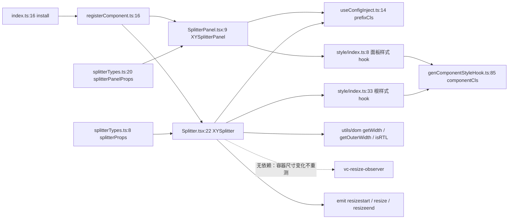
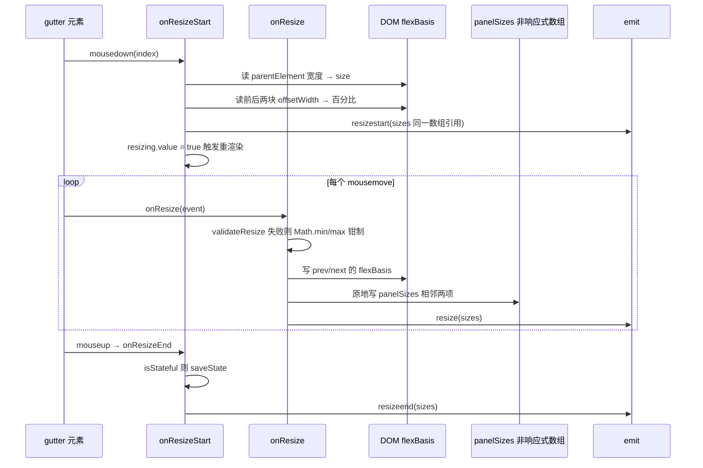
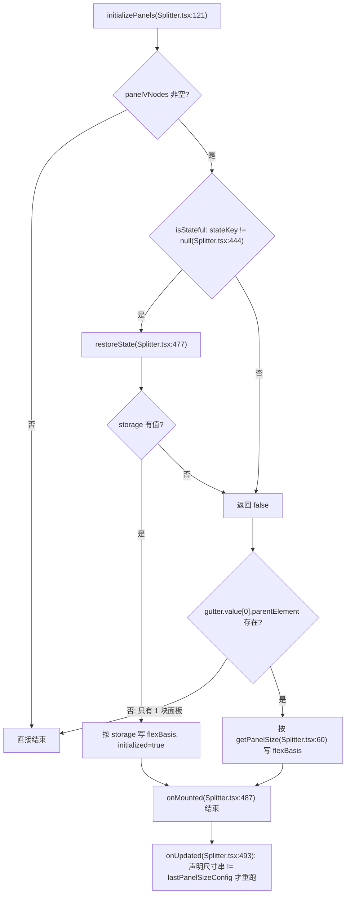

# C02-06 Splitter 分隔面板

> **本篇解决**：Splitter 的面板尺寸如何在「百分比」与「像素」两套坐标系之间归一，拖拽期间的即时更新与松手提交分别走哪条路径，键盘 resize 与 collapsible 边界在源码里由哪几行守住。
> **前置**：C02-00《类横写：栅格/flex/space 三代布局的取舍》　**读者坐标**：`03-components/02-layout` 第 7/14 篇

## 一、职责与边界

`Splitter` 负责把一块容器切成 N 个可拖拽面板，并把「面板占多大」这件事表达成**百分比**：它只在根元素的 `flex-direction` 上做文章，真正的尺寸分配交给 CSS flex（`flex-basis` + `flex-grow`），自己只负责三件事——测量、把测量结果换算成百分比、把百分比写回 `flex-basis`。它明确不负责：容器自身尺寸变化后的重算（源码里没有 `ResizeObserver`，`packages/xiaoye-ui/src/splitter/Splitter.tsx` 全文零引用，`OUTLINE.md:121` 给本篇标注的 `vc-resize-observer` 依赖在实现中并不存在）；面板的折叠语义（没有 `collapsible`/`maxSize` 之类的 prop，`packages/xiaoye-ui/src/splitter/splitterTypes.ts:8-15` 是全部声明面）；以及任何跨面板的联动约束。

被谁依赖：`packages/xiaoye-ui/src/components.ts:322-324` 把 `./splitter` 汇入包根聚合入口并 side-effect 导入样式；`packages/xiaoye-ui/typings/global.d.ts:82` 只登记了 `XYSplitter` 一个全局组件名（`XYSplitterPanel` 未登记，靠 `packages/xiaoye-ui/src/splitter/index.ts:16-20` 的 `install` 运行时注册）。依赖谁：`useConfigInject`（前缀注入）、`genComponentStyleHook`（Design Token → CSS-in-JS）、`@xiaoye-ui/utils/dom` 的四个测量函数与 `isRTL`、`initDefaultProps`。布局层的共性抽象（flex 容器族三代取舍）见 C02-00《类横写：栅格/flex/space 三代布局的取舍》，本篇不重复。

## 二、源码地图

| 文件 | 行数 | 职责 | 关键导出/入口行 |
| --- | --- | --- | --- |
| `packages/xiaoye-ui/src/splitter/Splitter.tsx` | 540 | 主实现：测量、换算、拖拽与键盘、状态持久化 | `packages/xiaoye-ui/src/splitter/Splitter.tsx:22`，渲染函数 `packages/xiaoye-ui/src/splitter/Splitter.tsx:529` |
| `packages/xiaoye-ui/src/splitter/SplitterPanel.tsx` | 40 | 面板容器，只做前缀类名与 nested 探测 | `packages/xiaoye-ui/src/splitter/SplitterPanel.tsx:9` |
| `packages/xiaoye-ui/src/splitter/splitterTypes.ts` | 29 | 两组 props 声明 + 两个联合类型 | `packages/xiaoye-ui/src/splitter/splitterTypes.ts:8`、`packages/xiaoye-ui/src/splitter/splitterTypes.ts:20` |
| `packages/xiaoye-ui/src/splitter/style/index.ts` | 129 | 两个 `genComponentStyleHook`：面板样式与根样式 | `packages/xiaoye-ui/src/splitter/style/index.ts:8`、`packages/xiaoye-ui/src/splitter/style/index.ts:33` |
| `packages/xiaoye-ui/src/splitter/index.ts` | 23 | 导出面 + `install` | `packages/xiaoye-ui/src/splitter/index.ts:16` |
| `packages/xiaoye-ui/src/splitter/index.test.js` | 145 | 11 个用例，全部为静态结构断言 | `packages/xiaoye-ui/src/splitter/index.test.js:84` |

主实现的关键分布值得先记住：非响应式可变状态全部集中在 `packages/xiaoye-ui/src/splitter/Splitter.tsx:35-52`（11 个 `let`）；三个交互入口在 `packages/xiaoye-ui/src/splitter/Splitter.tsx:150`（`onResizeStart`）、`packages/xiaoye-ui/src/splitter/Splitter.tsx:201`（`onResize`）、`packages/xiaoye-ui/src/splitter/Splitter.tsx:267`（`onResizeEnd`）；持久化在 `packages/xiaoye-ui/src/splitter/Splitter.tsx:444-493`；生命周期同步在 `packages/xiaoye-ui/src/splitter/Splitter.tsx:487-507`。

## 三、架构与数据流

### 3.1 模块关系（静态结构）



虚线框是**画出来提醒它不存在**：`Splitter` 与 `vc-resize-observer` 之间没有任何 import，`packages/xiaoye-ui/src/splitter/Splitter.tsx:2-17` 的导入清单只有 utils/dom、utils/object、vue 与自身四个模块。整条数据流因此是「事件驱动 + 两个生命周期钩子」，不是「尺寸驱动」。

### 3.2 一次拖拽的完整闭环



关键在两个「不回写」：`onResize` 只写 DOM，不写任何响应式状态（`panelSizes` 是 `let`，`packages/xiaoye-ui/src/splitter/Splitter.tsx:50`），所以拖拽期间 Vue 不会因为尺寸变化而重渲染；`emit` 的三个事件也只带这一个数组引用，外部拿到的 `sizes` 会在下一次拖拽时被追溯性地改掉。整个组件因此是「DOM 是唯一真相、`panelSizes` 是缓存、props 是初值」的三态结构。

### 3.3 尺寸来源的优先级分支



`restoreState` 返回 `true` 时声明式的 `size` 被完全跳过——这是 `stateKey` 最重要的隐藏语义，见论点 6。分支 `H` 的「只有 1 块面板」路径意味着：单面板场景下 `size` prop 静默失效，因为容器只能从 gutter 的 ref 反查（`packages/xiaoye-ui/src/splitter/Splitter.tsx:128-129`）。

## 四、核心机制精读

### 论点 1：`minSize` 唯一的消费者是一对零依赖 computed，首次求值后即永久冻结，多分隔条布局会钳错面板

断言：`minSize` 确实被读取了（不是死 API），但它经由两个**没有任何响应式依赖**的 `computed` 读取，Vue 的 computed 在没有依赖时只在第一次 `.value` 求值、之后永不置脏，于是这两个值在整个组件生命周期里被钉死在「第一次 `onResize` 时的那块面板」上。

`prevPanelIndex` 与 `panelVNodes` 都是 setup 作用域里的普通 `let`：

```tsx
// packages/xiaoye-ui/src/splitter/Splitter.tsx:35
    let panelVNodes: any[] = [];

    const resizing = ref(false);

    let mouseMoveListener: ((event: MouseEvent) => void) | null = null;
    let mouseUpListener: ((event: MouseEvent) => void) | null = null;
    let touchMoveListener: ((event: TouchEvent) => void) | null = null;
    let touchEndListener: ((event: TouchEvent) => void) | null = null;
    let size: number | null = null;
    let gutterElement: HTMLElement | null = null;
    let startPos: number | null = null;
    let prevPanelElement: HTMLElement | null = null;
    let nextPanelElement: HTMLElement | null = null;
    let nextPanelSize: number | null = null;
    let prevPanelSize: number | null = null;
    let panelSizes: number[] | null = null;
    let prevPanelIndex: number | null = null;
```

而读取 `minSize` 的两个 computed 只用到上面这些 `let`：

```tsx
// packages/xiaoye-ui/src/splitter/Splitter.tsx:108
    // 修复源项目 bug：去除 getVNodeProp 依赖，直接读 props
    const prevPanelMinSize = computed(() => {
      const pMinSize = panelVNodes[prevPanelIndex!]?.props?.minSize;
      return typeof pMinSize === 'number' ? pMinSize : 0;
    });

    const nextPanelMinSize = computed(() => {
      const nMinSize = panelVNodes[prevPanelIndex! + 1]?.props?.minSize;
      return typeof nMinSize === 'number' ? nMinSize : 0;
    });
```

getter 里出现的 `panelVNodes`（普通数组，`packages/xiaoye-ui/src/splitter/Splitter.tsx:84` 每次渲染重新赋值）、`prevPanelIndex`（普通 number，`packages/xiaoye-ui/src/splitter/Splitter.tsx:190` 在 `onResizeStart` 里赋值）、VNode 对象的 `.props`（VNode 不是响应式代理）三者都不注册依赖，`computed` 的 effect 依赖集为空 → `_dirty` 一旦被 `track` 清除就再没有东西能把它置回 true。

消费者有两处，都在拖拽主路径上：

```tsx
// packages/xiaoye-ui/src/splitter/Splitter.tsx:229
      if (!validateResize(newPrevPanelSize, newNextPanelSize)) {
        newPrevPanelSize = Math.min(
          Math.max(prevPanelMinSize.value, newPrevPanelSize),
          100 - nextPanelMinSize.value,
        );
        newNextPanelSize = Math.min(
          Math.max(nextPanelMinSize.value, newNextPanelSize),
          100 - prevPanelMinSize.value,
        );
      }
```

```tsx
// packages/xiaoye-ui/src/splitter/Splitter.tsx:382
    const validateResize = (newPrevPanelSize: number, newNextPanelSize: number) => {
      if (newPrevPanelSize > 100 || newPrevPanelSize < 0) return false;
      if (newNextPanelSize > 100 || newNextPanelSize < 0) return false;

      if (prevPanelMinSize.value > newPrevPanelSize) {
        return false;
      }

      if (nextPanelMinSize.value > newNextPanelSize) {
        return false;
      }
```

调用顺序决定了冻结点：`onGutterMouseDown`（`packages/xiaoye-ui/src/splitter/Splitter.tsx:321`）先跑 `onResizeStart` 把 `prevPanelIndex` 设为被按下的那条缝的下标，第一次 `.value` 读取发生在随后的首个 `mousemove`。此后无论拖哪条缝，`prevPanelMinSize.value` 都是**第一次那条缝左侧面板**的 `minSize`。

推论三条：两块面板（一条缝）的常规场景恰好正确，所以 `apps/docs/examples/splitter/min-size.vue:9` 这类示例看不出问题；三块面板两条缝时，后拖的那条缝用的是前一条缝两侧面板的最小值；运行期改 `:min-size` 完全不生效。文档 `apps/docs/components/splitter.md:37` 承诺的「防止内容被过度压缩」只在单缝布局下成立。

结论回扣：这不是「忘了实现 `minSize`」，而是「实现的读取通道被错误地包在了 computed 里」。把两者改成普通函数调用（`getPrevPanelMinSize()`）即可修复，`packages/xiaoye-ui/src/splitter/index.test.js:84` 只断言了 prop 存在性，**钳制路径零测试覆盖**。

### 论点 2：百分比与像素在 `flex-basis` 上交汇，减项按面板总数线性放大，导致声明值永远不等于渲染值

断言：`Splitter` 用 `calc(百分比% - 常量px)` 表达面板尺寸，但那个常量像素减项取的是「全部 gutter 的总宽」，却被**每一块**面板各自减了一次，于是 flex 引擎事后按 `flex-grow: 1` 回补的余量与面板数平方成正比；同时 `panelSizes` 的百分比基数是**扣掉根边框**的内容宽，两者叠加使 `panelSizes` 之和恒小于 100，而 `validateResize` 只逐块检查 0..100，从不检查两两之和。

写入侧（初始化与拖拽用的是同一个公式）：

```tsx
// packages/xiaoye-ui/src/splitter/Splitter.tsx:138
          panelVNodes.forEach((panel, i) => {
            const panelSize = getPanelSize(panel);
            _panelSizes[i] = panelSize;
            (children[i] as HTMLElement).style.flexBasis =
              'calc(' + panelSize + '% - ' + (panelVNodes.length - 1) * props.gutterSize + 'px)';
          });

          panelSizes = _panelSizes;
          prevSize.value = parseFloat(_panelSizes[0].toString()).toFixed(4) as unknown as number;
```

```tsx
// packages/xiaoye-ui/src/splitter/Splitter.tsx:240
      prevPanelElement!.style.flexBasis =
        'calc(' + newPrevPanelSize + '% - ' + (panelVNodes.length - 1) * props.gutterSize + 'px)';
      nextPanelElement!.style.flexBasis =
        'calc(' + newNextPanelSize + '% - ' + (panelVNodes.length - 1) * props.gutterSize + 'px)';
      panelSizes![prevPanelIndex!] = newPrevPanelSize;
      panelSizes![prevPanelIndex! + 1] = newNextPanelSize;
```

面板侧的 `flex-grow: 1` 在样式里，是它把误差吃掉的：

```ts
// packages/xiaoye-ui/src/splitter/style/index.ts:71
      [`${componentCls}-panel`]: {
        flexGrow: 1,
        overflow: 'hidden',

        [`&-nested`]: {
          display: 'flex',
        },
```

算一遍 N 块面板、缝宽 g：声明占比之和为 100（或略小），`flex-basis` 总和为 `100% - N(N-1)g px`，而面板可用空间是 `100% - (N-1)g px`，差值 `(N-1)²g` 由 `flex-grow: 1` 均摊，每块得 `(N-1)²g/N`。化简单块面板的**实际**宽度 = `声明% - (N-1)g/N px`。两块面板、默认 `gutterSize: 4`（`packages/xiaoye-ui/src/splitter/splitterTypes.ts:11`）时，声明 50 的面板实际是 `50% - 2px`；四块面板时变成 `声明% - 9px`。用户看到的结果是「拖不动到边界」和「同样的百分比在不同面板数下宽度不同」。

分母同样不干净：

```tsx
// packages/xiaoye-ui/src/splitter/Splitter.tsx:154
      const el = gutter.value[0]?.parentElement as HTMLElement;
      size = horizontal.value ? getWidth(el) : getHeight(el);
```

```ts
// packages/utils/src/dom/methods/getWidth.ts:1
export default function getWidth(element: HTMLElement): number {
  if (element) {
    let width = element.offsetWidth;
    const style = getComputedStyle(element);

    width -=
      parseFloat(style.paddingLeft) +
      parseFloat(style.paddingRight) +
      parseFloat(style.borderLeftWidth) +
      parseFloat(style.borderRightWidth);
```

分子用的是另一套口径：

```tsx
// packages/xiaoye-ui/src/splitter/Splitter.tsx:175
        prevPanelSize =
          (100 *
            (horizontal.value
              ? getOuterWidth(prevPanelElement, true)
              : getOuterHeight(prevPanelElement, true))) /
          size!;
```

`getOuterWidth(el, true)` 取的是 `offsetWidth` 再加左右 margin（`packages/utils/src/dom/methods/getOuterWidth.ts:3`），而根元素带 `border: 1px solid`（`packages/xiaoye-ui/src/splitter/style/index.ts:50`），`getWidth` 已把这条边框从分母里减掉。于是所有百分比都相对「内容盒」计算，而 flex 容器里 `%` 的解析基准虽同为内容盒，`panelSizes` 之和仍为 `100 - (N-1)g·100/(W-2)`，**天然不等于 100**。`validateResize`（`packages/xiaoye-ui/src/splitter/Splitter.tsx:382-384`）逐块判 `> 100 || < 0`，相邻两块各 90% 也能通过，结果就是这一对面板之和 180%，把同排其他面板挤成 0 宽——`flex-shrink` 在面板上没被关掉，面板样式只写了 `flexGrow`（`packages/xiaoye-ui/src/splitter/style/index.ts:72`），只有 gutter 写了 `flexShrink: 0`（`packages/xiaoye-ui/src/splitter/style/index.ts:89`）。

结论：本篇开头问的「两套坐标系如何归一」，源码给出的答案是**没有归一**——百分比是相对内容盒的近似量，像素减项是个被重复扣除的系统偏差，两者靠 `flex-grow` 兜住不至于崩版，代价是 `sizes` 事件里那些数字不能当权威值用。

### 论点 3：拖拽期间的即时反馈完全绕开响应式系统，唯一的「响应式尺寸」是 `prevSize`，而它装的是字符串且被所有分隔条共享

断言：`onResize` 每帧只写 DOM 与两个非响应式变量，组件里唯一被尺寸更新触碰的 ref 是 `prevSize`；它先被 `toFixed(4)` 变成字符串再用 `as unknown as number` 伪装成 number，并且只保存「最后一次拖的那条缝的左侧面板」一个数，却被渲染进**每一条** gutter 的 `aria-valuenow`。

```tsx
// packages/xiaoye-ui/src/splitter/Splitter.tsx:54
    const prevSize = ref<number | null>(null);
    const gutter = ref<HTMLElement[]>([]);
```

赋值处两处，都是「parseFloat 之后再 toFixed」：

```tsx
// packages/xiaoye-ui/src/splitter/Splitter.tsx:244
      panelSizes![prevPanelIndex!] = newPrevPanelSize;
      panelSizes![prevPanelIndex! + 1] = newNextPanelSize;
      prevSize.value = parseFloat(newPrevPanelSize.toString()).toFixed(4) as unknown as number;

      emit('resize', { originalEvent: event, sizes: panelSizes! });
```

`parseFloat(x)` 得 number，`.toFixed(4)` 又回到 string，`as unknown as number` 只是让 tsc 闭嘴。也就是说 `prevSize.value` 运行时类型是 `string`，声明类型是 `number | null`，两者都是错的（初始值 `null` 除外）。它的唯一消费点是无障碍属性：

```tsx
// packages/xiaoye-ui/src/splitter/Splitter.tsx:532
                <div
                  class={`${prefixCls.value}-gutter-handle`}
                  role="separator"
                  tabindex="0"
                  style={gutterStyle.value}
                  aria-orientation={props.layout}
                  aria-valuenow={prevSize.value}
                  onKeyup={onGutterKeyUp}
                  onKeydown={(e: KeyboardEvent) => onGutterKeyDown(e, i)}
                />
```

注意这段在 `panels().map((panel, i) => ...)` 内部（`packages/xiaoye-ui/src/splitter/Splitter.tsx:524`），`i` 参与了 `onGutterKeyDown(e, i)` 与 ref 下标，唯独 `aria-valuenow` 用的是全局共享的 `prevSize.value`——三条缝的布局里，读屏软件在任意一条缝上读到的都是「最后被拖那条缝左侧面板」的占比。同时 `role="separator"` 上缺 `aria-valuemin`/`aria-valuemax`/`aria-controls`，全文只有这一个 valuenow（`packages/xiaoye-ui/src/splitter/Splitter.tsx:542-546`）。

「即时更新走 DOM、提交走 storage」的分界也在这里定型：`onResize` 不发存储、`onResizeEnd` 才发。

```tsx
// packages/xiaoye-ui/src/splitter/Splitter.tsx:251
    const onResizeEnd = (event: any) => {
      if (isStateful()) {
        saveState();
      }

      emit('resizeend', { originalEvent: event, sizes: panelSizes! });
      resizing.value = false;
      clear();
    };
```

`clear()`（`packages/xiaoye-ui/src/splitter/Splitter.tsx:433-442`）重置了 `size`/`startPos`/两块面板元素/两个尺寸/`gutterElement`/`prevPanelIndex` 共 7 项，却**不清 `panelSizes`**——这是刻意的，因为 `panelSizes` 就是当前布局本身。但它也不重置 `prevSize`，于是松手后 `aria-valuenow` 会一直停在上一次拖动的数值，即便之后 `size` prop 被外部改掉并触发 `initializePanels()` 重排（`packages/xiaoye-ui/src/splitter/Splitter.tsx:144-145` 会重新写 `prevSize`，但只写第一块面板的）。结论：组件对外公布的「当前尺寸」有两个互相不同步的口径，`event.sizes` 是全体但被原地改写，`aria-valuenow` 是稳定但只有一个且语义漂移。

### 论点 4：键盘 resize 用 40ms `setInterval` 重放整个 `onResizeStart`，代价是 `resizestart` 每秒 25 次、RTL 方向不翻转、以及对不匹配的按键也无条件 `preventDefault`

断言：方向键的连续调节不是「记住起点后累加」，而是**每个 tick 重新执行一遍按下流程**，因为它依赖重新测量 DOM 才能累进。

```tsx
// packages/xiaoye-ui/src/splitter/Splitter.tsx:261
    const repeat = (event: any, index: number, step: number) => {
      onResizeStart(event, index, true);
      onResize(event, step, true);
    };

    const setTimer = (event: any, index: number, step: number) => {
      if (!timer) {
        timer = setInterval(() => {
          repeat(event, index, step);
        }, 40);
      }
    };
```

`onResizeStart` 尾部无条件做三件事（`packages/xiaoye-ui/src/splitter/Splitter.tsx:189-191`）：设 `prevPanelIndex`、`emit('resizestart', ...)`、`resizing.value = true`。所以按住方向键不放时，每 40ms 就有一次 `resizestart` 外发、一次 `resize` 外发，`onResizeEnd` 只在 `keyup` 时补一次，且补的是一个人造事件对象：

```tsx
// packages/xiaoye-ui/src/splitter/Splitter.tsx:281
    const onGutterKeyUp = () => {
      clearTimer();
      onResizeEnd({});
    };
```

于是键盘路径下 `resizeend` 的 `originalEvent` 恒为 `{}`（`packages/xiaoye-ui/src/splitter/Splitter.tsx:264` 直接透传），消费方若写 `e.originalEvent.shiftKey` 之类的判断，指针路径能跑、键盘路径静默失效。

`isKeyDown` 还改变了同一批变量的量纲：

```tsx
// packages/xiaoye-ui/src/splitter/Splitter.tsx:167
      if (isKeyDown) {
        prevPanelSize = horizontal.value
          ? getOuterWidth(prevPanelElement, true)
          : getOuterHeight(prevPanelElement, true);
        nextPanelSize = horizontal.value
          ? getOuterWidth(nextPanelElement, true)
          : getOuterHeight(nextPanelElement, true);
      } else {
```

```tsx
// packages/xiaoye-ui/src/splitter/Splitter.tsx:205
      if (isKeyDown) {
        if (horizontal.value) {
          newPrevPanelSize = (100 * (prevPanelSize! + step!)) / size!;
          newNextPanelSize = (100 * (nextPanelSize! - step!)) / size!;
        } else {
          newPrevPanelSize = (100 * (prevPanelSize! - step!)) / size!;
          newNextPanelSize = (100 * (nextPanelSize! + step!)) / size!;
        }
```

同一个 `prevPanelSize`，指针路径存百分比（`packages/xiaoye-ui/src/splitter/Splitter.tsx:175-180` 除过 `size`），键盘路径存**裸像素**，靠 `onResize` 的对应分支再换算回来。`props.step` 默认 5（`packages/xiaoye-ui/src/splitter/splitterTypes.ts:14`）在键盘路径里因此是「5 像素」而不是 5%，与 `size`/`minSize` 的百分比单位不一致；而指针路径的 `newPos` 是百分比（`packages/xiaoye-ui/src/splitter/Splitter.tsx:225-230`）。两条路径还各有副作用差异：非键盘才写 `startPos`（`packages/xiaoye-ui/src/splitter/Splitter.tsx:156-161`），非键盘才做 RTL 翻转——`isRTL` 在整个文件里只出现一次，位于鼠标/触摸分支：

```tsx
// packages/xiaoye-ui/src/splitter/Splitter.tsx:214
        if (horizontal.value) {
          const el = gutter.value[0]?.parentElement as HTMLElement;
          if (isRTL(el)) {
            newPos = ((startPos! - event.pageX) * 100) / size!;
          } else {
            newPos = ((event.pageX - startPos!) * 100) / size!;
          }
```

`isRTL` 的判定来自 `getComputedStyle(element).direction === 'rtl'`（`packages/utils/src/dom/methods/isRTL.ts:2`），而 `onResize` 的 `isKeyDown` 分支在 `packages/xiaoye-ui/src/splitter/Splitter.tsx:205-212` 提前 return 到另一套公式、根本不读 direction。所以 RTL 布局下指针拖动方向正确，方向键语义整体反向。

按键映射本身还有一处过度拦截：

```tsx
// packages/xiaoye-ui/src/splitter/Splitter.tsx:286
    const onGutterKeyDown = (event: KeyboardEvent, index: number) => {
      switch (event.code) {
        case 'ArrowLeft': {
          if (props.layout === 'horizontal') {
            setTimer(event, index, props.step * -1);
          }
          event.preventDefault();
          break;
        }
```

`event.preventDefault()` 在 `if` 外面，垂直布局下按 `ArrowLeft` 也会吃掉页面横向滚动；且 `ArrowUp` 走的是正向 `props.step`（`packages/xiaoye-ui/src/splitter/Splitter.tsx:317-322`）——配合 `packages/xiaoye-ui/src/splitter/Splitter.tsx:218-219` 的「垂直时 prev 减 step」，向上键的净效果是**上方面板变矮**，与多数实现里「向上键增长当前受控值」的直觉相反。此外 `setTimer` 的 `if (!timer)` 意味着同时按下左右方向键不会叠加，而是被忽略——这是合理的，但 `timer` 是 `let`（`packages/xiaoye-ui/src/splitter/Splitter.tsx:52`），若组件在按住键时被卸载，`onBeforeUnmount` 里的 `clearTimer()`（`packages/xiaoye-ui/src/splitter/Splitter.tsx:504`）是唯一的兜底，而 `repeat` 里访问的是已经游离的 `prevPanelElement`，靠 `!` 非空断言硬闯。

### 论点 5：触摸路径同时由 document 监听器和 gutter 元素内联属性处理，一次移动触发两次 `onResize`，其中一次的坐标是 `undefined`，NaN 顺利通过校验写进 `flex-basis`

断言：`touchmove` 被注册了两遍，且两遍传进 `onResize` 的参数类型不同，第二条是坏的。

```tsx
// packages/xiaoye-ui/src/splitter/Splitter.tsx:365
    const bindTouchListeners = () => {
      if (!isClient) return;

      if (!touchMoveListener) {
        touchMoveListener = (event: TouchEvent) => onResize(event.changedTouches[0]);
        document.addEventListener('touchmove', touchMoveListener);
      }

      if (!touchEndListener) {
        touchEndListener = (event: TouchEvent) => {
          resizeEnd(event);
          unbindTouchListeners();
        };
        document.addEventListener('touchend', touchEndListener);
      }
    };
```

```tsx
// packages/xiaoye-ui/src/splitter/Splitter.tsx:527
                onTouchstart={(e: TouchEvent) => onGutterTouchStart(e, i)}
                onTouchmove={(e: TouchEvent) => onGutterTouchMove(e)}
                onTouchend={(e: TouchEvent) => onGutterTouchEnd(e)}
```

```tsx
// packages/xiaoye-ui/src/splitter/Splitter.tsx:332
    const onGutterTouchMove = (event: TouchEvent) => {
      onResize(event);
      event.preventDefault();
    };
```

触摸事件的目标固定为 touchstart 时命中的那个元素（也就是 gutter），因此移动过程中内联 `onTouchmove` 必然触发；document 上的监听器在 `onGutterTouchStart`（`packages/xiaoye-ui/src/splitter/Splitter.tsx:326-338`）里也已经挂上，两者同一次移动各跑一次 `onResize`。区别在参数：document 版本传 `event.changedTouches[0]`，那是一个 `Touch`，有 `pageX/pageY`；内联版本传整个 `TouchEvent`，`event.pageX` 是 `undefined`。

```tsx
// packages/xiaoye-ui/src/splitter/Splitter.tsx:221
        } else {
          newPos = ((event.pageY - startPos!) * 100) / size!;
        }

        newPrevPanelSize = prevPanelSize! + newPos;
        newNextPanelSize = nextPanelSize! - newPos;
```

`undefined - number` → `NaN`，随后 `prevPanelSize! + NaN` 仍是 `NaN`。守卫在这里失效：

```tsx
// packages/xiaoye-ui/src/splitter/Splitter.tsx:386
      if (prevPanelMinSize() > newPrevPanelSize) {
        return false;
      }

      if (nextPanelMinSize() > newNextPanelSize) {
        return false;
      }

      return true;
```

> **2026-09-29 更新**：`prevPanelMinSize`/`nextPanelMinSize` 原先是 `.value` 形式的 `computed`（那正是「零依赖、首次求值后永久冻结」的成因），现已改成按当前索引即时求值的函数；`validateResize` 之前还加了坐标守卫，`NaN` 走不到 `return true`。本段与下面论点里「钳错邻居」的症状已不成立，取证按修复前状态保留。

`validateResize` 的四道判断全是 `>` / `<` 比较，任何与 `NaN` 的比较都返回 false，于是 `return true`，钳制分支（`packages/xiaoye-ui/src/splitter/Splitter.tsx:245`）被跳过，`NaN` 一路写进 `flexBasis`（`packages/xiaoye-ui/src/splitter/Splitter.tsx:248-251`）、`panelSizes`（`packages/xiaoye-ui/src/splitter/Splitter.tsx:252-253`）、`aria-valuenow`（`packages/xiaoye-ui/src/splitter/Splitter.tsx:262`）和外发事件负载。CSS 层面 `calc(NaN% - 4px)` 是非法声明，浏览器直接忽略该属性，面板回落到 `flex-grow` 均分；而 JS 层面 `NaN` 会被 `saveState()` 序列化（`JSON.stringify` 把 `NaN` 写成 `null`），下次 `restoreState()` 读出 `null` 再拼进 `calc` —— 静默降级成 `calc(null% - 4px)`。

第二重问题是 passive 默认值：document 级 `touchmove` 在 Chromium 里默认按 `passive: true` 处理，`packages/xiaoye-ui/src/splitter/Splitter.tsx:334` 与 `packages/xiaoye-ui/src/splitter/Splitter.tsx:347` 的 `event.preventDefault()` 对 document 上那个监听器（`packages/xiaoye-ui/src/splitter/Splitter.tsx:384`）无法阻止页面滚动——`addEventListener` 的第三参数一个都没传（`packages/xiaoye-ui/src/splitter/Splitter.tsx:378`、`packages/xiaoye-ui/src/splitter/Splitter.tsx:378`）。也就是说触屏拖分隔条时页面会跟着滚。指针路径没有这个问题，因为 `mousemove` 不属于 passive 默认集。

结论回扣到骨架里那句「拖拽期间的即时更新与松手提交分别走哪条路径」：移动端这两条路径都建立了，但即时路径有双写与 NaN 两个漏洞，且没有一条测试用例模拟过触摸或指针移动——`packages/xiaoye-ui/src/splitter/index.test.js` 全文 145 行只做结构与标识断言。

### 论点 6：尺寸同步只有 `onMounted` 与 `onUpdated` 两个时机，容器变化不重测；`onUpdated` 的哨兵值未回填，且 `restoreState` 一旦命中就永久压制声明值

断言：`panelSizes` 与真实 DOM 的一致性只靠两个钩子维护；`onUpdated` 用「声明尺寸拼成的字符串」做脏检查，而这个字符串的初值 `''` 从不在 `onMounted` 里回填，所以挂载后的**第一次**重渲染必然整体重排；同时状态恢复优先于声明值且无任何校验。

```tsx
// packages/xiaoye-ui/src/splitter/Splitter.tsx:487
    onMounted(() => {
      initializePanels();
    });

    let lastPanelSizeConfig = '';

    onUpdated(() => {
      const currentConfig = panelVNodes.map(panel => getPanelSize(panel)).join(',');

      if (currentConfig !== lastPanelSizeConfig) {
        lastPanelSizeConfig = currentConfig;
        initializePanels();
      }
    });

    onBeforeUnmount(() => {
      clear();
      clearTimer();
      unbindMouseListeners();
      unbindTouchListeners();
    });
```

三点要拆开看。第一，`currentConfig` 只由 `size` prop 推导（`getPanelSize` 读的是 `panel.props.size`，`packages/xiaoye-ui/src/splitter/Splitter.tsx:60-63`），**不含** `minSize`、不含 `panelSizes` 的实际值，所以外部改 `min-size` 连脏检查都过不了——这与论点 1 的冻结效应叠加成双保险式的失效。第二，`onMounted` 不写 `lastPanelSizeConfig`，而 `onResizeStart` 里 `resizing.value = true`（`packages/xiaoye-ui/src/splitter/Splitter.tsx:191`）必然触发一次重渲染，于是「第一次按下任意分隔条」这个时刻固定会多跑一次 `initializePanels()`：读一次 `container.children`、给每块面板写一次 `flexBasis`，在拖拽起始帧插入一次强制布局回写。第三，`panelVNodes` 是上一次渲染留下的数组（`packages/xiaoye-ui/src/splitter/Splitter.tsx:84` 在 render 里重新赋值），`onUpdated` 读它属于「渲染期副作用 + 提交期读副作用结果」，两者顺序恰好成立，但把面板收集逻辑挪出 render 就会立刻失效。

容器尺寸变化则完全没人管：整个文件只有 4 个 `addEventListener`，全在 `document` 上且全是拖拽期间临时挂的（`packages/xiaoye-ui/src/splitter/Splitter.tsx:369`、`packages/xiaoye-ui/src/splitter/Splitter.tsx:369`、`packages/xiaoye-ui/src/splitter/Splitter.tsx:378`、`packages/xiaoye-ui/src/splitter/Splitter.tsx:378`），没有 `window.resize`、没有 `ResizeObserver`。后果：根容器变宽后 `panelSizes` 仍是旧百分比，而 `flex-basis` 是 `% - px` 的混合式，面板会跟着容器线性缩放，于是「拖到某面板刚好容纳内容」的比例在窗口缩放后失配；更要紧的是下一次拖拽开始时 `size` 会重新测量（`packages/xiaoye-ui/src/splitter/Splitter.tsx:154`），而 `prevPanelSize` 也重新测量，所以拖拽本身能自愈，**不拖就永远错着**。

恢复路径的优先级与脆弱点：

```tsx
// packages/xiaoye-ui/src/splitter/Splitter.tsx:121
    const initializePanels = () => {
      if (panelVNodes && panelVNodes.length) {
        let initialized = false;

        if (isStateful()) {
          initialized = restoreState();
        }

        if (!initialized) {
          const container = gutter.value[0]?.parentElement;
          if (!container) return;
```

```tsx
// packages/xiaoye-ui/src/splitter/Splitter.tsx:461
    const restoreState = () => {
      const storage = getStorage();
      if (!storage) return false;

      const stateString = storage.getItem(props.stateKey!);

      if (stateString) {
        panelSizes = JSON.parse(stateString);
        const container = gutter.value[0]?.parentElement;
        if (!container) return false;

        const children = Array.from(container.children).filter(child =>
          (child as HTMLElement).classList.contains(`${prefixCls.value}-panel`),
        );

        children.forEach((child, i) => {
          (child as HTMLElement).style.flexBasis =
            'calc(' + panelSizes![i] + '% - ' + (panelVNodes.length - 1) * props.gutterSize + 'px)';
        });
```

`initialized = true` 后声明值整段跳过，`size` 与存储冲突时存储恒赢；`JSON.parse` 无 try/catch（`packages/xiaoye-ui/src/splitter/Splitter.tsx:476`）且发生在 `onMounted` 同步栈里，存储被写坏会直接抛在挂载阶段；`panelSizes![i]` 不做长度与类型校验（`packages/xiaoye-ui/src/splitter/Splitter.tsx:484-487`），面板数减少后残留的旧数组会让多余项被 `children.forEach` 忽略（少写几块），面板数增加后新增项是 `undefined`（拼出 `calc(undefined% - 4px)`，浏览器忽略该声明、该面板退回 `flex-grow` 均分）。而 `getStorage()` 对未知取值是抛错而非告警：

```tsx
// packages/xiaoye-ui/src/splitter/Splitter.tsx:439
    const getStorage = (): Storage | null => {
      if (!isClient) return null;
      switch (props.stateStorage) {
        case 'local':
          return window.localStorage;
        case 'session':
          return window.sessionStorage;
        default:
          throw new Error(
            props.stateStorage +
              ' is not a valid value for the state storage, supported values are "local" and "session".',
          );
```

由于 `stateStorage` 默认 `'session'`（`packages/xiaoye-ui/src/splitter/splitterTypes.ts:13`）且只在 `isStateful()` 时被碰到，这条 throw 仅在「传了 `stateKey` 又传错 `stateStorage`」时命中，届时 `onMounted` 直接失败、整棵子树不渲染，而不是降级为不持久化。

最后是容器定位方式本身：`gutter.value[0]?.parentElement` 意味着**所有**测量与初始化都以「第一条缝存在」为前提，一块面板时 `gutter.value` 是空数组（`packages/xiaoye-ui/src/splitter/Splitter.tsx:128-129` 的 `if (!container) return;`），`size` prop 被静默忽略。而 ref 回调只在元素存在时写入：

```tsx
// packages/xiaoye-ui/src/splitter/Splitter.tsx:535
              <div
                key={`gutter-${i}`}
                ref={(el: any) => {
                  if (el) gutter.value[i] = el;
                }}
```

卸载分支被 `if (el)` 挡掉，`gutter.value` 里保留已脱离文档的节点。动态删除面板后，若删掉的正是索引靠前的缝，`gutter.value[0]` 会指向游离元素，其 `parentElement` 为 `null` → `initializePanels` 直接 return；非空但游离时更糟，`children` 取到的是老快照，写样式写到不渲染的节点上，界面无变化。

### 论点 7：一个组件目录里两个 `genComponentStyleHook` 对同一批选择器各写一遍，加上三个从不被样式引用的类名与属性

断言：面板的 `flex-grow`/`overflow`/`-nested`/嵌套重置这四组声明，在 `style/index.ts` 里以两个不同的 hash 作用域各生成一次；根 hook 版本的后代选择器特异性更高，会把外部对 `.xy-splitter-panel` 的单类覆盖压掉。同时 `gutterClasses` 生成的 `xy-splitter-gutter-resizing` 与渲染函数写出的 `data-resizing`、`data-gutter-resizing` 三个标识在整个 `src` 目录里没有任何样式引用。

面板 hook：

```ts
// packages/xiaoye-ui/src/splitter/style/index.ts:8
export const useSplitterPanelStyle = genComponentStyleHook('SplitterPanel', token => {
  const { componentCls } = token;

  return {
    [componentCls]: {
      flexGrow: 1,
      overflow: 'hidden',

      [`&${componentCls}-nested`]: {
        display: 'flex',
      },

      // 嵌套 Splitter 时重置样式（硬编码 .xy-splitter 与 Splitter 的 prefixCls 一致）
      '.xy-splitter': {
        flexGrow: 1,
        minWidth: 0,
        minHeight: 0,
        border: '0 none',
      },
    },
  } as CSSObject;
});
```

根 hook 里的同一批声明：

```ts
// packages/xiaoye-ui/src/splitter/style/index.ts:71
      [`${componentCls}-panel`]: {
        flexGrow: 1,
        overflow: 'hidden',

        [`&-nested`]: {
          display: 'flex',
        },

        [`${componentCls}`]: {
          flexGrow: 1,
          minWidth: 0,
          minHeight: 0,
          border: '0 none',
        },
      },
```

两处的差异只在 `componentCls` 的来源：`genComponentStyleHook` 不解析组件名，`componentCls = .${prefixCls.value}`（`packages/xiaoye-ui/src/theme/util/genComponentStyleHook.ts:85`），而 `prefixCls` 是调用方传进来的 ref——面板传 `useConfigInject('splitter-panel', props)`（`packages/xiaoye-ui/src/splitter/SplitterPanel.tsx:18`），`getPrefixCls` 拼出 `xy-splitter-panel`（`packages/xiaoye-ui/src/config-provider/context.ts:166-169`），于是两个 hook 命中的 DOM 类名完全相同，只 hash 前缀不同。默认 `hashPriority: 'low'` 把 hash 包成 `:where(...)`（`packages/xiaoye-ui/src/_util/cssinjs/hooks/useStyleRegister/index.tsx:85`、`packages/xiaoye-ui/src/_util/cssinjs/StyleContext.tsx:115`），因此根 hook 那条的实际选择器是 `:where(.hashA).xy-splitter .xy-splitter-panel`（类选择器计数 2），面板自己那条是 `:where(.hashB).xy-splitter-panel`（计数 1）：业务侧写 `.xy-splitter-panel { flex-grow: 2 }` 会被根 hook 那份覆盖，且覆盖失败的原因藏在两个 hash 的先后顺序里，极难排查。

硬编码 `.xy-splitter` 那一支（`packages/xiaoye-ui/src/splitter/style/index.ts:21`）在 `ConfigProvider` 改了全局前缀后必然失配：届时根类名变成 `myui-splitter`、面板类名变成 `myui-splitter-panel`，两个 hook 的动态部分都跟着变，只有这条字面量不动，嵌套 Splitter 的 `min-width: 0`/`border: 0` 重置消失，内层 Splitter 因外层 `flex-basis` 未受约束而撑破容器。根 hook 的对应实现用的是变量（`packages/xiaoye-ui/src/splitter/style/index.ts:79`），所以同一份声明在「有前缀定制」这一条件下只生效一半。

三个死标识：

```tsx
// packages/xiaoye-ui/src/splitter/Splitter.tsx:97
    const gutterClasses = computed(() => [
      `${prefixCls.value}-gutter`,
      { [`${prefixCls.value}-gutter-resizing`]: resizing.value },
    ]);
```

`xy-splitter-gutter` 在 `packages/xiaoye-ui/src/splitter/style/index.ts:87` 有定义，`-gutter-resizing` 没有；`data-resizing`（`packages/xiaoye-ui/src/splitter/Splitter.tsx:507`）与 `data-gutter-resizing`（`packages/xiaoye-ui/src/splitter/Splitter.tsx:538`）也一样，拖拽时它们会随 `resizing` 一起变化，但没有一条规则消费。可复现的统计命令（同时覆盖类名与属性两种写法）：

```bash
grep -rn "gutter-resizing\|data-resizing" packages/xiaoye-ui/src
```

结果只有 3 行，全在 `Splitter.tsx` 自己内部（`:99`、`:507`、`:522`）。相对地，根元素的 `-resizing` 是活的：`splitterClasses`（`packages/xiaoye-ui/src/splitter/Splitter.tsx:90-95`）产出它，样式里 `user-select: none` 与两种 `cursor` 靠它生效（`packages/xiaoye-ui/src/splitter/style/index.ts:59-69`）——顺带说明拖拽期间光标是靠根容器统一切的， gutter 上那条 `col-resize`（`packages/xiaoye-ui/src/splitter/style/index.ts:97`）是同一效果的第二次声明。

组件 token 层则是彻底的空壳：`style/index.ts:4` 导出 `ComponentToken {}`，主题接口里两个组件的 token 面也是空对象（`packages/xiaoye-ui/src/theme/interface/components.ts:160-161`），而样式实际用了 8 个 alias token（`packages/xiaoye-ui/src/splitter/style/index.ts:34-44`）。这意味着 `ConfigProvider` 的 `theme.components.Splitter` 覆盖项无处落地，且尺寸里还有 `24px`、`100%`、`0.2rem`、`33` 这四个字面量（`packages/xiaoye-ui/src/splitter/style/index.ts:112-126`），与 `AGENTS.md`「禁止在组件样式中硬编码颜色、间距等值」的约定不符——`colorPrimary}33` 那处是 hex 透明度拼接，主题换成非 hex 色值即产出非法颜色。

## 五、对外契约如何生效

### 5.1 props 的两条流路

`splitterProps()` 经 `initDefaultProps(splitterProps(), {})`（`packages/xiaoye-ui/src/splitter/Splitter.tsx:26`）进入组件，第二参数是空对象——所有默认值实际写在 prop 定义里（`packages/xiaoye-ui/src/splitter/splitterTypes.ts:10-14`），`initDefaultProps` 在这里只做类型收口。之后分两路：

`layout` 一路进 `horizontal` computed（`packages/xiaoye-ui/src/splitter/Splitter.tsx:88`），同时决定根类名（`packages/xiaoye-ui/src/splitter/Splitter.tsx:92`）、gutter 的 `gutterStyle` 轴向（`packages/xiaoye-ui/src/splitter/Splitter.tsx:102-105`）、测量取宽还是取高（`packages/xiaoye-ui/src/splitter/Splitter.tsx:154`）、以及键盘映射用左右键还是上下键（`packages/xiaoye-ui/src/splitter/Splitter.tsx:297`、`packages/xiaoye-ui/src/splitter/Splitter.tsx:311`）。`gutterSize` 一路进 `gutterStyle` 与三处 `calc` 减项（`packages/xiaoye-ui/src/splitter/Splitter.tsx:141`、`packages/xiaoye-ui/src/splitter/Splitter.tsx:257`、`packages/xiaoye-ui/src/splitter/Splitter.tsx:478`）。`step` 只有一个消费者 `onGutterKeyDown`（`packages/xiaoye-ui/src/splitter/Splitter.tsx:286`），`stateKey`/`stateStorage` 只有 `isStateful`/`getStorage`（`packages/xiaoye-ui/src/splitter/Splitter.tsx:444`、`packages/xiaoye-ui/src/splitter/Splitter.tsx:455`）。也就是说 `prefixCls` 是唯一走 `useConfigInject('splitter', props)`（`packages/xiaoye-ui/src/splitter/Splitter.tsx:32`）的 prop，其余全部直接读 `props.x`。

面板侧的 `size`/`minSize` 从不经过面板自己的 setup——`SplitterPanel.tsx:13` 声明它们却一次都不读，真正的使用者是父组件翻 VNode 的 `props` 字段（`packages/xiaoye-ui/src/splitter/Splitter.tsx:61`、`packages/xiaoye-ui/src/splitter/Splitter.tsx:109`）。这带来一个宽严不一致：`size` 不做类型判断（`isNotEmpty` 后原样拼进 CSS 串，`packages/xiaoye-ui/src/splitter/Splitter.tsx:60-63`），写成 `size="30"` 侥幸成立；`minSize` 却卡 `typeof === 'number'`（`packages/xiaoye-ui/src/splitter/Splitter.tsx:112`、`packages/xiaoye-ui/src/splitter/Splitter.tsx:114`），写成 `min-size="20"` 直接退化为 0。

### 5.2 两处契约断点：attrs 通道与 prefixCls 下传

`Splitter` 声明了 `inheritAttrs: false`：

```tsx
// packages/xiaoye-ui/src/splitter/Splitter.tsx:22
export default defineComponent({
  name: 'XYSplitter',
  inheritAttrs: false,
  __XY_SPLITTER: true,
```

而它的 setup 签名与渲染函数里都没有 `attrs`——`setup(props, { slots, emit, expose })`（`packages/xiaoye-ui/src/splitter/Splitter.tsx:31`）不接收 attrs，根 div 只挂了 `class` 与 `data-resizing`（`packages/xiaoye-ui/src/splitter/Splitter.tsx:507`）。对照面板就清楚这是遗漏而非设计：`SplitterPanel.tsx:17` 显式解构 attrs 并在 `SplitterPanel.tsx:33` 用 `{...attrs}` 展开。后果是**用户写在 `<xy-splitter>` 标签上的所有非 prop 属性都被丢弃**，包括 `class`、`style`、`id`、`data-*` 与额外的 `on*` 监听。随仓示例恰好在依赖它：`apps/docs/examples/splitter/vertical.vue:2` 与 `apps/docs/examples/splitter/min-size.vue:8` 都写 `style="height: …px"` 在 `xy-splitter` 上，这些高度从未落到 DOM，垂直布局的实际高度由内容决定。验证命令：`grep -c attrs packages/xiaoye-ui/src/splitter/Splitter.tsx` 输出 0。

第二处断点是前缀不下传。`cloneVNode(panel, { tabindex: '-1' })` 是父组件对面板做的唯一注入（`packages/xiaoye-ui/src/splitter/Splitter.tsx:533`），没有把自身的 `prefixCls` 传下去，面板因此独立走 `useConfigInject('splitter-panel', props)`（`packages/xiaoye-ui/src/splitter/SplitterPanel.tsx:18`）。默认前缀下两者凑巧对齐（`xy-splitter` + `-panel`），一旦只在 `<xy-splitter prefixCls="my-split">` 上定制（`getPrefixCls` 对 `customizePrefixCls` 是原样返回，`packages/xiaoye-ui/src/config-provider/context.ts:167`），根 hook 生成的后代选择器变成 `.my-splitter-panel`（`packages/xiaoye-ui/src/splitter/style/index.ts:71`），而 DOM 上仍是 `xy-splitter-panel`，gutter 尺寸、面板 `flex-grow`、嵌套重置三条规则同时失配，且 `initializePanels` 的类名筛选（`packages/xiaoye-ui/src/splitter/Splitter.tsx:134`）也会筛出空数组而静默不初始化。

### 5.3 事件、插槽与 expose

三个事件在 `emits` 里声明（`packages/xiaoye-ui/src/splitter/Splitter.tsx:30`）且都有真实触发点（`packages/xiaoye-ui/src/splitter/Splitter.tsx:190`、`packages/xiaoye-ui/src/splitter/Splitter.tsx:256`、`packages/xiaoye-ui/src/splitter/Splitter.tsx:264`），这一层没有死 API；但三者负载同为 `{ originalEvent, sizes }`，`sizes` 是被原地改写的同一个数组（`packages/xiaoye-ui/src/splitter/Splitter.tsx:252-253`），事件是纯通知、没有 `preventDefault` 通道，调用方无法否决一次拖拽，也没有 `update:*` 事件可做 `v-model`。

插槽只有 `default`，两侧都靠 `CustomSlotsType` 收口（`packages/xiaoye-ui/src/splitter/Splitter.tsx:27-29`、`packages/xiaoye-ui/src/splitter/SplitterPanel.tsx:14-16`）。面板识别走组件名字符串匹配：

```tsx
// packages/xiaoye-ui/src/splitter/Splitter.tsx:57
    // 修复源项目 bug：硬编码 'SplitterPanel' → 'XYSplitterPanel'
    const isSplitterPanel = (child: any) => child.type?.name === 'XYSplitterPanel';
```

因此面板必须**以 `XYSplitterPanel` 这个 name 原样出现**：任何二次封装（`<template><xy-splitter-panel>…</xy-splitter-panel></template>` 式的包装组件、或 `<component :is>`）都会让 `child.type.name` 变成包装器的名字而识别不到，`getPanel` 返回空数组、渲染不出任何 gutter（`packages/xiaoye-ui/src/splitter/Splitter.tsx:65-81`）。同一函数还只下钻一层子节点，`v-for` 直接产出的 Fragment 能被吃到，包了两层就吃不到。

面板自己的 `isNested` 则在 computed 里调了一次插槽渲染函数：

```tsx
// packages/xiaoye-ui/src/splitter/SplitterPanel.tsx:21
    // 修复源项目 bug：硬编码 'Splitter' → 'XYSplitter'
    const isNested = computed(() => {
      const defaultSlot = slots.default?.();
      if (defaultSlot) {
        return defaultSlot.some((child: any) => child.type?.name === 'XYSplitter');
      }
      return false;
    });
```

插槽函数被调用两次（这里一次、`SplitterPanel.tsx:36` 渲染一次），子树里的响应式依赖因此被这个 computed 追踪，面板内容每次变化都会重跑一次「只为判断有没有嵌套」的渲染；判断同样只看直接子节点。

`expose` 面只有一个成员：

```tsx
// packages/xiaoye-ui/src/splitter/Splitter.tsx:509
    expose({
      onGutterMouseDown,
    });
```

它是内部事件处理器，签名 `(event: MouseEvent, index: number)`（`packages/xiaoye-ui/src/splitter/Splitter.tsx:337`），要求调用方自己知道第几条缝、还得造一个带 `pageX`/`target` 的事件对象，实用价值接近零；同时意味着组件**没有**任何 reset、编程式 resize、读当前尺寸的方法——想拿当前布局只能靠监听事件。骨架里预告的 collapsible 语义在源码中不存在对应实现：`packages/xiaoye-ui/src/splitter` 全目录 grep `collaps` 零命中，`maxSize` 同样零命中。

## 六、设计取舍

**尺寸真相放在 DOM 而不是响应式状态。** 换来的是一次 `mousemove` 只产生两次 `style.flexBasis` 赋值（`packages/xiaoye-ui/src/splitter/Splitter.tsx:248-251`），拖 60Hz 也不触发 Vue 渲染，N 块面板的代价与 N 无关。赔上的是三件事：`panelSizes` 与 DOM 可能背离（论点 1、论点 6 各给一条路径）、SSR 首帧没有任何尺寸（`initializePanels` 只在 `onMounted` 跑，`packages/xiaoye-ui/src/splitter/Splitter.tsx:487`，服务端输出的是只靠 `flex-grow: 1` 均分的裸结构）、以及 devtools 里看不到布局状态。替代方案「把 `panelSizes` 改成 `ref` 并用 `:style` 绑定」会把每次 mousemove 变成一次全量 patch，在这类高频交互里确实是错的取舍，所以问题不在选型，而在**没给这条非响应式通道补任何一致性保障**。

**用 `flex-basis: calc(% - px)` 而不是直接算像素。** 好处是容器缩放时面板按比例跟随，不需要 JS 参与；代价就是论点 2 里那个被每块面板重复扣除的减项——因为写成 `calc` 就得为每块面板单独交代 gutter 占地，而正确的减项需要「总 gutter ÷ 面板数」这种只在集合层面成立的量。纯像素方案（自己维护 `size` 数组并在容器 resize 时按比例重算）能消除偏差，但必须引入 `ResizeObserver`，正好是 `OUTLINE.md:121` 标注了却没实现的那个依赖。

**键盘连续调节用 `setInterval` 重放完整流程，而不是靠原生 key repeat 累加。** 收益是每一步都以实时 DOM 为准，天然免疫测量漂移与面板内容变化；代价是 `resizestart` 语义被摧毁（论点 4），以及松手前无法区分「一次调节」与「一串调节」，`saveState` 只能等 keyup（`packages/xiaoye-ui/src/splitter/Splitter.tsx:289-292`）。

**用 VNode `.props` 读子面板配置，而不是 provide/inject。** 省一层 context、允许面板独立使用，也和 `__XY_SPLITTER_PANEL` 标识（`packages/xiaoye-ui/src/splitter/SplitterPanel.tsx:12`）这套「靠 name/flag 认亲」的写法一致。赔上的是：读到的永远是**上一次渲染**的 props 快照（`packages/xiaoye-ui/src/splitter/Splitter.tsx:84` 每次 render 重新赋值），加上 computed 冻结后连快照都不刷新；同时把「面板必须直接是 `XYSplitterPanel`」变成硬约束（`packages/xiaoye-ui/src/splitter/Splitter.tsx:58`）。

**持久化用「恢复即压制声明值」的单向策略。** 实现只有 25 行（`packages/xiaoye-ui/src/splitter/Splitter.tsx:462-493`），不需要 `state` prop、不需要受控 API，符合这个组件其余部分的「JS 管初值、DOM 管过程」风格。代价是应用侧无法表达「这次请按我给的 `size` 重来」，唯一的办法是自己清 storage；而 `stateKey` 是字符串而非 `{ key, sizes }` 结构，也没有版本号，面板数量变化后旧数组会被照单全收（论点 6）。

## 七、坑与改动指南

### 坑 1：三块以上面板时，第二条分隔条用第一条的 `minSize` 钳制

- 触发：一个 `xy-splitter` 放 3 块以上面板、给面板设 `:min-size`，先拖某一条缝（触发首次 `onResize`），再拖另一条。
- 症状：后拖的那条缝的最小值限制来自**先前那条缝**两侧的面板；动态改 `:min-size` 完全不生效；面板可以一直被压到 0。
- 原因：`prevPanelMinSize`/`nextPanelMinSize` 是零依赖 computed，首次求值后永不置脏（见论点 1）。
- 定位：`packages/xiaoye-ui/src/splitter/Splitter.tsx:108`、`packages/xiaoye-ui/src/splitter/Splitter.tsx:113`，消费点 `packages/xiaoye-ui/src/splitter/Splitter.tsx:245`、`packages/xiaoye-ui/src/splitter/Splitter.tsx:378`。改成普通函数即可修，注意 `panelVNodes` 与 `prevPanelIndex` 都取自 `let`。

### 坑 2：写在 `<xy-splitter>` 标签上的 `style` / `class` 静默丢失

- 触发：`<xy-splitter style="height: 320px">` 或 `class="xxx"`（垂直布局几乎必踩，因为容器高度只能外部给）。
- 症状：根元素上没有该属性，垂直布局高度由内容决定；用 class 定位组件根节点的选择器全部失效。
- 原因：声明了 `inheritAttrs: false`，却既不解构 `attrs` 也不展开。
- 定位：`packages/xiaoye-ui/src/splitter/Splitter.tsx:24`（声明位）、`packages/xiaoye-ui/src/splitter/Splitter.tsx:31`（setup 签名缺 attrs）、`packages/xiaoye-ui/src/splitter/Splitter.tsx:507`（根 div 未展开）。对照正确写法 `packages/xiaoye-ui/src/splitter/SplitterPanel.tsx:33`。随仓示例已受影响：`apps/docs/examples/splitter/vertical.vue:2`、`apps/docs/examples/splitter/nested.vue:2`。

### 坑 3：只给 `xy-splitter` 设 `prefixCls`，面板与分隔条样式集体失配

- 触发：`<xy-splitter prefix-class="my-split">` 而不给每块面板同样设置、也不用 `ConfigProvider` 统一改前缀。
- 症状：面板不再 `flex-grow: 1`、gutter 无光标、初始化直接 return，视觉上分栏叠成一团或均分。
- 原因：根样式用 `${componentCls}-panel` 派生面板类名，父前缀一改派生名就跟着变；面板自己的前缀独立生成；父组件注入子节点时只加了 `tabindex`。
- 定位：`packages/xiaoye-ui/src/splitter/Splitter.tsx:533`（注入点）、`packages/xiaoye-ui/src/splitter/SplitterPanel.tsx:18`（独立前缀）、`packages/xiaoye-ui/src/splitter/style/index.ts:71`（派生选择器）、`packages/xiaoye-ui/src/splitter/Splitter.tsx:134`（DOM 类名筛选用同一变量）。

### 坑 4：移动端一次移动触发两次尺寸写入，第二次把 `NaN` 写进 `flex-basis` 与存储

- 触发：真机或 DevTools 触摸模拟下拖动分隔条（`touchstart` 之后连续 `touchmove`）。
- 症状：面板忽宽忽窄或直接塌成内容宽；页面同时跟着滚动；配了 `state-key` 时松手后刷新，布局更乱。
- 原因：document 监听器与元素内联 `onTouchmove` 双通道并存，后者传的是 `TouchEvent`，`pageX/pageY` 为 `undefined`；`validateResize` 全用大小比较，`NaN` 恒判合法；`JSON.stringify` 把 `NaN` 序列化成 `null` 落进存储，`restoreState` 再原样拼进 `calc`。
- 定位：`packages/xiaoye-ui/src/splitter/Splitter.tsx:384`、`packages/xiaoye-ui/src/splitter/Splitter.tsx:544`、`packages/xiaoye-ui/src/splitter/Splitter.tsx:229`、`packages/xiaoye-ui/src/splitter/Splitter.tsx:378`、`packages/xiaoye-ui/src/splitter/Splitter.tsx:476`。passive 问题另见 `packages/xiaoye-ui/src/splitter/Splitter.tsx:378`。**该分支无测试保护**：`packages/xiaoye-ui/src/splitter/index.test.js` 未触发过任何 touch 事件。

### 坑 5：配了 `state-key` 之后，改 `size` 不再生效

- 触发：首次访问拖过一下（写了 storage），随后应用侧更新 `:size` 期望重排。
- 症状：布局纹丝不动且没有任何告警；清掉该 storage key 后 `:size` 立刻恢复可用。
- 原因：`initializePanels` 先试 `restoreState()`，返回 true 就整段跳过声明值分支（见论点 6 的流程图分支 `E`）。
- 定位：`packages/xiaoye-ui/src/splitter/Splitter.tsx:124-128`、`packages/xiaoye-ui/src/splitter/Splitter.tsx:477`。若要引入「以声明值为准」的重置能力，只能新增 API；直接改 `initialized` 判据会破坏既有持久化语义。

### 坑 6：面板数量变化后旧数组被复用，或 storage 内容非 JSON 时挂载即抛

- 触发：动态 `v-for` 增删面板并配了 `state-key`；或同一 `stateKey` 被别处写进非预期字符串。
- 症状：新增面板宽度不对（`calc(undefined% - 4px)`）；后者直接白屏，报错落在 `onMounted` 栈里。
- 原因：`JSON.parse` 无 try/catch、恢复数组与 DOM 子节点数无对齐校验、`getStorage` 的 default 分支选择抛错而非告警。
- 定位：`packages/xiaoye-ui/src/splitter/Splitter.tsx:476`、`packages/xiaoye-ui/src/splitter/Splitter.tsx:484-487`、`packages/xiaoye-ui/src/splitter/Splitter.tsx:454`。同一条链上还要留意 `packages/xiaoye-ui/src/splitter/Splitter.tsx:535-539` 的 ref 回调不清理，`gutter.value[0]` 在删面板后可能指向游离节点，容器查找随之失效（`packages/xiaoye-ui/src/splitter/Splitter.tsx:129`）。

### 坑 7：窗口或容器缩放后面板比例漂移，且永不纠正

- 触发：拖出满意比例后缩放浏览器窗口、折叠侧栏，或用 CSS 改变容器宽度。
- 症状：某面板文字开始截断（`overflow: hidden` 见 `packages/xiaoye-ui/src/splitter/style/index.ts:73`），`@resize` 记录的百分比与实际观感不符。
- 原因：无 `ResizeObserver`、无 `window.resize` 监听，`size` 只在拖拽起点重测；容器变化时 `%` 项按比例缩、`- px` 项是常量，占比必然漂移。
- 定位：`packages/xiaoye-ui/src/splitter/Splitter.tsx:487-500`（仅两个同步时机）、`packages/xiaoye-ui/src/splitter/Splitter.tsx:154`（唯一重测点）。这正是 `OUTLINE.md:121` 标注的 `vc-resize-observer` 依赖的真实缺口。

### 坑 8：按住方向键时 `resizestart` 与 `resize` 同频外发

- 触发：Tab 聚焦到 gutter handle（它是全组件唯一 `tabindex="0"` 的元素，`packages/xiaoye-ui/src/splitter/Splitter.tsx:543`），按住 `ArrowRight` 不放。
- 症状：以 40ms 周期各发一次 `resizestart` 与 `resize`，回调里做埋点、写 store 或发请求会被刷屏；松手只有一次 `resizeend`，其 `originalEvent` 是空对象。
- 原因：`repeat()` 每个 tick 重放 `onResizeStart`（内含 emit），`onGutterKeyUp` 用 `{}` 补一次 `onResizeEnd`。
- 定位：`packages/xiaoye-ui/src/splitter/Splitter.tsx:269-272`、`packages/xiaoye-ui/src/splitter/Splitter.tsx:190`、`packages/xiaoye-ui/src/splitter/Splitter.tsx:289-292`。修法是在 `isKeyDown` 分支跳过 emit，但要同步确认 `resizing` 仍需置真（`packages/xiaoye-ui/src/splitter/Splitter.tsx:191`），否则根类名 `-resizing` 及其 `user-select`/`cursor` 规则失效（`packages/xiaoye-ui/src/splitter/style/index.ts:59-69`）。

### 坑 9：`role="separator"` 的 `aria-valuenow` 对所有分隔条报同一个数

- 触发：读屏软件下 Tab 到第二条缝查看当前占比。
- 症状：报出的是「最后被拖那条缝左侧面板」的百分比，且是 `"50.0000"` 这种字符串；没有最大/最小值可报。
- 原因：`prevSize` 是组件级单值且被 `toFixed(4)` 转成字符串后 `as unknown as number` 伪装；渲染时它在 map 外被复用。
- 定位：`packages/xiaoye-ui/src/splitter/Splitter.tsx:262`、`packages/xiaoye-ui/src/splitter/Splitter.tsx:546`、类型声明 `packages/xiaoye-ui/src/splitter/Splitter.tsx:54`。

### 测试现状与改动安全边界

现有测试全部是静态结构断言：`mountTest` 两行（`packages/xiaoye-ui/src/splitter/index.test.js:8`）、类名与元素数量（`packages/xiaoye-ui/src/splitter/index.test.js:24`、`packages/xiaoye-ui/src/splitter/index.test.js:61`）、prop 存在性（`packages/xiaoye-ui/src/splitter/index.test.js:86`）、内部标识与导出一致性（`packages/xiaoye-ui/src/splitter/index.test.js:91`、`packages/xiaoye-ui/src/splitter/index.test.js:139`）。它确实会被执行，因为 `packages/xiaoye-ui/vitest.config.mts:33` 的 glob 覆盖 `src/**/*.test.js`。但没有一条用例断言 `flex-basis` 的值、没有一条触发过 `mousemove`/`touchmove`/`keydown`、没有一条读写过 storage——**本篇论点 1 到论点 6 描述的每条路径都是零保护**。

安全边界：可以动的地方是 `getPanelSize` 的默认算式（`packages/xiaoye-ui/src/splitter/Splitter.tsx:60`，注意 `panelVNodes.length` 为 0 时结果是 `Infinity`，目前靠 `initializePanels` 的长度判断挡住）、`validateResize` 的判据（可加 `Number.isFinite` 与「相邻两项之和 ≤ 100」，但会收紧现有可拖范围）、以及把两个 min-size computed 降级为普通函数。谨慎动的地方是三处 `calc` 减项公式（`packages/xiaoye-ui/src/splitter/Splitter.tsx:141`、`packages/xiaoye-ui/src/splitter/Splitter.tsx:257`、`packages/xiaoye-ui/src/splitter/Splitter.tsx:478`，改了会让旧 `state-key` 数据与新渲染口径不一致）、`clear()` 的清理清单（`packages/xiaoye-ui/src/splitter/Splitter.tsx:441`，它刻意保留 `panelSizes`）、以及 `hashId` 在根类名与面板类名里的挂载位置（`packages/xiaoye-ui/src/splitter/Splitter.tsx:94`、`packages/xiaoye-ui/src/splitter/SplitterPanel.tsx:34`，动了对应样式规则整体失配，见论点 7）。验证命令：

```bash
cd packages/xiaoye-ui && npx vitest run src/splitter
```

补测试时至少三条：三面板 + `min-size` 的钳制断言；`mousemove` 之后读 `element.style.flexBasis` 的字符串断言（jsdom 原样保留非法值，正好能测出 `NaN` 路径）；`stateKey` 命中时改 `size` 的优先级断言。

## 附：本篇可证伪的三个检查点

1. 「`Splitter` 根本没接收 `attrs`，标签上的 `style`/`class` 必然丢失」——执行 `grep -c attrs packages/xiaoye-ui/src/splitter/Splitter.tsx`，输出为 `0`，而同文件 `packages/xiaoye-ui/src/splitter/Splitter.tsx:24` 写着 `inheritAttrs: false`；再执行 `grep -n "{\.\.\.attrs}" packages/xiaoye-ui/src/splitter/SplitterPanel.tsx` 命中 `33`，说明只有面板展开了 attrs。
2. 「`xy-splitter-gutter-resizing` 与两个 `data-*` 属性是死标识」——执行 `grep -rn "gutter-resizing\|data-resizing" packages/xiaoye-ui/src`，结果恰好 3 行且全在 `Splitter.tsx` 内部（`:99`、`:507`、`:522`），样式文件 `packages/xiaoye-ui/src/splitter/style/index.ts` 零命中；对照活着的根类名 `-resizing`（`packages/xiaoye-ui/src/splitter/Splitter.tsx:93` 产出、`packages/xiaoye-ui/src/splitter/style/index.ts:59` 消费）。
3. 「`OUTLINE.md` 给本篇标注的 `vc-resize-observer` 依赖与骨架预告的 collapsible 语义都不存在于实现」——执行 `grep -rn "ResizeObserver\|vc-resize-observer" packages/xiaoye-ui/src/splitter` 与 `grep -rn "collaps" packages/xiaoye-ui/src/splitter`，两条均输出 0 行；标注出处用 `grep -n "C02-06" docs/column/OUTLINE.md` 复核，组件同步时机只有 `packages/xiaoye-ui/src/splitter/Splitter.tsx:487` 与 `packages/xiaoye-ui/src/splitter/Splitter.tsx:493` 两处。
