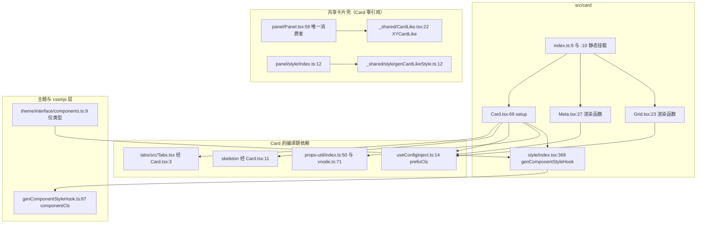
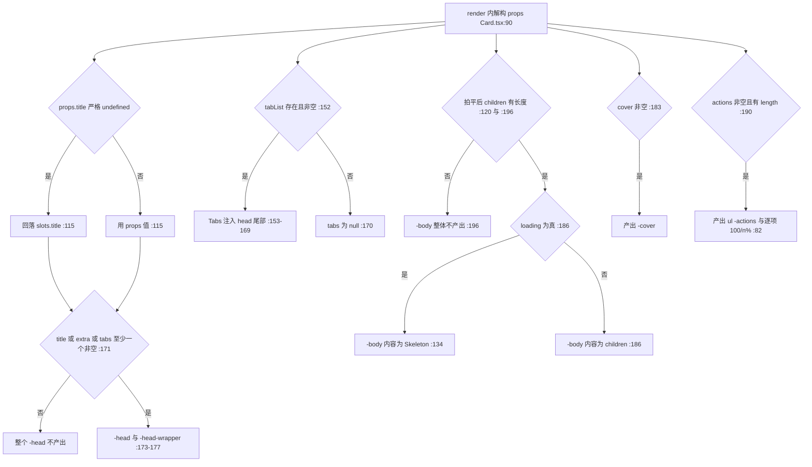
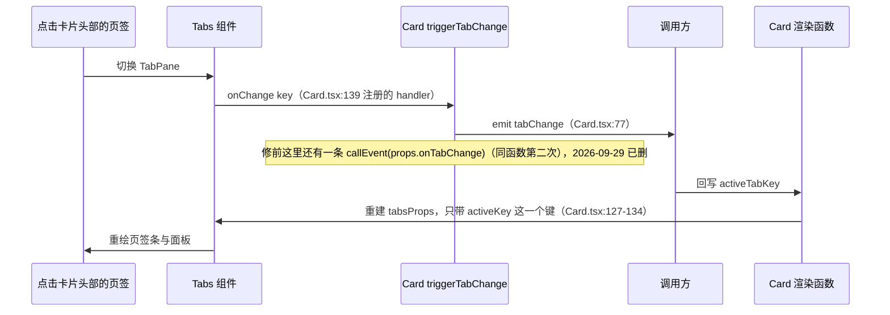

# C02-07 Card 卡片

> **本篇解决**：`<xy-card>` 的 tabs / extra / actions / cover 四类异构内容凭什么按那个次序长出来，`bordered` 与 `hoverable` 的视觉到底来自哪一层 Token，以及 Card、Grid、Meta 三件与 `_shared/CardLike` 之间那条**没接上**的继承线。
> **前置**：A03《Design Token 四层体系》、A05、A06、C02-00《类横写：三代布局》、I09　**读者坐标**：`03-components/02-layout` 第 8/14 篇

## 一、职责与边界

`XYCard`（`packages/xiaoye-ui/src/card/Card.tsx:56`）负责的是**一块带标题的容器面板的装配顺序**：它自己不做栅格、不做滚动、不做浮层，只把调用方给的六类内容——`title` / `extra` / `tabList` / `cover` / 默认内容 / `actions`——按固定次序拼成五层 DOM，并把其中三类映射成可枚举的根类名开关。`XYCardGrid`（`packages/xiaoye-ui/src/card/Grid.tsx:12`）与 `XYCardMeta`（`packages/xiaoye-ui/src/card/Meta.tsx:17`）是它的两个**寄生子件**：两者都不注册自己的样式、不生成自己的 `hashId`，类名前缀也借用 `'card'`（`Grid.tsx:16`、`Meta.tsx:26`），因此它们的外观全部产自 `card/style/index.tsx` 里 Card 的那一棵样式树。

明确**不负责**的事：

- 不负责页签机制本身。`tabList` 只是数据，页签由 `Tabs`（`Card.tsx:3` 导入）与 `TabPane`（`Card.tsx:26` 解构）渲染，页签数组在 `Card.tsx:139-155` 构造，受控与非受控的差别被压缩成一次动态键名选择（`Card.tsx:129`）。页签的 inkBar、滚动、更多下拉都由 tabs 篇（`C03-05`，原文误记为「C03-12 队列内」，那个编号实际是 BackTop）与 `tabs/src/Tabs.tsx` 负责。
- 不负责骨架屏。`loading` 为真时 Card 只是把内容换成 `Skeleton`（`Card.tsx:11` 导入、`Card.tsx:120-124` 构造）， shimmer/`active` 语义全在 skeleton 一侧。
- 不负责栅格间距与响应式。`Grid.tsx:24` 只输出一个 div，`width: 33.33%`（`card/style/index.tsx:82`）是写死的三等分；真正的断点系统属于 C02-00《类横写：三代布局》论点 5 讨论的「JS 拼类名 + CSS 枚举类名」双表结构，本篇不重复展开。
- **不负责、也没有使用 `_shared/CardLike.tsx`**。这一点必须显式纠正：`docs/column/03-components/02-layout/C02-09-collapse-折叠面板.md:13` 写着「`_shared/CardLike.tsx` 被 Card 卡片（C02-07）与 Panel 面板（C02-08）复用」，但 `grep -rn "_shared" packages/xiaoye-ui/src/card | wc -l` 的结果是 0，`grep -rn "CardLike" packages/xiaoye-ui/src/card | wc -l` 同样是 0。Card 是这套 DOM 骨架的**原始实现**，`CardLike.tsx` 是从它移植出去的平行副本，当前唯一消费者是 `panel/Panel.tsx:58`。接缝见论点 6。

**依赖清单**（编译期真实 import，全部来自 `Card.tsx:1-13`）：`tabs`（`Card.tsx:3`）、`_util/vue-types`（`:4`）、`_util/props-util` 的 `flattenChildren`/`isEmptyElement`/`filterEmptyWithUndefined`（`:5` → `_util/props-util/index.ts:50`、`:213`、`:244`）、`config-provider` 的 `SizeType`（`:6` → `config-provider/SizeContext.ts:3`）、`lodash-es/isPlainObject`（`:7`）、`config-provider/hooks/useConfigInject`（`:8` → `useConfigInject.ts:14`）、`vc-util/devWarning`（`:9`）、`./style`（`:10` → `card/style/index.tsx:368`）、`skeleton`（`:11`）、`_util/type` 的 `CustomSlotsType`（`:12`）、`_util/vnode` 的 `customRenderSlot`（`:13` → `_util/vnode.ts:71`）。

**被谁依赖**：源码层面 Card 是**运行时叶子**。`grep -rn "\.\./card\|xiaoye-ui/card" packages/xiaoye-ui/src --include='*.ts' --include='*.tsx'` 排除 `src/card/` 自身后只有 1 条命中——`theme/interface/components.ts:9` 的 `import type { ComponentToken as CardComponentToken } from '../../card/style'`，纯类型引用，不产生运行时代码依赖。也就是说：改 Card 的样式文件不会连累别的组件的 JS，但会让主题层的组件 Token 表（`theme/interface/components.ts:79`）跟着变类型。真正的下游是 `apps/docs/examples/card/` 的 10 个示例（basic、simple、border-less、loading、inner、tabs、meta、grid-card、in-column、flexible-content）与用法手册 `apps/docs/components/card.md`。

## 二、源码地图

`packages/xiaoye-ui/src/card/` 共 6 个文件、783 行；加上接缝处的两个共享文件：

| 文件 | 行数 | 职责 | 关键导出与卡位 |
| --- | --- | --- | --- |
| `card/index.ts` | 26 | 入口、复合组件挂载、三件套注册 | `Card.Meta`（`:9`）、`Card.Grid`（`:10`）、`install`（`:13-18`） |
| `card/Card.tsx` | 204 | 根容器装配与类名探测 | `cardProps`（`:28`）、`CardProps`（`:52`）、`CardTabListType`（`:15`）、`setup`（`:69`） |
| `card/Meta.tsx` | 57 | 图文三元组 | `cardMetaProps`（`:8`）、`CardGridProps`（`:14`，名字写错，见坑 5） |
| `card/Grid.tsx` | 27 | 格位 div 与内部标记 | `cardGridProps`（`:5`）、`__XY_CARD_GRID`（`:13`） |
| `card/style/index.tsx` | 388 | 8 个 `gen*` 函数 + 组件 Token 派生 | `ComponentToken`（`:6`）、`CardToken`（`:8`）、默认 `genComponentStyleHook('Card', …)`（`:368`） |
| `card/index.test.js` | 81 | 4 个 `it`，其中 2 个无断言 | `mountTest(Card)`（`:7`） |
| `_shared/CardLike.tsx` | 112 | Card DOM 骨架的平行移植壳 | `cardLikeProps`（`:7`）、`__XY_CARD_LIKE`（`:25`） |
| `_shared/style/genCardLikeStyle.ts` | 152 | 前缀参数化的卡片外观 | 默认 `genCardLikeStyle`（`:12`） |

注意两处与仓库惯例不一致的实况：样式入口是 `style/index.tsx` 而非 `AGENTS.md` 约定的 `style/index.ts`（`ls packages/xiaoye-ui/src/card/style` 只有一个 `index.tsx`），生成物里也照实登记为 `"./card/style": "./src/card/style/index.tsx"`（`packages/xiaoye-ui/package.json:165`）；组件主文件是 `Card.tsx`，没有 `cardTypes.ts`——props 工厂与类型都住在主文件里（`Card.tsx:28-52`），这与 `button/buttonTypes.ts` 的分文件惯例不同。

三个卡位要点名的行号：主实现入口是 `Card.tsx:69` 的 `setup`，Card 家族共用的样式树在 `card/style/index.tsx:236`（`[componentCls]: {` 开始的根选择器块），装配判定与渲染返回在 `Card.tsx:178-185`。样式侧的 hashId 锚点由 `theme/util/genComponentStyleHook.ts:87` 的 `componentCls = '.' + prefixCls` 与 `_util/cssinjs/hooks/useStyleRegister/index.tsx:95` 的选择器注入共同决定，这是论点 6 的物理基础。

## 三、架构与数据流

### 图 1：静态结构——Card 目录、它的依赖面，以及那条没有接上的 CardLike 分家



这张图要读出的第一件事是**右侧子图是断开的**：`CardLike` 与 `genCardLikeStyle` 没有任何一条来自 `card/` 的入边，Card 与 Panel 是同一套视觉的**两份独立实现**（论点 6 展开）。第二件事是 `Grid`/`Meta` 没有指向 `style/index.tsx` 的边——它们不调 `useStyle`，样式靠 Card 根节点上那个 `hashId` 类名作为祖先锚点命中（`Card.tsx:110`）。第三件事是主题层对 Card 的依赖方向是反的：不是 Card 引 `theme/interface/components.ts`，而是后者引 Card 的样式文件取 `ComponentToken`（`theme/interface/components.ts:9`）。

### 图 2：五层 DOM 的产出判定



判定的顺序不等于渲染的顺序：解构发生在 `Card.tsx:90-105` 一次做完，产出判定分散在 `:150-190`，最后由 `:192-199` 按 head → cover → body → actions 的固定次序拼成一个 div。图中的 `:196` 那条「children 无长度 ⇒ body 整体消失」是全组件唯一的反直觉分支，也是坑 1 的全部原因。

### 图 3：一次页签点击的闭环



闭环里有两条出口（`emit` 与 prop 回调）而不是一条，这是 `Card.tsx:75-78` 的显式设计：`emits: ['tabChange']`（`Card.tsx:68`）让 `<xy-card @tab-change>` 可用，`props.onTabChange` 让 JSX/命令式写法可用，两者**同时触发、互不排斥**，所以调用方如果两个都传就会收到两次通知。第三条入口是受控判定：`activeTabKey !== undefined`（`Card.tsx:133`）决定下一轮给 Tabs 的是 `activeKey` 还是 `defaultActiveKey`，而不是给同一个键传 `undefined`——差别见论点 3。

## 四、核心机制精读

### 论点 1：六类内容的 prop / slot 优先级不是「谁覆盖谁」，而是「解构默认值只在 props 严格 undefined 时点火」

断言：Card 不存在一个统一的「插槽优先」或「props 优先」策略。回落机制完全由 `Card.tsx:89-105` 这一次 render 内的对象解构实现，语义是 JavaScript 解构默认值的语义——**只有 `props.X === undefined` 才会去调 `slots.X?.()`**；调用方显式写 `:title="null"`、`title=""`、`:cover="false"` 时，同名插槽连被读取的机会都没有。

```tsx
// packages/xiaoye-ui/src/card/Card.tsx:89
    return () => {
      const {
        headStyle = {},
        bodyStyle = {},
        loading,
        bordered = true,
        type,
        tabList,
        hoverable,
        activeTabKey,
        defaultActiveTabKey,
        tabBarExtraContent = filterEmptyWithUndefined(slots.tabBarExtraContent?.()),
        title = filterEmptyWithUndefined(slots.title?.()),
        extra = filterEmptyWithUndefined(slots.extra?.()),
        actions = filterEmptyWithUndefined(slots.actions?.()),
        cover = filterEmptyWithUndefined(slots.cover?.()),
      } = props;
      const children = flattenChildren(slots.default?.());
```

逐段拆：

**为什么解构在 render 函数体内而不是 `setup` 顶部。** 提到 `setup` 作用域就只在组件初始化那一轮求值，之后 `props.title` 变了也不会重新读取插槽；写在 `:104` 之后，这五个字段每轮都重新判一次，props 与 slot 的切换才能反映到 DOM。代价是这五行 slot 调用**每轮必执行**、无法短路——插槽函数是否被调用取决于 props 是否为 `undefined`，而不是取决于上轮结果，所以 `<xy-card>` 的 `cover`/`actions` 插槽在任何一次父级重渲染里都会跑一遍。

**回落链的最后一环是 `undefined` 而不是 `[]`。** 五个字段都套了 `filterEmptyWithUndefined`：

```ts
// packages/xiaoye-ui/src/_util/props-util/index.ts:244
export function filterEmptyWithUndefined(children: any[]) {
  if (children) {
    const coms = filterEmpty(children);
    return coms.length ? coms : undefined;
  } else {
    return children;
  }
}
```

没有 `slots.title` 时 `slots.title?.()` 得到 `undefined`，走 `:245` 的假分支、函数没有 `return` → 结果仍是 `undefined`（`:244-251`）；有插槽但内容全是注释节点/空白文本时，`filterEmpty`（`:230-242`）先展开数组与 Fragment、再用 `isEmptyElement`（`:213-220`，判 `Comment`、空 `Fragment`、`trim()` 后为空的 `Text`）过滤，`coms.length` 为 0 → 显式返回 `undefined`（`:247`）。两种「没有内容」最终都归一到同一个值，`:171` 的 head 闸门才能用一句 `title || extra || tabs` 判完。

**props 侧确实没有 default。** `title: PropTypes.any`（`Card.tsx:30`）与 `extra`/`actions`/`cover`/`tabBarExtraContent`（`:31`、`:39`、`:43`、`:46`）都是裸的 `PropTypes.any`，工厂里没有 `default` 键；本库对 vue-types 的覆写只有 `looseBool`、`style`、`VueNode` 三项（`_util/vue-types/index.ts:7-25`），不含 `any`，所以未传时 props 值就是 `undefined`。

**同一个字段被默认了两次，其中一次是死代码。** `bordered` 在工厂里就是 `{ type: Boolean, default: true }`（`Card.tsx:32`），`:108` 又写了一遍 `bordered = true`；`loading`（`:35` 与 `:107`）、`hoverable`（`:36` 与 `:111`）同理。Vue 对带 `default` 的 Boolean prop 会先取 default，因此解构处那三个默认值在正常运行路径上永不触发——它们只在「有人绕过 props 直接调渲染函数」时生效。读代码时把 `:106-111` 当成默认值的权威位置会读错，权威位置是 `:32-36`。

**可识别的插槽名是被声明过的封闭集合。** `slots: Object as CustomSlotsType<{...}>`（`Card.tsx:59-67`）列出 `title`、`extra`、`tabBarExtraContent`、`actions`、`cover`、`customTab`、`default` 七个，`:114-118` 回落的正是前五个加 `:120` 的 `default`；`tabList` 没有对应的回落（它是纯数据 prop，`:40-42`），`headStyle`/`bodyStyle` 也没有（`:33-34`）。结论：Card 的回落是**逐个字段手写的白名单**，新增一个内容位就得在解构里补一行，不存在泛化的机制。

### 论点 2：`-head` 是一个槽位装两段——标题行与页签条共用同一个容器，且页签条被塞在 wrapper 之后

断言：Card 的头部不是「标题区 + 页签区」两个平级节点，而是一个 `-head` 容器内部先放 `-head-wrapper`（标题 + extra）、再把 `Tabs` 整个塞进同一个容器（`Card.tsx:164-174`）。页签存在与否还会反向改变标题行的样式（`card/style/index.tsx:314-320`），这条依赖是单向的：`contain-tabs` 由 `tabList` 决定（`Card.tsx:115`），标题/extra 的存在与否却完全不参与页签的产出条件。

```tsx
// packages/xiaoye-ui/src/card/Card.tsx:136
      let head;
      const tabs =
        tabList && tabList.length ? (
          <Tabs
            {...tabsProps}
            v-slots={{ rightExtra: tabBarExtraContent ? () => tabBarExtraContent : null }}
          >
            {tabList.map(item => {
              const { tab: temp, slots: itemSlots } = item as CardTabListType;
              const name = itemSlots?.tab;
              devWarning(
                !itemSlots,
                'Card',
                `tabList slots is deprecated, Please use \`customTab\` instead.`,
              );
              let tab = temp !== undefined ? temp : slots[name] ? slots[name](item) : null;
              tab = customRenderSlot(slots, 'customTab', item as any, () => [tab]);
              return <TabPane tab={tab} key={item.key} disabled={item.disabled} />;
            })}
          </Tabs>
        ) : null;
```

```tsx
// packages/xiaoye-ui/src/card/Card.tsx:164
      if (title || extra || tabs) {
        head = (
          <div class={`${pre}-head`} style={headStyle}>
            <div class={`${pre}-head-wrapper`}>
              {title && <div class={`${pre}-head-title`}>{title}</div>}
              {extra && <div class={`${pre}-extra`}>{extra}</div>}
            </div>
            {tabs}
          </div>
        );
      }
```

**页签的产出条件与内容无关，只与数组长度有关。** `tabList && tabList.length`（`:152`）——空数组不会产出 `Tabs`，也就不会撑出 `-head`；但 `tabList={[{key:'a'}]}`（缺 `tab` 字段）会照样产出一个空白页签，因为 `:165` 的 `temp` 是 `undefined`、`name` 是 `undefined`、`slots[undefined]` 是 `undefined` → `tab` 落到 `null`，`:166` 再给一次 `customTab` 机会后仍可能是 `[null]`，`TabPane` 照收。

**页签标题的三级优先是「后写覆盖前写」。** `:165` 先算出 `temp`（`item.tab`）或旧式具名插槽 `slots[name](item)`，`:166` 立刻用 `customRenderSlot(slots, 'customTab', item, () => [tab])` 把整个结果重新赋值。`customRenderSlot`（`_util/vnode.ts:71-82`）先以 `item` 为作用域参数调用 `customTab` 插槽，再用 `ensureValidVNode` 判定返回值（`:60` 起，`Comment` 与全空 Fragment 判为无效），无效时才执行 fallback `() => [tab]`。所以真实优先级是 `customTab` 插槽 > `item.tab` > 旧式 `itemSlots.tab` 指向的具名插槽，而 `:160-164` 的 `devWarning` 只在 `itemSlots` 存在时报警（条件写的是 `!itemSlots`）——**旧写法仍可用，只是会多一行 dev 警告**。

**`tabBarExtraContent` 的名字在两层之间是错位的。** Card 把它作为内容塞进 `Tabs` 的 `rightExtra` 插槽（`:155`），而 `Tabs` 一侧已经把这个键的 prop 形态判死：`tabs/src/Tabs.tsx:155-159` 的 `devWarning(!(props.tabBarExtraContent !== undefined), 'Tabs', '`tabBarExtraContent` prop has been removed. Please use `rightExtra` slot instead.')`。Card 走的是插槽而不是 prop，所以不会触发那条警告——但 Card 对外的字段名仍是 `tabBarExtraContent`（`Card.tsx:43`），即**上游已废弃的命名在本层被保留**。想改这个名字属于破坏性变更，见「六、设计取舍」。

**head 的样式后果在另一张表里。** `-head` 的 `display: flex; flexDirection: column`（`card/style/index.tsx:28-31`）加 `minHeight: cardHeadHeight`（`:31`）说明容器天然按纵向堆叠 wrapper 与页签条；而 `:64-74` 用 `[`${rootCls}-tabs-top`]` 给页签条补 `clear: both` 与 `marginBottom: cardHeadTabsMarginBottom`（`:375` 算成 `-padding - lineWidth`，是个**负值**，用来让页签底边和 `-head` 的 `borderBottom`（`:38`）叠成一条线）。`:314-320` 则只在根节点带 `-contain-tabs` 时给标题与 extra 补 `paddingTop: cardHeadPadding`。这三段合起来解释了「有页签的卡片标题为什么会往下挪」——挪的量由根类名决定，不由 props 决定。

### 论点 3：受控与非受控不是靠传 `undefined` 切换，而是靠**换键名**；`onChange` 则同时挂在 emit 与 prop 两条通道上

断言：`Card.tsx:133-141` 用一个计算属性键把 `activeTabKey` / `defaultActiveKey` 二选一塞给 `Tabs`，这是可读性写法而非功能必需；真正有行为后果的是 `Card.tsx:75-78` 的双通道回调——`emit('tabChange')` 与 `props.onTabChange` 会**各调一次同一个函数**，实测触发两次。

```tsx
// packages/xiaoye-ui/src/card/Card.tsx:120
      const loadingBlock = (
        <Skeleton loading active paragraph={{ rows: 4 }} title={false}>
          {children}
        </Skeleton>
      );

      const hasActiveTabKey = activeTabKey !== undefined;
      const tabsProps = {
        size: 'large' as SizeType,
        [hasActiveTabKey ? 'activeKey' : 'defaultActiveKey']: hasActiveTabKey
          ? activeTabKey
          : defaultActiveTabKey,
        onChange: triggerTabChange,
        class: `${pre}-head-tabs`,
      };
```

```tsx
// 修复前快照 · card/Card.tsx 的局部 callEvent（现已随双投修复删除）
    const callEvent = (fn: any, ...args: any[]) => {
      if (Array.isArray(fn)) {
        fn.forEach(f => f?.(...args));
      } else {
        fn?.(...args);
      }
    };
```

```tsx
// packages/xiaoye-ui/src/card/Card.tsx:75
    const triggerTabChange = (key: string) => {
      // emit 已经会调用 vnode 上的 onTabChange，再手工调一次会让调用方每次点击收到两遍
      emit('tabChange', key);
    };
```

**换键名为什么不影响 Tabs 的判定。** `Tabs` 把两个键都交给 `useMergedState`（`tabs/src/Tabs.tsx:204-206`：`value: computed(() => props.activeKey)`、`defaultValue: props.defaultActiveKey`），而 `useMergedState` 的受控判定是**每次访问时重算**的：`let val = value.value !== undefined ? value.value : innerValue.value`（`_util/hooks/useMergedState.ts:26`）。因此「传 `activeKey: undefined`」与「不传这个键」在 Vue 解析后是同一个 `undefined`，行为无差别；`:143` 的三元键名只起「把意图写进对象形状」的作用。反过来说，删掉这个技巧改成两个键都传也不会坏——但 `defaultValue` 只在 `useMergedState.ts:19-21` 的 setup 阶段消费一次，所以**非受控时事后修改 `defaultActiveTabKey` 不会改变已挂载的 Tabs**，这才是这个 prop 的真实语义边界。

**`Tabs` 的 `size` 被硬写死。** `tabsProps.size = 'large'`（`Card.tsx:128`）会盖掉全局尺寸，因为 `useConfigInject` 的规则是「prop 优先于 context」（`config-provider/hooks/useConfigInject.ts:39`：`computed(() => (props.size as SizeType) || sizeContext.value)`）。所以外层套了尺寸 Provider 之后，卡片内的页签条仍是 large，只有卡片自己的类名跟着变（见坑 3）。

**双通道回调的真实次数是 2（2026-09-29 已修为 1）。** `emits: ['tabChange']`（`Card.tsx:68`）使模板写法 `@tab-change="fn"` 编译成 vnode 上的 `onTabChange`；而 `onTabChange` 同时是**声明过的 prop**（`Card.tsx:47-49`）。Vue 的 `emit` 会直接查 vnode 上的 `onXxx` 并调用，修前的 `triggerTabChange` 随后又手动 `callEvent(props.onTabChange, key)` 调一次。当时用只依赖 vue 运行时的最小复现量化过（`setup` 内先 `emit` 再手动调用，SSR 渲染一轮后计数）：

```text
Card 式手动调用 = false -> 回调执行次数 = 1
Card 式手动调用 = true  -> 回调执行次数 = 2
```

（完整脚本与运行目录见本篇「附」的检查点 3，两条输出都是实跑结果。）**修后在真实组件上复测**：点一次页签，`onTabChange` 恰好 1 次，计数断言落在 `packages/xiaoye-ui/src/_util/__tests__/event-dispatch-count.test.tsx`（退回基线会报 `expected ... to be called 1 times, but got 2 times`）。修前仓库里的测试抓不到它：`card/index.test.js:66` 用的是 `expect(onTabChange).toHaveBeenCalledWith('tab2')`，不断言调用次数；被删掉的那份局部 `callEvent` 的数组分支也不在正常路径上——`onTabChange` 的类型只声明单个函数（`:48`），传数组要先吃一条 Vue 的 props 类型警告。

### 论点 4：actions 的等分宽度写在行内、分母取自数组长度，cover 的位移则挂在 bordered 上

断言：`-actions` 的等分**不依赖 CSS**，而是 `Card.tsx:75` 给每个 `<li>` 写死 `width: ${100 / actions.length}%`；`-cover` 的负 margin 却完全由 `-bordered` 类名触发（`card/style/index.tsx:281-289`）。两者都是「装配期算好的几何」，但一个走 JS、一个走 CSS，改出来的症状也完全不同。

```tsx
// packages/xiaoye-ui/src/card/Card.tsx:72
    const getAction = (actions: VNodeTypes[]) => {
      const actionList = actions.map((action, index) =>
        (isVNode(action) && !isEmptyElement(action)) || !isVNode(action) ? (
          <li style={{ width: `${100 / actions.length}%` }} key={`action-${index}`}>
            <span>{action}</span>
          </li>
        ) : null,
      );
      return actionList;
    };
```

**分母与分子可以不等。** 产出条件 `(isVNode(action) && !isEmptyElement(action)) || !isVNode(action)`（`:81`）翻译过来是：空 VNode（注释、空白文本、空 Fragment，判据在 `_util/props-util/index.ts:213-220`）不产出 `<li>`，但**非 VNode 值（含 `null`、`undefined`、`false`、`''`）会产出**一个空的 `<li><span></span></li>`。两种情况下宽度仍是 `100 / actions.length`，于是 `:actions="[icon1, icon2, null]"` 得到三个各占 33.33% 的格子里有一个是纯空格子，而 `-actions > li:not(:last-child)` 的 `borderInlineEnd`（`card/style/index.tsx:153-155`）会让那个空格子右侧多出一条分隔线。走插槽路径时不会有这个问题，因为 `slots.actions?.()` 的结果先过了一遍 `filterEmptyWithUndefined`（`Card.tsx:103`）。

```tsx
// packages/xiaoye-ui/src/card/Card.tsx:169
      const coverDom = cover ? <div class={`${pre}-cover`}>{cover}</div> : null;
      const body = (
        <div class={`${pre}-body`} style={bodyStyle}>
          {loading ? loadingBlock : children}
        </div>
      );
      const actionDom =
        actions && actions.length ? <ul class={`${pre}-actions`}>{getAction(actions)}</ul> : null;
```

**`actions && actions.length` 是数字也能活着的原因。** `:189-190` 的判定对 `actions={11}`（`card/index.test.js:73` 就是这条）取 `(11).length === undefined` → 假 → 不产出 `<ul>`，测试 `index.test.js:79` 断言 `.xy-card-actions` 数量为 0 通过。这是「靠 JS 判类型」而非「靠 props 声明拦」的典型：`actions: PropTypes.any`（`Card.tsx:39`）对任何值都放行。

**body 的产出不看 loading，只看 children。** `:196` 的 `children && children.length ? body : null` 在最终返回值里，`loading` 只影响 body **内部**放什么（`:186`）。于是 `<xy-card loading />` 不给默认内容时，`loadingBlock`（`:134-138`）根本进不了 DOM——`Skeleton` 被构造出来又被丢弃。这是坑 1。

**cover 的两条规则分居两处。** 通用规则在 `card/style/index.tsx:265-274`（`> *` 拉成 `display:block; width:100%`、`img` 补上方圆角），而 `-1` 的位移只在 `-bordered` 块里：

```ts
// packages/xiaoye-ui/src/card/style/index.tsx:281
    [`${componentCls}-bordered`]: {
      border: `${token.lineWidth}px ${token.lineType} ${colorBorderSecondary}`,

      [`${componentCls}-cover`]: {
        marginTop: -1,
        marginInlineStart: -1,
        marginInlineEnd: -1,
      },
    },
```

含义是：封面图要盖住容器 1px 边框的接缝，所以向左、右、上各挪 1px；但这条位移挂在 bordered 类名下，`bordered` 与 `cover` 在产品语义上毫无关系，读 `-cover` 这一段样式（`:265-274`）是看不到它的——只有知道 `:284-288` 存在，才解释得了「去掉边框的卡片封面为什么和容器齐平、带边框的却外扩 1px」。这里的 `-1` 是**字面量**，而同一段的 `border` 宽度用的是 `token.lineWidth`（`:282`）：`lineWidth` 一旦被改成 2px，边框与封面之间就会重新露出 1px 缝。这是坑 7。

### 论点 5：`bordered` 与 `hoverable` 不是「加类名＝加边框」，而是一张类名开关表驱动两条互斥的 Token 分支

断言：Card 的根 `classString`（`Card.tsx:108-119`）是组件唯一的开关表，10 个键；样式端没有任何一条规则是「默认加边框」，边框来自 `-bordered` 块，阴影来自 `:not(-bordered)` 块，两者互斥且都取值于别名 Token。

```tsx
// packages/xiaoye-ui/src/card/Card.tsx:108
      const classString = {
        [`${pre}`]: true,
        [hashId.value]: true,
        [`${pre}-loading`]: loading,
        [`${pre}-bordered`]: bordered,
        [`${pre}-hoverable`]: !!hoverable,
        [`${pre}-contain-grid`]: isContainGrid(children),
        [`${pre}-contain-tabs`]: tabList && tabList.length,
        [`${pre}-${size.value}`]: size.value,
        [`${pre}-type-${type}`]: !!type,
        [`${pre}-rtl`]: direction.value === 'rtl',
      };
```

```ts
// packages/xiaoye-ui/src/card/style/index.tsx:236
    [componentCls]: {
      ...resetComponent(token),

      position: 'relative',
      background: token.colorBgContainer,
      borderRadius: token.borderRadiusLG,

      [`&:not(${componentCls}-bordered)`]: {
        boxShadow,
      },

      [`${componentCls}-head`]: genCardHeadStyle(token),
```

**无边框 ≠ 无视觉。** `:243-245` 用 `&:not(.xy-card-bordered)` 给「没开 bordered 的卡片」加 `boxShadow`（别名 Token，来自 `theme` 的 `boxShadow`），而 `:281-282` 的 `-bordered` 块给开了的加 `border: lineWidth lineType colorBorderSecondary`。所以 `:bordered="false"` 的真实症状不是「变透明」而是「边框换成阴影」，改任何一边都要同时看另一半，否则会出现「无边框又有阴影」的双边框观感。

**`hoverable` 用 `borderColor: transparent` 而不是去掉边框。** `:291-299`：

```ts
// packages/xiaoye-ui/src/card/style/index.tsx:291
    [`${componentCls}-hoverable`]: {
      cursor: 'pointer',
      transition: `box-shadow ${token.motionDurationMid}, border-color ${token.motionDurationMid}`,

      '&:hover': {
        borderColor: 'transparent',
        boxShadow: cardShadow,
      },
    },
```

把边框改成透明色而不是 `border: none`，是为了保住那 1px 的盒模型占位——否则 hover 瞬间整卡尺寸变化、`transition` 也无处生效（`transition` 里同时列了 `box-shadow` 与 `border-color`，两条都是为这个写法服务的）。`cardShadow` 不是原始 Token，而是 `token.boxShadowCard` 的改名（`:370`），这就是「组件级派生 Token」的典型形态：值来自别名层，名字属于 Card。

**`loading` 在样式层几乎什么都不做。** `genCardLoadingStyle`（`:212-222`）只有 `overflow: hidden` 与 `-body { user-select: none }` 两条，骨架的动画与灰块全部由 `Skeleton` 自带（`Card.tsx:120-124`）。`:216` 的 `overflow: hidden` 还有个副作用：配合 `-contain-grid` 时的负 margin（`:307-311`）不会溢出卡片，而 `-contain-grid` 那条规则本身写的正是 `&:not(${componentCls}-loading) ${componentCls}-body`——**loading 态下 grid 卡片的 body 负 margin 被排除**，这是两处样式的接缝。

**`type` 只有一个合法值。** `CardType = 'inner'`（`Card.tsx:23`）→ 类名 `xy-card-type-inner`（`:131`）→ 规则 `:322` 转发到 `genCardTypeInnerStyle`（`:192-209`），内部把 `-head` 的背景换成 `colorFillAlter`（`:198`）并压缩标题字号与 body 内边距（`:201-206`）。`!!type` 的开关写法意味着任何字符串都会生成 `-type-<x>` 类名，只是没有对应规则。

**同名开关 `hoverable` 在家族里默认值相反。** Card 是 `{ type: Boolean, default: false }`（`Card.tsx:36`），Grid 是 `{ type: Boolean, default: true }`（`Grid.tsx:7`），生成的类名也不同（`xy-card-hoverable` vs `xy-card-grid-hoverable`，`Grid.tsx:20`），后者规则在 `card/style/index.tsx:95-99`（hover 时 `position: relative; z-index: 1` 加 `cardShadow`）。同一个词在两个文件里默认值不同，是把 Card 的 props 直接透传给 Grid 时最容易踩的不对称。

**`-contain-grid` 与 `-contain-tabs` 是探测值，不是 props。** `isContainGrid`（`Card.tsx:79-87`）遍历**拍平后的默认插槽**，判据是 `isPlainObject(element.type) && element.type.__XY_CARD_GRID`——标记写在 `Grid.tsx:13`。三点推论：其一，`flattenChildren`（`_util/props-util/index.ts:50`）只展开数组与 Fragment，所以把 `<xy-card-grid>` 包进任意一个 `<div>` 里就探测不到，根类名不出、`display: flex; flex-wrap: wrap`（`style:301-305`）也就不会加，卡片退化成普通堆叠；其二，`isPlainObject(element.type)` 意味着函数式/HOC 包装出来的 Grid（type 是 function）不算 Grid；其三，`-contain-tabs` 的判据是 `tabList && tabList.length`（`:129`），所以它是**真值判断而数组长度是数字**，`tabList` 为空数组时该键的值是 `0`，Vue 的类名对象会把它当假值跳过——恰好正确，但依赖的是「0 是 falsy」而不是显式转换。

### 论点 6：Card / Grid / Meta 的「继承」是共享前缀 + 单棵样式树；`_shared/CardLike` 是被 Panel 单走的平行副本

断言：三件套之间没有任何组件级继承机制（没有 mixin、没有 `extends`、没有 provide/inject），它们的关系是**同一个 `prefixCls` 命名空间 + 只有 Card 注册样式**；而 `_shared/CardLike.tsx` 把这套 DOM 骨架第二次实现了一遍，Card 一行都没用它。

```tsx
// packages/xiaoye-ui/src/card/Grid.tsx:15
  setup(props, { slots }) {
    const { prefixCls } = useConfigInject('card', props);
    const classNames = computed(() => {
      return {
        [`${prefixCls.value}-grid`]: true,
        [`${prefixCls.value}-grid-hoverable`]: props.hoverable,
      };
    });
    return () => {
      return <div class={classNames.value}>{slots.default?.()}</div>;
    };
  },
```

**Grid 里没有 `useStyle`、没有 `hashId`。** `Grid.tsx:1-3` 只导入 `vue` 与 `useConfigInject`，`Meta.tsx:3-6` 同样没有样式导入；两者传入 `useConfigInject` 的名字都是字符串 `'card'`（`Grid.tsx:16`、`Meta.tsx:26`，Card 自己在 `Card.tsx:70`）。于是 `-grid`、`-meta` 的规则只能在 Card 那棵样式树里找到（`card/style/index.tsx:263` 与 `:278`）。

**为什么少了 hashId 还能命中样式。** `genComponentStyleHook` 把 `componentCls` 拼成带点的 `.xy-card`（`theme/util/genComponentStyleHook.ts:87`），`useStyleRegister` 在展开对象时只对**最外层选择器**注入 hash 类名（`_util/cssinjs/hooks/useStyleRegister/index.tsx:203-209` 判定 `root || injectHash`，子层以 `root: nextRoot`（false）递归下去），注入位置由 `injectSelectorHash` 决定（`:95`，`hashPriority === 'low'` 时写成 `:where(.hash)`，否则直接 `.hash`，见 `:79-85`）。所以一条 grid 规则的最终形状是「hash 类名贴着 `.xy-card`，`.xy-card-grid` 在后代的位子上」——锚点是**卡片根元素**，正是 `Card.tsx:110` 那个 `[hashId.value]: true`。结论有两条：Grid/Meta 必须待在带 `hashId` 的 Card 内部才有样式；而 Card 之外单独渲染 Grid 会拿到一个裸 `div`。

**CardLike 是「无样式壳」，所以 hashId 只能进 props。**

```tsx
// packages/xiaoye-ui/src/_shared/CardLike.tsx:38
    const prefix = computed(() => `xy-${props.component}`);

    const showTitle = computed(() => props.title || slots.title);
    const showHeader = computed(
      () =>
        slots.header || showTitle.value || slots['header-actions'] || props.extra || slots.extra,
    );

    const componentClasses = computed(() => {
      const p = prefix.value;

      return [
        p,
        props.hashId,
        {
          [`${p}-bordered`]: props.bordered,
          [`${p}-loading`]: props.loading,
          [`${p}-hoverable`]: props.hoverable,
          [`${p}-collapsed`]: props.collapsed,
          [props.class as string]: props.class,
        },
      ];
    });
```

`prefix` 由 `component` 参数拼出（`:38`，取值域只有 `'card' | 'panel'`，见 `:8`），`hashId` 由调用方注入（`:15` 声明、`:51` 落到类名数组），样式则来自调用方自己的 hook——Panel 侧是 `panel/Panel.tsx:25` 取 `useStyle(prefixCls)`、`:65` 把 `hashId.value` 传下去。这是共享壳必须付出的设计代价：**壳不能自己决定 Token 命名空间**，否则 `xy-card` 与 `xy-panel` 两套 Component Token 就没法分开。代价的另一面是 `bordered`/`hoverable`/`loading` 三个类名开关在 Card 与 CardLike 里各写了一遍（`Card.tsx:111-113` 与 `CardLike.tsx:53-55`）。

**两副骨架已经分叉。** 逐项对照：CardLike 的头部容器叫 `-header`（`:65`）而 Card 叫 `-head`（`Card.tsx:159`）；CardLike 无条件产出 body（`:88-102`，靠 `display: none` 折叠 collapsed，`:89`），Card 按 children 长度决定产不产出（`Card.tsx:182`）；CardLike 的 loading 是三块自绘灰条（`:94-98`），Card 的 loading 是 `Skeleton` 组件；CardLike 的 actions 直接吐插槽、等分交给 CSS（`:106-108` + `_shared/style/genCardLikeStyle.ts:120-128` 的 `> li { flex: 1 }`），Card 的 actions 用行内 `100/n%`（`Card.tsx:75`）；CardLike 的 `title`/`extra` 类型是 `String`（`:9-10`），装不下 VNode，Card 用 `PropTypes.any`（`Card.tsx:30-31`）；CardLike 的 body 带 `role="region"`（`:91`），Card 的 body 没有任何 ARIA 属性（`Card.tsx:177-181`）。

**`genCardLikeStyle` 的注释交代了它的血统与两处技术债。** 文件头三段注释（`_shared/style/genCardLikeStyle.ts:3-10`）说明它是 `_shared/style/card-like.less` 的 `.card-like()` mixin 迁移产物、暗色模式「交由 ConfigProvider darkAlgorithm 改 token 值，无需 `[data-theme='dark']` 覆盖」（`:7`，与 A03《Design Token 四层体系》的暗色结论同源），以及一个必须**带点 key** 的历史 bug 修复（`:9-10`，配合 `panel/style/index.ts:13` 的 `cardLike[componentCls]` 取值——`componentCls` 带点，所以返回对象的 key 也必须带点）。它与 Card 自己的样式树在 RTL 上已经不等价：`genCardLikeStyle.ts:128` 用物理属性 `borderRight`，而 Card 用逻辑属性 `borderInlineEnd`（`card/style/index.tsx:154`）并额外提供 `-rtl` 类（`:326-328` + `Card.tsx:118`）；`genCardLikeStyle` 全程没有 `direction` 参与。同理，它的边框宽度写死 `1px`（`:40`、`:57`、`:108`、`:118`），不吃 `lineWidth`。Panel 侧的完整后果归 C02-08《Panel 面板》，本篇只登记接缝位置。

## 五、对外契约如何生效

**attrs 通道是手写的，不是继承来的。** `inheritAttrs: false`（`Card.tsx:57`）关掉自动落根，返回值自己展开：`<div {...attrs} class={[classString, attrs.class]}>`（`Card.tsx:179`）。这里 `class` 必须显式合并——`{...attrs}` 已经把调用方的 `class` 带进来了，后写的 `class` 键覆盖它，若不写成数组就丢掉整张开关表。`style` 没做这种处理，直接随展开落到根元素；组件级样式入口只有两个：`headStyle`（`:173`）与 `bodyStyle`（`:185`），两者都以 `= {}` 解构兜底（`:105-106`）。所以 `<xy-card style="width:300px">` 生效、`<xy-card bodyStyle=...>` 只到 `-body` 一层，二者不在同一个元素上。

**context 通道产出三个类名。** `useConfigInject('card', props)`（`Card.tsx:70`）返回的 `prefixCls`/`direction`/`size` 全部只用于拼类名：`prefixCls` 定命名空间（`:121` 的 `pre`，实现在 `config-provider/hooks/useConfigInject.ts:14`，规则是 `props.prefixCls` 优先于全局前缀）、`direction` 只贡献一个 `-rtl`（`:132`）、`size` 拼成 `-<size>`（`:130`）。方向性的真正工作由样式里的逻辑属性完成：`borderInlineEnd`（`card/style/index.tsx:154`）、`marginInlineStart: 'auto'`（`:251`，extra 靠它顶到行尾）、`marginTop/marginInlineStart/marginInlineEnd`（`:285-287`）。`-rtl` 类只提供 `direction: rtl` 一条（`:326-328`）。这套「逻辑属性为主、rtl 类为辅」的结构在 `_shared/style/genCardLikeStyle.ts` 那一份里是不成立的（论点 6 末段）。

**事件通道曾经有两条，且没有实例方法。** `emits: ['tabChange']`（`Card.tsx:68`）与 `props.onTabChange`（`:47-49`）并存，修前的 `triggerTabChange`（现 `:82-85`）同时走 `emit` 与 `callEvent`，实测叠加为两次调用（论点 3，**2026-09-29 已改成只 `emit`**）。另外 `setup(props, { slots, attrs, emit })`（`:69`）没有取 `expose`，全文件也没有 `expose`/`defineExpose` 调用——**Card 家族对外不提供任何实例方法**，`ref` 只能拿到默认代理。这与根 `AGENTS.md` 的组件模板（示例里有 `expose({ focus, blur })`）不同；需要程序化切页签的调用方只能自己受控 `activeTabKey`（`:44`）。

**类型契约只覆盖三分之一。** `card/index.ts:7` 只转发 `CardProps` 一个类型，`cardGridProps`（`Grid.tsx:5`）、`cardMetaProps`（`Meta.tsx:8`）以及 `Meta.tsx:14` 那个名字写错的 `CardGridProps` 都不在出口上；组件值有三条出口路径——静态属性 `Card.Meta`/`Card.Grid`（`index.ts:9-10`）、具名 `CardMeta`/`CardGrid`（`:20`）、默认导出带 Plugin 类型断言（`:22-26`）。注册侧 `install` 把三件分别交给 `registerComponent`（`index.ts:13-17`），标签名由 `toXYTagName` 从 `XYCard`/`XYCardMeta`/`XYCardGrid` 派生（`_util/registerComponent.ts:6-11`），因此 `xy-card-meta`、`xy-card-grid` 在运行期确实可用；但 `typings/global.d.ts` 的 `GlobalComponents` 只登记了 `XYCard`（`typings/global.d.ts:17`，全文件不含 `CardMeta`/`CardGrid` 字样）——模板类型检查与运行期注册在这里是脱节的（坑 6）。

**样式副作用入口是生成物给的，不是组件给的。** `src/components.ts` 对 card 输出三行：`export * from './card'`（`:52`）、`export { default as Card } from './card'`（`:53`）、`import './card/style'`（`:54`）；子入口登记为 `"./card/style": "./src/card/style/index.tsx"`（`packages/xiaoye-ui/package.json:165`）。第三行是**只导出 hook 的模块的副作用导入**（`card/style/index.tsx:368` 的默认导出），它本身不注入 CSS；真正注入发生在渲染时 `useStyle(prefixCls)`（`Card.tsx:71`）走到 `useStyleRegister`，SSR 场景再由 `wrapSSR(...)`（`:192`）把样式串到输出里。这条导入存在的意义是让聚合入口与 `./card/style` 子入口指向同一模块，静态样式抽取正是从聚合入口把整棵树拉起来的（`_util/static-style-extract/index.tsx:2` 的 `import * as xiaoyeUI from '../../components'`）。这三行都是 `pnpm gen:entries` 的生成物，手写会触发 `check:entries` 漂移。

## 六、设计取舍

**取舍一：不复用 `_shared/CardLike`，代价是同一套外观存在两份真相。** 被放弃的路是「Card 改成 `<CardLike component="card">`」，走通的只有 Panel（`panel/Panel.tsx:58`）。从代码上能读出的障碍是三条硬差异：`CardLike` 的 `title`/`extra` 只接受 `String`（`_shared/CardLike.tsx:9-10`），而 Card 要装 VNode（`Card.tsx:30-31`）；`CardLike` 没有页签概念，装不下 `tabList → Tabs` 的注入与 `-head-tabs`（`Card.tsx:133`）、`-contain-tabs`（`:129`）这两处联动；`CardLike` 的 actions 等分靠 CSS（`genCardLikeStyle.ts:121`），Card 靠行内宽度（`Card.tsx:75`）。要把壳抬到能覆盖这三条，就得让壳长出「内容类型放宽 + 可选页签槽 + 两种等分策略」的条件分支，而这正是 Card 自己 `:103-199` 已经在做的事。收益是零改动风险；赔上的是 `bordered`/`hoverable`/`loading` 三个类名开关与整套 Token 分支被写了两遍（`card/style/index.tsx:243-299` 与 `genCardLikeStyle.ts:39-53`），并且两份已经不等价——RTL、`lineWidth`、body 产出条件三处都是分叉点。**这个代价目前没有人记账**：`_shared/CardLike.tsx` 与 `genCardLikeStyle.ts` 都没有指向 `card/` 的注释，反之亦然。

**取舍二：actions 的等分放在 JS 而不是 CSS。** 现成反例就在同仓：`genCardLikeStyle.ts:120-121` 用 `> li { flex: 1 }`，而 `-actions` 本身已经是 `display: flex`（`card/style/index.tsx:113`），所以 Card 的行内 `width: 100/n%`（`Card.tsx:75`）在这个布局下是多余的。保留它的收益只可能是「与上游实现形状一致，便于对照」——本仓没有留下这条写法的注释或测试依据，`card/index.test.js` 的 4 个 `it` 里没有任何一条断言宽度。
> ⚠️ 未在源码中找到对应实现，此处为待核实推断。

赔上的是把数组长度变成了几何参数：`props.actions` 路径不做过滤（`:117` 的过滤只作用于插槽回落），于是 `null` 项照样占一份宽度（论点 4）。想把这条改对，正确做法是删掉行内宽度、在样式里补 `& > li { flex: 1 1 0 }`，但要先确认没有文档示例在覆盖 `.xy-card-actions > li` 的宽度。

**取舍三：Card 直接值引用重组件，换取简单 API。** `import Tabs from '../tabs'`（`Card.tsx:3`）与 `import Skeleton from '../skeleton'`（`:11`）都是值引用而非 `import type`，意味着 `xy-card` 的产物必然把页签子系统与骨架子系统一起拉进来，而 `tabList` 与 `loading` 都是低频路径（示例里只有 `apps/docs/examples/card/tabs.vue`、`loading.vue` 用到）。替代方案是把页签槽开放成插槽（调用方自己传 `<xy-tabs>`）或运行期解析组件名，代价是 `tabList`/`activeTabKey`/`onTabChange` 三个对外字段作废。本库选择了「API 稳定优先」，把 tree-shaking 损失留给包层处理。这里也是 Card 在源码里唯一的非叶子性来源——除 `theme/interface/components.ts:9` 的类型引用外，没人引它，但它引了两个子系统。

**取舍四：`size` 字段同时承载组件语义与全局语义。** `CardSize = 'default' | 'small'`（`Card.tsx:24`）与全局 `SizeType = 'small' | 'middle' | 'large' | undefined`（`config-provider/SizeContext.ts:3`）是两个不相交的联合，`useConfigInject.ts:39` 用一句 `(props.size as SizeType) || sizeContext.value` 把它们对齐，`Card.tsx:116` 再无条件拼成 `-<size>`。省下来的是一行专用合并逻辑（家族里 `Grid`/`Meta` 完全不管 size），赔上的是「产出无规则类名」的通道（坑 3）：样式端只枚举了 `-small`（`card/style/index.tsx:337`）。这与 C02-00《类横写：三代布局》论点 5 讲的「JS 拼类名 + CSS 枚举类名两张表必须同源」是同一个病根，本组件的解法是**没有解法**。

**取舍五：Card 不声明对外的 Component Token。** `export interface ComponentToken {}`（`card/style/index.tsx:6`）是空表，被主题层原样登记为 `Card?: CardComponentToken`（`theme/interface/components.ts:9`、`:83`）。9 个卡片专属量（`cardShadow`…`cardPaddingSM`）全部声明在文件内部的 `CardToken`（`:8-18`）并在 `mergeToken` 里现算（`:369-379`）。收益是不会出现「文档承诺了某个组件 Token、实现却不认」的错位；赔上是 `theme.components.Card` 这条路对卡片内边距、头高、动作条高度**完全无效**（坑 4）。至于「A03《Design Token 四层体系》登记的 `getDefaultToken`/`convertLegacyToken.ts` 一类为工具链预留却无工具链的残留」，本篇不重述，只指出 Card 的 `getDefaultToken` 位置同样是空的——`genComponentStyleHook('Card', token => …)` 只传了两个参数（`:368`），第三参数缺省（形参声明在 `theme/util/genComponentStyleHook.ts:43-45`）。

## 七、坑与改动指南

**坑 1：只写 `loading` 不给内容，骨架屏根本不出现。** 触发：`<xy-card loading :tab-list="list" />` 或任何「先占位、内容后到」的写法，默认插槽为空。症状：卡片只剩头部与一片空白，没有 shimmer。原因：骨架只塞进 `body`（`Card.tsx:179`），而 `body` 的产出条件是**拍平后 children 有长度**（`:196`），`loading` 完全不参与该判定；`loadingBlock`（`:134-138`）每轮都被构造再丢弃。定位：`card/Card.tsx:182` 对照 `:184-188`；样式侧 `card/style/index.tsx:212-222` 也只给了 `overflow: hidden` 与 `user-select: none`，没有任何「loading 时保留 body」的补偿。**该分支无测试保护**：`card/index.test.js:19` 那条例题写着 loading 相关，但整个用例只 `mount` 不 `expect`。

**坑 2：`actions` 数组里有 `null`，多出一个空格子和一条分隔线。** 触发：`const actions = cond ? [i1, i2] : [i1, null]` 之类的命令式拼装（插槽路径不会有这问题）。症状：动作条最后一格是空的，且中间多出一条竖分隔线，宽度也不是二分之一而是三分之一。原因：`getAction` 的产出条件 `(!isVNode(action)) || …` 会把非 VNode 值照样渲染成 `<li>`（`Card.tsx:73-79`），而等分宽度按**过滤前的数组长度**算（`:82`）；分隔线来自 `& > li:not(:last-child) { borderInlineEnd }`（`card/style/index.tsx:153-155`）。定位：`card/Card.tsx:74-75`。规避：走 `#actions` 插槽（`:117` 的 `filterEmptyWithUndefined` 会把空节点清掉，`_util/props-util/index.ts:244-251`）。

**坑 3：`size="default"` 与全局尺寸对 Card 不产生任何视觉差。** 触发：写 `size="default"`，或把卡片套进提供 `middle`/`large` 的尺寸上下文。症状：DOM 上多出 `xy-card-default`/`xy-card-middle` 类名但什么都不变；带页签的卡片页签条仍是 large。原因：类名由 `[`${pre}-${size.value}`]` 无条件拼出（`Card.tsx:116`），`size.value` 又是 `props.size || sizeContext`（`config-provider/hooks/useConfigInject.ts:39`）且被 `as SizeType` 抹平了类型差异（`SizeType` 与 `CardSize` 不相交，见 `config-provider/SizeContext.ts:3` 与 `Card.tsx:24`），而样式只枚举了 `-small`（`card/style/index.tsx:337-353`）；页签的 large 来自 `tabsProps.size = 'large'` 硬写（`Card.tsx:128`）。定位：`Card.tsx:116` + `card/style/index.tsx:337`。这类「产出但零样式规则的类名」与 `OUTLINE.md` 已知待办第 5 项登记的那批残留同属一类。

**坑 4：`theme.components.Card` 改不动卡片内边距。** 触发：想按项目微调 `cardPaddingBase`/`cardHeadHeight`。症状：类型上根本不让你写，写了也没视觉变化。原因：Card 的对外 `ComponentToken` 是空接口（`card/style/index.tsx:6`），主题层照它登记为 `Card?: CardComponentToken`（`theme/interface/components.ts:9`、`:83`）；9 个卡片专属量在样式末尾由 `mergeToken` **就地派生**（`card/style/index.tsx:369-379`），而 `merge` 的语义是后写覆盖先写（`theme/util/statistic.ts:20-30`，`objs.forEach` + `defineProperty`），所以外层 `token.value[component]` 先合进去（`theme/util/genComponentStyleHook.ts:85`）也会被这轮派生盖回。定位：`card/style/index.tsx:6` 与 `:369-379`。可行替代：覆写别名 Token（`paddingLG` 影响 `cardPaddingBase`、`fontSizeLG`/`lineHeightLG` 影响 `cardHeadHeight`，见 `:371-374`），或用稳定类名写局部 CSS。

**坑 5：`Meta` 导出的类型叫 `CardGridProps`。** 触发：想 `import type { CardMetaProps }`。症状：类型不存在，且 `import type { CardGridProps } from 'xiaoye-ui/card/Meta'` 拿到的「Grid 类型」字段其实是 Meta 的（`title`/`description`/`avatar`）。原因：`Meta.tsx:14` 的 `export type CardGridProps = …` 是从 `Grid.tsx:9` 复制时漏改的名字，全仓 `CardMetaProps` 出现次数为 0。定位：`card/Meta.tsx:14` 对照 `card/Grid.tsx:9`。因为 `card/index.ts:7` 只转发 `CardProps`，两个同名类型没有进聚合入口，所以**不会**触发 `components.ts` 的歧义名定主（A02 主题），这也是这个笔误能活到今天的原因。

**坑 6：`<xy-card-meta>` 运行期能用、类型层没登记。** 触发：全局注册后在模板里写 `xy-card-meta`/`xy-card-grid` 并跑 `vue-tsc`。症状：IDE/类型检查报未知组件，或 `GlobalComponents` 补全里没有它。原因：`install` 把三件都交给 `registerComponent`（`card/index.ts:13-17`），标签名由 `XYCardMeta`/`XYCardGrid` 派生（`_util/registerComponent.ts:6-11`），但生成物 `typings/global.d.ts` 只列了 `XYCard`（`typings/global.d.ts:17`），全文件不含 `CardMeta`/`CardGrid`。定位：`card/index.ts:13-18` 与 `typings/global.d.ts:17`。改法要落在生成器（`packages/xiaoye-ui/scripts/`），不是手改 `global.d.ts`——那是禁止编辑的生成物（见根 `AGENTS.md`）。

**坑 7：把 `lineWidth` 调大，封面与边框之间露缝。** 触发：`theme.token.lineWidth = 2`（打印/高对比度需求）。症状：带 `cover` 且 `bordered` 的卡片，封面上沿与左右各露出一条 2px 底色。原因：边框宽度取 Token（`card/style/index.tsx:282`），封面位移却是**写死的 `-1`**（`:285-287`），两者不同源。对照同一文件里 `-contain-grid` 的负 margin 用的是 `-token.lineWidth`（`:308-309`）——同一个仓库两种写法并存。定位：`card/style/index.tsx:284-288`。

**坑 8：Grid 想换列数或把卡片重排，flex 不生效。** 触发：给 `#default` 套一层 `<div>` 包裹 Grid，或想让格位变 4 列。症状：卡片退化成普通竖排，或 `grid-template-columns` 改了没用。原因：`-contain-grid` 由 `isContainGrid` 探测**拍平后的一层**子 vnode 得出（`Card.tsx:79-87` 与 `:128`），`flattenChildren` 只展开数组与 Fragment（`_util/props-util/index.ts:50-70`），多包一层就探测不到；`flex-wrap` 也确实只写在 `-contain-grid` 里（`card/style/index.tsx:301-305`）。列数方面，`width: 33.33%` 是字面量（`:82`），且格子的四条线是用 5 段 `box-shadow` 拼出来的（`:86-92`），不是 `border`——所以既不吃 `lineWidth`，也不能靠 `gap`。定位：`card/style/index.tsx:82`、`:86-92`、`:301-311`，以及标记本身 `card/Grid.tsx:13`。

**坑 9：`@tab-change` 的回调一次点击跑两遍（2026-09-29 已修）。** 触发：`<xy-card :tab-list="list" @tab-change="fn">`，且 `fn` 里有副作用（埋点、请求、写 store）。症状：重复埋点/重复请求。原因：`emits: ['tabChange']`（`Card.tsx:68`）使 `emit('tabChange', key)` 就已经调到 vnode 上的 `onTabChange`，修前紧接着又 `callEvent(props.onTabChange, key)` 手动调一次。现状：`triggerTabChange` 只剩 `emit`（`card/Card.tsx:75-78`），计数断言在 `src/_util/__tests__/event-dispatch-count.test.tsx`（修前实测 2 次、修后 1 次）。仓库原有的 `card/index.test.js:66` 用 `toHaveBeenCalledWith`，不含次数断言，所以它当时照不出来——**新增事件键时别再往回加第二条通道**。附 检查点 3 给了可跑的复现脚本。

**坑 10：`xy-card-head-tabs` 是一条产出但零规则的死类名。** 触发：想通过 `.xy-card-head-tabs` 覆盖页签条样式。症状：改了没反应。原因：类名在 `Card.tsx:133` 通过 `tabsProps.class` 落到 `Tabs` 根元素上，但整棵样式树里没有任何规则引用它——真正生效的是 `card/style/index.tsx:64-74` 那条 `[`${rootCls}-tabs-top`]`（按 `xy-tabs-top` 匹配）。定位：全仓 `grep -rn "head-tabs" packages/xiaoye-ui/src --include='*.ts' --include='*.tsx'` 只有两处命中：`card/Card.tsx:133` 与本问题无关的 `theme/convertLegacyToken.ts:749`。想覆盖请用 `.xy-card-head .xy-tabs-top`。

**坑 11（接缝，不归本篇修）：`genCardLikeStyle` 里两条规则抢同一个类名。** 触发：Panel 处于 loading 态。症状：整块面板的根元素被拉成纵向 flex 并带上 gap。原因：`_shared/style/genCardLikeStyle.ts:53` 的 `&-loading`（编译成 `.{p}-loading`，`overflow: hidden`）与 `:131` 的 `[`.${prefixCls}-loading`]`（同一个类名，`display: flex; flexDirection: column`）都命中根元素，而 `CardLike.tsx:54` 给根、`:94` 给内层各写了一次同名类。Card 侧没有这个问题，因为 Card 的 loading 类只在根上（`Card.tsx:111`）且样式端只有一条 `-loading`（`card/style/index.tsx:324`）。定位：`_shared/style/genCardLikeStyle.ts:53` 与 `:131`。完整后果与修法归 C02-08《Panel 面板》。

**测试现状。** Card 只有一个测试文件 `packages/xiaoye-ui/src/card/index.test.js`（81 行、4 个 `it`、文件内 2 个 `expect`），它会被执行——`packages/xiaoye-ui/vitest.config.mts:33` 的 include 含 `src/**/*.test.{js,ts,jsx,tsx}`。四条里只有两条真设防：`:66` 的 `onTabChange` 参数断言与 `:79` 的 `actions` 为数字时不产出 `<ul>`；`:15-25` 与 `:27-37` 两条例题分别关于「loading 时的 padding」与「标题垂直对齐」，却只 `mount` 不 `expect`（`wrapper` 变量未被使用），也就是说坑 1 与「head 对齐」这两条历史上出过问题的路径**现在没有任何回归保护**。另有 `mountTest(Card)`（`:7`）贡献一个 `expect`，但它来自共享文件 `tests/shared/mountTest.js:17`，且只渲染空卡片（`:10`）——恰好是坑 1 的那条路径，只验「不抛异常」。全仓没有任何其他测试文件导入 Card（`grep -rn "from '.*card'" packages/xiaoye-ui/src --include='*.test.*'` 为空），`src/tabs/index.test.js:5` 里的 `editable-card` 是 Tabs 自己的 type 值，与本组件无关。

**改动安全边界。** 可以动的：`Card.tsx:72-94` 的三个内部函数（`getAction`/`triggerTabChange`/`isContainGrid`）、`card/style/index.tsx` 的 8 个 `gen*` 函数（`:23`、`:79`、`:104`、`:161`、`:192`、`:212`、`:225`、`:333`）、`:369-379` 的 token 派生表。**谨慎动**的：`:122-133` 的类名表（每一项都可能被外部覆盖样式依赖，删一项就是删一种覆盖钩子）、`:140-148` 的 `tabsProps`（改受控口径要同步 I13 的 `useMergedState` 语义）、`:150-199` 的产出条件（`:196` 这行是可见行为的一部分：空卡片不产出 `-body`，改动会同时影响「空态是否占位」）。**禁止单改**的：`_shared/style/genCardLikeStyle.ts` —— 它是 Panel 唯一的外观来源（`panel/style/index.ts:12`），且函数签名靠「传不带点的字符串、返回带点的 key」这个约定工作（`_shared/style/genCardLikeStyle.ts:12`、`:32` 与 `panel/style/index.ts:13`），改 key 形态会静默拿到 `{}`；`Grid.tsx:13` 的 `__XY_CARD_GRID` 也不能改名或删，它是 Card 探测 Grid 的唯一凭据（`Card.tsx:82` 唯一读点）。改动后的验证命令：

```bash
pnpm --filter xiaoye-ui test:unit
pnpm typecheck
node docs/column/tools/verify-refs.mjs --excerpt docs/column/03-components/02-layout/C02-07-card-卡片.md
```

## 附：本篇可证伪的三个检查点

1. **Card 目录对 `_shared` 的引用为零。** 命令：`cd /Users/xiaoye/Desktop/publish/xiaoye-ui-vue && grep -rn "_shared\|CardLike" packages/xiaoye-ui/src/card/ | wc -l`，期望输出 `0`。这条否掉 `03-components/02-layout/C02-09-collapse-折叠面板.md:13` 的「CardLike 被 Card 复用」说法，也支撑一、职责与边界与论点 6 的「两份平行实现」结论。
2. **`xy-card-head-tabs` 没有任何样式规则。** 命令：`cd /Users/xiaoye/Desktop/publish/xiaoye-ui-vue && grep -rn "head-tabs" packages/xiaoye-ui/src --include='*.ts' --include='*.tsx'`，期望恰好 2 行命中（`card/Card.tsx:133` 的类名产出、`theme/convertLegacyToken.ts:749` 的遗留 Token 表项），且两行都不是 CSS 选择器。支撑坑 10。
3. **`emit` 与声明式 `onTabChange` 叠加导致回调执行两次。** 命令（只依赖 `vue` 运行时，在 `packages/xiaoye-ui` 目录下跑）：

   ```bash
   cd packages/xiaoye-ui && node --input-type=module -e "
   import { defineComponent, h, createSSRApp } from 'vue';
   const sr = await import('vue/server-renderer');
   let n = 0;
   const mk = manual => defineComponent({
     props: { onTabChange: { type: Function } },
     emits: ['tabChange'],
     setup(props, { emit }) {
       emit('tabChange', 'k');
       if (manual && typeof props.onTabChange === 'function') props.onTabChange('k');
       return () => h('div');
     },
   });
   const Parent = c => defineComponent({ setup() { return () => h(c, { onTabChange: () => { n++; } }); } });
   for (const manual of [false, true]) {
     n = 0;
     await sr.renderToString(createSSRApp(Parent(mk(manual))));
     console.log('Card 式手动调用 =', manual, '-> 回调执行次数 =', n);
   }
   "
   ```

   期望输出 `Card 式手动调用 = false -> 回调执行次数 = 1` 与 `= true -> 回调执行次数 = 2`。第一行证明 `emits` + 同名 prop 已经会触发一次，第二行证明 `Card.tsx:91` 的那次手动调用是净增。支撑论点 3 与坑 9。
