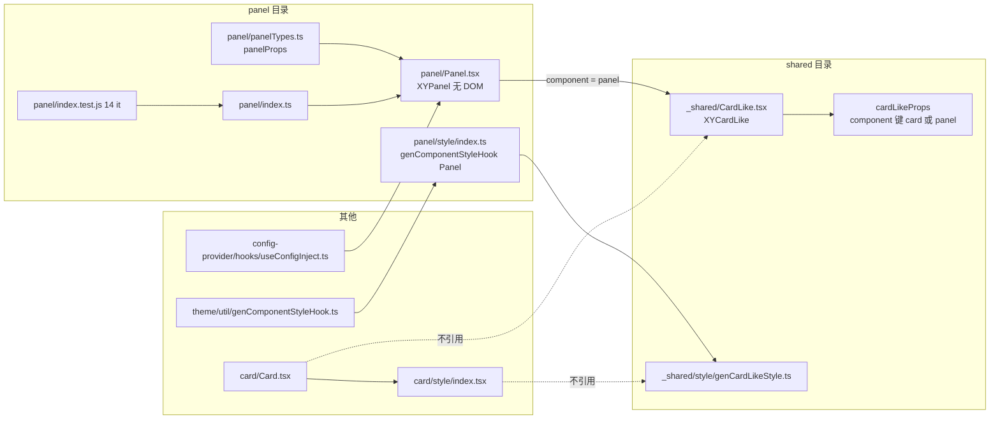
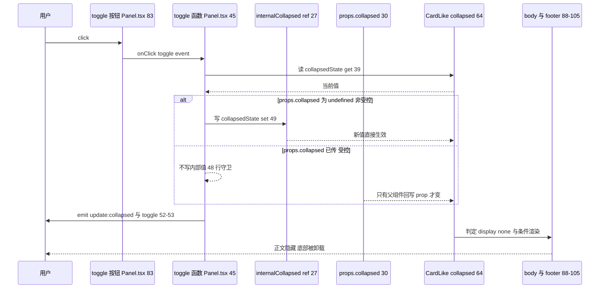
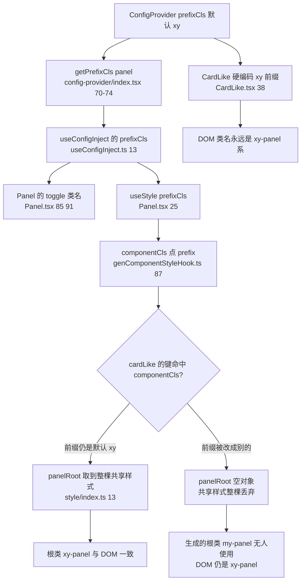

# C02-08 Panel 面板

> **本篇解决**：Panel 为什么没有一行自己的 DOM——它的类名、样式与折叠状态分别由谁产出，以及改 `_shared/CardLike` 或 `panel/style/index.ts` 里的哪一行会让 Panel 的整体外观塌掉。
> **前置**：C02-07 Card 卡片、C02-00 布局类横写篇、C02-09 Collapse 折叠面板　**读者坐标**：`03-components/02-layout` 第 8 篇

## 一、职责与边界

Panel 是「带标题条的卡片容器」的第二个实例：它自己**不产出任何 DOM**，把渲染整体委托给 `_shared/CardLike.tsx`（`packages/xiaoye-ui/src/panel/Panel.tsx:58`），只负责三件事——折叠状态的持有与切换（`Panel.tsx:27-54`）、折叠按钮及其箭头图标（`Panel.tsx:85-107`）、把 `header`/`title`/`icons`/`footer` 四个业务槽位翻译成 CardLike 的 `title`/`header-actions`/`footer` 三个内部槽位（`Panel.tsx:71-112`）。

明确**不负责**的：边框、圆角、头部/正文/底部间距、骨架屏、悬停阴影——这些全部来自 `genCardLikeStyle`（`packages/xiaoye-ui/src/_shared/style/genCardLikeStyle.ts:12-153`），Panel 的样式文件只往里合并两条 toggle 规则（`packages/xiaoye-ui/src/panel/style/index.ts:19-50`）。折叠动画也不负责：Panel 的正文折叠是内联 `display: none`（`CardLike.tsx:101`），没有走仓库里那套 `collapseMotion`（见 C02-09 Collapse 折叠面板）。

依赖清单（被谁依赖 / 依赖谁）：

- **依赖**：`_shared/CardLike`（`Panel.tsx:3`）、`_shared/style/genCardLikeStyle`（`panel/style/index.ts:3`）、`useConfigInject`（`Panel.tsx:6`）、`genComponentStyleHook`（`panel/style/index.ts:2`）、`initDefaultProps`（`Panel.tsx:5`）。
- **被依赖**：全仓没有任何组件 import Panel——`grep -rn "from '../panel'" packages/xiaoye-ui/src` 只命中聚合入口 `packages/xiaoye-ui/src/components.ts:238-240`。它是叶子组件。
- **反向事实**：`CardLike` 的唯一消费者也是 Panel（`grep -rn "CardLike" packages/xiaoye-ui/src` 命中除 `_shared/` 自身外只有 `panel/Panel.tsx:3`、`panel/Panel.tsx:58` 与 `panel/panelTypes.ts:12` 的注释）。Card 不用它，见 C02-07 论点 6。这条反向事实是本篇多数结论的地基。

## 二、源码地图

| 文件 | 行数 | 职责 | 关键导出 |
| --- | --- | --- | --- |
| `packages/xiaoye-ui/src/panel/index.ts` | 14 | 入口、`install`、`panelProps` 再导出 | `Panel`、`panelProps`、`PanelProps` |
| `packages/xiaoye-ui/src/panel/Panel.tsx` | 114 | 主实现（无 DOM，只做状态与槽位翻译） | `XYPanel`；主渲染起点 `Panel.tsx:56` |
| `packages/xiaoye-ui/src/panel/panelTypes.ts` | 19 | Props 定义 | `panelProps`（`panelTypes.ts:4-15`） |
| `packages/xiaoye-ui/src/panel/style/index.ts` | 53 | 组件样式 hook | `useStyle`（`style/index.ts:10`） |
| `packages/xiaoye-ui/src/panel/index.test.js` | 174 | 14 条 `it` + `mountTest` | 唯一测试文件 |
| `packages/xiaoye-ui/src/_shared/CardLike.tsx` | 112 | 共享 DOM 骨架（Panel 的全部输出） | `XYCardLike`、`cardLikeProps`（`CardLike.tsx:7-18`） |
| `packages/xiaoye-ui/src/_shared/style/genCardLikeStyle.ts` | 152 | 共享样式表（card/panel 名义上复用） | 默认导出函数（`genCardLikeStyle.ts:12`） |

对照参考：Card 侧的等价文件是 `packages/xiaoye-ui/src/card/Card.tsx`（204 行）与 `packages/xiaoye-ui/src/card/style/index.tsx`（388 行，**扩展名是 `.tsx`**，本仓 macOS 大小写不敏感但 `index.ts` 与 `index.tsx` 是两个不同文件，grep 时容易踩空）。

测试入口口径：按 `packages/xiaoye-ui/vitest.config.mts:33` 的 glob，`panel/index.test.js`（`.js` 后缀）确实在跑，`pnpm --filter xiaoye-ui test:unit panel` 可复现。


## 三、架构与数据流

### 图 1：静态结构——Panel 的全部产出都经过 CardLike，而 Card 走的是另一条独立链路



图里两条虚线是本篇的关键事实：`Card` 既不用 `CardLike` 也不用 `genCardLikeStyle`（`grep -rn "CardLike" packages/xiaoye-ui/src --include='*.tsx'` 的业务层命中只有 `panel/Panel.tsx:3` 与 `:58`；`genCardLikeStyle` 的调用点只有 `panel/style/index.ts:12`）。也就是说 `genCardLikeStyle.ts:4` 那句注释「共享卡片样式（card / panel 复用）」中，「card 复用」半句在源码里不成立；`cardLikeProps` 的 `component: 'card' | 'panel'`（`CardLike.tsx:8`）里 `'card'` 是**从未被传入的一档**，默认值 `'card'` 也从未生效，因为 Panel 每次都显式传 `'panel'`（`Panel.tsx:62`）。

### 图 2：一次折叠点击的闭环（受控与非受控在同一个 if 处分岔）



分岔条件在 `Panel.tsx:48`（`props.collapsed === undefined`），而不是常见的「传了 `undefined` 就切回非受控」。`emit('update:collapsed')`（`Panel.tsx:52`）在两条分支上都**无条件触发**，这与仓库标准的 `useMergedState` 不同——后者的 `onChange` 有值变守卫（`packages/xiaoye-ui/src/_util/hooks/useMergedState.ts:36`）。

### 图 3：类名与样式的双前缀来源，以及那张查表的落空分支



这张图解释了本篇最重的一个坑：DOM 类名有**两个互不相干的前缀来源**——CardLike 侧的字面量 `xy-`（`CardLike.tsx:38`）与 Panel 侧的 context 前缀（`Panel.tsx:24`）；样式侧又有第三个来源——`genCardLikeStyle('xy-panel', token)` 的硬编码入参（`panel/style/index.ts:12`）。默认配置下三者巧合对齐，一旦 `prefixCls` 被改写，图右侧的两条落空分支同时点火。

## 四、核心机制精读

### 论点 1：Panel 的 render 里没有一行 DOM——它是「状态持有 + 槽位翻译」层，而被翻译进去的 CardLike 只有它一个客户

`packages/xiaoye-ui/src/panel/Panel.tsx:56-73`

```tsx
    return () =>
      wrapSSR(
        <CardLike
          component="panel"
          title={props.title}
          bordered={props.bordered}
          loading={props.loading}
          hoverable={props.hoverable}
          collapsed={collapsedState.value}
          hashId={hashId.value}
          class={props.class}
          style={props.style}
        >
          {{
            title: () =>
```

三点读法：

1. `Panel.tsx:56` 的 `return` 就是整个组件的渲染输出，`Panel.tsx:58` 到 `:111` 是唯一的 JSX。文件里没有 `<div>`、没有 `classes` computed、没有 `expose`（对比 `AGENTS.md` 的组件模板，Panel 连 `focus/blur` 都不暴露）。所有类名——`.xy-panel`、`.xy-panel-header`、`.xy-panel-body`、`.xy-panel-footer`——都在 `_shared/CardLike.tsx` 里拼出来（`CardLike.tsx:46-60` 与 `CardLike.tsx:63-108`）。
2. `Panel.tsx:62` 显式写 `component="panel"`。这个 prop 的类型是 `'card' | 'panel'`，默认值 `'card'`（`CardLike.tsx:8`），而 `'card'` 一档在仓库里**从未被传入**：`grep -rn "CardLike" packages/xiaoye-ui/src --include='*.ts' --include='*.tsx'` 排除 `_shared/` 自身后只剩 `panel/Panel.tsx:3`、`panel/Panel.tsx:58`、`panel/panelTypes.ts:12`（注释）。也就是说 `prefix = 'xy-card'` 这条分支（`CardLike.tsx:38`）是死分支，Card 侧完全没接上——这条分家的来龙去脉由 C02-07 论点 6 论证，本篇不重复。
3. `Panel.tsx:66` 把 `hashId` 当普通字符串 prop 传下去，由 CardLike 拼进根节点类数组（`CardLike.tsx:51`）。CardLike 自己**不调用** `useStyle`（整个文件没有 `useStyle` 导入，见 `CardLike.tsx:1-5` 的 import 段），因此它没有任何自有样式，样式责任完全在调用方——这就是为什么下一节的 `panel/style/index.ts` 必须把共享样式树整个吃进来。

被翻译层挡在门外的东西，就是 CardLike 里的死分支。`_shared/CardLike.tsx` 的渲染段里带类名的容器除根节点外共 11 个，Panel 够不到其中 3 个：

`packages/xiaoye-ui/src/_shared/CardLike.tsx:76-99`

```tsx
        {showHeader.value && (
          <div class={`${prefix.value}-header`}>
            {slots.header ? (
              slots.header()
            ) : (
              <div class={`${prefix.value}-head-wrapper`}>
                {showTitle.value && (
                  <div class={`${prefix.value}-head-title`}>
                    {slots.title ? slots.title() : props.title}
                  </div>
                )}
                {slots['header-actions'] && (
                  <div class={`${prefix.value}-head-actions`}>{slots['header-actions']()}</div>
                )}
                {(props.extra || slots.extra) && (
                  <div class={`${prefix.value}-extra`}>
                    {slots.extra ? slots.extra() : props.extra}
                  </div>
                )}
              </div>
            )}
          </div>
        )}
        {slots.cover && <div class={`${prefix.value}-cover`}>{slots.cover()}</div>}
```

- `slots.header`（`CardLike.tsx:74`）：Panel 传给 CardLike 的槽位对象只有 `title`、`header-actions`、`footer`、`default` 四个键（`Panel.tsx:71-112`），没有 `header` 键，所以「整块头部替换」这条分支在 Panel 路径上不可达。
- `props.extra || slots.extra`（`CardLike.tsx:86`）：`extra` 既不在 `panelProps` 里（`panelTypes.ts:4-15`），也不在 Panel 的槽位声明里（`Panel.tsx:15-21`），不可达。
- `slots.cover`（`CardLike.tsx:99`）与 `slots.actions`（`CardLike.tsx:114`）：同样不在 Panel 的槽位对象里，不可达。

不可达的 DOM 分支连带不可达的 CSS：`genCardLikeStyle` 为它们生成了 `.xy-panel-cover`（`genCardLikeStyle.ts:90-100`）、`.xy-panel-actions`（`:112-129`）、`.xy-panel-extra`（`:84-88`）三组规则，但 Panel 永远渲染不出这三个类名。文档站那个名字最骗人的示例 `apps/docs/examples/panel/with-actions.vue:4` 用的其实是 `#icons`，全文件没有一个 action 元素。`_shared/CardLike.tsx` 不是公开入口：`packages/xiaoye-ui/package.json` 的 `exports` 里没有 `_shared` 子路径（`grep -n "_shared" packages/xiaoye-ui/package.json` 零命中），所以外部使用者也无法自己构造这些分支——这些规则在 Panel 这一侧是确定的死 CSS。

### 论点 2：Panel 的类名前缀有三个互不相干的来源，其中一个是字面量——所以样式合并是一次「拿运行时键去查字面量表」

`packages/xiaoye-ui/src/panel/style/index.ts:7-19`

```ts
// 修复源项目 bug：
// 1) 去掉第三参数 'xy-panel'，让 genComponentStyleHook('Panel') 自动推导 componentCls = '.xy-panel'
// 2) genCardLikeStyle 现在返回带点 key（'.xy-panel'），与 componentCls 一致，cardLike[componentCls] 能取到值
export default genComponentStyleHook('Panel', token => {
  const { componentCls, colorTextSecondary, colorText } = token;
  const cardLike = genCardLikeStyle('xy-panel', token);
  const panelRoot = (cardLike[componentCls] || {}) as CSSObject;

  return {
    [componentCls]: {
      ...panelRoot,

      '&-toggle-button': {
```

逐段读：

- `style/index.ts:12` 的入参 `'xy-panel'` 是**字符串字面量**，写死的。`genCardLikeStyle` 用它拼出返回对象的唯一键 `` `.${prefixCls}` ``（`genCardLikeStyle.ts:34`），即 `'.xy-panel'`。
- `style/index.ts:13` 用 `componentCls` 去查这张表，查不到就 `|| {}`。而 `componentCls` 不是字面量：它是 `` `.${prefixCls.value}` ``（`packages/xiaoye-ui/src/theme/util/genComponentStyleHook.ts:87`），那个 `prefixCls` 来自 `useStyle(prefixCls)` 的入参（`packages/xiaoye-ui/src/panel/Panel.tsx:25`），最终来自 `configProvider.getPrefixCls('panel', props.prefixCls)`（`packages/xiaoye-ui/src/config-provider/hooks/useConfigInject.ts:13`），而 `getPrefixCls` 会读 ConfigProvider 的 `prefixCls` prop（`packages/xiaoye-ui/src/config-provider/index.tsx:70-74`，默认 `'xy'`）。
- 结论是一句可以机械判定的话：**只要根前缀不是 `xy`，`cardLike[componentCls]` 必落空**，`panelRoot` 退化成 `{}`，Panel 的样式输出就只剩 `style/index.ts:19-50` 这两条 toggle 规则。背景色、边框、圆角、`padding`、头部下边线、骨架块全部消失。
- 更糟的是 DOM 并不会跟着改名：CardLike 的类名前缀是第三套来源——模板字符串 `` `xy-${props.component}` ``（`packages/xiaoye-ui/src/_shared/CardLike.tsx:38`），完全绕开 `useConfigInject`。于是自定义前缀下同时发生两件事：生成的规则挂在一个 DOM 上都不存在的根类下，而 DOM 上的 `.xy-panel-header` 一批类名永远匹配不到任何规则。连 `genCommonStyle` 的 `[class^="…"]` 属性选择器也跟着错位（`packages/xiaoye-ui/src/style/index.ts:108`，它用的是运行时前缀）。
- 讽刺的是这个组件已经被同族 bug 咬过一次：`style/index.ts:7-9` 与 `genCardLikeStyle.ts:9-10` 两处注释记录的都是「键不带点 / 带了参数所以查不到」。修的是**点号**，没修**字面量**——同一个查表表达式的另一半风险还在原地。

对照 Card 侧的写法可以看到标准做法：Card 的样式树直接用 `componentCls` 生成，键与 DOM 同源，换前缀只是整体改名，不会掉样式（这条由 C02-07 论点 6 详述）。Panel 的合并方式是「调用一个自己拼键的函数，再用另一个来源的键去查」，这是结构问题，不是笔误。

### 论点 3：「有没有头部」的判据被 Panel 自己写死了——它无条件提供槽位函数，于是空标题面板也渲染一条带下边线的空白头部

断言：CardLike 判定头部用的是**槽位函数是否存在**，而不是槽位是否产出内容；Panel 又是无条件提供这两个函数的，因此 `showHeader` 恒真。

`packages/xiaoye-ui/src/panel/Panel.tsx:72-82`

```tsx
          {{
            title: () =>
              slots.header || slots.title || props.title ? (
                slots.header ? (
                  slots.header()
                ) : (
                  <>{slots.title ? slots.title() : props.title}</>
                )
              ) : undefined,
            'header-actions': () =>
              slots.icons || props.toggleable ? (
```

`packages/xiaoye-ui/src/_shared/CardLike.tsx:40-44`

```tsx
    const showTitle = computed(() => props.title || slots.title);
    const showHeader = computed(
      () =>
        slots.header || showTitle.value || slots['header-actions'] || props.extra || slots.extra,
    );
```

读法：

- `Panel.tsx:73` 与 `Panel.tsx:81` 是**对象字面量的两个键**，无论用户有没有传 `title`、`header`、`icons`，也无论 `toggleable` 真假，这两个键的值始终是一个函数。函数本身恒为真值——`CardLike.tsx:40` 的 `props.title || slots.title` 因此恒真，`CardLike.tsx:41-44` 的 `showHeader` 也恒真。
- 于是 `<xy-panel>正文</xy-panel>` 这种「只要一个框，不要标题」的写法，实际渲染出 `CardLike.tsx:76-97` 的整棵头部结构：`.xy-panel-header` → `.xy-panel-head-wrapper` → 空的 `.xy-panel-head-title` 与空的 `.xy-panel-head-actions`。两个内层函数各自的三元守卫（`Panel.tsx:74` 与 `:79`）只决定**内容**是否为 `undefined`，决定不了**容器**是否渲染。
- 空白不等于看不见：`genCardLikeStyle.ts:55-59` 给 `-header` 上了 `padding: ${paddingMD}px ${paddingLG}px` 和 `border-bottom: 1px solid ${colorBorder}`，`:61-66` 给 `-head-wrapper` 上了 `display:flex` 与 `gap`。所以这条空头部是一条有实际高度、有分隔线的灰线带，正文被它往下推。
- 同一个槽位对象里，`footer` 却是**条件传函数**的——`Panel.tsx:111` 写的是 `footer: slots.footer ? () => slots.footer?.() : undefined`，配合 `CardLike.tsx:111` 的 `slots.footer &&` 才真正做到了「没传就没这个节点」。同一个文件、同一个对象字面量里两种写法并存，`title`/`header-actions` 那一半是漏掉了这层保护。
- 测试面（两种方法交叉核过）：`packages/xiaoye-ui/src/panel/index.test.js` 共 15 个用例（`npx vitest run src/panel/index.test.js` 输出 `Tests 15 passed`，其中 14 个 `it(` 加 `index.test.js:6` 的 `mountTest`），**没有一条**断言「不传 title 时 `-header` 不存在」。`:52-62` 与 `:121-132` 反而都在断言 `-head-title` 里有内容。也就是说这个空白头部是当前测试口径下的既成事实，改动它不会有任何测试报警，也不会有任何测试保护。

### 论点 4：同一个 `collapsed` 开关在同一个文件里对应两套相反的 DOM 策略——正文隐藏不卸载，底部直接卸载；而根节点的 `-collapsed` 类没有任何规则

`packages/xiaoye-ui/src/_shared/CardLike.tsx:96-116`

```tsx
        <div
          style={{ display: props.collapsed ? 'none' : undefined }}
          class={`${prefix.value}-body`}
          role="region"
        >
          {props.loading ? (
            <div class={`${prefix.value}-loading`}>
              {[1, 2, 3].map(i => (
                <div key={i} class={`${prefix.value}-loading-block`} />
              ))}
            </div>
          ) : (
            slots.default?.()
          )}
        </div>
        {slots.footer && !props.collapsed && (
          <div class={`${prefix.value}-footer`}>{slots.footer()}</div>
        )}
        {slots.actions && !props.collapsed && (
          <ul class={`${prefix.value}-actions`}>{slots.actions()}</ul>
        )}
```

三套互不一致的「消失」语义挤在同一段渲染里：

- **正文**：`CardLike.tsx:101` 用内联 `display: none`。节点常驻 DOM，子组件不卸载，表单值、滚动位置、页签激活键都活着；但 `display:none` 也无法用 CSS 过渡高度（高度从内容值直接跳到 0），所以 Panel 的折叠是**瞬时跳变**。`packages/xiaoye-ui/src/panel/` 与 `packages/xiaoye-ui/src/_shared/` 两个目录里 `grep -rn "collapseMotion" 与 "Transition"` 零命中——仓库那套折叠动效（`_util/collapseMotion.tsx`）Panel 一点没用，动画只有箭头自己在转（`panel/style/index.ts:45-49` 的 `transition: transform 0.3s` 配 `rotate(-90deg)`）。折叠动画该怎么做，见 C02-09 论点 3。
- **底部**：`CardLike.tsx:111` 是 JSX 条件渲染，折叠即卸载。于是「折叠一个带表单底部的面板」会把底部子组件销毁重建，而正文里的表单却完好——同一个动作对用户的状态造成两种后果。这条不对称被测试固定住了：`panel/index.test.js:142-143` 一次断言 `display` 是 `none`，一次断言 `.xy-panel-footer` 的 `exists()` 为 `false`。
- **骨架**：`CardLike.tsx:101` 的 `props.loading` 又换成第三种做法——`slots.default?.()` 根本不参与渲染（三元的另一支），正文**被卸载**。所以 `loading` 与 `collapsed` 对正文的处理正好相反：一个隐藏保留，一个替换销毁。文档站的 `apps/docs/examples/panel/with-actions.vue:23` 那句「这段内容不会显示，因为面板处于加载状态」描述的正是这里，但它不是「不显示」，是「不存在」。另外 `loading` 与 `collapsed` 同时为真时，骨架块会在 `display:none` 的容器里照样生成三份（`CardLike.tsx:103-105`），白跑一次渲染。
- **死类名**：根节点会挂上 `${p}-collapsed`（`CardLike.tsx:56`），但 `grep -c "collapsed" packages/xiaoye-ui/src/_shared/style/genCardLikeStyle.ts` 输出 `0`——这份共享样式表里根本没有 `-collapsed` 规则；`panel/style/index.ts` 里唯一一条 `'&-collapsed'`（`:47`）嵌在 `'&-toggle-icon'` 之下（`:42-50`），编译出来是 `.xy-panel-toggle-icon-collapsed`，跟根类无关。结论：`.xy-panel-collapsed` 是一个**只被断言、从未被样式化**的类名（`panel/index.test.js:77` 就断言了它的存在），使用者想靠它写覆盖样式时得不到任何库内钩子；反过来，把它当作「库已经处理过折叠态」的信号来读会读错。
- **无障碍**：`CardLike.tsx:99` 的 `role="region"` 是一个地标（landmark），按规范需要可访问名；而 `-head-title` 那个容器从未生成 `id`（`CardLike.tsx:78-82`），Panel 也没有 `aria-labelledby` 或 `aria-label`（`Panel.tsx:85-107` 里唯一的 ARIA 属性是按钮上的 `aria-expanded`，`:86`），也没有用仓库里的 `useId`（`packages/xiaoye-ui/src/_util/hooks/useId.ts` 存在，panel 与 _shared 两目录 grep 零命中）。折叠起来的正文只是视觉隐藏，语义上仍是一个无名地标。

### 论点 5：受控判定靠一个必须为 `undefined` 的默认值，而整套状态是手写的——它比仓库标准的 `useMergedState` 少了三道保护

`packages/xiaoye-ui/src/panel/Panel.tsx:27-54`

```tsx
    const internalCollapsed = ref(props.collapsed ?? false);

    watch(
      () => props.collapsed,
      value => {
        if (value !== undefined) {
          internalCollapsed.value = value;
        }
      },
    );

    const collapsedState = computed({
      get: () => internalCollapsed.value,
      set: value => {
        internalCollapsed.value = value;
      },
    });

    const toggle = (event: Event) => {
      const next = !collapsedState.value;

      if (props.collapsed === undefined) {
        collapsedState.value = next;
      }

      emit('update:collapsed', next);
      emit('toggle', { originalEvent: event, value: next });
    };
```

- **判据本身**：受控与否由 `props.collapsed === undefined` 单点决定（`Panel.tsx:48`）。这个 `undefined` 不是自然产生的：`collapsed` 声明为 `booleanType(undefined)`（`packages/xiaoye-ui/src/panel/panelTypes.ts:11`），而 `booleanType` 的返回体恒定写出 `default` 键，即便传入 `undefined`（`packages/xiaoye-ui/src/_util/type.ts:58-60`）。Vue 对布尔 prop 的缺省转换只在「没有 `default` 键」时把缺席值转成 `false`，所以这里的缺席能保持 `undefined`。`initDefaultProps(panelProps(), {})`（`Panel.tsx:14`）帮不上忙也帮不了倒忙——传入的默认值对象是空的，`initDefaultProps` 的循环体一次都不会执行（`packages/xiaoye-ui/src/_util/props-util/initDefaultProps.ts:17-30`）。**依据的这条 Vue 规则不在本仓源码里**，但它的后果在本仓可测：`panel/index.test.js:64-81` 那条不传 `collapsed` 的用例点击后确实切换了 `display`，说明缺席值当前确实是 `undefined`；一旦有人把 `panelTypes.ts:11` 改写成 `collapsed: Boolean` 这类不带 `default` 键的形式，缺席就会变成 `false`，`Panel.tsx:48` 的守卫恒假，非受控模式整体失效（按钮仍在、事件仍发、UI 永不动），而 `:64-81` 用例会当场红。
- **少的三道保护**，对照仓库标准实现 `useMergedState`：
  1. 无值变守卫。`useMergedState` 的 `onChange` 只在 `toRaw(mergedValue) !== newValue` 时才回调（`packages/xiaoye-ui/src/_util/hooks/useMergedState.ts:36`），Panel 的两个 `emit`（`Panel.tsx:52-53`）在受控分支上也**每次都触发**。父组件若绑了 `@toggle` 做埋点或请求，受控且不回写的场景下每点一次就发一次，值却始终不变。
  2. 无回落路径。`useMergedState` 用 `watch(value, …)` 把外部值整体同步回 inner（含 `undefined`，`useMergedState.ts:42-44`），Panel 的 watcher 显式跳过 `undefined`（`Panel.tsx:31-35`）。从受控切回不传值时，Panel 停在最后一次收到的受控值上，而不是交还内部状态。
  3. 无 `defaultValue` 通道。`useMergedState` 的第二个参数支持 `defaultValue`（`useMergedState.ts:7` 与 `:19-21`），Panel 的 props 里根本没有 `defaultCollapsed`（`panelTypes.ts:4-15`）。这直接封死了一个常见需求：**想以折叠态初始、之后交给用户自己开关**——传 `:collapsed="true"` 就永久进入受控（`Panel.tsx:48` 从此恒假），不传就没有初始折叠。
- **`collapsedState` 是一层空壳**：它的 `get` 与 `set` 都只是转发 `internalCollapsed`（`Panel.tsx:38-43`），既没有 `postState` 加工也没有派生。删掉它、直接读写 ref，行为完全等价；留着它的代价是多一个可写 computed 和一处「状态到底存了几份」的阅读歧义。仓库里同一角色的标准名字是 `mergedValue`（`useMergedState.ts:24`）。
- **Card 的对照**：Card 的页签受控用的是「换键名」策略——`activeTabKey` 与 `defaultActiveTabKey` 两个键并存（`packages/xiaoye-ui/src/card/Card.tsx:44-45`，判定在 `card/Card.tsx:133`），Panel 用的是「传不传值」策略，只有一根独苗 `collapsed`（`panelTypes.ts:11`）。这条差异由 C02-07 论点 3 详述，本篇不重复。

### 论点 6：`class` 被当成对象键用，`$attrs` 被两层 `inheritAttrs: false` 全部丢掉——Panel 只承认 `class` 与 `style` 两个透传通道

`packages/xiaoye-ui/src/_shared/CardLike.tsx:46-63`

```tsx
    const componentClasses = computed(() => {
      const p = prefix.value;

      return [
        p,
        props.hashId,
        {
          [`${p}-bordered`]: props.bordered,
          [`${p}-loading`]: props.loading,
          [`${p}-hoverable`]: props.hoverable,
          [`${p}-collapsed`]: props.collapsed,
          [props.class as string]: props.class,
        },
      ];
    });

    return () => (
      <div class={componentClasses.value} style={props.style}>
```

- **`class` 走的是对象键位**（`CardLike.tsx:57`）。Vue 的类名归一化对对象取的是**键名**，键值是开关；把外部的 `class` 值直接当键用，于是：字符串形式 `class="a b"` 恰好可用（键就是 `"a b"`，拼出来仍是两个类）；数组形式 `:class="['a','b']"` 会被强转成字符串 `"a,b"` 当键，产出一个含逗号的单个类名 token；对象形式 `:class="{a: true}"` 被强转成 `"[object Object]"`。也就是说 Panel 的自定义类名通道只支持字符串写法，而 `class` prop 的声明方式是 `anyType(undefined)`（`packages/xiaoye-ui/src/panel/panelTypes.ts:13`），`anyType` 连 `type` 键都不写（`packages/xiaoye-ui/src/_util/type.ts:66-67`）——因此任何形状都能通过，运行期一条警告都不会有。标准写法是把它作为数组元素直接放进类数组，而不是当键。
- **`attrs` 没有落点**。Panel 声明 `inheritAttrs: false`（`packages/xiaoye-ui/src/panel/Panel.tsx:12`），渲染时只把 `props.class`、`props.style` 两个显式 prop 交给 CardLike（`Panel.tsx:66-67`），从不展开 `attrs`——`Panel.tsx:23` 的 `setup(props, { slots, emit })` 里连 `attrs` 都没有解构出来。CardLike 同样 `inheritAttrs: false`（`CardLike.tsx:24`），根节点只绑 `class` 与 `style`（`CardLike.tsx:63`）。两层叠加的结果：写在 `<xy-panel>` 上的 `id`、`data-*`、`role`、`tabindex`，以及任何未在 `emits` 里声明的事件监听（`Panel.tsx:22` 只声明了 `update:collapsed` 与 `toggle`）都既不会落到根节点，也不会落到任何子节点，**静默消失**。
- 反过来说，`class`/`style` 之所以还能用，是因为它们被**声明成了 prop**（`panelTypes.ts:13-14`），从而被排除在 `attrs` 之外、走 props 通道进到 `CardLike.tsx:57` 与 `:63`。这两行注释也写明了意图：「透传给 CardLike 的 class/style（保留源项目模式）」（`panelTypes.ts:12`）。于是形成一个易碎的约定：**Panel 的透传白名单只有两个名字**，第三个想加必须同时改 `panelTypes.ts`、`Panel.tsx` 的 CardLike 调用与 `CardLike.tsx` 的 props 三处，漏一处就退回静默丢弃。
- `style` 比 `class` 幸运：`props.style` 原样绑到根节点（`CardLike.tsx:63`），文档站的示例正是靠它把面板撑宽（`apps/docs/examples/panel/with-actions.vue:3`）。
- 测试面：`panel/index.test.js` 的 15 个用例里没有任何一条传过 `class`、`style` 或额外属性（`grep -c "class:" panel/index.test.js` 输出 `0`），论点 6 的两条行为都没有测试保护。

### 论点 7：`loading` 一开，根节点就变成纵向 flex 容器——共享样式表里两种写类名的方言在 `-loading` 上撞成同一个选择器

`packages/xiaoye-ui/src/_shared/style/genCardLikeStyle.ts:51-59`

```ts
      '&-loading': {
        overflow: 'hidden',
      },

      [`.${prefixCls}-header`]: {
        padding: `${paddingMD}px ${paddingLG}px`,
        borderBottom: `1px solid ${colorBorder}`,
        borderRadius: `${borderRadiusLG}px ${borderRadiusLG}px 0 0`,
      },
```

`packages/xiaoye-ui/src/_shared/style/genCardLikeStyle.ts:131-149`

```ts
      [`.${prefixCls}-loading`]: {
        display: 'flex',
        flexDirection: 'column',
        gap: `${paddingSM}px`,
      },

      [`.${prefixCls}-loading-block`]: {
        height: `${fontSize}px`,
        background: colorBgLayout,
        borderRadius: borderRadiusSM,

        '&:nth-child(2)': {
          width: '80%',
        },

        '&:nth-child(3)': {
          width: '60%',
        },
      },
```

- 这份表里同时存在**两种方言**：根修饰类用相对写法 `'&-loading'`（`:51`，与 `:39` 的 `&-bordered`、`:43` 的 `&-hoverable` 同族），内部容器类用绝对写法 `` [`.${prefixCls}-loading`] ``（`:131`）。前者编译成 `.xy-panel-loading`，后者拼出来**也是** `.xy-panel-loading`——同一个选择器，两组互不冲突的声明，浏览器把它们并起来用。
- 而 `CardLike` 把这一个类名写了两次：根节点的修饰类 `[`${p}-loading`]: props.loading`（`CardLike.tsx:54`），以及骨架容器 `<div class={`${prefix.value}-loading`}>`（`CardLike.tsx:102`）。于是 `loading` 为真时，根节点同时拿到 `overflow: hidden`（本意给容器裁边）与 `display: flex; flexDirection: column; gap: ${paddingSM}px`（本意只给骨架块做纵向排布）。
- 后果是一条只有 Panel 会中的布局事故：根节点成了 flex 容器，`-header`、`-body`、`-footer` 降级成 flex item，相互之间被塞进一个 `paddingSM` 的 `gap`——头部那条 `border-bottom`（`:57`）与正文之间裂开一条空隙，正文与底部之间也是；骨架态下面板看起来像被切成了几段。
- Card 侧不受影响，因为 Card 的 loading 类只在根上出现一次，且它的样式树只有一条 `-loading` 规则——这条由 C02-07 坑 11 取证并把「完整后果与修法」交回本篇，本论点就是那份交接的收件。
- 修法有两种等价形态：把 `:131` 的绝对选择器改成 `&-loading-blocks`（容器类另起一个后缀），或把根修饰类改成不与容器同名的写法。真正要防的是**方言混用**——同文件里 `&-x` 与 `` `.${prefixCls}-x` `` 并存且不加约束，这类撞名只能靠人肉发现。
- 测试面（两条路径交叉核过）：Panel **确实**被静态样式抽取的 harness 渲染——`packages/xiaoye-ui/src/_util/static-style-extract/index.tsx:6` 全量 `import * as xiaoyeUI from '../../components'`，而 blacklist（`index.tsx:7-19`）里没有 `Panel`。但那三条活用例只断言抽出的 CSS 文本里某个颜色在不在（`_util/static-style-extract/index.test.js:10`、`:26`、`:44`），jsdom 也不做布局，所以 `panel/index.test.js:28-37` 与这套 harness 全绿也照样带着这条 bug。唯一能抓住「同一选择器两条规则」的 `toMatchSnapshot()` 落在一个**整块被注释掉的 `it`** 里（`_util/static-style-extract/index.test.js:46-78`，快照断言在 `:64`）——名义上有个 CSS 快照防线，实际不存在。该分支无有效测试保护。

## 五、对外契约如何生效

Panel 的 props 只有 8 个（`packages/xiaoye-ui/src/panel/panelTypes.ts:4-15`），但它们分成的三类命运值得说清楚——属性清单见 [apps/docs/components/panel.md](../../../../apps/docs/components/panel.md)，这里只走通路。

**第一类：真的流到 DOM。** `bordered`、`loading`、`hoverable` 三个从 `Panel.tsx:64-66` 原样传给 CardLike，在 `CardLike.tsx:53-55` 变成 `-bordered` / `-loading` / `-hoverable` 三个后缀类，再由 `genCardLikeStyle.ts:41`、`:51`、`:43` 各自的规则接住。这条链是全组件最干净的一条，也是唯一一条「prop → 类名 → 规则」三段同源的链。注意它们的挂法是**只在真值时挂类名**（对象写法，`CardLike.tsx:52-58`），`bordered=false` 时 DOM 上没有任何负向标记，想写「无边框时怎样」的选择器只能靠 `:not(.xy-panel-bordered)`。

**第二类：只活在 Panel 内部。** `toggleable` 从头到尾没进过 CardLike——它只在 `Panel.tsx:82` 与 `:82` 被读两次，决定按钮出不出现。`collapsed` 也不直传：它先经 `internalCollapsed`（`Panel.tsx:27`）再经 `collapsedState`（`Panel.tsx:39`），最后以 `collapsedState.value` 传给 CardLike（`Panel.tsx:66`），所以 CardLike 收到的永远是 Panel 的内部值而不是外部 prop。`prefixCls` 是最特殊的一个：它被 `useConfigInject` 读走（`packages/xiaoye-ui/src/config-provider/hooks/useConfigInject.ts:13`）后只流向两个地方——样式 hook（`Panel.tsx:25`）与 toggle 按钮的类名（`Panel.tsx:88`、`:91`）——**唯独不流向 DOM 根类**，根类由 `CardLike.tsx:38` 的字面量决定。这就是论点 2 那条断裂在契约层的表述：`prefixCls` 对 Panel 是半生效属性。

**第三类：声明了但没人读。** `emits: ['update:collapsed', 'toggle']`（`Panel.tsx:22`）两个都有真实触发点（`Panel.tsx:52` 与 `:53`），这一项没有死键；`__XY_PANEL: true`（`Panel.tsx:13`）在整个仓库里唯一的读取者是它自己的测试（`panel/index.test.js:105`），没有任何组件按它分支；同族的 `__XY_CARD_LIKE`（`CardLike.tsx:25`）连测试都没有——`grep -rn "__XY_CARD_LIKE" packages --include='*.tsx' --exclude-dir=_shared` 零命中。`ComponentToken` 被导出成空接口（`panel/style/index.ts:5`），主题层也确实登记了 `Panel?: {}`（`packages/xiaoye-ui/src/theme/interface/components.ts:157`），于是 `ConfigProvider` 的 `theme.components.Panel` 在类型上合法，但样式函数从不读任何 Panel 专属 token（`style/index.ts:10-52` 只用了 `componentCls`、`colorTextSecondary`、`colorText` 三个全局 token）——覆写口开着，后面没接线。这与 C02-09 论点 6 记录的是同一族现象。

**槽位通路只有一条翻译表。** Panel 声明 5 个槽位（`Panel.tsx:15-21`：`default`、`title`、`header`、`icons`、`footer`），传给 CardLike 的槽位对象只有 4 个键（`Panel.tsx:71-112`），映射关系是：`header` 与 `title` 与 `props.title` **三者共用同一个内部 `title` 槽位**（优先级写在 `Panel.tsx:74-80` 的嵌套三元里），`icons` 与折叠按钮共用 `header-actions`（`Panel.tsx:83-84` 写死了 icons 在前、按钮在后，用户无法调序），`footer` 与 `default` 直传（`Panel.tsx:111-112`）。CardLike 声明的 `header`、`extra`、`cover`、`actions` 四个槽位（`CardLike.tsx:27-36`）在这张表里没有落点，即论点 1 的死分支来源。

**没有 expose，没有 attrs。** `setup` 的解构是 `{ slots, emit }`（`Panel.tsx:23`），没有 `expose`，因此模板 ref 拿到的是空实例；`inheritAttrs: false`（`Panel.tsx:12`）加上从不展开 `attrs`，构成论点 6 的黑洞。

**注册与引入面。** 标签名 `xy-panel` 由 `registerComponent` 从 `name: 'XYPanel'` 推导（`packages/xiaoye-ui/src/_util/registerComponent.ts:6-11` 与 `panel/index.ts:10`）；包级三处生成物分别是聚合入口 `packages/xiaoye-ui/src/components.ts:238-240`（含 `import './panel/style'` 的样式副作用）、全局类型 `packages/xiaoye-ui/typings/global.d.ts:61`、双入口 `packages/xiaoye-ui/package.json:394-398`（`./panel` 与 `./panel/style`）。按需引入时必须自己引 `panel/style`，否则 Panel 一个样式都没有——这一点与 C02-09 论点 5 记录的「折叠动效 CSS 必须逐组件引入」是同一族约束。

## 六、设计取舍

**为什么是 CardLike 而不是复用 Card。** 收益是体量：Card 的实现有 204 行、样式 388 行（`packages/xiaoye-ui/src/card/Card.tsx`、`packages/xiaoye-ui/src/card/style/index.tsx`），带着页签、actions、cover、Grid 一整套 Panel 用不上的能力；抽出来的 `CardLike.tsx` 只有 112 行，Panel 自己 114 行。赔上是**同一视觉规格的两份实现**：Card 的 `-body`、`-extra`、`-cover`、`-actions` 这一组规则写在 `card/style/index.tsx:205-356` 这一段里，Panel 的对应规则在 `genCardLikeStyle.ts:102-129`，两份各自引用各自的 token，圆角、边框、padding 任何一次调整都要记得改两处。而且这次抽取只走了一半——`component` 的联合类型仍留着 `'card'`（`_shared/CardLike.tsx:8`），共享样式表头部注释仍写着「card / panel 复用」（`_shared/style/genCardLikeStyle.ts:4`），后来人按注释去 Card 里找接入点会一无所获。分家的完整过程与结论见 C02-07 论点 6。

**为什么 CardLike 的 DOM 前缀用字面量 `xy-`。** 换来的是零 context 依赖：`CardLike.tsx:38` 不 inject 任何东西，因此它可以在没有 ConfigProvider 的树里裸用（单测 `panel/index.test.js:9` 直接 `mount(Panel)` 就成立了，靠的正是这条硬编码）。赔上是 `prefixCls` 契约在 Panel 这里断成半条（论点 2），以及自定义前缀下样式整体塌陷。被放弃的另一条路很明确：CardLike 自己调 `useConfigInject(props.component, props)`——但那样 `component` 这个键就得从「前缀拼接料」变成「context 名」，且失去无 inject 可用的性质。**这条权衡目前是净亏**：修法（把 `panel/style/index.ts:12` 的字面量换成 `token.prefixCls`，并让 CardLike 接 `prefixCls` prop）并不比现状复杂。

**为什么折叠用 `display:none` 而不是条件渲染。** 见 `CardLike.tsx:101`。保住的正是 Panel 作为「容器」最常被塞进去的东西——表单、图表、`xy-tabs` 的激活键；展开时不重建 DOM、不重新挂载、不重发请求。赔上三件事：没有高度动画（`display` 不可插值，所以箭头转、正文硬切，见论点 4）、折叠状态下正文仍是一个无名的 `role="region"` 地标、以及与 `loading` 的行为正好相反（后者真卸载，`CardLike.tsx:101`）。另一条路（`v-if` 配仓库那套 motion，`_util/collapseMotion.tsx`）会拿到动画与一致性，代价是每次展开都重建子树，对一个「装表单的面板」是明确的倒退。

**为什么手写状态而不走 `useMergedState`。** 省下的只有一个 import；`useMergedState` 已经被仓库 20 多处引用（`grep -rn "useMergedState" packages/xiaoye-ui/src --include='*.tsx'` 命中 `tabs/src/Tabs.tsx:204`、`calendar/generateCalendar.tsx:172`、`vc-tree-select/TreeSelect.tsx:347` 等），它必然已经在依赖图里活着，**所以这里不省 bundle、只省抽象**。赔上是三道保护（论点 5 的三条：值变守卫、`undefined` 回落、`defaultValue` 通道），其中第三条直接变成一个 API 缺口。

**为什么 `collapsedState` 这层空壳还在。** 它是一对一的透传包装（`Panel.tsx:38-43`），唯一可能的理由是给将来的 `v-model` 留一个可写 computed 位。留着不炸，但它让「折叠状态到底存了几份」这个问题必须读两段代码才能回答。仓库标准实现里同一个位置是 `mergedValue`（`_util/hooks/useMergedState.ts:24`），那里的两份 ref 是有理由的（inner 与 merged 语义不同），这里的两份没有。

**为什么 `class`/`style` 走 prop 白名单。** `panelTypes.ts:12` 的注释自己交代了来源：「透传给 CardLike 的 class/style（保留源项目模式）」。这条模式把透传面收窄成两个名字，代价见论点 6。同仓已经有正确姿势可以照抄：`packages/xiaoye-ui/src/panel-menu/PanelMenuSub.tsx:35` 用 `['xy-panel-menu-submenu', attrs.class, hashId.value]` 把 `attrs.class` 作为**数组元素**并入，而不是像 `CardLike.tsx:57` 那样当对象键。

## 七、坑与改动指南

**坑 1：改一次全局前缀，Panel 的外观整体塌掉。** 触发：`<ConfigProvider prefix-cls="app">`（或任何非 `xy` 的根前缀）里放 Panel。症状：面板变成无框、无背景、无内边距的一叠裸 `div`，只有标题右侧的箭头还在。原因：样式端用字面量 `'xy-panel'` 生成共享样式并以运行时 `componentCls` 查表，查不到就 spread 空对象（`packages/xiaoye-ui/src/panel/style/index.ts:12-13`），而 DOM 端类名由另一处字面量决定（`_shared/CardLike.tsx:38`），运行时前缀只影响 toggle 按钮（`panel/Panel.tsx:88`）。定位：`panel/style/index.ts:12` 与 `_shared/CardLike.tsx:38`，链路见论点 2 与图 3。**该分支无测试保护**（`panel/index.test.js` 全文没有 ConfigProvider）。

**坑 2：不传 `title` 的面板仍有一条带下边线的空白头部。** 触发：`<xy-panel>正文</xy-panel>`。症状：正文上方多出一条高度约两个 padding 的空带和一条分隔线。原因：Panel 无条件把 `title` 与 `header-actions` 作为函数塞进槽位对象（`panel/Panel.tsx:73`、`:78`），CardLike 判头部用的是槽位函数的存在性（`_shared/CardLike.tsx:40-44`），空白容器仍拿到 `padding` 与 `border-bottom`（`_shared/style/genCardLikeStyle.ts:55-59`）。定位：`Panel.tsx:73` 对照同文件 `:108` 的条件写法。验证：`grep -c "xy-panel-header" packages/xiaoye-ui/src/panel/index.test.js` 输出 `0`，即没有任何用例看过这个节点该不该存在。

**坑 3：`header` 插槽不是「整块头部」，它被塞进标题盒子里。** 触发：用 `#header` 放多行内容或宽内容（文档站 `apps/docs/examples/panel/custom-header.vue:4-11` 放的是 Tabs）。症状：内容被 `white-space: nowrap` 与 `overflow: hidden` 裁掉，字号与字重直接继承标题（`fontSizeLG` 与 `fontWeight: 500`，`genCardLikeStyle.ts:74-76`），且头部右侧的 `-head-actions` 容器照样存在。原因：Panel 把 `slots.header` 映射进 CardLike 的 **`title`** 槽（`panel/Panel.tsx:74-80`），落到 `.xy-panel-head-title`（`_shared/CardLike.tsx:78-82`），而那个盒子由 `genCardLikeStyle.ts:68-76` 定义为单行省略号标题。定位：`Panel.tsx:74`。文档口径 `apps/docs/components/panel.md:70`（「完整的头部区域」）与实现不符，示例侥幸没崩只因为头部内容本身是 `display:flex`（`apps/docs/examples/panel/header-footer.vue:49-53`）。

**坑 4：数组或对象形式的 `class` 静默失效，其余属性一律丢弃。** 触发：`:class="['my-panel','mt-4']"`、`:class="{ active: true }"`，或给面板写 `id`、`data-*`、`@click`。症状：类名变成一个含逗号的怪 token（`"my-panel,mt-4"`）或 `[object Object]`；`id` 和事件监听像没写过一样，控制台零提示。原因：`CardLike.tsx:57` 把 `props.class` 当**对象键**用；`Panel.tsx:12` 与 `CardLike.tsx:24` 两层 `inheritAttrs: false`，Panel 只显式转发 `class`/`style`（`Panel.tsx:66-67`）、CardLike 只绑这两个（`CardLike.tsx:63`），其余 attrs 无处落地。定位：`CardLike.tsx:57` + `Panel.tsx:12`。规避：暂时只用字符串 `class`，需要 id 就外面套一层 `div`；正确修法参考 `panel-menu/PanelMenuSub.tsx:35` 的 `attrs.class` 数组并入写法。

**坑 5：`loading` 一开，根节点变成纵向 flex，头部与正文之间裂缝。** 触发：`<xy-panel loading>`（尤其与 `footer` 同用）。症状：骨架本身正常，但整块面板的子区块之间多出 `paddingSM` 的空隙，头部分隔线与正文脱开。原因：`genCardLikeStyle.ts:53` 的 `&-loading` 与 `:131` 的 `` [`.${prefixCls}-loading`] `` 编译成同一个 `.xy-panel-loading`，而该类名同时挂在根（`CardLike.tsx:54`）与骨架容器（`CardLike.tsx:102`）。定位：`_shared/style/genCardLikeStyle.ts:53` 与 `:131`。这条是 C02-07 坑 11 显式移交本篇的收尾，展开见论点 7。

**坑 6：受控但不回写，按钮变成死的，事件却照常发。** 触发：`:collapsed="true"` 而不写 `v-model:collapsed` 或 `@update:collapsed`。症状：点击箭头毫无反应（类名 `xy-panel-collapsed` 一直在），但 `@toggle` 每点一次触发一次，payload 的 `value` 还会翻转，埋点被翻倍。原因：`Panel.tsx:48` 的守卫让内部值不写，而两个 `emit` 在守卫之外无条件执行（`Panel.tsx:52-53`），也没有任何 dev 警告。定位：`Panel.tsx:48` 与 `:52-53`。同族连带一个文档站实例：`apps/docs/examples/panel/toggleable.vue:6` 的提示文案读的是 `uncontrolled` ref，而 `:8` 那块未受控面板并没有绑任何监听，所以那段 Alert 永远显示「已展开」——照抄这段示例的人会以为非受控不可用。

**坑 7：折叠会销毁底部、却保留正文。** 触发：把表单或按钮组放进 `#footer`，然后折叠再展开。症状：底部控件的本地状态（输入值、loading 态、focus）全丢，正文里的表单却完好如初。原因：正文是内联隐藏（`CardLike.tsx:101`），底部是条件渲染（`CardLike.tsx:111`）。定位：`CardLike.tsx:101` 对照 `:103`；这条不对称被 `panel/index.test.js:142-143` 明确钉住，想统一语义必须同时改这两行断言。

**坑 8：想要「初始折叠、之后用户自己开关」做不到。** 触发：需要面板默认收起但不想接管状态。症状：传 `collapsed` 就永久受控（外部不改就再也点不开），不传就只能初始展开。原因：`panelTypes.ts:4-15` 只有 `collapsed` 一个键，没有 `defaultCollapsed`，`Panel.tsx:27` 的初始化虽然读了 `props.collapsed ?? false`，但同一个 prop 又立刻被 `:48` 当作受控判据。定位：`panelTypes.ts:11` 与 `Panel.tsx:48`。这与 Card 的双键策略（`card/Card.tsx:44-45`）形成对照，属于 API 补齐项而非笔误。

**坑 9：`hoverable` 给出 `cursor: pointer` 但整块面板不可点。** 触发：`<xy-panel hoverable>` 期望点面板任意位置展开/折叠。症状：鼠标是手型，阴影也确实提升，但除了标题右侧小箭头以外哪里都没反应。原因：`genCardLikeStyle.ts:43-49` 只负责视觉（`cursor: pointer` + hover 阴影），而唯一的 `onClick` 挂在 toggle 按钮上（`Panel.tsx:90`），CardLike 根节点没有任何事件绑定（`_shared/CardLike.tsx` 全文无 `onClick`、无 `emits`）。定位：`genCardLikeStyle.ts:46` 对照 `Panel.tsx:85-90`。对照：Collapse 的整头点击与 `collapsible` 分区是另一套设计，见 C02-09 论点 4。

**坑 10：把 `collapsed: booleanType(undefined)` 顺手改成 `collapsed: Boolean`，非受控模式全灭。** 触发：清理 props、或改用 `PropTypes.bool` 风格。症状：所有没传 `collapsed` 的面板点箭头不再折叠，也没有任何测试以外的报错提示——好在 `panel/index.test.js:64-81` 会当场红。原因：受控判定依赖缺席值是 `undefined`（`Panel.tsx:48`），而缺席值能保持 `undefined` 依赖 `booleanType` 恒写 `default` 键（`_util/type.ts:58-60`）；换成不带 `default` 的布尔声明后，缺席会被 Vue 的布尔缺省规则转成 `false`，守卫恒假。定位：`panelTypes.ts:11`。**这条 Vue 规则不在本仓源码内，此处按条件句给出**，可核验的本仓事实是：现状下非受控用例通过（`panel/index.test.js:64-81`），且 `initDefaultProps(panelProps(), {})` 不会补任何默认值（`_util/props-util/initDefaultProps.ts:17-30`，空对象使循环体一次都不执行）。

**测试现状。** Panel 只有一个测试文件 `packages/xiaoye-ui/src/panel/index.test.js`（174 行、14 个 `it`，加 `index.test.js:6` 的 `mountTest` 共 15 个用例；`cd packages/xiaoye-ui && npx vitest run src/panel/index.test.js` 输出 `Tests 15 passed`）。它是真被执行的——`packages/xiaoye-ui/vitest.config.mts:33` 的 include 覆盖 `src/**/*.test.{js,ts,jsx,tsx}`，注意后缀是 `.js`，只找 `.tsx` 会误判成「Panel 没有测试」。覆盖面：类名开关（`:13-14`、`:24`）、骨架（`:32-35`）、槽位（`:47-48`、`:128-130`）、折叠交互（`:70-79`）、v-model（`:93-100`）、payload（`:170-171`）。**盲区与本篇坑一一对应**：没有 ConfigProvider/前缀用例（坑 1）、没有 `-header` 存在性用例（坑 2）、没有 `class`/attrs 用例（坑 4，`grep -c "class:" ...` 为 `0`）、没有受控不回写用例（坑 6）、没有 loading 布局断言（坑 5，jsdom 也做不了）。另有两条断言本身就是坑的固化：`:77` 断言的 `xy-panel-collapsed` 类没有任何样式规则（论点 4），`:143` 断言的 footer 消失正是坑 7 的行为。

**改动安全边界。** 好消息是爆炸半径可算：`CardLike` 与 `genCardLikeStyle` 的唯一消费者都是 Panel（`grep -rn "CardLike" packages/xiaoye-ui/src --include='*.ts' --include='*.tsx' --exclude-dir=_shared` 恰好 7 行命中，全在 `panel/`），所以这两份文件里的任何改动**不会影响 Card，也不会被外部使用者直接依赖**（`_shared` 不在 `packages/xiaoye-ui/package.json` 的 `exports` 里）。可以动的：`panel/Panel.tsx:27-54` 的状态块（建议整体换 `useMergedState` 并新增 `defaultCollapsed`，属 API 新增走 minor）、`panel/Panel.tsx:73` 与 `:78` 的无条件槽位（补成 `:108` 那种条件函数即可关掉坑 2）、`_shared/CardLike.tsx:57` 的类名并入方式、`_shared/style/genCardLikeStyle.ts:133` 的选择器方言。**谨慎动**：`_shared/CardLike.tsx:38` 的前缀来源（改成 props 驱动要同步改 `panel/style/index.ts:12`，两处一起改才不会掉样式）；`CardLike.tsx:101`/`:103` 的折叠策略（改了会翻 `panel/index.test.js:142-143`）。禁止单改：`genCardLikeStyle.ts` 的「传不带点字符串、返回带点 key」约定（`:12`、`:32` 与 `panel/style/index.ts:13` 三点成环，改任一处都会静默拿到 `{}`）。新增/删除组件目录或改名后仍要走 `pnpm gen:entries`（本篇三处生成物见 `src/components.ts:238-240`、`typings/global.d.ts:61`、`package.json:453-457`）。

```bash
cd packages/xiaoye-ui && npx vitest run src/panel/index.test.js
pnpm --filter xiaoye-ui test:unit
pnpm typecheck
node docs/column/tools/verify-refs.mjs --excerpt docs/column/03-components/02-layout/C02-08-panel-面板.md
```

## 附：本篇可证伪的三个检查点

1. **`CardLike` 的唯一消费者是 Panel。** 命令：`grep -rn "CardLike" packages/xiaoye-ui/src --include='*.ts' --include='*.tsx' --exclude-dir=_shared`，期望恰好 7 行命中且全部落在 `panel/`（`panelTypes.ts:12`、`style/index.ts:3`、`:9`、`:12`、`Panel.tsx:3`、`:58`、`:111`），Card 目录零命中。这条支撑图 1 的两条虚线、论点 1 与六、设计取舍的第一段；若哪天 Card 也接进来了，本篇关于「死分支」的结论全部要重估。
2. **`.xy-panel-loading` 在共享样式表里被两条规则占用。** 命令：`grep -n "loading" packages/xiaoye-ui/src/_shared/style/genCardLikeStyle.ts`，期望 3 行命中：`:51`（`'&-loading'`）、`:131`（绝对写法，编译后同样是 `.xy-panel-loading`）、`:137`（`-loading-block`，无关）。再看 `grep -n "loading" packages/xiaoye-ui/src/_shared/CardLike.tsx` 的 5 行里 `:54` 与 `:94` 各挂一次该类名。支撑论点 7 与坑 5（即 C02-07 坑 11 移交的那条）。
3. **前缀改写会让共享样式整棵丢弃，且没有测试会报警。** 命令一：`grep -n "genCardLikeStyle" packages/xiaoye-ui/src/panel/style/index.ts`，期望 `:12` 传的是字面量 `'xy-panel'` 而 `:13` 用 `componentCls` 查表；命令二：`grep -c "ConfigProvider" packages/xiaoye-ui/src/panel/index.test.js`，期望输出 `0`，即 Panel 的测试面完全没碰过自定义前缀。两条合起来构成坑 1 的「实现有洞、测试无防」。支撑论点 2 与图 3。
