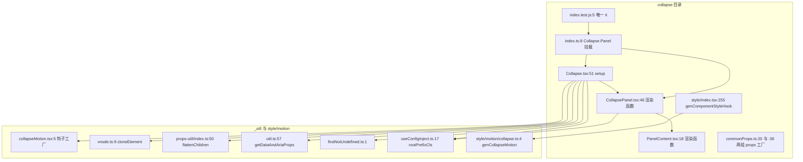
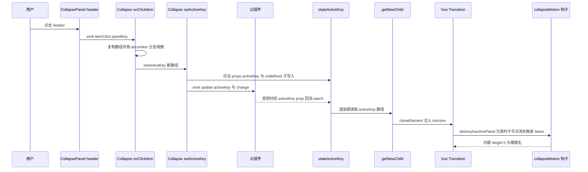
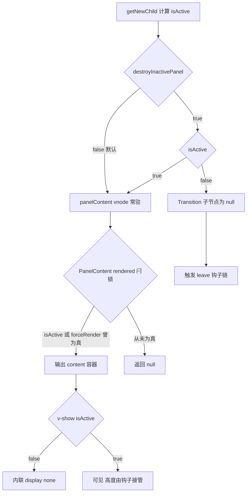

# C02-09 Collapse 折叠面板

> **本篇解决**：Collapse 的展开/收起为什么不能只靠 `display: none`，它的 activeKey 受控链路、`_util/collapseMotion` 与 `style/motion/collapse.ts` 各自负责什么、改哪一行会让动画或边框塌陷。
> **前置**：I09《动画与 motion 体系》、I13《响应式与通用 hooks》　**读者坐标**：`03-components/02-layout` 第 10/14 篇

## 一、职责与边界

`XYCollapse`（`packages/xiaoye-ui/src/collapse/Collapse.tsx:39`）与 `XYCollapsePanel`（`packages/xiaoye-ui/src/collapse/CollapsePanel.tsx:14`）组成的是一对**父子强耦合**组件：父组件负责持有展开集合（`stateActiveKey`）、把每个子面板重写成受控项、并生成箭头图标；子组件只负责渲染一个 header 加一个内容容器，它自己不持有任何展开状态。`Collapse.tsx:129-172` 的 `getNewChild` 是这套关系的全部实质——它每轮渲染都重写子 vnode 的 props，面板组件因此更像父组件渲染结果的一个模板，而不是独立控件。

明确**不负责**的事：

- 不负责折叠动画的 CSS。动画类名对应的 `overflow: hidden` 与 `height/opacity` 过渡写在 `packages/xiaoye-ui/src/style/motion/collapse.ts:4-21`，由每个需要折叠动画的组件自行引入；钩子实现写在 `packages/xiaoye-ui/src/_util/collapseMotion.tsx`。这条链路的协议层论证已在 I09《动画与 motion 体系》论点 4 与论点 6 完成，本篇只补 Collapse 侧的接线方式与它带来的组件级后果。
- 不负责卡片类外观基元。`_shared/CardLike.tsx` 的消费者**只有 Panel 面板（C02-08）**：`panel/Panel.tsx:58` 渲染它、`panel/style/index.ts:12` 调 `genCardLikeStyle('xy-panel', token)`，此外全仓零命中。**本行初稿曾写「被 Card 卡片（C02-07）与 Panel 面板复用」，该说法已被 C02-07 反证并更正**——`grep -rn "CardLike" packages/xiaoye-ui/src --include='*.ts*'` 排除 `_shared/` 自身后只剩 panel 的 5 行，Card 目录对 `_shared`/`CardLike` 的引用为 0（C02-07 附检查点 1 给的就是这条命令）。Collapse 自身同样完全没有引用它——`grep -rn "CardLike" packages/xiaoye-ui/src/collapse` 无结果。
- 不负责 `items` 式声明 API。本组件只接受默认插槽里的子 vnode（`Collapse.tsx:175`），没有 `items` prop（见 `commonProps.ts:20-34`）。
- 不负责图标资源。箭头直接命名导入 `RightOutlined`（`Collapse.tsx:13`），符合本库「图标只能来自 `@xiaoye-ui/icons`」的硬约定。

**依赖清单**（编译期真实 import）：`_util/props-util`（`Collapse.tsx:1-6`，`flattenChildren` 定义在 `packages/xiaoye-ui/src/_util/props-util/index.ts:50`、`isValidElement` 在 `:253`）、`_util/vnode` 的 `cloneElement`（`Collapse.tsx:7` → `packages/xiaoye-ui/src/_util/vnode.ts:9-28`）、`_util/util` 的 `getDataAndAriaProps`（`Collapse.tsx:10` → `packages/xiaoye-ui/src/_util/util.ts:57-64`）、`_util/firstNotUndefined`（`Collapse.tsx:14` → `packages/xiaoye-ui/src/_util/firstNotUndefined.ts:1-10`）、`config-provider/hooks/useConfigInject`（`Collapse.tsx:16` → `packages/xiaoye-ui/src/config-provider/hooks/useConfigInject.ts:17`）、`_util/collapseMotion`（`Collapse.tsx:18`）、`./style`（`Collapse.tsx:22` → `collapse/style/index.tsx:1`）。

**被谁依赖**：源码层面 Collapse 是**叶子**。`CollapsePanel` 与 `collapsePanelProps` 在 `collapse/` 目录之外没有任何真实引用者（`grep -rn "CollapsePanel" packages/xiaoye-ui/src --include='*.ts' --include='*.tsx'` 只命中 `packages/xiaoye-ui/src/theme/convertLegacyToken.ts:391` 的一行注释）。真正的下游是文档示例目录 `apps/docs/examples/collapse/`（9 个 `.vue`：basic、accordion、mix、collapsible、ghost、borderless、noarrow、extra、custom）与用法手册 `apps/docs/components/collapse.md:76-109`。PanelMenu 面板菜单（C03-03）在队列里把本篇列为前置，但它自带 `expand`/`collapse` 事件语义（`packages/xiaoye-ui/src/panel-menu/PanelMenu.tsx:48`、`:316`），是否复用本组件由那篇判定。

`_util/collapseMotion` 则被 5 个组件共享，Collapse 只是其一：`collapse/Collapse.tsx:18`、`menu/src/Menu.tsx:42`、`upload/UploadList/index.tsx:23`、`form/ErrorList.tsx:6`、`vc-tree/MotionTreeNode.tsx:16`。这决定了改 `collapseMotion.tsx` 的任何一行都不是局部改动。

## 二、源码地图

组件目录 `packages/xiaoye-ui/src/collapse/` 共 7 个文件、707 行（不含 `_util` 与样式公共层）：

| 文件 | 行数 | 职责 | 关键导出 |
| --- | --- | --- | --- |
| `collapse/index.ts` | 21 | 入口、`Collapse.Panel` 静态挂载、install | `Collapse`（默认）、`CollapsePanel`、`collapseProps`、`collapsePanelProps` |
| `collapse/Collapse.tsx` | 203 | 展开集合状态、子 vnode 重写、箭头渲染、根容器类名 | `CollapseProps`、`collapseProps`、默认组件 |
| `collapse/CollapsePanel.tsx` | 122 | 单个面板 DOM：header/extra/图标 + `Transition` 包裹内容 | `CollapsePanelProps`、`collapsePanelProps` |
| `collapse/PanelContent.tsx` | 34 | 内容容器与「首次展开后常驻」闩锁 | 默认组件（无对外类型） |
| `collapse/commonProps.ts` | 56 | 两组 props 工厂与 `CollapsibleType`/`ActiveKeyType` | `collapseProps`、`collapsePanelProps`、`PanelProps` |
| `collapse/style/index.tsx` | 271 | CSS-in-JS：基样式 + borderless/ghost/arrow + 折叠 motion | `genBaseStyle`（`:16`）、默认 `genComponentStyleHook('Collapse', …)`（`:255`） |
| `collapse/index.test.js` | 16 | **唯一**测试文件，1 个 `it`、0 个断言 | 无 |

外围必读卡位：`_util/collapseMotion.tsx:5-49`（钩子工厂，50 行）、`style/motion/collapse.ts:4-21`（24 行，唯一给出 `overflow: hidden` 的地方）、已删除的 `_util/transition.ts` 1-2 行（修复前的 2 行转发壳，把 `./transition` 指向 `_util/components/transition.tsx`，这是 I09 论点 3 的遮蔽现场）、`_util/vnode.ts:9-28`、`_util/util.ts:57-64`、`_util/type.ts:58`/`:62`/`:87`/`:91`（`booleanType`/`functionType`/`stringType`/`someType`）、`theme/interface/components.ts:15`/`:88`。

主实现入口是 `Collapse.tsx:51` 的 `setup`；面板的渲染函数在 `CollapsePanel.tsx:46`；内容的渲染函数在 `PanelContent.tsx:18`。

## 三、架构与数据流

### 图 1：模块静态结构



结构上有两个不对称值得先记下：其一，`commonProps.ts` 把父子两组 props 工厂放在同一个文件里（`:20` 与 `:36`），`CollapsePanel.tsx:3` 只取后者，`PanelContent.tsx:2` 也取后者——内容容器复用**面板**的 props 定义，因此 `PanelContent` 的 props 表里混着 `header`、`extra`、`expandIcon` 等它根本不读的字段。其二，`index.ts` 是 `Collapse.Panel = CollapsePanel` 的唯一赋予点（`collapse/index.ts:8`），离开入口文件后两者只是普通组件；`install` 走 `registerComponent`（`collapse/index.ts:12-14`），标签名由 `XYCollapse`/`XYCollapsePanel` 自动派生（`_util/registerComponent.ts:6-11`）。

### 图 2：一次点击的完整闭环



图里第 8 步和第 11 步是本篇全部风险的来源：`setActiveKey`（`Collapse.tsx:103-110`）在受控时**只 emit 不落内部 state**，展开结果完全取决于父组件是否把 `update:activeKey` 写回；而第 11 步的 `leave` 触发条件根本不在 `collapseMotion` 里，而在 `CollapsePanel.tsx:116` 那个三元表达式里——详见论点 3。

### 图 3：内容 DOM 的三层可见性判定



三条链路各自独立：`CollapsePanel.tsx:116` 决定 vnode 是否存在，`PanelContent.tsx:19` 决定组件内部是否产出 DOM，`CollapsePanel.tsx:82` 的 `v-show` 决定内联 `display`。I09 只讲到钩子层，这张图是 Collapse 侧的补充：**收起动作走的是哪条链路，取决于 `destroyInactivePanel`**，而它的默认值是 `false`（`Collapse.tsx:43`）。

---

## 四、核心机制精读

### 论点 1：面板不是自治组件，而是每轮渲染被 `cloneElement` 重写的模板；面板身份取 vnode key，缺 key 时退化为渲染顺序下标

断言：`Collapse.Panel` 声明的 `isActive` 默认值（`CollapsePanel.tsx:18`）在正常用法里永远读不到，因为父组件每轮渲染都用 `isActive` 覆盖它；而面板的 key 若不由用户写出，就取数组下标——这让「增删面板」与「展开状态」产生隐式耦合。

```tsx
// packages/xiaoye-ui/src/collapse/Collapse.tsx:129
    const getNewChild = (child, index) => {
      if (isEmptyElement(child)) return;
      const activeKey = stateActiveKey.value;
      const { accordion, destroyInactivePanel, collapsible, openAnimation } = props;
      const animation = openAnimation || collapseMotion(`${rootPrefixCls.value}-motion-collapse`);

      // If there is no key provide, use the panel order as default key
      const key = String(child.key ?? index);
      const {
        header = child.children?.header?.(),
        headerClass,
        collapsible: childCollapsible,
        disabled,
      } = child.props || {};
      let isActive = false;

      if (accordion) {
        isActive = activeKey[0] === key;
      } else {
        isActive = activeKey.indexOf(key) > -1;
      }
```

逐段解释：

- `:130` 先过滤空元素（`isEmptyElement`，`_util/props-util/index.ts:213`），返回值是 `undefined`，配合 `:175` 的 `.map(getNewChild)` 会产生空洞 vnode，这是插槽里写 `false`/注释时的容错。
- `:133` 是 motion 的**唯一**注入点：`openAnimation || collapseMotion(...)`。名字用 `rootPrefixCls`（`useConfigInject.ts:17`，即 ConfigProvider 的全局前缀）而不是组件前缀拼出，这是 Collapse 做对而树没做的事（I09 坑 2 的成因就是 `vc-tree/MotionTreeNode.tsx:40` 直接调 `collapseMotion()` 吃了 `collapseMotion.tsx:5` 的硬编码默认名）。
- `:136` `String(child.key ?? index)`：key 优先级完全交给 Vue 的 vnode key。用户在模板里写 `:key` 才稳定，否则「第 2 个面板」就是 key `"1"`。
- `:138` 的 `header = child.children?.header?.()` 是 slots 的兜底读法——`header` 既可以是 prop 也可以是具名插槽。
- `:145-149` 手写了「accordion 只看第一个 key / 多选看包含关系」的展开判定，两处逻辑用同一个字符串 key 比较，因此 `activeKey={[1, 2]}`（数字）能被 `:33` 的 `String(key)` 归一化，比较不会因类型不一致而失败。

```tsx
// packages/xiaoye-ui/src/collapse/Collapse.tsx:156
      const newProps = {
        key,
        panelKey: key,
        header,
        headerClass,
        isActive,
        prefixCls: prefixCls.value,
        destroyInactivePanel,
        openAnimation: animation,
        accordion,
        onItemClick: mergeCollapsible === 'disabled' ? null : onClickItem,
        expandIcon: renderExpandIcon,
        collapsible: mergeCollapsible,
      };

      return cloneElement(child, newProps);
```

`:156-169` 这 12 个字段是父→子的全部通信面：没有任何 provide/inject，没有 context。`cloneElement`（`_util/vnode.ts:9-28`）的第三参默认 `override = true`，`vnode.ts:25` 明确写「`cloneVNode` 内部是合并属性，这里改成覆盖属性」，所以子面板自己写的 `isActive`、`openAnimation`、`destroyInactivePanel` 一律被父组件覆盖——面板上唯一有效的配置途径是**父组件同名 prop**（`Collapse.tsx:132` 解构的 `accordion`/`destroyInactivePanel`/`collapsible`/`openAnimation`）与 `:151` 的 `childCollapsible ?? collapsible`（`collapsible` 是反向优先：子 > 父）。

回扣论点：`CollapsePanel.tsx` 读到的每个状态都是被灌进来的，改 `CollapsePanel.tsx:18` 的默认值对行为没有影响，因为 `initDefaultProps` 只给 prop 定默认，而 `:161` 的覆盖永远发生在渲染期。

### 论点 2：`activeKey` 的初始化只在 `setup` 执行一次，回流 watcher 却无守卫——把受控值改成 `undefined` 会收起全部面板

断言：`stateActiveKey` 只在 `setup` 里用 `firstNotUndefined([activeKey, defaultActiveKey])` 取值一次，之后完全由 `watch(() => props.activeKey)` 驱动；该 watcher 不做「prop 未提供就保留内部值」的判断，于是 `undefined` 会被 `getActiveKeysArray` 归一化成空数组。这与 I13 论点 2 归纳的「受控时不写内部 state」是同一套实现的另一半风险。

```tsx
// packages/xiaoye-ui/src/collapse/Collapse.tsx:26
function getActiveKeysArray(activeKey: Key | Key[]) {
  let currentActiveKey = activeKey;
  if (!Array.isArray(currentActiveKey)) {
    const activeKeyType = typeof currentActiveKey;
    currentActiveKey =
      activeKeyType === 'number' || activeKeyType === 'string' ? [currentActiveKey] : [];
  }
  return currentActiveKey.map(key => String(key));
}
```

`:26-34` 只有三条出路：数组原样、`number`/`string` 包成单元素、**其余一律 `[]`**。`undefined`、`null`、`true` 都落在第三条。注意 `:31` 用的是 `typeof` 白名单而不是真值判断，所以 `activeKey={0}` 能正常工作（`typeof 0 === 'number'`），这是有意为之的写法。

```tsx
// packages/xiaoye-ui/src/collapse/Collapse.tsx:52
    const stateActiveKey = ref<Key[]>(
      getActiveKeysArray(firstNotUndefined([props.activeKey, props.defaultActiveKey])),
    );

    watch(
      () => props.activeKey,
      () => {
        stateActiveKey.value = getActiveKeysArray(props.activeKey);
      },
      { deep: true },
    );
```

- `:52-54`：`defaultActiveKey` 只在这三行被读一次。此后无论它怎么变都不会回流（`watch` 的源只有 `props.activeKey`）。
- `:56-62`：`deep: true` 是因为 `activeKey` 常是数组，父组件原地 `push` 也要感知；I13 论点 2 已指出 `useMergedState.ts:42` 的 watch 没有 `deep`，两处对同一父组件写法的反应不同——本篇不重复论证，只登记 Collapse 侧的 `:61` 这个事实。
- `:59` 无条件赋值，是风险所在。

```tsx
// packages/xiaoye-ui/src/collapse/Collapse.tsx:103
    const setActiveKey = (activeKey: Key[]) => {
      if (props.activeKey === undefined) {
        stateActiveKey.value = activeKey;
      }
      const newKey = props.accordion ? activeKey[0] : activeKey;
      emit('update:activeKey', newKey);
      emit('change', newKey);
    };
```

`:104-106` 就是 I13 说的第三种受控语义；`:107` 顺手暴露另一个细节——accordion 模式下 emit 的是**标量** `activeKey[0]`，非 accordion 才 emit 数组，所以 `onChange` 的形参类型必须是联合类型（`commonProps.ts:32` 的 `(key: Key | Key[]) => void`，配合 `:7` 的 `ActiveKeyType`）。当 `activeKey` 从字符串切回 `undefined`（例如父组件用 `v-if` 换分支、或 `:active-key="cond ? k : undefined"`），`:59` 会把 state 清成 `[]`，全部面板收起，且因为 `:52` 不再重跑，`defaultActiveKey` 无法恢复它。

### 论点 3：收起动画的开关不在 motion 里，而在 `CollapsePanel` 的三元表达式里；默认配置下面板根本不走 `leave` 钩子

断言：面板内容同时被三种机制控制，其中只有 `destroyInactivePanel` 会让 `Transition` 的子节点真正消失；默认 `false` 时收起是 `v-show` 的瞬间 `display: none`，`collapseMotion` 的 `onBeforeLeave`/`onLeave` 没有机会执行。

```tsx
// packages/xiaoye-ui/src/collapse/CollapsePanel.tsx:80
      const panelContent = (
        <PanelContent
          v-show={isActive}
          prefixCls={prefixClsValue}
          isActive={isActive}
          forceRender={forceRender}
          role={accordion ? 'tabpanel' : null}
          v-slots={{ default: slots.default }}
        ></PanelContent>
      );
      const transitionProps = {
        appear: false,
        css: false,
        ...openAnimation,
      };

      return (
        <div {...attrs} class={itemCls}>
```

`:82` 的 `v-show` 只改元素的 `display`，属于**属性更新**；`:116` 的 `{!destroyInactivePanel || isActive ? panelContent : null}` 才决定子 vnode 的**存在性**；`:90-94` 是 I09 论点 4 已论证过的「`appear: false` 被 `collapseMotion.tsx:8` 的 `appear: true` 覆盖、`css: false` 被 `collapseMotion.tsx:9` 的 `css: true` 覆盖」的现场，本篇不重复。要补的是结论的另一半：既然 `css: true` 被保留、Vue 走 CSS 时长探测（I09 论点 4 的解释段），那么 `leave` 是否发生就完全取决于 `:116` 是否给 null。

```tsx
// packages/xiaoye-ui/src/collapse/PanelContent.tsx:10
    const rendered = shallowRef(false);

    watchEffect(() => {
      if (props.isActive || props.forceRender) {
        rendered.value = true;
      }
    });

    return () => {
      if (!rendered.value) return null;
      const { prefixCls, isActive, role } = props;
      return (
        <div
          class={classNames(`${prefixCls}-content`, {
            [`${prefixCls}-content-active`]: isActive,
            [`${prefixCls}-content-inactive`]: !isActive,
          })}
          role={role}
        >
```

`PanelContent.tsx:12-16` 是一个**单向闩锁**：`watchEffect` 里只有置 `true` 的分支，没有任何把它改回 `false` 的代码。因此一旦某个面板展开过（或 `forceRender` 为真），它的内部 DOM 就永久保留，此后收起只靠 `:82` 的 `display: none`。`:19` 的提前返回意味着**从未展开的面板连 DOM 都不产出**，这与 I09 论点 6 讲的 SSR 首屏行为叠加：SSR 阶段 `isActive` 为真的面板会渲染正文，未展开的面板在 HTML 里是空的。

三层机制的可观测后果：

- `destroyInactivePanel` 默认 `false`（`Collapse.tsx:43`）→ 收起没有高度动画，内容瞬时消失。
- `destroyInactivePanel={true}` → `:116` 给 null，`leave` 钩子链执行，`collapseMotion.tsx:28-38` 把 `height` 从 `offsetHeight` 动画到 `0px`。
- 首次展开 → `rendered` 由 `false` 变 `true`，内容 DOM 从零产出，此时 `:82` 的 `display` 已经是可见的。

> ⚠️ 未在源码中找到对应实现：「`Transition` 只在子节点挂载/卸载时触发 enter/leave，属性更新不触发钩子」属于 Vue 框架语义，本仓库源码里没有可挂 `file:line` 的对应实现；本论点里 Collapse 侧的三个行号事实（`CollapsePanel.tsx:82`、`:116`、`PanelContent.tsx:12-19`）可直接核对，框架语义部分为待核实推断，附录检查点 3 给出了验证方法。

### 论点 4：`collapsible` 的分区触发被拆在两个组件里，且父侧读的是自身 props，面板级 `collapsible="icon"` 的图标点击无效

断言：header、header-text、expand-icon 三个区域各自用不同来源的 `collapsible` 值做判定——前两个读**合并后**的面板 props，第三个读**父组件全局** props。因此把 `collapsible="icon"` 写在单个面板上时，点击箭头不展开。

```tsx
// packages/xiaoye-ui/src/collapse/Collapse.tsx:84
      return (
        <div
          class={[`${prefixCls.value}-expand-icon`, hashId.value]}
          onClick={() =>
            ['header', 'icon'].includes(props.collapsible) && onClickItem(panelProps.panelKey)
          }
        >
          {isValidElement(Array.isArray(expandIcon) ? icon[0] : icon)
            ? cloneElement(
                icon,
                {
                  class: `${prefixCls.value}-arrow`,
                },
                false,
              )
            : icon}
        </div>
      );
```

- `:88` 用的是 `props.collapsible`（`Collapse` 自己的 prop，`commonProps.ts:30`）。
- 该函数在 `:167` 被当作 `expandIcon` 灌给面板，面板在 `CollapsePanel.tsx:76-78` 用 `expandIcon(props)` 调用它，实参是**面板** props（`CollapsePanelProps`，含 `collapsible: mergeCollapsible`，见 `Collapse.tsx:168`）。也就是说 `renderExpandIcon` 的形参里明明有正确的合并值，函数体里却没用。
- `:92-98` 的 `cloneElement(icon, { class }, false)` 第三参 `override = false`（对照 `vnode.ts:12`），按 `vnode.ts:25` 的分支此时 `node.props` 就是 `cloneVNode` 的合并结果，不做覆盖式二次合并——这是为了让自定义图标的原有 class 不被吞掉。

```tsx
// packages/xiaoye-ui/src/collapse/CollapsePanel.tsx:98
          <div
            class={headerCls}
            onClick={() => !['header', 'icon'].includes(collapsible) && handleItemClick()}
            role={accordion ? 'tab' : 'button'}
            tabindex={disabled ? -1 : 0}
            aria-expanded={isActive}
            onKeypress={handleKeyPress}
          >
            {showArrow && icon}
            <span
              onClick={() => collapsible === 'header' && handleItemClick()}
              class={`${prefixClsValue}-header-text`}
            >
              {header}
            </span>
```

`:100` 与 `:108` 读的 `collapsible` 来自 `:58` 的 props 解构，即父组件 `:168` 灌进来的 `mergeCollapsible`（`Collapse.tsx:151-155` 计算，`:153` 的 `disabled || disabled === ''` 是 2.x 兼容：把布尔 `disabled` 折算成 `'disabled'`，同时 `CollapsePanel.tsx:32-36` 会 `devWarning` 提示改用 `collapsible="disabled"`）。三处判定的完整矩阵：

| `collapsible` | header 区（`:100`） | header-text（`:108`） | 图标（`Collapse.tsx:87-89`） |
| --- | --- | --- | --- |
| `undefined` | 可点 | 冒泡到 header 可点 | 可点（父级设值时） |
| `header` | 不可点 | 可点 | 可点 |
| `icon` | 不可点 | 不可点 | 可点（父级设值时） |
| `disabled` | 不可点 | 不可点 | 不可点，且 `onItemClick` 传 null |

最后一行的 `onItemClick` 由 `Collapse.tsx:166` 置 `null`，而 `CollapsePanel.tsx:38-40` 的 `handleItemClick` 依然 `emit('itemClick', props.panelKey)`——emit 的是面板自己的默认 handler（`CollapsePanel.tsx:19` 的 `onItemClick() {}`），不会炸，但也不会展开。键盘路径同理：`:41-45` 的 `handleKeyPress` 对 Enter 无条件调用 `handleItemClick`，没有 `collapsible` 判定，只靠 `:102` 的 `tabindex={disabled ? -1 : 0}` 让禁用面板不可聚焦。

### 论点 5：折叠动画的 CSS 嵌在 `componentCls` 之下，必须逐组件引入；本仓库的引入点是 5 处而不是 3 处

断言：`genCollapseMotion` 生成的选择器是「组件根类名 空格 motion 类名」的嵌套形式，所以 `overflow: hidden` 只在该组件自己的样式被生成过之后、且元素位于该组件子树内时才存在。一个组件调用了 `collapseMotion()` 却没在样式里引 `genCollapseMotion`，动画会以内容溢出的形式失败，且没有任何警告。

```ts
// packages/xiaoye-ui/src/style/motion/collapse.ts:4
const genCollapseMotion: GenerateStyle<TokenWithCommonCls<AliasToken>> = token => ({
  [token.componentCls]: {
    // For common/openAnimation
    [`${token.rootCls}-motion-collapse-legacy`]: {
      overflow: 'hidden',

      '&-active': {
        transition: `height ${token.motionDurationMid} ${token.motionEaseInOut},
        opacity ${token.motionDurationMid} ${token.motionEaseInOut} !important`,
      },
    },

    [`${token.rootCls}-motion-collapse`]: {
      overflow: 'hidden',
      transition: `height ${token.motionDurationMid} ${token.motionEaseInOut},
        opacity ${token.motionDurationMid} ${token.motionEaseInOut} !important`,
    },
  },
});
```

`:16-20` 的裸类名 `xy-motion-collapse` 正是 `collapseMotion.tsx:13` 用 `addClass` 手工加上的那一个（I09 论点 4 已论证「只挂裸类、无 `-enter`/`-leave` 后缀」）；`:7-13` 的 `-legacy` 分支在本仓库没有任何生产者——`grep -rn "motion-collapse-legacy" packages/xiaoye-ui/src --include='*.ts' --include='*.tsx'` 只命中 `style/motion/collapse.ts:7` 这一条定义，没有任何 JS 拼出过这个类名，属于协议升级留下的死规则。两处 transition 都带 `!important`（`:12`、`:19`），因为钩子写的是**内联** `height`，而内联优先级高于任何类选择器；`!important` 在这里不是风格问题而是必需——它保证过渡时长不被元素自身的其他 transition 覆盖。

`Collapse` 侧的引入点在最后一行：

```tsx
// packages/xiaoye-ui/src/collapse/style/index.tsx:264
  return [
    genBaseStyle(collapseToken),
    genBorderlessStyle(collapseToken),
    genGhostStyle(collapseToken),
    genArrowStyle(collapseToken),
    genCollapseMotion(collapseToken),
  ];
```

全仓 `genCollapseMotion(` 的调用点实测 **5 处**（命令见附录检查点 2）：`collapse/style/index.tsx:269`、`tree/style/index.ts:478`、`form/style/index.ts:485`、`menu/style/index.ts:513`、`upload/style/index.ts:64`。**这里我更正了 I09 的「三处（tree/form/collapse）」**：menu 与 upload 同样引入了它，`menu/src/Menu.tsx:354` 与 `upload/UploadList/index.tsx:199` 也确实在用 `collapseMotion`，两处配套是自洽的。

### 论点 6：Collapse 在主题层注册了一个空的 `ComponentToken`，组件专属值全部走 `mergeToken` 注入，覆写口是关闭的

断言：`theme/interface/components.ts:84` 把 `Collapse?: CollapseComponentToken` 挂进了 `ComponentTokenMap`，而 `CollapseComponentToken` 就是 `collapse/style/index.tsx:6` 的 `export interface ComponentToken {}`——空对象。于是 `ConfigProvider` 的 `theme.components.Collapse` 在类型层面不接受任何字段，在运行时也没有任何字段可被覆盖。

```tsx
// packages/xiaoye-ui/src/collapse/style/index.tsx:255
export default genComponentStyleHook('Collapse', token => {
  const collapseToken = mergeToken<CollapseToken>(token, {
    collapseContentBg: token.colorBgContainer,
    collapseHeaderBg: token.colorFillAlter,
    collapseHeaderPadding: `${token.paddingSM}px ${token.padding}px`,
    collapsePanelBorderRadius: token.borderRadiusLG,
    collapseContentPaddingHorizontal: 16, // Fixed value
  });
```

`:256-262` 的五个字段声明在本地类型 `CollapseToken`（`:8-14`）而不是 `ComponentToken`，所以它们是**私有 token**：外部主题包看不到，`convertLegacyToken.ts` 也映射不到。`:261` 直接把 `16` 写死并注释 `Fixed value`，被 `:139` 用作内容盒子的水平内边距（`padding: ${padding}px ${collapseContentPaddingHorizontal}px`）——这是本组件唯一一处违反「样式不硬编码值」约定的地方，竖向用 `token.padding`、横向用字面量，两者不成对。

另外三个可直接核对的样式事实：`:142-144` 定义了 `&-hidden { display: none }`（展开后是 `.xy-collapse-content-hidden`），但 `PanelContent.tsx:24-25` 只产出 `-content-active` 与 `-content-inactive`，从不产出 `-content-hidden`，全仓 `grep -rn "content-hidden" packages/xiaoye-ui/src --include='*.ts' --include='*.tsx'` 零命中；反过来 `-content-active`/`-content-inactive` 在 `style/index.tsx` 里没有任何规则（`grep -n "content-active\|content-inactive" collapse/style/index.tsx` 无输出）。也就是说内容显隐靠 `v-show` 的内联样式，那两个类名只是给外部覆盖留的钩子，而 `-hidden` 是一条彻底的死规则。

## 五、对外契约如何生效

**props 的落地**。`collapseProps`（`collapse/commonProps.ts:20-34`）与 `collapsePanelProps`（`:36-54`）是两组函数式 props 工厂，字段类型全部走 `_util/type.ts` 的辅助函数：`someType`（`:91`）、`booleanType`（`:58`）、`stringType`（`:87`）、`functionType`（`:62-64`）。`Collapse.tsx:41-46` 用 `initDefaultProps` 注入 4 个默认值（`accordion: false`、`destroyInactivePanel: false`、`bordered: true`、`expandIconPosition: 'start'`），面板侧 `CollapsePanel.tsx:16-22` 注入 5 个（`showArrow: true`、`isActive: false`、`onItemClick() {}`、`headerClass: ''`、`forceRender: false`）。这里要区分两件事：`initDefaultProps` 只影响 **prop 缺省值**，而 `getNewChild` 的 `newProps` 是 **渲染期覆盖**（`_util/vnode.ts:25`），后者的优先级永远更高（论点 1）。判据是一条具体的行：`CollapsePanel.tsx:18` 写着 `isActive: false`，但用户在模板上给面板写 `:is-active="true"` 同样无效，因为 `Collapse.tsx:161` 每轮都覆盖。

**事件是 props，不是 emits**。`Collapse` 与 `CollapsePanel` 都没有 `emits` 选项——面板里那行 `// emits: ['itemClick']` 被注释掉了（`CollapsePanel.tsx:30`）。因此 `Collapse.tsx:108-109` 的 `emit('update:activeKey', newKey)` 与 `emit('change', newKey)` 命中 `commonProps.ts:33` 与 `:32` 声明的两个函数型 prop，`v-model:active-key` 之所以能用，靠的是把 `'onUpdate:activeKey'` 显式写进 props 这件事，而不是靠 `emits` 白名单。副作用是：`onUpdate:activeKey` 会出现在 `props` 里而不是 `attrs` 里，`getDataAndAriaProps` 因此不可能把它误传到 DOM（`Collapse.tsx:194`）。面板的 `emit('itemClick', props.panelKey)`（`CollapsePanel.tsx:39`）命中 `Collapse.tsx:166` 灌进来的 `onClickItem`，`collapsible === 'disabled'` 时那里是 `null`，`emit` 找不到 handler 就静默无操作。

**`expandIcon` 的三跳路径**。`Collapse.tsx:77` 用解构默认值取图标源（props 未给则落到 `slots.expandIcon`）→ 包进 `renderExpandIcon`（`:76`）→ 作为 `newProps.expandIcon` 灌给面板（`:167`）→ 面板再解构 `expandIcon = slots.expandIcon`（`CollapsePanel.tsx:56`）→ 面板在 `:76-78` 判 `typeof expandIcon === 'function'` 后调用 `expandIcon(props)`。因为父组件一定灌进一个函数，`:76` 的判定恒真；而面板自己的 `slots.expandIcon` 只有在 `showArrow` 为真时才会被渲染（`:106`）。缺省图标是 `RightOutlined` 加 `rotate={90}`（`Collapse.tsx:81`），旋转由 CSS `transform` 过渡（`collapse/style/index.tsx:91-97`），与高度动画是两条独立曲线。

**slots**。`Collapse` 声明 `default` 与 `expandIcon`（`Collapse.tsx:47-50`），面板声明 `expandIcon`/`extra`/`header`/`default`（`CollapsePanel.tsx:23-28`）。`header` 走 prop 优先、插槽兜底（`Collapse.tsx:138`），`extra` 只走插槽（`CollapsePanel.tsx:57`），内容只走 `default` 并且是被 `v-slots` 二次转发（`CollapsePanel.tsx:87` 把面板的 `slots.default` 原封交给 `PanelContent`，由 `PanelContent.tsx:29` 消费）。

**expose**。两个组件都没有调用 `expose`（`grep -n "expose" packages/xiaoye-ui/src/collapse/*.tsx` 无输出），`setup` 的第二个参数解构里也没有它（`Collapse.tsx:51` 只取 `attrs, slots, emit`，`CollapsePanel.tsx:31` 只取 `slots, emit, attrs`）。所以 `ref` 拿到组件实例后没有任何官方方法可调——想「用代码展开某面板」只有一条路：改 `activeKey`。这与 `Collapse.tsx:22` 引入样式 hook 后必须在 `:191` 用 `wrapSSR(...)` 包裹根节点是两回事，后者是 SSR 契约。

**类名契约**。根容器类名在 `Collapse.tsx:180-190` 组装：`prefixCls` + `-borderless`（`:183`，`bordered` 取反）+ `-icon-position-start|end`（`:184`，值来自 `:68-74` 的 `iconPosition`，未显式给定时随 `direction` 变成 `end`）+ `-rtl`（`:185`）+ `-ghost`（`:186`）+ `hashId`（`:189`）。面板项在 `CollapsePanel.tsx:67-73` 组装 `-item`/`-item-active`/`-item-disabled`/`-no-arrow`，header 在 `:62-66` 组装 `-header`/`-header-collapsible-only`/`-icon-collapsible-only`，三种类名都有 CSS 对应（`collapse/style/index.tsx:106-124`）。`attrs` 的处理两条路不同：根组件只转发 `data-*`/`aria-*` 加 `class`/`style`（`Collapse.tsx:187`、`:194`、`:195`），面板则把 `attrs` 整体铺开（`CollapsePanel.tsx:97`）；`PanelContent` 既没有 `inheritAttrs: false` 也不读 `attrs`（`PanelContent.tsx:5-9`），于是 attrs 由 Vue 自动落到内容根 div。

## 六、设计取舍

**取「父组件重写子 vnode」而非「provide/inject + 自治面板」。** 这是本组件最根本的一条选择，收益与代价都很大。收益：面板可以是纯声明式标签，用户写 `<Collapse.Panel header="…">` 时不需要理解任何上下文；`isEmptyElement` 过滤（`Collapse.tsx:130`）允许在插槽里随意条件渲染；面板自身零状态，不存在「面板与父状态不同步」这一类 bug。代价有三层，且都能落到行上：（一）父组件新增任何需要下游感知的配置，都必须同时改 `newProps` 字段表（`Collapse.tsx:156-169`），漏写不会报错只会静默失效——`forceRender` 恰好就**不在**这张表里，它能生效完全是因为 `cloneElement` 保留了子 vnode 的原 props（`_util/vnode.ts:25` 的 `{ ...node.props, ...nodeProps }`），这是一个「靠实现细节而非靠设计」成立的契约；（二）每轮渲染都要 `flattenChildren` + `map` + `cloneElement` 全部子节点（`:175`），面板数量多时是一次全量重建；（三）面板的可配置面被父组件压缩到 `newProps` 之外的那几个字段，于是 `collapsible` 这种「子优先」的语义需要额外一行 `:151` 来手工维护，而 `expandIcon` 的图标点击判定就漏了这一步（论点 4）。

**取「字符串化的 key」而非「数字索引或对象标识」。** `getActiveKeysArray` 把所有 key 归一化为字符串（`:33`），`:136` 又把 vnode key 或下标也转成字符串。换来的是用户可以在 `activeKey={[1, '2']}` 里混用数字与字符串、且能与 vnode key 正确匹配；赔上是 emit 出去的值（`:107`）与内部比较用的值类型不同——内部永远比字符串，外部 accordion 模式拿到标量、多选拿到数组，`onChange` 只能声明成 `Key | Key[]`（`commonProps.ts:32`）。

**取「JS 测高 + 裸类名」而非「纯 CSS 高度过渡」。** 根因是 `height: auto` 不可插值，必须在 JS 里读 `scrollHeight`（`_util/collapseMotion.tsx:17`）。协议层的完整论证见 I09 论点 4，本篇只补 Collapse 特有的两个后果：其一，`overflow: hidden` 无法写在动画元素自己身上（钩子加的是裸类），只能由样式侧在**祖先组件类名**下补一条规则（`style/motion/collapse.ts:16-20`），于是这条规则必须被每个使用者重复引入，实测 5 处（`collapse/style/index.tsx:269`、`tree/style/index.ts:478`、`form/style/index.ts:485`、`menu/style/index.ts:513`、`upload/style/index.ts:64`）；其二，因为过渡时长来自 token（`motionDurationMid`，`style/motion/collapse.ts:18`）而测量来自 JS，两者不可能同步——`motionDurationMid` 改成 `0` 时 JS 侧仍会走一遍 `nextTick` 与 `setTimeout`。

**取「保留 DOM」作为默认（`destroyInactivePanel: false`，`Collapse.tsx:43`）。** 收益明确：面板内的表单控件、编辑器、滚动位置在收起后不丢，这对企业后台是刚需；赔上是默认行为没有收起动画（论点 3）、以及未展开面板的 DOM 常驻内存。把动画与销毁绑在同一个开关上，是本组件 API 表面最容易被误读的一点——用户以为 `destroyInactivePanel` 只管内存。

**取「空 `ComponentToken`」而非「暴露组件 token」。** `collapse/style/index.tsx:6` 的 `export interface ComponentToken {}` 被 `theme/interface/components.ts:15` 引为 `CollapseComponentToken` 并登记到 `:88`。这样 Collapse 的五个私有 token（`:257-261`）不进公共类型，主题系统对它没有约束力；换来的是组件内部改 token 不破坏公共类型面，赔上是使用者无法通过 `theme.components.Collapse` 做局部换色，只能改全局 alias token 或写 CSS 覆盖。同一处 `:261` 还留下了 `16` 这个字面量并注释 `Fixed value`，属于已知未收口项。

**取「v-show 与 Transition 并存」而非「只用一种」。** 见论点 3。这条选择没有干净的收益论证：`CollapsePanel.tsx:82` 的 `v-show` 在 `destroyInactivePanel={false}` 时是唯一生效的隐藏手段，在 `true` 时又与存在性判定重复；两者叠加造成的「展开有动画、收起无动画」是可见的行为不对称，用法手册 `apps/docs/components/collapse.md:92` 把 `destroyInactivePanel` 只描述成「销毁折叠隐藏的面板」，没有提示这一点。

## 七、坑与改动指南

**坑 1：`v-for` 渲染面板却不写 `:key`，重排后展开状态错位。** 触发：面板列表会增删或排序，模板不写 key。症状：收起第 1 项后，展开状态跑到新的第 1 项上。原因：`Collapse.tsx:136` 在没有 vnode key 时用数组下标当 key，`stateActiveKey` 存的正是这个字符串下标。定位：`Collapse.tsx:136` 与比较处 `:148`；正确写法见 `apps/docs/examples/collapse/mix.vue` 一类的显式 key 用法。

**坑 2：受控 `activeKey` 中途变成 `undefined`，全部面板收起且回不去。** 触发：`:active-key="cond ? k : undefined"`，或父组件把 `v-model` 绑到未初始化的 ref。症状：一次 `undefined` 之后展开集变空，此后 `defaultActiveKey` 再也救不回来。原因：`getActiveKeysArray` 的 `typeof` 白名单把 `undefined` 折成 `[]`（`:31`），watcher 无条件写入（`:59`），而初始化的 `firstNotUndefined` 只在 `setup` 跑一次（`:52-54`）。定位：`Collapse.tsx:26-34` 与 `:56-62`。这与 I13 论点 2 描述的「受控时不写内部 state」是同一处实现的两个面：受控写回缺失只影响状态来源，`undefined` 归零影响的是状态本身。

**坑 3：`collapsible="icon"` 写在单个面板上，点箭头不展开。** 触发：只给 `Collapse.Panel` 传 `collapsible`，父组件不传。症状：header 点不动（这是预期），箭头也点不动（这不是预期）。原因：`Collapse.tsx:88` 的判定读 `props.collapsible`（父级），没有读它自己形参 `panelProps` 上已经合并好的 `collapsible`；面板侧的 `:100`/`:108` 读的却是合并值。定位：`Collapse.tsx:84-90` 对照 `CollapsePanel.tsx:100`。规避：把 `collapsible` 提到 `Collapse` 上。

**坑 4：默认配置下没有收起动画，看起来像 bug。** 触发：不设 `destroyInactivePanel`。症状：展开有高度过渡，收起瞬间内容消失。原因：`CollapsePanel.tsx:116` 的存在性三元在 `!destroyInactivePanel` 时恒真，`Transition` 的子节点从未消失；收起只由 `:82` 的 `v-show` 改 `display`。定位：`CollapsePanel.tsx:82`、`:116`，默认值在 `Collapse.tsx:43`。

**坑 5：从未展开的面板在服务端 HTML 里是空的。** 触发：SSR/预渲染场景需要未展开面板的正文被爬取或打印。症状：源码里没有内容，客户端展开时才插入。原因：`PanelContent.tsx:19` 的 `rendered` 闩锁在首次 `isActive || forceRender` 前直接返回 `null`，且 `:12-16` 只会置 `true` 不会回退。定位：`PanelContent.tsx:10-19`；开关是面板 props 的 `forceRender`（`commonProps.ts:47`，默认 `false` 见 `CollapsePanel.tsx:21`），注意它不经过 `Collapse.tsx:156-169` 的覆盖表。

**坑 6：自定义全局前缀后动画塌陷、内容溢出。** 触发：`ConfigProvider` 改 `prefixCls`，同时业务侧自己传 `openAnimation` 并硬编码了类名。症状：折叠过程中文字跑到容器外。原因：CSS 由 `token.rootCls` 拼出（`style/motion/collapse.ts:16`），而钩子加的裸类来自调用方传入的 `name`（`_util/collapseMotion.tsx:13`）。定位：`Collapse.tsx:133` 是本组件的正确写法（用 `rootPrefixCls.value` 拼），`vc-tree/MotionTreeNode.tsx:40` 是失败样本，I09 坑 2 记录的正是后者。

**坑 7：`theme.components.Collapse` 覆写不生效。** 触发：想在深色主题里单独改面板内容底色。症状：类型报错或无视觉变化。原因：`collapse/style/index.tsx:6` 的 `ComponentToken` 是空接口，五个底色/内边距 token 在 `:256-262` 由 `mergeToken` 就地派生，不属于公共面（`theme/interface/components.ts:84`）。定位：`collapse/style/index.tsx:6`、`:256-262`。可行的替代是覆写 alias token（`colorBgContainer`、`colorFillAlter`）或用 `hashId` 之外的稳定类名写局部 CSS。

**坑 8：给 `Collapse` 根元素加非 `data-*`/`aria-*` 属性无效。** 触发：`<xy-collapse id="faq" tabindex="0">`。症状：DOM 上没有 `id`。原因：`Collapse.tsx:40` 声明 `inheritAttrs: false`，`:194` 只把 `getDataAndAriaProps(attrs)` 铺开，`:195` 只取 `attrs.style`，其余 attrs 被丢弃。定位：`Collapse.tsx:187-196` 与 `_util/util.ts:57-64`；对照面板侧 `CollapsePanel.tsx:97` 的 `{...attrs}` 是全量转发。

**坑 9：`-content-hidden` 是一条永远匹配不到的规则。** 触发：想通过覆盖 `.xy-collapse-content-hidden` 控制显隐。症状：改动无效果。原因：`collapse/style/index.tsx:142-144` 用嵌套 `&-hidden` 生成了该选择器，但 `PanelContent.tsx:24-25` 只输出 `-content-active`/`-content-inactive`，隐藏靠内联 `display`。定位：`collapse/style/index.tsx:133-145`；同时 `grep -n "content-active\|content-inactive" packages/xiaoye-ui/src/collapse/style/index.tsx` 无输出，说明那两个类在本库样式里没有任何规则。

**测试现状。** Collapse 只有一个测试文件 `collapse/index.test.js`，16 行、1 个 `it`、**0 个 `expect`**（`collapse/index.test.js:5-15`，用例名 `should support remove expandIcon` 里连 `default-active-key` 都没给，跑的是最浅的一条渲染路径）。`grep -c "expect(" packages/xiaoye-ui/src/collapse/index.test.js` 输出 0。该文件会被执行（`packages/xiaoye-ui/vitest.config.mts:33` 的 include 含 `src/**/*.test.{js,ts,jsx,tsx}`），但它对受控链路、`collapsible` 分区、`cloneElement` 覆盖、motion 钩子**全部没有保护**；`_util/collapseMotion.tsx` 也没有对应测试（`packages/xiaoye-ui/src/_util/` 下的测试只有 `easings`、`safeUrl`、`scrollTo`、`unreachableException`、`vNode` 五个）。本篇论点 2、3、4 描述的行为分支均属无测试保护。

**改动安全边界。** 可以动的：`Collapse.tsx:156-169` 的 `newProps` 表（加字段是安全的，删字段等于删面板功能）、`collapse/style/index.tsx` 的四个 `genXxxStyle`（`:16`、`:179`、`:193`、`:234`）、`:256-262` 的 token 注入。**谨慎动**的：`:26-34` 的 key 归一化（改类型口径会同时改变 emit 面）、`:56-62` 的 watcher（加守卫会改变受控语义，与 I13 的三套实现对齐前不要单独改）、`:133` 的 motion 名字拼接（这是与 `style/motion/collapse.ts:16` 的唯一耦合点）。**禁止单改**的：`_util/collapseMotion.tsx` 的任何钩子——它有 5 个消费者（`collapse/Collapse.tsx:18`、`menu/src/Menu.tsx:42`、`upload/UploadList/index.tsx:23`、`form/ErrorList.tsx:6`、`vc-tree/MotionTreeNode.tsx:16`），且 `style/motion/collapse.ts` 被 5 个组件样式引入，两处集合并不相同，只改一边必然出现「有钩子无 CSS」或「有 CSS 无钩子」。改动后的验证命令：

```bash
pnpm --filter xiaoye-ui test:unit     # 现有用例几乎不设防，绿不代表行为未变
pnpm typecheck
pnpm gen:entries && pnpm check:entries   # 仅当增删过 collapse 目录内文件
node docs/column/tools/verify-refs.mjs --excerpt docs/column/03-components/02-layout/C02-09-collapse-折叠面板.md
```

## 附：本篇可证伪的三个检查点

1. **面板级 `collapsible` 的图标分支读错来源（论点 4）**。跑 `grep -n "props.collapsible" packages/xiaoye-ui/src/collapse/Collapse.tsx`，期望**恰好 1 处**且位于 `:88` 的 `['header', 'icon'].includes(props.collapsible)`；再跑 `grep -n "collapsible" packages/xiaoye-ui/src/collapse/CollapsePanel.tsx`，期望命中 `:35`（弃用提示串）、`:58`（解构自面板 props）、`:60`、`:64-65`、`:100`、`:108`，其中三处点击判定（`:100`、`:108` 与经 `:58` 传入的合并值）都取自面板 props 而非父组件。若第一条 grep 变成 0 处或改读 `panelProps.collapsible`，本论点被证伪。
2. **`genCollapseMotion` 的引入点是 5 处而非 3 处（论点 5，并对 I09 的更正）**。跑 `grep -rn "genCollapseMotion(" packages/xiaoye-ui/src --include='*.ts' --include='*.tsx' | grep -v "style/motion" | wc -l`，期望输出 `5`；逐条对照应为 `collapse/style/index.tsx:269`、`tree/style/index.ts:478`、`form/style/index.ts:485`、`menu/style/index.ts:513`、`upload/style/index.ts:64`。同时 `grep -rn "motion-collapse-legacy" packages/xiaoye-ui/src --include='*.ts' --include='*.tsx' | wc -l` 期望 `1`（只有定义、没有生产者）。
3. **收起路径上没有存在性变化（论点 3）**。跑 `grep -n "v-show\|destroyInactivePanel" packages/xiaoye-ui/src/collapse/CollapsePanel.tsx`，期望三条：`:52`（props 解构）、`:82`（`v-show={isActive}`）、`:116`（`!destroyInactivePanel || isActive ? panelContent : null`）；再确认默认值 `grep -n "destroyInactivePanel: false" packages/xiaoye-ui/src/collapse/Collapse.tsx` 命中 `:43`。若 `:82` 的 `v-show` 被删除、或 `:116` 改成恒真的渲染形式，收起动画的行为归属就要重新判定。
