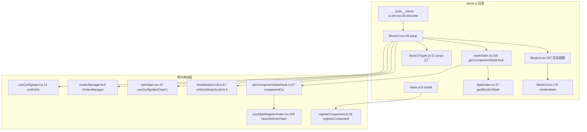
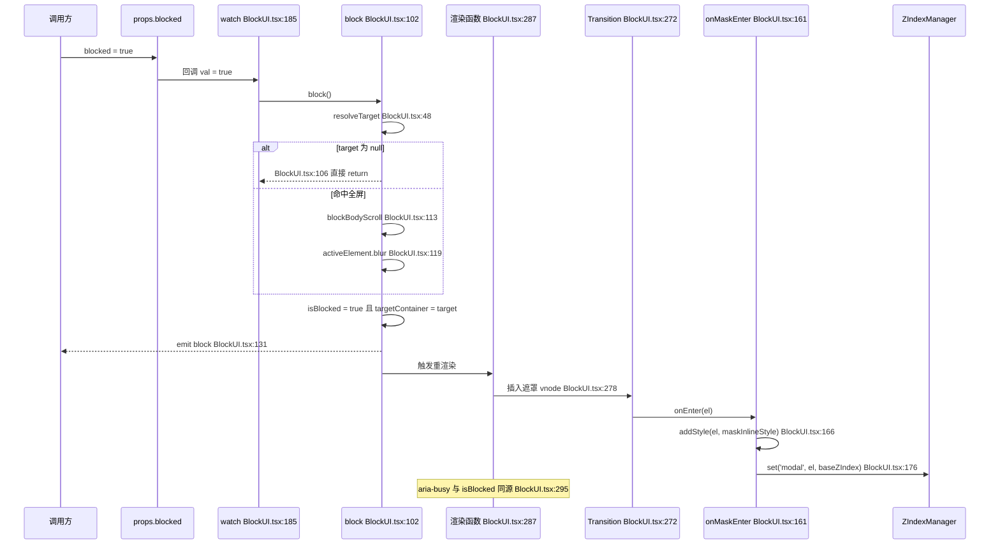
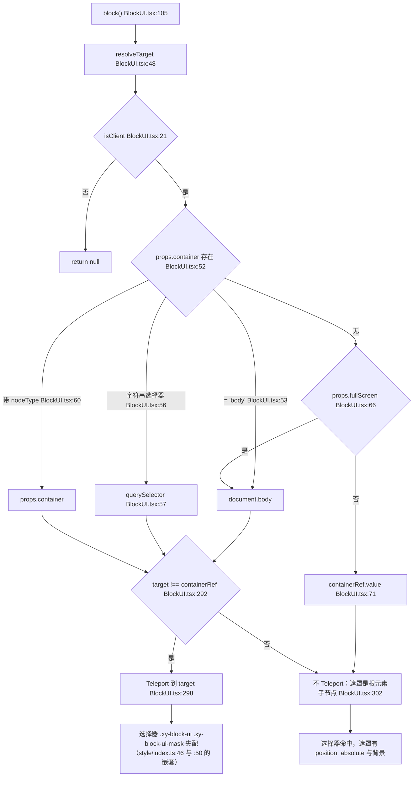

# C02-10 BlockUI 区块容器

> **本篇解决**：BlockUI 的遮罩到底挂在哪儿、什么时候才真正从 DOM 上消失、`blocked` 这个 prop 与组件内部状态谁是真相、以及为什么「区块内阻塞」有样式而「全屏阻塞」可能没有样式。
> **前置**：C02-00《类横写：栅格/flex/space 三代布局的取舍》、A04《cssinjs 样式引擎与 SSR 注水》、A05《ConfigProvider 注入链与 Size/Disabled Context》、I10《z-index 层级编排》　**读者坐标**：`03-components/02-layout` 第 10/14 篇

## 一、职责与边界

`XYBlockUI`（`packages/xiaoye-ui/src/block-ui/BlockUI.tsx:24`）只做一件事：**在某个 DOM 子树上面盖一层遮罩，并在遮罩存在期间把该区域标成忙碌**。它是本类里唯一一个「不参与排版、只负责覆盖」的容器：根元素是一个 `position: relative` 的普通 div（`packages/xiaoye-ui/src/block-ui/style/index.ts:110`），默认插槽原样输出（`packages/xiaoye-ui/src/block-ui/BlockUI.tsx:288`），遮罩是它的兄弟或子节点。内部标识 `__XY_BLOCK_UI`（`BlockUI.tsx:26`）与 `inheritAttrs: false`（`BlockUI.tsx:25`）都在，说明它是按本库组件规范登记过的正式组件，而不是 `_shared` 里的半成品。

明确**不负责**的事：

- 不负责加载指示符本身。遮罩里那个大号线 Spinner 是 `import Spin from '../spin'`（`BlockUI.tsx:15`）后在 `packages/xiaoye-ui/src/block-ui/BlockUI.tsx:263` 直接渲染的，`<xy-spin>` 的 `size="large"` 是写死的；Spin 自己的类名 `xy-spin` 来自它自己的 `useConfigInject('spin', props)`（`packages/xiaoye-ui/src/spin/Spin.tsx:42`），BlockUI 无权改它的外观。
- 不负责浮层层级体系。它只调用 `ZIndexManager.set('modal', node, props.baseZIndex)`（`BlockUI.tsx:176`），注册表、回收语义、`baseZIndex` 只在空表生效这些规则归 I10《z-index 层级编排》，本篇只在论点 2 与论点 5 里补 BlockUI 自己接线带来的后果。
- 不负责焦点管理。它只在进入全屏阻塞时对 `document.activeElement` 调一次 `blur()`（`BlockUI.tsx:118-120`），既没有焦点陷阱，也没有退出后的焦点归还——那属于 A07《交互基础设施总览》里 `focus-trap` 的主题。
- 不负责 `v-model`。`emits: ['block', 'unblock']`（`BlockUI.tsx:28`）里没有 `update:blocked`，因此 `blocked` 是只进不出的单向 prop（见论点 1）。
- 不做请求、不做排队、不感知任何异步状态。它是纯展示层互斥原语。

**依赖清单**（编译期真实 import，全部在 `packages/xiaoye-ui/src/block-ui/BlockUI.tsx:2-18`）：Vue 的 `Teleport`（`BlockUI.tsx:8`）与 `Transition`（`BlockUI.tsx:9`）、`@xiaoye-ui/utils/dom` 的 `addStyle`/`blockBodyScroll`/`unblockBodyScroll`（`BlockUI.tsx:12`，实现见 `packages/utils/src/dom/methods/addStyle.ts:1`、`packages/utils/src/dom/helpers/blockBodyScroll.ts:9`、`packages/utils/src/dom/helpers/unblockBodyScroll.ts:8`）、`_util/props-util` 的 `initDefaultProps`（`BlockUI.tsx:13` → `packages/xiaoye-ui/src/_util/props-util/initDefaultProps.ts:4`）、`config-provider/hooks/useConfigInject`（`BlockUI.tsx:14` → `packages/xiaoye-ui/src/config-provider/hooks/useConfigInject.ts:7`）、`../spin`（`BlockUI.tsx:15`）、`./blockUITypes`（`BlockUI.tsx:16`）、`./style`（`BlockUI.tsx:17`）、`_util/zIndexManager`（`BlockUI.tsx:18` → `packages/xiaoye-ui/src/_util/zIndexManager.ts:6`）。

**被谁依赖**：源码层面 BlockUI 是**纯叶子**。`grep -rn "block-ui'" packages/xiaoye-ui/src --include='*.ts' --include='*.tsx' | grep -v dist` 只命中生成物 `packages/xiaoye-ui/src/components.ts:36`/`:37` 与它自己的 `BlockUI.tsx:30`，没有任何组件引用它；它的样式被 `packages/xiaoye-ui/src/components.ts:38` 的 `import './block-ui/style'` 无条件拖入。真正的使用面只有文档：`apps/docs/components/block-ui.md` 与 5 个示例（`apps/docs/examples/block-ui/`：basic、custom-target、with-spin、document-block、auto-unblock），注册在 `apps/docs/.vitepress/config/index.ts:148`。这决定了改 `BlockUI.tsx` 的爆炸半径只在文档站与外部使用者，库内没有连带受害者——但也意味着**没有任何库内用例能替你验证它**。

## 二、源码地图

组件目录 `packages/xiaoye-ui/src/block-ui/` 共 5 个文件、772 行（`find packages/xiaoye-ui/src/block-ui -type f | xargs wc -l`）：

| 文件 | 行数 | 职责 | 关键导出 |
| --- | --- | --- | --- |
| `block-ui/index.ts` | 14 | 入口、`install`、类型转发 | `BlockUI`（默认，`packages/xiaoye-ui/src/block-ui/index.ts:14`）、`blockUIProps`（`:5`） |
| `block-ui/BlockUI.tsx` | 295 | 主实现：目标解析、遮罩生命周期、z-index 与滚动锁接线 | 默认组件 |
| `block-ui/blockUITypes.ts` | 44 | props 工厂与 `BlockUIContainerType` | `blockUIProps`（`packages/xiaoye-ui/src/block-ui/blockUITypes.ts:10`）、`:42` 的 `BlockUIProps` |
| `block-ui/style/index.ts` | 125 | CSS-in-JS：遮罩基样式 + 进出场 Keyframes + `body` 锁滚动规则 | `ComponentToken`（`packages/xiaoye-ui/src/block-ui/style/index.ts:7`）、默认 `genComponentStyleHook('BlockUI', …)`（`:108`） |
| `block-ui/__tests__/block-ui.test.tsx` | 294 | 21 个自写 `it` + `mountTest` 的 1 个 | 无 |

主实现入口是 `BlockUI.tsx:29` 的 `setup`；渲染函数在 `BlockUI.tsx:287`；遮罩的渲染函数在 `BlockUI.tsx:270`。

外围必读卡位：`packages/xiaoye-ui/src/_util/zIndexManager.ts:4-26`（全局层级登记表）、`packages/utils/src/dom/helpers/blockBodyScroll.ts:9-17` 与 `unblockBodyScroll.ts:8-17`（一对 `classList` 加减，`packages/utils/src/dom/methods/addClass.ts:10`、`packages/utils/src/dom/methods/removeClass.ts:7`）、`packages/xiaoye-ui/src/_util/hooks/useScrollLocker.ts:21-52`（另一套滚动锁，见论点 5）、`packages/xiaoye-ui/src/theme/util/genComponentStyleHook.ts:40-113`（`componentCls` 与 hashId 的注水处）、`packages/xiaoye-ui/src/_util/cssinjs/hooks/useStyleRegister/index.tsx:79-100`/`:203-232`（嵌套选择器与 hashId 注入）、`packages/xiaoye-ui/src/theme/interface/components.ts:5`/`:80`（BlockUI 的 ComponentToken 登记进公开覆盖面）、`packages/xiaoye-ui/src/config-provider/index.tsx:70-75`（`getPrefixCls` 拼 `xy-block-ui`）、`packages/xiaoye-ui/vitest.config.mts:33`（`src/**/*.test.tsx` 的 glob，证明该测试真被执行）。

注意两个「没有」：目录里**没有** `demo/` 子目录（AGENTS.md 的组件模板要求它有），5 个示例全部在 `apps/docs/examples/block-ui/`；也**没有** `style/index.less`，样式只有 CSS-in-JS 一份来源。

## 三、架构与数据流

### 图 1：模块静态结构



七个框对应七个真实卡位，值得说明的是它们的**耦合方向**：`BlockUI.tsx` 是唯一有状态的节点（`BlockUI.tsx:34-40` 四个 ref），样式侧（`style/index.ts`）与它只通过 `prefixCls` 这一个字符串握手——JSX 里拼类名（`BlockUI.tsx:77`）、CSS 侧用 token 拼同样的类名（`packages/xiaoye-ui/src/block-ui/style/index.ts:55`），两边没有任何共享常量。这条「双表结构」在 C02-00 类横写里已作为布局组件的通例论证过，本篇只补它在 BlockUI 上的**特殊后果**：其中一张表把 `body` 写成了字面量（`style/index.ts:42`），而另一张表把 `prefixCls` 拼出来了（`BlockUI.tsx:77`），两表的可配置度不同级。

### 图 2：一次 `blocked: true` 的完整闭环



这张图里最容易看错的是**两段式生效**：`emit('block')` 发生在 `BlockUI.tsx:131`，而遮罩 DOM 的行内样式与层级直到 `onMaskEnter`（`BlockUI.tsx:161`）才被写上，两者之间隔着一整个渲染回合。因此 `@block` 的回调里读 `event.target` 或立刻去查 `.xy-block-ui-mask` 是查不到样式就绪的（测试里也得先 `await nextTick()` 才能查到节点，例 `packages/xiaoye-ui/src/block-ui/__tests__/block-ui.test.tsx:108-110`）。另一个分支是 `resolveTarget` 失败：`BlockUI.tsx:106` 的 `if (!target) return` 既不 `emit` 也不回滚 `props.blocked`，这条路径**没有任何测试覆盖**（测试里的三种 target 全部命中：默认 `:42-50`、`body` `:103-116`、CSS 选择器 `:118-133`、HTMLElement `:135-148`）。

### 图 3：挂载目标决策与样式作用域



分支的存在理由：`resolveTarget`（`BlockUI.tsx:48-72`）要同时服务四种合法输入（无、`'body'`、选择器字符串、DOM 节点），而 props 声明里 `container` 的类型是 `[String, Object]`（`packages/xiaoye-ui/src/block-ui/blockUITypes.ts:23`），运行期只能靠 `nodeType` 判别（`BlockUI.tsx:60`）。`shouldTeleport` 之所以要拿 `target !== containerRef.value` 做比较（`BlockUI.tsx:292`）而不是直接看 `props.container`，是因为默认模式下 target **就是**根元素自己——此时套一层 `<Teleport :to="自己">` 会让 Vue 在同一帧里搬家自己，白增一次 patch。这个比较顺带造成了图里最后那条分岔：只有「不搬运」的那一支能被 CSS 命中，机制在论点 3 展开。

## 四、核心机制精读

### 论点 1：`blocked` 是「一次性命令」而不是受控 prop——真状态住在 `isBlocked`，两个写入入口之间没有任何对账路径

断言：外部改 `blocked` 只在那一帧触发一次 `block()`/`unblock()` 调用，之后 prop 与内部状态就此脱钩；`emits` 里没有 `update:blocked`（`BlockUI.tsx:28`），所以 `v-model:blocked` 在本组件不成立。

```tsx
// packages/xiaoye-ui/src/block-ui/BlockUI.tsx:185
    watch(
      () => props.blocked,
      val => {
        if (val) {
          block();
        } else {
          unblock();
        }
      },
    );
```

```tsx
// packages/xiaoye-ui/src/block-ui/BlockUI.tsx:102
    function block() {
      if (isBlocked.value) return;

      const target = resolveTarget();
      if (!target) return;

      targetContainer.value = target;
      isBlocked.value = true;
```

逐段看：`watch` 的源是 `() => props.blocked`（`BlockUI.tsx:198`），默认 flush 是 `pre`，它只在值变化时执行一次，没有 `immediate: true`——所以挂载时的初始同步靠的是另一个入口 `onMounted`（`BlockUI.tsx:211-215`），这两处是 `block()` 的全部库内调用点（第三个是 `:205` 的容器切换重阻塞）。`block()` 的第一行是幂等守卫 `if (isBlocked.value) return;`（`BlockUI.tsx:103`），第二行是失败即静默返回的 `if (!target) return;`（`BlockUI.tsx:106`）。守卫读的是**内部** `isBlocked`（`BlockUI.tsx:38` 声明），不是 prop。

把这两段合起来就得到三个可复现后果：

1. **事件丢失**。先用 `expose` 出来的 `block()`（`BlockUI.tsx:246`）把组件置为阻塞，此时 `props.blocked` 仍是 `false`（默认值由 `booleanType(false)` 给出，`packages/xiaoye-ui/src/block-ui/blockUITypes.ts:13`、工厂在 `packages/xiaoye-ui/src/_util/type.ts:58`）；随后调用方把 `blocked` 改成 `true` → `watch` 触发 → `block()` 在 `:103` 早退 → `@block` 一次都不发。测试 `packages/xiaoye-ui/src/block-ui/__tests__/block-ui.test.tsx:65-75` 覆盖了「prop 从 false 到 true 且初始未阻塞」的正例（断言 `emitted('block').length === 1`），`:253-262` 覆盖了「连续两次 `block()` 只发一个事件」，但**没有任何一条把两条路径串起来**，所以这个组合在测试里是空白。
2. **反向不可逆**。`unblock()`（`BlockUI.tsx:135-139`）同样只写内部状态：`if (!isBlocked.value) return;` → `isBlocked.value = false` → `emit('unblock')`。prop 全程不被回写，因此 `props.blocked === true` 而遮罩已消失是稳定的合法状态。库内唯一让二者重新对齐的机制是「下次 prop 变化」，而 `:103`/`:133` 的守卫决定了**下一次相同值的赋值不会有任何效果**。
3. **对账缺位是分层选择，不是疏忽**。看 `aria-busy` 绑的是谁：

```tsx
// packages/xiaoye-ui/src/block-ui/BlockUI.tsx:294
      return wrapSSR(
        <div ref={containerRef} class={[prefixCls.value, hashId.value]} aria-busy={isBlocked.value}>
          {children}
          {shouldTeleport ? (
            <Teleport to={target as HTMLElement} disabled={!isClient}>
              {renderMask()}
            </Teleport>
          ) : (
            renderMask()
          )}
        </div>,
      );
```

无障碍语义、遮罩渲染（`isBlocked.value ? <div …>`，`BlockUI.tsx:278`）、`targetContainer`（`BlockUI.tsx:289`）三者全部读同一个 `isBlocked`，这是**一致的**；不一致的是它与 `props.blocked` 之间没有桥。如果本组件要成为受控组件，缺的是 `emit('update:blocked')` 与 `props.blocked` 为唯一真相的收敛，而不是现在这种「prop 是遥控器、内部是电机」的结构。I13《响应式内核 hooks》论证过本库 `useMergedState` 才是受控/非受控统一实现的标准载体，而 `block-ui/` 目录里 `grep -n useMergedState packages/xiaoye-ui/src/block-ui/*.tsx` 无命中——这条链路根本没接上。

### 论点 2：遮罩的「卸载」被拆成三份手工记账，`unblock()` 只翻布尔，DOM 回收与副作用清理全押在 `onAfterLeave`

断言：`isBlocked = false` 不等于遮罩消失；真正的清理发生在 Vue 的过渡回调里，而该回调被复制了三份（`BlockUI.tsx:139-154`、`:170-182`、`:217-230`），三份的守卫条件互不相同。

```tsx
// packages/xiaoye-ui/src/block-ui/BlockUI.tsx:142
    function removeMask() {
      if (!isBlocked.value) return;
      isBlocked.value = false;

      if (isFullScreen.value) {
        unblockBodyScroll('xy-block-ui-overflow-hidden');
      }

      if (maskRef.value && props.autoZIndex) {
        ZIndexManager.clear(maskRef.value);
      }

      maskRef.value = null;
      targetContainer.value = null;
      emit('unblock');
    }
```

```tsx
// packages/xiaoye-ui/src/block-ui/BlockUI.tsx:181
    function onMaskAfterLeave(el: Element) {
      const node = el as HTMLElement;
      if (props.autoZIndex) {
        ZIndexManager.clear(node);
      }

      if (isFullScreen.value) {
        unblockBodyScroll('xy-block-ui-overflow-hidden');
      }

      maskRef.value = null;
      targetContainer.value = null;
    }
```

`removeMask`（`BlockUI.tsx:142`）与 `onMaskAfterLeave`（`BlockUI.tsx:181`）做的是同一件事，差别只有两处：前者多一个 `if (!isBlocked.value) return;` 的短路（`:140`，注释也写明「跳过动画，立即清理」，`BlockUI.tsx:141`），后者不带短路、且清理完**不发 `unblock`**（对比 `:153` 与 `:180-181`）。第三份是卸载钩子：

```tsx
// packages/xiaoye-ui/src/block-ui/BlockUI.tsx:229
    onBeforeUnmount(() => {
      // 强制清理
      if (isBlocked.value) {
        if (maskRef.value && props.autoZIndex) {
          ZIndexManager.clear(maskRef.value);
        }
        if (isFullScreen.value) {
          unblockBodyScroll('xy-block-ui-overflow-hidden');
        }
        isBlocked.value = false;
        maskRef.value = null;
        targetContainer.value = null;
      }
    });
```

这份是前两份的交集：只清理 `maskRef`（不是 `onMaskAfterLeave` 的入参 `node`），同样以 `isFullScreen.value` 决定是否解滚动锁（`BlockUI.tsx:223`），同样不改 `props.blocked`。三份的差异不是冗余，而是**职责确实不同**：`unblock` 走动画、`removeMask` 跳动画、`onBeforeUnmount` 谁都不走。但正因为不同，任何一处新增副作用都必须同步三处，而这三处的可观察差异已经造成行为分岔——`maskRef` 只在 `onMaskEnter` 里被赋值：

```tsx
// packages/xiaoye-ui/src/block-ui/BlockUI.tsx:161
    function onMaskEnter(el: Element) {
      const node = el as HTMLElement;
      maskRef.value = node;

      // 应用内联样式
      addStyle(node, maskInlineStyle.value);

      if (props.autoZIndex && props.zIndex === undefined) {
        ZIndexManager.set('modal', node, props.baseZIndex);
      }
    }
```

也就是说：**如果遮罩从未进过场，`maskRef` 就是 `null`**（`BlockUI.tsx:40` 的初值），于是 `removeMask`（`:147`）与 `onBeforeUnmount`（`:220`）的 `ZIndexManager.clear` 都被短路掉，只剩 `onMaskAfterLeave` 用入参 `node` 兜底。而 `props.blocked` 从 `true` 挂载但 `resolveTarget` 返回 `null` 的场景（`:106`）恰好会走到这里：状态没进阻塞、DOM 没进场、`Transition` 的 `onAfterLeave` 也不会为不存在的节点触发。这条「三份清理都跳过」的路径同样**没有测试保护**（`packages/xiaoye-ui/src/block-ui/__tests__/block-ui.test.tsx:226-240` 只测了 `blocked: true` 挂载成功后再 `removeMask()` 的正例）。

结论回扣：BlockUI 的生命周期不是「挂载/卸载」两个点，而是**布尔翻转、DOM 插入、过渡进/离场、清理**四个错开的时刻。测试 `packages/xiaoye-ui/src/block-ui/__tests__/block-ui.test.tsx:277-293` 名义上在验证「等 leave 动画结束再移除」，但它在 `advanceTimersByTime(500)` 之后（`:289`）没有一条断言，只 `wrapper.unmount()`（`:292`）——leave 是否真的完成、DOM 是否真的被移除，测试没有证明任何事。

### 论点 3：样式挂在 `componentCls` 的**后代**上，而全屏/自定义容器模式把遮罩搬出了这个后代关系——同一份 CSS 在两种模式下命中率不同

断言：`style/index.ts` 里所有遮罩规则都是 `[componentCls]` 的嵌套子对象，编译后带祖先组合器；默认模式（不传 `container`、不传 `fullScreen`）遮罩是根元素的孩子能命中，`fullScreen` 与显式 `container` 两种模式把遮罩 `Teleport` 到根元素之外，同一批规则整体失配。

```ts
// packages/xiaoye-ui/src/block-ui/style/index.ts:109
    [componentCls]: {
      position: 'relative',

      // 遮罩层
      [`${componentCls}-mask`]: {
        position: 'absolute',
        inset: 0,
        display: 'flex',
        alignItems: 'center',
        justifyContent: 'center',
        background: token.blockUIMaskBg,
        opacity: token.blockUIMaskOpacity,
        borderRadius: token.blockUIMaskBorderRadius,
        zIndex: 1,
        userSelect: 'none',
        pointerEvents: 'auto',

        // 全屏遮罩为 fixed 定位
        [`&${componentCls}-mask-fullscreen`]: {
          position: 'fixed',
        },
```

`componentCls` 的来源是 `packages/xiaoye-ui/src/theme/util/genComponentStyleHook.ts:87` 的 `const componentCls = \`.\${prefixCls.value}\``，即 `.xy-block-ui`。嵌套对象的展开在 `packages/xiaoye-ui/src/_util/cssinjs/hooks/useStyleRegister/index.tsx:221-232`：子键带着 `parentSelectors: [...parentSelectors, mergedKey]`（`:224`）递归，最后拼成 `mergedKey + parsedStr` 交给 stylis（`:232`，编译入口 `:70` 的 `serialize(compile(styleStr), stringify)`）。stylis 对不含 `&` 的嵌套键按后代组合器展开，所以 `:50` 的遮罩规则产出的是 `.xy-block-ui .xy-block-ui-mask`，`:64` 的 `&${componentCls}-mask-fullscreen` 因为 `&` 指代整条父选择器，产出 `.xy-block-ui .xy-block-ui-mask.xy-block-ui-mask-fullscreen`。**两类选择器都要求 DOM 上存在 `.xy-block-ui` 祖先。**

再看搬运条件：

```tsx
// packages/xiaoye-ui/src/block-ui/BlockUI.tsx:289
      const target = targetContainer.value;

      // 全屏或指定 container 时，使用 Teleport 挂载到目标节点
      const shouldTeleport = !!target && target !== containerRef.value;
```

```tsx
// packages/xiaoye-ui/src/block-ui/BlockUI.tsx:297
          {shouldTeleport ? (
            <Teleport to={target as HTMLElement} disabled={!isClient}>
              {renderMask()}
            </Teleport>
          ) : (
            renderMask()
          )}
```

`target` 在 `fullScreen` 下是 `document.body`（`BlockUI.tsx:53-55`/`:66-68`），在选择器模式下是 `document.querySelector` 的结果（`BlockUI.tsx:57`）——都不是 `containerRef.value`，所以 `shouldTeleport` 为真，遮罩成为 `body` 或外部容器的直接子节点。此时祖先链上没有 `.xy-block-ui`，`:46` 整块规则（含 `:56` 的 `background`、`:51` 的 `position: absolute`、`:69-82` 的进出场动画）全部不匹配，只剩下元素自身的两个类名（`BlockUI.tsx:77`）与 `hashId`。`hashId` 在这里救不了场：它只被注入到**每条规则的第一个复合选择器**上（`useStyleRegister/index.tsx:203-210` 调 `injectSelectorHash`，实现 `:79-100`），也就是 `.xy-block-ui` 那一段，遮罩自己身上带 hash 类不构成祖先匹配。

文档示例正好把这条分岔摆在了读者眼前：`apps/docs/examples/block-ui/basic.vue:3` 用的是默认包裹模式（有样式），而 `apps/docs/examples/block-ui/document-block.vue:14` 的 `full-screen` 与 `apps/docs/examples/block-ui/custom-target.vue:26` 的 `container="#card-target"` 都是搬运模式。测试则**只验证类名与父子关系**，不验证任何声明：`packages/xiaoye-ui/src/block-ui/__tests__/block-ui.test.tsx:110-112` 断言遮罩在 `body` 下且带 `xy-block-ui-mask-fullscreen`，`:129` 断言它在自定义容器下——`grep -rn "getComputedStyle" packages/xiaoye-ui/src/block-ui` 无命中，所以「遮罩是否有背景/是否 fixed」这件事在测试里是真空。

> ⚠️ 未在源码中找到对应实现，此处为待核实推断：本论点由 `parseStyle` 的选择器拼接与 `Teleport` 目标关系推导得出，未启动浏览器导出运行时 `<style>` 文本实测；若要在 CI 里固化，正确做法是断言 `document.head` 里的 CSS 文本包含 `.xy-block-ui .xy-block-ui-mask`，或用 `packages/xiaoye-ui/src/_util/static-style-extract/index.tsx` 抽出 CSS 后 `grep`。

值得补一句的是：这个坑不是「嵌套写错了」，而是**该组件的 CSS 结构假设「遮罩永远在根元素里面」，而它的 JS 结构假设「遮罩可以被搬出去」**。同一文件里的 `:42` 那条 `body` 规则反而是顶层键（不受祖先约束），恰好说明作者知道顶层写法存在。

### 论点 4：遮罩的行内样式不进渲染函数，只在过渡进场回调里一次性写入——因此它对响应式更新与 SSR 都不可见

断言：`maskInlineStyle` 这个 computed（`BlockUI.tsx:87-99`）在整个组件里**只有一个读取点**，就是 `onMaskEnter` 的 `addStyle(node, maskInlineStyle.value)`（`BlockUI.tsx:166`）；渲染遮罩的 `<div>`（`BlockUI.tsx:279`）没有 `style` 绑定。

```tsx
// packages/xiaoye-ui/src/block-ui/BlockUI.tsx:87
    // 计算遮罩内联样式
    const maskInlineStyle = computed<Record<string, any>>(() => {
      const base: Record<string, any> = {};
      if (props.maskColor) {
        base.background = props.maskColor;
      }
      if (props.zIndex !== undefined) {
        base.zIndex = props.zIndex;
      }
      if (props.maskStyle) {
        Object.assign(base, props.maskStyle);
      }
      return base;
    });
```

```tsx
// packages/xiaoye-ui/src/block-ui/BlockUI.tsx:270
    const renderMask = () => {
      return (
        <Transition
          name={`${prefixCls.value}-mask`}
          appear
          onEnter={onMaskEnter}
          onAfterLeave={onMaskAfterLeave}
        >
          {isBlocked.value ? (
            <div class={maskClasses.value} role="presentation" aria-hidden="true">
              {renderMaskContent()}
            </div>
          ) : null}
        </Transition>
      );
    };
```

三个后果，按严重程度排：

1. **阻塞期间改样式无效**。`computed` 只在 `onMaskEnter` 被读一次，之后没有任何渲染依赖它——把 `maskColor` 从 A 改成 B，遮罩不会变，因为没有任何 vnode 带着新值重渲染。唯一能改到的是 `maskClassName`（它进的是 `maskClasses`，`BlockUI.tsx:80`，被 `:266` 绑定）。这是典型的「响应式来源与渲染输出脱钩」：`addStyle` 的实现在 `packages/utils/src/dom/methods/addStyle.ts:6-8`，直接 `element.style[key] = value`，绕过 Vue 的属性 diff，所以后续 patch 也不会把它冲掉——**写了就定格**。
2. **SSR 首帧没有遮罩样式**。`wrapSSR` 会把组件的服务端 HTML 输出（`BlockUI.tsx:294`），但过渡钩子是纯客户端行为，`onMaskEnter` 在 hydration 前不执行；如果 `blocked` 初值为 `true`，`onMounted`（`BlockUI.tsx:211-215`）在挂载后才 `block()`，首帧 HTML 里连遮罩节点都没有。A04《cssinjs 样式引擎与 SSR 注水》论证过本库 `wrapSSR` 实为恒等函数、样式靠 `extractStyle` 出串，因此行内样式是 SSR 链路上唯一无法被抽取的一段。
3. **测试用「裸元素调钩子」的方式绕过了这一切**。`packages/xiaoye-ui/src/block-ui/__tests__/block-ui.test.tsx:163-173` 造一个游离 `div`、直接调 `onMaskEnter(el)`、断言 `el.style.zIndex === '9999'`——它验证的是「钩子会把 computed 写进行内样式」，而不是「遮罩上有行内样式」。同样形态的还有 `:150-161` 与 `:175-185`。这三条用例之所以能过，靠的正是 `expose` 把 `onMaskEnter` 公开了出来（`BlockUI.tsx:250`）。

结论回扣：把样式写入点从渲染函数搬到过渡钩子，换到的是「一次进场就定格、不参与后续 patch」，赔上是响应式与 SSR。正确形态是 `style={maskInlineStyle.value}` 直接绑在 `:266` 的 div 上——`zIndex` 那一项需要额外注意，因为 `ZIndexManager.set` 写的也是同一个 `element.style.zIndex`（`packages/xiaoye-ui/src/_util/zIndexManager.ts:15`），两者会互相覆盖，这大概是原作者分开的动机，但代价被低估了。

### 论点 5：全屏阻塞靠「一个固定类名 + 一条 `body` 规则」实现，但这条规则在默认主题下拿不到可匹配的祖先条件——锁上了类，没锁住滚动

断言：`blockBodyScroll('xy-block-ui-overflow-hidden')` 只往 `body` 上加类（无计数），而产出该类的 CSS 规则因为 hashId 注入策略被打断，默认配置下匹配不到任何元素。

```ts
// packages/xiaoye-ui/src/block-ui/style/index.ts:40
  return {
    // 全屏阻塞时锁定 body 滚动
    [`body.xy-block-ui-overflow-hidden`]: {
      overflow: 'hidden !important',
    },

    [componentCls]: {
      position: 'relative',
```

```tsx
// packages/xiaoye-ui/src/block-ui/BlockUI.tsx:111
      // 全屏时锁定 body 滚动
      if (isFullScreen.value) {
        blockBodyScroll('xy-block-ui-overflow-hidden');
        // 移走焦点，避免键盘交互穿透
        if (isClient && document.activeElement instanceof HTMLElement) {
          document.activeElement.blur();
        }
      }
```

`blockBodyScroll` 走的是字符串重载：`packages/utils/src/dom/helpers/blockBodyScroll.ts:10-11` 的 `addClass(document.body, option || 'p-overflow-hidden')`，即 `packages/utils/src/dom/methods/addClass.ts:10` 的 `element.classList.add`。**没有引用计数**，`unblockBodyScroll` 对称地 `classList.remove`（`packages/utils/src/dom/helpers/unblockBodyScroll.ts:11-12` → `packages/utils/src/dom/methods/removeClass.ts:7`）。同一个工具的对象重载（`blockBodyScroll.ts:13-15`）会顺带用 `calculateBodyScrollbarWidth()` 写一个 CSS 变量来补偿滚动条宽度，BlockUI 传字符串就绕过了它——所以全屏阻塞时页面会横向抖动一个滚动条宽度。

再看 CSS 侧。这条规则是 `parseStyle` 的**根层键**，命中 `packages/xiaoye-ui/src/_util/cssinjs/hooks/useStyleRegister/index.tsx:203` 的 `if ((root || injectHash) && hashId)`，随后在 `:209` 调 `injectSelectorHash(key, hashId, hashPriority)`。该函数（`packages/xiaoye-ui/src/_util/cssinjs/hooks/useStyleRegister/index.tsx:79-100`）先把 `key` 按空白拆段（`:89`），再用 `/^\w+/` 抠出开头的元素名（`:93`），插入到元素名之后：

```ts
// packages/xiaoye-ui/src/_util/cssinjs/hooks/useStyleRegister/index.tsx:83
    const hashClassName = `.${hashId}`;
    const hashSelector = hashPriority === 'low' ? `:where(${hashClassName})` : hashClassName;

    // 注入 hashId
    const keys = key.split(',').map(k => {
      const fullPath = k.trim().split(/\s+/);

      // 如果 Selector 第一个是 HTML Element，那我们就插到它的后面。反之，就插到最前面。
      let firstPath = fullPath[0] || '';
      const htmlElement = firstPath.match(/^\w+/)?.[0] || '';

      firstPath = `${htmlElement}${hashSelector}${firstPath.slice(htmlElement.length)}`;
```

`body.xy-block-ui-overflow-hidden` 会被改写成 `body:where(.<hashId>).xy-block-ui-overflow-hidden`（默认 `hashPriority: 'low'`，`packages/xiaoye-ui/src/_util/cssinjs/StyleContext.tsx:115`；`high` 时是 `body.<hashId>.xy-block-ui-overflow-hidden`）。**两种形态都要求 `<body>` 自己带 hash 类**，而 BlockUI 只加了那一个固定类（`BlockUI.tsx:113`）。hashId 默认非空：`packages/xiaoye-ui/src/theme/internal.ts:60-63` 的 `defaultConfig` 里 `hashed: true`，`packages/xiaoye-ui/src/theme/internal.ts:137` 据此返回 `cacheToken.value[1]`。于是这条规则在默认配置下匹配不到任何元素，锁滚动的效果只存在于类名层面——测试 `packages/xiaoye-ui/src/block-ui/__tests__/block-ui.test.tsx:114` 与 `:248-250` 断言的正是**类名的加与解**，读屏/滚动是否真被锁住无人验证。唯一的例外路径是显式 `theme.hashed: false`（此时 `useToken` 返回空 hashId，`:203` 的分支不进，规则退化成 `body.xy-block-ui-overflow-hidden`，反而生效）。

对照实现更能说明问题。本库另一套滚动锁 `_util/hooks/useScrollLocker.ts` 走的是完全不同的机制：

```ts
// packages/xiaoye-ui/src/_util/hooks/useScrollLocker.ts:21
export default function useScrollLocker(lock?: Ref<boolean>) {
  const mergedLock = computed(() => !!lock && !!lock.value);
  uuid += 1;
  const id = `${UNIQUE_ID}_${uuid}`;

  watchEffect(
    onClear => {
      if (!canUseDom()) {
        return;
      }
      if (mergedLock.value) {
        const scrollbarSize = getScrollBarSize();
        const isOverflow = isBodyOverflowing();

        updateCSS(
          `
html body {
  overflow-y: hidden;
  ${isOverflow ? `width: calc(100% - ${scrollbarSize}px);` : ''}
}`,
          id,
        );
```

它是「每实例一个 `<style>`、由 `updateCSS` 按 `id` 增删」（`packages/xiaoye-ui/src/_util/hooks/useScrollLocker.ts:23-24` 生成 per-instance id，`:44`/`:47` 的 `removeCSS`），天然按实例隔离、还补偿滚动条（`:39`）。BlockUI 选了共享类名这条更朴素的路，代价是三件事同时失去：**多实例隔离**（两个 `fullScreen` 实例共享同一类名，先解除者会解掉后一个的锁）、**CSS 生效保证**（上一条）、以及**与 Modal/Drawer 的一致性**（`useScrollLocker` 挂在 `_util/PortalWrapper.tsx:109`，与本组件的 `Teleport` 方案是两条平行链路）。

> ⚠️ 未在源码中找到对应实现，此处为待核实推断：本论点的「类名加了但规则不命中」与论点 3 同源，由 `injectSelectorHash` 的注入位置推导，未导出运行时 `<style>` 文本实测；坑 1（阻塞中切 prop 泄漏锁）与坑 3（多实例互相解锁）同样是代码路径推导，两者在 `__tests__/block-ui.test.tsx` 里都没有对应用例。

### 论点 6：Token 侧只接了四层体系的一个入口，另外三个 ComponentToken 是「有类型、有默认值、零读取点」的死面；层级侧的 `zIndex`/`autoZIndex` 两处守卫也不对称

断言：`style/index.ts` 声明并默认了 4 个组件 Token，但 `mergeToken` 只把 `colorBgMask` 一个映射进实际使用的 token；同时组件默认值会反向遮蔽同名的全局 alias Token。

```ts
// packages/xiaoye-ui/src/block-ui/style/index.ts:115
// ============================== Export ==============================
export default genComponentStyleHook(
  'BlockUI',
  token => {
    const blockUIToken = mergeToken<BlockUIToken>(token, {
      blockUIMaskBg: token.colorBgMask || 'rgba(0, 0, 0, 0.45)',
      blockUIMaskOpacity: 1,
      blockUIMaskBorderRadius: token.borderRadius,
      blockUIContentMinHeight: token.controlHeightLG,
    });
    return [genBlockUIStyle(blockUIToken)];
  },
  {
    colorBgMask: 'rgba(0, 0, 0, 0.45)',
    maskBorderRadius: 0,
    maskOpacity: 1,
    contentMinHeight: 32,
  },
);
```

三个值的来源值得逐字看：`blockUIMaskOpacity: 1`（`:113`）是**常量**，不是 `token.maskOpacity`；`blockUIMaskBorderRadius: token.borderRadius`（`:114`）读的是全局圆角，不是 `token.maskBorderRadius`；`blockUIContentMinHeight: token.controlHeightLG`（`:115`）同理。第三个参数（`:119-124`）是组件默认 Token，会被 `genComponentStyleHook` 合并进 token 对象：

```ts
// packages/xiaoye-ui/src/theme/util/genComponentStyleHook.ts:81
        const defaultComponentToken =
          typeof getDefaultToken === 'function'
            ? (getDefaultToken as any)(proxyToken)
            : getDefaultToken;
        const mergedComponentToken = { ...defaultComponentToken, ...token.value[component] };

        const componentCls = `.${prefixCls.value}`;
```

`mergedComponentToken` 随后作为 `mergeToken` 的**最后一个**实参参与合并（`packages/xiaoye-ui/src/theme/util/genComponentStyleHook.ts:88-99`），而 `merge` 的实现是「后来的对象用 `Object.defineProperty` 覆盖同名键」（`packages/xiaoye-ui/src/theme/util/statistic.ts:21-31`，生产分支是 `Object.assign({}, ...objs)`，`:14`）。由此得到两条结论：

- `maskBorderRadius`、`maskOpacity`、`contentMinHeight` 三个键被合法地注入到 token 上、被 `theme/interface/components.ts:5`/`:80` 登记进公开的 `ComponentTokenMap`（用户写 `theme.components.BlockUI.token.maskOpacity` 能通过类型检查），但样式函数从不读它们。`grep -rn "maskOpacity\|maskBorderRadius" packages/xiaoye-ui/src --include='*.ts' --include='*.tsx' | grep -v dist` 只有 4 处命中，全在 `style/index.ts` 的声明段（`:11`、`:13`）与默认段（`:121`、`:122`）。这是 OUTLINE 已知待办里登记的「API 面存活、实现死亡」类型的又一个实例。
- `colorBgMask` 同时是全局 alias Token（声明 `packages/xiaoye-ui/src/theme/interface/maps/colors.ts:430`，派生 `packages/xiaoye-ui/src/theme/themes/shared/genColorMapToken.ts:89`）**又**是 BlockUI 的组件默认值（`style/index.ts:120`）。因为组件默认在合并时压在全局 token 之上，用户改 `theme.token.colorBgMask` 对 BlockUI 遮罩**无效**，必须改 `theme.components.BlockUI.token.colorBgMask`。两处的字面值恰好都是 `rgba(0, 0, 0, 0.45)`，与 `genColorMapToken.ts:89` 同值，所以这个遮蔽在日常主题下看不出来——`drawer/style/index.ts:19`、`modal/style/index.ts:72` 这类直接读 `colorBgMask` 的组件才吃到全局值，两套行为不一致。

层级侧的不对称是同一类问题的另一面：进场只在 `props.autoZIndex && props.zIndex === undefined` 时登记（`BlockUI.tsx:164-166`），离场却无条件按 `props.autoZIndex` 回收（`BlockUI.tsx:172-174`）。`ZIndexManager.clear` 的记账键是「元素此刻的行内值」，并且会直接把行内值清空：

```ts
// packages/xiaoye-ui/src/_util/zIndexManager.ts:17
  clear(element: HTMLElement): void {
    const z = parseInt(element.style.zIndex, 10) || 0;
    const idx = zIndexRecords.findIndex(r => r.value === z);
    if (idx !== -1) zIndexRecords.splice(idx, 1);
    element.style.zIndex = '';
  },
```

于是「显式 `zIndex` + 默认 `autoZIndex: true`（`blockUITypes.ts:27`）」这个**默认就成立**的组合，会让一次离场去 `findIndex` 一个并未登记过的数值（`packages/xiaoye-ui/src/_util/zIndexManager.ts:19`）：命中就 splice 掉别人的记录（后续 `set` 取 `last.value + 1`，`:13`，整个库的层级会倒退一格），不命中就只是把行内 `z-index` 抹成空串（`:21`）。这正是 I10《z-index 层级编排》论点 4 描述的「消费方两侧守卫条件不对称」在 BlockUI 内部的可复现形态；`packages/xiaoye-ui/src/block-ui/__tests__/block-ui.test.tsx:163-173` 只调进场断言 `zIndex` 被写上，从不调 `onMaskAfterLeave`，所以这条回收路径在本组件测试里完全没被触碰。

## 五、对外契约如何生效

**props 入口**。`blockUIProps()` 是函数式工厂（`packages/xiaoye-ui/src/block-ui/blockUITypes.ts:10`），同一个文件末尾既 `export const blockUIProps`（`:10`）又 `export default blockUIProps`（`:44`）；主实现取默认（`BlockUI.tsx:16`），公开入口取具名（`packages/xiaoye-ui/src/block-ui/index.ts:5`）。组件侧的包装是 `initDefaultProps(blockUIProps(), {})`（`BlockUI.tsx:27`）——第二个实参是空对象，`initDefaultProps` 的 `Object.keys(defaultProps).forEach`（`packages/xiaoye-ui/src/_util/props-util/initDefaultProps.ts:17`）因此一次都不执行，它实际只做了一次浅拷贝（`:16`）。**本组件的全部默认值都住在工厂里**：`blocked`/`fullScreen`/`autoZIndex` 用 `booleanType`（`blockUITypes.ts:13`/`:15`/`:27`，工厂在 `packages/xiaoye-ui/src/_util/type.ts:58`），`baseZIndex` 用字面 `default: 0`（`blockUITypes.ts:29`），`zIndex`/`maskClassName`/`maskStyle`/`maskColor`/`container` 显式写 `default: undefined`（`blockUITypes.ts:31`/`:33`/`:35`/`:37`/`:24`）。AGENTS.md 推荐的 `initDefaultProps(props(), defaults)` 形态在这里退化成了形式合规。

**前缀链路**。`useConfigInject('block-ui', props)`（`BlockUI.tsx:30`）→ `packages/xiaoye-ui/src/config-provider/hooks/useConfigInject.ts:14` → `configProvider.getPrefixCls('block-ui', props.prefixCls)` → `packages/xiaoye-ui/src/config-provider/index.tsx:70-75`（`customizePrefixCls` 优先，否则 `${mergedPrefixCls}-${suffixCls}`；无 ConfigProvider 时走 `packages/xiaoye-ui/src/config-provider/context.ts:166-169` 的 `xy-` 硬编码）。同一个 `prefixCls.value` 被用在五处输出：根类名（`BlockUI.tsx:295`）、遮罩类名（`:77`）、过渡名前缀（`:260`）、内容/文案类名（`:244`、`:249`、`:251`），以及样式侧的 `componentCls`（`packages/xiaoye-ui/src/theme/util/genComponentStyleHook.ts:87`）。**唯一不跟前缀走的是滚动锁类名**：`xy-block-ui-overflow-hidden` 以字面量出现在 `BlockUI.tsx:113`、`:144`、`:177`、`:224` 与 `packages/xiaoye-ui/src/block-ui/style/index.ts:42`。`useConfigInject` 还导出了 `getPopupContainer`（`packages/xiaoye-ui/src/config-provider/hooks/useConfigInject.ts:26-28`，它会把 `props.getContainer` 也纳进来），但 `BlockUI.tsx:30` 只解构了 `prefixCls` 一个键——**ConfigProvider 的全局容器配置对 BlockUI 完全不起作用**，搬运目标只认组件自己的 `container` prop（`BlockUI.tsx:52-63`）。

**插槽与优先级**。默认插槽直接落地（`BlockUI.tsx:288`）；`mask` 与 `tip` 在 `renderMaskContent` 里：

```tsx
// packages/xiaoye-ui/src/block-ui/BlockUI.tsx:254
    // 渲染遮罩内容
    const renderMaskContent = () => {
      const maskSlot = slots.mask?.();
      if (maskSlot) {
        return <div class={`${prefixCls.value}-content`}>{maskSlot}</div>;
      }
      const tipSlot = slots.tip?.();
      const tip = props.tip ?? tipSlot;
      return (
        <div class={`${prefixCls.value}-content`}>
          <Spin size="large" />
          {tip ? <div class={`${prefixCls.value}-tip`}>{tip}</div> : null}
        </div>
      );
    };
```

两条不对称：`mask` 一旦存在就吞掉默认 Spin（`:243` 的 `if (maskSlot)` 判的是「插槽函数是否被调用出东西」，而 Vue 的插槽返回数组，空数组在 JS 里为真值，因此**传一个渲染结果为空的 `#mask` 插槽会得到一块没有任何内容的遮罩**——完全看不见、却挡住了交互）；`tip` 则是 prop 压过插槽（`:247` 的 `props.tip ?? tipSlot`），与本库常见的「插槽优先」习惯相反。两条都有测试：`:211-224`（`mask` 优先且断言 `.xy-block-ui-content .xy-spin` 为 `null`）、`:198-209`（只测 prop 路径，未测 `tip` 插槽本身）。另外 `defineComponent` 里**没有** `slots: Object as CustomSlotsType<…>` 声明（对比 `packages/xiaoye-ui/src/button/button.tsx:41`，注意该文件名首字母小写，macOS 的大小写不敏感会让 `grep .../Button.tsx` 假性命中），所以 `slots.mask?.()` 与 `slots.tip?.()` 在类型层面是裸的。

**attrs 被丢弃**。组件声明了 `inheritAttrs: false`（`BlockUI.tsx:25`），但 `setup` 的解构里连 `attrs` 都没有（`BlockUI.tsx:29`），全文件 `grep -n attrs packages/xiaoye-ui/src/block-ui/BlockUI.tsx` 零命中，根 `<div>`（`BlockUI.tsx:295`）也没有任何 `{...attrs}` 展开（同类组件的做法是 `packages/xiaoye-ui/src/button/button.tsx:187` 的 `...attrs,`）。净效果：写在 `<xy-block-ui>` 上的 `class`、`style`、`id`、`data-*`、`@click` 全部**静默消失**，既不落到根元素也不落到遮罩。这是本组件对外契约上最容易踩、且完全没有测试覆盖的一条（A06《Props 体系与类型工具》论证过 `inheritAttrs: false` 必须与 attrs 手工落点配套）。

**expose 面**。`expose({ block, unblock, removeMask, isBlocked, onMaskEnter })`（`BlockUI.tsx:232-238`）里有两样东西不该在外面：`isBlocked` 是一个 `ref` 本体（`:38`），暴露后调用方读到的是解包后的布尔值，但**写它不会有任何效果**（`setup` 返回的渲染函数读的是同一个 ref，外部赋值走不到 `block()` 的副作用链路上）；`onMaskEnter` 是 Vue 过渡的内部钩子（`:157`），暴露它唯一的实际用途是让测试直接喂一个游离 DOM 节点（`packages/xiaoye-ui/src/block-ui/__tests__/block-ui.test.tsx:156`、`:170`、`:182`）。测试文件用 `BlockUIExposed` 接口（`:8-14`）把这五个成员原样抄了一遍作为契约，等于把「内部钩子」固化成了公开 API。

**事件语义**。`emits: ['block', 'unblock']`（`BlockUI.tsx:28`）的三个发射点是 `:128`、`:135`、`:153`，其中 `:135` 属于 `unblock()`、`:153` 属于 `removeMask()`。由于容器切换的 watcher 走的是「`removeMask()` + 下一帧 `block()`」（`BlockUI.tsx:197-209`），**改一次 `container` 会成对抛出 `unblock` 与 `block`**，即事件表达的是「阻塞动作发生过」而不是「状态变了」：

```tsx
// packages/xiaoye-ui/src/block-ui/BlockUI.tsx:197
    // 监听 fullScreen / container 变化时，如果当前阻塞中，需要切换容器
    watch(
      () => [props.fullScreen, props.container],
      () => {
        if (isBlocked.value) {
          // 先解除再重新阻塞，重新挂载到新容器
          removeMask();
          // 下一帧重新阻塞
          if (isClient) {
            requestAnimationFrame(() => block());
          }
        }
      },
    );
```

源是数组字面量 `() => [props.fullScreen, props.container]`（`:199`），Vue 对数组源做浅比较，所以只有这两个值本身变化才触发；`requestAnimationFrame`（`:205`）保证新容器已经完成 patch 到位移目标，避免同一帧内摘挂两次。

## 六、设计取舍

**用 `Teleport` 搬遮罩，而不是给遮罩 `position: fixed`。** `container` 允许是任意 CSS 选择器或 DOM 节点（`blockUITypes.ts:22-25`），这类目标无法靠 `fixed` 定位达成——遮罩必须真的成为那个元素的子节点才能被它的 `overflow`/裁剪关系包住。代价是把 CSS 的作用域假设打断了：所有规则按「遮罩在根元素里」写（`style/index.ts:46-103` 整块嵌在 `[componentCls]` 下），搬出去就不命中（论点 3）。另一条路是把遮罩规则提升为顶层键（同文件 `:42` 已经是顶层写法的证据），或者像 Modal/Drawer 那样让**整个子树**一起搬运（`drawer/style/index.ts:42` 的根块对应的 `.xy-drawer` 元素自身就是被搬运的根，因此后代选择器在 body 下依然自洽）——BlockUI 只搬遮罩、不搬根，是这套约定里唯一不自洽的形态。

**复用 `Spin` 组件，而不是画一个自己的转圈。** `BlockUI.tsx:15` 直接 `import Spin from '../spin'`，在 `:250` 渲染。换来的是外观一致性（Spin 有自己的 token 与动效），赔上的是：本组件被 `packages/xiaoye-ui/src/components.ts:37` 具名导出、样式被 `:38` 无条件引入，**只要用 BlockUI 就必须把 Spin 的实现和样式一起进包**，即便调用方用了 `#mask` 插槽完全不需要 Spin（`BlockUI.tsx:256` 分支下它压根不渲染）。

**共享类名锁滚动，而不是 per-instance 注样式。** `blockBodyScroll` 来自 `@xiaoye-ui/utils`（`BlockUI.tsx:12`），一行调用即可；替代方案是 `_util/hooks/useScrollLocker.ts:21-52`，它已经在 Modal/Drawer 链路上跑着（经 `_util/PortalWrapper.tsx:109`）。选择前者的收益是实现成本低，代价是论点 5 列的三件事：多实例互相解锁、无滚动条补偿（`blockBodyScroll.ts:13-15` 的补偿分支被字符串重载绕过）、以及 CSS 侧一旦不匹配就整体失效。

**SSR 安全的写法是「模块级快照 + Teleport disabled」。** `isClient` 在模块顶层求值一次（`BlockUI.tsx:20-21`），`resolveTarget` 首行即返回 `null`（`BlockUI.tsx:49`），`Teleport` 则用 `disabled={!isClient}`（`:285`）。这套兜底方向是对的——服务端阶段不会去碰 `document`，最坏情况是遮罩退化成内联渲染。风险点在于求值时机：`isClient` 不是函数也不是 computed，任何「先在无 DOM 环境 import、之后才有 DOM」的场景（单元测试里动态 `import`、微前端预加载）都会把 `isClient` 永久定格为 `false`，此时 `block()` 依然工作（`:105` 拿到 `containerRef.value`），但 `fullScreen` 静默失效（`resolveTarget` 在 `:49` 就返回 null）。

**类型面用 `[String, Object]` + `nodeType` 判别，而不是包装成 `PropTypes.oneOfType`。** `blockUITypes.ts:23` 的类型是 `BlockUIContainerType = 'body' | (string & {}) | HTMLElement`（`:8`），`string & {}` 是为了保住字面量补全又不收窄成 `'body'`。运行期 `BlockUI.tsx:60` 用 `(props.container as HTMLElement).nodeType` 判别节点。这是便宜的写法，代价是 `document.querySelector`（`:57`）拿不到节点时不报错、不告警，只让 `block()` 在 `:106` 静默返回——一个写错的选择器与「组件坏了」在外部表现完全相同。

## 七、坑与改动指南

以下每条按「触发 → 症状 → 原因 → 定位」四段给出。

1. **阻塞过程中切换 `fullScreen` 或 `container`，body 滚动锁永久泄漏。**
   触发：`fullScreen` 阻塞中，把 `fullScreen` 改为 `false`（或把 `container` 从 `'body'` 改成别的选择器）。
   症状：页面滚不动了，但遮罩已经不在 `body` 上；`document.body` 上残留 `xy-block-ui-overflow-hidden`，只有整页刷新或该组件再进一次全屏阻塞再正常解除才能恢复。
   原因：watcher 在 prop **变更之后**才执行，`isFullScreen` 是 computed（`packages/xiaoye-ui/src/block-ui/BlockUI.tsx:43-45`），读到的已是新值 `false`；`removeMask()` 里解铃的那一句 `if (isFullScreen.value) unblockBodyScroll(...)`（`BlockUI.tsx:143-145`）因此被跳过，随后 `requestAnimationFrame(() => block())`（`:205`）也不会再锁。整条链路上没有任何地方保存「当初是以什么模式加的锁」。
   定位：`packages/xiaoye-ui/src/block-ui/BlockUI.tsx:197-209` 与 `:143-145`。该分支**无测试保护**（`__tests__/block-ui.test.tsx` 全文没有一次在阻塞中改这两个 prop）。

2. **显式给 `zIndex`，离场时行内层级被抹掉，还可能删掉别人的层级记录。**
   触发：`<xy-block-ui :z-index="9999" />`（不写 `auto-z-index`，因为默认是 `true`，`blockUITypes.ts:27`）。
   症状：遮罩消失一次之后，同页其他浮层（`context-menu`、`color-picker`、`block-ui` 共用一张表，见 `packages/xiaoye-ui/src/_util/zIndexManager.ts:2` 的注释）的层级突然倒退一格，或某个受管元素失去 `z-index`。
   原因：进场守卫是 `props.autoZIndex && props.zIndex === undefined`（`BlockUI.tsx:175`），显式 `zIndex` 时**没有登记**；离场守卫只有 `if (props.autoZIndex)`（`BlockUI.tsx:183`），照样调 `ZIndexManager.clear(node)`。`clear` 以元素当前行内值为键去 `findIndex`（`packages/xiaoye-ui/src/_util/zIndexManager.ts:19`），命中就 `splice`，并不管这条记录是不是自己写的，最后无条件 `element.style.zIndex = ''`（`:21`）。
   定位：`packages/xiaoye-ui/src/block-ui/BlockUI.tsx:175` 与 `:172`；根治要跨到 `_util/zIndexManager.ts:17-22`（属 I10 范围）。

3. **两个全屏 BlockUI 实例同时阻塞，先解除的那个会把后一个的滚动锁解掉。**
   触发：页面上两处 `<xy-block-ui full-screen>` 先后进入阻塞，先阻塞的那个先解除。
   症状：后一个遮罩还在，但页面能滚了（或反过来：CSS 生效时能滚、类名被删）。
   原因：加锁/解锁用的是同一个固定字符串常量，在 4 处调用点各写一遍（`BlockUI.tsx:113`、`:144`、`:177`、`:224`），底层 `addClass`/`removeClass` 是裸 `classList` 操作、无引用计数（`packages/utils/src/dom/methods/addClass.ts:10`、`packages/utils/src/dom/methods/removeClass.ts:7`）。
   定位：`packages/xiaoye-ui/src/block-ui/BlockUI.tsx:111-121`；对照实现 `packages/xiaoye-ui/src/_util/hooks/useScrollLocker.ts:23-24`（per-instance id）。

4. **阻塞期间改 `maskColor` / `maskStyle` / `zIndex` 没有任何反应。**
   触发：先 `blocked = true`，再改 `mask-color`。
   症状：遮罩颜色不变，控制台上也没有告警。
   原因：这三者只进 `maskInlineStyle`（`BlockUI.tsx:87-99`），而它唯一的读取点在进场钩子里（`:162`），渲染函数绑的是 `class` 不是 `style`（`:266`）；`addStyle` 走 `element.style[key] = value` 直写（`packages/utils/src/dom/methods/addStyle.ts:7`），之后没有 vnode 携带新值，patch 无事可做。
   定位：`packages/xiaoye-ui/src/block-ui/BlockUI.tsx:87-99`、`:162`、`:266`。测试 `__tests__/block-ui.test.tsx:163-173` 用游离节点直接调钩子，恰好绕过了这个绑定缺口，因此这条是「测试全绿但功能不生效」的形态。

5. **改全局前缀后，`xy-block-ui-overflow-hidden` 是唯一不带新前缀的类名。**
   触发：`<xy-config-provider prefix-cls="my">`，于是组件类名变成 `my-block-ui`（`packages/xiaoye-ui/src/config-provider/index.tsx:70-75` → `packages/xiaoye-ui/src/theme/util/genComponentStyleHook.ts:87`）。
   症状：功能上暂时没坏（JS 与 CSS 两侧都是字面量，彼此一致），但 CSS 里出现一个游离于前缀体系外的类，任何按前缀做样式隔离/覆盖的构建脚本都会漏掉它；若只改一侧就会直接坏。
   原因：锁类名在 `packages/xiaoye-ui/src/block-ui/style/index.ts:42` 与 `BlockUI.tsx:113` 各硬编码一次，中间没有共享常量，也没走 `rootPrefixCls`（`useConfigInject` 已经导出它，`packages/xiaoye-ui/src/config-provider/hooks/useConfigInject.ts:17`）。
   定位：`packages/xiaoye-ui/src/block-ui/style/index.ts:42`、`packages/xiaoye-ui/src/block-ui/BlockUI.tsx:113`。

6. **`container` 写错选择器 → 永远不阻塞，而且再赋值 `blocked = true` 也救不回来。**
   触发：`container="#cart-taget"`（拼错），`blocked = true`。
   症状：没有遮罩、没有报错、没有 `@block` 事件；把选择器改对之后如果不同时改 `blocked`，仍然不阻塞。
   原因：`resolveTarget` 返回 `null`（`BlockUI.tsx:57` 的 `querySelector` 结果为 null）→ `block()` 在 `:106` 直接 return，`isBlocked` 没被置真；而 `watch(() => props.blocked)`（`:185`）只在**值变化**时执行，修正 `container` 触发的是另一个 watcher，它在 `:200` 用 `if (isBlocked.value)` 做守卫，此时为假，于是重阻塞逻辑也不跑。
   定位：`packages/xiaoye-ui/src/block-ui/BlockUI.tsx:105-106` 与 `:197-209`。库内没有 `dev` 告警（`_util/warning.ts` 在本目录零引用），可观测性为零。

7. **`#mask` 插槽存在但渲染为空 → 遮罩变成看不见的交互挡板。**
   触发：`<template #mask><!-- 注释 --></template>`，或插槽内容随条件全部为空。
   症状：默认 Spin 消失、遮罩没有内容；配合论点 5/`maskColor` 未设时用户只感到「页面卡住」。
   原因：`if (maskSlot)` 判的是插槽返回值是否存在，Vue 插槽返回数组、空数组为真值（`BlockUI.tsx:242-245`），本库处理空子节点有现成工具 `flattenChildren`（`packages/xiaoye-ui/src/_util/props-util/index.ts:50`）与其依赖的 `isEmptyElement`（`packages/xiaoye-ui/src/_util/props-util/index.ts:213`），但此处未用。
   定位：`packages/xiaoye-ui/src/block-ui/BlockUI.tsx:241-245`。

8. **搬运模式下遮罩没有背景、不是 `fixed`、进出场动画不跑。**
   触发：`full-screen` 或 `container` 任一生效。
   症状：遮罩节点在 DOM 里（测试能查到，`__tests__/block-ui.test.tsx:110`），视觉上没有半透明层、也没有居中 Spin；`pointer-events` 与 `user-select` 同样丢失。
   原因：所有相关规则嵌在 `[componentCls]` 里，编译成 `.xy-block-ui .xy-block-ui-mask`（`packages/xiaoye-ui/src/block-ui/style/index.ts:109`/`:50`），而 `Teleport` 把遮罩放到了根元素之外（`BlockUI.tsx:297-300`）。
   定位：`packages/xiaoye-ui/src/block-ui/style/index.ts:109-111` 与 `packages/xiaoye-ui/src/block-ui/BlockUI.tsx:292`。

**测试现状**。`packages/xiaoye-ui/src/block-ui/__tests__/block-ui.test.tsx` 有 21 个自写 `it`，加 `mountTest(BlockUI)`（`:27` → `packages/xiaoye-ui/tests/shared/mountTest.js:4`，只有 1 个「能挂载卸载不抛错」的用例、无快照断言）后实跑 22 个，`pnpm --filter xiaoye-ui test:unit block-ui` 全绿。测试命中面是：类名与父子关系（`:47`、`:60`、`:110-112`、`:129`、`:145`、`:193`、`:205`、`:220`）、事件次数（`:72-73`、`:88`、`:238`、`:260`、`:273`）、`aria-busy`（`:48`、`:61`）、行内 `z-index`（`:157-159`、`:171`、`:183`）。**未命中面**恰好是本篇论点集中攻击的地方：没有任何 `getComputedStyle`（样式是否生效）、没有任何「阻塞中改 prop」（坑 1）、没有 `onMaskAfterLeave` 调用（坑 2）、没有 `resolveTarget` 失败路径（坑 6）、`:277-293` 的 leave 用例在推进计时器后一条断言都没有。另外 `afterEach` 里 `document.body.innerHTML = ''`（`:30`）会连带清掉别的测试残留，说明这套用例对 body 级副作用是敏感的——但它自己从不断言 body 上的 CSS。

**改动安全边界**。可以动的：`renderMaskContent`（`BlockUI.tsx:241-254`）与 `maskClasses`（`:75-84`）是纯渲染面；`style/index.ts` 的 `:69-82` 两条动画规则改时长只影响本组件（Keyframes 是本文件私有的，`:26-35`）。要小心动的：`resolveTarget`（`:48-72`，四种输入要同时保持，`container` 的 `'body'` 分支 `:53-55` 与 `querySelector('body')` 等价，属可收敛的冗余）；`ZIndexManager` 相关的两个守卫（`:164`/`:172`，改一侧必须改另一侧）；三份清理逻辑（`:139-154`、`:170-182`、`:217-230`，新增副作用必须三处同步，建议先抽一个 `teardown()` 再改）。跨模块红线：`_util/zIndexManager.ts` 是 4 个组件共享的登记表（`packages/xiaoye-ui/src/_util/zIndexManager.ts:2` 的注释列了消费者），不要为 BlockUI 单独改 `clear` 语义。验证命令：

```bash
cd /Users/xiaoye/Desktop/publish/xiaoye-ui-vue
pnpm --filter xiaoye-ui test:unit block-ui   # 22 passed 才算没改坏
node docs/column/tools/verify-refs.mjs --excerpt docs/column/03-components/02-layout/C02-10-block-ui-区块容器.md
```

## 附：本篇可证伪的三个检查点

1. **BlockUI 的测试从不检查样式是否生效。** 跑 `grep -rn "getComputedStyle\|window.getComputedStyle" packages/xiaoye-ui/src/block-ui | wc -l` → 期望 `0`；再跑 `grep -n "classList.contains" packages/xiaoye-ui/src/block-ui/__tests__/block-ui.test.tsx` → 命中 `:114`、`:248`、`:250`。两者相证：论点 3 与论点 5 描述的「类名加上但规则不命中」不可能被现有测试发现。
2. **三个 ComponentToken 是死面。** 跑 `grep -rn "maskOpacity\|maskBorderRadius" packages/xiaoye-ui/src --include='*.ts' --include='*.tsx' | grep -v dist` → 恰好 4 行，全部在 `packages/xiaoye-ui/src/block-ui/style/index.ts` 的 `:11`、`:13`（接口声明）与 `:121`、`:122`（默认值），没有第五行读取点；同时 `grep -n "token.maskOpacity\|token.maskBorderRadius\|token.contentMinHeight" packages/xiaoye-ui/src/block-ui/style/index.ts` → 无输出。若有人补上读取，本条即失效并应回改论点 6。
3. **`isBlocked` 与 `props.blocked` 会脱钩，且脱钩后事件不再发。** 用一段脚本验证守卫顺序：`grep -n "if (isBlocked.value) return" packages/xiaoye-ui/src/block-ui/BlockUI.tsx` → 命中 `:103`；`grep -n "update:blocked" packages/xiaoye-ui/src/block-ui -r` → 无输出。两条合起来即论点 1 的机制前提：`block()` 可以不调用 `props` 就被置真（`BlockUI.tsx:232-238` 暴露），而 prop 后续变化会被该守卫吞掉。若要人工复现，把 `apps/docs/examples/block-ui/basic.vue:3` 的组件加上 `ref` 并在控制台调 `vm.block()` 后再点原按钮即可。
