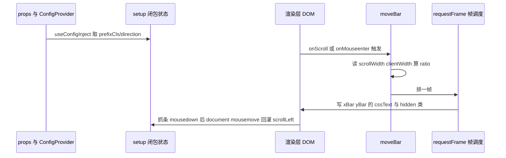
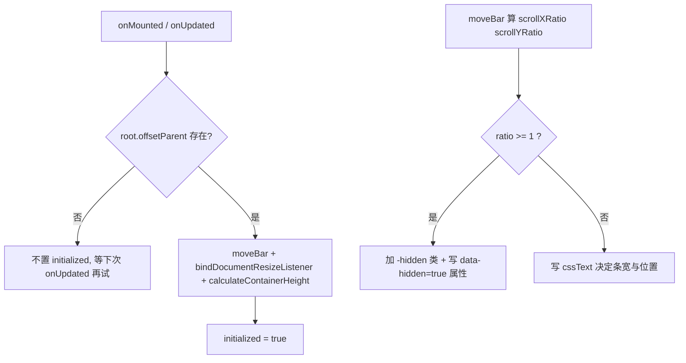

# C02-11 ScrollPanel 滚动面板

> **本篇解决**：ScrollPanel 为什么不用本仓库的 `vc-resize-observer`、它的两条自绘滚动条如何靠几何反算同步到原生 scroll、以及 `prefixCls`/事件/透传属性这三条对外契约为什么在这个组件上集体失效。
> **前置**：C02-00《类横写：栅格/flex/space 三代布局的取舍》　**读者坐标**：`03-components/02-layout` 第 11/14 篇

## 一、职责与边界

`XYScrollPanel`（`packages/xiaoye-ui/src/scroll-panel/ScrollPanel.tsx:25`，组件名 `XYScrollPanel`，`packages/xiaoye-ui/src/scroll-panel/ScrollPanel.tsx:25` 处 `inheritAttrs: false`）是一个**自包含的自定义滚动条容器**：它把一个原生可滚动的内容 `div`（`packages/xiaoye-ui/src/scroll-panel/ScrollPanel.tsx:423-431`）包在容器里、隐藏其原生滚动条（`packages/xiaoye-ui/src/scroll-panel/style/index.ts:38`、`:40-42`），再叠两个绝对定位的 `div` 当横/纵滚动条（`packages/xiaoye-ui/src/scroll-panel/ScrollPanel.tsx:433-446` 与 `:420-433`），并在 `moveBar` 里用 `scrollWidth/clientWidth` 反算每条滚动条的宽高与位移，用 `mousedown`/`mousemove` 反向驱动 `scrollLeft/scrollTop`。它的全部价值就是把「浏览器原生滚动条不可样式化」这一约束在容器内部消化掉。

明确**不负责**的事：

- **不接 `vc-resize-observer`**。`OUTLINE.md:126` 把本篇的依赖登记为 `vc-resize-observer`，但 `packages/xiaoye-ui/src/scroll-panel/ScrollPanel.tsx:1-6` 的 import 面里没有任何 ResizeObserver；重算尺寸走的是 `window` 的 `resize` 事件（`packages/xiaoye-ui/src/scroll-panel/ScrollPanel.tsx:149-154`）。全仓 11 个真实 `vc-resize-observer` 消费者（`affix`、`avatar`、`page-header`、`tabs`、`input/ResizableTextArea`、`vc-table`、`vc-virtual-list`、`vc-overflow`、`typography` 等）里**不含 ScrollPanel**。这条登记是失真项，本篇论点 1 展开。
- **不做轴向锁定**。内部 `orientation`（`packages/xiaoye-ui/src/scroll-panel/ScrollPanel.tsx:37`）只是记录「上一次滚动动了哪个轴」（`packages/xiaoye-ui/src/scroll-panel/ScrollPanel.tsx:200-206`），用于决定方向键驱动哪个轴；横/纵滚动条**始终都在 DOM 里**，靠内容是否溢出该轴来 `visibility` 隐藏。文档的 horizontal 示例（`apps/docs/examples/scroll-panel/horizontal.vue:2` 起）没有传任何「方向」prop，纯靠 `inline-flex` 撑出溢出宽度。
- **不 emit 任何事件、不做内容虚拟化**。`defineComponent` 无 `emits` 选项（`packages/xiaoye-ui/src/scroll-panel/ScrollPanel.tsx:24-27`），`scrollPanelProps` 也没有事件型 prop（`packages/xiaoye-ui/src/scroll-panel/interface.ts:3-5`），`scroll`/`wheel` 只在内部消化不外抛。

**依赖清单**（编译期真实 import，见 `packages/xiaoye-ui/src/scroll-panel/ScrollPanel.tsx:1-6`）：`@xiaoye-ui/utils/dom` 的 `addClass`/`getHeight`/`removeClass`（`packages/xiaoye-ui/src/scroll-panel/ScrollPanel.tsx:18` → `packages/utils/src/dom/index.ts:6`、`:32`、`:80`）、`config-provider/hooks/useConfigInject`（`packages/xiaoye-ui/src/scroll-panel/ScrollPanel.tsx:27` → `packages/xiaoye-ui/src/config-provider/hooks/useConfigInject.ts:14-15`）、`_util/props-util` 的 `initDefaultProps`（`packages/xiaoye-ui/src/scroll-panel/ScrollPanel.tsx:28`）、`./style` 的 `useStyle`（`packages/xiaoye-ui/src/scroll-panel/ScrollPanel.tsx:29` → `packages/xiaoye-ui/src/scroll-panel/style/index.ts:88`）、`./interface` 的 `scrollPanelProps`（`packages/xiaoye-ui/src/scroll-panel/ScrollPanel.tsx:30` → `packages/xiaoye-ui/src/scroll-panel/interface.ts:3`）。入口 `packages/xiaoye-ui/src/scroll-panel/index.ts:9-12` 经 `registerComponent`（`packages/xiaoye-ui/src/_util/registerComponent.ts:16`）注册标签 `xy-scroll-panel`。

**被谁依赖**：源码层面 ScrollPanel 是**叶子**——除自身目录外，`ScrollPanel` 只被生成物 `packages/xiaoye-ui/src/components.ts:286-288`、类型声明 `packages/xiaoye-ui/typings/global.d.ts:73`、主题 token 登记 `packages/xiaoye-ui/src/theme/interface/components.ts:46`/`:123` 与元数据 `packages/metadata/src/components/index.ts:42` 引用；真实下游只有文档示例 `apps/docs/examples/scroll-panel/`（`basic.vue`、`horizontal.vue`）与用法手册 `apps/docs/components/scroll-panel.md:1`。没有第二个组件在实现里 import 它。

## 二、源码地图

组件目录 `packages/xiaoye-ui/src/scroll-panel/` 共 5 个文件、583 行：

| 文件 | 行数 | 职责 | 关键导出 |
| --- | --- | --- | --- |
| `scroll-panel/index.ts` | 14 | 入口、`install`、类型转发 | `XYScrollPanel`（默认）、`ScrollPanelProps`（`:5`） |
| `scroll-panel/ScrollPanel.tsx` | 438 | 主实现：DOM refs、几何反算、鼠标/键盘、渲染 | 默认组件（`setup` 在 `:12`，render 在 `:385`） |
| `scroll-panel/interface.ts` | 7 | 唯一的 props 工厂 | `scrollPanelProps`（`:3`，仅 `step`）、`ScrollPanelProps`（`:7`） |
| `scroll-panel/style/index.ts` | 91 | CSS-in-JS：容器/内容/两条/hidden/grabbed | `ComponentToken` 空接口（`:6`）、默认 `genComponentStyleHook('ScrollPanel', …)`（`:88`） |
| `scroll-panel/__tests__/scroll-panel.test.js` | 33 | **唯一**测试，2 个 `it` | 无 |

外围必读卡位：`useConfigInject.ts:14-15`（读 `props.prefixCls`/`props.direction`，但 ScrollPanel 未声明这两个 prop，见论点 3）、`vc-resize-observer/index.tsx:3`（`resize-observer-polyfill`）与 `:22`（`ResizeObserver` 组件本体，ScrollPanel 从不引用）、`theme/interface/components.ts:117`（注册了一个空的 `ScrollPanelComponentToken`）。主实现入口是 `packages/xiaoye-ui/src/scroll-panel/ScrollPanel.tsx:37` 的 `setup`，渲染函数在 `packages/xiaoye-ui/src/scroll-panel/ScrollPanel.tsx:412`。

## 三、架构与数据流

**静态结构（模块与符号，注意那条虚线缺边）**：

```mermaid
classDiagram
  class index_ts {
    +install()
    +ScrollPanelProps
  }
  class ScrollPanel_tsx {
    +setup()
    +moveBar()
    +expose 25 成员
  }
  class interface_ts {
    +scrollPanelProps()
    +step
  }
  class style_index_ts {
    +genScrollPanelStyle()
    +genComponentStyleHook()
  }
  class useConfigInject {
    +prefixCls
    +direction
  }
  class dom_utils {
    +getHeight()
    +addClass()
    +removeClass()
  }
  class vc_resize_observer {
    +ResizeObserver
    +onResize
  }
  index_ts --> ScrollPanel_tsx
  ScrollPanel_tsx --> interface_ts
  ScrollPanel_tsx --> style_index_ts
  ScrollPanel_tsx --> useConfigInject
  ScrollPanel_tsx --> dom_utils
  ScrollPanel_tsx -.-> "缺边: 从不 import"
```

`ScrollPanel.tsx` 把「读几何 → 反算 → 写样式」闭环全收在自己内部，对外只借 `useConfigInject` 拿前缀、借 `@xiaoye-ui/utils/dom` 的类名/高度工具。它与 `vc_resize_observer` 之间的箭头是**虚线缺边**：这条边在 OUTLINE 里被登记，但在源码里不存在，是理解本篇一切「尺寸不跟手」问题的根因（论点 1、坑 1）。

**数据流（props/refs → 事件 → moveBar → rAF → DOM 写回）**：



内容 `div` 的原生滚动（`packages/xiaoye-ui/src/scroll-panel/ScrollPanel.tsx:427`）经 `onScroll`（`packages/xiaoye-ui/src/scroll-panel/ScrollPanel.tsx:187-209`）回流到 `moveBar`；反过来抓条拖动经 `document` 上的 `mousemove`（`packages/xiaoye-ui/src/scroll-panel/ScrollPanel.tsx:244-253`）改 `content.scrollLeft/scrollTop`（`packages/xiaoye-ui/src/scroll-panel/ScrollPanel.tsx:240`、`:222`），再次触发生成 `scroll` 事件——两条通道构成一个互相回灌的闭环，靠 `scrollXRatio/scrollYRatio`（`packages/xiaoye-ui/src/scroll-panel/ScrollPanel.tsx:50-51`）做比例换算。`moveBar` 的样式写入排进 `requestFrame`（`packages/xiaoye-ui/src/scroll-panel/ScrollPanel.tsx:58-69`、`:93`），读几何放在同帧之前，是标准的「读后写分离」防抖动写法。

**初始化与隐藏判定的两条分支**：



惰性初始化（`packages/xiaoye-ui/src/scroll-panel/ScrollPanel.tsx:187-194` 的 `initialize` 只在 `root.offsetParent` 真值时才 `initialized = true`）是为「组件先挂载、后显示」的容器准备的：`offsetParent` 对 `display:none` 或 `position:fixed` 元素返回 `null`，此时几何全是 0，`moveBar` 会算出脏值，所以用 `onUpdated`（`packages/xiaoye-ui/src/scroll-panel/ScrollPanel.tsx:359-372`）兜底重试。下半支路（`packages/xiaoye-ui/src/scroll-panel/ScrollPanel.tsx:114-136`）里 `ratio >= 1` 意味该轴没有溢出，走隐藏：但同时写了 `-hidden` 类**和**一个 `data-*-hidden` 属性，而只有类被 CSS 消费（论点 2）。

## 四、核心机制精读

### 论点 1：ScrollPanel 的尺寸重算挂在 `window.resize` 上，不接 `vc-resize-observer`——OUTLINE 的依赖登记是失真项

断言：只要视口宽高不变、仅容器自身宽高变化（外层 Splitter 拖动、兄弟面板展开、CSS 断点未触发窗口 resize），ScrollPanel 的两条滚动条尺寸就是**陈旧的**，因为它压根没订阅元素级 resize。

```tsx
// packages/xiaoye-ui/src/scroll-panel/ScrollPanel.tsx:131
    function bindDocumentResizeListener() {
      if (!documentResizeListener) {
        documentResizeListener = () => moveBar();
        window.addEventListener('resize', documentResizeListener);
      }
    }

    function unbindDocumentResizeListener() {
      if (documentResizeListener) {
        window.removeEventListener('resize', documentResizeListener);
        documentResizeListener = null;
      }
    }
```

逐段解释：重算的唯一「尺寸」入口是 `window.addEventListener('resize', …)`（`packages/xiaoye-ui/src/scroll-panel/ScrollPanel.tsx:152`），而 window 的 `resize` 事件语义是**视口**变化，不是元素盒变化。这个监听在 `initialize` 里绑定一次（`packages/xiaoye-ui/src/scroll-panel/ScrollPanel.tsx:187-194`），且 `initialize` 的前置是 `root.value?.offsetParent` 为真值——也就是说容器一旦在隐藏态挂载，resize 监听根本还没挂上（`packages/xiaoye-ui/src/scroll-panel/ScrollPanel.tsx:188`）。

```tsx
// packages/xiaoye-ui/src/scroll-panel/ScrollPanel.tsx:169
    function initialize() {
      if (root.value?.offsetParent) {
        moveBar();
        bindDocumentResizeListener();
        calculateContainerHeight();
        initialized = true;
      }
    }
```

除 resize 外，能触发 `moveBar` 的只剩三处：内容 `scroll` 事件（`packages/xiaoye-ui/src/scroll-panel/ScrollPanel.tsx:196-209`）、内容 `mouseenter`（`packages/xiaoye-ui/src/scroll-panel/ScrollPanel.tsx:428` 的 `onMouseenter={moveBar}`）、以及外部手动调用暴露出的 `refresh`/`moveBar`。没有一处是「容器尺寸变了」。这与本仓库另外 11 处真实用 `vc-resize-observer` 的组件（例如 `packages/xiaoye-ui/src/affix/index.tsx`、`packages/xiaoye-ui/src/avatar/Avatar.tsx`、`packages/xiaoye-ui/src/input/ResizableTextArea.tsx`）形成鲜明对照：那些组件能感知元素盒变化，ScrollPanel 不能。

结论回扣：`OUTLINE.md:126` 给 C02-11 填的依赖列 `vc-resize-observer` 与现实相反。维护者若按 OUTLINE 去 `scroll-panel/` 里找 ResizeObserver 接线会一无所获（`grep -n ResizeObserver packages/xiaoye-ui/src/scroll-panel/ScrollPanel.tsx` 无结果），并且会误以为「容器 resize 一定被处理了」。真实后果见坑 1。

### 论点 2：隐藏/抓取状态被同时写进「CSS 类」和「data-\* 属性」两条通道，只有类通道被消费，属性通道不但没人读、还自相矛盾

断言：`moveBar` 与两个 `*BarMouseDown` 对同一个视觉事实维护了两套并行状态，`data-xy-scroll-panel-hidden`/`-grabbed` 属性全仓只写不读，是死通道；而这条死通道内部还有 X/Y 两支互相矛盾的赋值。

```tsx
// packages/xiaoye-ui/src/scroll-panel/ScrollPanel.tsx:105
        if (scrollXRatio! >= 1) {
          xBar.value.setAttribute('data-xy-scroll-panel-hidden', 'true');
          addClass(xBar.value, `${prefixCls.value}-hidden`);
        } else {
          xBar.value.setAttribute('data-xy-scroll-panel-hidden', 'false');
          removeClass(xBar.value, `${prefixCls.value}-hidden`);

          const leftRatio =
            (Math.abs(content.value.scrollLeft) / (totalWidth - ownWidth)) * (100 - scrollBarWidth);
          xBar.value.style.cssText = `width:${scrollBarWidth}%; inset-inline-start:${leftRatio}%; bottom:${bottom}px;`;
        }
```

逐段解释：隐藏一个轴时，同时 `setAttribute('data-xy-scroll-panel-hidden','true')`（`packages/xiaoye-ui/src/scroll-panel/ScrollPanel.tsx:124`）**和** `addClass(...-hidden)`（`packages/xiaoye-ui/src/scroll-panel/ScrollPanel.tsx:107`）。真正让条消失的是 CSS 里的类选择器 ``[`&-hidden`]: { visibility: 'hidden' }``（`packages/xiaoye-ui/src/scroll-panel/style/index.ts:73-75`），而不是那个 `data-*` 属性——全仓 `grep -rn "data-xy-scroll-panel" packages apps` 的命中**全部**落在 `ScrollPanel.tsx` 的 `setAttribute` 行上（`packages/xiaoye-ui/src/scroll-panel/ScrollPanel.tsx:124`、`:100`、`:109`、`:112` 及 grabbed 的 `:188`、`:190`、`:200`、`:202`、`:239`、`:243`、`:246`），没有任何样式表或脚本读取它们。

抓取态的矛盾更明显。对比两个 `mousedown`：

```tsx
// packages/xiaoye-ui/src/scroll-panel/ScrollPanel.tsx:193
    function onXBarMouseDown(e: MouseEvent) {
      isXBarClicked = true;
      xBar.value?.focus();
      lastPageX = e.pageX;
      yBar.value?.setAttribute('data-xy-scroll-panel-grabbed', 'false');
      if (xBar.value) addClass(xBar.value, `${prefixCls.value}-grabbed`);
      document.body.setAttribute('data-xy-scroll-panel-grabbed', 'false');
      addClass(document.body, `${prefixCls.value}-grabbed`);
      bindDocumentMouseListeners();
      e.preventDefault();
    }

    function onYBarMouseDown(e: MouseEvent) {
      isYBarClicked = true;
      yBar.value?.focus();
      lastPageY = e.pageY;
      yBar.value?.setAttribute('data-xy-scroll-panel-grabbed', 'true');
      if (yBar.value) addClass(yBar.value, `${prefixCls.value}-grabbed`);
      document.body.setAttribute('data-xy-scroll-panel-grabbed', 'true');
      addClass(document.body, `${prefixCls.value}-grabbed`);
      bindDocumentMouseListeners();
      e.preventDefault();
    }
```

`onYBarMouseDown` 把 body 的 `data-xy-scroll-panel-grabbed` 设为 `'true'`（`packages/xiaoye-ui/src/scroll-panel/ScrollPanel.tsx:229`），而几乎逐行对称的 `onXBarMouseDown` 把它设为 `'false'`（`packages/xiaoye-ui/src/scroll-panel/ScrollPanel.tsx:217`）。这是一处复制粘贴不对称。它今天**不会**暴露，是因为没人读该属性；真正生效的是两支都调用的 `addClass(document.body, ...-grabbed)`（`packages/xiaoye-ui/src/scroll-panel/ScrollPanel.tsx:218`、`:203`），对应样式 ``[`&-grabbed, ${componentCls}-grabbed`]: { userSelect: 'none' }``（`packages/xiaoye-ui/src/scroll-panel/style/index.ts:81-83`）——它才是抑制拖动时选中文字的那条规则。

结论回扣：这类「一个状态两套写入口、其中一套无人消费」正是 OUTLINE 末尾「已知待办」登记的 `API 面存活、实现死亡` 家族在 ScrollPanel 里的翻版。坑 6 记录了：一旦有人想「补一个 `[data-xy-scroll-panel-grabbed="true"]` 样式」来接管高亮，会立刻踩到 X 支写 `false` 的历史矛盾。

### 论点 3：`prefixCls` 与 `direction` 被 `useConfigInject` 读取，却没在 props 里声明——逐实例覆盖是死的，任意透传属性也被静默丢弃

断言：ScrollPanel 的 props 面只有一个 `step`；`prefixCls`/`direction` 虽然被 `useConfigInject` 当 prop 读，但因未声明 + `inheritAttrs:false` + 根节点不 `...attrs` 三重叠加，用户无法逐实例改前缀或方向，也无法给根节点挂 `id`/`data-*`/`title`。

```ts
// packages/xiaoye-ui/src/scroll-panel/interface.ts:3
export const scrollPanelProps = () => ({
  step: { type: Number, default: 5 },
});
```

```ts
// packages/xiaoye-ui/src/config-provider/hooks/useConfigInject.ts:14
  const prefixCls = computed(() => configProvider.getPrefixCls(name, props.prefixCls));
  const direction = computed(() => props.direction ?? configProvider.direction?.value);
```

逐段解释：`useConfigInject` 明确把 `props.prefixCls`（`packages/xiaoye-ui/src/config-provider/hooks/useConfigInject.ts:14`）与 `props.direction`（`packages/xiaoye-ui/src/config-provider/hooks/useConfigInject.ts:15`）当作逐实例覆盖口来读。但 `scrollPanelProps()`（`packages/xiaoye-ui/src/scroll-panel/interface.ts:3-5`）里**没有** `prefixCls`/`direction` 两项——这与本仓库组件惯例（`AGENTS.md` 的 Button 模板里 `prefixCls: String` 是显式声明的）不一致。未声明的 prop 不会进 `props`，因此 `props.prefixCls` 恒为 `undefined`，`getPrefixCls(name, undefined)` 只会退回全局前缀。结论：ScrollPanel 的类名前缀**只能全局改**（`ConfigProvider`），逐实例覆盖口是关着的。

再看透传。`inheritAttrs: false`（`packages/xiaoye-ui/src/scroll-panel/ScrollPanel.tsx:26`）关掉了自动透传，而渲染里根 `div` 只手动绑了两个 attr：

```tsx
// packages/xiaoye-ui/src/scroll-panel/ScrollPanel.tsx:394
    return () => {
      const classes = [
        prefixCls.value,
        hashId.value,
        attrs.class,
        { [`${prefixCls.value}-rtl`]: direction.value === 'rtl' },
      ];

      return wrapSSR(
        <div ref={root} class={classes} style={attrs.style}>
```

`class`（`packages/xiaoye-ui/src/scroll-panel/ScrollPanel.tsx:416`，来自 `attrs.class`）与 `style`（`packages/xiaoye-ui/src/scroll-panel/ScrollPanel.tsx:421`，来自 `attrs.style`）被手动接上，其余 `attrs` 既不落到根 `div`、也没有别处消费，于是 `<xy-scroll-panel id="x" role="region">` 这类属性会被静默丢弃。`direction` 的作用仅剩根节点的 `-rtl` 类（`packages/xiaoye-ui/src/scroll-panel/ScrollPanel.tsx:417`，取自全局 config 而非 prop），配合样式里条位置用的是逻辑属性 `inset-inline-start`/`inset-inline-end`（`packages/xiaoye-ui/src/scroll-panel/ScrollPanel.tsx:114`、`:117`）来做 RTL 翻转。结论回扣：唯一真正「活着且可逐实例改」的输入是 `step`（被 `onKeyDown` 读取，`packages/xiaoye-ui/src/scroll-panel/ScrollPanel.tsx:303`）。

### 论点 4：内容 `id` 用 `Math.random()` 生成，SSR 下服务端与客户端各算各的，`aria-controls` 关联会在水合后断裂

> **2026-09-29 已修**：随机源已换成组件实例 `uid`（现 `ScrollPanel.tsx:31`-`:34` 的 `getCurrentInstance()?.uid`，注释写明「uid 在服务端与客户端的组件创建顺序一致」），SSR 水合断裂不再发生。下方摘录为**修复前快照**。

断言（修前）：滚动条的无障碍关联完全依赖一个随机 id，而这个随机 id 在 SSR 场景下服务端产物与客户端产物不一致。

```ts
// 修复前快照（修后为 uid 版，见 ScrollPanel.tsx:34）
    const contentId = computed(
      () => `xy_scroll_panel_${Math.random().toString(36).slice(2)}_content`,
    );
```

逐段解释：`contentId` 是 `computed`（`packages/xiaoye-ui/src/scroll-panel/ScrollPanel.tsx:23-25`），求值一次后按实例缓存，因此同一次渲染里三处引用（内容 `div` 的 `id` 在 `packages/xiaoye-ui/src/scroll-panel/ScrollPanel.tsx:425`、两条滚动条的 `aria-controls` 在 `packages/xiaoye-ui/src/scroll-panel/ScrollPanel.tsx:439`、`:426`）拿到的是同一个值，客户端内部自洽。问题在跨端：`Math.random()`（`packages/xiaoye-ui/src/scroll-panel/ScrollPanel.tsx:24`）在 Node 端与浏览器端各自取值、互不可知，SSR 生成的 `id="xy_scroll_panel_aBc..._content"` 与水合时 `setup` 重新算出的 id 必然不同，于是 hydration 阶段属性不匹配、`aria-controls` 指向一个不存在的 id。这违反 `AGENTS.md`「SSR 兼容：组件需要支持服务端渲染」的硬约定。仓库里做全局 id 的组件通常用自增计数器（而非随机），ScrollPanel 是个反例。（未在本篇范围内找到对 `contentId` 稳定化的处理，此处仅指出随机源本身。）

需要精确区分的是：**SSR 阶段本身不会崩**。所有 `window`/`document` 访问都待在函数体内（`moveBar`、`initialize`、各 `*MouseDown`…），只在 `onMounted`（`packages/xiaoye-ui/src/scroll-panel/ScrollPanel.tsx:357`）与真实用户事件里被调用，服务端 `setup` 求值时这些函数不被执行、`root.value` 等为 `null`，因此不会 `window is not defined`。渲染也被 `wrapSSR` 包裹以注入样式（`packages/xiaoye-ui/src/scroll-panel/ScrollPanel.tsx:420`）。唯一的 SSR 侧后果就是上面这个随机 `id` 造成的水合属性 mismatch——这也说明：一个组件「能在服务端跑通」和「水合正确」是两件事，坑 3 定位到行即可复现。

### 论点 5：键盘滚动不建 `setInterval`，靠「每次 keydown 清掉 40ms 定时器再重排一枪」续命，连续滚动完全押在操作系统的按键自动重复上

断言：按住方向键能否连续滚，取决于系统 keydown 重复间隔是否 ≥ 40ms；这个实现没有任何自持的循环。

```tsx
// packages/xiaoye-ui/src/scroll-panel/ScrollPanel.tsx:263
    function repeat(bar: 'scrollTop' | 'scrollLeft', step: number) {
      if (!content.value) return;
      content.value[bar] += step;
      moveBar();
    }

    function setTimer(bar: 'scrollTop' | 'scrollLeft', step: number) {
      clearTimer();
      timer = setTimeout(() => repeat(bar, step), 40);
    }
```

逐段解释：`repeat`（`packages/xiaoye-ui/src/scroll-panel/ScrollPanel.tsx:281-285`）只滚一格 `props.step` 然后 `moveBar`，它**不自我重排**。续命靠 `onKeyDown`（`packages/xiaoye-ui/src/scroll-panel/ScrollPanel.tsx:290-335`）——浏览器在按住方向键时以系统重复频率连发 keydown，每来一次就调 `setTimer`（如 `packages/xiaoye-ui/src/scroll-panel/ScrollPanel.tsx:303`）。而 `setTimer` 第一行是 `clearTimer()`（`packages/xiaoye-ui/src/scroll-panel/ScrollPanel.tsx:288`），会把上一个尚未触发的 40ms 定时器清掉再重排。于是存在一个隐性竞态：若系统按键重复间隔小于 40ms，`setTimeout(…, 40)` 永远在触发前被下一个 keydown 清除，`repeat` 一次都不执行，表现为「按住方向键纹丝不动」。方向由 `orientation` 决定（`packages/xiaoye-ui/src/scroll-panel/ScrollPanel.tsx:300`、`:290`），而 `orientation` 是 `onFocus` 依据焦点落在哪条上来设定的（`packages/xiaoye-ui/src/scroll-panel/ScrollPanel.tsx:332-338`）。`onKeyUp` 仅 `clearTimer()`（`packages/xiaoye-ui/src/scroll-panel/ScrollPanel.tsx:319-321`）。结论回扣：这是一段把「定时循环」外包给宿主环境的实现，跨平台手感不一致，且无测试保护（见坑 4）。

### 论点 6：`expose` 把 25 个成员、几乎整套内部实现钉成了公开契约，但测试只用其中一个

断言：组件实例对外暴露的不是一层「公共方法」，而是内部函数清单的转储，导致后续重构这些函数即破坏契约。

```tsx
// packages/xiaoye-ui/src/scroll-panel/ScrollPanel.tsx:366
    expose({
      initialize,
      calculateContainerHeight,
      moveBar,
      onYBarMouseDown,
      onXBarMouseDown,
      onScroll,
      onKeyDown,
      onKeyUp,
      repeat,
      setTimer,
      clearTimer,
      onDocumentMouseMove,
      onMouseMoveForXBar,
      onMouseMoveForYBar,
      onFocus,
      onBlur,
      onDocumentMouseUp,
      requestAnimationFrame: requestFrame,
      refresh,
      scrollTop,
      timeoutFrame,
      bindDocumentMouseListeners,
      unbindDocumentMouseListeners,
      bindDocumentResizeListener,
      unbindDocumentResizeListener,
    });
```

逐段解释：`expose`（`packages/xiaoye-ui/src/scroll-panel/ScrollPanel.tsx:366-392`）列出 25 个成员（行 358–382），其中绝大多数是事件处理器与生命周期辅助：`onXBarMouseDown`/`onYBarMouseDown`（`packages/xiaoye-ui/src/scroll-panel/ScrollPanel.tsx:379-389`）、`onFocus`/`onBlur`（`packages/xiaoye-ui/src/scroll-panel/ScrollPanel.tsx:391-400`）、`onDocumentMouseMove`（`packages/xiaoye-ui/src/scroll-panel/ScrollPanel.tsx:387`）、以及 `bindDocumentResizeListener`/`unbindDocumentResizeListener`（`packages/xiaoye-ui/src/scroll-panel/ScrollPanel.tsx:400-409`）这类明显是论据点 1 内部机制的函数。更刺眼的是把帧调度原语也外抛：`timeoutFrame`（`packages/xiaoye-ui/src/scroll-panel/ScrollPanel.tsx:396`）与一个改名键 `requestAnimationFrame: requestFrame`（`packages/xiaoye-ui/src/scroll-panel/ScrollPanel.tsx:384`）。而唯一测试文件 `packages/xiaoye-ui/src/scroll-panel/__tests__/scroll-panel.test.js:29` 只 `await wrapper.vm.scrollTop(50)` 用到 `scrollTop`；语义上像公共 API 的其实只有 `refresh`（`packages/xiaoye-ui/src/scroll-panel/ScrollPanel.tsx:346-357`，转发一次 `moveBar`）与 `scrollTop(value)`（带 `[0, scrollableHeight]` 夹取，`packages/xiaoye-ui/src/scroll-panel/ScrollPanel.tsx:341-346`）。

结论回扣：一旦有用户（或本仓库未来某个组件）`ref.value.bindDocumentResizeListener()`，论点 1 里那套 `window.resize` 方案就无法无痛替换为 `vc-resize-observer`——契约面已被内部实现撑满。这是「实现细节泄漏为公共 API」的教科书样本，与 OUTLINE「已知待办」的过度暴露条目同类。

### 论点 7：`moveBar` 里藏着三条不成文的几何约束——10% 拇指下限、负偏移定位、以及「ratio<1 才进除法」的隐式防零

断言：滚动条的尺寸/位置公式不是朴素比例映射，读不懂这三条就会误改。

```tsx
// packages/xiaoye-ui/src/scroll-panel/ScrollPanel.tsx:86
    function moveBar() {
      if (!content.value || !xBar.value || !yBar.value || !root.value) return;

      const totalWidth = content.value.scrollWidth;
      const ownWidth = content.value.clientWidth;
      const bottom = (root.value.clientHeight - xBar.value.clientHeight) * -1;
      scrollXRatio = ownWidth / totalWidth;

      const totalHeight = content.value.scrollHeight;
      const ownHeight = content.value.clientHeight;
      const right = (root.value.clientWidth - yBar.value.clientWidth) * -1;
      scrollYRatio = ownHeight / totalHeight;

      const scrollBarWidth = Math.max(scrollXRatio * 100, 10);
      const scrollBarHeight = Math.max(scrollYRatio * 100, 10);
```

逐段解释：

- **入口守卫**：第一行 `if (!content.value || !xBar.value || !yBar.value || !root.value) return;`（`packages/xiaoye-ui/src/scroll-panel/ScrollPanel.tsx:105`）对四个 ref 全量判空，这是为「`onBeforeUnmount` 后仍有排队 rAF 回调落地」准备的——配合 `requestFrame` 回调内的再次判空（`packages/xiaoye-ui/src/scroll-panel/ScrollPanel.tsx:121`），才让坑 5 的残帧不至于抛错。
- **10% 拇指下限**：`scrollBarWidth = Math.max(scrollXRatio * 100, 10)`（`packages/xiaoye-ui/src/scroll-panel/ScrollPanel.tsx:117`）、纵向同理（`:91`）。即便内容极长使 `ratio→0`，自定义拇指也绝不短于轨道的 10%，保证「抓得住」。代价：内容超过约 10 倍视口时拇指不再等比，位置比例与实际滚动比例出现肉眼可见偏差。改这个 `10` 会同时影响两条轴的可点性。
- **负偏移定位**：`bottom`（`packages/xiaoye-ui/src/scroll-panel/ScrollPanel.tsx:100`）与 `right`（`:87`）都是 `(容器尺寸 - 条尺寸) * -1` 的负值，最终写进 `cssText` 的 `bottom:${bottom}px`（`packages/xiaoye-ui/src/scroll-panel/ScrollPanel.tsx:114`）与 `inset-inline-end:${right}px`（`:117`）。负号源于论点六讲的「内容被撑大 `2*barSize`」——滚动条定位参照的是被放大的内容盒，需要负偏移把它拉回容器可视边缘。
- **隐式防零**：`leftRatio` 除以 `(totalWidth - ownWidth)`（`packages/xiaoye-ui/src/scroll-panel/ScrollPanel.tsx:121-122`）、纵向除以 `(totalHeight - ownHeight)`（`:115-116`）。这两处除法只在 `scrollXRatio! >= 1`（`packages/xiaoye-ui/src/scroll-panel/ScrollPanel.tsx:114`）/ `scrollYRatio! >= 1`（`:108`）的 `else` 分支里执行，而 `ratio < 1` 恰好等价于 `totalWidth > ownWidth`，分母严格为正——**没有** 显式 `if (totalWidth===ownWidth)` 保护，靠的是分支顺序保证。一旦有人把 `else` 里的除法提到分支外，就会在「内容恰好不溢出」时炸出 `Infinity`。
- **读后写分离**：几何读取（`scrollWidth`/`scrollHeight`/`clientWidth`…，`packages/xiaoye-ui/src/scroll-panel/ScrollPanel.tsx:89-100`）全在同步段完成，只有样式写入进 `requestFrame` 的回调（`packages/xiaoye-ui/src/scroll-panel/ScrollPanel.tsx:102`），避免同一事件里读写交错触发重排抖动。

结论回扣：这套公式没有注释、没有测试断言其数值（`packages/xiaoye-ui/src/scroll-panel/__tests__/scroll-panel.test.js` 不校验 cssText），维护者只能靠读源码理解「为什么拇指最短 10%」「为什么 bottom 是负的」——这正是本篇存在的理由。

### 论点 8：`onScroll` 用 `else if` 判方向，横向优先且对角滚动只记一轴，而 `orientation` 又反过来决定方向键作用哪个轴

断言：键盘滚动到底走横还是走纵，不是用户显式选的，是被「上一次滚动事件恰好先命中哪个分支」隐式决定的，存在一个静默的轴向串扰。

```tsx
// packages/xiaoye-ui/src/scroll-panel/ScrollPanel.tsx:178
    function onScroll(event: Event) {
      const target = event.target as HTMLElement | null;
      if (!target) return;

      if (lastScrollLeft.value !== target.scrollLeft) {
        lastScrollLeft.value = target.scrollLeft;
        orientation.value = 'horizontal';
      } else if (lastScrollTop.value !== target.scrollTop) {
        lastScrollTop.value = target.scrollTop;
        orientation.value = 'vertical';
      }

      moveBar();
    }
```

逐段解释：`orientation` 的更新是 `if (横变) … else if (纵变) …`（`packages/xiaoye-ui/src/scroll-panel/ScrollPanel.tsx:200-206`）。`scroll` 事件在同一帧里若横纵都动了（触控板斜向滚动很常见），因为 `else if` 结构，只会命中横向分支、把 `orientation` 钉成 `'horizontal'`，纵向增量被完全忽略（`packages/xiaoye-ui/src/scroll-panel/ScrollPanel.tsx:203`）。这个 `orientation` 紧接着就是论点 5 键盘分支的开关：`onKeyDown` 首行 `if (orientation.value === 'vertical')` 决定 ↑↓ 是真滚还是被 `preventDefault` 吞掉（`packages/xiaoye-ui/src/scroll-panel/ScrollPanel.tsx:300-316`）。于是「刚斜向滚过一下」会让用户按 ↓ 时毫无反应（被当成横向模式吞掉，`packages/xiaoye-ui/src/scroll-panel/ScrollPanel.tsx:310-313`）。

复位逻辑同样不对称：

```tsx
// packages/xiaoye-ui/src/scroll-panel/ScrollPanel.tsx:331
    function onBlur() {
      if (orientation.value === 'horizontal') {
        orientation.value = 'vertical';
      }
    }
```

`onBlur`（绑定在两条上，`packages/xiaoye-ui/src/scroll-panel/ScrollPanel.tsx:445`、`:432`）只把 `horizontal` 复位回默认 `vertical`（`packages/xiaoye-ui/src/scroll-panel/ScrollPanel.tsx:342-351`），从不复位成 `horizontal`；`onFocus` 则按焦点落点显式设向（`packages/xiaoye-ui/src/scroll-panel/ScrollPanel.tsx:324-327`）。三条写向源（`onScroll` 的 `else if`、`onFocus`、`onBlur`）叠在一起，没有一个单一真源。结论回扣：这是一个「滚动历史被当作输入模式」的设计味道——`orientation` 语义在文件里既当「上次滚动方向」又当「当前键盘轴」用（`packages/xiaoye-ui/src/scroll-panel/ScrollPanel.tsx:46`），一个变量两种职责是坑的温床。

## 五、对外契约如何生效

**输入侧**：外部唯一能喂进 `props` 的键是 `step`（`packages/xiaoye-ui/src/scroll-panel/interface.ts:4`，默认 `5` 由 `packages/xiaoye-ui/src/scroll-panel/ScrollPanel.tsx:36` 的 `initDefaultProps` 兜底），它只在键盘处理里被读（`packages/xiaoye-ui/src/scroll-panel/ScrollPanel.tsx:303`、`:280`、`:293`、`:297`）。`prefixCls`/`direction` 名义上是配置注入入口、实际逐实例失效（论点 3）。`slots.default`（`packages/xiaoye-ui/src/scroll-panel/ScrollPanel.tsx:37` 解构、`:403` 渲染进可滚动的 `...-content`）是唯一的内容入口，没有命名插槽。

**渲染侧**：渲染函数产出一个根 `div` + 一个 `-content-container` 包 `-content` + 两个绝对定位条（`packages/xiaoye-ui/src/scroll-panel/ScrollPanel.tsx:402-444`），整体被 `wrapSSR` 包裹（`packages/xiaoye-ui/src/scroll-panel/ScrollPanel.tsx:420`），`hashId` 挂在根节点类名里（`packages/xiaoye-ui/src/scroll-panel/ScrollPanel.tsx:415`）。注意：两条滚动条元素**自身**不携带 `hashId`（`packages/xiaoye-ui/src/scroll-panel/ScrollPanel.tsx:406`、`:422` 的 `class` 只有 `-bar`/`-bar-x`/`-bar-y`），所以它们的显隐依赖的是「运行时 `addClass` 追加的 `-hidden`」（`packages/xiaoye-ui/src/scroll-panel/ScrollPanel.tsx:107`、`:110`），而非渲染期类名绑定——这解释了为什么 `moveBar` 必须命令式操作 DOM 而不是改一个响应式变量。

**无障碍契约**：两条用 `role="scrollbar"`（`packages/xiaoye-ui/src/scroll-panel/ScrollPanel.tsx:437`、`:424`）、`aria-orientation`（`packages/xiaoye-ui/src/scroll-panel/ScrollPanel.tsx:438`、`:425`）、`aria-controls` 指向随机 `contentId`（`packages/xiaoye-ui/src/scroll-panel/ScrollPanel.tsx:439`、`:426`）、`aria-valuenow` 绑定 `lastScrollLeft/lastScrollTop`（`packages/xiaoye-ui/src/scroll-panel/ScrollPanel.tsx:440`、`:427`）。缺 `aria-valuemin`/`aria-valuemax`，且 `aria-valuenow` 存的是像素值不是 0–100 百分比，语义不完整（论点 4 的随机 id 还带来 SSR 断链）。

**输出侧**：没有 `emits`、没有事件 prop（`packages/xiaoye-ui/src/scroll-panel/ScrollPanel.tsx:24-27`、`interface.ts:3-5`）——`onScroll`/`onKeyDown` 等名字带 `on*` 但都是 DOM 原生事件处理器（绑定在 `packages/xiaoye-ui/src/scroll-panel/ScrollPanel.tsx:427`、`:415` 等），不是组件自定义事件。对外回流只有 `expose` 的 25 个方法（论点 6）。因此「监听 ScrollPanel 滚动」这件事在组件层面根本不存在接口，只能自己 `addEventListener('scroll')` 到内部 `.xy-scroll-panel-content` 上。

## 六、设计取舍

**为什么用 `window.resize` 而不是复用 `vc-resize-observer`**：复用能一行接一个 `<ResizeObserver onResize>` 组件就获得元素盒变化通知（见 `packages/xiaoye-ui/src/vc-resize-observer/index.tsx:57` 的 `onResize` 回调），代价是要引入 polyfill 依赖与一层包裹元素。当前实现选了零依赖路径，把触发点摊到 `scroll`/`mouseenter`/`window.resize`/手动 `refresh` 四个来源上（论点 1）。赔上的能力：容器自身尺寸变化（Splitter/折叠展开）拿不到通知，只能靠鼠标进容器时 `mouseenter` 顺手补一次 `moveBar`（`packages/xiaoye-ui/src/scroll-panel/ScrollPanel.tsx:419`）——一个「交互兜底」被当成了「尺寸兜底」。

**为什么命令式重写 `style.cssText`**：`moveBar` 每帧把整条 `width:...%;inset-inline-start:...%;bottom:...px` 赋给 `cssText`（`packages/xiaoye-ui/src/scroll-panel/ScrollPanel.tsx:114`、`:117`）。好处是滚动条跟手、绕开 Vue 响应式与 patch 开销；代价是**每次赋值清空该元素此前所有内联样式**，外部无法再给这两条挂内联 style（`cssText` 是全量覆盖，非合并）。同时可见性走 `visibility:hidden` 而非 `display:none`（`packages/xiaoye-ui/src/scroll-panel/style/index.ts:73-75`），保留占位、避免布局抖动。

**为什么内容比容器大 `2*barSize` 再补 `padding`**：`-content` 用 `height/width: calc(100% + ${barSize*2}px)` 撑大、再用 `paddingInline/paddingBlock: 0 ${barSize*2}px` 收回（`packages/xiaoye-ui/src/scroll-panel/style/index.ts:31-34`），配合 `scrollbar-width:none`（`packages/xiaoye-ui/src/scroll-panel/style/index.ts:38`）与 `::-webkit-scrollbar{display:none}`（`packages/xiaoye-ui/src/scroll-panel/style/index.ts:40-42`）把原生滚动条藏到可视区外。这是把「自绘条压在原生条槽位」的经典做法。代价：内容可用空间与溢出判定被这套 padding 语义绑定，改动 `barSize`（`packages/xiaoye-ui/src/scroll-panel/style/index.ts:12`）会同时移动隐藏槽位与自定义条尺寸。

**为什么还需要 `calculateContainerHeight`**：`moveBar` 只管滚动条，容器自身高度交给 `calculateContainerHeight`（`packages/xiaoye-ui/src/scroll-panel/ScrollPanel.tsx:57-84`）单独兜。它的生效条件极窄：`containerStyles.maxHeight !== 'none' && pureContainerHeight === 0`（`packages/xiaoye-ui/src/scroll-panel/ScrollPanel.tsx:82`）——即「根节点用 CSS 设了 `max-height`，且实测高度（扣掉横条高）为 0」时才介入，此时若内容 `offsetHeight + 横条高` 超过 `maxHeight` 就把根高钉成 `maxHeight`（`packages/xiaoye-ui/src/scroll-panel/ScrollPanel.tsx:86-87`），否则按 `content.offsetHeight + padding + border` 精确回算（`:62-72`）。维护者据此可知：本组件的**高度不由 prop 决定**（`interface.ts` 只有 `step`），完全交给外部 CSS 的 `height/max-height`；`calculateContainerHeight` 只是修复「外部设了 max-height 却因内容塌陷成 0」的边角。它被 `initialize` 调用一次（`packages/xiaoye-ui/src/scroll-panel/ScrollPanel.tsx:191`）并出现在 `expose` 里（`:359`），意味着改高度逻辑同样是契约变更。

**空 `ComponentToken` 的覆写口是关的**：`style/index.ts:6` 的 `ComponentToken` 与 `ScrollPanelToken`（`:8`，`extends FullToken<'ScrollPanel'> {}` 空体）都不加组件专属 token，`genComponentStyleHook('ScrollPanel', token => mergeToken(token, {}))`（`packages/xiaoye-ui/src/scroll-panel/style/index.ts:88-90`）注入的是空对象，条色走 `new TinyColor(colorTextSecondary).setAlpha(0.3)`（`packages/xiaoye-ui/src/scroll-panel/style/index.ts:13`）、条宽走 `token.sizeXS || 9`（`packages/xiaoye-ui/src/scroll-panel/style/index.ts:12`）这种硬派生。这与 Collapse 在主题层注册空 `ComponentToken` 是同一套路（见 C02-09 论点 6）：`theme/interface/components.ts:117` 的 `ScrollPanel?: ScrollPanelComponentToken` 类型口存在，但往里塞 token 不会有任何消费点。

## 七、坑与改动指南

**坑 1（尺寸不跟手）**
- 触发：视口不变、仅容器宽高变化——外层 Splitter（C02-06）拖动、兄弟 `collapse` 展开、CSS Grid 重排。
- 症状：滚动条长度/位置与实际可滚范围不符，直到用户滚动或鼠标进入容器才恢复。
- 原因：只有 `window.resize`/`scroll`/`mouseenter`/手动 `refresh` 触发 `moveBar`，无元素级 ResizeObserver（见 C02-06 splitter 用 `vc-resize-observer`，本组件没用）。
- 定位：`packages/xiaoye-ui/src/scroll-panel/ScrollPanel.tsx:149-154`、`:169-182`、`:401`。**该分支无测试保护**（`packages/xiaoye-ui/src/scroll-panel/__tests__/scroll-panel.test.js` 只有 2 用例）。

**坑 2（透传属性/逐实例 prefixCls 被吞）**
- 触发：`<xy-scroll-panel prefixCls="my" id="x" data-x="1">`。
- 症状：前缀仍是全局值，`id`/`data-*` 在 DOM 上消失。
- 原因：props 未声明 `prefixCls`（`packages/xiaoye-ui/src/scroll-panel/interface.ts:3-5`），`inheritAttrs:false`（`packages/xiaoye-ui/src/scroll-panel/ScrollPanel.tsx:26`），根节点只手动绑 `class`/`style`（`packages/xiaoye-ui/src/scroll-panel/ScrollPanel.tsx:416`、`:394`）。
- 定位：`packages/xiaoye-ui/src/scroll-panel/ScrollPanel.tsx:412-421` + `packages/xiaoye-ui/src/config-provider/hooks/useConfigInject.ts:14-15`。

**坑 3（SSR 水合 id 不一致）**
- 触发：`nuxt-module`/VitePress SSR 渲染 ScrollPanel 后水合。
- 症状：`aria-controls` 指向不存在的 id，hydration 属性 mismatch 警告。
- 原因（修前）：`contentId` 用 `Math.random()`，服务端与客户端各算各的；**2026-09-29 已改用组件实例 `uid`（`ScrollPanel.tsx:34`），本坑不再复现**，保留作判据样本。原消费点行号为修前位置。**无测试覆盖 SSR（修后仍未补）。**

**坑 4（长按方向键时断时续）**
- 触发：按住 ↑/↓ 或 ←/→。
- 症状：部分平台完全不滚，或每次只滚一格。
- 原因：无 `setInterval`，`setTimer` 每次 keydown 先 `clearTimer()` 再排单发 40ms 定时器，系统按键重复间隔 <40ms 时永远触发不了 `repeat`（`packages/xiaoye-ui/src/scroll-panel/ScrollPanel.tsx:271-281`、`:254-258`）。
- 定位：`packages/xiaoye-ui/src/scroll-panel/ScrollPanel.tsx:288`。**该分支无测试保护。**

**坑 5（`frame` 单槽位 + 回退分支取消错 API）**
- 触发：拖动滚动条的同时内容仍在滚动，或环境无 `requestAnimationFrame` 走了 `timeoutFrame` 回退。
- 症状：卸载时残留一帧回调（内部有 `null` 守卫兜住，但会多跑一次 `moveBar`）；回退路径下 `cancelAnimationFrame` 取消不掉 `setTimeout` 句柄。
- 原因：`moveBar`（`packages/xiaoye-ui/src/scroll-panel/ScrollPanel.tsx:102`）、`onMouseMoveForXBar`（`:212`）、`onMouseMoveForYBar`（`:220`）共用同一个 `let frame`（`packages/xiaoye-ui/src/scroll-panel/ScrollPanel.tsx:58`），后写覆盖前值，`onBeforeUnmount` 只 `cancelAnimationFrame(frame)`（`packages/xiaoye-ui/src/scroll-panel/ScrollPanel.tsx:379-381`）；而 `requestFrame` 的兜底是 `window.setTimeout`（`packages/xiaoye-ui/src/scroll-panel/ScrollPanel.tsx:58-64`），句柄类型与取消 API 不匹配。
- 定位：`packages/xiaoye-ui/src/scroll-panel/ScrollPanel.tsx:58`、`:40-46`、`:352-354`。

**坑 6（死属性通道的隐藏矛盾）**
- 触发：有人想「用 `[data-xy-scroll-panel-grabbed]` 接管抓取高亮」。
- 症状：X 条抓取时读到 `'false'`、Y 条读到 `'true'`，样式只在一个轴生效。
- 原因：`onXBarMouseDown` 把 body 该属性写 `false`（`packages/xiaoye-ui/src/scroll-panel/ScrollPanel.tsx:217`），`onYBarMouseDown` 写 `true`（`:202`），二者本应对称；今天无人读该属性所以不显形（论点 2）。
- 定位：`packages/xiaoye-ui/src/scroll-panel/ScrollPanel.tsx:215-233`。

**坑 7（`onDocumentMouseMove` 的「两轴都没抓」分支是死代码）**
- 触发：以为删掉 `else { onMouseMoveForXBar; onMouseMoveForYBar; }` 会改变某种边界行为。
- 症状：删了也没区别——该分支永远进不去。
- 原因：`bindDocumentMouseListeners` 只在 `onXBarMouseDown`（`packages/xiaoye-ui/src/scroll-panel/ScrollPanel.tsx:219`，此前已置 `isXBarClicked = true` `:185`）与 `onYBarMouseDown`（`:204`，此前置 `isYBarClicked = true` `:197`）里被调用；也就是 `document` 上一旦挂着 `mousemove`，`isXBarClicked`/`isYBarClicked` 必有一个为真，于是 `onDocumentMouseMove`（`packages/xiaoye-ui/src/scroll-panel/ScrollPanel.tsx:235-253`）恒走前两个分支，末尾同时驱动两轴的 `else`（`:231-234`）不可达。若有人据此「优化」成两轴同时跟手，反而会给单轴抓条引入非预期位移。
- 定位：`packages/xiaoye-ui/src/scroll-panel/ScrollPanel.tsx:244-253`、`:192`、`:204`。

**改动安全边界**：动 `moveBar` 的几何公式（`packages/xiaoye-ui/src/scroll-panel/ScrollPanel.tsx:95-138`）前，先确认没有外部依赖 `expose` 里的 `moveBar`/`bindDocumentResizeListener` 等（论点 6）——它们是公开契约。若要引入 ResizeObserver 修坑 1，正确做法是把 `bindDocumentResizeListener` 换成 `vc-resize-observer` 包裹（`packages/xiaoye-ui/src/vc-resize-observer/index.tsx:57`），但**不能**同时删 `expose` 里同名成员，否则破坏 `:381` 的契约面。验证：`pnpm --filter xiaoye-ui test:unit scroll-panel`（命中 `packages/xiaoye-ui/vitest.config.mts:33` 的 glob）+ 手动在 Splitter 里嵌 ScrollPanel 拖窗口外沿 vs 拖分隔条，比对两种尺寸变化下滚动条是否都跟手。

**测试现状**：唯一测试 `packages/xiaoye-ui/src/scroll-panel/__tests__/scroll-panel.test.js` 共 33 行、2 个 `it`——一个只断言四个类名节点存在（`:12-15`），一个用 `Object.defineProperty` 把 `scrollHeight/clientHeight` 钉死成 300/100 后验证 `scrollTop(50)`（`:27-30`）。它按 `packages/xiaoye-ui/vitest.config.mts:33` 的 glob 会被执行，但对论点 1（resize 重算）、论点 2（hidden/grabbed 双通道）、论点 5（键盘定时器）、论点 7（cssText 几何）全部零覆盖——上面这些机制的正确性没有任何回归网兜底，改动只能靠人工在浏览器里比对。安全做法是补一个断言 `moveBar` 后 `xBar.style.width` 的用例，再动 `moveBar`。

## 附：本篇可证伪的三个检查点

1. **「ScrollPanel 不接 ResizeObserver」**：`grep -n "ResizeObserver\|resize-observer" packages/xiaoye-ui/src/scroll-panel/ScrollPanel.tsx` 应无任何命中；而 `grep -rln "vc-resize-observer" packages/xiaoye-ui/src | grep -v scroll-panel` 列出 11 个真实消费者且不含 scroll-panel。二者共同证伪 OUTLINE 依赖登记（论点 1）。
2. **「`data-xy-scroll-panel-*` 属性只写不读」**：`grep -rn "data-xy-scroll-panel" packages apps | grep -v "setAttribute"` 应输出为空——即全仓所有出现都是 `ScrollPanel.tsx` 里的 `setAttribute`，无 CSS 选择器/JS 读取（论点 2、坑 6）。
3. **「`step` 是唯一活的输入 prop」**：`grep -n "props\." packages/xiaoye-ui/src/scroll-panel/ScrollPanel.tsx` 的命中里，来自 `scrollPanelProps` 的只有 `props.step`（键盘四处 `:276`/`:280`/`:293`/`:297`）；`props.prefixCls`/`props.direction` 由 `useConfigInject` 读但 props 未声明，且测试 `packages/xiaoye-ui/src/scroll-panel/__tests__/scroll-panel.test.js:29` 只调用 `scrollTop`（论点 3、论点 6）。
