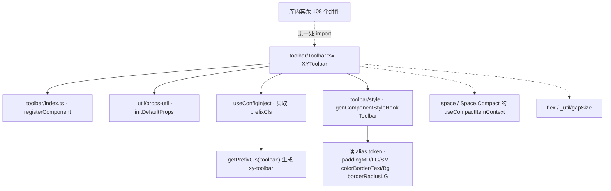
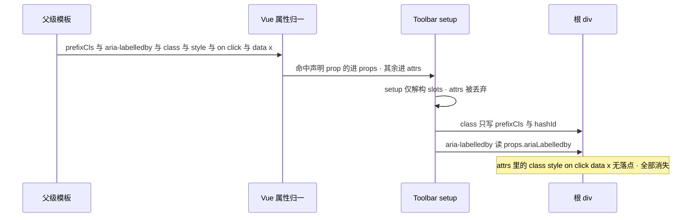
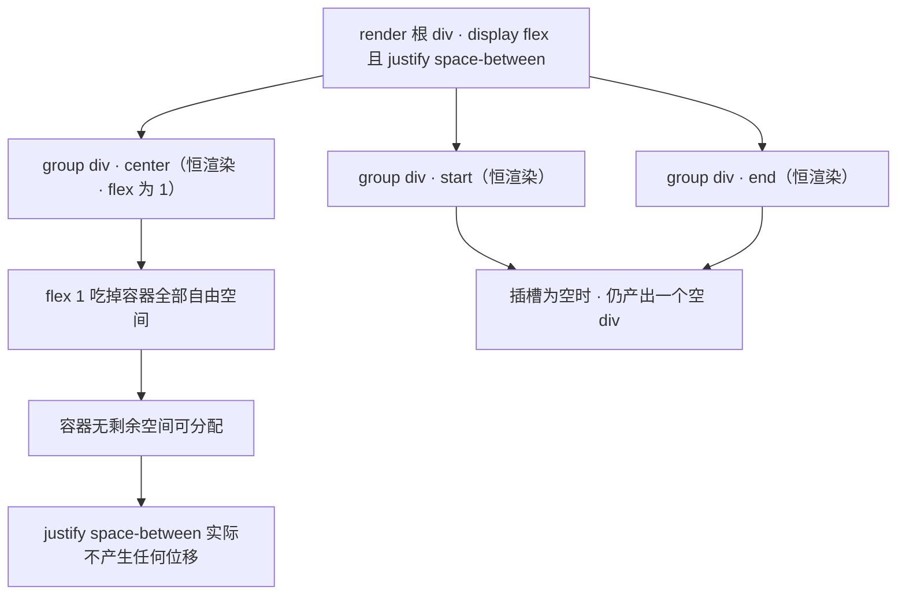

# C02-13 Toolbar 工具栏

> **本篇解决**：`src/toolbar/` 到底依赖谁、又实际不依赖谁——一个只有 42 行的组件为何被队列登记为「底层 space」却在源码里与 Space 零耦合，它的 `inheritAttrs: false` 为什么反而让外部属性静默消失，`role="toolbar"` 兑现了 ARIA 契约的哪一半、又欠了哪一半。
> **前置**：C02-04《Space 间距》（已完成）、C02-02《Flex 弹性布局》（已完成）、C02-00《类横写：栅格/flex/space 三代布局的取舍》（已完成）　**读者坐标**：`03-components/02-layout` 第 13/14 篇

## 一、职责与边界

`XYToolbar` 只负责一件事：给出一个 `role="toolbar"` 的水平 flex 容器，把三个具名插槽 `start` / `center` / `end` 各包进一个 `div`，并让这三块按「左 / 中 / 右」排布（`packages/xiaoye-ui/src/toolbar/Toolbar.tsx:25-41`）。它是 `02-layout` 类里最薄的一个组件——主实现全文只有 42 行（`packages/xiaoye-ui/src/toolbar/Toolbar.tsx`），没有 `useXxx` 组合式函数、没有子组件、没有 `expose`、没有事件。

明确不负责的事有五条，每一条都在源码里有对应的「缺席」证据：一是不负责间距的计算与协商，分区之间和分区之内的空隙全部由 CSS-in-JS 的 `gap` 直出（`packages/xiaoye-ui/src/toolbar/style/index.ts:29`、`:34`），容器只是 `display: flex`（`packages/xiaoye-ui/src/toolbar/style/index.ts:20`）且 `flexWrap: wrap`（`packages/xiaoye-ui/src/toolbar/style/index.ts:23`），既不经过 `Space`、也不经过 `Flex`；二是不负责属性透传，组件设了 `inheritAttrs: false`（`packages/xiaoye-ui/src/toolbar/Toolbar.tsx:11`）却在渲染函数里从不引用 `attrs`；三是不负责键盘导航，`role="toolbar"` 的交互契约（roving tabindex、方向键切换焦点、`aria-orientation`）一项都没实现（`grep -rn "keydown\|tabindex\|orientation" packages/xiaoye-ui/src/toolbar` 零命中）；四是不提供默认插槽，只认 `start`/`center`/`end` 三个具名插槽（`:14-18`），这条被单测显式钉成预期行为（`packages/xiaoye-ui/src/toolbar/index.test.js:50-68`）；五是不暴露任何可配置的间距或尺寸入参——props 只有 `prefixCls` 与 `ariaLabelledby` 两个（`packages/xiaoye-ui/src/toolbar/toolbarTypes.ts:4-7`），既没有 `Flex`/`Space` 那样的 `gap`/`size`。

依赖清单。入边（Toolbar import 谁）：`_util/props-util` 的 `initDefaultProps`（`packages/xiaoye-ui/src/toolbar/Toolbar.tsx:4`）、`config-provider/hooks/useConfigInject`（`:5`，且只取其中的 `prefixCls` 一个字段）、`_util/type` 的 `CustomSlotsType`（`:6`）、`./style` 的 `genComponentStyleHook('Toolbar')`（`:7`），以及入口里的 `_util/registerComponent`（`packages/xiaoye-ui/src/toolbar/index.ts:3`）。**没有一条边指向 `space` 或 `flex`**——这是本篇第一个要纠的登记错误（详见第二节）。出边（谁 import Toolbar 组件）：`grep -rn "from '.*toolbar'" packages/xiaoye-ui/src apps --include='*.ts*' --include='*.vue'` 排掉 `toolbar/` 自身目录后，唯一命中是聚合入口 `packages/xiaoye-ui/src/components.ts:327`-`:360`。也就是说 `XYToolbar` 在库内没有任何复用方，它是一个纯叶子组件。

## 二、源码地图

| 文件 | 行数 | 职责 | 关键导出 / 主入口行 |
| --- | --- | --- | --- |
| `src/toolbar/Toolbar.tsx` | 42 | 主实现：三区 flex 容器 | 组件 `:9`、`setup` `:19`、render `:23` |
| `src/toolbar/toolbarTypes.ts` | 11 | props 声明 | `toolbarProps` `:4-7`、`ToolbarProps` `:9` |
| `src/toolbar/index.ts` | 14 | 导出与安装 | `registerComponent` `:10`、`export default` `:14` |
| `src/toolbar/style/index.ts` | 51 | CSS-in-JS 规则与样式钩子 | `genComponentStyleHook('Toolbar')` `:6` |
| `src/toolbar/index.test.js` | 133 | 唯一单测（含 `mountTest`） | `mountTest` `:6`、各区断言 `:25-28` |

生成物登记面（对照 `AGENTS.md`「生成物」三件套）：`packages/xiaoye-ui/src/components.ts:359-361` 做了三件事——`export * from './toolbar'`、`export { default as Toolbar }`、样式副作用导入 `import './toolbar/style'`；`packages/xiaoye-ui/package.json:547-551` 提供 `./toolbar` 与 `./toolbar/style` 双入口；`packages/xiaoye-ui/typings/global.d.ts:91` 声明了 `XYToolbar`。这三条路都齐全，与 C02-04 发现的「`Space.Compact` 缺全局类型声明」形成对照——单文件组件走 `registerComponent`（`packages/xiaoye-ui/src/toolbar/index.ts:10`）→ `pnpm gen:entries` 的链路是完整的，只有子组件才会掉队（机制见 C02-04 论点 6，此处不重述）。

**关于队列登记的 `space` 依赖。** `docs/column/OUTLINE.md:128` 把 C02-13 的「底层（已核实）」列写成 `space`，但这条登记与源码不符：`grep -rni "space" packages/xiaoye-ui/src/toolbar` 的命中只有 `style/index.ts:22` 的 `justifyContent: 'space-between'`（一个 CSS 关键字，与 `Space` 组件无关）；Toolbar 的 import 列表（`packages/xiaoye-ui/src/toolbar/Toolbar.tsx:2-7`）里没有 `space`、`flex`、`compact` 任何一项。这与 `space`、`splitter`、`scroll-panel` 三篇各自的「底层」登记被本篇作者用同样的 grep 方法纠正为「登记错误」是同一族现象（见 C02-04、C02-06、C02-11 正文二节的取证记录）。这条误登记最可能的来源是文档示例：`apps/docs/examples/toolbar/responsive.vue:2` 用 `<xy-space direction="vertical">` 把工具栏竖着包了一层，是**示例作者**在外围借用了 Space，不是 Toolbar 内部依赖它——组件自身连这个都碰不到（见论点 4）。

## 三、架构与数据流

### 图 1：静态结构——一个「什么都没有接」的叶子组件



图 1 的价值全在两条虚线的「断裂」。实线 `T → C → G` 与 `T → S → K` 是 Toolbar 真实的全部运行时依赖：一条前缀注入、一条样式生成。两条虚线 `T -.-> X` 与 `T -.-> Y` 画出的是**队列以为存在、源码里不存在**的耦合——Space 的紧凑上下文（`packages/xiaoye-ui/src/space/Compact.tsx:27`）与 Flex 的 gap 档位（`packages/xiaoye-ui/src/_util/gapSize.ts:3`），Toolbar 一个都没 import。第三条虚线 `Z -.-> T` 说明它也没有被任何组件反向复用。合起来的结论是：Toolbar 是一个自包含的 CSS flexbox 封装，`space` 与 `flex` 两篇论证过的机制（间距双轨、gap 档位表、紧凑 context）对它**均不适用**，本篇后续论点因此不会重述这些机制，只会讲 Toolbar 自己的三处结构性缺席。

### 图 2：一次渲染里，props 与 attrs 各自的去向



图 2 拆出两条命运不同的通路。左侧只有 `aria-labelledby` 能走通：因为它是**声明过的 prop**（`packages/xiaoye-ui/src/toolbar/toolbarTypes.ts:6`），Vue 会把模板里写的 `aria-labelledby` 经驼峰归一后与 `ariaLabelledby` 对上，从而进 `props`、再由渲染函数显式写到根节点（`packages/xiaoye-ui/src/toolbar/Toolbar.tsx:31`）。其余一切——用户写的 `class`、`:style`、`@click`、`data-*`、乃至 `aria-label`（注意不是 `aria-labelledby`）——都因为 `inheritAttrs: false`（`:11`）而落进 `attrs`，而 `setup(props, { slots })` 的解构里根本没有 `attrs`（`:19`），于是 `attrs` 在整个 render 里没有任何落点，静默蒸发。这正是 C02-02 论点 1 描述的「其余 attrs 没有任何落点」，但 Toolbar 比 Flex 更彻底：Flex 至少在根节点手工并了 `attrs.class` 与 `attrs.style`（`packages/xiaoye-ui/src/flex/index.tsx:49-50`），Toolbar 连这一步都没有（对照 `packages/xiaoye-ui/src/toolbar/Toolbar.tsx:26`）。展开的机制在 C02-02/C02-04 已论证，本篇只保留这一张对照图。

### 图 3：三区恒渲染与 `justify-content` 的相互作用



图 3 讲 Toolbar 布局的一个隐含依赖：三区之所以稳定地「贴左 / 居中 / 贴右」，靠的**不是**容器上的 `justifyContent: 'space-between'`（`packages/xiaoye-ui/src/toolbar/style/index.ts:22`），而是 center 那一块无条件带 `flex: 1`（`:43`）且 center group 的 `div` 恒渲染（`packages/xiaoye-ui/src/toolbar/Toolbar.tsx:35-37`，即便 `#center` 插槽为空也产出空 div，被单测 `packages/xiaoye-ui/src/toolbar/index.test.js:42-46` 钉死）。`flex: 1` 会吸收主轴全部剩余空间，于是 `space-between` 永远没有自由空间可分配，退化为一条惰性声明。这一点由论点 3 展开，此处先给形状。

## 四、核心机制精读

### 论点 1：Toolbar 的间距是「CSS 单轨直出」，既不 import Space/Flex，也不做任何 flex-gap 能力探测——它是三代布局里唯一放弃补偿轨的一个

断言：`src/toolbar/` 全目录不出现 `space`、`flex`、`gapSize`、`useFlexGapSupport` 任何一个 import（`packages/xiaoye-ui/src/toolbar/Toolbar.tsx:2-7` 的 import 列表里只有 vue、toolbarTypes、props-util、useConfigInject、type、style 六行）；分区与分区之间的空隙完全由样式里的两行 `gap` 字面量承担。

```ts
// packages/xiaoye-ui/src/toolbar/style/index.ts:18
  return {
    [componentCls]: {
      display: 'flex',
      alignItems: 'center',
      justifyContent: 'space-between',
      flexWrap: 'wrap',
      padding: `${paddingMD}px ${paddingLG}px`,
      background: colorBgContainer,
      border: `1px solid ${colorBorder}`,
      color: colorText,
      borderRadius: borderRadiusLG,
      gap: `${paddingMD}px`,

      [`${componentCls}-group`]: {
        display: 'flex',
        alignItems: 'center',
        gap: `${paddingSM}px`,
      },
```

读这段样式能得到三个事实。第一，容器层 `gap: ${paddingMD}px`（`:29`）管三区之间，group 层 `gap: ${paddingSM}px`（`:34`）管每区内部，两处用了**不同的 token**（中号与小号 padding），但都直接来自 alias 层的数值 token（`:13-15` 的 `paddingMD`/`paddingLG`/`paddingSM`），不是 Space 那种写死的 `spaceSize` 三元字面量（见 C02-04 论点 4 的「无 token」结论——Toolbar 反而比 Space 接得更深，这与 C02-00 论点 3「三代接 token 的深度不一样」的分类一致）。第二，全文没有 `useFlexGapSupport`，即**没有能力探测**：`grep -rn "FlexGap\|supportFlex" packages/xiaoye-ui/src/toolbar` 零命中。这意味着 Toolbar 假定运行环境原生支持 flexbox `gap`；一旦在不支持 `gap` 的老浏览器上，Toolbar 的所有空隙会同时塌成 0，而不是像 Space 那样退回逐 item 的 margin 补偿轨（`packages/xiaoye-ui/src/space/index.tsx:116-129` 那条 C02-04 论点 1/6 论证过的双轨兜底，对 Toolbar 不适用）。第三，容器还写了 `flexWrap: 'wrap'`（`:23`）——三区放不下时会换行，但换行后三区不再共享一条轴，`-group-center` 的居中（`:42`）也随之失效，Toolbar 对这种退化没有任何 JS 介入。

结论回扣：把「间距」这件事从「组件职责」降级成「一行 CSS」，是 Toolbar 只有 42 行的根本原因。它没有 Space 的拆子节点、没有 Flex 的档位表，因为它既不数子节点也不给调用方传 gap 参数。也正因如此，队列把它登记为「底层 space」在机制层面是反的——Toolbar 恰恰是**绕开 space** 的那一个。

### 论点 2：`inheritAttrs: false` 而 `attrs` 全程零落点，连 `class` 与 `style` 都会被丢弃——这是「API 面存活、实现死亡」族里最严重的一档

断言：组件声明了 `inheritAttrs: false`，`setup` 却只解构 `{ slots }`，render 里既没有 `{...attrs}` 也没有把 `attrs.class`/`attrs.style` 并进根节点。结果是 Vue 不会自动把非 prop 属性挂到根元素，而组件自己也一个都没手动挂——用户写 `<xy-toolbar class="x" :style="..." @click="f" data-id="1">` 时，`x`、内联样式、点击监听、`data-id` 会**同时**消失。

```tsx
// packages/xiaoye-ui/src/toolbar/Toolbar.tsx:9
export default defineComponent({
  name: 'XYToolbar',
  inheritAttrs: false,
  __XY_TOOLBAR: true,
  props: initDefaultProps(toolbarProps(), {}),
  slots: Object as CustomSlotsType<{
    start?: any;
    center?: any;
    end?: any;
  }>,
  setup(props, { slots }) {
    const { prefixCls } = useConfigInject('toolbar', props);
    const [wrapSSR, hashId] = useStyle(prefixCls);
```

`:11` 关掉自动继承，`:19` 的解构里只有 `slots`——`attrs` 形参被彻底省略。再看根节点怎么写的：

```tsx
// packages/xiaoye-ui/src/toolbar/Toolbar.tsx:23
    return () =>
      wrapSSR(
        <div
          class={[prefixCls.value, hashId.value]}
          role="toolbar"
          aria-labelledby={props.ariaLabelledby}
        >
```

`:26` 的 `class` 数组只有内部生成的两项，没有任何一处引用外部 `attrs`。对照同类的两个组件就更清楚这是缺陷而非风格：Space 显式声明 `inheritAttrs: false` 后，在 setup 里解构了 `attrs`（`packages/xiaoye-ui/src/space/index.tsx:47`），并在根节点 `{...attrs}`（`:106`）且把 `attrs.class`、`attrs.style` 并进数组（`:107-108`）；Flex 同样 `inheritAttrs: false`（`packages/xiaoye-ui/src/flex/index.tsx:15`），却在根节点手工合了外部 class 与 style：

```tsx
// packages/xiaoye-ui/src/flex/index.tsx:44
      return wrapSSR(
        <Component
          class={[attrs.class, mergedCls.value]}
          style={[attrs.style as CSSProperties, mergedStyle]}
          {...omit(othersProps, ['justify', 'wrap', 'align', 'vertical'])}
```

Flex 至少救回了 `class`/`style`（C02-02 论点 1 因此把 Flex 的失血面限定在「其余 attrs」），而 Toolbar 比 Flex 还少一层——它连 `class` 和 `style` 都不接。这里 `aria-labelledby` 能幸存纯属巧合：它因为被声明成 prop（`packages/xiaoye-ui/src/toolbar/toolbarTypes.ts:6`）才走 props 通道在 `:28` 被读出来。换句话说，**同一个根节点上，`aria-labelledby` 有效而 `aria-label` 无效**，两者在 DOM 里都是 aria-* 属性，区别只在后者不是声明 prop（详见坑 5）。这条「声明 prop 才透传、其余全丢」的行为，是理解 Toolbar 属性面死亡的唯一钥匙。

### 论点 3：三区结构恒渲染，center 的 `flex: 1` 才是「左中右」的真实驱动，容器上的 `justify-content: space-between` 因此是惰性声明

断言：Toolbar 无条件渲染三个 group div，其中 center 带 `flex: 1`；`flex: 1` 会吃掉容器主轴的全部剩余空间，导致根容器上的 `justifyContent: 'space-between'` 拿不到可分配的自由空间，从不产生实际位移。真正的「贴左 / 贴右」是 center 撑开的副产物。

```tsx
// packages/xiaoye-ui/src/toolbar/Toolbar.tsx:32
          <div class={[`${prefixCls.value}-group`, `${prefixCls.value}-group-start`]}>
            {slots.start?.()}
          </div>
          <div class={[`${prefixCls.value}-group`, `${prefixCls.value}-group-center`]}>
            {slots.center?.()}
          </div>
          <div class={[`${prefixCls.value}-group`, `${prefixCls.value}-group-end`]}>
            {slots.end?.()}
          </div>
```

`:30`、`:33`、`:36` 三个 div 都在，无论对应插槽是否为空。空插槽时 `slots.center?.()` 返回 `undefined`，但那层 `div` 照样产出——单测 `packages/xiaoye-ui/src/toolbar/index.test.js:42-46` 正是断言「不传任何插槽时 `.xy-toolbar-group` 仍为 3 个」。CSS 侧：

```ts
// packages/xiaoye-ui/src/toolbar/style/index.ts:41
      [`${componentCls}-group-center`]: {
        justifyContent: 'center',
        flex: 1,
      },
```

`flex: 1`（等价于 `flex-grow: 1`）让 center 这一块的基准为 0、但会一直长到填满剩余空间，于是 `justify-content: space-between`（`:22`）在这个永远没有「剩余」可分配的容器上形同虚设：start 被 center 顶到最左、end 被 center 顶到最右，与 `space-between` 无关。判别这个惰性的实验是：把 `:43` 的 `flex: 1` 删掉，三区会按内容宽度靠左聚成一团，`space-between` 这时才第一次显形——但那时 center 也不再居中。也就是说这两条规则在数值上冗余、在语义上互相顶牛，而驱动布局的只有后者。`-group-start` 的 `justify-content: flex-start`（`:37-39`）与 `-group-end` 的 `flex-end`（`:46-48`）同理，因为 group 自身是 `display: flex`（`:31`）且宽度由内容决定，这两条内部对齐也几乎不触发（子项已把 group 撑满），属于第二层冗余。

### 论点 4：`useConfigInject` 递到手的 `direction` / `space` / `size` 三个上游能力被 Toolbar 主动丢弃，导致它不响应 RTL、也不响应全局配置

断言：`useConfigInject('toolbar', props)` 返回一大包上下文，但 Toolbar 只解构了 `prefixCls`（`packages/xiaoye-ui/src/toolbar/Toolbar.tsx:20`），把 `direction`、`space`、`size` 全扔了；样式侧也没有任何 `-rtl` 规则（`grep -rn "rtl" packages/xiaoye-ui/src/toolbar` 零命中）。

```ts
// packages/xiaoye-ui/src/config-provider/hooks/useConfigInject.ts:50
  return {
    configProvider,
    prefixCls,
    direction,
    size,
    getTargetContainer,
    getPopupContainer,
    space,
```

这个 hook 明确把 `direction`（`:53`，其值来自 `props.direction ?? configProvider.direction`，`:15`）、`size`（`:54`）、`space`（`:57`）都准备好了。Space 组件正是靠这里的 `space`（`packages/xiaoye-ui/src/config-provider/hooks/useConfigInject.ts:20` 的定义）去读全局尺寸、靠 `direction` 拼 `xy-space-rtl` 类名（这套用法见 C02-04 论点 2/4，不重述）。Toolbar 只写了 `const { prefixCls } = useConfigInject(...)`（`Toolbar.tsx:20`），后果有二：其一，在全局 `ConfigProvider` 设了 `direction="rtl"` 的页面里，Toolbar 既不给根元素加 rtl 类、也不设 `dir` 属性，`start` 区仍停在物理左侧，是否镜像完全取决于某个祖先元素有没有恰好把 CSS `direction` 继承下来——而组件自己没有安排这一步；其二，全局配置里的 `space.size`（`packages/xiaoye-ui/src/config-provider/context.ts:93` 的 `space: objectType<{ size?: ... }>()` 声明的通道）对 Toolbar 恒不生效，因为 Toolbar 的间距是钉死在 `paddingMD`/`paddingSM` 两个 token 上的（`packages/xiaoye-ui/src/toolbar/style/index.ts:29`、`:34`），根本没有读 `size` 的代码。这不一定是 bug——一个三区容器不做 RTL 翻转在很多设计系统里是可接受的取舍——但它是「组件解构了什么就响应什么、没解构就彻底失联」这一模式的教科书样本：入参面看起来接了 `useConfigInject`，实则只接了 1/7。

### 论点 5：props 面与 component token 面是「双空壳」——间距既不可从 props 配、也不可从主题配，唯一留存的公开入参是 `ariaLabelledby`

断言：`toolbarProps()` 只声明 `prefixCls` 与 `ariaLabelledby` 两个键（`packages/xiaoye-ui/src/toolbar/toolbarTypes.ts:4-7`），没有 `gap`/`size`/`align`；样式侧的组件 token 接口是空对象（`packages/xiaoye-ui/src/toolbar/style/index.ts:4` 的 `export interface ComponentToken {}`），主题层登记的也是 `Toolbar?: {}`（`packages/xiaoye-ui/src/theme/interface/components.ts:158`）。

```ts
// packages/xiaoye-ui/src/toolbar/toolbarTypes.ts:4
export const toolbarProps = () => ({
  prefixCls: String,
  ariaLabelledby: stringType(undefined),
});

export type ToolbarProps = Partial<ExtractPropTypes<ReturnType<typeof toolbarProps>>>;
```

两个空壳叠在一起，把「定制 Toolbar 间距/外观」的两条常规通道都堵上了。props 通道没有 `gap`，所以 `<xy-toolbar gap={32}>` 会变成一条被丢弃的 attr（回到论点 2）。主题通道这里要借用 C02-04 已论证的机制说明、不重开：`genComponentStyleHook('Toolbar', ...)`（`packages/xiaoye-ui/src/toolbar/style/index.ts:6`）会把 `theme.components.Toolbar.token` 里的任意键并进 `mergedComponentToken`，但既然 `ComponentToken` 是空接口、样式函数里也只从 `token` 解构了通用的 alias 字段（`:7-16` 的 `paddingMD` 等，没有任何 `toolbar*` 专属键），那么调用方在 `components.Toolbar.token` 下写什么键都找不到消费者——与 C02-04 论点 4 对 Space 空接口的判断同构，只是这里连 `spaceSize` 那种「写死但能用」的常量都没有，间距被完全交给 alias。能改的只有全局 `theme.token.padding`（派生出 `paddingMD`/`paddingSM`）与 `colorBorder`/`colorBgContainer`/`colorText`/`borderRadiusLG`（`:25-28`），改这些会同时牵动其它所有用同一 alias 的组件。结论：Toolbar 的「可配置面」实际为空，它的定位就是一个带语义的固定外观三区壳。

### 论点 6：默认插槽被排除、三区结构被单测固化成契约——生成物三件套齐全反而印证它是「正常对照组」

断言：`slots` 类型只声明 `start`/`center`/`end`（`packages/xiaoye-ui/src/toolbar/Toolbar.tsx:14-18`），render 也只求值这三个（`packages/xiaoye-ui/src/toolbar/Toolbar.tsx:34`、`:34`、`:37`），因此默认插槽内容不被渲染；这条「反直觉」的行为被测试当成期望值钉住。

```tsx
// packages/xiaoye-ui/src/toolbar/index.test.js:50
  it('默认插槽内容不会被渲染（组件只支持具名插槽）', () => {
    // Toolbar 仅渲染 start/center/end 三个具名插槽，default 插槽内容应被忽略
    const wrapper = mount(
      {
        render() {
          return (
            <Toolbar>
              <span class="default-content">不应被渲染</span>
            </Toolbar>
          );
        },
      },
      { sync: false },
    );
    expect(wrapper.find('.default-content').exists()).toBe(false);
    // 三个 group 仍应存在
    expect(wrapper.findAll('.xy-toolbar-group').length).toBe(3);
    wrapper.unmount();
  });
```

`:64` 断言 default 内容不存在、`:66` 断言三区恒在，把论点 3 的「结构刚性」和「无默认插槽」同时固化为契约：将来若有人给 Toolbar 补一个 default 插槽兜底，这个测试会先失败。这与 `Space`/`Flex` 依赖 `slots.default` 的形状是相反的取向（对照 `packages/xiaoye-ui/src/flex/index.tsx:53` 就是渲染 `slots.default?.()`）。至于生成物登记面——`packages/xiaoye-ui/src/components.ts:359-361` 的三件套、`packages/xiaoye-ui/typings/global.d.ts:91` 的 `XYToolbar` 全局声明、`packages/xiaoye-ui/package.json:547-551` 的双入口都齐全——这恰好说明「单文件组件的注册链路」本身没问题，Toolbar 的所有缺陷都发生在组件实现内部（属性丢弃、RTL 失联、惰性 CSS），而不是发生在导出/类型/构建这一层。它因此可以作为对照 C02-04 论点 6「子组件 Space.Compact 才掉全局声明」的反例：一个规规矩矩被 `registerComponent` 注册的顶层组件，登记面应当长成什么样。

## 五、对外契约如何生效

Toolbar 的对外契约面极窄，逐条看它「从哪里进、到哪里断」。

**props。** `prefixCls`（`packages/xiaoye-ui/src/toolbar/toolbarTypes.ts:5`）→ `useConfigInject('toolbar', props)`（`packages/xiaoye-ui/src/toolbar/Toolbar.tsx:20`）→ 内部 `getPrefixCls`（`packages/xiaoye-ui/src/config-provider/hooks/useConfigInject.ts:14`）→ 同一个 `prefixCls` ref 既拼类名（`Toolbar.tsx:26`、`:30`）又当样式作用域（`:21` 的 `useStyle(prefixCls)`），两用的是同一个 ref，因此改前缀时 DOM 类名与 CSS 一起改，不会错位。`ariaLabelledby`（`:6`）→ `props.ariaLabelledby`（`Toolbar.tsx:31`）→ 根元素 `aria-labelledby` 属性，这是组件里**唯一**一条从入参直达 DOM 的通路。文档示例正是用模板属性形式走这条通路——`apps/docs/examples/toolbar/basic.vue:2` 写的 `aria-labelledby="toolbar-basic-title"`，经 Vue 的 prop 名归一后命中 `ariaLabelledby` 才没退化成被丢弃的 attr。类型侧 `initDefaultProps(toolbarProps(), {})`（`:13`）传的是空默认对象，即两个 prop 都没有兜底默认值，`ariaLabelledby` 缺省就是 `undefined`（`stringType(undefined)`），此时 Vue 不写该属性——被 `packages/xiaoye-ui/src/toolbar/index.test.js:70-76` 断言。

**slots。** 三个具名插槽从 `slots` 形参进（`Toolbar.tsx:19`），各自被包进一层 group div 后原样吐出（`:30-38`），中间没有任何加工——不像 Space 那样数子节点、插分隔符。default 插槽被有意忽略（论点 6）。

**attrs / 事件。** 全部失效。`inheritAttrs: false`（`:11`）+ setup 不接 `attrs`（`:19`）+ 根节点不 spread（`:26`）三件事叠加，使得 `@click`、`@keydown`、`id`、`class`、`style`、非声明的 `aria-*` 一律无处落地（论点 2 展开）。这也意味着 Toolbar **没有任何 emits 声明**（`grep -rn "emits:" packages/xiaoye-ui/src/toolbar` 零命中）——它压根不打算向父级回传事件。

**expose / context。** 都没有。`setup` 未调用 `expose`（`packages/xiaoye-ui/src/toolbar/Toolbar.tsx` 全文无 `expose`），组件不 provide 也不 inject 任何自定义 context（无 `SpaceCompactItemContext.useInject`）。图 1 里那两条断裂的虚线在契约层的含义就是：Toolbar 既不接受紧凑上下文、也不向下广播任何东西，它是一个上下文孤岛。

**语义属性。** `role="toolbar"` 被硬编码在根节点（`Toolbar.tsx:30`），与 props/slots 无关、不可关闭。这半条契约是「声明性无障碍」，另半条「行为性无障碍」的缺失见论点与坑 6。

## 六、设计取舍

**用纯 CSS `gap` 而不是复用 `Space`。** 这是 Toolbar 与队列登记方向相反的核心选择。收益有三：组件运行期零逻辑（`packages/xiaoye-ui/src/toolbar/Toolbar.tsx` 全文只有一个 return）、不引入 Space 那套「拆子节点 + 数末项 + 双轨落样式」的成本（机制见 C02-04 论点 1），以及**天然规避了 Space 的 SSR 首帧翻转问题**——Space 因为要探测 flex-gap 支持度，服务端与首帧落在 margin 补偿轨、挂载后翻回 gap 轨（`packages/xiaoye-ui/src/space/index.tsx:82-85`、`:116-129`，见 C02-04 论点 6 与 C02-00 论点 6），而 Toolbar 直接写死 `gap`（`packages/xiaoye-ui/src/toolbar/style/index.ts:29`、`:34`），渲染结果与环境无关，与 `flex` 一样「天然成立」。赔上的是：不支持 flexbox `gap` 的老环境没有兜底轨，空隙会整体塌成 0；且间距从此不可按实例配置（见论点 5）。这个取舍对一个「布局壳」是合理的，但它成立的前提——Toolbar 不 import Space——恰恰被队列登记反向描述了。

**设 `inheritAttrs: false` 却不手工并 attrs。** 从代码意图推测（源码无注释，此为降级推断），作者写 `inheritAttrs: false` 可能是想「封闭内部 class，不让外部污染三区结构」。但这个封闭方式过头了：Space 与 Flex 的做法是关掉自动继承后**手工**把 `attrs.class`、`attrs.style` 并进根节点（`packages/xiaoye-ui/src/space/index.tsx:107-108`、`packages/xiaoye-ui/src/flex/index.tsx:49-50`），既保留调用方加类/加样式的能力，又把事件等其它 attrs 挡在结构之外——这是「半封闭」。Toolbar 走成了「全封闭」，连最该保留的 `class`/`style` 一起丢，等于把 `inheritAttrs: false` 的副作用原样吃下、又没补上任何一条透传路径。被放弃的替代方案（照 Flex 合 class/style）代价几乎为零，换来的却是调用方无法从外部定位这个元素，这是一处明显的负权衡。

**恒渲染三个 group div，而不是按插槽条件渲染。** 收益是布局可预测：`justify-content: space-between` 配合「center 恒在且 `flex: 1`」保证了无论填几个插槽，start 恒贴左、end 恒贴右（`packages/xiaoye-ui/src/toolbar/style/index.ts:22`、`:43`）。若改成条件渲染，缺 center 时三区数量变化会让 `space-between` 的行为在「两区之间留空」和「贴两端」之间摇摆。赔上的是：空插槽照样产出空 div，而 Toolbar 的样式里**没有** Space 那样的 `&:empty { display: none }` 清理规则（对照 `packages/xiaoye-ui/src/space/style/index.tsx:41-45`；`grep -n "empty" packages/xiaoye-ui/src/toolbar/style/index.ts` 零命中），所以空 group 会留在 DOM 里、并作为 flex item 参与 `gap` 计数，产生「只放了 start，右侧却空出一截」的观感（坑 3）。

**`role="toolbar"` 只做声明、不做交互。** 组件把语义角色当成一个静态属性写死（`packages/xiaoye-ui/src/toolbar/Toolbar.tsx:30`），把键盘交互留给插槽内容自理。对被定位成「布局壳」的组件，这是一种边界收口的选择；但要如实记下代价：`AGENTS.md` 注意事项 5 明确要求「遵循 WCAG 规范，提供键盘导航」，而 WAI-ARIA 的 toolbar 模式期望容器管理内部控件的 roving tabindex 与方向键导航，Toolbar 一项未实现（`grep -rn "keydown\|tabindex" packages/xiaoye-ui/src/toolbar` 零命中）。声明与实现之间的这段距离，是接手这块代码的人需要知道的事实，而不是可以粉饰的细节。

## 七、坑与改动指南

**坑 1：给 `xy-toolbar` 写 `class` / `style` / `@click`。** 触发：`<xy-toolbar class="my-bar" @click="onClick">`。症状：外层类名、内联样式、点击监听全部失效，DevTools 里根元素只有 `xy-toolbar` 与 hash 类，事件也不触发，且**不报任何警告**。原因：`inheritAttrs: false`（`packages/xiaoye-ui/src/toolbar/Toolbar.tsx:11`）关掉自动继承，setup 只解构 `{ slots }` 不接 `attrs`（`:19`），根节点 class 数组只有内部两项（`:26`）。定位：`packages/xiaoye-ui/src/toolbar/Toolbar.tsx:11`、`:19`、`:26`。这条**无测试保护**——`index.test.js` 从不挂载带外部 class/事件的用例。

**坑 2：误以为三区贴边靠 `justify-content: space-between`。** 触发：调布局时去改 `style/index.ts:22` 的 `space-between`，或反过来删掉 `-group-center` 的 `flex: 1`。症状：改 `space-between` 毫无变化（因为它本就惰性，见论点 3）；而删 `flex: 1` 会让三区按内容挤到一起、start/end 不再贴边。原因：真正驱动左右的是 center 的 `flex: 1`（`packages/xiaoye-ui/src/toolbar/style/index.ts:43`）叠加 center div 恒渲染（`packages/xiaoye-ui/src/toolbar/Toolbar.tsx:35-37`）。定位：`packages/xiaoye-ui/src/toolbar/style/index.ts:22`、`:43`。

**坑 3：只填一个插槽，右侧空出一截。** 触发：`<xy-toolbar><template #start>…</template></xy-toolbar>`，不给 center/end。症状：end 区空、start 贴左，中间一大片空白；DOM 里能看到三个 group div，其中两个是空的。原因：三 div 恒渲染（`packages/xiaoye-ui/src/toolbar/Toolbar.tsx:32-40`）、center `flex: 1` 撑满、且样式无 `:empty` 清理（`grep -n empty packages/xiaoye-ui/src/toolbar/style/index.ts` 零命中）。定位：`packages/xiaoye-ui/src/toolbar/Toolbar.tsx:35`（空 center）与 `packages/xiaoye-ui/src/toolbar/style/index.ts:43`（`flex: 1`）。若要收窄，应在插槽层用 `v-if` 控制内容，或给 group 补一条 `:empty { display: none }`——但后者会连带改变 center 的 `flex: 1` 撑开效果，需一并回归。

**坑 4：全局 `ConfigProvider direction="rtl"` 想让工具栏镜像。** 触发：在 rtl 配置下渲染 Toolbar。症状：`start` 区仍停在物理左侧，不镜像。原因：Toolbar 只从 `useConfigInject` 取了 `prefixCls`（`packages/xiaoye-ui/src/toolbar/Toolbar.tsx:20`），丢弃了 `direction`（`packages/xiaoye-ui/src/config-provider/hooks/useConfigInject.ts:53`），且样式无 `-rtl` 规则（`grep -rn rtl packages/xiaoye-ui/src/toolbar` 零命中）。定位：`packages/xiaoye-ui/src/toolbar/Toolbar.tsx:20`。对照 Space 会产出 `xy-space-rtl`（机制见 C02-04 论点 2）。

**坑 5：用 `aria-label` 或任意 `id` / `data-*`。** 触发：`<xy-toolbar aria-label="工具栏" id="tb">`。症状：两个属性都不出现在 DOM——这与 `aria-labelledby` 能生效形成诡异反差。原因：`aria-labelledby` 恰好是声明的 prop（`packages/xiaoye-ui/src/toolbar/toolbarTypes.ts:6`）走 props 通道被写到根节点（`packages/xiaoye-ui/src/toolbar/Toolbar.tsx:31`），而 `aria-label`/`id`/`data-*` 非声明 prop，进 attrs 后被丢弃（坑 1 同因）。定位：`packages/xiaoye-ui/src/toolbar/toolbarTypes.ts:4-7`（props 只有 `prefixCls` 与 `ariaLabelledby`）。

**坑 6：把 `role="toolbar"` 当成自带键盘可达性。** 触发：无障碍审计要求工具栏支持方向键切换焦点。症状：组件不提供 roving tabindex、方向键导航、`aria-orientation`，用户只能 Tab 进每个按钮。原因：render 里除 `role` 外没有任何交互逻辑（`packages/xiaoye-ui/src/toolbar/Toolbar.tsx:23-43`，全文无 `keydown`/`tabindex`），这与 `AGENTS.md` 注意事项 5 的「提供键盘导航」要求存在缺口。定位：`packages/xiaoye-ui/src/toolbar/Toolbar.tsx:30`（只有静态 role）。若要补齐，需在容器层接管焦点，属功能新增而非改动。

**坑 7：在主题里配 `theme.components.Toolbar.token`。** 触发：`theme: { components: { Toolbar: { token: { /* 任意键 */ } } } } }`。症状：无任何视觉变化。原因：`ComponentToken` 是空接口（`packages/xiaoye-ui/src/toolbar/style/index.ts:4`）、主题登记也是 `Toolbar?: {}`（`packages/xiaoye-ui/src/theme/interface/components.ts:158`），样式函数只解构通用 alias 字段（`:7-16`），没有专属键消费者。定位：`packages/xiaoye-ui/src/toolbar/style/index.ts:4`。机制同 C02-04 对 Space 空接口的论证，不重开。

**测试现状。** 本篇范围内只有 `packages/xiaoye-ui/src/toolbar/index.test.js`（133 行）：`mountTest(Toolbar)` 提供一条「更新/卸载不抛异常」且无实质断言的用例（`packages/xiaoye-ui/tests/shared/mountTest.js`，只 `not.toThrow`），加上 8 条显式 `it`（`:8`、`:32`、`:42`、`:50`、`:70`、`:78`、`:92`、`:104`）。它按 `packages/xiaoye-ui/vitest.config.mts:33` 的 `src/**/*.test.{js,ts,jsx,tsx}` glob 会被执行。已覆盖：三区分组渲染、`aria-labelledby` 透传、空态恒 3 组、default 插槽被忽略、`role="toolbar"`、`xy-toolbar` 前缀、start 多子节点。**完全未覆盖**：外部 `class`/`style`/事件 attrs（坑 1、坑 5 的失血行为恰恰没测，`grep -n "attrs\|@click\|data-" packages/xiaoye-ui/src/toolbar/index.test.js` 零命中）、RTL（坑 4，无实现故无测试）、键盘导航（坑 6，无实现）。也就是说这份测试把「三区 + role + aria-labelledby」这条 happy path 钉得很牢，却对属性面死亡视而不见。

**安全边界与验证命令。** Toolbar 是叶子组件、库内零复用方（第二节），改它不牵动其他组件，风险边界清晰；但改它的 `class`/`style`/插槽行为会直接改变对外的 DOM 契约，`index.test.js` 只兜得住 happy path。最小验证序列：

```bash
cd packages/xiaoye-ui && npx vitest run src/toolbar/index.test.js
grep -rn "space\|flex\|compact" packages/xiaoye-ui/src/toolbar --include='*.ts*'
node docs/column/tools/verify-refs.mjs --excerpt docs/column/03-components/02-layout/C02-13-toolbar-工具栏.md
```

## 附：本篇可证伪的三个检查点

1. Toolbar 与 Space/Flex 零耦合：执行 `grep -rn "from '.*space'\|from '.*flex'\|gapSize\|useCompactItemContext" packages/xiaoye-ui/src/toolbar/Toolbar.tsx`，应无任何输出；`packages/xiaoye-ui/src/toolbar/Toolbar.tsx:2-7` 的六行 import 里没有 Space 或 Flex。若命中，则第二、三节「`space` 是登记错误」的结论即被推翻。
2. `attrs` 全程无落点：执行 `grep -n "attrs" packages/xiaoye-ui/src/toolbar/Toolbar.tsx`，应**无输出**（对照 `grep -n "attrs" packages/xiaoye-ui/src/space/index.tsx` 命中 `:47`、`:106`、`:107`、`:108` 多处）；而 `grep -n "inheritAttrs" packages/xiaoye-ui/src/toolbar/Toolbar.tsx` 应命中 `:11`。两者合起来即证明「关了自动继承又没手工透传」，坑 1 成立。
3. 布局驱动是 `flex: 1` 不是 `space-between`：执行 `grep -n "flex: 1\|space-between" packages/xiaoye-ui/src/toolbar/style/index.ts`，应命中 `:22`（`space-between`）与 `:43`（`flex: 1`）。在浏览器 devtools 里注释掉 `:43` 的 `flex: 1`，三区会从「两端贴边 + 居中」塌成「靠左聚成一团」；只改 `:22` 的 `space-between` 则无可见变化——以此复现论点 3 的惰性判断。
