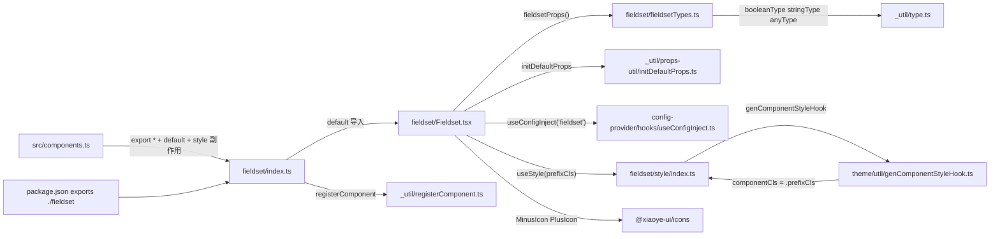
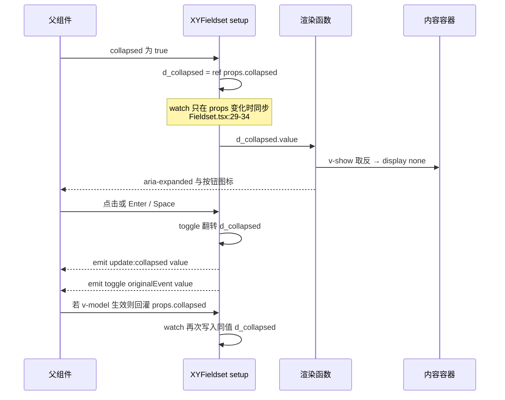
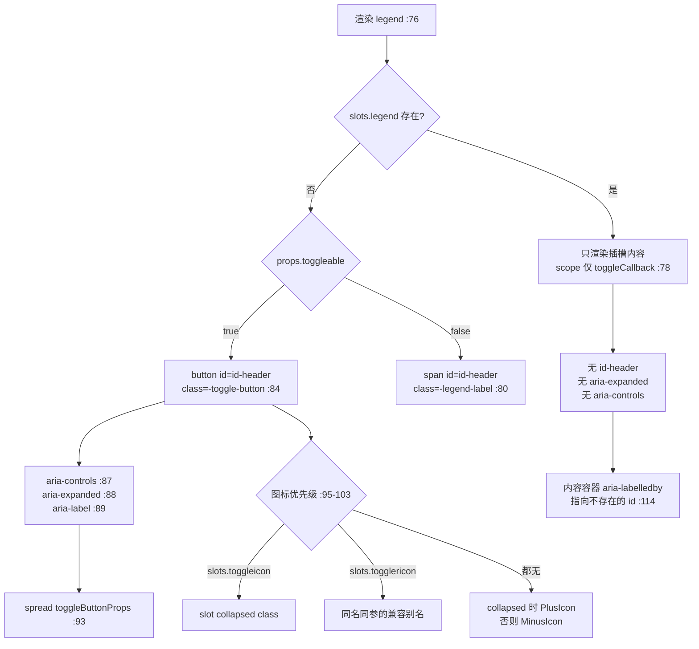
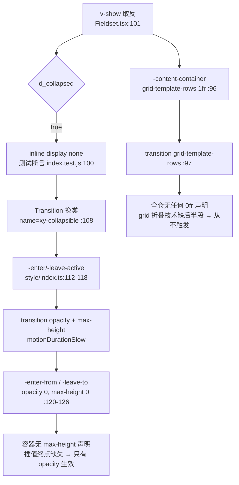

# C02-14 Fieldset 字段集

> **本篇解决**：为什么 `<xy-fieldset>` 上的 `class` 会消失、为什么「折叠动画」只有淡入淡出、为什么用了 `legend` 插槽之后 `aria-labelledby` 就成了悬空引用——121 行的小组件里藏着 4 处「声明了但不生效」的实现。
> **修复状态（2026-09-29）**：四处里已改掉两处——`inheritAttrs: false` 却不读 `attrs`（现已在根节点展开并合并类名）、样式引用全仓从未声明的 `var(--xy-border-radius)`（已改回 Token `borderRadius`）。折叠动画的两条死声明与 `id` 用模块级自增计数器（现也改为实例 `uid`）各自的原始取证按修复前状态保留在正文。
> **前置**：C06-01 Form 表单　**读者坐标**：`03-components/02-layout` 第 14 篇

## 一、职责与边界

`Fieldset` 是「带标题的分组容器 + 可选折叠开关」：它把原生的 `<fieldset>/<legend>` 语义结构、一个可键盘操作的折叠按钮、以及一套由 Design Token 驱动的样式封装进 121 行的单文件组件（`packages/xiaoye-ui/src/fieldset/Fieldset.tsx:1-115`）。

它负责的事只有四件：

1. 渲染 `fieldset > legend + content-container` 的固定 DOM 骨架，并把 `legend` 文本或 `legend` 插槽放进 `<legend>` 里（`packages/xiaoye-ui/src/fieldset/Fieldset.tsx:75-107`）；
2. 维护折叠状态的双向桥接：外部 `collapsed` prop 单向流入内部 `d_collapsed` ref，用户操作时再把 `update:collapsed` 与 `toggle` 两个事件推回去（`packages/xiaoye-ui/src/fieldset/Fieldset.tsx:21-37`）；
3. 生成并维护 ARIA 控制关系：`aria-expanded`、`aria-controls`、`role="region"`、`aria-labelledby`（`packages/xiaoye-ui/src/fieldset/Fieldset.tsx:78-79`、`:113-114`）；
4. 注册组件自己的 CSS-in-JS 样式，并顺带注册一组**全局**折叠过渡类 `.xy-collapsible-*`（`packages/xiaoye-ui/src/fieldset/style/index.ts:114-129`）。

它明确不负责的事，同样重要，因为这是本篇后面所有「坑」的根源：

- **不负责折叠动画的高度计算**。组件只挂 `<Transition name="xy-collapsible">` 与 `v-show`（`packages/xiaoye-ui/src/fieldset/Fieldset.tsx:99-101`），真实动画取决于样式里是否存在可插值的属性，而答案是否定的（见论点 2）；
- **不负责表单联动**。它不读 `DisabledContext`、不调 `useConfigInject` 的 `disabled`、不注册任何 `form` 字段，与 `xy-form` 没有任何代码耦合（`packages/xiaoye-ui/src/fieldset/Fieldset.tsx:17` 只解构了 `prefixCls`）。分组语义靠原生 `<fieldset>` 的禁用继承，而不是库内协议；
- **不负责属性透传**。它声明了 `inheritAttrs: false`（`packages/xiaoye-ui/src/fieldset/Fieldset.tsx:12`），却从未读取 `attrs`（`packages/xiaoye-ui/src/fieldset/Fieldset.tsx:25` 的 setup 形参里没有 `attrs`，全文件 `grep -n "attrs"` 无命中）——外部 `class`/`style`/`id` 因此静默消失（见论点 1）；
- **不负责提供组件级 Token**。`ComponentToken` 是空接口（`packages/xiaoye-ui/src/fieldset/style/index.ts:4`），主题侧对应槽位也是空对象类型（`packages/xiaoye-ui/src/theme/interface/components.ts:159`）——`Fieldset` 没有任何可覆盖的组件 Token（见论点 6）。

依赖清单（全部为出向依赖，无兄弟组件耦合）：

| 依赖 | 用途 | 定位 |
| --- | --- | --- |
| `fieldsetProps()` | props 工厂 | `packages/xiaoye-ui/src/fieldset/fieldsetTypes.ts:4-11` |
| `initDefaultProps` | props 包装（本篇为空调用） | `packages/xiaoye-ui/src/_util/props-util/initDefaultProps.ts:4-34` |
| `useConfigInject` | `prefixCls` 派生 | `packages/xiaoye-ui/src/config-provider/hooks/useConfigInject.ts:14` |
| `useStyle` | 组件样式注册 | `packages/xiaoye-ui/src/fieldset/style/index.ts:10-130` |
| `@xiaoye-ui/icons` | `MinusIcon` / `PlusIcon` | `packages/xiaoye-ui/src/fieldset/Fieldset.tsx:3`、`:100`、`:102` |
| `registerComponent` | `XYFieldset` → `xy-fieldset` 标签映射 | `packages/xiaoye-ui/src/fieldset/index.ts:10` |

## 二、源码地图

| 文件 | 行数 | 职责 | 关键导出 / 主入口 |
| --- | --- | --- | --- |
| `packages/xiaoye-ui/src/fieldset/index.ts` | 14 | 包入口、`install`、类型转发 | `Fieldset`（默认导出）`:14`、`fieldsetProps` `:5` |
| `packages/xiaoye-ui/src/fieldset/Fieldset.tsx` | 124 | 主实现 | `defineComponent` 起于 `:13`，`setup` `:25`，渲染函数 `:73-122` |
| `packages/xiaoye-ui/src/fieldset/fieldsetTypes.ts` | 15 | props 工厂与类型 | `fieldsetProps` `:4-11`、`FieldsetProps` `:13` |
| `packages/xiaoye-ui/src/fieldset/style/index.ts` | 129 | CSS-in-JS 样式 + 全局过渡类 | `genComponentStyleHook('Fieldset', …)` `:10` |
| `packages/xiaoye-ui/src/fieldset/index.test.js` | 147 | 唯一测试文件（`.js` 而非 `.tsx`） | 14 个 `it`，见 §七 |

主实现入口是 `packages/xiaoye-ui/src/fieldset/Fieldset.tsx:25` 的 `setup`；渲染分支全部集中在 `:73-122`，没有子组件、没有 composable 文件、没有 `__tests__` 目录——测试与源码同目录，且后缀是 `.js`：

```bash
// packages/xiaoye-ui/vitest.config.mts:33
include: ['tests/**/*.test.{js,ts,jsx,tsx}', 'src/**/*.test.{js,ts,jsx,tsx}'],
```

这条 glob 决定了 `src/fieldset/index.test.js` 会被执行；若按 `**/*.test.tsx` 检索，会得到「Fieldset 没有测试」的错误结论（本篇用 `find packages/xiaoye-ui/src/fieldset -type f` 与上面这条 glob 两种方式交叉确认过，除该文件外没有 `fieldset` 相关的测试或快照）。

## 三、架构与数据流

### 3.1 静态结构：五个文件的出向依赖



图中最后两条入边值得单独说：`Fieldset` 的三个生成物入口都由工具链写入而非手工维护——聚合导出与样式副作用在 `packages/xiaoye-ui/src/components.ts:136-138`，双入口 `./fieldset` 与 `./fieldset/style` 在 `packages/xiaoye-ui/package.json:266-270`，Vue `GlobalComponents` 声明在 `packages/xiaoye-ui/typings/global.d.ts:38`。`components.ts:142` 的 `import './fieldset/style'` 这一行决定了「按需引入 `xy-fieldset` 时样式一定会被注册」，也顺带把 §3.4 要讲的全局过渡类带进来了。

### 3.2 折叠状态的闭环：props 进、事件出



这个闭环里有三处刻意的不对称，读者容易当成 bug：

1. **内部状态优先**。`toggle` 先翻转 `d_collapsed`（`packages/xiaoye-ui/src/fieldset/Fieldset.tsx:31`），再 emit（`:41-45`）。因此即使父组件拒绝回灌（例如没写 `v-model:collapsed` 也没接 `@update:collapsed`），UI 也已经变了——它是「非受控优先、受控可选」，而不是严格受控。真正纯受控需要父组件始终显式传 `collapsed`，靠 `:32-37` 的 `watch` 把内部状态拽回来。
2. **`collapsed` 的默认值让「未传」与「传 false」不可区分**。`booleanType(false)`（`packages/xiaoye-ui/src/fieldset/fieldsetTypes.ts:8` → `packages/xiaoye-ui/src/_util/type.ts:58-60`）把默认值直接烧进 props 工厂，所以 `props.collapsed` 恒为布尔。组件因此无法在「首次挂载时读 prop、之后自管」这类模式上做出更细的判断。
3. **`toggle` 事件在 `update:collapsed` 之后**。两者都读同一个 `d_collapsed.value`（`packages/xiaoye-ui/src/fieldset/Fieldset.tsx:38-42`），顺序在源码里是字面顺序，没有批处理，父组件里两个 handler 看到的值必然一致。

### 3.3 `legend` 的三分支决策：ARIA 产物由分支决定



分支的优先级是 `slots.legend` > `toggleable`，这在 `packages/xiaoye-ui/src/fieldset/Fieldset.tsx:68-70` 是三目运算符的字面嵌套顺序。它带来一个源码层面可确认、但文档没有提示的后果：**只要提供 `legend` 插槽，`-header` 这个 id 就不再被渲染**，而内容容器的 `aria-labelledby={`${id.value}-header`}`（`:114`）仍然照原样输出，指向一个页面上不存在的元素；同时插槽作用域只暴露 `toggleCallback`（`:78`），没有暴露 `id.value`，调用方**无法**自行补回正确的关联。详见论点 4。

### 3.4 折叠视觉的真实执行路径



这张图是论点 2 的结论先行：两条动画路径都在样式层被写死成「不可插值」的形态，真实可见的只有淡入淡出。

## 四、核心机制精读

### 论点 1：`inheritAttrs: false` 却不读 `attrs`，外部属性在根节点被无声吞掉

**断言**：`Fieldset` 关闭了 Vue 的自动属性继承，又没有手工把 `attrs` 展开到任何 DOM 节点上，于是调用方写在 `<xy-fieldset>` 上的 `class`、`style`、`id`、`data-*` 与所有非声明事件监听器**全部丢失**——这不是「按需挑选」，而是整包丢弃。

```tsx
// packages/xiaoye-ui/src/fieldset/Fieldset.tsx:10-24
export default defineComponent({
  name: 'XYFieldset',
  inheritAttrs: false,
  __XY_FIELDSET: true,
  props: initDefaultProps(fieldsetProps(), {}),
  slots: Object as CustomSlotsType<{
    default?: any;
    legend?: any;
    toggleicon?: any;
    togglericon?: any;
  }>,
  emits: ['update:collapsed', 'toggle'],
  setup(props, { slots, emit, expose }) {
    const { prefixCls } = useConfigInject('fieldset', props);
    const [wrapSSR, hashId] = useStyle(prefixCls);
```

```tsx
// packages/xiaoye-ui/src/fieldset/Fieldset.tsx:61-75
    const rootClasses = computed(() => [
      prefixCls.value,
      hashId.value,
      {
        [`${prefixCls.value}-toggleable`]: props.toggleable,
      },
    ]);

    const toggleIconClass = `${prefixCls.value}-toggle-icon`;

    expose({ toggle, onKeyDown });

    return () =>
      wrapSSR(
        <fieldset class={rootClasses.value}>
```

逐段解释：

- `:15` 的 `inheritAttrs: false` 语义是「渲染函数自己负责安置 `attrs`」。关闭它之后 Vue 不再把剩余属性挂到唯一根元素上，这一步本身是合理的（组件想精确控制属性落点）；
- `:25` 的 setup 形参只解构了 `slots, emit, expose`——`attrs` 连形参都没拿到。用 `grep -n "attrs" packages/xiaoye-ui/src/fieldset/Fieldset.tsx` 交叉核对，唯一命中是 `inheritAttrs` 里的 `Attrs`（大写 A，小写检索都不命中），即**组件作用域内不存在任何对 `attrs` 的读取**；
- `:75` 的根元素 `<fieldset class={rootClasses.value}>` 是渲染树的最外层，它只接 `class`，没有 `{...attrs}`。`rootClasses`（`:61-67`）由 `prefixCls`、`hashId` 与 `toggleable` 三部分组成，没有为外部 `class` 留合并位；
- 对照同层的三个邻居组件，本仓的惯例是把 `attrs` 展开在根节点并显式合并 `class`：`packages/xiaoye-ui/src/card/Card.tsx:179` 写 `<div {...attrs} class={[classString, attrs.class]}>`，`packages/xiaoye-ui/src/collapse/CollapsePanel.tsx:97` 写 `<div {...attrs} class={itemCls}>`，`packages/xiaoye-ui/src/splitter/SplitterPanel.tsx:33` 同样展开。`Fieldset` 是这一族里唯一「声明了 `inheritAttrs: false` 却不安置 `attrs`」的成员。

**结论回扣**：`inheritAttrs: false` 在这里不是优化，而是把一条本可自动生效的契约切断后没有补回。可观察后果有三个层次：外部无法给根节点加类名（连测试都没验证过这条路，`packages/xiaoye-ui/src/fieldset/index.test.js` 全文 `grep -n "attrs\|\.class"` 零命中）；无法加 `style`；`@click`、`@focusin` 这类未在 `:24` 的 `emits` 里声明的监听器作为 attr 存在，也一并被丢弃。要恢复只需在 `:75` 加 `{...attrs}`，但那会立刻撞上论点 5 讲的「展开顺序覆盖」问题——`class` 需要像 `Card.tsx:179` 那样显式合并，而不是裸展开。

### 论点 2：折叠动画的两条路径都不成立，`grid-template-rows` 与 `max-height` 都是死声明

**断言**：组件把折叠交给 `v-show` + `Transition`，样式层准备了**两套**折叠技术方案（`grid-template-rows: 1fr ↔ 0fr` 与 `max-height` 过渡），但两套都只写了一半——`0fr` 这一端在全仓任何地方都不存在，容器基态也从不声明 `max-height`。真实可见的动画因此只剩 `opacity` 淡入淡出，标题里「高度收起动画」的那一半是死代码。

```tsx
// packages/xiaoye-ui/src/fieldset/Fieldset.tsx:99-110
          <Transition name="xy-collapsible">
            <div
              v-show={!d_collapsed.value}
              id={`${id.value}-content`}
              class={`${prefixCls.value}-content-container`}
              role="region"
              aria-labelledby={`${id.value}-header`}
            >
              <div class={`${prefixCls.value}-content-wrapper`}>
                <div class={`${prefixCls.value}-content`}>{slots.default?.()}</div>
              </div>
            </div>
```

```ts
// packages/xiaoye-ui/src/fieldset/style/index.ts:97-130
      '&-content-container': {
        display: 'grid',
        gridTemplateRows: '1fr',
        transition: 'grid-template-rows 0.2s ease-out',
      },

      '&-content-wrapper': {
        minHeight: 0,
        overflow: 'hidden',
      },

      '&-content': {
        padding: `${paddingMD}px 0 0`,
      },
    },

    // 全局过渡类：被 Fieldset、PanelMenu、PanelMenuSub 等使用
    // Transition name="xy-collapsible" 会应用这些类
    '.xy-collapsible-enter-active': {
      transition: `opacity ${motionDurationSlow}, max-height ${motionDurationSlow}`,
      overflow: 'hidden',
    },
    '.xy-collapsible-leave-active': {
      transition: `opacity ${motionDurationSlow}, max-height ${motionDurationSlow}`,
      overflow: 'hidden',
    },
    '.xy-collapsible-enter-from': {
      opacity: 0,
      maxHeight: 0,
    },
    '.xy-collapsible-leave-to': {
      opacity: 0,
      maxHeight: 0,
    },
```

逐段解释：

- **grid 路线缺终点**。`grid-template-rows: 1fr`（`:96`）配 `min-height: 0`（`:101`）正是「用 grid 行高做无 JS 高度动画」 recipe 的两个前置件，但这条 recipe 的第三件事——折叠态把行高改成 `0fr`——没有任何地方写。用两条独立检索确认：`grep -rn "gridTemplateRows\|grid-template-rows" packages/xiaoye-ui/src --include='*.ts' --include='*.tsx' --include='*.vue'` 只命中 `fieldset/style/index.ts:98`、`:97` 与 `panel-menu/style/index.ts:110`、`:196` 四处；`grep -rn -- "0fr" packages/xiaoye-ui/src` 零命中。组件侧同样没有：`Fieldset.tsx:99-110` 的容器只绑 `v-show`，折叠时不切类名、不绑内联行高。于是 `transition: grid-template-rows`（`:97`）观察的属性永远不变，这条 transition 声明从不触发。
- **`v-show` 与「行高过渡」互斥**。`v-show` 的实现是内联 `display: none`（本仓测试直接把这条当作契约断言：`packages/xiaoye-ui/src/fieldset/index.test.js:95-101` 检查 `element.style.display === 'none'`）。元素从 `display: grid` 直接跳到不产生盒子，中间不存在「行高从 `1fr` 插值到 `0fr`」的时间窗——`display` 的切换本身就是硬切换，需要靠 `transition-behavior: allow-discrete` 或 `@starting-style` 之类的显式手段才能延迟，样式文件里没有这两样。
- **max-height 路线同样缺终点**。过渡声明（`:113`、`:117`）列了 `max-height`，`-enter-from`/`-leave-to`（`:120-126`）把起点设成 `0`，但被过渡的元素——也就是 `:109` 那个容器——基态从未声明 `max-height`，全文件里 `maxHeight` 只出现在 `:122` 与 `:126` 两行。端点一侧是 `0`、另一侧是未声明。
- **注释自陈了修补来源**。`packages/xiaoye-ui/src/fieldset/style/index.ts:6-9` 的三行注释写着「修复源项目 bug：……3) 补充全局过渡类 xy-collapsible 的 enter/leave 动画（源项目使用但未定义）」——这批全局类是对上游实现缺声明的补齐（注释中的「源项目」即上游实现，本仓措辞），补齐时按 `max-height` 方案补，容器却按 `grid` 方案留了 `1fr`。两条路线来自两次修补，没有对齐。
- **时长口径不一致**（同一份文件内）。`:45`、`:70`、`:82`、`:97` 四处硬编码 `0.2s`，`:113`、`:117` 用 `motionDurationSlow`。种子值 `motionUnit: 0.1`、`motionBase: 0`（`packages/xiaoye-ui/src/theme/themes/seed.ts:44-45`）经 `motionDurationSlow: ${(motionBase + motionUnit * 3).toFixed(1)}s`（`packages/xiaoye-ui/src/theme/themes/shared/genCommonMapToken.ts:11`）算出 `0.3s`，而 `motionDurationMid` 才是 `0.2s`（同文件 `:10`）。所以容器与按钮是 0.2s、过渡类是 0.3s，且前者根本没走 Token——改 `motionUnit` 只会影响其中一半。

**结论回扣**：`Fieldset` 的折叠是「状态即时切换 + 一层淡入淡出」，不是高度动画。任何人想让它真的收起高度，需要同时补三处：给容器一个随 `d_collapsed` 变化的 `0fr`/`1fr`（或改用 `v-if` 之外的两态类名）、把 `display` 切换改为可延迟的形式、并统一时长到 Token。

### 论点 3：样式引用了一个全仓从未声明的 CSS 变量 `--xy-border-radius`，而正确的 Token 就在同一个解构里

**断言**：`legend` 与 `toggle-button` 两条规则的 `border-radius` 写成了 `var(--xy-border-radius)`，但这个自定义属性在仓库里**没有任何声明点**——只有这两处消费。结果是根节点按 Token 拿到 8px 圆角，标题条与按钮却是未定义值，圆角在同一张卡片上不一致；而作者其实已经把该用的 `borderRadiusLG` 解构进来了。

```ts
// packages/xiaoye-ui/src/fieldset/style/index.ts:10-35
export default genComponentStyleHook('Fieldset', token => {
  const {
    componentCls,
    colorBgContainer,
    colorBorder,
    borderRadiusLG,
    colorText,
    paddingMD,
    paddingLG,
    paddingSM,
    colorBgLayout,
    paddingXS,
    colorPrimary,
    colorTextSecondary,
    motionDurationSlow,
  } = token;

  return {
    [componentCls]: {
      margin: 0,
      padding: `${paddingMD}px ${paddingLG}px`,
      color: colorText,
      background: colorBgContainer,
      border: `1px solid ${colorBorder}`,
      borderRadius: borderRadiusLG,
```

```ts
// packages/xiaoye-ui/src/fieldset/style/index.ts:37-47
      '&-legend': {
        display: 'block',
        width: '100%',
        padding: `${paddingSM}px ${paddingMD}px`,
        color: colorText,
        fontWeight: 500,
        background: 'transparent',
        border: 0,
        borderRadius: 'var(--xy-border-radius)',
        transition: 'background 0.2s, color 0.2s, box-shadow 0.2s',
      },
```

逐段解释：

- `borderRadiusLG` 在 `:15` 被解构、在 `:34` 被用于根节点（值由 `radiusBase = 6` 经 `packages/xiaoye-ui/src/theme/themes/shared/genRadius.ts:17-18` 的 `radiusBase + 2` 得到 8，种子见 `packages/xiaoye-ui/src/theme/themes/seed.ts:56`），却在 `:44` 与 `:67` 换成了一个字符串常量；
- 声明点检索：`grep -rn -- "--xy-border-radius" packages apps`（排除 `dist` 与 `node_modules`）只命中 `packages/xiaoye-ui/src/fieldset/style/index.ts:44` 与 `:67` 两行，全部是**消费**，没有 `--xy-border-radius: …` 形式的声明。CSS 层面，引用未声明的自定义属性且不写 fallback 会让该属性在计算值阶段失效，落到 `border-radius` 的初始值 0；
- 对照本仓「自定义属性成对声明」的既有做法：`--xy-arrow-background-color` 在消费点 `packages/xiaoye-ui/src/tooltip/style/index.ts:110` 之外，确有声明点 `packages/xiaoye-ui/src/tooltip/style/index.ts:51`、`:92` 与 `packages/xiaoye-ui/src/tooltip/util.ts:18`，`packages/xiaoye-ui/src/popover/style/index.ts:50` 与 `packages/xiaoye-ui/src/tour/style/index.ts:59` 也各自先声明再消费。`Fieldset` 这两行是唯一「只消费、无人声明」的一族；
- 同一文件里还有第二处硬编码：`border: \`1px solid ${colorBorder}\``（`:33`）的 `1px` 未走 `lineWidth`（种子 `lineWidth: 1`，`packages/xiaoye-ui/src/theme/themes/seed.ts:40`）。它恰好等于默认值，所以默认主题下看不出问题，改 `lineWidth` 时不会跟随；
- 焦点环同样绕开了公共 helper。`:72-76` 手写 `boxShadow: 'none'; outline: 2px solid ${colorPrimary}; outlineOffset: 2`，而 `packages/xiaoye-ui/src/style/index.ts:131-141` 的 `genFocusOutline`/`genFocusStyle` 用的是 `${token.lineWidthBold}px solid ${token.colorPrimaryBorder}` + `outlineOffset: 1` + `transition: 'outline-offset 0s, outline 0s'`。两处偏差是可观察的：颜色用 `colorPrimary`（主色实色）而非 `colorPrimaryBorder`（浅一档），宽度写死 2px 而非 `lineWidthBold`（默认 `lineWidth + 1 = 2`，`packages/xiaoye-ui/src/theme/themes/shared/genCommonMapToken.ts:14`）。手写 `&:focus-visible` 在本仓并非孤例（`packages/xiaoye-ui/src/panel/style/index.ts`、`packages/xiaoye-ui/src/scroll-panel/style/index.ts` 等同样如此），但**颜色与宽度都偏离 helper** 的组合使 `Fieldset` 的焦点环与 `button`/`tabs`/`pagination` 一族（`packages/xiaoye-ui/src/button/style/index.ts:56`、`packages/xiaoye-ui/src/tabs/style/index.ts:546`、`packages/xiaoye-ui/src/pagination/style/index.tsx:522`）不同色。

**结论回扣**：这是「Token 体系里的悬空引用」。修法有两种，取向不同：把 `:44`/`:67` 换成 `borderRadiusLG` 或 `borderRadiusSM`（跟随主题，但改变现有视觉），或者真的在某处声明 `--xy-border-radius`（保持可外部覆盖，但把一个库内样式变成依赖外部注入的半公开 API）。选择哪种必须由维护者显式决定，不能让「没人声明也没人看见」继续充当答案。

### 论点 4：类名与反应式包装的三处不对齐

**断言**：`Fieldset` 在「样式标识符」这一层有三条互不一致的纪律——渲染出的类名没人给它写规则、同一个 `prefixCls` 有时被 `computed` 包装有时被字符串快照、过渡类名绕过 `prefixCls` 走全仓字面量约定。三者单独看都无害，合起来意味着**改 `prefixCls` 或改样式表时，无法用一条规则推断哪些类名会随之变化**。

```tsx
// packages/xiaoye-ui/src/fieldset/Fieldset.tsx:52-60
    const rootClasses = computed(() => [
      prefixCls.value,
      hashId.value,
      {
        [`${prefixCls.value}-toggleable`]: props.toggleable,
      },
    ]);

    const toggleIconClass = `${prefixCls.value}-toggle-icon`;
```

```tsx
// packages/xiaoye-ui/src/fieldset/Fieldset.tsx:70-73
            ) : !props.toggleable ? (
              <span id={`${id.value}-header`} class={`${prefixCls.value}-legend-label`}>
                {props.legend}
              </span>
```

```tsx
// packages/xiaoye-ui/src/fieldset/Fieldset.tsx:95-99
                <span class={`${prefixCls.value}-legend-label`}>{props.legend}</span>
              </button>
            )}
          </legend>
          <Transition name="xy-collapsible">
```

逐段解释：

- **`-legend-label` 零规则**。它被渲染两次：不可折叠分支的 `span`（`:80`）与按钮内的文字 `span`（`:104`）。`packages/xiaoye-ui/src/fieldset/style/index.ts` 的 `componentCls` 块里，除根规则（`:28`）外有 8 条嵌套规则（`:36`、`:48`、`:54`、`:79`、`:85`、`:94`、`:100`、`:105`），选择器依次是 `&-legend`、`&-toggleable > &-legend`、`&-toggle-button`、`&-toggle-icon`、`&-toggleable > &-legend:hover`、`&-content-container`、`&-content-wrapper`、`&-content`——没有 `&-legend-label`。全仓检索 `legend-label` 只命中 `Fieldset.tsx:71`、`:104` 与测试的 `index.test.js:16`、`:115`。也就是说这个类名的唯一功能是**给测试当选择器**、给使用者当 CSS 钩子，库自身不提供任何样式；写它的人（或上游实现）原本打算给它加定位规则，那一段没落地。
- **两种反应式包装**。`rootClasses`（`:61`）是 `computed`，每次渲染重读 `prefixCls.value`；`toggleIconClass`（`:69`）是 `setup` 期求值一次的普通 `const`。而 `prefixCls` 本身是响应式的：`packages/xiaoye-ui/src/config-provider/hooks/useConfigInject.ts:14` 写 `const prefixCls = computed(() => configProvider.getPrefixCls(name, props.prefixCls))`，它同时依赖全局配置与组件 props。于是运行时切换 `ConfigProvider` 的前缀，或改动 `prefixCls` prop，根类名与 `-content-container`（`:112` 渲染期读取 `prefixCls.value`）会更新，而图标类名冻结在首次值——同一次渲染里两套前缀并存。样式表里 `.xy-fieldset-toggle-icon` 的规则（`packages/xiaoye-ui/src/fieldset/style/index.ts:80-84`）与 hover 时的图标着色（`:89-91`）都按前缀生成，冻结的类名因此可能匹配不到任何规则。同一行代码里还有个更隐蔽的连带：`:96`、`:98` 把同一个冻结字符串作为 `class` 交给插槽作用域，调用方自定义图标时拿到的也是过期值。
- **过渡类名绕过 prefixCls**。`<Transition name="xy-collapsible">`（`:108`）与前缀无关，是硬编码字面量；样式侧对应 `.xy-collapsible-enter-active` 等四条规则也硬编码（`packages/xiaoye-ui/src/fieldset/style/index.ts:114-129`）。两侧靠字符串约定耦合，全仓这个约定的副本共有四处消费与两处声明：消费在 `Fieldset.tsx:99`、`packages/xiaoye-ui/src/panel-menu/PanelMenu.tsx:861`、`packages/xiaoye-ui/src/panel-menu/PanelMenuSub.tsx:208`，声明在 `fieldset/style/index.ts:114-129` 与 `packages/xiaoye-ui/src/panel-menu/style/index.ts:201-205`——两份声明的选择器写法不同（fieldset 把 enter/leave 拆成四条独立键，panel-menu 用逗号合并成两条），属性集也不同。谁后注册谁覆盖同名属性，而跨组件复用同一个过渡名意味着 `Fieldset` 的淡入淡出时长可能被 `panel-menu` 的定义改写。这条重复属于 `panel-menu` 的主题边界，本篇只登记事实与定位，不展开其成因。

**结论回扣**：`Fieldset` 的类名契约不能靠「跟着 `prefixCls` 走」这一条假设推演。审计方法只有两种：把 `:61-69` 统一到 `computed`，或者接受「前缀不可运行时改变」这条未写下的前提并在 §五 显式声明它。本仓当前的实际行为是后者——但没有任何测试或注释固定这条前提（`packages/xiaoye-ui/src/fieldset/index.test.js` 全文没有 `prefixCls` 相关断言）。

### 论点 5：`{...props.toggleButtonProps}` 是最后展开的属性，它按字面顺序覆盖内部处理器与 ARIA 状态

**断言**：切换按钮上的 `toggleButtonProps` 展开排在所有内部属性**之后**，所以这是一个「调用方可覆盖一切」的通道：传 `onClick` 会让折叠永不发生，传 `class` 会丢掉按钮的全部样式，传 `aria-expanded` 会让无障碍状态与实际状态脱钩。文档把这条通道描述为「透传」，源码实现的是「覆盖」，二者不等价。

```tsx
// packages/xiaoye-ui/src/fieldset/Fieldset.tsx:75-85
              <button
                id={`${id.value}-header`}
                type="button"
                aria-controls={`${id.value}-content`}
                aria-expanded={!d_collapsed.value}
                aria-label={buttonAriaLabel.value}
                class={`${prefixCls.value}-toggle-button`}
                onClick={toggle}
                onKeydown={onKeyDown}
                {...props.toggleButtonProps}
              >
```

```tsx
// packages/xiaoye-ui/src/fieldset/Fieldset.tsx:49-53
    const buttonAriaLabel = computed(() =>
      props.toggleButtonProps && (props.toggleButtonProps as any).ariaLabel
        ? (props.toggleButtonProps as any).ariaLabel
        : props.legend,
    );
```

逐段解释：

- JSX 编译成 `createVNode(type, props)`，多个属性来源靠 `mergeProps` 按**字面出现顺序**合并，后写者胜。`:93` 排在 `:85-92` 八个属性之后，因此 `toggleButtonProps` 里任何同名键都会替换内部值。这里没有 `class` 合并逻辑，可与 `packages/xiaoye-ui/src/card/Card.tsx:179` 的 `class={[classString, attrs.class]}` 对比——同一仓库里存在「合并」与「覆盖」两种写法，`Fieldset` 选的是后者；
- 手册对这条通道的承诺是「透传给切换按钮的属性对象，如 `aria-label`、`class` 等」（`apps/docs/components/fieldset.md:60`）。按源码，`class` 的实际效果是**替换掉** `xy-fieldset-toggle-button`（`:90`），于是 `packages/xiaoye-ui/src/fieldset/style/index.ts:55-78` 那 24 行按钮规则（`display: inline-flex`、`width: 100%`、`padding`、`cursor: pointer`、`border: 0`、`focus-visible` 轮廓）全部不再命中，标题条会退回浏览器默认的 `<button>` 外观；
- 事件侧更危险：`onClick={toggle}`（`:91`）被 `toggleButtonProps.onClick` 替换后，`toggle`（`:39-46`）不再执行，`update:collapsed` 与 `toggle` 两个事件都不再发出，而 `aria-expanded` 仍按内部 `d_collapsed` 渲染（`:88`）——按钮看起来可点、点下去无反应、辅助技术读到的状态恒为「展开」。同理 `onKeydown`（`:92`）可被替换，`Enter`/`Space` 支持（`:48-53`）消失；
- `anyType` 让这条通道没有任何运行时护栏。`fieldsetTypes.ts:10` 用 `anyType<Record<string, any> | null>(null)`，而 `packages/xiaoye-ui/src/_util/type.ts:66-78` 的实现是 `{ validator: () => true, default }` 再做一次 `as unknown` 类型伪装——运行时对象里**根本没有 `type` 键**，Vue 拿不到任何构造器，`validator` 又恒真。写错键名（如 `ariaExtent`）不会有任何警告；
- `buttonAriaLabel`（`:55-59`）读的是 **camelCase** 的 `ariaLabel`，而仓库里唯一的契约证据用的是 **kebab** 的 `aria-label`（`packages/xiaoye-ui/src/fieldset/index.test.js:134-146`，断言 `attributes('aria-label') === 'Expand section'`）。组件内没有任何 kebab↔camel 归一化代码，所以两种键名走两条不同机制：kebab 形式下该 computed 的三元判断恒为假、返回 `props.legend`，最终 DOM 上的 `aria-label` 来自 `:93` 的展开而非 `:89`；camel 形式下才由 `:89` 生效。若同时提供两种键名，`aria-label` 取 camel 值（`:89`）、`ariaLabel` 再被展开一次（`:93`），两者是否等价取决于浏览器对该键的处理，源码层面无法判定。

**结论回扣**：`toggleButtonProps` 的正确心智模型是「**最后写入的裸 spread**」，不是「安全的属性透传」。安全的做法要么把展开提到 `:85` 之前（让内部值优先，代价是 ARIA 无法定制），要么像 `Card.tsx:179` 那样逐键合并 `class`、并拒绝覆盖 `onClick`/`onKeydown`/`aria-expanded` 这三个由组件状态决定的键。当前实现把决定权全部交给调用方，却不提供任何护栏或文档警告。

### 论点 6：id 用模块级自增计数器现场生成，绕开了仓库里已有的 SSR 安全 `useId`

**断言**：`Fieldset` 的 ARIA 关联建立在一个 `setup` 期一次性求值的字符串上，该字符串来自模块级计数器；而仓库里已经有一个专门解决这个问题的 `useId`（存在两份完全相同的副本），`Fieldset` 没有用它。后果分两层：SSR 与客户端的 id 必然不一致；`legend` 插槽路径下 `-header` 根本不渲染，而内容区仍指向它。

```tsx
// packages/xiaoye-ui/src/fieldset/Fieldset.tsx:10-11
// 模块级 id 计数器，保证同一页面内多个 Fieldset 的 aria 控制关系唯一
let fieldsetIdCounter = 0;
```

```tsx
// packages/xiaoye-ui/src/fieldset/Fieldset.tsx:29-30
    const id = ref(`${prefixCls.value}-${++fieldsetIdCounter}`);
    const d_collapsed = ref(props.collapsed);
```

```ts
// packages/xiaoye-ui/src/_util/hooks/useId.ts:6-30
/** Is client side and not jsdom */
export const isBrowserClient = process.env.NODE_ENV !== 'test' && canUseDom();

/** Get unique id for accessibility usage */
export function getUUID(): number | string {
  let retId: string | number;

  // Test never reach
  /* istanbul ignore if */
  if (isBrowserClient) {
    retId = uuid;
    uuid += 1;
  } else {
    retId = 'TEST_OR_SSR';
  }

  return retId;
}

export default function useId(id = ref('')) {
  // Inner id for accessibility usage. Only work in client side
  const innerId = `vc_unique_${getUUID()}`;

  return id.value || innerId;
}
```

逐段解释：

- `:11` 的计数器活到进程结束，不随实例卸载回收。`:29` 用 `ref()` 把首次值定死（不是 `computed`），组件重渲染不改变它——这是对的，但代价是 id 只在「这个实例活着期间」稳定；服务端每次请求共享同一个模块状态，渲染第 N 个 `Fieldset` 得到的序号取决于此前整个进程处理过多少请求，客户端水合时从 0 重新数起，两侧 `aria-controls`（`:87`）与 `aria-labelledby`（`:114`）指向的目标因此不同名。源码层面可证的到此为止：不一致本身由 `:11` + `:29` 两行决定；「Vue 会因此抛属性水合警告」属于框架行为，本篇未在仓库里找到固定它的测试或注释。
- 对照 `packages/xiaoye-ui/src/_util/hooks/useId.ts:15-20`：这条路径在非浏览器环境直接返回常量 `'TEST_OR_SSR'`，两端字符串相同，不会因计数漂移而不一致；`:29` 还允许用外部 `id` 覆盖。`Fieldset` 两个好处都没拿到——它没调用 `useId`，而且由于论点 1（`attrs` 被丢弃）加上 props 里没有 `id`（`packages/xiaoye-ui/src/fieldset/fieldsetTypes.ts:4-11` 只有 5 个键），**调用方没有任何途径把 id 固定下来**；
- `useId` 本身在仓库里有两份完全相同的实现：`packages/xiaoye-ui/src/_util/hooks/useId.ts` 与 `packages/xiaoye-ui/src/vc-select/hooks/useId.ts`（`diff` 两文件无输出），消费方各自引用其中一份（`packages/xiaoye-ui/src/vc-tour/Mask.tsx:5` 用 `_util` 版，`packages/xiaoye-ui/src/vc-select/Select.tsx:38`、`packages/xiaoye-ui/src/vc-cascader/Cascader.tsx:11`、`packages/xiaoye-ui/src/vc-tree-select/TreeSelect.tsx:26` 用 `vc-select` 版）。所以「Fieldset 该用现成的 useId」不只是类型层面的建议，仓库确实存在这条既定路径，只是没被这条新组件接上；同类自增计数器还散落在 `packages/xiaoye-ui/src/panel-menu/PanelMenu.tsx:28`、`packages/xiaoye-ui/src/tabs/src/Tabs.tsx:49`、`packages/xiaoye-ui/src/form/FormItem.tsx:145`，即第三种、第四种策略并存；
- **`legend` 插槽让 ARIA 关联变成悬空引用**。三分支的顺序是 `slots.legend` 优先（`:77-79`），命中时按钮和 `span` 都不渲染，`:85` 的 `id={`${id.value}-header`}` 因此不存在于 DOM；而内容容器的 `aria-labelledby={`${id.value}-header`}`（`:114`）与 `role="region"`（`:113`）无条件渲染。插槽作用域只给了 `toggleCallback`（`:78`），没有给 `id.value`，调用方即使知道要补关联也拿不到那个字符串。文档的 `#legend` 用法恰恰是推荐写法（`apps/docs/examples/fieldset/custom-legend.vue:20-21` 在插槽里放的是 `<div @click="toggleCallback">`，`apps/docs/examples/fieldset/with-actions.vue:12` 自建 `<button>` 但只写了 `aria-label`、没有 `aria-expanded`），也就是说**两个官方示例走的都是这条断掉的路径**；
- 无 `legend` 时的按钮没有可访问名字。`legend` 默认 `null`（`packages/xiaoye-ui/src/fieldset/fieldsetTypes.ts:6`），`buttonAriaLabel` 的兜底就是 `props.legend`（`:58`），`aria-label={null}`（`:89`）不输出属性，`:104` 的文字 `span` 内容为空，剩下 `:100`/`:102` 的图标——本仓图标把 `<svg>` 包在 `<span class="xyicon">` 里（`packages/icons/src/minus/MinusIcon.vue:2`），且该文件内 `grep -n "aria\|role=\|<title"` 零命中，不提供任何文本名。这条路径被库自己的冒烟测试渲染过（`packages/xiaoye-ui/src/fieldset/index.test.js:7` 的 `mountTest(Fieldset)` → `packages/xiaoye-ui/tests/shared/mountTest.js:10` 以零 props 挂载 `<Component />`），但测试只断言「不抛异常」，没有任何关于可访问名字的断言。

**结论回扣**：`Fieldset` 的无障碍承诺（`:87-88`、`:113-114` 四个属性）只在「不传 `legend` 插槽、且服务端不渲染」这两个前提下成立。修 id 的最小改动是把 `:29` 换成 `useId()` 调用并接受外部 `id`；修插槽悬空则必须把 `id.value` 放进插槽作用域（`:78`），否则只能把 `role="region"` 与 `aria-labelledby` 一并改成条件渲染。

## 五、对外契约如何生效

这一节按「一个外部输入如何变成 DOM」的流向讲，而不是把 API 罗列一遍；属性清单见 [apps/docs/components/fieldset.md](../../../apps/docs/components/fieldset.md)。

**`prefixCls` 是唯一有双头效应的 prop。** 它不直接出现在 DOM 上，而是分两路生效：一路进 `useConfigInject('fieldset', props)`，在 `packages/xiaoye-ui/src/config-provider/hooks/useConfigInject.ts:14` 变成 computed，再被渲染函数读成类名（`packages/xiaoye-ui/src/fieldset/Fieldset.tsx:53`、`:76`、`:80`、`:90`、`:104`、`:112`、`:116`、`:117`）；另一路作为参数交给样式 hook（`:27`），在 `packages/xiaoye-ui/src/theme/util/genComponentStyleHook.ts:47-48` 被包成 computed、在 `:87` 变成 `componentCls = .${prefixCls.value}`。也就是说改一次 `prefixCls`，**选择器和类名同时换**，这是它和 `hashId`（只出现在 `:63` 根类名里）的分工差异。但这条链路对图标类名失效（论点 4），也对 `xy-collapsible` 失效（`packages/xiaoye-ui/src/fieldset/Fieldset.tsx:99` 与 `packages/xiaoye-ui/src/fieldset/style/index.ts:114-129` 都是字面量）。

**`legend` 走「文本或插槽」两条互斥路径。** prop 路径的终点是 `packages/xiaoye-ui/src/fieldset/Fieldset.tsx:75` 或 `:104` 的文字节点，并额外充当按钮的 `aria-label` 兜底（`:58`）；插槽路径的终点是 `:78`，作用域只带 `toggleCallback`。两条路径由 `:77-79` 的三目嵌套决定优先级，不会同时输出。`legend` 为 `null`（默认，`packages/xiaoye-ui/src/fieldset/fieldsetTypes.ts:6`）时 DOM 仍然渲染空的 `-legend-label` 容器（`:80`），不会退化为不渲染。

**`toggleable` 只改变标题区的形状，不改变内容区的生命周期。** 它产出一个类名 `xy-fieldset-toggleable`（`:65`）、决定标题区是否渲染 `<button>`（`:79`），并被样式表的两条后代选择器消费（`packages/xiaoye-ui/src/fieldset/style/index.ts:49-53` 与 `:85-92`）。内容容器（`packages/xiaoye-ui/src/fieldset/Fieldset.tsx:103-109`）在两种模式下完全相同，包括 `role="region"`。

**`collapsed` 的落地终点是三处，不是「卸载」。** `props.collapsed` 经 `:30` 初始化、`:32-37` 的 watch 同步到 `d_collapsed`，`d_collapsed` 在渲染里被读三次：`aria-expanded`（`:88`）、`v-show` 取反（`:110`）、图标二选一（`:99`）。**内容子树从不被 `v-if` 移除**（`:117` 的 `slots.default?.()` 无条件调用），折叠只是 `display: none`。这条契约对表单使用者是决定性的：折叠状态下的字段仍然挂载、仍然参与校验、仍然随表单提交。它与 `collapse/CollapsePanel.tsx:115-116` 形成对照——那里有 `!destroyInactivePanel || isActive ? panelContent : null` 的卸载开关，`Fieldset` 没有对应能力。折叠与表单字段生命周期的完整关系属于 C06-01 Form 表单 的主题，本篇不展开。

**两个事件的存活完全依赖 `emits` 声明。** `packages/xiaoye-ui/src/fieldset/Fieldset.tsx:15` 声明了 `update:collapsed` 与 `toggle`，`:41` 与 `:42-45` 分别发出。因为声明在 `emits` 里，`onUpdate:collapsed` 这类监听器不会进入 `attrs`，所以论点 1 里「attrs 全丢」并不影响 `v-model:collapsed`——这解释了为什么官方示例 `apps/docs/examples/fieldset/toggleable.vue:42` 的 `v-model:collapsed` 与 `@toggle` 都能工作，而同一个文件里的 `class` 之类的属性如果写上去就会消失。测试对两个事件都有断言（`packages/xiaoye-ui/src/fieldset/index.test.js:44-46`），是这份实现里被钉得最牢的契约。

**方法面是 `expose` 的两个函数。** `packages/xiaoye-ui/src/fieldset/Fieldset.tsx:68` 暴露 `toggle` 与 `onKeyDown`。`toggle(event)` 的入参只被放进事件负载（`:42-45` 的 `originalEvent`），不参与任何判断，所以外部用模板 ref 调 `toggle()` 传 `undefined` 也不会抛错；`onKeyDown(event)` 则要求对象带 `code` 字段（`:49`），传错形状会静默不生效。这两个是 `legend` 插槽场景下唯一的程序化切换入口。

**公开面由生成物锁定。** `packages/xiaoye-ui/src/components.ts:136-138` 决定包根能 `import { Fieldset }` 并自动带上样式副作用；`packages/xiaoye-ui/package.json:266-270` 提供 `xiaoye-ui/fieldset` 与 `xiaoye-ui/fieldset/style` 两个子入口；`packages/xiaoye-ui/typings/global.d.ts:38` 把 `XYFieldset` 写进 Vue 的 `GlobalComponents`；`packages/metadata/src/components/index.ts:40` 把它登记为公开组件名。四个文件都是 `pnpm gen:entries` 的产物，手工添加组件目录后不跑这条命令，`pnpm check:entries` 会失败。运行时注册走 `packages/xiaoye-ui/src/fieldset/index.ts:9-12` 的 `install`，由 `packages/xiaoye-ui/src/_util/registerComponent.ts:16-27` 把 `XYFieldset` 折算成标签 `xy-fieldset`（`:6-11`），并在 `:23` 用 `app.component(tagName)` 的读取形态做重复注册防护。

**主题侧目前没有任何可覆盖的组件 Token。** `packages/xiaoye-ui/src/fieldset/style/index.ts:4` 的 `ComponentToken` 是空接口，`packages/xiaoye-ui/src/theme/interface/components.ts:159` 对应槽位是 `Fieldset?: {}`。`genComponentStyleHook.ts:85` 会把 `token.value[component]` 合进组件 Token，但对空对象而言这一步是恒等操作——`theme.components.Fieldset` 写什么都不会生效。`Fieldset` 的可配置面实际上只有全局 Token 间接值（`paddingMD`、`paddingLG`、`colorBorder`、`borderRadiusLG`、`colorBgLayout`、`colorTextSecondary`、`motionDurationSlow`，见 `packages/xiaoye-ui/src/fieldset/style/index.ts:11-26`）加上论点 3 里那两个硬编码字符串。

## 六、设计取舍

**为什么不用 `v-if`，也不复用 `collapse/` 的折叠机制。** `Fieldset` 选的是「`v-show` + CSS 过渡类」（`packages/xiaoye-ui/src/fieldset/Fieldset.tsx:99-101`），而同一仓库的 `Collapse` 选的是「`v-show` + `Transition {...transitionProps}`，且 `transitionProps.css === false`」（`packages/xiaoye-ui/src/collapse/CollapsePanel.tsx:90-94`、`:115`）——`css: false` 意味着 Vue 完全不加过渡类，动画交给调用方提供的 JS 钩子。两条路的收益与代价是对偶的：`Fieldset` 用 CSS 类就不需要暴露 `openAnimation` 这类 prop，接口面小，但动画能力被样式表的正确性单点决定，而论点 2 已经证明那半张表是死的；`Collapse` 用 JS 钩子则把「能不能动画」的责任推给主题/调用方，代价是接口面更宽。`Fieldset` 之所以另起一套而不是接进 `Collapse` 协议，从源码看得到的动机只有语义层：它需要原生 `<fieldset>`/`<legend>` 的元素关系与 `role="region"` 地标（`:75-76`、`:113`），`Collapse` 用的是 `role="tab"`/`role="button"` 的手风琴语义（`packages/xiaoye-ui/src/collapse/CollapsePanel.tsx:101`）。换来的是无障碍语义正确，赔上的是同仓两套折叠实现互不复用、`xy-collapsible` 这个全局过渡名从此变成跨组件的隐式契约（论点 4）。

**为什么按钮用真实 `<button>` 而不是 div + role。** `packages/xiaoye-ui/src/fieldset/Fieldset.tsx:75-77` 渲染 `<button type="button">`，因此焦点、`aria-expanded`（`:88`）、原生激活行为都由浏览器负责；代价是必须自己处理「键盘事件与合成 click 撞车」——`:91-92` 把 `onClick` 与 `onKeydown` 接到同一个 `toggle`，只靠 `:51` 的 `event.preventDefault()` 阻断浏览器的默认激活。这条阻断是本组件正确性的隐藏前提：它一旦被删，`Enter`/`Space` 会切换两次，而测试用 `trigger('keydown')` 只派发 keydown 事件（`packages/xiaoye-ui/src/fieldset/index.test.js:54`、`:63`），检测不到双切换。

> 未在源码中找到对应实现，此处为待核实推断：浏览器与 jsdom 在「派发 `keydown` 后是否合成 click」上的实际行为，本篇未做运行时实测，也未在仓库里找到固定该行为的测试。可证的源码事实只有两条——`:51` 是全组件唯一的阻断点，`index.test.js:50-66` 两条键盘用例都只触发 `keydown`。

**为什么 `toggleButtonProps` 用 `anyType` 而不是精确的按钮属性类型。** `packages/xiaoye-ui/src/fieldset/fieldsetTypes.ts:10` 的 `anyType<Record<string, any> | null>(null)` 免掉了维护 `ButtonHTMLAttributes` 式类型的成本，也让调用方能传任意键；代价是运行时零校验（`packages/xiaoye-ui/src/_util/type.ts:66-78` 的实现不含 `type` 键、`validator` 恒真）以及论点 5 的覆盖语义。被放弃的另一条路是「白名单合并」：只读取 `aria-*`、把 `class` 合并、拒绝 `onClick`——它能保住手册承诺的「透传」语义，但需要为新组件写一段不共享的合并逻辑，本仓只有 `packages/xiaoye-ui/src/card/Card.tsx:179` 这一处同类做法，没有形成可复用的工具。

**为什么 props 层保留了一次空包装。** `packages/xiaoye-ui/src/fieldset/Fieldset.tsx:11` 写 `initDefaultProps(fieldsetProps(), {})`，而默认值已经在工厂里用 `booleanType`/`stringType` 烧好（`packages/xiaoye-ui/src/fieldset/fieldsetTypes.ts:6-10`）。`initDefaultProps` 的实现是浅拷贝后遍历第二个参数（`packages/xiaoye-ui/src/_util/props-util/initDefaultProps.ts:16-17`），传空对象时循环体一次都不执行，只在 `:31` 返回一份副本。这条调用是「满足规范形式而无规范实质」——根目录 `AGENTS.md` 的组件模板要求这一层包装，作者照做了，但它对行为没有任何影响。被放弃的另一条路是把默认值全部集中到 `initDefaultProps` 的第二参数，`button` 一族正是这样用的（`packages/xiaoye-ui/src/button/Button.tsx:40` 传 `{ type: 'default' }`），但那样会让 `fieldsetTypes.ts` 的 props 工厂失去自描述性。

**类型面的一处债。** `packages/xiaoye-ui/src/fieldset/fieldsetTypes.ts:6` 写 `stringType<string | null>(null)`，而 `stringType` 的约束是 `T extends string`（`packages/xiaoye-ui/src/_util/type.ts:87-89`）。这行能编译通过，唯一原因是根 `tsconfig.base.json:6` 的 `"strict": false` 让 `null` 可赋给 `string`。将来仓库打开 `strictNullChecks` 时，这一行会第一批报错。

## 七、坑与改动指南

**坑 1：给 `<xy-fieldset>` 写 `class` / `style` / `id` / 事件监听器，全都无效。**
- 触发：`<xy-fieldset class="my-group" @click="..." >`，或想从外层覆盖内边距。
- 症状：DOM 上看不到这些属性，外层样式写不上，`@click` 永不触发；开发者会以为是选择器优先级问题，转而加 `!important`。
- 原因：`packages/xiaoye-ui/src/fieldset/Fieldset.tsx:12` 关闭了自动继承，`:25` 没有取 `attrs`，`:75` 的根节点也没有展开它。
- 定位：`packages/xiaoye-ui/src/fieldset/Fieldset.tsx:12`、`:25`、`:75`；正确范式见 `packages/xiaoye-ui/src/card/Card.tsx:179`。修复时必须同时合并 `class`，否则会与坑 3 撞车。

**坑 2：以为折叠有高度动画。**
- 触发：切换 `collapsed` 并期待内容「收起来」。
- 症状：内容瞬间消失再淡入，没有任何高度过渡；调 `motionUnit` 只改变淡入时长，容器与按钮的 `0.2s` 不动。
- 原因：`grid-template-rows` 缺少 `0fr` 那一端，`max-height` 基态从未声明，`v-show` 的 `display` 切换本身也掐掉了插值窗口。
- 定位：`packages/xiaoye-ui/src/fieldset/Fieldset.tsx:99-101`；`packages/xiaoye-ui/src/fieldset/style/index.ts:95-99`、`:112-127`；时长口径见 `packages/xiaoye-ui/src/theme/themes/shared/genCommonMapToken.ts:10-11`。

**坑 3：`toggleButtonProps` 传 `class` 或 `onClick` 会拆掉组件自己。**
- 触发：按手册的说法把它当「透传」用，例如 `{ class: 'btn-sm' }` 或 `{ onClick: myHandler }`。
- 症状：按钮失去 `width: 100%`、`padding`、`cursor: pointer` 与焦点轮廓，退回浏览器默认外观；或点击后状态不变但 `aria-expanded` 仍显示「展开」。
- 原因：`packages/xiaoye-ui/src/fieldset/Fieldset.tsx:84` 的展开排在 `:85-92` 之后，后写者胜；`anyType` 不提供任何运行时护栏。
- 定位：`packages/xiaoye-ui/src/fieldset/Fieldset.tsx:75-85`、`packages/xiaoye-ui/src/_util/type.ts:66-78`，以及承诺这条用法的 `apps/docs/components/fieldset.md:60`。

**坑 4：`legend` 插槽让 ARIA 关联与键盘支持同时消失。**
- 触发：需要自定义标题（图标、右侧操作按钮），于是改用 `#legend` 并自建触发元素。
- 症状：`aria-labelledby` 指向页面上不存在的 `-header`；`role="region"` 的可访问名字丢失；若像示例那样用 `<div @click>`，键盘完全无法切换。
- 原因：`packages/xiaoye-ui/src/fieldset/Fieldset.tsx:68-70` 的插槽分支优先且不产出 id；`:113-114` 的 region 关联是无条件渲染的；插槽作用域 `:78` 没有暴露 `id.value`。
- 定位：`packages/xiaoye-ui/src/fieldset/Fieldset.tsx:68-70`、`:113-114`；被这个缺口影响的官方示例是 `apps/docs/examples/fieldset/custom-legend.vue:21`（`<div @click="toggleCallback">`）与 `apps/docs/examples/fieldset/with-actions.vue:12`（自建 `<button>` 但没有 `aria-expanded`）；`grep -rn "aria-expanded\|aria-controls\|aria-labelledby" apps/docs/examples/fieldset/` 零命中，可作为复现命令。

**坑 5：SSR 与客户端的 id 必然不一致。**
- 触发：服务端渲染一个含若干 `Fieldset` 的页面并在水合时对齐 DOM。
- 症状：Vue 属性水合警告；极端情况下 `aria-controls` 指向另一个实例的内容区（多个 fieldset 同页时关联串位）。
- 原因：`packages/xiaoye-ui/src/fieldset/Fieldset.tsx:11` 的模块级计数器在进程内单调递增、不随实例卸载回收，`:29` 又在 `setup` 期一次性快照，服务端序号取决于此前渲染过多少实例。
- 定位：`packages/xiaoye-ui/src/fieldset/Fieldset.tsx:11`、`:29`；仓库内已有的正确做法是 `packages/xiaoye-ui/src/_util/hooks/useId.ts:15-20`（非浏览器返回常量 `TEST_OR_SSR`），但该文件同时存在两份相同副本 `packages/xiaoye-ui/src/vc-select/hooks/useId.ts`，改动要一并考虑。

**坑 6：长按 Enter/Space 会以系统重复率反复切换。**
- 触发：焦点落在切换按钮上，按住 Enter 或空格。
- 症状：折叠状态高频抖动，`update:collapsed` 与 `toggle` 被连续发出，父组件若做了请求会被打爆。
- 原因：`packages/xiaoye-ui/src/fieldset/Fieldset.tsx:42-47` 对每个 `keydown` 都调 `toggle`，没有 `event.repeat` 判断；`:51` 的 `preventDefault()` 只阻默认激活，不阻重复派发。
- 定位：`packages/xiaoye-ui/src/fieldset/Fieldset.tsx:42-47`。补充事实：`grep -rn "event.repeat\|e.repeat" packages/xiaoye-ui/src` 零命中，即全仓都没有这条防护，修 `Fieldset` 时不要指望已有工具函数。

**坑 7：折叠不等于卸载，隐藏内容仍在跑校验。**
- 触发：把表单放进 `toggleable` 的 `Fieldset` 并默认折叠，期望隐藏字段不参与校验或提交。
- 症状：折叠状态下字段仍被校验、仍占 DOM、值仍提交；重表单时首屏渲染成本不会因为折叠而下降。
- 原因：`packages/xiaoye-ui/src/fieldset/Fieldset.tsx:101` 的 `v-show` 与 `:117` 的无条件插槽调用；对照有卸载能力的 `packages/xiaoye-ui/src/collapse/CollapsePanel.tsx:115-116`。
- 定位：`packages/xiaoye-ui/src/fieldset/Fieldset.tsx:99-110`；测试把这条钉成了契约：`packages/xiaoye-ui/src/fieldset/index.test.js:95-102` 断言的是 `display: none` 而不是元素不存在。

**测试现状。** `packages/xiaoye-ui/src/fieldset/index.test.js` 共 147 行、14 个 `it`，由 `packages/xiaoye-ui/vitest.config.mts:33` 的 glob 执行。它覆盖的是：基础渲染与四个类名（`:9-19`）、toggleable 类名与按钮（`:21-29`）、非 toggleable 不渲染按钮（`:31-37`）、点击与 Enter/Space 触发两个事件（`:39-66`）、`__XY_FIELDSET` 标记（`:68-70`）、`expose` 的两个方法存在性（`:72-79`）、`aria-expanded` 随 props 同步（`:81-89`）、`install` 存在（`:91-93`）、折叠时 `display: none`（`:95-102`）、`legend` 插槽（`:104-117`）、`toggleicon` 插槽作用域（`:119-132`）、`toggleButtonProps` 的 kebab `aria-label`（`:134-146`）。

**没有测试保护的关键分支**（逐条对应上面的坑）：`attrs` 透传（坑 1）、任何动画相关断言（坑 2）、`toggleButtonProps` 的 `class`/`onClick` 覆盖（坑 3）、`togglericon` 这个别名插槽（`packages/xiaoye-ui/src/fieldset/Fieldset.tsx:88-89` 的唯一消费路径零测试，`grep -n "togglericon" packages/xiaoye-ui/src/fieldset/index.test.js` 零命中）、`aria-controls`/`aria-labelledby`/id 的任何取值（坑 4、坑 5）、`event.repeat`（坑 6）、`prefixCls` 运行时改变（论点 4）、以及 `legend` 为空时的可访问名字（论点 6）。

**安全边界与验证命令。** 单文件、无兄弟组件耦合（§一 的依赖清单里没有其他组件目录），因此改动半径极小：`Fieldset.tsx` 的渲染分支与 `style/index.ts` 的规则可以独立修改，唯一的外溢是 `.xy-collapsible-*` 这组全局类被 `panel-menu` 复用（论点 4），以及 `packages/xiaoye-ui/src/fieldset/index.test.js` 用类名当选择器——任何类名重命名都会同时打断测试（`:14-17`、`:25-27`）。改 props 面（增删键）需要跑 `pnpm gen:entries` 后 `pnpm check:entries`，因为包根导出名会变（`packages/xiaoye-ui/tests/__snapshots__/index.test.js.snap:61` 的 `"Fieldset"` 与 `:272` 的 `"fieldsetProps"` 属于快照契约，`packages/xiaoye-ui/tests/index.test.js:25` 那条测试就是用来逼评审的）。

```bash
# 单跑本篇主题测试（-t 过滤 + 文件路径）
pnpm --filter xiaoye-ui test:unit -- src/fieldset/index.test.js
# 类名与样式规则是否成对：渲染的类名 vs 样式表键
grep -n 'prefixCls.value}-' packages/xiaoye-ui/src/fieldset/Fieldset.tsx
grep -n "'&-" packages/xiaoye-ui/src/fieldset/style/index.ts
# 悬空 CSS 变量复查（应只剩 fieldset 的两处消费）
grep -rn -- "--xy-border-radius" packages apps | grep -v /dist/
```

## 附：本篇可证伪的三个检查点

1. **`--xy-border-radius` 没有声明点。** 运行 `grep -rn -- "--xy-border-radius" packages apps --include='*.ts' --include='*.tsx' --include='*.vue' --include='*.css' --include='*.less' | grep -v "/dist/" | grep -v node_modules`，若结果只有 `fieldset/style/index.ts:44` 与 `:67` 两行（均为消费），则论点 3 成立；只要出现任何 `--xy-border-radius:` 形式的赋值行，论点 3 即被推翻。
2. **`Fieldset` 从不读取 `attrs`。** 运行 `grep -n "attrs" packages/xiaoye-ui/src/fieldset/Fieldset.tsx`，输出为空即证明论点 1（组件作用域内没有 `attrs` 标识符，连 setup 形参都没有）；任何一条命中都意味着坑 1 的描述需要重写。
3. **grid 折叠技术只写了一半。** 运行 `grep -rn "0fr" packages/xiaoye-ui/src --include='*.ts' --include='*.tsx' --include='*.vue' | grep -v "/dist/"`，零命中即证明没有任何状态把 `grid-template-rows` 推到折叠端（论点 2）；若命中，请核对命中处是否真能被 `Fieldset` 触发——`fieldset/` 目录内出现命中才算本篇被推翻。
