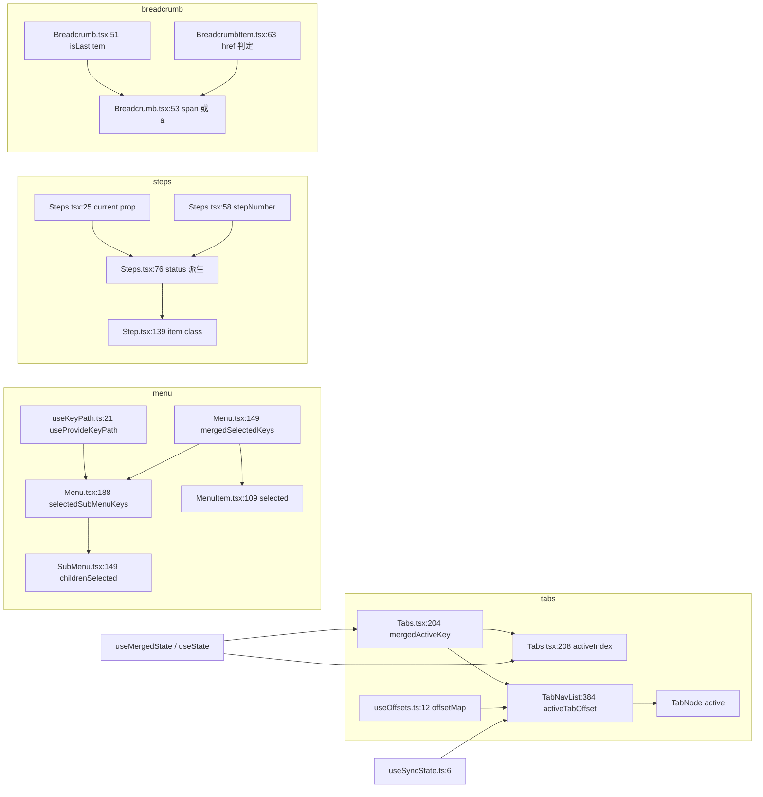
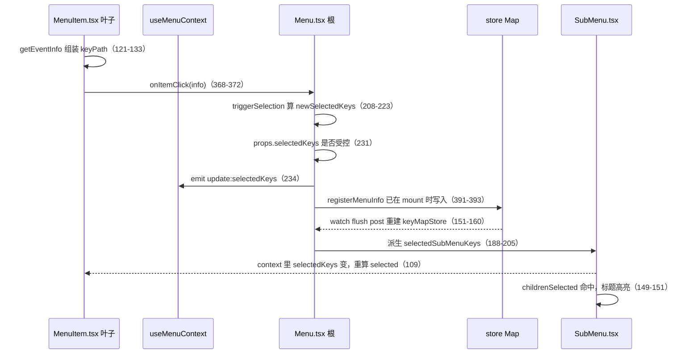
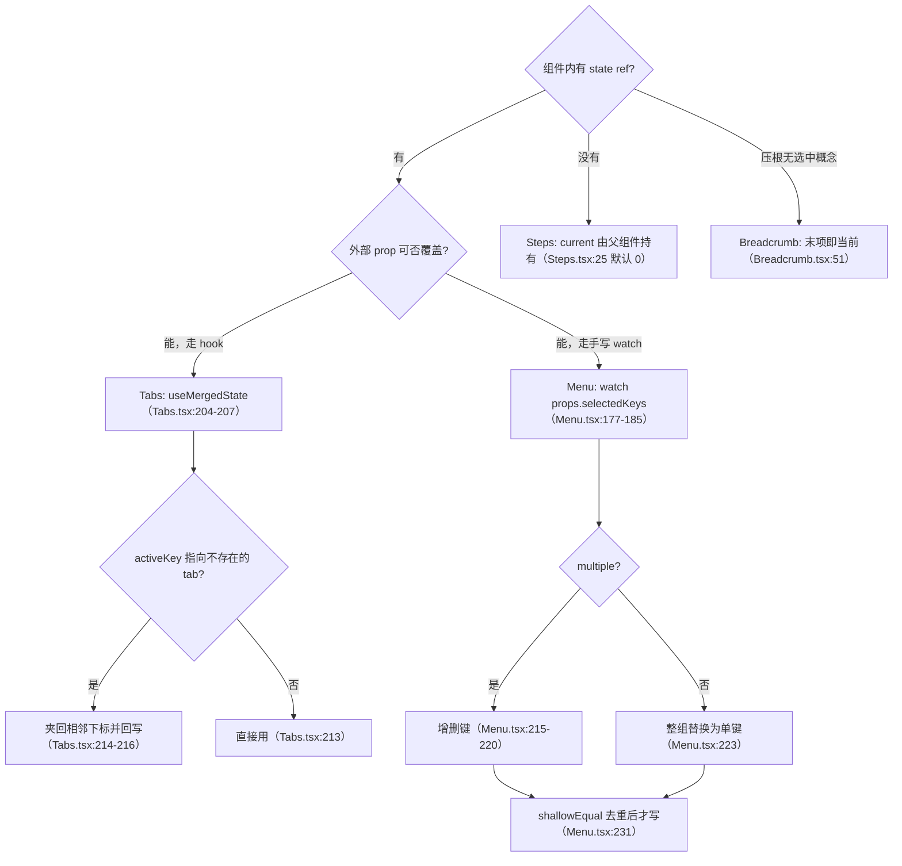

# C03-00 类横写：menu/tabs/steps/breadcrumb 的选中态模型

> **本篇解决**：menu / tabs / steps / breadcrumb 四个导航组件的「当前选中项」到底存在哪里、由谁计算、如何回流，以及四者在哪一层共用同一套选中态机制、在哪一层分道扬镳。
> **前置**：A06 Props 体系与类型工具、I13 响应式内核 hooks　**读者坐标**：`03-components/03-navigation` 第 0/14 篇（类横写）

## 一、职责与边界

导航类组件对外只回答一个问题：**「当前是哪一项」**。但这一句话在四个组件里对应四套完全不同的实现形态，而本类此前没有一处共享代码把它们归一。本篇的职责是把这四套形态的差异钉到具体文件与行号上，让读者在读任何一个 C03-01 到 C03-06 单篇之前，先拿到一张「状态在哪里、由谁算、怎么回流」的对照表；并指出四个组件各自把「选中」表达成了什么——类名、几何位移、状态位、还是「根本没有链接」。

明确不负责：受控/非受控 hook 的内部实现与三套实现的横向普查归 I13 响应式内核 hooks，本篇只引用其结论并说明本类如何落在它的结论之外；props 定义、`initDefaultProps`、`flattenChildren`、`eventType` 的语义归 A06 Props 体系与类型工具，本篇只在引用点出现；浮层三件套（trigger / align / zIndex）的时序归 A07 交互基础设施总览与 I02 vc-trigger 弹出时序与事件穿透，Menu 的 SubMenu 弹出、Breadcrumb 的 Dropdown 只作为「选中态的外部消费者」出现；滚动与 rAF 节流的两处底层缺陷已在 C03-11 Affix 固钉与 C03-12 BackTop 返回顶部证过，本篇直接引用其结论，不重证。Menu / Tabs / Steps / Breadcrumb 四个组件的单体实现细节分别归 C03-01、C03-05、C03-06、C03-04，本篇只写它们共有的那层结构。

依赖清单（本类四组件向下依赖的部分）：

- 状态原语：`packages/xiaoye-ui/src/_util/hooks/useMergedState.ts:4`、`packages/xiaoye-ui/src/_util/hooks/useState.ts`、`packages/xiaoye-ui/src/tabs/src/hooks/useSyncState.ts:6`
- 上下文：`packages/xiaoye-ui/src/menu/src/hooks/useMenuContext.ts:82`、`packages/xiaoye-ui/src/tabs/src/TabContext.ts:12`、`packages/xiaoye-ui/src/menu/src/hooks/useKeyPath.ts:21`
- 子节点归一：`packages/xiaoye-ui/src/_util/props-util` 的 `flattenChildren`（`packages/xiaoye-ui/src/tabs/src/Tabs.tsx:391`、`packages/xiaoye-ui/src/menu/src/Menu.tsx:449`、`packages/xiaoye-ui/src/breadcrumb/Breadcrumb.tsx:133`）
- vendor 层：`packages/xiaoye-ui/src/vc-steps/Steps.tsx:12`（Steps 的全部选中语义）、`packages/xiaoye-ui/src/vc-overflow`（**只服务 Menu**——读者是 `menu/src/Menu.tsx:35`、`menu/src/MenuItem.tsx:19`、`menu/src/SubMenu.tsx:26` 与 `vc-select/Selector/MultipleSelector.tsx:10`；`grep -rn "vc-overflow" packages/xiaoye-ui/src/tabs` 零命中，Tabs 不直接用，只经内嵌 Menu 间接受影响，2026-09-29 更正）
- 跨类组合：`packages/xiaoye-ui/src/breadcrumb/Breadcrumb.tsx:104` 在面包屑里嵌了一个 Menu，`packages/xiaoye-ui/src/breadcrumb/BreadcrumbItem.tsx:45` 用 Dropdown 包一层

## 二、源码地图

| 文件 | 行数 | 在选中态链路中的职责 | 关键导出 |
| --- | --- | --- | --- |
| `packages/xiaoye-ui/src/menu/src/Menu.tsx` | 531 | 持有 `mergedSelectedKeys` / `mergedOpenKeys` / `activeKeys` 三份状态并派生 `selectedSubMenuKeys` | `menuProps`（48 行）、默认导出 |
| `packages/xiaoye-ui/src/menu/src/MenuItem.tsx` | 269 | 从 vnode key 取身份，注册进 store，读 context 算 `selected` | 默认导出 |
| `packages/xiaoye-ui/src/menu/src/SubMenu.tsx` | 370 | 追加 keyPath、维护 `childrenEventKeys`、把 `selectedSubMenuKeys` 转成祖先高亮 | 默认导出 |
| `packages/xiaoye-ui/src/menu/src/hooks/useKeyPath.ts` | 45 | 嵌套 provide 的祖先键链；`PathContext` 测量副本隔离 | `useProvideKeyPath`、`OVERFLOW_KEY` |
| `packages/xiaoye-ui/src/menu/src/hooks/useMenuContext.ts` | 168 | 选中态的 context 契约与「无 provider 时的空 context」 | `useProvideMenu`、`MenuContextProvider` |
| `packages/xiaoye-ui/src/menu/src/hooks/useItems.tsx` | 136 | `items` 数据驱动路径，自建一份 keyPath 表 | `useItems` |
| `packages/xiaoye-ui/src/tabs/src/Tabs.tsx` | 403 | 外层 `XYTabs` 解析 slot 成 tabs，内层 `InternalTabs` 持有 `mergedActiveKey` | `tabsProps`（51 行）、默认导出 |
| `packages/xiaoye-ui/src/tabs/src/TabNavList/index.tsx` | 591 | 把 `activeKey` 翻成 ink bar 与滚动位移 | 默认导出 |
| `packages/xiaoye-ui/src/tabs/src/hooks/useOffsets.ts` | 40 | key → 矩形偏移表 | 默认导出 |
| `packages/xiaoye-ui/src/tabs/src/hooks/useSyncState.ts` | 21 | 位移状态的同步回调写入 | 默认导出 |
| `packages/xiaoye-ui/src/vc-steps/Steps.tsx` | 145 | 零状态：`current` 与下标比较，现场算 `status` | 默认导出、`Step` |
| `packages/xiaoye-ui/src/vc-steps/Step.tsx` | 199 | `status` / `active` → 类名与可访问性属性 | `VcStepProps` |
| `packages/xiaoye-ui/src/steps/index.tsx` | 169 | 业务壳，给 `current` 兜底 0 并补 `update:current` | `stepsProps`（23 行） |
| `packages/xiaoye-ui/src/breadcrumb/Breadcrumb.tsx` | 171 | 无选中态；用「是否末项」决定渲染 `span` 还是 `a` | `breadcrumbProps`（19 行） |
| `packages/xiaoye-ui/src/breadcrumb/BreadcrumbItem.tsx` | 89 | 用 `href` 缺位表达「当前页」；overlay 时套 Dropdown | `breadcrumbItemProps`（13 行） |

主实现入口的落点：Menu 是 `packages/xiaoye-ui/src/menu/src/Menu.tsx:105` 的 setup，Tabs 是 `packages/xiaoye-ui/src/tabs/src/Tabs.tsx:146`（内层）与 `packages/xiaoye-ui/src/tabs/src/Tabs.tsx:385`（外层），Steps 是 `packages/xiaoye-ui/src/vc-steps/Steps.tsx:36`，Breadcrumb 是 `packages/xiaoye-ui/src/breadcrumb/Breadcrumb.tsx:66`。四个组件的包级入口分别是 `packages/xiaoye-ui/src/menu/index.tsx:16`、`packages/xiaoye-ui/src/tabs/index.ts:9`、`packages/xiaoye-ui/src/steps/index.tsx:162`、`packages/xiaoye-ui/src/breadcrumb/index.ts:15`，注册一律走 `packages/xiaoye-ui/src/_util/registerComponent.ts`。

测试现状（决定「哪条分支有人守」）：`packages/xiaoye-ui/src/menu/index.test.js` 共 523 行，是本类唯一成体系的用例；`packages/xiaoye-ui/src/tabs/index.test.js:4` 只覆盖 `editable-card` 与 `tabPosition`；`packages/xiaoye-ui/src/steps/index.test.js:5` 只有 `mountTest`；`packages/xiaoye-ui/src/breadcrumb/Breadcrumb.test.js` 123 行。按 `packages/xiaoye-ui/vitest.config.mts:33` 的 glob，这四个文件都会被执行。

## 三、架构与数据流

四套模型的静态关系如下。这张图想固化的一件事是：**选中态的持有者（state owner）在四个组件里落在四个不同层级**——Menu 在根组件、Tabs 在根组件的内层实例、Steps 在调用方（组件内部一个 ref 都没有）、Breadcrumb 在数据本身。



Menu 的完整闭环（点击 → 事件对象 → 根组件算新键集 → 写内部态 → 回流到叶子类名 → 再派生祖先高亮）。之所以画成时序图，是因为这条链上有一次「写 store 的异步 flush」和一次「setTimeout 去抖」，静态图无法表达：



Steps 与 Breadcrumb 没有上面那条闭环——它们是纯函数式的两段：渲染期算，算完就丢。这个分岔是本类最需要固化的一张判定图：



逐图说明第一处关键分支：`flowchart TD` 里的「有 state 但走手写 watch」这一支（`packages/xiaoye-ui/src/menu/src/Menu.tsx:177-185`）正是 I13 论点 2 所说的「第三套实现」在本类的实例——它不经过 `useMergedState`，因此 I13 关于 hook 层去重与 `postState` 的所有结论对 Menu 一律不适用，读 Menu 时要把 hook 的心智模型整套摘掉。第二处：`Tabs.tsx:204-207` 用的是 `useMergedState`，但它同时把 `activeIndex` 存在 `useState` 里（`packages/xiaoye-ui/src/tabs/src/Tabs.tsx:208`），这是 I13 论点 1 提到的「同构可互换」的一个真实反例场景——两个 ref 之间必须靠 `watchEffect` 手工对齐（`packages/xiaoye-ui/src/tabs/src/Tabs.tsx:206-213`），换成别的 hook 并不能省掉这段。第三处：`useSyncState`（`packages/xiaoye-ui/src/tabs/src/hooks/useSyncState.ts:6-18`）只服务于位移而不是选中态，但它落在同一个组件文件族里，容易误认为 Tabs 的 `activeKey` 也用它管的——实际 `activeKey` 全程走 `useMergedState`。

## 四、核心机制精读

### 论点 1：选中项的身份取自 VNode 的 key，而不是任何 prop；四个组件因此分成「用 key」与「用下标」两个阵营

`packages/xiaoye-ui/src/menu/src/MenuItem.tsx:55-66`（叶子组件的身份证据）：

```tsx
// packages/xiaoye-ui/src/menu/src/MenuItem.tsx:55
  setup(props, { slots, emit, attrs }) {
    const instance = getCurrentInstance();
    const isMeasure = useMeasure();
    const key =
      typeof instance.vnode.key === 'symbol' ? String(instance.vnode.key) : instance.vnode.key;
    devWarning(
      typeof instance.vnode.key !== 'symbol',
      'MenuItem',
      `MenuItem \`:key="${String(key)}"\` not support Symbol type`,
    );

    const eventKey = `menu_item_${++indexGuid}_$$_${key}`;
```

逐段解释：`props` 里没有任何 `key` 字段——`menuItemProps` 声明的是 `disabled` / `danger` / `onClick` 等（`packages/xiaoye-ui/src/menu/src/MenuItem.tsx:35` 附近），选中身份完全从 `instance.vnode.key` 反读（`packages/xiaoye-ui/src/menu/src/MenuItem.tsx:58-59`）。这意味着调用方写 `<xy-menu-item key="home">` 里的 `key` 同时承担两件事：Vue 的 diff 身份与业务选中身份。`packages/xiaoye-ui/src/menu/src/MenuItem.tsx:66` 再造一个带自增序号的 `eventKey`，把「同一 key 的多个实例」区分开——`eventKey` 用于 DOM 事件与父子登记，`key` 用于选中，两套标识在同一段代码里并存（结构见 `packages/xiaoye-ui/src/menu/src/hooks/useMenuContext.ts:13-20` 的 `StoreMenuInfo`，两个字段都在）。

Tabs 走的是同一个来源，但换了个读取位置。`packages/xiaoye-ui/src/tabs/src/Tabs.tsx:85-123`（`parseTabList`）：

```tsx
// packages/xiaoye-ui/src/tabs/src/Tabs.tsx:85
function parseTabList(children: any[]): Tab[] {
  return children
    .map(node => {
      if (isValidElement(node)) {
        const props = { ...(node.props || {}) };
        for (const [k, v] of Object.entries(props)) {
          delete props[k];
          props[camelize(k)] = v;
        }
        const slots = node.children || {};
        const key = node.key !== undefined ? node.key : undefined;
        const {
          tab = slots.tab,
          disabled,
          forceRender,
          closable,
          // ...
        } = props;
        return {
          key,
          ...props,
          node,
```

解释：`packages/xiaoye-ui/src/tabs/src/Tabs.tsx:92` 从子 VNode 直接取 `node.key`，`packages/xiaoye-ui/src/tabs/src/Tabs.tsx:106` 把它放进 `Tab` 结构体的首位（类型定义在 `packages/xiaoye-ui/src/tabs/src/interface.ts:17-20`：`Tab extends TabPaneProps` 且必须有 `key`）。此后整条选中链都以这个 key 为轴：`packages/xiaoye-ui/src/tabs/src/Tabs.tsx:213` 用它 `findIndex`，`packages/xiaoye-ui/src/tabs/src/TabNavList/index.tsx:489` 用 `key === activeKey` 决定 `active` 属性。同一行的三元表达式在语义上等价于 `node.key` 本身，但写法上把「key 可能缺失」这件事显式摊开了——缺失时 `key` 为 `undefined`，`packages/xiaoye-ui/src/tabs/src/Tabs.tsx:204` 的初始值 `props.tabs[0]?.key` 就会拿到 `undefined`，选中态直接不可达。

Steps 与 Breadcrumb 在另一端：身份是**数组下标**。`packages/xiaoye-ui/src/vc-steps/Steps.tsx:43-70`（`renderStep`）：

```tsx
// packages/xiaoye-ui/src/vc-steps/Steps.tsx:43
    const renderStep = (item: VCStepProps, index: number, legacyRender?: any) => {
      const {
        prefixCls,
        // ...
        current,
        initial,
        // ...
      } = props;
      const mergedProgressDot = isInline || progressDot;
      const mergedItem = { ...item, class: '' };
      const stepNumber = initial + index;
      const commonProps = {
        active: stepNumber === current,
        stepNumber: stepNumber + 1,
        stepIndex: stepNumber,
        key: stepNumber,
```

解释：`packages/xiaoye-ui/src/vc-steps/Steps.tsx:58` 用 `initial + index` 造出身份，`packages/xiaoye-ui/src/vc-steps/Steps.tsx:60` 的选中判定是一次数字相等，`packages/xiaoye-ui/src/vc-steps/Steps.tsx:63` 又把这个数字**当作** VNode key。这里身份与 key 是同一个数，所以 Steps 的选中态天生跟着「数组位置」走：中间插入或删除一项，`current` 不变而指向的步骤变了。Breadcrumb 的两条路径各取一种身份——`packages/xiaoye-ui/src/breadcrumb/Breadcrumb.tsx:122` 的 `key={path || route.breadcrumbName}`（routes 路径，字符串身份），与 `packages/xiaoye-ui/src/breadcrumb/Breadcrumb.tsx:153` 的 `cloneVNode(element, { separator, key: index })`（children 路径，下标身份），同一个组件对「一项是什么」给出了两种答案。

结论回扣：本类没有统一的「选中身份」抽象，只有两个隐含约定——**有交互语义的组件（menu/tabs）用 key，纯展示语义的组件（steps/breadcrumb）用下标**。改动任何一个组件时若引入 `id`/`value` 之类的显式身份 prop，就会与另一阵营不一致；而 Menu 的 key 缺失没有兜底（`packages/xiaoye-ui/src/menu/src/MenuItem.tsx:58-59` 直接取，不判空），SubMenu 却有兜底（`packages/xiaoye-ui/src/menu/src/SubMenu.tsx:79` 生成 `sub_menu_${++indexGuid}_$$_not_set_key`），这是同阵营内部的不对称。

### 论点 2：「是否受控」的判定谓词在本类共出现五种写法，其中三种挤在 Menu 的同一个文件里

`packages/xiaoye-ui/src/menu/src/Menu.tsx:177-185` 与 `packages/xiaoye-ui/src/menu/src/Menu.tsx:226-241`（手写受控判定）：

```tsx
// packages/xiaoye-ui/src/menu/src/Menu.tsx:177
    watch(
      () => props.selectedKeys,
      selectedKeys => {
        if (selectedKeys) {
          mergedSelectedKeys.value = selectedKeys.slice();
        }
      },
      { immediate: true, deep: true },
    );
```

```tsx
// packages/xiaoye-ui/src/menu/src/Menu.tsx:226
        // Trigger event
        const selectInfo: SelectInfo = {
          ...info,
          selectedKeys: newSelectedKeys,
        };
        if (!shallowEqual(newSelectedKeys, mergedSelectedKeys.value)) {
          if (props.selectedKeys === undefined) {
            mergedSelectedKeys.value = newSelectedKeys;
          }
          emit('update:selectedKeys', newSelectedKeys);
          if (exist && props.multiple) {
            emit('deselect', selectInfo);
          } else {
            emit('select', selectInfo);
          }
        }
```

逐段解释：入向用 **truthy** 判定（`packages/xiaoye-ui/src/menu/src/Menu.tsx:181` 的 `if (selectedKeys)`），出向用 **`=== undefined`** 判定（`packages/xiaoye-ui/src/menu/src/Menu.tsx:232`）。两个谓词对 `undefined` 同真，但对 `null` 分叉：传 `:selected-keys="null"` 时，入向 watcher 因为 falsy 不写入，出向因为 `!== undefined` 判定为「非受控」而写内部态——同一个 prop 值在同一文件里被读成两种受控性。`packages/xiaoye-ui/src/menu/src/Menu.tsx:182` 的 `.slice()` 与 `packages/xiaoye-ui/src/menu/src/Menu.tsx:231` 的 `shallowEqual` 构成第二重保护：外部数组被复制后才落进内部态，避免调用方原地 push 直接把 Menu 的选中态改掉。`openKeys` 用的是第三种写法——默认参数：`packages/xiaoye-ui/src/menu/src/Menu.tsx:250-258` 的 `(openKeys = mergedOpenKeys.value) => {...}`，默认值只在 `undefined` 时生效，传 `null` 会走到 `packages/xiaoye-ui/src/menu/src/Menu.tsx:255` 的 `openKeys.slice()` 抛 TypeError。同一个文件里三种谓词，是全类最需要警惕的一处不统一。

Tabs 把这件事交给了 hook。`packages/xiaoye-ui/src/tabs/src/Tabs.tsx:197-213`：

```tsx
// packages/xiaoye-ui/src/tabs/src/Tabs.tsx:197
    // ====================== Active Key ======================
    const [mergedActiveKey, setMergedActiveKey] = useMergedState<Key>(() => props.tabs[0]?.key, {
      value: computed(() => props.activeKey),
      defaultValue: props.defaultActiveKey,
    });
    const [activeIndex, setActiveIndex] = useState(() =>
      props.tabs.findIndex(tab => tab.key === mergedActiveKey.value),
    );

    watchEffect(() => {
      let newActiveIndex = props.tabs.findIndex(tab => tab.key === mergedActiveKey.value);
      if (newActiveIndex === -1) {
        newActiveIndex = Math.max(0, Math.min(activeIndex.value, props.tabs.length - 1));
        setMergedActiveKey(props.tabs[newActiveIndex]?.key);
      }
      setActiveIndex(newActiveIndex);
    });
```

解释：受控性判定被压进 `value` ref（`packages/xiaoye-ui/src/tabs/src/Tabs.tsx:199`），谓词形式是 hook 内部的 `value.value !== undefined`（`packages/xiaoye-ui/src/_util/hooks/useMergedState.ts:26`）——即第四种写法，但由 I13 论点 1 统一分析，本篇不展开。本组件层面的增量是那两个 ref 的**分工**：`mergedActiveKey` 是身份，`activeIndex` 是位置，`packages/xiaoye-ui/src/tabs/src/Tabs.tsx:206-213` 的 `watchEffect` 是唯一的对齐器。当 key 找不到对应项（`newActiveIndex === -1`）时，它不删状态而是把下标夹进 `[0, tabs.length-1]` 再回写 key，这一步在受控场景下会被外部 value 立刻覆盖回去（这是 I13 坑 1「受控转非受控时值被清空」的镜像问题，本类的具体表现见 §七 坑 3）。

Steps 是第五种：**根本没有非受控分支**。`packages/xiaoye-ui/src/steps/index.tsx:59-63`：

```tsx
// packages/xiaoye-ui/src/steps/index.tsx:59
  props: initDefaultProps(stepsProps(), {
    current: 0,
    responsive: true,
    labelPlacement: 'horizontal',
  }),
```

`packages/xiaoye-ui/src/steps/index.tsx:81-84`：

```tsx
// packages/xiaoye-ui/src/steps/index.tsx:81
    const handleChange = (current: number) => {
      emit('update:current', current);
      emit('change', current);
    };
```

解释：`current` 有 prop 默认值 0（`packages/xiaoye-ui/src/steps/index.tsx:60`），因此 `props.current` 在组件内**永远不是** `undefined`——不存在「读 props 还是读内部态」的分支，Steps 永远读 props。`packages/xiaoye-ui/src/vc-steps/Steps.tsx:25` 同样给了 `current: PropTypes.number.def(0)`。于是 `v-model:current` 是唯一的状态来源：`packages/xiaoye-ui/src/steps/index.tsx:82` 发出 `update:current`，父组件不接（`apps/docs` 里那种只读用法）就等于步骤条不可切换，而 vc-steps 侧 `packages/xiaoye-ui/src/vc-steps/Steps.tsx:37-42` 只做 `if (current !== next) emit('change', next)`，一次写入都没有。Breadcrumb 连 `change` 都没有：它的「当前」由 `packages/xiaoye-ui/src/breadcrumb/Breadcrumb.tsx:51` 的 `routes.indexOf(route) === routes.length - 1` 现场算出，不可写。

结论回扣：判定谓词共五种（truthy / `=== undefined` / 默认参数 / hook 内部 `!== undefined` / 有 prop 默认值故无分支），分布在不同文件甚至同一文件的不同行。任何「给导航组件加一个 default 属性」的改动，先要回答的是「这个组件用哪谓词判断受控」，而不是「hook 怎么调」。

### 论点 3：「选中（selected）」与「激活（active）」是两条独立的状态轴，本类只有 Menu 把两条都实现，且它的第二轴由鼠标与焦点驱动、不是方向键

`packages/xiaoye-ui/src/menu/src/Menu.tsx:148-175`（第二轴的源头与受控入口）：

```tsx
// packages/xiaoye-ui/src/menu/src/Menu.tsx:149
    const activeKeys = ref([]);
    const mergedSelectedKeys = ref([]);
    const keyMapStore = ref<Record<Key, StoreMenuInfo>>({});
    watch(
      store,
      () => {
        const newKeyMapStore = {};
        for (const menuInfo of store.value.values()) {
          newKeyMapStore[menuInfo.key] = menuInfo;
        }
        keyMapStore.value = newKeyMapStore;
      },
```

`packages/xiaoye-ui/src/menu/src/Menu.tsx:162-175`：

```tsx
// packages/xiaoye-ui/src/menu/src/Menu.tsx:162
    watchEffect(() => {
      if (props.activeKey !== undefined) {
        let keys = [];
        const menuInfo = props.activeKey ? keyMapStore.value[props.activeKey] : undefined;
        if (menuInfo && props.activeKey !== undefined) {
          keys = uniq([].concat(unref(menuInfo.parentKeys), props.activeKey));
        } else {
          keys = [];
        }
        if (!shallowEqual(activeKeys.value, keys)) {
          activeKeys.value = keys;
        }
      }
    });
```

逐段解释：`packages/xiaoye-ui/src/menu/src/Menu.tsx:149-150` 两个 ref 并排声明，一条给 hover/focus（`activeKeys`，复数、含祖先链），一条给点击（`mergedSelectedKeys`）。第二轴的受控入口是 `packages/xiaoye-ui/src/menu/src/Menu.tsx:60` 的 `activeKey: String, // 内部组件使用`——单数、且注释自陈是内部用；受控时 `packages/xiaoye-ui/src/menu/src/Menu.tsx:168` 把外部单键扩成「祖先链 + 自身」，所以 hover 一个三级项会给一到三级全部挂上 active 类。`packages/xiaoye-ui/src/menu/src/Menu.tsx:164` 的外层 `if (props.activeKey !== undefined)` 意味着**非受控时这段派生整块不执行**，`activeKeys` 只能由 `changeActiveKeys` 写：

```tsx
// packages/xiaoye-ui/src/menu/src/Menu.tsx:261
    let timeout: any;
    const changeActiveKeys = (keys: Key[]) => {
      clearTimeout(timeout);
      timeout = setTimeout(() => {
        if (props.activeKey === undefined) {
          activeKeys.value = keys;
        }
        emit('update:activeKey', keys[keys.length - 1]);
      });
    };
```

解释：`packages/xiaoye-ui/src/menu/src/Menu.tsx:260-268` 用零延时 `setTimeout` 做「同帧去抖」，让一次批量重排 DOM 引发的多次 mouseenter 只落一次状态；`packages/xiaoye-ui/src/menu/src/Menu.tsx:268` 把链尾单键发出去，与受控入口的「单数」对齐。这条 emit 在全仓**没有任何监听方**：`grep -rn "update:activeKey" packages --include="*.tsx" --include="*.ts"` 的命中只有 `packages/xiaoye-ui/src/menu/src/Menu.tsx:268` 自身，以及 tabs（`packages/xiaoye-ui/src/tabs/src/Tabs.tsx:387`）与 collapse（`packages/xiaoye-ui/src/collapse/Collapse.tsx:108`）各自发出的同名事件，三者互不相干；再用第二种方式交叉验证——`grep -rn "activeKey" packages/xiaoye-ui/src` 的 Menu 侧命中全部落在声明（`Menu.tsx:60`、`Menu.tsx:89`）与内部读取（`Menu.tsx:164-268`），无外部调用点。也就是说 `activeKey` 目前是**只出不进**的公开 API 面。

驱动源不在键盘。`packages/xiaoye-ui/src/menu/src/MenuItem.tsx:146-157`：

```tsx
// packages/xiaoye-ui/src/menu/src/MenuItem.tsx:146
    const onMouseEnter = (event: MouseEvent) => {
      if (!mergedDisabled.value) {
        changeActiveKeys(keysPath.value);
        emit('mouseenter', event);
      }
    };
    const onMouseLeave = (event: MouseEvent) => {
      if (!mergedDisabled.value) {
        changeActiveKeys([]);
        emit('mouseleave', event);
      }
    };
```

`packages/xiaoye-ui/src/menu/src/MenuItem.tsx:159-169`：

```tsx
// packages/xiaoye-ui/src/menu/src/MenuItem.tsx:159
    const onInternalKeyDown = (e: KeyboardEvent) => {
      emit('keydown', e);

      if (e.which === KeyCode.ENTER) {
        const info = getEventInfo(e);

        // Legacy. Key will also trigger click event
        emit('click', e);
        onItemClick(info);
      }
    };
```

解释：MenuItem 的键盘处理**只认 ENTER**（`packages/xiaoye-ui/src/menu/src/MenuItem.tsx:162`），没有方向键游标；ENTER 会同时发 `click` 与 `onItemClick`，注释（`:165`）自陈「Key will also trigger click event」是遗留行为，即一次回车会走两遍点击语义。真正把 `activeKeys` 点亮的是 `packages/xiaoye-ui/src/menu/src/MenuItem.tsx:175-178` 的 `onInternalFocus`（注释在 `:171-174` 说明「helper 会在没有键盘的情况下聚焦」）。叶子如何消费第二轴也不是 computed，而是 watch：

```tsx
// packages/xiaoye-ui/src/menu/src/MenuItem.tsx:101
    watch(
      activeKeys,
      () => {
        isActive.value = !!activeKeys.value.find(val => val === key);
      },
      { immediate: true },
    );
    const mergedDisabled = computed(() => disabled.value || props.disabled);
    const selected = computed(() => selectedKeys.value.includes(key));
```

解释：同一段里两条轴用了两种响应式手段——active 走 `watch` + `shallowRef`（`packages/xiaoye-ui/src/menu/src/MenuItem.tsx:101-107`，配 `packages/xiaoye-ui/src/menu/src/MenuItem.tsx:82` 的 `const isActive = shallowRef(false)`），selected 走 `computed`（`:109`）。差别不是性能偏好而是**依赖来源**：`activeKeys` 是 context 里的 Ref，数组每次被整体替换，用 computed 会与 `watch` 等价但需要额外 `includes`；用 `watch` 可以把「链上任一 key 命中」摊成布尔。SubMenu 抄了同一段（`packages/xiaoye-ui/src/menu/src/SubMenu.tsx:153-160`），两条轴的类名落点分别是 `packages/xiaoye-ui/src/menu/src/MenuItem.tsx:115`（`-item-active`）与 `:116`（`-item-selected`）。

本类的其它三个组件对第二轴各有不同答案。Tabs 把它**搬进了溢出下拉**：`packages/xiaoye-ui/src/tabs/src/TabNavList/OperationNode.tsx:49-51`：

```tsx
// packages/xiaoye-ui/src/tabs/src/TabNavList/OperationNode.tsx:49
    // ======================== Dropdown ========================
    const [open, setOpen] = useState(false);
    const [selectedKey, setSelectedKey] = useState<Key>(null);
```

`OperationNode.tsx:52-65` 的 `selectOffset` 与 `:74-105` 的 `onKeyDown` 才真正实现了上下键游标（`KeyCode.UP`/`KeyCode.DOWN`/`KeyCode.ESC`/`KeyCode.SPACE`/`KeyCode.ENTER`，见 `packages/xiaoye-ui/src/tabs/src/TabNavList/OperationNode.tsx:72-90`），确认时它直接 `emit('tabClick', selectedKey.value, e)`（`packages/xiaoye-ui/src/tabs/src/TabNavList/OperationNode.tsx:86`）把游标升级成选中。Steps 的第二轴是纯可访问性：`packages/xiaoye-ui/src/vc-steps/Step.tsx:160-164` 只在 `onStepClick && !disabled` 时给容器加 `role = 'button'` 与 `tabindex = 0`，没有独立的 hover 态。Breadcrumb 没有第二轴（`packages/xiaoye-ui/src/breadcrumb/BreadcrumbItem.tsx:55-57` 只有 `emit('click', e)`）。

结论回扣：只有 Menu 在**同一棵树**里维护「selected 集合 + active 链」，因此也只有 Menu 的样式能区分 `-selected` 与 `-active` 两种视觉；Tabs 的键盘游标存在于溢出副本里，正常显示的 tab 条没有游标态。读者若要给任一组件加「方向键切换」，先要确认自己在加第二轴还是第一轴——加错轴会同时破坏 `Menu.tsx:268` 的 emit 语义与 `OperationNode.tsx:86` 的升级语义。

### 论点 4：溢出折叠会让同一份选中态被渲染两次，两个组件用了两种完全不同的隔离手段

横向机制在 C04-00 类横写：受控/非受控与 `useMergedState` 的一致实现中已有讨论，本篇只处理它在导航类的特殊形态——导航组件必须把「装不下的项」折叠进浮层，于是**同一批项在页面上存在两个 DOM 实例**，两者都会注册自己。Menu 的处理是给隐藏副本关掉 active 与 open：

```tsx
// packages/xiaoye-ui/src/menu/src/Menu.tsx:457
      const getWrapperList = childList => {
        return mergedMode.value !== 'horizontal' || props.disabledOverflow
          ? childList
          : // Need wrap for overflow dropdown that do not response for open
            childList.map((child, index) => (
              // Always wrap provider to avoid sub node re-mount
              <MenuContextProvider
                key={child.key}
                overflowDisabled={index > lastVisibleIndex.value}
                v-slots={{ default: () => child }}
              ></MenuContextProvider>
            ));
      };
```

解释：`packages/xiaoye-ui/src/menu/src/Menu.tsx:455-467` 给每个一级子项套一个 `MenuContextProvider`，只在 `index > lastVisibleIndex.value` 时把 `overflowDisabled` 置真；`lastVisibleIndex` 由溢出容器回调写入（`packages/xiaoye-ui/src/menu/src/Menu.tsx:518-520`），初值 0（`packages/xiaoye-ui/src/menu/src/Menu.tsx:402`）。消费点全部在 SubMenu：`packages/xiaoye-ui/src/menu/src/SubMenu.tsx:146` 的 `open = computed(() => !overflowDisabled.value && originOpen.value)` 让隐藏副本永远不展开，`packages/xiaoye-ui/src/menu/src/SubMenu.tsx:295` 让隐藏副本不建 PopupTrigger，`:353` 让隐藏副本不渲染标题弹层。而 provider 的合并语义有一处硬约束——`packages/xiaoye-ui/src/menu/src/hooks/useMenuContext.ts:150-152`：

```ts
// packages/xiaoye-ui/src/menu/src/hooks/useMenuContext.ts:150
    if (props.overflowDisabled !== undefined) {
      newContext.overflowDisabled = toRef(props, 'overflowDisabled');
    }
```

配合 `packages/xiaoye-ui/src/menu/src/hooks/useMenuContext.ts:142-153` 的浅拷贝与注释「确保传入的属性不会动态增删 / 不需要 watch 变化」：`newContext` 是一次性浅拷贝（`:144`），后续根组件再改 `selectedKeys` 不会给已生成的 provider 实例加字段——它依赖的是「context 里存的是 Ref 而不是值」（`packages/xiaoye-ui/src/menu/src/hooks/useMenuContext.ts:26-29`），拷贝的是 Ref 的引用，所以已有字段的值仍然联动，但**增删字段不会联动**。另外 `packages/xiaoye-ui/src/menu/src/Menu.tsx:438` 给的根默认值是 `overflowDisabled: shallowRef(undefined)`，即第一层 provider 的该字段是 `undefined` 的 Ref，靠 `SubMenu.tsx:146` 的 `!overflowDisabled.value` 把 `undefined` 当假值用。

Tabs 用了另一条路：它不让 Menu 参与溢出，而是在溢出下拉里**内嵌一个 Menu 实例**，并把自己的键盘游标灌进 Menu 的选中轴。`packages/xiaoye-ui/src/tabs/src/TabNavList/OperationNode.tsx:1-2`：

```tsx
// packages/xiaoye-ui/src/tabs/src/TabNavList/OperationNode.tsx:1
import Menu, { MenuItem } from '../../../menu';
import Dropdown from '../../../vc-dropdown';
```

`packages/xiaoye-ui/src/tabs/src/TabNavList/OperationNode.tsx:168-177`（下拉里的 Menu）：

```tsx
// packages/xiaoye-ui/src/tabs/src/TabNavList/OperationNode.tsx:168
              <Menu
                onClick={({ key, domEvent }) => {
                  emit('tabClick', key, domEvent);
                  setOpen(false);
                }}
                id={popupId.value}
                tabindex={-1}
                role="listbox"
                aria-activedescendant={selectedItemId.value}
                selectedKeys={[selectedKey.value]}
```

解释：`packages/xiaoye-ui/src/tabs/src/TabNavList/OperationNode.tsx:177` 把 Tabs 的第二轴（`selectedKey`，键盘游标，`packages/xiaoye-ui/src/tabs/src/TabNavList/OperationNode.tsx:51`）**跨轴接进 Menu 的第一轴**（`selectedKeys`）。于是下拉里的「当前项」由 Menu 的 `-item-selected` 类名表达（`packages/xiaoye-ui/src/menu/src/MenuItem.tsx:116`），而不是 Menu 的 active 轴。副本的每一项由 `packages/xiaoye-ui/src/tabs/src/TabNavList/OperationNode.tsx:181-190` 直接构造 `MenuItem`，key 取 `tab.key`（`:205`），因此与主 tab 条共用同一套身份——这正是论点 1 的「key 阵营」在下拉里的延续。

`OperationNode.tsx:123` 还有一行 `useProvideOverride({})`，即 `packages/xiaoye-ui/src/menu/src/OverrideContext.ts:19-28` 的覆盖链。逐字段 `??` 合并（`packages/xiaoye-ui/src/menu/src/OverrideContext.ts:22-24`）并回读父级 override（`:20`），所以可多层嵌套。传空对象的实际效果是让 `packages/xiaoye-ui/src/menu/src/Menu.tsx:107` 的 `useInjectOverride()` 返回一个真值对象，从而 `packages/xiaoye-ui/src/menu/src/Menu.tsx:110-115` 把 `useStyle` 的第二个参数算成 `false`——下拉副本因此不注入自己的样式哈希。Menu 侧真正读取的覆盖字段只有四个：prefixCls（`packages/xiaoye-ui/src/menu/src/Menu.tsx:109`）、mode（`:287-289`）、onClick（`:371`）、expandIcon（`:402`），加上 `:113` 的真值判断。`OverrideContext.ts:9` 的 `selectable` 与 `:10` 的 `validator` **没有任何读取方**：`useInjectOverride` 的 import 点全仓只有 `packages/xiaoye-ui/src/menu/src/Menu.tsx:46` 一处（`grep -rn "useInjectOverride" packages/xiaoye-ui/src` 与 `grep -rn "override" menu/src/*.tsx` 交叉验证）。而 `packages/xiaoye-ui/src/dropdown/dropdown.tsx:77` 与 `packages/xiaoye-ui/src/mentions/index.tsx:134` 都显式传了 `selectable: computed(() => false)`，意图是「下拉里的 Menu 不可选中」，但该意图落到了 `packages/xiaoye-ui/src/menu/src/Menu.tsx:210` 从不阅读的字段上。

解释两个组件对「一份数据、两处渲染」的答案不同且都可行——Menu 必须保留 DOM 实例给溢出测量（`packages/xiaoye-ui/src/menu/src/Menu.tsx:462` 的注释「Always wrap provider to avoid sub node re-mount」正是这个约束），所以只能屏蔽行为；Tabs 的下拉副本是新实例，所以要屏蔽样式与事件出口。风险在于两套隔离都靠「读取端自觉判一个开关」，而不是渲染层物理排除：`overflowDisabled` 只被 SubMenu 读，MenuItem 的 hover（`packages/xiaoye-ui/src/menu/src/MenuItem.tsx:146-151`）与 selected（`:109`）都没有查它，隐藏副本的叶子照样会被点进 `-selected`。任何以「遍历所有 item」为前提的选中逻辑在本类都不成立。

结论回扣：本类的「选中」在最窄的地方（溢出下拉）反而存在三份实例与两套轴：可见项、隐藏的原始项（Menu）、下拉里的副本项（Tabs 内嵌 Menu），且副本与主体共用 key 空间。改动时先确认自己动的是哪一份实例的哪一条轴。

### 论点 5：选中态落到视觉有两条本质不同的通道——类名通道与几何通道，几何通道额外引入一帧延迟与一张可能过期的量表

类名通道最直接，Menu 与 Steps 都走它，但两者的「距离」差得很远。`packages/xiaoye-ui/src/menu/src/MenuItem.tsx:110-119`：

```tsx
// packages/xiaoye-ui/src/menu/src/MenuItem.tsx:110
    const classNames = computed(() => {
      const itemCls = `${prefixCls.value}-item`;
      return {
        [`${itemCls}`]: true,
        [`${itemCls}-danger`]: props.danger,
        [`${itemCls}-active`]: isActive.value,
        [`${itemCls}-selected`]: selected.value,
        [`${itemCls}-disabled`]: mergedDisabled.value,
      };
    });
```

`packages/xiaoye-ui/src/vc-steps/Step.tsx:138-143`：

```tsx
// packages/xiaoye-ui/src/vc-steps/Step.tsx:138
      const mergedStatus = status || 'wait';
      const classString = classNames(`${prefixCls}-item`, `${prefixCls}-item-${mergedStatus}`, {
        [`${prefixCls}-item-custom`]: icon,
        [`${prefixCls}-item-active`]: active,
        [`${prefixCls}-item-disabled`]: disabled === true,
      });
```

逐段解释：Menu 的叶子必须穿过「context 里的数组 + key 相等」两步才得到布尔（`packages/xiaoye-ui/src/menu/src/MenuItem.tsx:109`），Steps 的叶子只把父组件算好的 `status` 字符串拼进类名（`packages/xiaoye-ui/src/vc-steps/Step.tsx:139`）——四值状态机的定义在 `packages/xiaoye-ui/src/vc-steps/interface.ts:1`（`'error' | 'process' | 'finish' | 'wait'`），生成它的三行比较在 `packages/xiaoye-ui/src/vc-steps/Steps.tsx:76-84`。因此 Steps 的样式**同时**表达顺序（`-item-finish`/`-item-wait`）与位置（`-item-active`），而 Menu 的样式只表达位置；Steps 里还有一条纯视觉补丁：`packages/xiaoye-ui/src/vc-steps/Steps.tsx:72-74`，当 `status === 'error'` 时给 `index === current - 1` 那一项挂 `-next-error`，即「错误项的前一项」也要变色——这是「选中态」向相邻项泄漏的唯一一处，判据是下标而不是 key。

几何通道是 Tabs 独有的。选中态先变成一张量表，再变成内联样式：`packages/xiaoye-ui/src/tabs/src/hooks/useOffsets.ts:12-37`：

```ts
// packages/xiaoye-ui/src/tabs/src/hooks/useOffsets.ts:12
  const offsetMap = ref<TabOffsetMap>(new Map());
  watchEffect(() => {
    const map: TabOffsetMap = new Map();
    const tabsValue = tabs.value;
    const lastOffset = tabSizes.value.get(tabsValue[0]?.key) || DEFAULT_SIZE;
    const rightOffset = lastOffset.left + lastOffset.width;

    for (let i = 0; i < tabsValue.length; i += 1) {
      const { key } = tabsValue[i];
      let data = tabSizes.value.get(key);

      // Reuse last one when not exist yet
      if (!data) {
        data = tabSizes.value.get(tabsValue[i - 1]?.key) || DEFAULT_SIZE;
      }

      const entity = (map.get(key) || { ...data }) as TabOffset;

      // Right
      entity.right = rightOffset - entity.left - entity.width;

      // Update entity
      map.set(key, entity);
    }
    offsetMap.value = new Map(map);
  });
```

解释：`packages/xiaoye-ui/src/tabs/src/hooks/useOffsets.ts:24-26` 是这条链上唯一的「数据缺失兜底」——某项还没测到尺寸时，直接复用**前一项**的矩形。量表本身来自 `packages/xiaoye-ui/src/tabs/src/TabNavList/index.tsx:130` 的 `useRafState`，写入被推迟到下一帧（`packages/xiaoye-ui/src/tabs/src/hooks/useRaf.ts:36-44` 的批处理 flush），所以新增 tab 的首帧必然走到那条兜底，ink bar 会先按邻居的宽度画一次。`packages/xiaoye-ui/src/tabs/src/hooks/useOffsets.ts:16` 只用第 0 项算 `rightOffset`，而这个右基准在循环里对所有项共用（`:31`），意味着 `right` 是「相对第一项右缘」的坐标，rtl 分支正是靠它（`packages/xiaoye-ui/src/tabs/src/TabNavList/index.tsx:379-380`）。

选中态到像素的最后一步在 `packages/xiaoye-ui/src/tabs/src/TabNavList/index.tsx:366-396`：

```tsx
// packages/xiaoye-ui/src/tabs/src/TabNavList/index.tsx:366
    const activeTabOffset = computed(() => tabOffsets.value.get(props.activeKey));

    // Delay set ink style to avoid remove tab blink
    const inkBarRafRef = shallowRef<number>();
    const cleanInkBarRaf = () => {
      raf.cancel(inkBarRafRef.value);
    };

    watch([activeTabOffset, tabPositionTopOrBottom, () => props.rtl], () => {
      const newInkStyle: CSSProperties = {};

      if (activeTabOffset.value) {
        if (tabPositionTopOrBottom.value) {
          // ...
          newInkStyle.width = toPx(activeTabOffset.value.width);
        } else {
          newInkStyle.top = toPx(activeTabOffset.value.top);
          newInkStyle.height = toPx(activeTabOffset.value.height);
        }
      }

      cleanInkBarRaf();
      inkBarRafRef.value = raf(() => {
        setInkStyle(newInkStyle);
      });
    });
```

解释：ink bar 不跟随 `activeKey` 直接变，而是跟随 `activeTabOffset`（`packages/xiaoye-ui/src/tabs/src/TabNavList/index.tsx:366`）——一个「量表里的值」，所以选中变化但量表没更新时，`watch` 不触发，样式保持旧值；`packages/xiaoye-ui/src/tabs/src/TabNavList/index.tsx:368` 的注释「Delay set ink style to avoid remove tab blink」说明这一帧延迟是为删除场景打的补丁。`packages/xiaoye-ui/src/tabs/src/TabNavList/index.tsx:380` 的 `raf.cancel` 命中的是 `_util/raf.ts:48-51`，C03-12 坑 2 已证它的 `cleanup(realId)` 拿浏览器句柄当键去删 `_util/raf.ts:15` 那张以自增 id 为键的表（写入在 `_util/raf.ts:39`），因此删不掉、句柄不回收；本组件每切一次 tab 就多一条残留，`packages/xiaoye-ui/src/tabs/src/TabNavList/index.tsx:420-423` 的卸载清理同样只调 `cleanInkBarRaf()`，不解决残留。同一文件里还有两处用 `flush: 'post'` 的 watch 把选中变化推到滚动与重排（`packages/xiaoye-ui/src/tabs/src/TabNavList/index.tsx:398-404`、`:424-430`），三者叠加意味着一次点击的视觉收敛最多跨三个微任务/帧。

Breadcrumb 的视觉通道最短也最特殊：它不加类名而**换元素类型**。`packages/xiaoye-ui/src/breadcrumb/Breadcrumb.tsx:49-54`：

```ts
// packages/xiaoye-ui/src/breadcrumb/Breadcrumb.tsx:49
}): VueNode {
  const { route, params, routes, paths } = opt;
  const isLastItem = routes.indexOf(route) === routes.length - 1;
  const name = getBreadcrumbName(route, params);
  return isLastItem ? <span>{name}</span> : <a href={`#/${paths.join('/')}`}>{name}</a>;
}
```

解释：`packages/xiaoye-ui/src/breadcrumb/Breadcrumb.tsx:53` 用三元在 `span` 与 `a` 之间选一个，「当前页」的表达方式是**没有链接**，而不是某个 `-current` 类名；`packages/xiaoye-ui/src/breadcrumb/BreadcrumbItem.tsx:63-75` 在 item 层做了同构的事（`props.href !== undefined` 决定 `<a>` 还是 `<span>`，两者都挂 `${prefixCls.value}-link`）。`packages/xiaoye-ui/src/breadcrumb/Breadcrumb.tsx:51` 的判据用的是 `routes.indexOf(route)` 而不是 `map` 的当前下标 `index`，而 `indexOf` 是引用相等且只返回**首次**命中的位置：如果调用方在 `routes` 数组里塞了同一个对象两次，这两次渲染会得到同一个 `isLastItem`，于是当该对象位于末位时，前面那次重复也被判成末项、渲染成不可点的 `span`。改用遍历下标即可消除这一歧义，但源码没有这么做。

### 论点 6：可选项集合的提供方式决定了选中态能不能被「校验」——Menu 有注册表，其余三个没有

Menu 是唯一维护「当前有哪些项」这份知识的组件。`packages/xiaoye-ui/src/menu/src/Menu.tsx:391-398`：

```tsx
// packages/xiaoye-ui/src/menu/src/Menu.tsx:393
    const registerMenuInfo = (key: string, info: StoreMenuInfo) => {
      store.value.set(key, info);
      store.value = new Map(store.value);
    };
    const unRegisterMenuInfo = (key: string) => {
      store.value.delete(key);
      store.value = new Map(store.value);
    };
```

解释：`store` 是 `shallowRef(new Map())`（`packages/xiaoye-ui/src/menu/src/Menu.tsx:117`），所以每次登记都要**整体替换** Map 才能触发响应（`packages/xiaoye-ui/src/menu/src/Menu.tsx:393`、`:397`）；`packages/xiaoye-ui/src/menu/src/Menu.tsx:151-161` 再把它摊平成 `keyMapStore`，并显式 `flush: 'post'`，保证「所有子组件都登记完」才重建索引。这份注册表存在的唯一理由，就是让选中态能被回查：`packages/xiaoye-ui/src/menu/src/Menu.tsx:192-197` 用它把选中叶子换成祖先键，`packages/xiaoye-ui/src/menu/src/Menu.tsx:374-388` 用它把关闭的父项级联到所有子孙（`getChildrenKeys`，`packages/xiaoye-ui/src/menu/src/Menu.tsx:354-362`，递归读 `childrenEventKeys`）。注意这份知识是**双源**的：`items` 路径在 `packages/xiaoye-ui/src/menu/src/hooks/useItems.tsx:77` 与 `:98` 往自己的 Map 里写了两类节点，而 `packages/xiaoye-ui/src/menu/src/Menu.tsx:125` 只取 `const { itemsNodes } = useItems(props)`，返回的 `store` 与 `hasItmes`（`packages/xiaoye-ui/src/menu/src/hooks/useItems.tsx:135`）没有任何消费者——`grep -rn "useItems\|hasItmes\|itemsNodes" menu/` 的命中只有 `Menu.tsx:44`、`Menu.tsx:125`、`Menu.tsx:449` 与类型 import。真正生效的注册表始终是子组件挂载时自报的那份（`packages/xiaoye-ui/src/menu/src/MenuItem.tsx:95`、`packages/xiaoye-ui/src/menu/src/SubMenu.tsx:128`）。

其余三个组件都没有集合知识，只有「当轮渲染的列表」。Tabs 在每次 render 重算：`packages/xiaoye-ui/src/tabs/src/Tabs.tsx:390-392`：

```tsx
// packages/xiaoye-ui/src/tabs/src/Tabs.tsx:393
    return () => {
      const tabs = parseTabList(flattenChildren(slots.default?.()));
      return (
```

解释：`packages/xiaoye-ui/src/tabs/src/Tabs.tsx:391` 把默认插槽拍平（`flattenChildren` 的语义见 A06 论点 5）再解析成 `Tab[]`，`packages/xiaoye-ui/src/tabs/src/interface.ts:17-20` 定义其形状，`packages/xiaoye-ui/src/tabs/src/TabContext.ts:12-14` 把这份只读列表 provide 下去（`:29` 用 `toRefs(props)`）。因此 Tabs 判断「key 是否还存在」只能靠 `packages/xiaoye-ui/src/tabs/src/Tabs.tsx:213` 的 `findIndex === -1`，而 Menu 靠 `packages/xiaoye-ui/src/menu/src/Menu.tsx:194` 的 `keyMapStore.value[key]` 查不到即忽略。Steps 与 Breadcrumb 更弱：`packages/xiaoye-ui/src/vc-steps/Steps.tsx:139-140` 直接把 `items.map` 与 `slots.default` 两路各自渲染、不合并也不查重；`packages/xiaoye-ui/src/breadcrumb/Breadcrumb.tsx:137-155` 用 `routes` 或 `children` 二选一（`routes` 优先），也没有集合。

结论回扣：只有 Menu 能在「项已消失」时把选中态收敛干净（祖先集合靠查表得到，查不到就跳过），其余三个组件对失效 key 的处理是**钳位或忽略**（Tabs 见 `packages/xiaoye-ui/src/tabs/src/Tabs.tsx:214-216`；Steps 靠 `packages/xiaoye-ui/src/vc-steps/Steps.tsx:76-84` 每次重算，key 概念不存在；Breadcrumb 靠 `packages/xiaoye-ui/src/breadcrumb/Breadcrumb.tsx:51` 每次重算）。给本类加「选中项被删除后回退到某项」的需求时，只有 Menu 有现成的表可查，其余三个都要先建表。

## 五、对外契约如何生效

§四 问的是「选中态存在哪里、由谁算」。本节换一根探针：调用方**以为**自己拿到的契约，与代码里**真正生效**的契约，差在哪。只写跨组件共性；单体细节已落在 C03-01 到 C03-13，本节只给编号不复述。

### 前缀有四条来源通道，没有哪个组件把四条走全

默认通道是 `packages/xiaoye-ui/src/config-provider/hooks/useConfigInject.ts:14` 那一行：`configProvider.getPrefixCls(name, props.prefixCls)`——一次调用同时吃「组件 prop」与「ConfigProvider 全局值」两个来源。本类 13 个组件共 19 个 `useConfigInject(` 调用点全走它（`menu/src/Menu.tsx:105`、`mega-menu/MegaMenu.tsx:38`、`panel-menu/PanelMenu.tsx:54` 与 `panel-menu/PanelMenuSub.tsx:32`、`breadcrumb/Breadcrumb.tsx:67` 与 `breadcrumb/BreadcrumbItem.tsx:36` 与 `breadcrumb/BreadcrumbSeparator.tsx:20`、`tabs/src/Tabs.tsx:165`、`steps/index.tsx:71`、`pagination/Pagination.tsx:87`、`dropdown/dropdown.tsx:37` 与 `dropdown/dropdown-button.tsx:44`、`context-menu/ContextMenu.tsx:52` 与 `context-menu/ContextMenuSub.tsx:36`、`anchor/Anchor.tsx:92` 与 `anchor/AnchorLink.tsx:51`、`affix/index.tsx:254`、`back-top/BackTop.tsx:35`、`tour/index.tsx:25`）。第三、第四条通道是它的两个逃逸口：

- **第三条：覆盖链。** Menu 不用 hook 给的 `prefixCls`，自己重拼（`packages/xiaoye-ui/src/menu/src/Menu.tsx:107-109`），因为它要多读一个来源 `override?.prefixCls?.value`；同一段还把 `useStyle` 的第二个参数算成 `!override`（`packages/xiaoye-ui/src/menu/src/Menu.tsx:110-115`），于是「谁负责注入本组件样式」也挂在这条通道上。Dropdown 的浮层菜单与 Tabs 的溢出下拉都靠它让渡样式（C03-08 论点 3、C03-05 论点 5）。这条通道只有 Menu 有读取方，字段清单与零读取字段见 §四 论点 4。
- **第四条：字符串字面量。** `packages/xiaoye-ui/src/context-menu/ContextMenu.tsx:52` 拿到的 `prefixCls` 只交给 `useStyle`，DOM 类名全部硬编码；22 处字面量的取证在 C03-09 论点 6。

第二条通道之下还压着一层不被写进文档的事实：**前缀不穿过子组件边界**。四个「父 + 子」结构的子件都自己再调一次 hook（`panel-menu/PanelMenuSub.tsx:32`、`breadcrumb/BreadcrumbItem.tsx:36`、`anchor/AnchorLink.tsx:51`、`context-menu/ContextMenuSub.tsx:36`），而父级的子节点构造点从不补 `prefixCls`——Breadcrumb 的 `cloneVNode(element, { separator, key: index })`（`packages/xiaoye-ui/src/breadcrumb/Breadcrumb.tsx:153`）补丁字典里只有分隔符与下标，Anchor 的 `items` 路径 `createNestedLink` 只给 `href/target/class/style/title`（`packages/xiaoye-ui/src/anchor/Anchor.tsx:271-279`）。净效果：组件级 `prefixCls` 换掉的是根节点那一个类，子树仍按全局通道解析。三处已登记的同类实例分别是 C03-03 坑 2、C03-06 坑 8、C03-09 坑 2。

两类派生前缀只能由全局通道供给，值得单独记：跨组件前缀 `selectPrefixCls`（`packages/xiaoye-ui/src/pagination/Pagination.tsx:91-93`）与图标前缀（`packages/xiaoye-ui/src/steps/index.tsx:80`），两者都绕过本组件、直接问 `configProvider.getPrefixCls`。第三种派生是动画名，而且是纯字符串拼接：`packages/xiaoye-ui/src/tabs/src/Tabs.tsx:308`、`packages/xiaoye-ui/src/dropdown/dropdown.tsx:63` 与 `:65` 各自拼 `${rootPrefixCls}-slide-up` / `-slide-down`，Menu 更彻底——`packages/xiaoye-ui/src/menu/src/Menu.tsx:347` 自建 `rootPrefixCls = computed(() => getPrefixCls())` 再拼三个运动名（`:347-349`）。供给侧在全局运动样式表里（`packages/xiaoye-ui/src/style/motion/slide.ts:119`、`packages/xiaoye-ui/src/style/motion/zoom.ts:158`、`packages/xiaoye-ui/src/style/motion/collapse.ts:16`），两端之间没有任何编译期或运行期约束。

### 尺寸注入在本类是四件事，只有一件接了尺寸上下文

合并式写在 `packages/xiaoye-ui/src/config-provider/hooks/useConfigInject.ts:39`：`props.size || sizeContext.value`——是 `||` 而不是 `??`，这个运算符选的就是下面四种拼法的分歧点。

1. **类名尺寸（上下文生效）**：Tabs 声明 `size: stringType<SizeType>()`（`packages/xiaoye-ui/src/tabs/src/Tabs.tsx:68`）**不带默认值**，所以 `:165` 解构出的 `size` 能被尺寸上下文命中，最终只落成一个修饰类（`packages/xiaoye-ui/src/tabs/src/Tabs.tsx:343`）。这是 A06 与 I13 都点名过的正确形状。
2. **断点尺寸（接了，但被自己的判据挡回去）**：Pagination 同样无默认值（`packages/xiaoye-ui/src/pagination/Pagination.tsx:34`）、同样解构（`:87`），但消费式是 `size.value === 'small' || !!(breakpoint.value?.xs && !size.value && responsive)`（`packages/xiaoye-ui/src/pagination/Pagination.tsx:150-151`）。`!size.value` 这一项让「没写 size」与「显式写 `size="default"`」在这行不等价：后者会关掉 xs 断点的自动缩小。
3. **直径尺寸（不接上下文，且落点在厂商层）**：Steps 声明了 `size`（`packages/xiaoye-ui/src/steps/index.tsx:33`），但它的解构式里没有 `size`（`packages/xiaoye-ui/src/steps/index.tsx:71` 只取 `prefixCls`、`direction`、`configProvider`），组件层唯一读取点是 `percent` 圆环直径（`packages/xiaoye-ui/src/steps/index.tsx:101`）。`xy-steps-small` 这个类其实由厂商层挂出（`packages/xiaoye-ui/src/vc-steps/Steps.tsx:130`，其值在 `:126` 被 `isInline` 直接归为 `undefined`），prop 默认值在 `packages/xiaoye-ui/src/vc-steps/Steps.tsx:22` 是 `def('')`。于是尺寸上下文对 Steps 零效果，而 `type="inline"` 时连类都不生成。
4. **死尺寸**：`Dropdown.Button` 的 `size` 声明在 `packages/xiaoye-ui/src/dropdown/props.ts:82`，组件不读，取证见 C03-08 坑 2。其余八个组件（menu / mega-menu / panel-menu / breadcrumb / context-menu / anchor / affix / back-top / tour 中去掉已列者）连 prop 都不声明。

### 受控与非受控在本类是七拼，共享 hook 的覆盖率是一个组件

§四 论点 2 已在四个核心组件里数出五种谓词（truthy、`=== undefined`、默认参数、hook 内部 `!== undefined`、有 prop 默认值故无分支）。把本类其余组件摊开，再加两种半：

- **typeof 判定 + 双 prop 别名**：`packages/xiaoye-ui/src/dropdown/dropdown.tsx:146-148` 是 `typeof props.visible === 'boolean' ? props.visible : props.open`——旧名优先、且只认布尔，传 `null` 会落到 `open` 上。同一对别名向外出四条事件（`:151-154`），废弃名单在 `:44-52`。
- **三源合并，hover 压在受控之上**：`packages/xiaoye-ui/src/mega-menu/MegaMenu.tsx:50-56`（内部态 `internalActive` 在 `:42`、写入在 `:120`），裁定见 C03-02 论点 1。
- **私有 hook 的又一次实现**：`packages/xiaoye-ui/src/tour/useMergedType.ts:14-23` 用 `innerCurrent` 加一条 `watch(mergedCurrent)` 复刻了受控/非受控，种子只在 setup 期取一次（`:15`），写入出口 `updateInnerCurrent`（`:24-26`）被公开层在 `packages/xiaoye-ui/src/tour/index.tsx:64` 调用。也就是说 Tour 在 `current` 这条轴上是本类第六次手写同一判定，而它对 `open` 那条轴的归一化只做了一半（C03-13 论点 3）。

量化事实：`useMergedState` 在本类的 import 点只有两个——`packages/xiaoye-ui/src/tabs/src/Tabs.tsx:24` 与厂商层 `packages/xiaoye-ui/src/vc-tour/Tour.tsx`，公开组件层 13 个里接入 1 个。这与 C04-00 论点 1 的「C04 全类零接入」是同一种分布的两端：导航类不是选择了共享 hook 再局部破例，而是根本没把受控判定当作一类问题来收敛。其余归属：PanelMenu 的 `expandedKeys` 只被根层消费、`activeItem` 只 emit 不 read（C03-03 论点 1、C03-03 论点 2）；Pagination 的整套状态在 Options API 底座里（C03-07 论点 3）；Anchor 的激活集合是子组件挂载时自报的运行时常量表（C03-10 论点 4），与受控无关。

### 事件通道的共同形状：两个正交开关、三种派发机制、两套命名法

第一个开关是 **attrs 是否被显式转发**。本类 13 个主组件文件共 14 处 `inheritAttrs: false`（Tabs 内外两层各一条：`packages/xiaoye-ui/src/tabs/src/Tabs.tsx:124` 与 `:366`；另见 `menu/src/Menu.tsx:99`、`breadcrumb/Breadcrumb.tsx:59`、`steps/index.tsx:58`、`pagination/Pagination.tsx:83`、`dropdown/dropdown.tsx:24`、`anchor/Anchor.tsx:89`、`affix/index.tsx:77`、`back-top/BackTop.tsx:27`、`tour/index.tsx:22`、`mega-menu/MegaMenu.tsx:24`、`panel-menu/PanelMenu.tsx:35`、`context-menu/ContextMenu.tsx:47`）。这条全类统一的约定把属性面变成显式责任，于是每个组件都要回答「attrs 往哪放」，本类给出三种归宿：**留在自己的 DOM 上**（`packages/xiaoye-ui/src/menu/src/Menu.tsx:476`、`breadcrumb/Breadcrumb.tsx:165`、`tabs/src/Tabs.tsx:336`、`mega-menu/MegaMenu.tsx:414`、`back-top/BackTop.tsx:129`、`affix/index.tsx:272`、`breadcrumb/BreadcrumbItem.tsx:65` 与 `:71`）；**转手给底座或别的组件**（`packages/xiaoye-ui/src/steps/index.tsx:138` 给 VcSteps、`packages/xiaoye-ui/src/pagination/Pagination.tsx:160` 给 VcPagination、`packages/xiaoye-ui/src/anchor/Anchor.tsx:322` 给 Affix，Anchor 写在标签上的类名因此落到 Affix 的占位层，见 C03-10 论点 6；`dropdown/dropdown.tsx:196` 同族）；**整体丢弃**（`panel-menu/PanelMenu.tsx` 与 `context-menu/ContextMenu.tsx` 两个文件里 `attrs` 出现 0 次，对应 C03-03 坑 4 与 C03-09 论点 1）。统计口径：13 个主组件里 11 个转发、2 个丢弃。

第二个开关是 **`emits` 声明**。本类三种状态并存：

- 声明且与实现一致：`mega-menu/MegaMenu.tsx:36`、`panel-menu/PanelMenu.tsx:44-52`（七条全活，含 `:314` 的 `panel-open`）、`tabs/src/Tabs.tsx:148` 与 `:384`、`context-menu/ContextMenu.tsx:50`（六条全活，含 `:135` 与 `:152` 两条连字符事件）、`back-top/BackTop.tsx:33`、`vc-steps/Steps.tsx:35`。
- 声明被注释掉：`packages/xiaoye-ui/src/steps/index.tsx:69`、`pagination/Pagination.tsx:85`、`dropdown/dropdown.tsx:31`、`dropdown/dropdown-button.tsx:28`、`breadcrumb/BreadcrumbItem.tsx:29`，而这五处全都在发事件（例如 `steps/index.tsx:82` 与 `:83`）。
- 从未出现 `emits` 这个键：`menu/src/Menu.tsx`（发七条：`:235`、`:237`、`:239`、`:268`、`:298`、`:299`、`:371`）、`breadcrumb/Breadcrumb.tsx`、`anchor/Anchor.tsx`（`:157`、`:235`）、`affix/index.tsx`（`:168`、`:181`）、`tour/index.tsx`（`:62`、`:63`）。

两个开关相乘，才是「外部监听器收几次」的真正决定因素，也是 §七 坑 4 的成因。

三种派发机制：**只 `emit`**（Menu、Breadcrumb item、Anchor、Affix、BackTop、MegaMenu、PanelMenu、ContextMenu，**2026-09-29 起 Tabs 与 tour 也归进这一档**）；**`emit` 之外再手工调 `callEvent(props.onX)`**——这一档在本类**已经清空**：修前是 Tabs 四处、`packages/xiaoye-ui/src/tour/panelRender.tsx` 四处（`prev`、`finish`、`next`、`close`）、`packages/xiaoye-ui/src/vc-tour/Tour.tsx` 四处（`change`、`update:current`、`close`、`update:open`），2026-09-29 把后两处一并删掉，现在 `grep -rn "callEvent" packages/xiaoye-ui/src/tabs packages/xiaoye-ui/src/tour packages/xiaoye-ui/src/vc-tour` 在实现代码里命中 0 行（只剩 `tabs/src/Tabs.tsx:250` 与 `tabs/event-dedupe.test.tsx:8` 两处注释里的名字），`panelRender.tsx` 的四个出口落在 `:28`、`:38`、`:41`、`:50`，`vc-tour/Tour.tsx` 的两个出口在 `:129`-`:130` 与 `:155`-`:156`，后果见 C03-05 论点 6；**完全不 `emit`，把处理函数当普通 prop 摊给底座**（`packages/xiaoye-ui/src/pagination/Pagination.tsx:52` 到 `:55` 四条函数型 prop，经 `:172` 展开进 VcPagination，`Pagination.tsx` 全文 `emit(` 出现 0 次），后果见 C03-07 论点 2。

第二种机制的私有工具 `callEvent` 在本类原本是**六份逐字相同的拷贝**（`tabs/src/Tabs.tsx`、`tabs/src/TabNavList/index.tsx`、`tabs/src/TabNavList/OperationNode.tsx`、`tabs/src/TabNavList/TabNode.tsx`、`packages/xiaoye-ui/src/tour/panelRender.tsx:21`、`packages/xiaoye-ui/src/vc-tour/Tour.tsx:66`，函数体完全一致，含 `Array.isArray(fn)` 分支；本篇此前写「五份」，漏的是厂商层 `vc-tour` 那一份，按 `git grep -c "const callEvent" HEAD -- packages/xiaoye-ui/src/<本类目录>` 数得 6），`_util` 下没有任何共享版本（`grep -rn "callEvent" packages/xiaoye-ui/src/_util` 零命中）。2026-09-29 先删掉 tabs 那四份（全仓 23 降到 19，上一轮实测），本轮再删 `panelRender.tsx` 与 `vc-tour/Tour.tsx` 两份，**本类现在一份不剩**。全仓口径为判据 `grep -rl "const callEvent" packages/xiaoye-ui/src | wc -l`，本轮实测 **6**，六份全在导航类之外：`vc-dialog/Dialog.tsx:55`、`vc-select/BaseSelect.tsx:281`、`vc-select/Selector/index.tsx:129`、`vc-select/Selector/Input.tsx:51`、`upload/UploadList/index.tsx:48`、`popconfirm/index.tsx:83`，逐条为何保留见 A06 坑 3。它存在的理由正是「JSX 事件键在 `mergeProps` 下被收集成数组而不是后者覆盖前者」，这条语义原本在同一族里复制了六遍——**而 tabs 那一族的实测代价是「一次交互把同一个 handler 调 4 到 16 次」**，删除它们的那一笔见 C03-05 论点 6 与坑 2。

两套命名法：同一件事在 `packages/xiaoye-ui/src/mega-menu/MegaMenu.tsx:36` 叫 `itemClick`，在同族另一处叫 `item-click`（`packages/xiaoye-ui/src/panel-menu/PanelMenuSub.tsx:77`，同文件 `:68` 的 `item-toggle`），根层则用 `panel-open` / `panel-close`（`packages/xiaoye-ui/src/panel-menu/PanelMenu.tsx:50-51`）；`context-menu/ContextMenu.tsx:50` 的一份声明里 camelCase 与 kebab-case 混用。

最后一个特殊出口：`packages/xiaoye-ui/src/affix/index.tsx:181` 的 `emit('testUpdatePosition')` 包在 `process.env.NODE_ENV === 'test'` 里（`:180`），类型面也给了位置（`affix/index.tsx:58` 与 `:65`）。它是本类唯一按运行环境分叉的事件，也是「测试探针泄漏到公开事件名」的唯一一例。

包根侧还有一条由生成物决定的契约：本类两个目录都导出裸名 `MenuItem`——`packages/xiaoye-ui/src/menu/index.tsx:42` 导出的是组件值，`packages/xiaoye-ui/src/context-menu/index.ts:6` 导出的是类型。聚合入口的歧义消解块把这个名字判给了后者（`packages/xiaoye-ui/src/components.ts:409`），同族的 `BackTopProps` 判给了 `back-top`（`packages/xiaoye-ui/src/components.ts:407`，冲突方是 `packages/xiaoye-ui/src/back-top/index.ts:5` 与 `packages/xiaoye-ui/src/float-button/index.ts:12`）。所以从包根具名导入 `MenuItem` 拿不到 `<xy-menu-item>`，组件值要走 `Menu.Item`（`packages/xiaoye-ui/src/menu/index.tsx:25`）或子路径导入。注册面本身仍统一走 `registerComponent`，见 A05 论点 6。

## 六、设计取舍

**取舍一：横写的立论单位选「状态轴的形态」，不选「组件清单」。** 本类 13 个组件里真正持有选中态的只有 4 个（Menu / Tabs / Steps / Breadcrumb），其余 9 个的共性在浮层装配、滚动目标与定位，那部分已由 A07 与 I02 各自立过。若本篇按组件清单铺，就得把浮层三件套重推一遍，而那一层的结论已经和 A07 论点 8 的四套「点外面关闭」绑定。代价是明确的：本篇对 Anchor / Affix / BackTop / Tour 只做引用式覆盖，读者要把选中态结论套到它们身上必须先读单体篇——所以 §五 的四个小节（前缀、尺寸、受控拼法、事件通道）都只写「谁接了、谁没接」，不写「它们怎么实现」。

**取舍二：放弃「以 `useMergedState` 为类契约」的统一方案。** 这不是惰性，而是三项行为在 hook 里不存在：Menu 入向的数组复制（`packages/xiaoye-ui/src/menu/src/Menu.tsx:182` 的 `.slice()`）、出向的同值去重（`packages/xiaoye-ui/src/menu/src/Menu.tsx:231` 的 `shallowEqual`）、以及 Tabs 那个与身份并存的**位置态**（`packages/xiaoye-ui/src/tabs/src/Tabs.tsx:208` 的 `activeIndex` 与 `:212-219` 的对齐器）。把这三件塞进 hook 会把它变成 I13 论点 1 所说「同构可互换」的反面——一个带数组语义与索引语义的上帝 hook。代价就是 §五 数出的七拼法，并且这个代价由**读者**付：每读一个组件都要先认谓词。

**取舍三：放弃「把选中身份统一成显式 prop」。** 表面看这是最容易的收敛——给四个组件都加一个 `value` 身份 prop，让 key 只留给 Vue。但 Steps 的对外语义本身就是数字（`current` 与 `initial`，`packages/xiaoye-ui/src/vc-steps/Steps.tsx:63` 把数字直接当 VNode key），Breadcrumb 的 routes 路径身份来自业务数据结构里的 `path` 字段（`packages/xiaoye-ui/src/breadcrumb/Breadcrumb.tsx:122`）。统一身份的改动落在已发布 API 面上，属于 6.x 不能做的破坏性变更。本篇因此只把「两阵营」登记成事实（§四 论点 1），而它的跨组件后果留在这里：走下标阵营的组件对「插入与重排」天生敏感——右键菜单重排后展开路径指向错项（C03-09 坑 5）、Steps 的 `items` 与默认插槽混写必然重复 key（C03-06 坑 4）、PanelMenu 的两套键空间把焦点与 `aria-activedescendant` 一起锁死（C03-03 论点 4）。

**取舍四：放弃「溢出副本的单一隔离层」。** §四 论点 4 的两种手段（Menu 的 context 开关、Tabs 的样式让渡）看着分裂，其实受制于各自的物理约束：Menu 必须把 DOM 实例留在文档里给溢出容器测量（`packages/xiaoye-ui/src/menu/src/Menu.tsx:462` 的注释就是这条约束），所以只能屏蔽行为；Tabs 的下拉副本是新建实例，能屏蔽样式但不能屏蔽行为（行为要用来把游标升级成选中，`packages/xiaoye-ui/src/tabs/src/TabNavList/OperationNode.tsx:86`）。真正的统一方案是「渲染层物理排除副本」，那会直接让 vc-overflow 的测量失效。代价：两套隔离都靠读取端自觉判开关，于是留下 §四 论点 4 末尾那条「隐藏副本的叶子照样能被点成 selected」。

**取舍五：放弃「全量补 `emits` 声明 + 单通道派发」。** 这条是被动的：本类的 `on*` prop 声明（`packages/xiaoye-ui/src/pagination/Pagination.tsx:52-55`、`packages/xiaoye-ui/src/tour/interface.ts:11`）承担着**跨层透传**职责，是厂商层的可达通道而不是装饰（C03-08 论点 2 把这条通道叫「闭合 prop 面之外的属性透传」）。给组件补 `emits` 声明会同时把这些键从 `attrs` 里摘走，也就改掉了它们流向底座的路径。本篇选择把这件事写成契约事实（§五 第四节）与坑（§七 坑 4），而不是提一个「补声明」的伪修复。

**取舍六：为什么第 5、6 论点留在本篇而不下沉。** 「视觉通道分为类名与几何两条」与「只有 Menu 有可回查的集合」这两条，单看都像是 Tabs 篇或 Menu 篇的局部事实。它们留在横写篇的原因是同一个根因：状态持有人所在层级不同（§三 那张判定图的全部内容）。下沉会让单体篇各自重新论证一遍「为什么我没有表」，而横写篇只需在 §七 坑 3 给一次操作后果。放弃的是「每篇自带完整因果链」的自足性。

**取舍七（口径选择）：判依赖用 import 判据，不用功能判据。** 从功能看，Tabs 的溢出折叠与 vc-overflow 做的是同一件事，于是「Tabs 用 vc-overflow」这种说法在横写篇里很容易顺手写出；从 import 看，它是错的（见 §七 坑 6）。本篇统一采用 import 与调用形态判据，理由是裸子串判据有假阳性——例如查「有没有原地（inplace）编辑」时用裸词会连 `builtinPlacements` 一类不相干标识符一起命中，据此得到的依赖清单是错的。

## 七、坑与改动指南

以下八条都是**跨组件**的坑：单组件视角看不到它们的形状，只能看到一次「我这里怎么不生效」。每条给触发 / 症状 / 原因 / 定位 / 改动边界。

**坑 1：只在根上换前缀，子树不跟着换，样式半丢且没有任何告警。**
- 触发：`<xy-breadcrumb prefix-cls="my-bc">`、`<xy-anchor prefix-cls="my-anchor">`、`<xy-panel-menu :prefix-cls="...">`，或给 MegaMenu 换前缀后再挂子项。
- 症状：根节点类名变了，条目 / 链接 / 子菜单类名仍是 `xy-*` 默认前缀；两张样式表对不上，表现是「有的部分还在、有的裸掉」。PanelMenu 是极端情形（整棵子树失去样式，见 C03-03 坑 2）。
- 原因：子件各自解析前缀、父级构造子节点时不补 `prefixCls`。
- 定位：`packages/xiaoye-ui/src/breadcrumb/Breadcrumb.tsx:153`（clone 字典只有 `separator` 与 `key`）、`packages/xiaoye-ui/src/anchor/Anchor.tsx:271-279`（items 路径不补前缀）、子件解析点 `packages/xiaoye-ui/src/breadcrumb/BreadcrumbItem.tsx:36`、`packages/xiaoye-ui/src/anchor/AnchorLink.tsx:51`、`packages/xiaoye-ui/src/panel-menu/PanelMenuSub.tsx:32`、`packages/xiaoye-ui/src/context-menu/ContextMenuSub.tsx:36`。
- 改动边界：全局通道（ConfigProvider）是唯一已经自洽的换前缀方式，组件级前缀要能穿透必须**新建一条 context**，本类目前只有 Menu 有这种 context、且它读的是 `OverrideContext` 而不是父件前缀（`packages/xiaoye-ui/src/menu/src/Menu.tsx:109`）。最小改动是在三处 clone / 构造点补 `prefixCls`（子件的 prop 面已有该键，如 `packages/xiaoye-ui/src/breadcrumb/BreadcrumbItem.tsx:14`），但会把前缀变成隐式 prop、并让「父级 prop 与 ConfigProvider 谁赢」成为新的公开契约，不能只改一个组件。

**坑 2：全局禁用对导航类 13 个组件全部零效果。**
- 触发：`<xy-config-provider :disabled="true">` 或 `<xy-form disabled>` 包住 menu / tabs / pagination / dropdown / breadcrumb 任意一个。
- 症状：控件不置灰、仍可点、也没有任何类名变化；同页的 input / checkbox 却是禁用的，看起来像「导航组件被特殊对待」。
- 原因：链路两头都接好了、中间没人取。供给端 `packages/xiaoye-ui/src/config-provider/index.tsx:218` 与 `packages/xiaoye-ui/src/form/Form.tsx:142` 都调了 `useProviderDisabled`（实现 `packages/xiaoye-ui/src/config-provider/DisabledContext.ts:10-17`），合成端在 `packages/xiaoye-ui/src/config-provider/hooks/useConfigInject.ts:43`；但本类 19 个 `useConfigInject(` 调用点里没有一处解构出 `disabled`（判据：`grep -rn "useConfigInject(" packages/xiaoye-ui/src/menu packages/xiaoye-ui/src/tabs packages/xiaoye-ui/src/pagination` 的命中行全是 `prefixCls`、`direction`、`size`、`configProvider` 这些键；跨行解构的 `tabs/src/Tabs.tsx:165-172` 与 `dropdown/dropdown.tsx:37-40` 两块已逐行读过）。Menu 甚至用同名 computed 遮蔽了它：`packages/xiaoye-ui/src/menu/src/Menu.tsx:274` 的 `computed(() => !!props.disabled)`，再经 context 发下去（`:422`），叶子读的就是这条（`packages/xiaoye-ui/src/menu/src/MenuItem.tsx:71`、`:108`）。
- 定位：单体已登记一例——C03-07 论点 6 与 C03-07 坑 4（分页那一例）。
- 改动边界：给任一组件补 `disabled` 解构就能接通，但**必须同时改掉 `Menu.tsx:274` 的 `!!`**——否则 `props.disabled` 的 `false` 会短路掉 `??` 兜底，这是本仓「父层把自己的 `disabled` 硬传给子控件、子控件里的 `??` 永不生效」那一族缺陷的父层写法。另外本类 `disabled` 的语义粒度不一致（Menu 是整树、Tabs 是逐项 `packages/xiaoye-ui/src/tabs/src/Tabs.tsx:108`、Pagination 是整页），接通会把判定从 truthy 变成三态，属于公开行为变更，要连 C03-01 的形态切换用例一起重跑。

**坑 3：受控用法下删掉当前项，本类只有一个组件能干净收敛，其余是钳位或静默。**
- 触发：`v-model:active-key` 指向的 tab 被移除；或 `:selected-keys` 指向的菜单项消失；或 Steps 的 `items` 被缩短。
- 症状：Tabs 视图停在「没有任何面板高亮」的状态、`@change` 仍在触发；Menu 的选中与祖先展开自动收干净；Steps 与 Breadcrumb 完全不报错，因为它们的「当前」每帧重算。
- 原因：只有 Menu 持有可回查的项集合（`packages/xiaoye-ui/src/menu/src/Menu.tsx:192-197` 的 `keyMapStore.value[key]` 查不到即跳过），其余组件的「集合」就是当轮渲染的数组。Tabs 的夹回逻辑写的是内部值（`packages/xiaoye-ui/src/tabs/src/Tabs.tsx:206-213` → `packages/xiaoye-ui/src/_util/hooks/useMergedState.ts:35`），而受控时对外可见的值只跟 `props.activeKey`（`packages/xiaoye-ui/src/_util/hooks/useMergedState.ts:26`），夹回不生效也没有出口通知调用方。
- 定位：`packages/xiaoye-ui/src/tabs/src/TabNavList/index.tsx:366` 的 `activeTabOffset` 取到 `undefined` 后的连锁（组件级表现见 C03-05 坑 3，本篇此处是它的类级别表述）；Steps 侧的重算在 `packages/xiaoye-ui/src/vc-steps/Steps.tsx:75-81`；Breadcrumb 的末项判定在 `packages/xiaoye-ui/src/breadcrumb/Breadcrumb.tsx:51`。
- 改动边界：给 Tabs 加「删除后回退」有两条路——调用方同步 `activeKey`（现状唯一可行），或让 `:218-225` 的对齐器在受控时也发一次 `update:activeKey`。后者改掉的是「受控删项不发事件」这个既有行为，而 `packages/xiaoye-ui/src/tabs/index.test.js` 全文只有 50 行、3 条 `it(`，覆盖的是 `editable-card` 与 `tabPosition`（见 §二 测试现状），改前必须先补用例。**不要把 Menu 的查表法照搬给 Tabs**：Menu 的表是子组件挂载时自报的（`packages/xiaoye-ui/src/menu/src/MenuItem.tsx:95`），Tabs 的项来自插槽解析、无注册通道。

**坑 4：外部事件处理函数被调用两次或更多，本轮定型为三种形态（旧措辞的「两条成因不同的路径」是它的前两种形状）。**
- 触发：形态①——修前的 `<xy-tabs @change="track">`；形态③——`<xy-breadcrumb-item @click="track">`（或 `<xy-steps @change>`，Steps 这一条本轮已按 omit 堵掉）。
- 症状：埋点、请求、数组 push 重复执行。Tabs 是这一族的极端样本，也是本轮定型的**形态③**：修前在真实组件树上点一次标签，`@change` 与 `@tabClick` 各 **16** 次、点一次加号 `@edit` **4** 次；本篇此前写的「按转发链实测可达 8 次」是按四级转发形状手工复刻的最小复现，比真树少一半，差额正是外层那一次数组并集（推导链落在 C03-05 坑 2，本篇不重推）。修后两个数字都是 **1**，由 `packages/xiaoye-ui/src/tabs/event-dedupe.test.tsx:65` 的确切次数断言钉住。
- 原因：本轮把这一族定名为**事件双投递**，并拆成**三种形态**，不再用旧的 A/B 二分。形态①：`emit('x')` 紧跟 `callEvent(props.onX)`——旧路径 A，本类的现役样本已经归零。形态②：`emit('x')` 紧跟 `props.onX?.(...)` 直调，helper 名字还随文件变成 `callEvent` 或 `callPropEvent`——**本类没有这一形态的现役站点**（`grep -rn "props\.on[A-Z][A-Za-z]*?.(" packages/xiaoye-ui/src/menu packages/xiaoye-ui/src/tabs packages/xiaoye-ui/src/steps packages/xiaoye-ui/src/breadcrumb` 只命中 `tabs/src/TabNavList/TabNode.tsx:50` 一条被注释掉的行，`BreadcrumbItem.tsx:55`-`:57` 与 `steps/index.tsx:82`-`:83` 都是单 `emit`），但把它单列出来是因为这一形态**没有 `callEvent` 这个可 grep 的锚点**，按旧措辞整片漏检。形态③：根本不写第二行——外层整包 `{...props}`/`{...attrs}` 摊到元素、同一元素又显式绑 arrow，`mergeProps` 把同名事件键并成数组，**每穿一层翻一倍**；旧路径 B（「`emits` 未声明 ⇒ 监听器留在 `attrs`」×「同元素既写显式 `onClick` 又摊 `{...restAttrs}`」两个开关相乘）就是它的一种具体形状。三种形态共用同一机理：Vue 的 `emit` 本就从 `instance.vnode.props` 取 `onXxx`，两条通道指向同一个用户函数。
- 现状（本轮清掉了哪些同形站点）：**本类层面**清掉的是 Tabs 四层（`Tabs.tsx`、`TabNavList/index.tsx`、`TabNode.tsx`、`OperationNode.tsx`）、`tour/panelRender.tsx` 四处、`vc-tour/Tour.tsx` 四处，以及 `steps/index.tsx:139` 的 omit 清单从 2 键扩到 4 键（补 `onChange` 与 `onUpdate:current`，把形态③在 Steps 上堵掉）。**本类仍未清掉的是形态③在 attrs 侧的形状**：`breadcrumb/BreadcrumbItem.tsx:65` 与 `:71` 的同元素双写、`menu/src/Menu.tsx:476` 的「七条事件全无声明而 attrs 仍被摊到根元素」两处，本轮没有动（`git diff --numstat packages/xiaoye-ui/src/breadcrumb packages/xiaoye-ui/src/menu/src/Menu.tsx` 里 `breadcrumb/` 零改动、`Menu.tsx` 的改动只涉及 `disabled` 三态与 `configDisabled` 合并）。**跨类同形站点本轮已清**：`vc-select`（`BaseSelect.tsx`、`Select.tsx`）、`vc-cascader`（`Cascader.tsx`）、`vc-tree-select`（`TreeSelect.tsx`）、`vc-picker`（`Picker.tsx`、`RangePicker.tsx`、`PresetPanel.tsx`）、`upload`（`Upload.tsx`）、`float-button`（`FloatButtonGroup.tsx`）、`popconfirm`（`index.tsx`）、`vc-dialog`（`Dialog.tsx`）、`vc-tour`（`Tour.tsx`）、`tour`（`panelRender.tsx`）——判据是本轮之后 `grep -rl "const callEvent" packages/xiaoye-ui/src | wc -l` 得 **6** 且六份都是单通道或有意保留（逐条理由见 A06 坑 3）。
- 定位：`packages/xiaoye-ui/src/breadcrumb/BreadcrumbItem.tsx:29`（被注释掉的 `emits`）、`:55-57`（`handleClick` 内 `emit('click', e)`）、`:65` 与 `:71`（同元素双写）；`packages/xiaoye-ui/src/steps/index.tsx:69`（注释掉的 `emits`）与 `:138`（`{...attrs}` 转给厂商层）、`:139`（本轮扩过的 omit 清单）；`packages/xiaoye-ui/src/menu/src/Menu.tsx:476`（七条事件全无声明而 attrs 仍被摊到根元素）。
- 改动边界：形态③ 的修法有两条且**必须成对**——恢复那一行 `emits` 声明，或者把事件键从摊包里 omit 掉；只删第二行不改展开，`mergeProps` 照样并数组、次数不变（Steps 走的是后一条，见上条）。恢复声明会把这些键从 `$attrs` 里摘走，连带影响「谁还能收到它们」的透传路径（见 §六 取舍五），所以要连带跑 C03-07 坑 7 那类「展开位置」用例。形态①② 的修法只能二选一，两者并存的任何改动都维持翻倍。现有保护：`packages/xiaoye-ui/src/breadcrumb/Breadcrumb.test.js` 里 `emitted(` 与 `toHaveBeenCalledTimes` 各出现 0 次（`grep -c` 实数，**未修**）；Tabs 侧有 `tabs/event-dedupe.test.tsx` 四条确切次数用例；Steps 侧在 2026-09-30 补了计数用例（`packages/xiaoye-ui/src/_util/__tests__/event-dispatch-count.test.tsx:414`，修前实测 `@change` 2 次）；顺带撤回 `C03-06` 初稿那条「`@change` 无投递路径」——它是探针点了**当前项**（`vc-steps/Steps.tsx:39` 有 `current !== next` 短路）量出的假阴性，链路其实经 `emit('stepClick')` 命中容器传下来的 `onStepClick` prop 而成立，详见 `C03-06` 坑 10。

**坑 5：受控值传 `null`（而不是 `undefined`）时，同一个组件内部会把它读成两种受控性，只有一处用 typeof 判定。**
- 触发：`:selected-keys="null"`、`:open-keys="null"`、`:visible="null"`（常见于从路由参数或接口字段直接绑定，缺值时是 `null`）。
- 症状：Menu 的 `selectedKeys` 出向仍会写内部态、入向却不写（两个谓词对 `null` 判定相反）；`openKeys` 直接抛 `TypeError`；Dropdown 的 `null` 被当成「非受控」而回落到 `open`。
- 原因：谓词分裂（§四 论点 2 的五种 + §五 的 typeof 一种），`null` 只在 `=== undefined` 与 `typeof === 'boolean'` 两种谓词下有确定答案。
- 定位：`packages/xiaoye-ui/src/menu/src/Menu.tsx:181`（truthy 入向）、`:231`（`=== undefined` 出向）、`:252` 与 `:254`（默认参数版在 `null` 上走到 `openKeys.slice()`）；`packages/xiaoye-ui/src/dropdown/dropdown.tsx:146-148`。
- 改动边界：想「一次性把 null 当未传」要覆盖七种拼法，机械改法是收敛到 `useMergedState`，但坑 3 列出的三项行为（数组复制、同值去重、位置态对齐）都不在 hook 里，这正是 I13 论点 2 说的「第三套实现」问题——**不要在本类单点解决**，先推 I13。局部安全的改法只有 `Menu.tsx:253` 那一条：把默认参数换成显式 `openKeys ?? mergedOpenKeys.value`，它不改变任何已有真值路径。

**坑 6：按「功能相似」判依赖，会把 vc-overflow 的改动边界算错一圈。**
- 触发：想改溢出折叠算法并「顺手覆盖」整族导航组件；或反过来评估「改 vc-overflow 会不会影响 Tabs」。
- 症状：Tabs 行为完全不变，改完才发现它不走 vc-overflow；真正受影响的是 Menu 一族与 vc-select 的多选标签区。
- 原因：`vc-overflow` 的仓内读者只有四个文件——`packages/xiaoye-ui/src/menu/src/Menu.tsx:35`、`packages/xiaoye-ui/src/menu/src/MenuItem.tsx:19`、`packages/xiaoye-ui/src/menu/src/SubMenu.tsx:26` 与 `packages/xiaoye-ui/src/vc-select/Selector/MultipleSelector.tsx:10`。Tabs 自己实现了一套双向扫描（裁定见 C03-05 论点 3），它与 vc-overflow 的唯一接触点是「更多」下拉里内嵌的那个 Menu 实例（`packages/xiaoye-ui/src/tabs/src/TabNavList/OperationNode.tsx:1`），即**只在浮层打开时经内嵌 Menu 间接命中**。
- 定位：`grep -rln "vc-overflow" packages/xiaoye-ui/src`（4 个文件）对照 `grep -rn "vc-overflow" packages/xiaoye-ui/src/tabs`（0 命中），命令与期望输出见附 检查点 1。
- 改动边界：动 `packages/xiaoye-ui/src/vc-overflow/**` 的爆炸半径按 `menu/**` 与 `vc-select/Selector/**` 计，`tabs/**` 只能算条件命中。旁证一条本篇自身的登记错误：§一 依赖清单把 vc-overflow 记成「Menu 与 Tabs 的溢出容器」，按上述判据应为「Menu 与 vc-select 多选的溢出容器」；§一 不在本次改动范围，先在此登记口径，供后续统一修订（另见 §六 取舍七）。

**坑 7：设计要「导航类统一 small 密度」时，要读的是四张互不相干的表。**
- 触发：一次跨组件的密度调整，或新增一个带尺寸档位的导航组件。
- 症状：Tabs 跟随（挂 `-small` 类），Steps 只改圆环直径且 `type="inline"` 时连类都不挂，Pagination 在 xs 断点下反而不再缩小，`Dropdown.Button` 毫无反应。
- 原因：§五 第二节列出的四拼法——类名尺寸 / 断点尺寸 / 直径尺寸 / 死尺寸——各占一条实现路径，没有共同的 token 出口。
- 定位：`packages/xiaoye-ui/src/tabs/src/Tabs.tsx:68`、`:165`、`:340`；`packages/xiaoye-ui/src/pagination/Pagination.tsx:34`、`:150-151`；`packages/xiaoye-ui/src/steps/index.tsx:33`、`:101` 与 `packages/xiaoye-ui/src/vc-steps/Steps.tsx:22`、`:126`、`:130`；`packages/xiaoye-ui/src/dropdown/props.ts:82`。
- 改动边界：先决定 `size` 的语义是「Component Token 密度」还是「DOM 修饰类」，两者混用是现状。注意 Steps 的 `-small` 落在厂商层（`vc-steps/Steps.tsx:130`），把它搬回组件层会同时改 `xy-steps-*` 与 `vc-steps-*` 两套类名（前缀由 `packages/xiaoye-ui/src/steps/index.tsx:142` 传下去），是一次可见的 DOM 结构变更，会打到按类名断言的快照上。

**坑 8：动画名是一条跨文件的隐式字符串契约，三处各自拼接、一处根本没有样式实现。**
- 触发：改 ConfigProvider 的根前缀；或只按需引入组件样式而不引全局 motion 样式；或想给某个下拉换过渡。
- 症状：溢出下拉「瞬间出现」，没有过渡也不报错；改前缀的场合是全族动画一起消失。
- 原因：动画名不是 token，而是运行期字符串拼接：`packages/xiaoye-ui/src/tabs/src/Tabs.tsx:308`、`packages/xiaoye-ui/src/dropdown/dropdown.tsx:63` 与 `:65`、`packages/xiaoye-ui/src/menu/src/Menu.tsx:349-351`（其 `rootPrefixCls` 还是 `Menu.tsx:347` 自建的，没走 hook 的 `useConfigInject.ts:17`）。供给侧在全局运动表：`packages/xiaoye-ui/src/style/motion/slide.ts:119`、`packages/xiaoye-ui/src/style/motion/zoom.ts:158`、`packages/xiaoye-ui/src/style/motion/collapse.ts:16`。
- 定位：判形命令 `grep -rn "rootPrefixCls.value}-slide" packages/xiaoye-ui/src` —— 命中即为本类的三处拼接点（Tabs 一处、Dropdown 两处）。
- 改动边界：把运动名收进 token 是跨包改动（`theme` 与全部消费方），单点改 `Tabs.tsx:308` 只会让它与 Menu 的下拉动画再次分叉；反过来，任何「删 `style/motion/**` 以减体积」的尝试都会同时打掉本类四个组件的过渡。`context-menu` 是这条契约的反例：它的动画名在全仓没有任何样式实现，取证见 C03-09 论点 6。

## 附：本篇可证伪的三个检查点

1. **命题：溢出容器的读者只有 Menu 一族与 vc-select 多选，Tabs 不直接用（支撑 §四 论点 4，同时是 §七 坑 6 与本篇 §一 口径的判据）。** 命令一：`grep -rln "vc-overflow" packages/xiaoye-ui/src`，实测期望恰 4 行——`menu/src/SubMenu.tsx`、`menu/src/MenuItem.tsx`、`menu/src/Menu.tsx`、`vc-select/Selector/MultipleSelector.tsx`；命令二：`grep -rn "vc-overflow" packages/xiaoye-ui/src/tabs`，期望零命中（退出码 1）。反证条件：只要命令一的列表里出现 `tabs/`，论点 4 的「Tabs 的下拉副本是一个内嵌 Menu 实例」整段作废，坑 6 的改动边界也要反过来写。
2. **命题：受控性判定在本类至少分裂成四种谓词，其中三种挤在 Menu 的同一个文件里（支撑 §四 论点 2 与 §五 第三节、§七 坑 5）。** 命令一：`grep -n -e "if (selectedKeys)" -e "props.selectedKeys === undefined" -e "openKeys = mergedOpenKeys.value" packages/xiaoye-ui/src/menu/src/Menu.tsx`，期望恰 3 行且行号为 `181`、`232`、`253`；命令二：`grep -n "typeof props.visible === 'boolean'" packages/xiaoye-ui/src/dropdown/dropdown.tsx`，期望 1 行（`147`）；命令三（本类对共享 hook 的接入度）：`grep -rln "useMergedState" packages/xiaoye-ui/src/menu packages/xiaoye-ui/src/tabs packages/xiaoye-ui/src/steps packages/xiaoye-ui/src/breadcrumb packages/xiaoye-ui/src/pagination packages/xiaoye-ui/src/dropdown packages/xiaoye-ui/src/anchor packages/xiaoye-ui/src/affix packages/xiaoye-ui/src/back-top packages/xiaoye-ui/src/tour packages/xiaoye-ui/src/mega-menu packages/xiaoye-ui/src/panel-menu packages/xiaoye-ui/src/context-menu`，期望只有 `packages/xiaoye-ui/src/tabs/src/Tabs.tsx` 一行。反证条件：若命令一少于 3 行，说明三种谓词已被收敛，论点 2 的「五种拼法」计数需下调；若命令三出现第二个文件，§六 取舍二的成本测算要重做。
3. **命题：`update:activeKey` 在本类是只出不进的公开面，且本类的事件契约不能按 `emits` 声明审计（支撑 §四 论点 3 与 §五 第四节、§七 坑 4）。** 命令一：`grep -rn "update:activeKey" packages/xiaoye-ui/src --include="*.tsx" --include="*.ts"`，期望 6 行且**没有任何监听方**——三个发出点 `tabs/src/Tabs.tsx:387`、`collapse/Collapse.tsx:108`、`menu/src/Menu.tsx:268`，两行是 Tabs 的 `emits` 声明（`Tabs.tsx:148`、`:384`），第六行是 2026-09-29 新增的计数用例 `tabs/event-dedupe.test.tsx:65`（它把 `onUpdate:activeKey` 当 prop 传进去数次数，不是消费方）；命令二：`grep -c "emits:" packages/xiaoye-ui/src/menu/src/Menu.tsx` 期望 `0`，紧接 `grep -c "emit(" packages/xiaoye-ui/src/menu/src/Menu.tsx` 期望 `7`；命令三（第二种派发机制在本类的拷贝份数）：`grep -rn "const callEvent = " packages/xiaoye-ui/src/tabs packages/xiaoye-ui/src/tour`，2026-09-29 之后期望 **1 行**（`tour/panelRender.tsx:21`；修前是 5 行，tabs 那四份随双投递修复删除）。反证条件：命令一出现任何 `@update:active-key` 或 `v-model:active-key` 的消费方（含 `apps/docs`），论点 3 的「只出不进」结论即被推翻，`Menu.tsx:165` 的受控分支就成了对外承诺；命令二若 `emits:` 不再为 0，坑 4 的路径 B 需要改写为「已声明但仍双写」。
