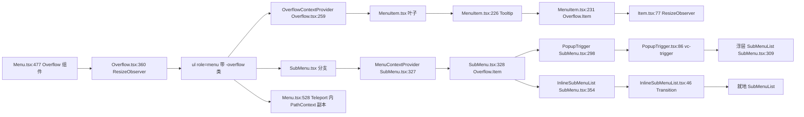
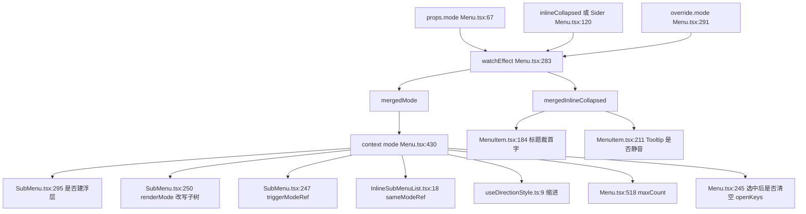
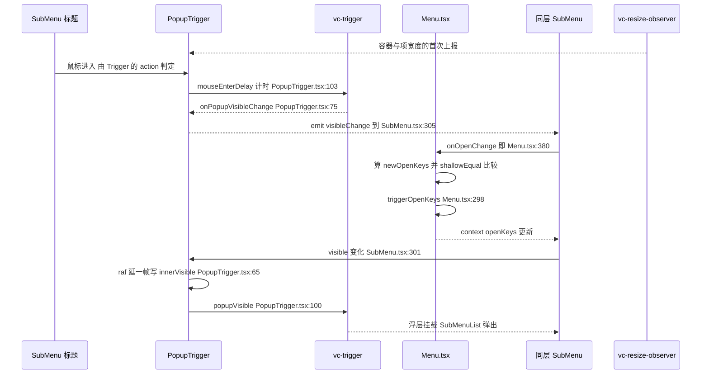
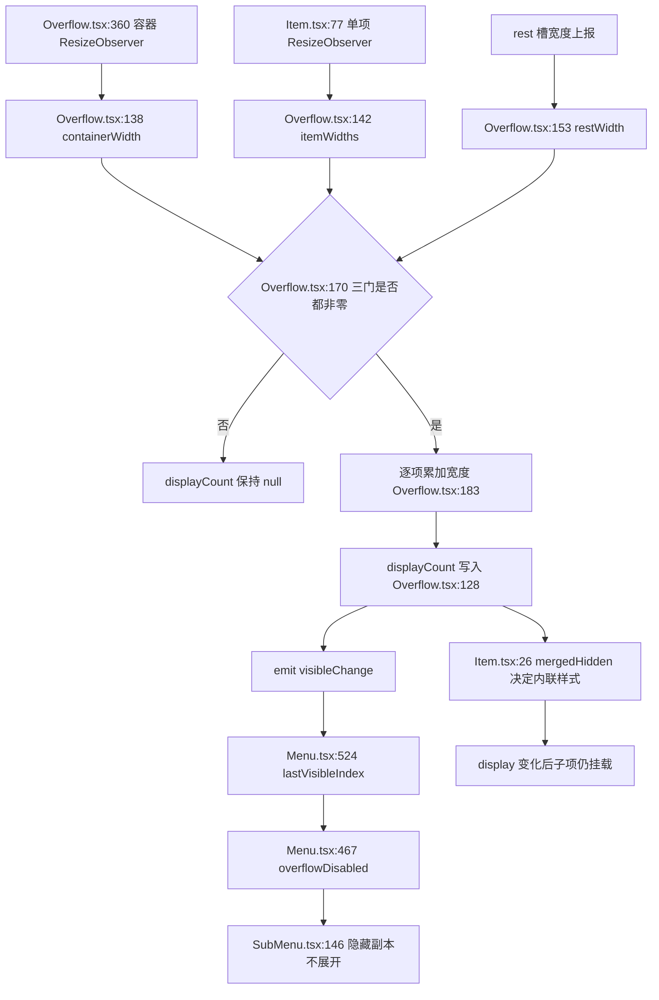

# C03-01 Menu 导航菜单

> **本篇解决**：Menu 的水平、垂直、内联三种形态各自的状态从哪里来、弹层在哪里装配，
> 以及「收缩」「溢出」这两件事为什么在源码里都不是「另一种形态」而是对同一条 `mergedMode` 的改写。
> **前置**：C03-00 类横写：menu/tabs/steps/breadcrumb 的选中态模型、I02 vc-trigger、C02-09 Collapse、C07-03 Tooltip　**读者坐标**：`03-components/03-navigation` 第 1/14 篇（首个单体组件篇）

## 一、职责与边界

Menu 负责把一棵「可展开、可选中、装不下要折叠」的导航树装配成 DOM：根组件持有 `openKeys` 与 `selectedKeys` 两份数组状态，`SubMenu` 按当前形态决定「展开」是就地撑开还是弹出浮层，`vc-overflow` 负责水平形态下的宽度计量与剩余项收纳。三形态（horizontal / vertical / inline）不是三套组件，而是同一个 `mergedMode` 值在若干分岔点上的不同取值路径——这是本篇的主线。

明确不负责：选中态与激活态两条轴的通用模型、受控判定的五种谓词写法、`eventKey`/`key` 双身份、注册表 `store` 与 `keyMapStore` 的存在理由、溢出下拉里同一份状态的多次渲染隔离——这些在 C03-00 类横写：menu/tabs/steps/breadcrumb 的选中态模型 里已经证过，本篇只引用其结论并把镜头推进到「形态」与「浮层」这两件横写篇没有展开的事。`vc-trigger` 的弹出时序、Portal 与 `forceRender` 的死链归 I02 vc-trigger；`collapseMotion` 与 `genCollapseMotion` 的样式侧归 C02-09 Collapse；Tooltip 的整项覆盖机制归 C07-03 Tooltip；`raf.cancel` 的句柄残留已在 C03-12 证过；Sider 的折叠注入只到接口边界为止。

依赖清单（向下）：

- 溢出计量：`packages/xiaoye-ui/src/vc-overflow/Overflow.tsx:47`、`packages/xiaoye-ui/src/vc-overflow/Item.tsx:10`、`packages/xiaoye-ui/src/vc-overflow/RawItem.tsx:7`、`packages/xiaoye-ui/src/vc-overflow/context.ts:26`
- 尺寸观察：`packages/xiaoye-ui/src/vc-resize-observer/index.tsx`（被 `Overflow.tsx:360` 与 `Item.tsx:77` 两处使用）
- 浮层：`packages/xiaoye-ui/src/menu/src/PopupTrigger.tsx:86` 直连 `vc-trigger`，几何表在 `packages/xiaoye-ui/src/menu/src/placements.ts:6`
- 跨组件：`packages/xiaoye-ui/src/menu/src/MenuItem.tsx:15` 引入 Tooltip（折叠态标题提示），`packages/xiaoye-ui/src/menu/src/Menu.tsx:120` 注入 Sider 的折叠状态
- 形态内覆盖：`packages/xiaoye-ui/src/menu/src/OverrideContext.ts:19`（结论见 C03-00 论点 4）

被谁依赖：`packages/xiaoye-ui/src/tabs/src/TabNavList/OperationNode.tsx:1` 直接复用 Menu 作溢出下拉；`packages/xiaoye-ui/src/breadcrumb/Breadcrumb.tsx:104` 在面包屑里嵌 Menu；`packages/xiaoye-ui/src/layout` 通过 `SiderCollapsedKey` 反向驱动 Menu 的形态。

## 二、源码地图

| 文件 | 行数 | 职责 | 关键导出 / 落点 |
| --- | --- | --- | --- |
| `packages/xiaoye-ui/src/menu/index.tsx` | 55 | 包级入口，挂 `Menu.Item/SubMenu/Divider/ItemGroup` 静态属性 | `Menu.install`（16 行） |
| `packages/xiaoye-ui/src/menu/src/Menu.tsx` | 531 | 形态归一、`openKeys` 缓存/恢复、context 装配、`Overflow` 接线 | `menuProps`（48 行）、setup（104 行） |
| `packages/xiaoye-ui/src/menu/src/SubMenu.tsx` | 370 | 三形态分岔的现场：浮层与就地撑开的二选一 | setup（68 行）、渲染（286 行） |
| `packages/xiaoye-ui/src/menu/src/MenuItem.tsx` | 269 | 叶子：折叠态标题裁剪与 Tooltip 挂载 | setup（55 行） |
| `packages/xiaoye-ui/src/menu/src/PopupTrigger.tsx` | 116 | `vc-trigger` 的 Menu 专用适配器 | `popupPlacementMap`（12 行） |
| `packages/xiaoye-ui/src/menu/src/InlineSubMenuList.tsx` | 55 | 内联形态的子列表 + 过渡容器 | setup（15 行） |
| `packages/xiaoye-ui/src/menu/src/SubMenuList.tsx` | 23 | 子列表 `ul`，形态类名在 12 行 | `InternalSubMenuList` |
| `packages/xiaoye-ui/src/menu/src/placements.ts` | 52 | 四个 `points/offset` 组合，rtl 表另立 | `placements` / `placementsRtl` |
| `packages/xiaoye-ui/src/menu/src/Divider.tsx` | 28 | 分割线，无状态 | — |
| `packages/xiaoye-ui/src/menu/src/ItemGroup.tsx` | 47 | 分组；测量副本下直接透传子节点（33 行） | — |
| `packages/xiaoye-ui/src/menu/src/interface.ts` | 115 | `MenuMode` / `MenuTheme` / 事件信息形状 | — |
| `packages/xiaoye-ui/src/menu/src/hooks/useMenuContext.ts` | 168 | context 契约、`MenuContextProvider` 合并、首层标记 | `useProvideMenu`、`useInjectFirstLevel` |
| `packages/xiaoye-ui/src/menu/src/hooks/useKeyPath.ts` | 45 | 祖先键链与测量副本隔离 | `OVERFLOW_KEY`（6 行）、`PathContext`（30 行） |
| `packages/xiaoye-ui/src/menu/src/hooks/useDirectionStyle.ts` | 15 | 仅 inline 生效的缩进内联样式 | 默认导出 |
| `packages/xiaoye-ui/src/menu/src/hooks/useItems.tsx` | 136 | `items` 数据驱动路径 | `useItems` |
| `packages/xiaoye-ui/src/vc-overflow/Overflow.tsx` | 378 | 宽度打包算法与 rest 槽 | 默认导出、`RESPONSIVE/INVALIDATE`（371-372 行） |
| `packages/xiaoye-ui/src/vc-overflow/Item.tsx` | 99 | 单项的隐藏样式与宽度上报 | 默认导出 |
| `packages/xiaoye-ui/src/vc-overflow/RawItem.tsx` | 53 | 让调用方自己的节点接入 Item | `RawItem` |
| `packages/xiaoye-ui/src/vc-overflow/context.ts` | 48 | order/display/registerSize 的注入面 | `OverflowContextProvider` |
| `packages/xiaoye-ui/src/vc-resize-observer/index.tsx` | 139 | 尺寸来源 | 默认导出 |
| `packages/xiaoye-ui/src/menu/style/index.ts` | 574 | 组件 Token 与形态样式装配 | `genComponentStyleHook('Menu', ...)` |
| `packages/xiaoye-ui/src/menu/style/vertical.ts` | 229 | vertical/inline 共用主体 | — |
| `packages/xiaoye-ui/src/menu/style/horizontal.ts` | 57 | horizontal 专有 | — |
| `packages/xiaoye-ui/src/menu/index.test.js` | 523 | 本类唯一成体系用例（结论同 C03-00） | — |

主实现入口：`packages/xiaoye-ui/src/menu/src/Menu.tsx:105`（setup）与 `packages/xiaoye-ui/src/menu/src/Menu.tsx:454`（渲染）。形态的判定源头在 `packages/xiaoye-ui/src/menu/src/Menu.tsx:283`，浮层的装配源头在 `packages/xiaoye-ui/src/menu/src/SubMenu.tsx:286`，溢出的装配源头在 `packages/xiaoye-ui/src/menu/src/Menu.tsx:477`。

## 三、架构与数据流

先看静态装配层级。这张图要固化一件事：**Menu 的根节点不是一个 `ul`，而是 `Overflow`，而 `Overflow` 的根节点是一个 `ResizeObserver` 组件**；同时每个叶子头上都还套着一层 `Tooltip`。把这两点画出来，后面所有「为什么改了样式没生效」的问题都有了坐标。



`MenuItem.tsx:231` 与 `SubMenu.tsx:328` 都写 `Overflow.Item`，它是 `RawItem`（`packages/xiaoye-ui/src/vc-overflow/Overflow.tsx:370`），`RawItem.tsx:26-50` 决定「有上下文就转成 `Item`、没有就直接渲染自己」——这就是 `Menu.tsx:528` 那份 `PathContext` 副本不产生任何测量上报的原因（副本里没有 `OverflowContextProvider`，`context.value` 为空，走 `RawItem.tsx:28-34` 的短路分支）。浮层与就地两条路共用同一个 `SubMenu` 实例，靠 `SubMenu.tsx:295` 的分支二选一，`InlineSubMenuList.tsx:41-43` 再决定是否真的产出 DOM。

形态的判定流与它扇出的七个消费点：



七个消费点里有两处是**二次改写**：`C2` 把 horizontal 的子树标成 vertical（`SubMenu.tsx:250`），`C3` 把非顶层的 trigger 标成 vertical（`SubMenu.tsx:247`）。所以「当前这个 SubMenu 以什么形态渲染」在树里是逐层收敛的，不是全局唯一的；`MIC` 这支只影响视觉与提示，不影响任何状态判定，这与论点 1 的结论一致。

浮层开合的完整闭环（hover 到类名回流）：



这条链上「一帧 `raf`」与「两段延时」是叠加的：`vc-trigger` 侧管延时（`PopupTrigger.tsx:103-104`，默认开 0 / 关 0.1），`PopupTrigger.tsx:61-70` 再押一帧；这就是快速划过多个子菜单时浮层跟随滞后的来源，也是 `raf.cancel` 残留被放大的地方（C03-12 已证）。

水平形态的溢出计量回路：



回路的关键是 `G`：rest 槽自己也要被量一次，而它是 `Menu.tsx:494` 那个 `...` 指示器。`H` 是首帧状态——此时 `mergedDisplayCount` 走 `Overflow.tsx:65-66` 的 SSR 分支拿到 `Number.MAX_SAFE_INTEGER`，于是「全部可见」，等 `J` 落定后才收缩。`L → M → N` 这支就是 C03-00 论点 4 所说的「同一份状态被渲染多次时的隔离」，本篇只补它在计量回路里的位置。

逐图说明的最后一处：`Menu.tsx:526-530` 的 `Teleport` 副本在第三张与第四张图里都不出现——因为它 `disabled` 掉了所有测量（`RawItem.tsx:28-34`），也从不弹浮层（`SubMenu.tsx:287-292`）。它唯一的输出是 `registerMenuInfo`（`MenuItem.tsx:95`、`SubMenu.tsx:128`），而这份注册表被 `Menu.tsx:153-162` 摊平成 `keyMapStore` 后服务于祖先高亮与级联收起（结论见 C03-00 论点 6）。

## 四、核心机制精读

### 论点 1：形态只有一个真值源 `mergedMode`，而「折叠的内联」在源码里根本不是内联形态——它被改写成 `vertical`，所以对外三形态、对内只有两形态加一个开关

`packages/xiaoye-ui/src/menu/src/Menu.tsx:274-290`：

```tsx
// packages/xiaoye-ui/src/menu/src/Menu.tsx:274
    const disabled = computed(() => !!props.disabled);
    const isRtl = computed(() => direction.value === 'rtl');
    const mergedMode = ref<MenuMode>('vertical');
    const mergedInlineCollapsed = shallowRef(false);

    watchEffect(() => {
      if ((props.mode === 'inline' || props.mode === 'vertical') && inlineCollapsed.value) {
        mergedMode.value = 'vertical';
        mergedInlineCollapsed.value = inlineCollapsed.value;
      } else {
        mergedMode.value = props.mode;
        mergedInlineCollapsed.value = false;
      }
      if (override?.mode?.value) {
        mergedMode.value = override.mode.value;
      }
    });

    const isInlineMode = computed(() => mergedMode.value === 'inline');
```

逐段解释：`Menu.tsx:278` 用 `ref` 而不是 `computed` 承载形态，是为了让 `Menu.tsx:291-292` 的覆盖能在同一个变量上再写一次——`props.mode`（默认 `vertical`，见 `packages/xiaoye-ui/src/menu/src/Menu.tsx:67`）、折叠改写、`override.mode` 三层依次覆盖，最后一个赢。关键在 `Menu.tsx:284-286`：只要 `inlineCollapsed` 为真，`inline` 与 `vertical` 两个入口值都被压成 `mergedMode = 'vertical'`，同时 `mergedInlineCollapsed` 记下一票。也就是说，「收缩侧栏菜单」这个文档里单列的形态，在运行时是 vertical 形态；`Menu.tsx:298` 的 `isInlineMode` 随之变假，而这个布尔是下面整条展开态生命周期的门（见论点 2）。

`inlineCollapsed` 的来源不是 prop 独裁：`packages/xiaoye-ui/src/menu/src/Menu.tsx:120-126` 先取 `SiderCollapsedKey` 的注入值，只要它 `!== undefined` 就直接返回它，`props.inlineCollapsed` 只在没有 Sider 时生效；`Menu.tsx:138-142` 的 `devWarning` 正是给「在 Sider 下又给 Menu 传 `inlineCollapsed`」这种写法准备的。`Menu.tsx:131-135` 的另一条告警则限定 `inlineCollapsed` 只该配 `inline`，但它只告警不拦截，`props.mode === 'vertical'` 加 `inlineCollapsed` 依然会被折叠分支接管。

这个改写把「谁读形态」变成一处需要通读全部消费点才能核对的清单。读取端全部经由 context，而不是 props：`packages/xiaoye-ui/src/menu/src/Menu.tsx:430` 把 `mode: mergedMode` 放进 `useProvideMenu`，于是下游组件读到的永远是改写后的值。三个代表性消费点：

`packages/xiaoye-ui/src/menu/src/hooks/useDirectionStyle.ts:5-15`：

```ts
// packages/xiaoye-ui/src/menu/src/hooks/useDirectionStyle.ts:5
export default function useDirectionStyle(level: ComputedRef<number>): ComputedRef<CSSProperties> {
  const { mode, rtl, inlineIndent } = useInjectMenu();

  return computed(() =>
    mode.value !== 'inline'
      ? null
      : rtl.value
        ? { paddingRight: `${level.value * inlineIndent.value}px` }
        : { paddingLeft: `${level.value * inlineIndent.value}px` },
  );
}
```

解释：缩进是 inline 独占的视觉，判定写在 `useDirectionStyle.ts:9`。折叠后形态变 `vertical`，这里立刻返回 `null`，缩进改由样式承担（`packages/xiaoye-ui/src/menu/style/vertical.ts:29` 一带的省略号与宽度规则）。`level` 来自键链长度——调用点是 `packages/xiaoye-ui/src/menu/src/MenuItem.tsx:194` 与 `packages/xiaoye-ui/src/menu/src/SubMenu.tsx:191`，两处都传 `keysPath.value.length`，所以深度是按祖先数量算的，不是按 DOM 层级。

`packages/xiaoye-ui/src/menu/src/InlineSubMenuList.tsx:16-21`：

```tsx
// packages/xiaoye-ui/src/menu/src/InlineSubMenuList.tsx:16
    const fixedMode = computed<MenuMode>(() => 'inline');
    const { motion, mode, defaultMotions } = useInjectMenu();
    const sameModeRef = computed(() => mode.value === fixedMode.value);
    const destroy = ref(!sameModeRef.value);

    const mergedOpen = computed(() => (sameModeRef.value ? props.open : false));
```

解释：`InlineSubMenuList.tsx:18` 把「当前是不是 inline」抽成 `sameModeRef`，`InlineSubMenuList.tsx:19` 用它在 setup 时就决定 `destroy` 初值，`InlineSubMenuList.tsx:21` 则在非 inline 时把 `open` 强制压成 `false`。换句话说，就地撑开这条路在 horizontal 与 vertical 下被双重关闭（不渲染 + 不展开），浮层那条路才生效（论点 3）。而 `packages/xiaoye-ui/src/menu/src/SubMenuList.tsx:12` 的形态类名同样只读注入值：inline 才挂 `-inline`，否则一律 `-vertical`。

结论回扣：本篇后面所有「horizontal / vertical / inline」的分岔，实际读的都是 `mergedMode` 这个二值量。写「inline 形态如何如何」时，只要 `inlineCollapsed` 为真，那句话就自动不成立；`Menu.tsx:341-350` 的根类名也印证了这点——`-inline-collapsed` 与 `-${mergedMode}` 是两个独立的类，折叠态的根节点同时带 `-vertical` 与 `-inline-collapsed`，而不带 `-inline`。

### 论点 2：展开态 `openKeys` 由「缓存 / 恢复」两条 watch 跨形态续命，而「关闭」的语义在 inline 与非 inline 之间是分叉的——非 inline 才级联收起子孙、才在选中时整表清空

`packages/xiaoye-ui/src/menu/src/Menu.tsx:302-335`：

```tsx
// packages/xiaoye-ui/src/menu/src/Menu.tsx:302
    // >>>>> Cache & Reset open keys when inlineCollapsed changed
    const inlineCacheOpenKeys = ref(mergedOpenKeys.value);

    const mountRef = shallowRef(false);

    // Cache
    watch(
      mergedOpenKeys,
      () => {
        if (isInlineMode.value) {
          inlineCacheOpenKeys.value = mergedOpenKeys.value;
        }
      },
      { immediate: true },
    );

    // Restore
    watch(
      isInlineMode,
      () => {
        if (!mountRef.value) {
          mountRef.value = true;
          return;
        }

        if (isInlineMode.value) {
          mergedOpenKeys.value = inlineCacheOpenKeys.value;
        } else {
          // Trigger open event in case its in control
          triggerOpenKeys(EMPTY_LIST);
        }
      },
      { immediate: true },
    );
```

逐段解释：`Menu.tsx:307` 的 `inlineCacheOpenKeys` 初值直接取 `mergedOpenKeys.value` 的引用（此时是 `Menu.tsx:249` 那个 `ref([])` 的空数组），`Menu.tsx:298-302` 的 `triggerOpenKeys` 是唯一写 `mergedOpenKeys` 的出口，它同时 emit `update:openKeys` 与 `openChange`。三条值得停下的地方：

1. 缓存写入有门（`Menu.tsx:313`）：只有 `isInlineMode` 为真时才把当前值记进缓存。折叠态（mergedMode 已是 `vertical`，见论点 1）里从浮层点开的项目不会进缓存，于是展开回来时被丢弃。
2. 恢复侧用 `mountRef` 吞掉首帧（`Menu.tsx:324-327`）：两条 watch 都带 `immediate: true`，若没有这个闩，挂载时 `isInlineMode` 的初始回调就会执行 `triggerOpenKeys(EMPTY_LIST)`，把用户传入的 `defaultOpenKeys` 立即清空。`Menu.tsx:309` 因此是一个「只跳一次」的守卫，而不是「首帧」守卫——它之后永远为真。
3. 离开 inline 时是 `triggerOpenKeys(EMPTY_LIST)` 而不是 `mergedOpenKeys.value = []`（`Menu.tsx:333`）：注释「Trigger open event in case its in control」说明这是刻意让受控方收到一次空数组；`Menu.tsx:96` 的 `EMPTY_LIST` 是模块级共享数组，会被原样 emit 出去。当前 Menu 内部对它没有任何原地写入（`Menu.tsx:256` 用 `slice`、`Menu.tsx:382` 用 `filter`，都产生新数组），所以共享不会在本库内出事，但调用方接住 `update:openKeys` 后原地 `push` 就会污染所有 Menu 实例。

关闭语义的分岔在两处。第一处是级联收起：

`packages/xiaoye-ui/src/menu/src/Menu.tsx:378-393`：

```tsx
// packages/xiaoye-ui/src/menu/src/Menu.tsx:376
    const onInternalOpenChange = (key: Key, open: boolean) => {
      const childrenEventKeys = keyMapStore.value[key]?.childrenEventKeys || [];
      let newOpenKeys = mergedOpenKeys.value.filter(k => k !== key);

      if (open) {
        newOpenKeys.push(key);
      } else if (mergedMode.value !== 'inline') {
        // We need find all related popup to close
        const subPathKeys = getChildrenKeys(unref(childrenEventKeys));
        newOpenKeys = uniq(newOpenKeys.filter(k => !subPathKeys.includes(k)));
      }

      if (!shallowEqual(mergedOpenKeys.value, newOpenKeys)) {
        triggerOpenKeys(newOpenKeys);
      }
    };
```

解释：`Menu.tsx:384` 的 `else if` 让「收起一个父项时连带收起所有子孙」只发生在 horizontal / vertical。在 inline 下关掉祖父节点，子孙的 key 仍留在 `openKeys` 里——因为 inline 的撑开是逐层嵌套 DOM，祖父一旦收起，子孙在视觉上已不可见，key 留着不影响呈现，再展开时会看到原来的多层展开状态被完整复原。这是「就地撑开」与「浮层」两种装配方式直接导致的差别：浮层是脱离父容器的 Portal，父浮层关掉时子浮层不会自动消失，必须显式清账（`Menu.tsx:360-368` 的 `getChildrenKeys` 递归读 `childrenEventKeys`，账本由 `packages/xiaoye-ui/src/menu/src/SubMenu.tsx:93` 在 setup 期挂到父项上）。第二处分岔在选中之后：

`packages/xiaoye-ui/src/menu/src/Menu.tsx:243-247`：

```tsx
// packages/xiaoye-ui/src/menu/src/Menu.tsx:244
      // Whatever selectable, always close it
      if (mergedMode.value !== 'inline' && !props.multiple && mergedOpenKeys.value.length) {
        triggerOpenKeys(EMPTY_LIST);
      }
    };
```

解释：点中一个叶子项后，非 inline 且非多选会把 `openKeys` 整个清空——水平菜单点完自动收、垂直浮层菜单点完自动收，而 inline 点完保持展开。注意这里读的是 `mergedMode`，不是 `props.mode`：折叠的 inline 也会走这条清空分支，与论点 1 的「运行时只有两形态」一致。

写向 `openKeys` 的两个入口也按形态分开。标题点击只在 inline 下翻转：`packages/xiaoye-ui/src/menu/src/SubMenu.tsx:171-174`：

```tsx
// packages/xiaoye-ui/src/menu/src/SubMenu.tsx:171
      // Trigger open by click when mode is `inline`
      if (mode.value === 'inline') {
        onOpenChange(key, !originOpen.value);
      }
```

而浮层的可见性回调反向排除 inline：`packages/xiaoye-ui/src/menu/src/SubMenu.tsx:193-198`：

```tsx
// packages/xiaoye-ui/src/menu/src/SubMenu.tsx:193
    // >>>>> Visible change
    const onPopupVisibleChange = (newVisible: boolean) => {
      if (mode.value !== 'inline') {
        onOpenChange(key, newVisible);
      }
    };
```

解释：两个条件互补（`=== 'inline'` 与 `!== 'inline'`），读的都是 context 里的 `mode`（`Menu.tsx:430` 提供），因此折叠态下标题点击不会翻转 `openKeys`——它落进 `SubMenu.tsx:172` 的假分支，展开只由浮层的 hover/click 驱动。`SubMenu.tsx:145` 的 `originOpen` 与 `Menu.tsx:425` 的 `openKeys: mergedOpenKeys` 构成闭环。

结论回扣：`openKeys` 不是「一个数组」这么简单，它是「一份 inline 缓存 + 一份当前值 + 三套清理触发器」。任何把形态切换与关闭逻辑分头改动的 PR，都会破坏这三者之一：改 `Menu.tsx:313` 的门会让折叠期打开的项泄漏回展开态；去掉 `Menu.tsx:324` 的闩会让 `defaultOpenKeys` 失效；把 `Menu.tsx:384` 的 `else if` 改成 `else` 会让 inline 失去多层展开的记忆。

### 论点 3：浮层装配有三个不同的 mode 变量，`PopupTrigger` 实例在 inline 下也照样创建——它是被「不传 popup 插槽」而不是被「不渲染」静音的

`packages/xiaoye-ui/src/menu/src/SubMenu.tsx:245-254`：

```tsx
// packages/xiaoye-ui/src/menu/src/SubMenu.tsx:245
    // Cache mode if it change to `inline` which do not have popup motion
    const triggerModeRef = computed(() => {
      return mode.value !== 'inline' && keysPath.value.length > 1 ? 'vertical' : mode.value;
    });

    const renderMode = computed(() => (mode.value === 'horizontal' ? 'vertical' : mode.value));

    const subMenuTriggerModeRef = computed(() =>
      triggerModeRef.value === 'horizontal' ? 'vertical' : triggerModeRef.value,
    );
```

逐段解释：三个变量名字相近、职责完全不同，是这块最容易读错的地方。

- `triggerModeRef`（`SubMenu.tsx:246-248`）喂给 `PopupTrigger` 的 `mode` prop，决定浮层几何与动画名。它的规则是「非 inline 且不是第一层，就退化成 `vertical`」，所以水平菜单里二级、三级子菜单都用垂直浮层的几何；`keysPath.value.length > 1` 判的是祖先键数量（`SubMenu.tsx:84`），因此顶层项在水平形态下才拿到 `horizontal`。
- `renderMode`（`SubMenu.tsx:250`）喂给**自己子树**的 context（`SubMenu.tsx:327`），把 horizontal 根下的所有子项标成 `vertical`。`packages/xiaoye-ui/src/menu/src/SubMenuList.tsx:12` 因此永远画不出 `-horizontal` 的子列表类名。
- `subMenuTriggerModeRef`（`SubMenu.tsx:252-254`）喂给**浮层内子树**的 context（`SubMenu.tsx:308`）。由于 `triggerModeRef` 已排除 `horizontal` 之外的可能，它实际只做一次防御性同值映射。

装配的分岔在渲染函数开头：

`packages/xiaoye-ui/src/menu/src/SubMenu.tsx:286-330`：

```tsx
// packages/xiaoye-ui/src/menu/src/SubMenu.tsx:286
    return () => {
      if (isMeasure) {
        if (!hasKey) {
          return null;
        }
        return slots.default?.();
      }
      const subMenuPrefixClsValue = subMenuPrefixCls.value;
      let titleNode = () => null;
      if (!overflowDisabled.value && mode.value !== 'inline') {
        const popupOffset = mode.value === 'horizontal' ? [0, 8] : [10, 0];
        titleNode = () => (
          <PopupTrigger
            mode={triggerModeRef.value}
            prefixCls={subMenuPrefixClsValue}
            visible={!props.internalPopupClose && open.value}
            popupClassName={popupClassName.value}
            popupOffset={props.popupOffset || popupOffset}
            disabled={mergedDisabled.value}
            onVisibleChange={onPopupVisibleChange}
            v-slots={{
              popup: () => (
                <MenuContextProvider mode={subMenuTriggerModeRef.value}>
                  <SubMenuList
                    id={popupId}
                    ref={popupRef}
                    v-slots={{ default: slots.default }}
                  ></SubMenuList>
                </MenuContextProvider>
              ),
            }}
          >
            {baseTitleNode()}
          </PopupTrigger>
        );
      } else {
        // 包裹一层，保持结构一致，防止动画丢失
        // fix: keep structure consistent for animation
        titleNode = () => <PopupTrigger v-slots={{ default: baseTitleNode }}></PopupTrigger>;
      }
      return (
        <MenuContextProvider mode={renderMode.value}>
          <Overflow.Item
            component="li"
            {...attrs}
```

解释：`SubMenu.tsx:295` 的一个条件同时排除两种情况——溢出副本里的隐藏项（`overflowDisabled`，结论见 C03-00 论点 4）与 inline 形态，两者都落到 `SubMenu.tsx:324` 那个「只有 default 插槽」的 `PopupTrigger`。这一行是理解 Menu 浮层成本的钥匙：inline 菜单里每个 `SubMenu` 仍然实例化 `PopupTrigger` 与它内部的 `Trigger`（`packages/xiaoye-ui/src/menu/src/PopupTrigger.tsx:86`），只是 `popup` 插槽为 `undefined`，`vc-trigger` 因而没有浮层内容可渲。注释「keep structure consistent for animation」说明了为什么不干脆写 `<>{baseTitleNode()}</>`：形态从 inline 切到 vertical 时（论点 1 的折叠路径正是这种切换），如果组件结构变了，Vue 会卸载再挂载标题节点，`Transition` 的进场动画随节点一起丢失。`SubMenu.tsx:287-292` 则给出测量副本的第三种形态：只透传子节点、不建标题、不建浮层。

`SubMenu.tsx:301` 的 `visible={!props.internalPopupClose && open.value}` 里，`internalPopupClose` 是溢出指示器专用的强制关闭位（`Menu.tsx:499` 传 `len === 0`），它让「没有剩余项」时的 `...` 保持不可弹出；`open` 本身还叠了一层 `overflowDisabled`（`SubMenu.tsx:146`）。

几何由 `PopupTrigger` 决定，`packages/xiaoye-ui/src/menu/src/PopupTrigger.tsx:12-17` 与 `:52-58`：

```tsx
// packages/xiaoye-ui/src/menu/src/PopupTrigger.tsx:12
const popupPlacementMap = {
  horizontal: 'bottomLeft',
  vertical: 'rightTop',
  'vertical-left': 'rightTop',
  'vertical-right': 'leftTop',
};
```

```tsx
// packages/xiaoye-ui/src/menu/src/PopupTrigger.tsx:52
    const placement = computed(() =>
      rtl.value
        ? { ...placementsRtl, ...builtinPlacements.value }
        : { ...placements, ...builtinPlacements.value },
    );

    const popupPlacement = computed(() => popupPlacementMap[props.mode]);
```

解释：`PopupTrigger.tsx:58` 用 `props.mode`（即 `triggerModeRef`）查表，水平顶层得 `bottomLeft`、嵌套与垂直得 `rightTop`；表体在 `packages/xiaoye-ui/src/menu/src/placements.ts:6-27`，四个键各自的 `points` 与 `offset`（如 `bottomLeft` 是 `['tl','bl']` + `[0,7]`，`rightTop` 是 `['tl','tr']` + `[4,0]`）。`placements.ts:29-50` 的 rtl 表不是镜像计算，而是把 `leftTop` / `rightTop` 两个键的 `points` 与 `offset` 手工对调——这意味着调用方通过 `builtinPlacements` 传入同名字段时的行为与 C07-03 Tooltip 里证过的「整项覆盖」一致：`PopupTrigger.tsx:54-55` 的对象展开以键为单位替换整项，不做深合并，只改 `offset` 必须把 `points`、`overflow` 一起补齐。`SubMenu.tsx:296` 的 `popupOffset` 又叠了一层：`PopupTrigger.tsx:101` 的 `popupAlign={popupOffset && { offset: popupOffset }}` 会在 align 阶段覆盖几何表里的 `offset`，所以水平菜单的实际纵向间距是 `SubMenu.tsx:296` 的 8px 而不是 `placements.ts:15` 的 7px——两处都写着同类数值，改一处不生效是必然的。

`packages/xiaoye-ui/src/menu/src/PopupTrigger.tsx:83-112`：

```tsx
// packages/xiaoye-ui/src/menu/src/PopupTrigger.tsx:83
    return () => {
      const { prefixCls, popupClassName, mode, popupOffset, disabled } = props;
      return (
        <Trigger
          prefixCls={prefixCls}
          popupClassName={classNames(
            `${prefixCls}-popup`,
            {
              [`${prefixCls}-rtl`]: rtl.value,
            },
            popupClassName,
            rootClassName.value,
          )}
          stretch={mode === 'horizontal' ? 'minWidth' : null}
          getPopupContainer={getPopupContainer.value}
          builtinPlacements={placement.value}
          popupPlacement={popupPlacement.value}
          popupVisible={innerVisible.value}
          popupAlign={popupOffset && { offset: popupOffset }}
          action={disabled ? [] : [triggerSubMenuAction.value]}
          mouseEnterDelay={subMenuOpenDelay.value}
          mouseLeaveDelay={subMenuCloseDelay.value}
          onPopupVisibleChange={onVisibleChange}
          forceRender={forceRender || forceSubMenuRender.value}
          popupAnimation={mergedMotion.value}
```

解释：`PopupTrigger.tsx:96` 的 `stretch` 读的是 `props.mode`，也就是 `triggerModeRef`——只有水平形态的第一层才是 `horizontal`，所以只有顶层浮层受 `minWidth` 约束；`SubMenu.tsx:296` 的 `popupOffset` 读的却是 context 里的 `mode`。常规用法下两者取值一致，因为 `SubMenu.tsx:327` 的 `renderMode` 已经把 horizontal 之下的子树改写成 `vertical`，嵌套项于是同时得到 `triggerModeRef = 'vertical'` 与 `popupOffset = [10, 0]`。但它们是两条独立的推导链：一条从 `keysPath` 长度算（`SubMenu.tsx:247`），一条从 `MenuContextProvider` 的嵌套层算（`SubMenu.tsx:250`），任一侧被改动（例如给 `renderMode` 加分支）就会让浮层的宽度约束与间距分家。另外要分清：走 `SubMenu.tsx:324` 静音分支的是**未折叠的 inline**；折叠后的 inline 已是 `vertical`，它照样建浮层（论点 1）。`PopupTrigger.tsx:102` 的 `action` 是单元素数组，值来自 `Menu.tsx:75` 默认的 `hover`（可切 `click`），`disabled` 时给空数组即彻底无交互。`PopupTrigger.tsx:106` 的 `forceRender` 双源——`useInjectForceRender()`（由 `SubMenu.tsx:125` 提供，语义是「父项没设 key 时强制渲染子项」）与 `forceSubMenuRender` prop；这两个开关的**有效性**问题在 I02 vc-trigger 里已经证过（`menu/src/PopupTrigger.tsx:78-82` 每次返回新对象、死链断在 `Trigger.tsx:694-701` 与 `PortalWrapper.tsx:178`），本篇不重复论证。

结论回扣：浮层装配是「三个 mode 变量 + 一个恒存在的 `PopupTrigger`」的组合。`horizontal` 从来不是一个完整的形态，它只在顶层生效（`triggerModeRef` 与 `renderMode` 都在第一层之下把自己改写成 `vertical`）；而 inline 也不是「没有浮层」，它是「浮层组件在、浮层内容不在」。

### 论点 4：溢出折叠不卸载 DOM——它靠内联样式与 flex `order` 把项「藏起来」；为了让被折叠的项仍能被选中态回查，Menu 另外向 body 挂了一份只注册不渲染的镜像

`packages/xiaoye-ui/src/menu/src/Menu.tsx:452-485`：

```tsx
// packages/xiaoye-ui/src/menu/src/Menu.tsx:449
    const getChildrenList = () => itemsNodes.value || flattenChildren(slots.default?.());
    return () => {
      const childList = getChildrenList();
      const allVisible =
        lastVisibleIndex.value >= childList.length - 1 ||
        mergedMode.value !== 'horizontal' ||
        props.disabledOverflow;
      // >>>>> Children
      const getWrapperList = childList => {
        return mergedMode.value !== 'horizontal' || props.disabledOverflow
          ? childList
          : // Need wrap for overflow dropdown that do not response for open
            childList.map((child, index) => (
              // Always wrap provider to avoid sub node re-mount
              <MenuContextProvider
                key={child.key}
                overflowDisabled={index > lastVisibleIndex.value}
                v-slots={{ default: () => child }}
              ></MenuContextProvider>
            ));
      };
      const overflowedIndicator = slots.overflowedIndicator?.() || <EllipsisOutlined />;

      return wrapSSR(
        <Overflow
          {...attrs}
          onMousedown={props.onMousedown}
          prefixCls={`${prefixCls.value}-overflow`}
          component="ul"
          itemComponent={MenuItem}
          class={[className.value, attrs.class, hashId.value]}
          role="menu"
          id={props.id}
          data={getWrapperList(childList)}
          renderRawItem={node => node}
```

逐段解释：`Menu.tsx:456-459` 的 `allVisible` 是「装得下」的判据，`Menu.tsx:406` 的 `lastVisibleIndex` 初值是 `0`（不是「全部可见」），由溢出容器回调写入（`Menu.tsx:524-526`），所以首帧 `allVisible` 只在「只有一个子项」时才为真。`Menu.tsx:485` 的 `renderRawItem={node => node}` 是整条链路的关键选择：它让 `vc-overflow` 不再用自己的 `Item` 包裹每一项，而是把原节点直接交出，仅在 `OverflowContextProvider` 里注入 `order/display/registerSize`（`packages/xiaoye-ui/src/vc-overflow/Overflow.tsx:254-273`），真正的包裹由 Menu 自己在 `packages/xiaoye-ui/src/menu/src/MenuItem.tsx:231` 与 `packages/xiaoye-ui/src/menu/src/SubMenu.tsx:328` 用 `Overflow.Item` 完成。`Overflow.Item` 就是 `RawItem`（`packages/xiaoye-ui/src/vc-overflow/Overflow.tsx:370`），它读到上下文后转成 `Item`（`packages/xiaoye-ui/src/vc-overflow/RawItem.tsx:40-49`），并立刻用 `OverflowContextProvider value={null}` 切断向下传播（`RawItem.tsx:41`，注释「Do not pass context to sub item to avoid multiple measure」）——嵌套的 `SubMenu` 因此不会重复上报宽度。

隐藏的实际手段在 `packages/xiaoye-ui/src/vc-overflow/Item.tsx:58-73`：

```tsx
// packages/xiaoye-ui/src/vc-overflow/Item.tsx:58
      let overflowStyle: CSSProperties | undefined;
      if (!invalidate) {
        overflowStyle = {
          opacity: mergedHidden.value ? 0 : 1,
          height: mergedHidden.value ? 0 : UNDEFINED,
          overflowY: mergedHidden.value ? 'hidden' : UNDEFINED,
          order: responsive ? order : UNDEFINED,
          pointerEvents: mergedHidden.value ? 'none' : UNDEFINED,
          position: mergedHidden.value ? 'absolute' : UNDEFINED,
        };
      }

      const overflowProps: HTMLAttributes = {};
      if (mergedHidden.value) {
        overflowProps['aria-hidden'] = true;
      }
```

解释：`Item.tsx:26` 的 `mergedHidden = responsive && !display`，`display` 由 `Overflow.tsx:267` 的 `index <= mergedDisplayCount.value` 决定。被折叠的项**依然挂载**，只是透明、`position: absolute`、`pointer-events: none`、`aria-hidden`，同时 `order`（`Item.tsx:63`）把它们在 flex 行里推到尾部。这就是 `Menu.tsx:466` 那句注释「Always wrap provider to avoid sub node re-mount」背后的约束：一旦卸载，子树里所有 `MenuContextProvider` 与其下的 `Transition` 状态都会丢。`invalidate` 为真时 `overflowStyle` 整个是 `undefined`——一个样式都不写，这是 vertical / inline 形态的常态（见下）。

打包算法在 `packages/xiaoye-ui/src/vc-overflow/Overflow.tsx:167-213`：

```tsx
// packages/xiaoye-ui/src/vc-overflow/Overflow.tsx:167
    watch(
      [mergedContainerWidth, itemWidths, restWidth, suffixWidth, () => props.itemKey, mergedData],
      () => {
        if (mergedContainerWidth.value && mergedRestWidth.value && mergedData.value) {
          let totalWidth = suffixWidth.value;

          const len = mergedData.value.length;
          const lastIndex = len - 1;

          // When data count change to 0, reset this since not loop will reach
          if (!len) {
            updateDisplayCount(0);
            suffixFixedStart.value = null;
            return;
          }

          for (let i = 0; i < len; i += 1) {
            const currentItemWidth = getItemWidth(i);

            // Break since data not ready
            if (currentItemWidth === undefined) {
              updateDisplayCount(i - 1, true);
              break;
            }
            // ...
            } else if (totalWidth + mergedRestWidth.value > mergedContainerWidth.value) {
              // Can not hold all the content to show rest
              updateDisplayCount(i - 1);
              suffixFixedStart.value =
                totalWidth - currentItemWidth - suffixWidth.value + restWidth.value;
              break;
            }
```

解释：`Overflow.tsx:170` 的门要求 `mergedRestWidth` 非零——即 rest 槽必须先被量到宽度，否则整个循环不执行、`displayCount` 保持 `null`。这就是 `Menu.tsx:488-516` 里 rest 槽被渲染**两次**的原因：

```tsx
// packages/xiaoye-ui/src/menu/src/Menu.tsx:484
          renderRawRest={omitItems => {
            // We use origin list since wrapped list use context to prevent open
            const len = omitItems.length;

            const originOmitItems = len ? childList.slice(-len) : null;

            return (
              <>
                <SubMenu
                  eventKey={OVERFLOW_KEY}
                  key={OVERFLOW_KEY}
                  title={overflowedIndicator}
                  disabled={allVisible}
                  internalPopupClose={len === 0}
                  v-slots={{ default: () => originOmitItems }}
                ></SubMenu>
                <PathContext>
                  <SubMenu
                    eventKey={OVERFLOW_KEY}
                    key={OVERFLOW_KEY}
                    title={overflowedIndicator}
                    disabled={allVisible}
                    internalPopupClose={len === 0}
                    v-slots={{ default: () => originOmitItems }}
                  ></SubMenu>
                </PathContext>
              </>
            );
          }}
```

解释：第一份（`Menu.tsx:494-501`）是可见的 `...` 指示器，它内部的 `Overflow.Item`（`SubMenu.tsx:328`）会调 `registerOverflowSize`（`Overflow.tsx:153-156`）上报自己的宽度，从而打开 `Overflow.tsx:170` 那道门。第二份（`Menu.tsx:502-511`）包在 `PathContext` 里，`packages/xiaoye-ui/src/menu/src/hooks/useKeyPath.ts:30-41` 的 `PathContext` 只做一件事——`provide(measure, true)`，`useMeasure()` 读到真值后 `SubMenu.tsx:287-292` 直接 `return slots.default?.()`，既不建标题也不建 `Overflow.Item`；而 `MenuItem.tsx:197` 在测量态下 `return null`。所以第二份几乎不产出 DOM，它的存在意义是**注册**：`SubMenu.tsx:127` 的条件 `(isMeasure && hasKey)` 恰好在「测量态且有 key」时成立，于是被折叠的项也进 `store`。同样的镜像在根列表上又做了一次：

`packages/xiaoye-ui/src/menu/src/Menu.tsx:515-531`：

```tsx
// packages/xiaoye-ui/src/menu/src/Menu.tsx:515
          maxCount={
            mergedMode.value !== 'horizontal' || props.disabledOverflow
              ? Overflow.INVALIDATE
              : Overflow.RESPONSIVE
          }
          ssr="full"
          data-menu-list
          onVisibleChange={newLastIndex => {
            lastVisibleIndex.value = newLastIndex;
          }}
        >
          <Teleport to="body">
            <div style={{ display: 'none' }} aria-hidden>
              <PathContext>{getWrapperList(getChildrenList())}</PathContext>
            </div>
          </Teleport>
```

解释：`Menu.tsx:515-519` 是三形态里最硬的一条分岔——只有水平且未 `disabledOverflow` 时才给 `RESPONSIVE`，否则给 `INVALIDATE`（`Overflow.tsx:371-372`）。`INVALIDATE` 的后果可以在 `vc-overflow` 里逐项查出：`isResponsive` 为假（`Overflow.tsx:80`）、`showRest` 为假因而 rest 槽整个不渲染（`Overflow.tsx:86-90` 与 `:341`）、`mergedData` 落到 `props.data` 原样返回（`Overflow.tsx:92-108` 两个分支都不进）、`Item.tsx:59` 不写任何内联样式、`Overflow.tsx:332` 不加 `-overflow` 类名、`Overflow.tsx:361` 的容器 `ResizeObserver` 被 `disabled`。也就是说 vertical / inline 下 `Overflow` 退化成一个直通壳，`Menu.tsx:515` 之后的一切溢出代码都不执行。`Menu.tsx:520` 的 `ssr="full"` 配合 `Overflow.tsx:53` 与 `:65-67` 让 `mergedDisplayCount` 在没有测量结果时取 `Number.MAX_SAFE_INTEGER`，于是服务端产物包含全部项；`Menu.tsx:526-530` 的 `Teleport` 则把整棵子树以测量态复制到 body 下的 `display:none` 容器里（它是 `Overflow` 的默认插槽，被 `Overflow.tsx:355` 渲染在同一个 `ul` 内，再由 `Teleport` 搬走），保证「被折叠掉的项」也有一份 `registerMenuInfo` 记录进 `store`——C03-00 论点 6 已证 `keyMapStore` 是按 `key` 摊平、后注册者覆盖，这份镜像正是「项没挂载也要能被查到的」代价。

结论回扣：水平形态的溢出不是「删掉装不下的项」，而是「让所有项都在 DOM 里、用样式关掉其中一部分」，再叠一份纯注册的 body 镜像。三形态里只有 horizontal 会走 `vc-overflow` 的计量分支；`disabledOverflow`（`Menu.tsx:58`）是唯一能让水平形态也退回直通的开关，它同时出现在 `Menu.tsx:458`、`Menu.tsx:462` 与 `Menu.tsx:518` 三处判定里，改一处不改另两处就会让 `allVisible`、provider 包裹与 `maxCount` 三者不一致。

### 论点 5：动画有三道门（`isMounted`、`raf`、开合延时不对称），而 `defaultMotions` 的三个键里 `vertical` 是缺位的——垂直菜单的浮层实际拿到的是 `other`

`packages/xiaoye-ui/src/menu/src/Menu.tsx:351-356`：

```tsx
// packages/xiaoye-ui/src/menu/src/Menu.tsx:347
    const rootPrefixCls = computed(() => getPrefixCls());
    const defaultMotions = computed(() => ({
      horizontal: { name: `${rootPrefixCls.value}-slide-up` },
      inline: collapseMotion(`${rootPrefixCls.value}-motion-collapse`),
      other: { name: `${rootPrefixCls.value}-zoom-big` },
    }));
```

解释：三个键里没有 `vertical`。消费点有两处，都是「先按 mode 查、查不到退回 `other`」——`packages/xiaoye-ui/src/menu/src/PopupTrigger.tsx:78-82`：

```tsx
// packages/xiaoye-ui/src/menu/src/PopupTrigger.tsx:78
    const mergedMotion = computed(() => {
      const m = motion.value || defaultMotions.value?.[props.mode] || defaultMotions.value?.other;
      const res = typeof m === 'function' ? m() : m;
      return res ? getTransitionProps(res.name, { css: true }) : undefined;
    });
```

这里的 `props.mode` 是 `SubMenu.tsx:299` 传入的 `triggerModeRef`：水平顶层得 `horizontal` → `-slide-up`；垂直菜单与所有嵌套浮层得 `vertical` → 查不到键 → 退回 `other` → `-zoom-big`；inline 走另一条路（`packages/xiaoye-ui/src/menu/src/InlineSubMenuList.tsx:34-39`），用 `fixedMode = 'inline'` 查到 `collapseMotion`。这三组动画名与样式侧一一对应：`packages/xiaoye-ui/src/menu/style/index.ts:513` 的 `genCollapseMotion(menuToken)`、`:515` 的 `initSlideMotion(menuToken, 'slide-up')`、`:517` 的 `initZoomMotion(menuToken, 'zoom-big')`。`collapseMotion` 的来源与 `genCollapseMotion` 的关系在 C02-09 Collapse 里已证（`Menu.tsx:354` 与 `menu/style/index.ts:513`），本篇只补一条：`style/index.ts:516` 还额外 `initSlideMotion(menuToken, 'slide-down')`，而 menu 目录内没有任何地方引用 `slide-down`（`grep -rn "slide-down" packages/xiaoye-ui/src/menu` 只命中 `style/index.ts:516` 一行）——它多注册了一套类名，本组件用不到。

第二处消费点：

```tsx
// packages/xiaoye-ui/src/menu/src/InlineSubMenuList.tsx:34
    const mergedMotion = computed(() => {
      const m =
        motion.value || defaultMotions.value?.[fixedMode.value] || defaultMotions.value?.other;
      const res = typeof m === 'function' ? m() : m;
      return { ...res, appear: props.keyPath.length <= 1 };
    });
```

解释：`InlineSubMenuList.tsx:38` 的 `appear` 用键链长度做门——只有顶层子菜单（链长 ≤ 1）在首次挂载时会跑进场动画，二三级不会。同一个组件的 `destroy` 逻辑（`InlineSubMenuList.tsx:19` 与 `:25-33`）决定 DOM 是否存在：初值取 `!sameModeRef.value`，即非 inline 挂载时 `destroy` 为真、`InlineSubMenuList.tsx:41-43` 直接 `return null`；`InlineSubMenuList.tsx:25-33` 的 watch 带 `flush: 'post'`，只在切回 inline 时把它置假，**从不置真**。所以这条路是单向闩：一旦渲染过就保留节点、靠 `mergedOpen`（`InlineSubMenuList.tsx:21`）用 `v-show` 控制显隐（`InlineSubMenuList.tsx:47`）。

第三道门是 SSR 相关的 `isMounted`：

```tsx
// packages/xiaoye-ui/src/menu/src/Menu.tsx:128
    const isMounted = shallowRef(false);
    onMounted(() => {
      isMounted.value = true;
    });
```

`packages/xiaoye-ui/src/menu/src/Menu.tsx:440-441`：

```tsx
// packages/xiaoye-ui/src/menu/src/Menu.tsx:436
      defaultMotions: computed(() => (isMounted.value ? defaultMotions.value : null)),
      motion: computed(() => (isMounted.value ? props.motion : null)),
```

解释：挂载前两个动画源都被强制成 `null`，于是 `PopupTrigger.tsx:81` 的 `res` 为假、`popupAnimation` 为 `undefined`（`PopupTrigger.tsx:107`），`InlineSubMenuList.tsx:36-37` 也拿不到 `m`。这与 `Menu.tsx:520` 的 `ssr="full"` 是配套的：服务端产物要「全部项都在、没有任何动画壳的差异」，否则服务端渲染的 class/结构与水合后的不一致。代价是首帧之后所有子树都要再渲染一次（`isMounted` 一变，context 里这两个字段变，`InlineSubMenuList` 与 `PopupTrigger` 的 `mergedMotion` 重算）。

第四道是延时与去抖。`packages/xiaoye-ui/src/menu/src/Menu.tsx:70-71` 给的两个默认值不对称：

```tsx
// packages/xiaoye-ui/src/menu/src/Menu.tsx:71
  subMenuOpenDelay: { type: Number, default: 0 },
  subMenuCloseDelay: { type: Number, default: 0.1 },
```

解释：打开 0 秒、关闭 0.1 秒，两者经 `PopupTrigger.tsx:103-104` 变成 `mouseEnterDelay` / `mouseLeaveDelay` 交给 `vc-trigger`。这条不对称是为了让鼠标斜穿相邻两个子菜单时不闪关，但它只作用于**开合**；同一文件里的 `raf` 门是另一回事——`packages/xiaoye-ui/src/menu/src/PopupTrigger.tsx:60-73`：

```tsx
// packages/xiaoye-ui/src/menu/src/PopupTrigger.tsx:60
    const visibleRef = shallowRef<number>();
    watch(
      () => props.visible,
      visible => {
        raf.cancel(visibleRef.value);
        visibleRef.value = raf(() => {
          innerVisible.value = visible;
        });
      },
      { immediate: true },
    );
    onBeforeUnmount(() => {
      raf.cancel(visibleRef.value);
    });
```

解释：`props.visible` 不直接喂给 `Trigger`（`PopupTrigger.tsx:100` 传的是 `innerVisible.value`），中间隔一帧 `raf`。`raf.cancel` 的句柄不回收问题在 C03-12 已证（`_util/raf.ts` 以自增 id 为键、cancel 收到的是浏览器句柄），这里每次切换可见性都会留下一个无法删除的表项，本篇不重证；`PopupTrigger.tsx:71-73` 只做了卸载时的取消调用，不解决残留本身。

结论回扣：`vertical` 缺位这一事实决定了「垂直菜单与内联菜单动画不同源」——浮层永远用 `zoom-big`（`style/index.ts:517`），就地撑开永远用 `motion-collapse`（`style/index.ts:513`），而这两者之间没有任何形态能同时用上：折叠的 inline 虽然走浮层，但它的 `mode` 是 `vertical`（论点 1），于是也拿到 `zoom-big`——收起再展开时，展开动画从「高度撑开」变成了「缩放淡入」，这是折叠交互观感的来源，也是 `InlineSubMenuList.tsx:25` 那句注释「Reset destroy state when mode change back」存在的原因。

### 论点 6：折叠不是「卸载文字」而是「裁成首字 + 常驻 Tooltip」；每个叶子在三种形态下都实例化一个 Tooltip，形态切换只改它的 `title/open`——而尺寸观察器的数量才真正由形态决定

`packages/xiaoye-ui/src/menu/src/MenuItem.tsx:201-230`：

```tsx
// packages/xiaoye-ui/src/menu/src/MenuItem.tsx:201
      let tooltipTitle: any = title;
      if (typeof title === 'undefined') {
        tooltipTitle = firstLevel && childrenLength ? children : '';
      } else if (title === false) {
        tooltipTitle = '';
      }
      const tooltipProps: any = {
        title: tooltipTitle,
      };

      if (!siderCollapsed.value && !inlineCollapsed.value) {
        tooltipProps.title = null;
        // Reset `visible` to fix control mode tooltip display not correct
        tooltipProps.open = false;
      }

      // ============================ Render ============================
      const optionRoleProps = {};

      if (props.role === 'option') {
        optionRoleProps['aria-selected'] = selected.value;
      }

      // ...
      const icon = props.icon ?? slots.icon?.(props);
      return (
        <Tooltip
          {...tooltipProps}
          placement={rtl.value ? 'left' : 'right'}
          overlayClassName={`${prefixCls.value}-inline-collapsed-tooltip`}
        >
          <Overflow.Item
```

逐段解释：`MenuItem.tsx:226` 的 `<Tooltip>` 包裹是**无条件**的：horizontal、vertical、inline 三种形态下每个叶子都建一个 Tooltip 实例，未折叠时只是把 `title` 置 `null` 并把 `open` 置 `false`（`MenuItem.tsx:211-215`，注释「Reset `visible` to fix control mode tooltip display not correct」说明这一行是为了受控 Tooltip 场景补的）。`rtl` 只把 `placement` 从 `right` 换成 `left`（`MenuItem.tsx:228`），折叠提示始终出现在项的右侧。

`tooltipTitle` 的取值链有三档（`MenuItem.tsx:201-206`）：`props.title`（或 `slots.title`，`MenuItem.tsx:198`）未定义时，**只有第一层**才拿子节点当提示（`firstLevel && childrenLength ? children : ''`），`firstLevel` 来自 `packages/xiaoye-ui/src/menu/src/hooks/useMenuContext.ts:130-131` 的注入，默认值是 `true`，而 `SubMenu.tsx:69` 会向下 provide `false`——即嵌套一层之后，叶子的折叠提示自动变成空串。`title === false` 是显式关闭提示的通路。

文字裁剪在 `MenuItem.tsx:180-191`：

```tsx
// packages/xiaoye-ui/src/menu/src/MenuItem.tsx:180
    const renderItemChildren = (icon: any, children: any) => {
      const wrapNode = <span class={`${prefixCls.value}-title-content`}>{children}</span>;
      // inline-collapsed.md demo 依赖 span 来隐藏文字,有 icon 属性，则内部包裹一个 span
      if (!icon || (isValidElement(children) && children.type === 'span')) {
        if (children && inlineCollapsed.value && firstLevel && typeof children === 'string') {
          return (
            <div class={`${prefixCls.value}-inline-collapsed-noicon`}>{children.charAt(0)}</div>
          );
        }
      }
      return wrapNode;
    };
```

解释：`MenuItem.tsx:184` 四个条件全满足才裁——有内容、`inlineCollapsed` 为真（context 里的 `Menu.tsx:437` 值，即 `mergedInlineCollapsed`）、`firstLevel`、且 children 是字符串。裁法是 `children.charAt(0)`（`MenuItem.tsx:186`），只取第一个字符。SubMenu 侧是同一套逻辑的第二份实现：`packages/xiaoye-ui/src/menu/src/SubMenu.tsx:218-227`：

```tsx
// packages/xiaoye-ui/src/menu/src/SubMenu.tsx:218
    const renderTitle = (title: any, icon: any) => {
      if (!icon) {
        return inlineCollapsed.value &&
          !parentKeys.value.length &&
          title &&
          typeof title === 'string' ? (
          <div class={`${prefixCls.value}-inline-collapsed-noicon`}>{title.charAt(0)}</div>
        ) : (
          <span class={`${prefixCls.value}-title-content`}>{title}</span>
        );
      }
```

解释：两处的「第一层」判据不同——MenuItem 用注入的 `firstLevel`（`MenuItem.tsx:184`），SubMenu 用 `parentKeys.value.length === 0`（`SubMenu.tsx:221`），前者受 `useProvideFirstLevel` 的传播影响（`MenuItem.tsx:81`、`SubMenu.tsx:69`、`Menu.tsx:358`），后者受键链影响。正常情况下两者等价，但只要有一层包裹改变了 provide 链（例如 C03-00 论点 4 提到的溢出副本 `MenuContextProvider`），两者就会分叉。另外 `MenuItem.tsx:183` 与 `SubMenu.tsx:230` 都在处理「children 是裸 `span`」这一历史写法，两处各自判断一次。

与折叠形态相对照，真正随形态增减的是观察器数量。`packages/xiaoye-ui/src/vc-resize-observer/index.tsx:98-118`：

```tsx
// packages/xiaoye-ui/src/vc-resize-observer/index.tsx:98
    const registerObserver = () => {
      const { disabled } = props;

      // Unregister if disabled
      if (disabled) {
        destroyObserver();
        return;
      }
      // Unregister if element changed
      const element = findDOMNode(instance) as Element;
      const elementChanged = element !== currentElement;
      if (elementChanged) {
        destroyObserver();
        currentElement = element;
      }

      if (!resizeObserver && element) {
        resizeObserver = new ResizeObserver(onResize);
        resizeObserver.observe(element);
      }
    };
```

解释：`disabled` 为真时**根本不创建** `ResizeObserver`（`vc-resize-observer/index.tsx:115-105`），且 `watch(() => props.disabled, …, { flush: 'post' })`（`:128-134`）保证 `disabled` 翻转时会即时建立或断开。两个使用点都把 `disabled` 绑到 responsive 上：容器侧 `packages/xiaoye-ui/src/vc-overflow/Overflow.tsx:359-364`，单项侧 `packages/xiaoye-ui/src/vc-overflow/Item.tsx:76-81`。结合论点 4 的 `maxCount` 结论（`Menu.tsx:515-519`），水平形态的观察器是「1 个容器 + N 个项」，垂直与内联是「0 个」。菜单项再多，折叠侧栏也不会带来观察器成本——这是形态之间最实际的性能差异，而它没有出现在任何文档里。

回调用的是微任务而非帧：`vc-resize-observer/index.tsx:82-94`，注释「defer the callback but not defer to next frame」用 `Promise.resolve().then(...)` 派发；`index.tsx:62-71` 取 `getBoundingClientRect` 并 `Math.floor`，配 `index.tsx:73-78` 的四字段去重（`width/height/offsetWidth/offsetHeight`）。`Item.tsx:79` 的 `({ offsetWidth }) => internalRegisterSize(offsetWidth)` 只取 `offsetWidth`，容器侧 `Overflow.tsx:138-140` 则完全忽略回调参数、直接读 `element.clientWidth`——同一份尺寸信息在两条路径上取自不同属性（`offsetWidth` 含边框、`clientWidth` 不含），水平菜单的容器与项宽度因此并非同一口径。

结论回扣：折叠态用「文字裁首字 + Tooltip 常驻」换取「不卸载节点」，代价是每个叶子都带一个 Tooltip 实例（三形态皆然，非折叠时才靠 `title: null` 静音）。而 ResizeObserver 的建立与否是纯形态函数：`disabled` 一路从 `Menu.tsx:515` 传到 `vc-resize-observer/index.tsx:102`。要评估一个菜单纯渲染成本，先数 Tooltip 实例（等于叶子数）、再数观察器（只有水平形态有）。

> ⚠️ 未在源码中找到对应实现，此处为待核实推断：Tooltip 在 `title` 为 `null` 时是否仍会创建 `Trigger` 实例（即静音到底省掉了多少成本），取决于 `packages/xiaoye-ui/src/tooltip` 内部对空标题的处理，本篇没有逐层读到 `vc-trigger` 之外的这一分支。

## 五、对外契约如何生效

这一节把「调用方写的东西」按它实际走过的文件排序，而不是按 prop 名字罗列（属性清单见 `apps/docs/components/menu.md`）。

**形态类契约（`mode` / `inlineCollapsed` / `disabledOverflow`）走「改写 → context → 消费点清单」**。`props.mode`（`packages/xiaoye-ui/src/menu/src/Menu.tsx:67`，类型 `MenuMode` 见 `packages/xiaoye-ui/src/menu/src/interface.ts:75`）先被 `Menu.tsx:283-294` 归一成 `mergedMode`，再由 `Menu.tsx:430` 放进 context。此后没有任何组件回头看 `props.mode`：`Menu.tsx:462` 决定要不要包 provider、`Menu.tsx:518` 决定 `maxCount`、`SubMenu.tsx:250` 决定子树 context、`SubMenu.tsx:295` 决定走不走浮层、`SubMenu.tsx:334` 决定形态类名、`InlineSubMenuList.tsx:18` 决定要不要建 DOM、`useDirectionStyle.ts:9` 决定缩进——七个读取点、两份就地改写（`SubMenu.tsx:250` 与 `SubMenu.tsx:247`），这就是「加一个形态」一定要动 `vc-overflow` 之外六个文件的原因。`disabledOverflow`（`Menu.tsx:58`）只出现在 `Menu.tsx:458`、`Menu.tsx:462`、`Menu.tsx:518` 三处，全是渲染期的即时判断，没有进入 context，因此子组件无法感知它。

**展开类契约（`openKeys` / `defaultOpenKeys` / `triggerSubMenuAction` / 两个延时）走「context 单向下发、事件双向上行」**。入向 `Menu.tsx:251-259` 写入 `mergedOpenKeys`，`Menu.tsx:425` 下发，`SubMenu.tsx:145` 转成 `originOpen`，再分两路出口：浮层路 `SubMenu.tsx:301` 的 `visible`、就地路 `SubMenu.tsx:356` 的 `open` prop（由 `InlineSubMenuList.tsx:21` 再决定显隐）。回程统一是 `Menu.tsx:380` 的 `onInternalOpenChange`，出口 `Menu.tsx:298-299` 同时发 `update:openKeys` 与 `openChange`。`triggerSubMenuAction`（默认 `hover`，`Menu.tsx:75`）与两个延时（`Menu.tsx:70-71`）只在浮层路上有效——它们经 `Menu.tsx:432-435` 到 `PopupTrigger.tsx:102-104`，inline 形态根本不经过这条链。

**浮层落点与几何契约**：`getPopupContainer`（`Menu.tsx:77`）→ `Menu.tsx:436` → `PopupTrigger.tsx:97` → `Trigger`；`builtinPlacements`（`Menu.tsx:73`）→ `Menu.tsx:434` → `PopupTrigger.tsx:52-56` 做整项合并（合并语义见 C07-03 Tooltip）→ `PopupTrigger.tsx:98`。`popupOffset` 声明在 `SubMenu.tsx:42`、传值在 `SubMenu.tsx:303`，它是**每个 SubMenu 自己**的，优先级高于几何表里的 `offset`（`PopupTrigger.tsx:101`），为空时才回落到 `SubMenu.tsx:296` 的形态默认值。`popupClassName`（`SubMenu.tsx:211-217`）与 `rootClassName`（`Menu.tsx:446`，值就是样式哈希 `hashId`）在 `PopupTrigger.tsx:88-95` 拼装——`popupClassName` 那行还叠了一层主题类名，写法是 `props.theme || theme.value`（`SubMenu.tsx:214`），即子菜单自己的 `theme` 优先于根菜单的；而根类名 `Menu.tsx:348` 直读 `props.theme`，样式侧则两份主题样式都生成（`style/index.ts:506-507`）。

**插槽契约**：`expandIcon` 有三级优先（`SubMenu.tsx:258` 的 `props.expandIcon || slots.expandIcon || menuExpandIcon.value`），后两者来自 `Menu.tsx:407-421` 的包装，它会 `cloneElement` 补上 `-submenu-expand-icon` 类名；但 `SubMenu.tsx:278` 的 `mode.value !== 'horizontal'` 让水平形态**不画展开图标**，此时三层优先级全部失效——「设了没效果」的场景就在这里。`overflowedIndicator` 只有一个消费点（`Menu.tsx:474`），且它在非水平形态下永远读不到，因为 rest 槽不渲染（`Overflow.tsx:341`）。`title` 与 `icon` 插槽服务于折叠裁剪路径（`MenuItem.tsx:198`、`SubMenu.tsx:259`）。

**事件契约**：`click` / `select` / `deselect` 都源自 `Menu.tsx:372-376` 的 `onInternalClick`，它先 emit `click`，再调 `triggerSelection`（`Menu.tsx:209-247`，选中语义见 C03-00 论点 2），最后调 `override?.onClick?.()`（`Menu.tsx:373`）——`onClick` 是 override 里唯一被读的回调。`update:activeKey` 在 `Menu.tsx:269` 发出，全仓无监听方（C03-00 论点 3 已用两种方式交叉验证）。

**expose 契约：不存在。** 三个主组件的 setup 签名分别是 `Menu.tsx:105`（`{ slots, emit, attrs }`）、`SubMenu.tsx:68`（`{ slots, attrs, emit }`）、`MenuItem.tsx:55`（`{ slots, emit, attrs }`），都没有取 `expose`；`grep -rn "expose" packages/xiaoye-ui/src/menu/src` 与 `grep -rn "defineExpose" packages/xiaoye-ui/src/menu` 两条命令都是零命中，即整个 menu 目录没有任何 `expose(` 调用。因此 `ref` 到 Menu 上拿不到任何方法，唯一可行的外部干预是直接改实例内部字段——`packages/xiaoye-ui/src/menu/index.test.js:317` 的 `wrapper.vm.$refs.menu.switchModeFromInline = false` 正是这种写法，而 `switchModeFromInline` 在源码里已不存在（`grep -rn "switchModeFromInline" packages/xiaoye-ui/src` 只命中 `index.test.js:317` 与被注释掉的 `index.test.js:371`），现在承担同等职责的是 `Menu.tsx:309` 的 `mountRef`。

## 六、设计取舍

**取舍一：折叠用「改写 mode」而不是「新增一个 mode 值」。** `MenuMode` 只有三值（`packages/xiaoye-ui/src/menu/src/interface.ts:75`），折叠被实现成 `mergedMode = 'vertical'` 加一枚 `mergedInlineCollapsed` 标记（`Menu.tsx:284-286`）。另一条路是加第四个值（如 `inline-collapsed`），那样每个消费点都能一次判全，不必再猜「现在是折叠还是真垂直」。赔上的代价是本篇论点 1 到论点 5 反复出现的那件事：**所有 `mode === 'inline'` 的判定在折叠期自动失效**，于是必须补一整套跨形态续命的机制——`Menu.tsx:302-335` 的缓存/恢复两条 watch 与 `mountRef` 闩、`InlineSubMenuList.tsx:25-33` 的 `destroy` 复位、`SubMenu.tsx:245` 那句注释「Cache mode if it change to `inline` which do not have popup motion」，这三块代码存在的唯一理由就是这条取舍。收益则是七个消费点（见 §五）一行不用改。

**取舍二：溢出不卸载 DOM，改用样式隐藏 + 一份 body 注册镜像。** 另一条路是把装不下的项从 `mergedData` 里彻底删掉，只在浮层里渲染副本——DOM 更省、`store` 不会双份。源码选的是 `Item.tsx:59-68` 的样式屏蔽加 `Menu.tsx:526-530` 的 `Teleport` 镜像，赔上是三份实例并存（可见项、样式隐藏项、测量镜像）与 `keyMapStore` 的同键覆盖（`Menu.tsx:153-162`，结论见 C03-00 论点 6），以及 body 下永远多出一个 `display: none` 的隐藏 `ul`。换来的收益有两项，都能在源码里指认：一是 `Menu.tsx:466` 注释所说的「avoid sub node re-mount」——浮层里的子树与主列表是同一批实例，`Transition` 与 `PopupTrigger` 的内部态不会因折叠而清零；二是 `SubMenu.tsx:127` 的 `(isMeasure && hasKey)` 分支，它让**从未挂载过浮层**的项也进注册表，于是选中一个隐藏项时祖先高亮仍然算得出来（`Menu.tsx:189-206`）。`disabledOverflow`（`Menu.tsx:58`）就是给这条取舍准备的退路。

**取舍三：一个 `SubMenu` 组件同时承担浮层与就地撑开。** 拆成 `SubMenuPopup` / `SubMenuInline` 两个组件会让 `SubMenu.tsx:246-254` 那三个 mode 变量消失，但形态切换时必然重挂，动画与内部态全丢。源码的折中是「组件恒存在、内容按形态开关」：`SubMenu.tsx:324` 那个空插槽 `PopupTrigger` 与 `InlineSubMenuList.tsx:47` 的 `v-show` 都是这个折中的具体形状。代价很实在——inline 菜单里每个 `SubMenu` 都白养一个 `Trigger` 实例，而 `PopupTrigger.tsx:78-82` 的动画对象每次渲染都新建（已由 I02 证过），这份开销在 inline 下纯粹是浪费。

**取舍四：树样式用 `order` + `position: absolute`，前提是容器必须是 flex。** 这一条不是「选择」而是「隐式契约」：`style/index.ts:260-266` 只在 `${prefixCls}-overflow` 上声明 `display: flex`，而该类名只在非 `invalidate` 时才挂上（`Overflow.tsx:332`）。所以 `Item.tsx:63` 的 `order` 与 `:66` 的 `position` 在垂直/内联形态下没有宿主容器——反正那两个形态里这些样式根本不写（`Item.tsx:59`）。读到这里会得出一个有用的判断：**改水平菜单的溢出行为时，任何依赖文档流顺序的逻辑都不可信**，因为 `order` 会重排视觉顺序而不改 DOM 顺序。

**取舍五：保留了类型上不可达的几何映射。** `PopupTrigger.tsx:15-16` 有 `vertical-left` / `vertical-right` 两个键，而 `MenuMode`（`interface.ts:75`）不含这两个值，`PopupTrigger.tsx:24` 的 `mode` prop 也正是 `PropType<MenuMode>`——`grep -rn "vertical-left" packages/xiaoye-ui/src --include="*.tsx" --include="*.ts"` 只命中 `PopupTrigger.tsx:15` 一行，即这两项永远不会被查中。这是上游分层留下的痕迹，代价是两行误导性的表项（读代码的人会以为存在「左展开/右展开」两种垂直形态），收益是零——如果要保留它，正确做法是把这两个值加进 `MenuMode` 并在 `SubMenu.tsx:246-254` 里给出对应的 `triggerModeRef` 推导。

**取舍六：样式注入的开关交给覆盖链而不是组件参数。** `style/index.ts:431-436` 在 `injectStyle?.value === false` 时直接返回空数组，而 `Menu.tsx:113-118` 把 `!override` 作为 `useStyle` 的第二参——被 `useInjectOverride` 包住的下拉副本（`packages/xiaoye-ui/src/menu/src/OverrideContext.ts:19`，机制见 C03-00 论点 4）因此不注入自己的 Menu 样式，转而依赖宿主已经注入的那份。收益是下拉体积不再重复一份组件样式，赔上是「副本离开宿主就没有样式」这一隐式依赖：任何把带 override 的 Menu 复制到独立上下文（比如静态样式提取、按需注入）的改动都要同时处理这条链。

## 七、坑与改动指南

测试现状先摆清楚：menu 目录只有一个 `packages/xiaoye-ui/src/menu/index.test.js`（523 行），按 `packages/xiaoye-ui/vitest.config.mts:33` 的 `include` glob 会被执行；里面 9 条 `it()` 生效、2 条 `it.skip`（`:248`、`:334`），另有 3 条整体注释掉的用例（`:104`、`:430`、`:461`）与一段注释掉的 `describe`（`:390`）。下面每条坑都标出「有没有人守」。

**坑 1：折叠一次，`openChange` 就会收到一次空数组，受控方若据此回写会把展开态钉死。**
触发：`inline` 形态下把 `inlineCollapsed`（或 Sider 的 `collapsed`）翻真。症状：菜单收起的同时 `openChange` 抛出 `[]`，调用方如果在 `onOpenChange` 里回写 `openKeys`，展开回来后所有子项都是收起的。原因：离开 inline 走的是 `Menu.tsx:333` 的 `triggerOpenKeys(EMPTY_LIST)`，而 `Menu.tsx:298-299` 会同时 emit `update:openKeys` 与 `openChange`；恢复走 `Menu.tsx:330`，读的是内部缓存而不是 props。定位：`packages/xiaoye-ui/src/menu/src/Menu.tsx:323-339`。有人守吗：`index.test.js:284` 覆盖了非受控路径，但折叠后的断言整段被注释（`index.test.js:320-326`），受控路径与该 skip 的 `index.test.js:334` 才是对应场景——**该分支无测试保护**。

**坑 2：用 `mode` 直接切换形态时展开态不延续，而测试是 skip 状态。**
触发：`:mode="this.mode"`，运行时从 `horizontal` 改成 `inline`（或反向）。症状：切换后原先展开的父项全部收起。原因：缓存只在 `isInlineMode` 为真时写（`Menu.tsx:313`），而 `props.mode` 变更后 `mergedMode` 立刻改值（`Menu.tsx:290`），`Menu.tsx:323` 的恢复分支第一次就把 `mountRef` 置真并直接 return（`Menu.tsx:324-327`）。定位：`Menu.tsx:302-335`。有人守吗：`index.test.js:248`「should always follow openKeys when mode is switched」——**被 `it.skip` 禁用**。改这块代码前先把它打开跑一遍。

**坑 3：`builtinPlacements` 只改 `offset` 不生效，`popupOffset` 又反过来盖掉几何表。**
触发：给 `Menu` 传 `:builtin-placements="{ bottomLeft: { offset: [0, 20] } }"`，或给 `SubMenu` 传 `popupOffset`。症状：浮层位置纹丝不动，或者动了但 `points` 丢了导致浮层翻到错误一侧。原因：`PopupTrigger.tsx:54-55` 是**整项覆盖**（同 C07-03 Tooltip 里 `_util/placements.ts:96-106` 的机制），只写 `offset` 会把 `points` 与 `overflow` 一起丢掉；即便写对了，`SubMenu.tsx:303` 传下的 `popupOffset` 又会在 `PopupTrigger.tsx:101` 变成 `popupAlign.offset` 再次覆盖（水平默认 `[0, 8]`、垂直 `[10, 0]`，见 `SubMenu.tsx:296`，而 `placements.ts:15` 写的是 `[0, 7]`）。定位：`placements.ts:6-27`、`SubMenu.tsx:296`、`PopupTrigger.tsx:101`。有人守吗：无，测试文件里没有任何 `builtinPlacements` 或 `popupOffset` 用例。

**坑 4：给 Menu 加方向键导航会「看起来没反应」。**
触发：在 `MenuItem` 上加 ArrowDown/ArrowUp 处理并期望高亮跟随。症状：类名 `-item-active` 不变。原因：第二轴 `activeKeys` 只有三个写入源——`MenuItem.tsx:146-157` 的 mouseenter/leave、`MenuItem.tsx:175-177` 的 focus、`Menu.tsx:163-176` 的受控派生；键盘路径里只有 ENTER（`MenuItem.tsx:162`），而 `Menu.tsx:269` 的 `update:activeKey` 全仓无监听方（C03-00 论点 3 已证）。定位：`Menu.tsx:262-270` 与 `MenuItem.tsx:159-169`。有人守吗：ENTER 路径有（`index.test.js:35`、`:126` 等点击类用例），方向键路径没有任何测试。

**坑 5：水平菜单首帧会「全展开然后突然收成 `...`」，并且预切规则依赖 `itemWidth`。**
触发：SSR 或宽容器变窄。症状：水合瞬间整条菜单可见，随后折叠。原因链：`Menu.tsx:520` 的 `ssr="full"` → `Overflow.tsx:53` + `:65-66` 让首帧 `mergedDisplayCount = Number.MAX_SAFE_INTEGER`（全展开）；`Overflow.tsx:170` 的门要求容器宽、rest 宽都已测到；一旦落定，`Overflow.tsx:99-103` 先把 `data` 预切成「容器宽 / itemWidth」项（`itemWidth` 默认 10，`Overflow.tsx:26`），`omittedItems` 再按 `mergedDisplayCount + 1` 切（`Overflow.tsx:113`）。定位：`vc-overflow/Overflow.tsx:92-116` 与 `:167-220`。有人守吗：`index.test.js` 里没有任何溢出用例；`disabledOverflow`（`Menu.tsx:58`）与 `overflowedIndicator`（`Menu.tsx:474`）在整个 `packages/xiaoye-ui/src` 内除声明与消费点外零命中——`grep -rnE "disabledOverflow|overflowedIndicator" packages/xiaoye-ui/src --include="*.ts" --include="*.tsx" --include="*.js"` 的 8 条命中全部落在 `menu/src/Menu.tsx` 的 `55 / 101 / 453 / 456 / 468 / 493 / 502 / 512` 行，测试文件与 `tabs`、`dropdown` 等复用方一条都没有，**这两个开关完全没有测试保护**。

**坑 6：`expandIcon` 在水平菜单里不出现，`overflowedIndicator` 在非水平形态里也不出现。**
触发：给 `Menu` 或 `SubMenu` 配展开图标 / 自定义溢出指示器。症状：垂直与内联正常，水平形态两个都不见。原因：`SubMenu.tsx:278` 的 `mode.value !== 'horizontal'` 直接跳过展开图标（连 `props.expandIcon` 都不读），而指示器所在的 rest 槽在非水平形态根本不渲染（`Menu.tsx:518` 给 `INVALIDATE` → `Overflow.tsx:341` 的 `showRest` 为假）。定位：`SubMenu.tsx:258` + `:278`、`Menu.tsx:474` + `:512`。有人守吗：无。

**坑 7：body 里多出一棵隐藏菜单，让「按数量断言」的测试与快照不可信。**
触发：任何形态的 Menu 挂载后查询 `document.querySelectorAll('ul.xy-menu-sub')`、做 DOM 快照、或跑可访问性扫描。症状：数量翻倍；隐藏副本带着同一批 `data-menu-id`。原因：`Menu.tsx:526-530` 的 `Teleport to="body"` 副本是**无条件**渲染的（它是 `Overflow` 的默认插槽，由 `Overflow.tsx:355` 渲染），副本内 `MenuItem.tsx:197` 返回 `null`、`SubMenu.tsx:287-292` 只透传子节点，但两者仍会执行 setup 并调 `registerMenuInfo`（`MenuItem.tsx:95` 无 `isMeasure` 守卫、`SubMenu.tsx:127-128` 有守卫），`overflowedIndicator` 里那份 `PathContext` 副本（`Menu.tsx:502-511`）还额外注册一个同 `eventKey` 的条目——`registerMenuInfo` 以 `eventKey` 为 Map 键（`Menu.tsx:395-397`），`keyMapStore` 又以 `key` 摊平（`Menu.tsx:153-162`），同键后者覆盖前者。定位：`Menu.tsx:528`、`Menu.tsx:495` 与 `:500`。有人守吗：`index.test.js:311` 用 `$$('ul.xy-menu-sub')[0]` 取第一个，本身就说明作者知道有多个。
> ⚠️ 未在源码中找到对应实现，此处为待核实推断：上述「同 `eventKey`/同 `key` 的覆盖顺序会改变 `Menu.tsx:377` 级联收起时取到的 `childrenEventKeys` 数组」只从注册与摊平两处代码推得，本篇没有写测试去证实它真的导致行为差异。

**坑 8：想通过 `ref` 调 Menu 的方法，拿到的是 `undefined`。**
触发：`menuRef.value.scrollTo()` 或按上游经验读 `menuRef.value.<内部字段>`。症状：undefined，或改完没反应。原因：本库 Menu 没有 `expose` 任何成员（§五 末段，两条 grep 均零命中）；测试里那行 `wrapper.vm.$refs.menu.switchModeFromInline = false`（`index.test.js:317`）写的是一个**源码里已不存在的字段**，现在是 `Menu.tsx:309` 的 `mountRef`，所以那行断言实际是空转，它只是让测试不至于卡在动画计时上。定位：`Menu.tsx:105`、`index.test.js:317`。有人守吗：没有，也不该有——这条是提醒「别把测试里的写法当 API」。

**改动安全边界**：动形态相关代码时最小验证集是 `pnpm --filter xiaoye-ui test:unit src/menu/index.test.js`，并额外手工检查三形态 × `inlineCollapsed` 切换后的 `ul` 根类名（应为 `-vertical` 与 `-inline-collapsed` 并存，`Menu.tsx:343-344`）；动 `vc-overflow` 时必须同时跑 Tabs，因为 `tabs/src/TabNavList` 也依赖它（结论见 C03-00 论点 4），而 Tabs 侧只有 `packages/xiaoye-ui/src/tabs/index.test.js` 的少量用例；动 `PopupTrigger` 时注意它同时被 `dropdown`/`tooltip` 链路间接影响，`packages/xiaoye-ui/src/menu/src/PopupTrigger.tsx:86` 是 Menu 唯一接触 `vc-trigger` 的点，其余浮层知识归 I02。

## 附：本篇可证伪的三个检查点

1. **命题：折叠的内联在运行时不是 `inline`；`mergedMode` 全文只有三处赋值，其中一处专写 `'vertical'`。** 反证只需找出第四处赋值。命令：`grep -n "mergedMode.value = " packages/xiaoye-ui/src/menu/src/Menu.tsx` —— 实测输出恰三行：`281: mergedMode.value = 'vertical';`、`284: mergedMode.value = props.mode;`、`288: mergedMode.value = override.mode.value;`；再读 `packages/xiaoye-ui/src/menu/src/Menu.tsx:283-294` 确认 281 处于 `inlineCollapsed.value` 为真的分支内。若出现「折叠为真而 `mergedMode` 仍等于 `inline`」的路径，论点 1 与论点 2 的整条缓存推论同时被推翻。
2. **命题：只有水平形态会创建 `ResizeObserver`，垂直与内联一个都不建。** 命令一：`grep -nE "Overflow\.(RESPONSIVE|INVALIDATE)" packages/xiaoye-ui/src/menu/src/Menu.tsx` 得 `513: ? Overflow.INVALIDATE` 与 `514: : Overflow.RESPONSIVE`，判据在其上方的 `Menu.tsx:518`；命令二：`grep -n "disabled" packages/xiaoye-ui/src/vc-overflow/Overflow.tsx packages/xiaoye-ui/src/vc-overflow/Item.tsx`，两处绑定分别是 `Overflow.tsx:361` 的 `disabled={!isResponsive.value}` 与 `Item.tsx:78` 的 `disabled={!responsive}`；命令三：读 `packages/xiaoye-ui/src/vc-resize-observer/index.tsx:102-105` 确认 `disabled` 时 `destroyObserver(); return` 而不构造观察器。三段中任何一段允许「非 responsive 也建观察器」，论点 4、论点 6 与坑 5 的计数结论即不成立。
3. **命题：形态切换与折叠恢复这两条最脆的分支没有测试保护，且测试里仍在写一个源码中已不存在的内部字段。** 命令一：`grep -nE "it\.skip|switchModeFromInline" packages/xiaoye-ui/src/menu/index.test.js` —— 实测四条：`248`（`it.skip` 形态切换）、`317`（`switchModeFromInline` 仍在执行）、`334`（`it.skip` 折叠 + 不存在的 openKeys）、`371`（同字段的注释版本）。命令二（交叉验证）：`grep -rn "switchModeFromInline" packages/xiaoye-ui/src | wc -l` 输出 `2`，两条都在测试文件内，说明该字段在生产代码中不存在；当前承担同等职责的是 `Menu.tsx:309` 的 `mountRef`。若有人放开 `:248` 或把那行改成 `mountRef`，本篇坑 1、坑 2、坑 8 的「无测试保护」结论需要同步修订。
