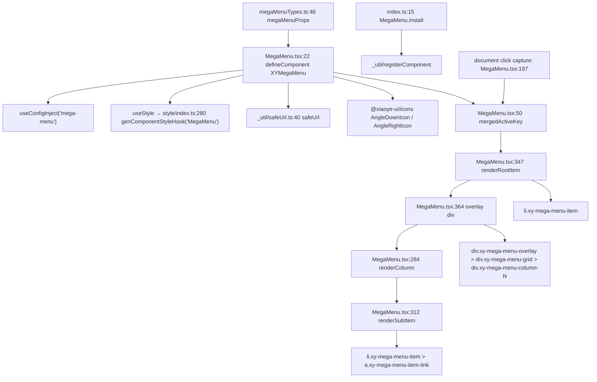
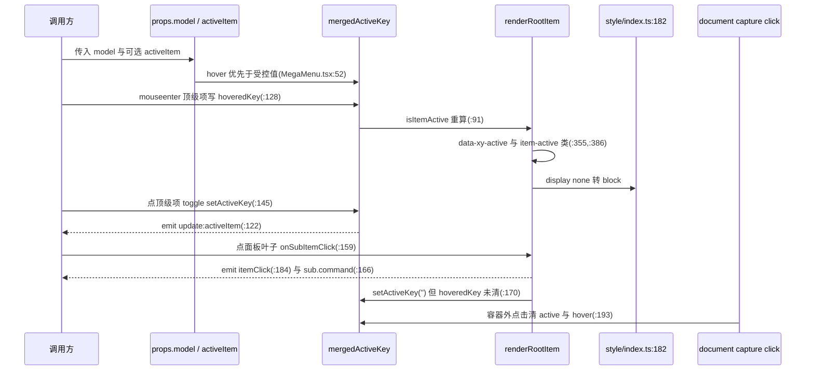
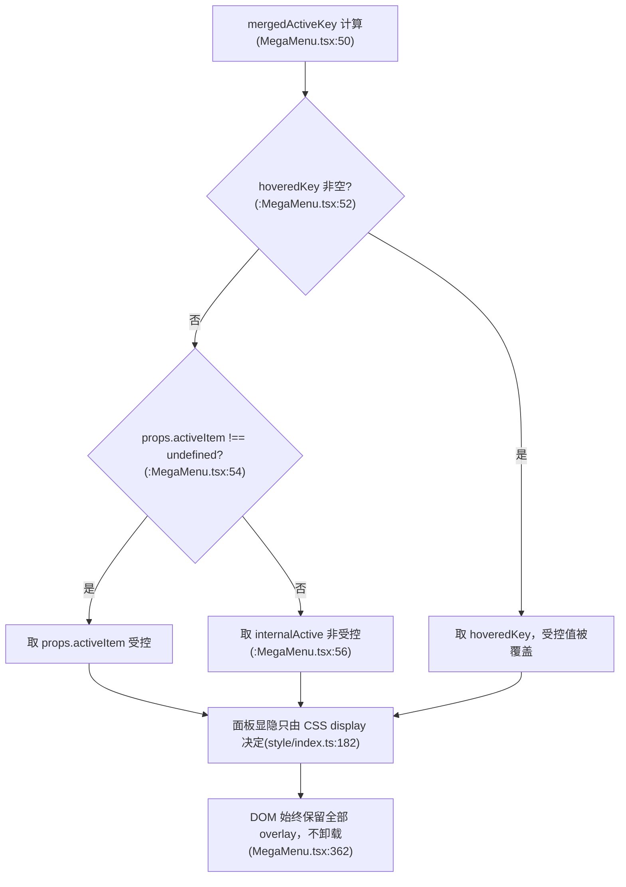

# C03-02 MegaMenu 大图菜单

> **本篇解决**：MegaMenu 的多列面板在完全不借用 Menu 运行时代码、也不走浮层三件套的前提下是怎么装配出来的——面板住在哪一层 DOM、显隐由谁决定、列宽从哪换算、外部点击监听何时绑定，以及这套自建的选中态与 Menu 侧口径的落差会在哪些场景咬人。
> **前置**：C03-00 类横写：menu/tabs/steps/breadcrumb 的选中态模型、C03-01 Menu 导航菜单、I02 vc-trigger　**读者坐标**：`03-components/03-navigation` 第 2/14 篇

## 一、职责与边界

MegaMenu 负责的是「一个顶级项背后挂一整块多列面板」这一种导航形态：顶级项横向或纵向排列（`packages/xiaoye-ui/src/mega-menu/megaMenuTypes.ts:7`），每个顶级项可以携带一个二维数组 `items`，外层数组的每个元素是一列，列内元素可以是带标题的分组或直接是叶子项（`packages/xiaoye-ui/src/mega-menu/megaMenuTypes.ts:36`）。面板的装配、列宽换算、分组标题插入、叶子链接渲染都在这一个 431 行的文件里完成（`packages/xiaoye-ui/src/mega-menu/MegaMenu.tsx:1`）。

它明确不负责的事，比负责的事更能说明这篇的定位：

- **不负责浮层定位**。MegaMenu 不引 `vc-trigger`、不引 `vc-align`、不进 `zIndexManager`，面板是 DOM 里常驻的一个 `<div>`，靠 `position: absolute` + `display: none/block` 显隐（`packages/xiaoye-ui/src/mega-menu/style/index.ts:168`）。因此它不参与浮层三件套那条链路。
- **不负责复用 Menu**。主实现共 10 条 import 声明（其中 3 条是 type-only，`packages/xiaoye-ui/src/mega-menu/MegaMenu.tsx:1`、`:6`、`:10`），没有一条指向 `../menu`（`grep -c "^import" packages/xiaoye-ui/src/mega-menu/MegaMenu.tsx` 得 10，`grep -n "from '\.\./menu'" packages/xiaoye-ui/src/mega-menu/*.tsx` 无命中）。Menu 提供的 `Menu`/`SubMenu`/`MenuItem`/`ItemGroup` 四个运行时组件（`packages/xiaoye-ui/src/menu/index.tsx:2-9`）在这里一个都没被使用，选中态模型是就地重写的一套三源合并逻辑（`packages/xiaoye-ui/src/mega-menu/MegaMenu.tsx:50-57`）。这是本篇与 C03-01《Menu 导航菜单》的分界：那篇讲 Menu 如何把 inline 折叠态、overflow 与 motion 编织起来，本篇讲 MegaMenu 如何**绕开**这套编织自己搭面板，以及绕开之后留下的接口落差。
- **不负责键盘导航**。渲染出的 `role="menubar"`（`packages/xiaoye-ui/src/mega-menu/MegaMenu.tsx:420`）与 `aria-expanded`（`packages/xiaoye-ui/src/mega-menu/MegaMenu.tsx:384`）没有任何键盘事件处理器支撑，组件内不存在 `keydown`/`onKeydown` 相关代码。
- **不负责数据获取**。`model` 是纯输入（`packages/xiaoye-ui/src/mega-menu/megaMenuTypes.ts:49`），组件只读不改。

依赖清单（全部为真实 import，见 `packages/xiaoye-ui/src/mega-menu/MegaMenu.tsx:1-15`）：

| 依赖 | 用途 | 证据 |
| --- | --- | --- |
| `_util/props-util` 的 `initDefaultProps` | 给函数式 props 补默认值 | `packages/xiaoye-ui/src/mega-menu/MegaMenu.tsx:3` |
| `config-provider/hooks/useConfigInject` | 注入 `prefixCls` / `direction` | `packages/xiaoye-ui/src/mega-menu/MegaMenu.tsx:38` |
| `_util/vue-types` + `_util/type` 的 prop 辅助函数 | props 定义 | `packages/xiaoye-ui/src/mega-menu/megaMenuTypes.ts:2-4` |
| `@xiaoye-ui/icons` 的 `AngleDownIcon` / `AngleRightIcon` | 子菜单箭头按方向分派 | `packages/xiaoye-ui/src/mega-menu/MegaMenu.tsx:5` |
| `_util/safeUrl` | `href` 协议白名单 | `packages/xiaoye-ui/src/mega-menu/MegaMenu.tsx:8` |
| `./style` 的 `useStyle` | CSS-in-JS 样式 hook 与 `hashId` | `packages/xiaoye-ui/src/mega-menu/MegaMenu.tsx:39` |
| `_util/type` 的 `CustomSlotsType` | 五个具名插槽的类型声明 | `packages/xiaoye-ui/src/mega-menu/MegaMenu.tsx:6` |
| `_util/registerComponent` | 全局注册时把 `XYMegaMenu` 映射成 `xy-mega-menu` | `packages/xiaoye-ui/src/mega-menu/index.ts:3` |

被谁依赖：包级聚合入口 `packages/xiaoye-ui/src/components.ts:206-208`（`export * from './mega-menu'` + `export { default as MegaMenu }` + 样式副作用导入）、全局类型声明 `packages/xiaoye-ui/typings/global.d.ts:55`、双入口 `exports` 字段 `packages/xiaoye-ui/package.json:354-358`、组件名清单 `packages/metadata/src/components/index.ts:69`，以及文档站的导航分类归属 `apps/docs/.vitepress/config/index.ts:71`。

## 二、源码地图

组件目录总行数 1107（`find packages/xiaoye-ui/src/mega-menu -type f | xargs wc -l | sort -n`）。

| 文件 | 行数 | 职责 | 关键导出 / 主入口行 |
| --- | --- | --- | --- |
| `packages/xiaoye-ui/src/mega-menu/MegaMenu.tsx` | 431 | 唯一主实现：状态合并、面板装配、渲染 | `defineComponent` 起点 `MegaMenu.tsx:22`，渲染函数返回 `MegaMenu.tsx:406` |
| `packages/xiaoye-ui/src/mega-menu/megaMenuTypes.ts` | 64 | props 与四个数据形状 | `megaMenuProps` 工厂 `megaMenuTypes.ts:46`，`MegaMenuProps` `:64` |
| `packages/xiaoye-ui/src/mega-menu/index.ts` | 20 | 入口、类型再导出、`install` | `install` 赋值 `index.ts:15`，默认导出 `:20` |
| `packages/xiaoye-ui/src/mega-menu/style/index.ts` | 288 | CSS-in-JS：基础/方向/禁用/RTL/焦点 | `genComponentStyleHook('MegaMenu', ...)` `style/index.ts:280` |
| `packages/xiaoye-ui/src/mega-menu/__tests__/mega-menu.test.tsx` | 304 | 15 条用例 + `mountTest` | 用例集合 `mega-menu.test.tsx:61`，hover 展开 `:125`，列栅格 `:254` |

主实现内部按行分块（这是后文论点的定位坐标系）：

| 区段 | 行范围 | 内容 |
| --- | --- | --- |
| 组件声明 | `MegaMenu.tsx:22-37` | `name: 'XYMegaMenu'`、`__XY_MEGA_MENU` 标识、五个插槽、两个 emit |
| 状态层 | `MegaMenu.tsx:41-60` | `internalActive` / `hoveredKey` / `mergedActiveKey` / 方向判定 |
| 数据规整 | `MegaMenu.tsx:62-92` | `items` 补 key、`rootClasses`、`hasSubmenu`、`isItemActive` |
| 列宽换算 | `MegaMenu.tsx:94-115` | `columnClass`：列数 → 宽度类 |
| 交互层 | `MegaMenu.tsx:117-224` | `setActiveKey`、hover、点击、外部点击监听与卸载 |
| 图标与内容渲染 | `MegaMenu.tsx:226-281` | `renderIcon`、`renderSubmenuIcon`、`renderItemContent` |
| 面板装配 | `MegaMenu.tsx:283-344` | `renderColumn`、`renderSubItem` |
| 顶级项与面板挂载 | `MegaMenu.tsx:346-398` | `renderRootItem`：先构造 overlay，再把它作为 `<li>` 的最后一个子节点挂上（`MegaMenu.tsx:395`） |
| 对外接口 | `MegaMenu.tsx:400-404` | `expose` 三个成员 |
| 根渲染 | `MegaMenu.tsx:406-429` | `wrapSSR` 包裹的容器 + `start` / 列表 / `end` |

样式侧的行坐标：容器 `style/index.ts:43`、面板显隐 `style/index.ts:168-184`、栅格列宽 `style/index.ts:191-214`、水平方向 `style/index.ts:222-234`、垂直方向 `style/index.ts:237-257`、禁用 `style/index.ts:260-264`、RTL `style/index.ts:267-269`、焦点环 `style/index.ts:272-275`。

需要注意 `packages/xiaoye-ui/src/mega-menu/` 下**没有** `demo/` 目录，文档示例独立放在 `apps/docs/examples/mega-menu/`（5 个 `.vue`，如 `apps/docs/examples/mega-menu/custom-content.vue:4`），用法手册在 `apps/docs/components/mega-menu.md:1`。

## 三、架构与数据流

### 图 1：静态结构（文件—符号—DOM 三层）



三张图里这张是唯一的静态结构图，它要说明的是：**面板不在浮层容器里，就在 `<li>` 内部**（`MegaMenu.tsx:395`）。因此 `div.xy-mega-menu-overlay` 的定位上下文是它自己那条 `li`，而 `li` 有 `position: relative`（`packages/xiaoye-ui/src/mega-menu/style/index.ts:93`），面板的 `left: 0; top: 100%`（`packages/xiaoye-ui/src/mega-menu/style/index.ts:171-172`）是相对这一条顶级项算出来的，而不是相对整个菜单容器（容器虽有 `position: relative`，`style/index.ts:44`，但它不是最近定位祖先）。这一层关系是后文论点 5 与坑 5 的起点：面板既是 `li` 的后代，就只能被祖先的 `overflow` 裁掉，也没有任何翻转可言。

另一条要从图上读出的是链路缺口：`mergedActiveKey` 只喂给渲染（`MegaMenu.tsx:91`、`MegaMenu.tsx:349`）和外部点击监听的绑定（`MegaMenu.tsx:209-219`），没有任何一条边通向 `vc-trigger`——这是它与 Menu、Dropdown 那套浮层三件套在拓扑上的根本分岔。

### 图 2：props → 状态 → 渲染 → 事件回流



这张闭环图里最值得停一眼的是最后两行：**关闭面板的三条路径清的不是同一个状态**。叶子点击只清 `internalActive`/发出 `update:activeItem`，不清 `hoveredKey`（`MegaMenu.tsx:170`）；容器外点击两个都清（`MegaMenu.tsx:193-194`）；鼠标离开整个容器只清 `hoveredKey`（`MegaMenu.tsx:136`）。因为 `hoveredKey` 在合并优先级里排在最前（`MegaMenu.tsx:52`），「点叶子关闭」这条路径在有鼠标停留的场景下会失效——图 3 展开这个判定。

### 图 3：激活项判定的三分支



分支之所以存在，是因为组件把「hover 临时预览」当成高于受控语义的状态（`MegaMenu.tsx:50-57` 的注释即写作「hover 优先（hover 时临时切换显示）」）。这与 I13 定义的受控/非受控口径不同：受控值在这里不是唯一真源，而是第三优先级。图 3 底部两行则点出另一个设计后果——激活与否只切换样式（`style/index.ts:169` 的 `display: 'none'` 与 `:183` 的 `display: 'block'`），组件从不按激活态裁剪渲染（`MegaMenu.tsx:362` 的条件是 `grouped`，与 `active` 无关）。

## 四、核心机制精读

### 论点 1：激活态是就地重写的三源合并，且 hover 的优先级压在受控值之上

断言：MegaMenu 没有接入 Menu 的选中态链路，而是用两个 `ref` 加一个 `computed` 自建了「hover → 受控 → 非受控」三级判定，结果是受控值 `activeItem` 在鼠标停留期间不生效。

```tsx
// packages/xiaoye-ui/src/mega-menu/MegaMenu.tsx:42
    const internalActive = ref<string>('');
    // 是否由于 hover 触发（用于 hover 展开）
    const hoveredKey = ref<string>('');

    const containerRef = ref<HTMLElement | null>(null);
    let outsideClickListener: ((event: MouseEvent) => void) | null = null;

    // 合并受控与非受控激活项
    const mergedActiveKey = computed(() => {
      // hover 优先（hover 时临时切换显示）
      if (hoveredKey.value) return hoveredKey.value;
      // 受控
      if (props.activeItem !== undefined) return props.activeItem;
      // 非受控
      return internalActive.value;
    });
```

逐段看：`:42` 与 `:44` 是两个互不影响的写入通道，`:50-57` 才是唯一的读取口径。关键在于 `:52` 的短路——只要 `hoveredKey` 非空，`:54` 的受控分支根本不会被求值。而 `hoveredKey` 的清空只发生在三处：鼠标离开**整个容器**（`MegaMenu.tsx:135-137`）、容器外点击（`MegaMenu.tsx:194`）、组件卸载（`MegaMenu.tsx:223`）。也就是说，鼠标停留在菜单内的任何时刻，`activeItem` 的受控语义处于被旁路状态。

写入侧的两个函数进一步放大这一点：

```tsx
// packages/xiaoye-ui/src/mega-menu/MegaMenu.tsx:117
    // 设置激活项
    function setActiveKey(key: string) {
      if (props.activeItem === undefined) {
        internalActive.value = key;
      }
      emit('update:activeItem', key);
    }

    // hover 顶级项
    function onItemMouseEnter(item: MegaMenuItem) {
      if (props.disabled || item.disabled) return;
      hoveredKey.value = item.key ?? '';
      if (hasSubmenu(item)) {
        setActiveKey(item.key ?? '');
      }
    }
```

`:119-121` 是标准的受控/非受控分叉（非受控才落本地状态），`:122` 则无条件发出 `update:activeItem`——这一段本身没问题。问题在 `:126-131`：`onItemMouseEnter` 里既有本地状态写入（`:128`）又调用了 `setActiveKey`（`:130`），而 `setActiveKey` 会 emit。于是**纯 hover 动作就会推动调用方的 `v-model:active-item`**，文档站的两个示例正是这么用的（`apps/docs/examples/mega-menu/custom-content.vue:4`、`apps/docs/examples/mega-menu/vertical.vue:4`）。

再看这套判定与 Menu 侧的距离。`isItemActive` 只做一次字符串相等（`MegaMenu.tsx:90-92`），没有任何「父项因后代命中而点亮」的上卷逻辑；`hasSubmenu` 的判据也只是 `items` 数组非空（`MegaMenu.tsx:85-87`）。对照 Menu：它维护的是 `selectedKeys` 与 `openKeys` 两个数组（`packages/xiaoye-ui/src/menu/src/Menu.tsx:60-61`），受控判定写在 `props.selectedKeys === undefined` 上（`packages/xiaoye-ui/src/menu/src/Menu.tsx:233`），同步靠 `watch` 把外部数组 `slice` 进本地 ref（`packages/xiaoye-ui/src/menu/src/Menu.tsx:180-183`、`:251-254`）。MegaMenu 则只有一个字符串 prop（`packages/xiaoye-ui/src/mega-menu/megaMenuTypes.ts:53`）加一个手写 `computed`，连仓库里现成的 `useMergedState`（`packages/xiaoye-ui/src/_util/hooks/useMergedState.ts:4`）都没引——`grep -rn "useMergedState" packages/xiaoye-ui/src/mega-menu` 返回空。Tabs 用同一个 hook 时也产出了同名的 `mergedActiveKey`（`packages/xiaoye-ui/src/tabs/src/Tabs.tsx:204`），两处同名不同实现，检索时容易混。选中态的共性口径归 C03-00《类横写：选中态模型》，本篇不展开。

结论回扣：MegaMenu 的「复用 Menu」只停留在命名与视觉语汇层面（同为 `item` / `item-active` / `submenu` 类名，见 `MegaMenu.tsx:352-358` 与 `style/index.ts:154`），状态机是完全独立的一套。改激活行为时，在 Menu 侧做的任何修复都不会传导到这里，反之亦然。

### 论点 2：面板不是「展开时才渲染」，而是无条件渲染、由 CSS 决定可见

断言：只要顶级项带 `items`，它的面板就进入虚拟 DOM 并常驻到底，激活与否只改两个通道——类名 `item-active` 与属性 `data-xy-active`；组件里不存在任何以 `active` 为条件的渲染裁剪。

```tsx
// packages/xiaoye-ui/src/mega-menu/MegaMenu.tsx:361
      let overlay: VNode | null = null;
      if (grouped) {
        const columns = item.items as any[];
        overlay = (
          <div class={`${prefixCls.value}-overlay`}>
            <div class={`${prefixCls.value}-grid`}>
              {columns.map((col, colIdx) => (
                <div key={`${key}-col-${colIdx}`} class={columnClass(columns.length)}>
                  {renderColumn(col as any[], `${key}-col-${colIdx}`, key)}
                </div>
              ))}
            </div>
          </div>
        );
      }
```

`:362` 的 `if (grouped)`（`grouped` 在 `MegaMenu.tsx:350` 由 `hasSubmenu(item)` 得出）是这段唯一的门槛，它只看数据形状，不看 `active`；`:361` 把 `overlay` 初始化成 `null`，所以「没有子菜单的顶级项不产生面板节点」是这段里唯一真实的条件分支。整棵树是 `renderColumn` → `renderSubItem` 的全量递归（`MegaMenu.tsx:287-306`、`:312-344`），也就是说一个 4 列 × 2 分组 × 5 项的顶级项，每次 `renderRootItem` 执行都会产出 40 个 `<li>` 的 VNode，而当前只有一个能看到。

再看挂载位置与显隐机制的两处耦合：

```tsx
// packages/xiaoye-ui/src/mega-menu/MegaMenu.tsx:377
      return (
        <li
          key={key}
          id={`${prefixCls.value}-${key}`}
          class={itemClass}
          role="menuitem"
          aria-disabled={item.disabled || undefined}
          aria-expanded={grouped ? active : undefined}
          aria-haspopup={grouped ? 'menu' : undefined}
          data-xy-active={active}
        >
```

```ts
// packages/xiaoye-ui/src/mega-menu/style/index.ts:168
      [`${componentCls}-overlay`]: {
        display: 'none',
        position: 'absolute',
        left: 0,
        top: '100%',
        zIndex: 1,
        minWidth: '100%',
        padding: token.megaMenuOverlayPadding,
        background: colorBgContainer,
        border: `1px solid ${colorBorder}`,
        borderRadius: borderRadiusLG,
        boxShadow,
      },

      [`${componentCls}-root-list > ${componentCls}-item-active > ${componentCls}-overlay`]: {
        display: 'block',
      },
```

`:386` 写出的 `data-xy-active` 在 MegaMenu 自己的范围内没有任何消费点：`grep -rn "data-xy-active" packages apps --include='*.ts' --include='*.tsx' --include='*.vue' --include='*.js'`（排除 `dist` 与 `node_modules`）在 `mega-menu/` 目录内只有这一行命中，样式文件里也不存在 `[data-xy-active]` 选择器。这个属性是仓内多组件共用的写法——`packages/xiaoye-ui/src/panel-menu/PanelMenu.tsx:159` 就用 `getAttribute` 读它——但 MegaMenu 只写不读，它的显隐完全走类名。留在这个组件里的作用只剩「给外部样式/测试一个钩子」，而组件自带的手感靠 `item-active` 类（`MegaMenu.tsx:355`）。两处状态同源不同形，改一个忘另一个不会出现编译错误。

这里有一条必须写下来的验证陷阱：测试 `packages/xiaoye-ui/src/mega-menu/__tests__/mega-menu.test.tsx:140` 在 hover 之后断言 `expect(wrapper.find('.xy-mega-menu-overlay').exists()).toBe(true)`，但**未激活时该节点同样存在**（`:130` 只断言了 `item-active` 类不存在，没断言 overlay 不存在），加上 jsdom 不加载 CSS-in-JS 产物，`display` 切换在这套测试里是不可观测的。这条用例名字写着「expands submenu panel」，实际只证明了「类名挂上了」。C03-01 证的「溢出内容用样式隐藏而非卸载」是同一族的取舍，只是 MegaMenu 把它推广到了整块面板。

结论回扣：MegaMenu 的面板成本模型是「全量常驻 + 样式遮蔽」。项目小（几个顶级项、每项几列）时这换来零挂载抖动与简单实现；项目多、列深时它换来的是每次激活切换都要重跑全部 `renderColumn`（因为 `mergedActiveKey` 变化触发 `isItemActive`，进而让 `MegaMenu.tsx:424` 的整表重渲染），以及一份与顶级项数量成正比的常驻 DOM。

### 论点 3：列宽是一套「列数 → 12 栅格 span」的硬编码映射，映射表外的一切列数都回落到整行

断言：面板的栅格不靠 `grid-template-columns`，而是把「列数」翻译成一个 12 栅格 span 后缀类，翻译表只写了 2/3/4/6 四个入值，其余入值一律落进 `default` 分支变成 span 12；这个后缀类与样式表里的百分比宽度是一对外部契约，改任何一边都必须同时改另一边。

```tsx
// packages/xiaoye-ui/src/mega-menu/MegaMenu.tsx:95
    function columnClass(count: number): string {
      let modifier: string;
      switch (count) {
        case 2:
          modifier = '6';
          break;
        case 3:
          modifier = '4';
          break;
        case 4:
          modifier = '3';
          break;
        case 6:
          modifier = '2';
          break;
        default:
          modifier = '12';
          break;
      }
      return `${prefixCls.value}-column ${prefixCls.value}-column-${modifier}`;
    }
```

```ts
// packages/xiaoye-ui/src/mega-menu/style/index.ts:187
      [`${componentCls}-grid`]: {
        display: 'flex',
      },

      [`${componentCls}-column`]: {
        flex: '0 0 auto',
        padding: paddingXS,

        '&-2': {
          width: '16.6667%',
        },

        '&-3': {
          width: '25%',
        },

        '&-4': {
          width: '33.3333%',
        },

        '&-6': {
          width: '50%',
        },

        '&-12': {
          width: '100%',
        },
      },
```

两点必须钉住。第一，`MegaMenu.tsx:368` 在 `columns.map` 的每一次迭代里传的都是同一个 `columns.length`，所以同一个面板内所有列共享同一个后缀类——组件没有「混合列宽」的能力，也没有任何按列内容分配宽度的逻辑（`MegaMenu.tsx:367-371`）。第二，映射方向是「列数 → span」，`style/index.ts:195-213` 里的类名 `-column-2/-3/-4/-6/-12` 正是 switch 的五个输出值，两边一一对应；如果只给 `columnClass` 加一个 `case 5: modifier = '2.4'`，样式表里没有 `&-2.4` 规则，那一列就会退化成 `flex: 0 0 auto` 的内容宽（`style/index.ts:192`），面板不报错、只是塌。

`default` 分支的真实后果是：列数为 1 时得到 span 12 是正确的（`MegaMenu.tsx:110-112`），列数为 5、7、8 时同样得到 `-column-12`，即每列都被要求占满 100% 宽，而父容器 `.grid` 是一个不写 `flex-wrap` 的 flex 行（`style/index.ts:187-189`）、列项又显式声明不收缩（`style/index.ts:192` 的 `flex: '0 0 auto'`）。至于最终表现为「横向溢出」还是「逐行堆叠」，取决于浏览器对绝对定位 shrink-to-fit 容器内百分比宽度的解析，本篇没有在真实浏览器里量过这个几何结果，只证实了类名与样式规则确实落到 `-column-12`。

测试侧只守住了一条通路：`packages/xiaoye-ui/src/mega-menu/__tests__/mega-menu.test.tsx:270` 断言 2 列时拿到 `xy-mega-menu-column-6`，`:268` 断言列数是 2；`default` 分支没有任何用例（`grep -n "column-12" packages/xiaoye-ui/src/mega-menu/__tests__/mega-menu.test.tsx` 返回空）。文档站的示例也没有越过这张表——`apps/docs/examples/mega-menu/multi-column.vue:16`、`:24`、`:34`、`:44` 恰好是 4 列，落在 `case 4` 上。

结论回扣：这是一个「用命名约定代替布局能力」的实现。换来的是样式规则极简、不需要计算容器宽度；赔上的是列数集合被写死，以及一个静默的 `default` 兜底——数据里有 5 列时不会有任何警告，用户只会看到面板变形。

### 论点 4：「列里是分组还是叶子」由一次运行期形状探测决定，key 空间因此分叉

断言：MegaMenu 的类型把一列写成 `MegaMenuColumnGroup[] | MegaMenuSubItem[]` 的并集（`packages/xiaoye-ui/src/mega-menu/megaMenuTypes.ts:36`），运行期靠 `isColumnGroup` 的形状探测来分流，而这条探测同时决定了 DOM 结构、`key` 的生成路径，以及 `itemClick` 事件里 `key` 字段的含义。

```tsx
// packages/xiaoye-ui/src/mega-menu/MegaMenu.tsx:18
function isColumnGroup(node: any): node is MegaMenuColumnGroup {
  return !!node && Array.isArray(node.items) && node.items.length > 0;
}
```

```tsx
// packages/xiaoye-ui/src/mega-menu/MegaMenu.tsx:285
      const children: VNode[] = [];

      column.forEach((node, idx) => {
        if (isColumnGroup(node)) {
          // 分组：渲染标题 + 叶子项列表
          children.push(
            <li
              key={`${columnKey}-g-${idx}`}
              class={`${prefixCls.value}-submenu-label`}
              role="presentation"
            >
              {node.label}
            </li>,
          );
          (node.items || []).forEach((sub, sIdx) => {
            children.push(renderSubItem(sub, `${columnKey}-g-${idx}-${sIdx}`, parentKey));
          });
        } else {
          // 直接是叶子项
          children.push(renderSubItem(node, `${columnKey}-${idx}`, parentKey));
        }
      });

      return <ul class={`${prefixCls.value}-submenu`}>{children}</ul>;
```

三个后果依次展开。

**其一，空分组会被降级成叶子项。** `isColumnGroup` 的判据含 `node.items.length > 0`（`MegaMenu.tsx:19`），一个 `{ label: '新分组', items: [] }` 走不进 `:288` 的分组分支，而是被 `:304` 当叶子渲染成一条可点击项；此时 `MegaMenu.tsx:159` 的 `onSubItemClick` 拿到的是这个「分组对象」，`sub.command` 为 `undefined`（`megaMenuTypes.ts:21-25` 的 `MegaMenuColumnGroup` 根本没有 `command` 字段），事件照样发出，payload 里 `item` 却是分组形状。

**其二，key 是位置索引拼出来的，不是数据 key。** 分组标题的 VNode key 是 `${columnKey}-g-${idx}`（`MegaMenu.tsx:292`），叶子是 `${columnKey}-g-${idx}-${sIdx}`（`:300`）或 `${columnKey}-${idx}`（`:304`），全部由「列索引 + 组索引 + 项索引」拼成，与 `MegaMenuSubItem.key`（`megaMenuTypes.ts:11`）无关。这意味着 `model` 中间插入一项会让后续所有 VNode 的 key 右移，Vue 会复用错位的节点；而 `renderRootItem` 用的顶级列 key 也是同样的位置串（`MegaMenu.tsx:368`、`:369`）。顶级项反而享受了另一套处理——`items` 计算属性给缺 key 的顶级项按索引补了字符串 key（`MegaMenu.tsx:66-69`），但这个补齐只作用于顶级项，`renderColumn` 拿到的子项数组是原始对象（`MegaMenu.tsx:363` 直接读 `item.items`），没人给它们补 key。

**其三，事件里的 `key` 因此有两种身份。**

```tsx
// packages/xiaoye-ui/src/mega-menu/MegaMenu.tsx:174
    function triggerItemClick(
      event: Event,
      item: MegaMenuItem | MegaMenuSubItem,
      parentKey?: string,
    ) {
      const payload: MegaMenuItemClickEvent = {
        key: item.key ?? parentKey ?? '',
        item,
        originalEvent: event,
      };
      emit('itemClick', payload);
    }
```

`:180` 的回退链是 `item.key → parentKey → ''`。顶级叶子（如测试里的「设置」）取到自己的 key（`mega-menu.test.tsx:173` 断言 `key: 'settings'`）；面板内叶子若没写 `key`，取到的是**顶级项的 key**（`MegaMenu.tsx:168` 把 `parentKey` 透传下来）——调用方从 payload 上无法区分「点了顶级项 A」和「点了 A 面板里某个没命名的小项」。类型定义里 `MegaMenuItemClickEvent.key` 是无条件必填的 `string`（`megaMenuTypes.ts:41`），把这层歧义藏在了类型之下。

另外，同一交互还有第二个回调入口：`MegaMenu.tsx:165-167` 先执行 `sub.command({ item: sub, originalEvent: event })`，再发 `itemClick`。两条通路的参数形状不同——`command` 的参数类型是 `{ item, originalEvent }`（`megaMenuTypes.ts:17`），`itemClick` 的是 `{ key, item, originalEvent }`（`megaMenuTypes.ts:40-44`），前者没有 `key`。测试只覆盖了后者的发出（`mega-menu.test.tsx:195` 断言 `v1-1`），`command` 通路零用例。

### 论点 5：面板不是浮层——它没有 flip、没有 Portal、也不进全局层叠体系

断言：MegaMenu 的「弹出」是纯 CSS 绝对定位，定位上下文是自己那条 `<li>`；组件里没有一处引用浮层三件套（trigger / align / zIndex），因此 `ConfigProvider` 的浮层容器配置、溢出翻转、全局层级对它全部无效。

```tsx
// packages/xiaoye-ui/src/mega-menu/MegaMenu.tsx:46
    const containerRef = ref<HTMLElement | null>(null);
```

`containerRef` 在整个组件里只有三处出现：声明（`MegaMenu.tsx:46`）、外部点击的归属判断（`MegaMenu.tsx:192`）、绑定到根 `div`（`MegaMenu.tsx:412`）。它不是浮层容器，没有 `Teleport`、没有 `getPopupContainer`——`grep -rn "Teleport\|Portal\|vc-align\|builtinPlacements\|zIndexManager\|getPopupContainer" packages/xiaoye-ui/src/mega-menu` 返回空。对照 C03-01 证过的 Menu：`SubMenu` 在非 inline 形态下经 `PopupTrigger` 走 `vc-trigger`（机制归 I02 vc-trigger），MegaMenu 则连这条边都没有。

定位与层叠由这几条规则决定：

```ts
// packages/xiaoye-ui/src/mega-menu/style/index.ts:93
      [`${componentCls}-item`]: {
        position: 'relative',
```

```ts
// packages/xiaoye-ui/src/mega-menu/style/index.ts:253
      [`${componentCls}-root-list > ${componentCls}-item-active > ${componentCls}-overlay`]: {
        left: '100%',
        top: 0,
      },
```

`:93-94` 让每条顶级项成为定位上下文，于是 `style/index.ts:171-172` 的 `left: 0; top: 100%`（水平形态）与 `:254-255` 的 `left: 100%; top: 0`（垂直形态，作用域是 `componentCls-vertical`，见 `style/index.ts:237`）都是相对这一条项的偏移。水平形态下面板从被激活项的正下方铺开、`minWidth: 100%`（`style/index.ts:174`）只保证「不比这一项窄」；垂直形态下面板左边缘对齐到该项右边界。两种形态都没有任何「距视口边界不足就换边」的逻辑——组件里没有几何测量，`.overlay` 也不接受外部传入的 placement。

层叠上，面板拿到的是写死的 `zIndex: 1`（`style/index.ts:173`）。这只是菜单容器内部的局部排序键：浮层类的基准是 `zIndexPopupBase: 1000`（`packages/xiaoye-ui/src/theme/themes/seed.ts:68`，接口声明在 `packages/xiaoye-ui/src/theme/interface/seeds.ts:164`），并由 `packages/xiaoye-ui/src/_util/zIndexManager.ts:6` 的 `ZIndexManager` 统一分配。MegaMenu 既不用它，面板就永远处于「真浮层之下」——这不是缺陷而是分层的必然，但它的另一面是：**任何祖先元素的 `overflow: hidden` 都会裁掉面板**，因为没有 Portal 让面板逃出这个盒子。把 MegaMenu 放进一张 `overflow: auto` 的卡片里时，面板会随卡片滚动而不是稳定悬停。

结论回扣：这是本篇认为最需要被后来者读懂的一处取舍。用 `vc-trigger` 能立刻换来翻转、层级、容器逃逸和 `getPopupContainer` 一致性，代价是每个面板都要走一次挂载/销毁或 `forceRender` 的双树渲染（C03-01 里 Menu 溢出下拉就为隐藏副本付出过代价）。MegaMenu 选了反面：**零浮层依赖、零测量、零 Portal**，代价是几何能力被压到只剩「上下左右四个方向里写死两个」。

### 论点 6：外部点击监听按「合并后的激活态」挂载，`immediate: false` 让初始就展开的面板没有关闭通道

断言：`document` 上的捕获监听只在 `mergedActiveKey` 发生变化时才绑定，绑定条件读的是三级合并后的值而不是「用户交互过」这一事实，于是受控初始值不为空的面板从挂载起就没有外部点击监听；同时暴露给父组件的实例成员只有三个，是一层比 Menu 更宽但也更容易被误用的接口。

```tsx
// packages/xiaoye-ui/src/mega-menu/MegaMenu.tsx:188
    function bindOutsideClickListener() {
      if (!outsideClickListener && typeof document !== 'undefined') {
        outsideClickListener = (event: MouseEvent) => {
          const target = event.target as Node;
          if (containerRef.value && !containerRef.value.contains(target)) {
            setActiveKey('');
            hoveredKey.value = '';
          }
        };
        document.addEventListener('click', outsideClickListener, true);
      }
    }
```

```tsx
// packages/xiaoye-ui/src/mega-menu/MegaMenu.tsx:209
    watch(
      mergedActiveKey,
      key => {
        if (key) {
          bindOutsideClickListener();
        } else {
          unbindOutsideClickListener();
        }
      },
      { immediate: false },
    );
```

`:189` 的 `if (!outsideClickListener ...)` 保证全局只有一个 handler 实例（重复绑定被短路），`:197` 用的是**捕获阶段**监听——所以先于 `li` 上的 `onClick` 执行，判断依据是 `containerRef.contains(target)`（`:192`）。这条链有两个必须记住的性质：其一，面板是 `li` 的后代（`MegaMenu.tsx:395`），点面板内部不会被判定为「外部」，因此 MegaMenu 没有「点选项后面板留在原地」的自相矛盾；其二，SSR 安全靠 `typeof document !== 'undefined'`（`:189`）守住，卸载靠 `onBeforeUnmount` 显式解绑并清 hover（`MegaMenu.tsx:221-224`）——这一段生命周期是干净的。

不干净的是 `:218` 的 `immediate: false`。若调用方写成 `<xy-mega-menu v-model:active-item="k" />` 且 `k` 初值就是 `'videos'`（受控打开态），`watch` 不会在挂载时跑一次，监听不会绑定；此时点击菜单外任何位置，`bindOutsideClickListener` 从未生效 → 没有任何代码路径去清状态，面板保持展开，直到 `mergedActiveKey` 因 hover 或点击第一次变化。测试恰好绕开了这个组合：`mega-menu.test.tsx:274` 的外部点击用例走的是「非受控、先点开再点外」，受控用例 `mega-menu.test.tsx:218-226` 又完全不触发外部点击——**受控初始展开 + 外部点击这条分支无测试保护**。

对外接口面：

```tsx
// packages/xiaoye-ui/src/mega-menu/MegaMenu.tsx:400
    expose({
      activeKey: mergedActiveKey,
      setActiveKey,
      items,
    });
```

三个成员分别是只读计算属性（`MegaMenu.tsx:50`）、写状态函数（`:118`）、规整后的顶级项列表（`:63`）。这与 C03-01 证过的「Menu 没有任何 `expose`」形成对照：MegaMenu 给了模板 ref 直接改激活态的能力。要注意 `activeKey` 暴露的是**合并后**的值，因此模板里读 `menuRef.value.activeKey` 会看到 `hoveredKey`（`MegaMenu.tsx:52`）而不是 `props.activeItem`；而 `setActiveKey` 不校验 key 是否存在于 `items`（`:118-123` 只做赋值与 emit），传错字符串不会报错，只会让所有顶级项都失去 `item-active`。

结论回扣：状态写入通道有三条（hover、点击、外部点击），关闭判定只有两条真正生效，且 `expose` 把内部合并结果直接端了出去。这个组合意味着「谁让面板关上」这件事在 MegaMenu 里比在 Menu 里更难从外部推理——Menu 至少把开合收敛到了 `openKeys` 一条轴上。

## 五、对外契约如何生效

props 的默认值在声明处就被补齐一次：`initDefaultProps(megaMenuProps(), { orientation: 'horizontal' })`（`packages/xiaoye-ui/src/mega-menu/MegaMenu.tsx:26-28`），`megaMenuProps` 本体在 `packages/xiaoye-ui/src/mega-menu/megaMenuTypes.ts:46-62`。从入口到渲染只有四条真实通路。

**前缀与样式。** `prefixCls` 不是直接用的，它先进 `useConfigInject('mega-menu', props)`（`MegaMenu.tsx:38`），出来的 `prefixCls` 与 `direction` 再进 `rootClasses`（`MegaMenu.tsx:73-82`）；`useStyle(prefixCls)` 返回的 `[wrapSSR, hashId]`（`MegaMenu.tsx:39`）里，`hashId` 被塞进同一个类名数组的第一项（`MegaMenu.tsx:74-75`），`wrapSSR` 只在最后一步把整棵子树包起来（`MegaMenu.tsx:410`）。因此想改 CSS 前缀必须在 `useConfigInject` 那层改，改 `rootClasses` 只影响类名不影响 token 计算（`style/index.ts:280` 的 `genComponentStyleHook('MegaMenu', ...)` 认的是组件名，不是前缀）。

**方向与禁用。** `orientation` 有两个读取点：`horizontal`/`vertical` 两个 computed（`MegaMenu.tsx:59-60`）产出类名（`MegaMenu.tsx:77-78`），以及 `aria-orientation`（`MegaMenu.tsx:421`）；`horizontal.value` 另外还决定箭头图标分派（`MegaMenu.tsx:243`）。`disabled` 有四个读取点：容器类（`MegaMenu.tsx:80`）、hover 短路（`MegaMenu.tsx:127`）、顶级点击短路（`MegaMenu.tsx:141`）、`aria-disabled`（`MegaMenu.tsx:422`）。注意**面板内叶子不查 `props.disabled`**——`onSubItemClick` 只看 `sub.disabled`（`MegaMenu.tsx:160`），整菜单禁用是靠样式的 `pointerEvents: 'none'`（`style/index.ts:260-264`）在容器层挡住的，逻辑层没有第二道闸。

**事件的双入口。** `emits: ['itemClick', 'update:activeItem']`（`MegaMenu.tsx:36`）与 props 里的 `onItemClick: eventType<...>()`（`megaMenuTypes.ts:59`）指向同一个 key。`emit('itemClick', payload)`（`MegaMenu.tsx:184`）之所以能命中 `props.onItemClick`，是 Vue 运行时的取法：`emit` 按 `toHandlerKey(event)` 到 props 上取处理器，取不到再退回连字符写法。本机实际安装的是 3.5.40（仓库声明的区间是 `>=3.4.0`，见 `packages/xiaoye-ui/package.json:44`），复现该取法的命令：`grep -rn "toHandlerKey(event)" node_modules/.pnpm --include="runtime-core.cjs.js"`，命中行是 4474，连字符回退紧随其后在 4477。所以 `@item-click="fn"`（`apps/docs/examples/mega-menu/basic.vue:4`）与 `:on-item-click="fn"` 效果相同，手册两张表把这写成两件事（`apps/docs/components/mega-menu.md:64` 的参数表、`:100-102` 的事件表），语义上是一条。

**插槽的三实一虚。** 声明了五个：`start`、`end`、`item`、`itemicon`、`submenuicon`（`MegaMenu.tsx:29-35`）。`start`/`end` 在根渲染里各有一次消费并各带一个容器 `div`（`MegaMenu.tsx:417`、`:426`）；`item` 在 `renderItemContent` 开头短路整段默认渲染（`MegaMenu.tsx:250-259`），参数是 `{ item, label, hasSubmenu, active }`；`submenuicon` 在 `renderSubmenuIcon` 里带 `active` 参数（`MegaMenu.tsx:239-241`）。**`itemicon` 没有任何消费点**：`grep -rn "itemicon" packages/xiaoye-ui/src/mega-menu` 只命中声明行 `MegaMenu.tsx:33`；同名插槽在兄弟菜单组件里是真有实现的（`apps/docs/components/context-menu.md:94`、`apps/docs/components/panel-menu.md:104`），MegaMenu 这一份看起来是照着同族 API 抄了声明、没抄消费。手册的插槽表也没有列它（`apps/docs/components/mega-menu.md:107` 起的表只有四行），所以传进去只会静默失效。

同理静默的还有两个 props：`item`（`megaMenuTypes.ts:57`，注释写「自定义 item 渲染」）与 `icon`（`:61`，注释写「icon 渲染透传」）。组件里读取 `props.*` 的位置全量只有十处（`MegaMenu.tsx:54`、`:59`、`:60`、`:64`、`:80`、`:119`、`:127`、`:141`、`:421`、`:422`），另有 `props[ ]` 下标写法零命中，两者都没有被读；渲染图标只认数据上的 `item.icon` / `sub.icon`（`MegaMenu.tsx:261`、`:320`），渲染项内容只认 `slots.item`（`MegaMenu.tsx:250`）。这两个名字会随 `MegaMenuProps` 类型（`megaMenuTypes.ts:64`）出现在 IDE 补全里，属于「类型面存活、实现死亡」。

`expose` 的三个成员（`MegaMenu.tsx:400-404`）与 `attrs` 的落点（`inheritAttrs: false` 见 `MegaMenu.tsx:24`，显式 spread 见 `MegaMenu.tsx:414`）构成剩下的对外面。由于 `inheritAttrs` 关掉且 `attrs` 只 spread 到根 `div`，外部传入的 `id`、`style`、`data-*` 都只会落在容器上，落不到 `role="menubar"` 的 `ul`（`MegaMenu.tsx:418-425`）；`ul` 上可被外部影响的属性只有组件自己写的那几个。

## 六、设计取舍

**取舍一：不接浮层三件套。** 被放弃的路是把面板交给 `vc-trigger`——同仓的 Menu 已经在这么做，接上就能白得翻转（`overflow` 调整）、`getPopupContainer`、`zIndexManager` 层级协调与 `forceRender` 语义（机制归 I02 vc-trigger）。MegaMenu 的实际选择是绝对定位加类名显隐（`style/index.ts:168-184`）。换来的是：实现只有 431 行且零跨包协调、渲染只有一棵树（`MegaMenu.tsx:410` 的 `wrapSSR` 包住的就是唯一一份 DOM）、SSR 与测试都不需要处理 Portal（`document` 只在 `MegaMenu.tsx:189` 的 `typeof` 守卫后出现，且绑定动作推迟到 `watch` 回调 `MegaMenu.tsx:209-219`）。赔上的是：面板无法逃出祖先的 `overflow`（论点 5）、层级永远压在局部 `zIndex: 1`（`style/index.ts:173`）上、以及面板开合没有过渡——`style/index.ts:168-184` 这两个 overlay 规则块里没有任何 `transition` 声明，全文件仅有的两处 `transition` 是项的配色（`style/index.ts:105`）与箭头的 `transform`（`style/index.ts:151`），`MegaMenu` 也不在任何动画注册表里（`grep -rn "MegaMenu" packages/xiaoye-ui/src/_util packages/xiaoye-ui/src/config-provider` 无命中）。这条取舍能不能接受，取决于使用者是否要求 MegaMenu 出现在可滚动容器里；本篇认为文档没有把这条限制写出来是缺陷（见坑 5）。

**取舍二：全量常驻 DOM，而不是激活时才渲染。** 替代方案是 `MegaMenu.tsx:362` 改成 `if (grouped && active)`。选常驻的理由能从代码里读出来的只有一条简洁性：面板内容与顶级项同级，`overlay` 变量声明后无条件挂载（`MegaMenu.tsx:361-375`、`:395`），不需要维护「首次展开」标记。代价前面算过——VNode 数量与 `model` 总项数成正比，且每次激活变化都全表重渲染（`MegaMenu.tsx:424`）。值得注意的是这个代价对可访问性**没有**影响：`display: none`（`style/index.ts:169`）会把隐藏面板整棵子树移出可达性树，所以常驻 DOM 不会让屏幕阅读器多读出一堆链接。

**取舍三：用运行期形状探测代替判别联合。** `MegaMenuColumnGroup` 与 `MegaMenuSubItem` 的区别只在有没有 `items`（`megaMenuTypes.ts:21-25` 对 `:10-18`），`isColumnGroup` 因此可以只看 `Array.isArray(node.items)`（`MegaMenu.tsx:18-20`）。好处是调用方写数据时不用带 `type` 字段，`items` 缺省即叶子；坏处是 `items: []` 这种「空分组」在语义上同时满足两个分支，被静默降级为叶子项（论点 4 其一），而类型系统对此完全无感。

**取舍四：12 栅格 span 而不是 `grid-template-columns`。** 用 CSS Grid 的话 `repeat(columns.length, minmax(0, 1fr))` 一行就能支持任意列数，组件却选了「列数 → span 后缀类」的两段式映射（`MegaMenu.tsx:95-115` 与 `style/index.ts:191-214`）。这换来的是与全站 12 栅格语义一致的类名（消费方可以按 `-column-4` 这种名字覆盖宽度），赔上的是列数集合封闭与 `default` 分支的静默塌列（论点 3）。

**取舍五：自建选中态而不是复用 Menu 的状态轴。** 这条不是「设计」而是「结果」，但必须写进取舍：MegaMenu 与 Menu 现在共享的是命名约定（`item` / `item-active` / `submenu`，`MegaMenu.tsx:352-358`），不共享任何状态实现（论点 1）。因此 Menu 侧将来对选中态做的任何修正（受控判定、hover 与 active 两轴分离）都不会自动修好 MegaMenu，两边要各自改各自。反过来，MegaMenu 也不需要 Menu 的 `mode`、`level`、`inlineIndent` 那一整套递归语义——它的层级深度被硬编码为「顶级项 → 列 → 分组 → 叶子」四层（`MegaMenu.tsx:346-398` 到 `:284-309` 到 `:312-344`），比 Menu 的递归树简单得多。

## 七、坑与改动指南

测试现状：`packages/xiaoye-ui/src/mega-menu/__tests__/mega-menu.test.tsx` 有 19 条 `it()` 加 `mountTest` 的 1 条（`:62`），按 `packages/xiaoye-ui/vitest.config.mts:33` 的 `src/**/*.test.{js,ts,jsx,tsx}` glob 会被执行；实跑 `pnpm --filter xiaoye-ui test:unit src/mega-menu` 得 `✓ src/mega-menu/__tests__/mega-menu.test.tsx (20 tests)`。下面每条坑标出「有没有人守」。

**坑 1：只要鼠标划过带子菜单的顶级项，调用方的 `v-model:active-item` 就被改写，而受控值本身在停留期间不生效。** 触发：`<xy-mega-menu v-model:active-item="k" :model="model" />`，鼠标移到任一有 `items` 的项上（不点）。症状：`k` 变成该项 key；如果外部此刻把 `k` 设成另一个值，面板显示的仍是 hover 项。原因：`onItemMouseEnter` 先写 `hoveredKey`（`MegaMenu.tsx:128`）再调 `setActiveKey`（`MegaMenu.tsx:130`），后者无条件 emit（`MegaMenu.tsx:122`）；读取侧 hover 排在受控分支之前（`MegaMenu.tsx:52` 先于 `:54`）。定位：`packages/xiaoye-ui/src/mega-menu/MegaMenu.tsx:50-57`、`:118-123`、`:126-132`。有人守吗：受控用例 `mega-menu.test.tsx:218-226` 只断类名、不涉及 hover，hover 用例 `mega-menu.test.tsx:125-144` 用的是非受控挂载——**受控 + hover 的组合无测试保护**。

**坑 2：鼠标停在面板里点叶子项，面板不会关闭。** 触发：hover 打开面板 → 鼠标下移到面板 → 点一个叶子。症状：`itemClick` 正常发出、`command` 正常执行，但顶级项仍是 `item-active`，面板继续显示。原因：`onSubItemClick` 只调 `setActiveKey('')`（`MegaMenu.tsx:170`），不清 `hoveredKey`；而 `hoveredKey` 只在离开**整个容器**时才清（`MegaMenu.tsx:135-137`），面板本身就是容器后代（`MegaMenu.tsx:395`），鼠标从未离开容器；于是 `mergedActiveKey` 立刻回落到 `hoveredKey`（`MegaMenu.tsx:52`）。定位：`MegaMenu.tsx:170`、`:136`、`:52`。有人守吗：`mega-menu.test.tsx:177-197` 走的是 `trigger('click')` 且没有先 hover，`hoveredKey` 恒为空——**该分支无测试保护**（jsdom 也无法表达「鼠标仍在容器内」）。

**坑 3：hover 一个没有子菜单的顶级项，它会被点亮成激活态，并且此后的任意一次页面点击都会发出 `update:activeItem('')`。** 触发：鼠标划过一个纯链接项（无 `items`），然后点页面任意处。症状：该项变白字主色底（`style/index.ts:154-157`），看起来像被选中，移出菜单才恢复；期间任何一次点击都会让 `v-model` 绑定的值被清成空串。原因：`hoveredKey` 的写入不看 `hasSubmenu`（`MegaMenu.tsx:128` 在 `:129` 的判断之前执行），`isItemActive` 拿它比对（`MegaMenu.tsx:91`）并把 `item-active` 挂上（`MegaMenu.tsx:355`）；`watch(mergedActiveKey)` 见非空即绑定全局捕获监听（`MegaMenu.tsx:209-219` → `:188-199`），监听回调里 `setActiveKey('')` 无条件 emit（`MegaMenu.tsx:122`）。定位：`MegaMenu.tsx:126-132`、`:188-199`、`:209-219`。有人守吗：无，测试里唯一的 hover 用例针对的是有子菜单的项（`mega-menu.test.tsx:133-136`）。

**坑 4：不安全 URL 不是被拒绝，而是被降级成 `href=""`，链接仍可点。** 触发：给顶级项或叶子填 `url: 'javascript:alert(1)'`，或任何不在白名单里的协议。症状：脚本不执行（安全目的达成），但该元素仍是一个 `href=""` 的活链接，浏览器按当前文档地址解析，点击等于自跳到本页；若同时填了 `target`，还会新开一个当前页副本（`rel` 会补 `noopener noreferrer`）。后半句属于 HTML 对空 `href` 的解析语义，**2026-09-30 已在真实浏览器里实测，两条都成立**（本地起一个 http 服务、页面里放 `<a href="">` 与 `<a href="" target="_blank">`，用 playwright 的 chromium 跑：`a.getAttribute('href')` 是空串但 `a.href` 解析成当前文档 URL；点前者之后页面脚本重跑（随机 stamp 变了）而 `location.href` 一字未动，即「原地自跳」；点后者会真的开出一个 new tab，其 `url()` 与 opener 完全相同）。代码侧可证的是「`href` 被写成空串」与「`target` 存在时补 `rel`」（`MegaMenu.tsx:270`、`:327`）。原因：`linkProps` 的条件是「`url` 是否 truthy」而不是「`safeUrl` 的结果是否为空」——`item.url ? { href: safeUrl(item.url), ... }`（`MegaMenu.tsx:266-272`），叶子同一写法在 `MegaMenu.tsx:323-329`，而 `safeUrl` 不安全时返回 `fallback`，默认就是空串（`packages/xiaoye-ui/src/_util/safeUrl.ts:40-41`，白名单在 `:10`）。定位：`MegaMenu.tsx:266-272`、`MegaMenu.tsx:323-329`、`_util/safeUrl.ts:25-41`。有人守吗：无——`grep -rn "safeUrl" packages/xiaoye-ui/src/mega-menu/__tests__` 返回空，测试数据里的 `icon: 'pi pi-video'`（`mega-menu.test.tsx:12`）是唯一走字符串图标的样本，URL 通路零覆盖。

**坑 5：列数不在 2/3/4/6 之内时静默塌列；同时祖先的 `overflow` 会裁掉面板，而文档都没写。** 触发：给某顶级项填 5 列的 `items`；或把 MegaMenu 放进 `overflow: hidden` 的卡片/滚动容器里。症状：前者所有列都拿到 `-column-12`（各 100% 宽、`style/index.ts:211-213`），面板形状与预期不符且控制台无警告；后者面板被容器边缘裁切，且没有翻转或逃逸。原因：`columnClass` 的 `default` 分支兜底成 `'12'`（`MegaMenu.tsx:110-112`），映射表外没有第二道校正；面板是 `li` 的绝对定位后代（`MegaMenu.tsx:395`、`style/index.ts:168-172`），组件不引 Portal（`grep -rn "Teleport\|Portal" packages/xiaoye-ui/src/mega-menu` 空）。定位：`MegaMenu.tsx:95-115`、`style/index.ts:187-214`、`style/index.ts:168-174`。有人守吗：只有 2 列断言（`mega-menu.test.tsx:270`），`grep -n "column-12" packages/xiaoye-ui/src/mega-menu/__tests__/mega-menu.test.tsx` 返回空；溢出行为在 jsdom 里根本测不到。

**坑 6：受控初始展开的面板没有外部点击关闭通道。** 触发：`activeItem` 初值非空（`<xy-mega-menu :active-item="'videos'" ... />` 或 `v-model` 初值非空），然后点菜单外任意处。症状：面板一直开着，直到用户 hover/点击过某项使 `mergedActiveKey` 变化一次。原因：绑定监听的条件写在 `watch(mergedActiveKey, ...)` 里且显式 `immediate: false`（`MegaMenu.tsx:209-219`，选项在 `:218`），挂载时不执行第一次判定。定位：`MegaMenu.tsx:209-219`、`:188-199`。有人守吗：外部点击用例走的是「非受控 + 先点开」（`mega-menu.test.tsx:274-295`），受控用例完全不点外部（`mega-menu.test.tsx:218-226`）——**该分支无测试保护**。

**坑 7：整个菜单不可键盘到达，而 DOM 上写的是 `menubar`/`menuitem` 语义。** 触发：只用 Tab / 方向键操作页面。症状：焦点直接跳过整条菜单，无法展开任何面板；辅助技术读到 `role="menubar"`（`MegaMenu.tsx:420`）、`role="menuitem"`（`MegaMenu.tsx:332`、`:382`）与 `aria-expanded`（`MegaMenu.tsx:384`）却拿不到可聚焦目标。原因：组件唯一的可聚焦元素是两处 `<a tabindex={-1}>`（`MegaMenu.tsx:275`、`:337`），`li` 与 `ul` 都没有 `tabindex`（`MegaMenu.tsx:378-387`、`:418-425`），并且全目录没有任何键盘处理器（`grep -rn "keydown" packages/xiaoye-ui/src/mega-menu` 返回空）——没有 `focus()` 调用、没有 roving tabindex。连带后果：样式里为 `root-list` 写的焦点环规则（`style/index.ts:272-275`）永不命中，因为那个 `ul` 无法获得焦点。定位：`MegaMenu.tsx:275`、`:337`、`:418-425`、`style/index.ts:272-275`。有人守吗：无，测试文件没有任何键盘或焦点用例（`grep -n "trigger('keydown')\|setData(" packages/xiaoye-ui/src/mega-menu/__tests__/mega-menu.test.tsx` 返回空）。

**坑 8：两条样式规则与一个插槽名是死的，改组件时容易误判它们在用。** 触发：想给面板加分隔线（以为有 `-separator` 支持），或给 MegaMenu 传 `#itemicon` 插槽，或指望分组标题有禁用态。症状：分隔线不会出现（没有任何渲染点写这个类名，`grep -rn "separator" packages/xiaoye-ui/src/mega-menu` 只命中 `style/index.ts:216`）；`#itemicon` 静默失效（声明在 `MegaMenu.tsx:33`，`grep -rn "itemicon" packages/xiaoye-ui/src/mega-menu` 只命中这一行）；分组的禁用样式 `&-disabled`（`style/index.ts:87-90`）无从命中，因为 `renderColumn` 只写基类（`MegaMenu.tsx:293`）且 `MegaMenuColumnGroup` 根本没有 `disabled` 字段（`megaMenuTypes.ts:21-25`）。同理 props 里的 `item`（`megaMenuTypes.ts:57`）与 `icon`（`:61`）零读取（第五节已列全 10 个 `props.*` 读取点）。定位：`style/index.ts:87-90`、`style/index.ts:216-218`、`MegaMenu.tsx:33`、`megaMenuTypes.ts:57`、`megaMenuTypes.ts:61`。有人守吗：反向的——`mega-menu.test.tsx:142` 断言了 `submenu-label` 存在，但没有任何用例断言 `separator`、`itemicon`、`columnClass` 之外的死路径。

改动这块代码的安全边界：
1. 动 `mergedActiveKey`（`MegaMenu.tsx:50-57`）的优先级前，先给坑 1 与坑 2 补两条用例（受控 + hover、hover 后点叶子），这两条现在都是空白；
2. 动 `columnClass`（`MegaMenu.tsx:95-115`）必须同步动 `style/index.ts:191-214` 的宽度键集合，两边是一对外部契约，编译器不会报错；
3. 想加浮层能力（翻转、层级、`getPopupContainer`）等于把论点 5 的取舍翻案，改动面会扩到 `containerRef`（`MegaMenu.tsx:46`）与样式 `style/index.ts:168-184` 两处，且 `mega-menu.test.tsx:274-295` 依赖「面板在容器内」这一前提（它靠 `containerRef.contains` 判定外部点击）；
4. 任何渲染层改动都要重跑 `pnpm --filter xiaoye-ui test:unit src/mega-menu`（20 条）与 `pnpm typecheck`，并确认 `pnpm check:entries` 不因导出名变化而漂移（`packages/xiaoye-ui/src/components.ts:206-208` 是本组件进包根的唯一路径）。

## 附：本篇可证伪的三个检查点

1. **MegaMenu 与 Menu 之间没有运行时耦合（本篇论点 1 的立论前提）。** 命令：`grep -rn "\.\./menu" packages/xiaoye-ui/src/mega-menu | wc -l`，当前输出 `0`；`grep -c "^import" packages/xiaoye-ui/src/mega-menu/MegaMenu.tsx`，当前输出 `10`。只要第一条不再为 `0`，本篇关于「选中态就地重写、修复不传导」的论证就必须重写。
2. **面板的渲染条件不含激活态（论点 2 的判据）。** 命令：`grep -n -A 1 "let overlay" packages/xiaoye-ui/src/mega-menu/MegaMenu.tsx`，当前输出 `361: let overlay: VNode | null = null;` 与 `362: if (grouped) {`——门槛只有数据形状。再用 `grep -n "active" packages/xiaoye-ui/src/mega-menu/MegaMenu.tsx` 核对：11 处命中全在 `:240`、`:256`、`:349`、`:355`、`:384`、`:386`、`:401` 这类类名、ARIA、插槽参数与 `expose` 位置，`:361-375` 这段渲染体内一个都没有。若将来 `:362` 变成 `if (grouped && active)`，坑 2 与取舍二的成本测算同时失效。
3. **列宽映射与样式键集合是一对外部契约（坑 5 的判据）。** 命令：`grep -n "modifier = " packages/xiaoye-ui/src/mega-menu/MegaMenu.tsx` 得到 `'6'`、`'4'`、`'3'`、`'2'`、`'12'`（`:99`、`:102`、`:105`、`:108`、`:111`）；`grep -n "'&-[0-9]*':" packages/xiaoye-ui/src/mega-menu/style/index.ts` 得到 `'&-2'`、`'&-3'`、`'&-4'`、`'&-6'`、`'&-12'`（`:195`、`:199`、`:203`、`:207`、`:211`）。两边数字集合相同（`{2,3,4,6,12}`），说明 `columnClass` 的输出被样式表完全覆盖；任何一侧多出键，就是坑 5 描述的「静默塌列」新增入口。
