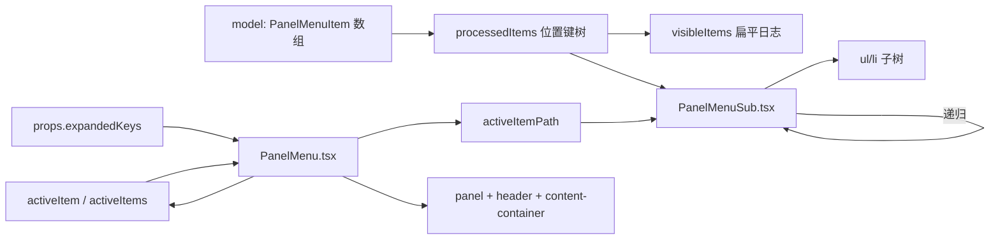
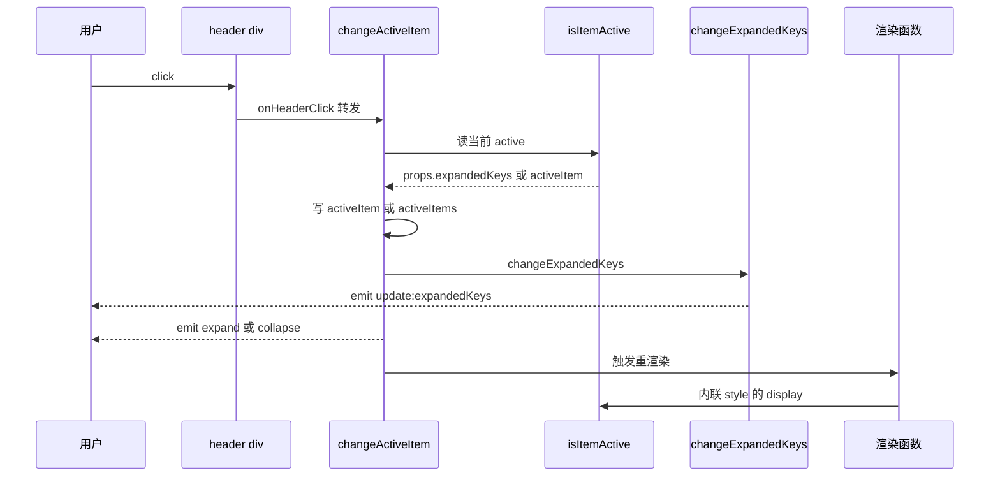
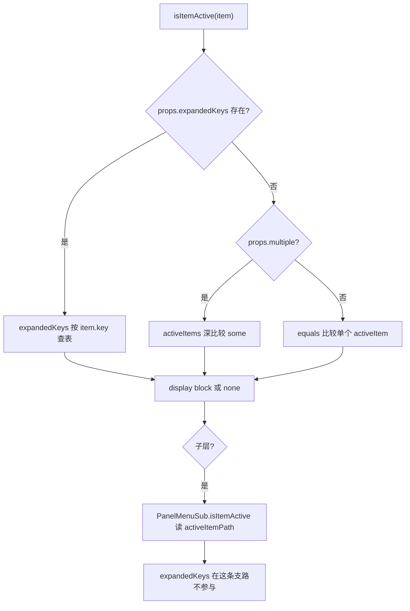

# C03-03 PanelMenu 面板菜单

> **本篇解决**：PanelMenu 的面板展开与菜单项选中到底是同一份状态还是两份状态，以及它借用的折叠词汇在哪三处与 Collapse 的真实实现断裂。
> **前置**：C02-09《Collapse 折叠面板》、C03-00《类横写：menu/tabs/steps/breadcrumb 的选中态模型》、C03-01《Menu 导航菜单》、I09《动画与 motion 体系》　**读者坐标**：`03-components/03-navigation` 第 4/14 篇

## 一、职责与边界

PanelMenu 面向一种复合形态：侧边导航既要有折叠面板（Accordion）的「一块一块开关」，又要在面板里放多级树。于是它的顶层 `model` 数组每一项被渲染成一个面板——面板由 `.xy-panel-menu-header` 与 `.xy-panel-menu-content-container` 两段组成（`packages/xiaoye-ui/src/panel-menu/PanelMenu.tsx:845-860`），而该节点的 `items` 则交给一个递归组件 `PanelMenuSub` 渲染成 `ul/li` 的树（`packages/xiaoye-ui/src/panel-menu/PanelMenuSub.tsx:226-247`）。官方手册对它的定性也是这个混合体（`apps/docs/components/panel-menu.md:3`）。

它最容易被误读的一点是**它不复用任何既有实现**。OUTLINE 给它标注的关联模块是 `collapse`，但 `panel-menu` 目录里对 `collapse` 的全部命中只有事件名 `emit('collapse')`（`packages/xiaoye-ui/src/panel-menu/PanelMenu.tsx:316`），对 `menu`/`vc-*` 目录没有任何 import；同样也不建立在 C03-01 讲过的 `Menu`/`vc-overflow` 之上。它是对一套外部实现的自立重写：`PanelMenu.tsx:342` 的注释「子菜单项交互（来自 PanelMenuList 逻辑）」与 `PanelMenuSub.tsx:20` 的注释「保持源项目 BEM 类名扁平化（xy-panel-menu-*）风格」都留下了移植痕迹。所以本篇真正要讲的两件事是：

1. 它自己造的两套状态通道——根层用「当前激活项对象」，子层用「激活路径数组」——在哪里互通、在哪里断裂；
2. 它借来的折叠词汇（`panel` / `header` / `content-container` / `xy-collapsible`）与 Collapse 的真实实现之间的差异，以及由此产生的「看起来该有动画、实际没有」的落差。

明确不负责的部分：不渲染选中态（`props.activeItem` 在实现里从未被读，见论点 2）；不做溢出折叠与滚动条（C03-01 已证 `packages/xiaoye-ui/src/menu/Item.tsx:59-68` 那条样式隐藏路线与此无关）；不做路由；不做多选选中集合的对外表达（`multiple` 只作用于展开，见 `packages/xiaoye-ui/src/panel-menu/panelMenuTypes.ts:71-72`）。跨组件共用的「选中态模型」抽象在 C03-00 的类横写篇展开，本篇只讲 PanelMenu 偏离它的地方。

依赖清单（全部是仓内模块）：`@xiaoye-ui/utils/dom` 与 `@xiaoye-ui/utils/object`（`PanelMenu.tsx:1-9`）、`@xiaoye-ui/icons` 的 `DownOutlined`/`RightOutlined`（`PanelMenu.tsx:10`）、`config-provider/hooks/useConfigInject`（`PanelMenu.tsx:24`）、`_util/props-util` 的 `initDefaultProps`（`PanelMenu.tsx:25`）、本目录 `style`（`PanelMenu.tsx:23`）、`PanelMenuSub`（`PanelMenu.tsx:20`）；子层还额外依赖 `ripple` 指令（`PanelMenuSub.tsx:4`）。被谁依赖：只有文档站示例（`apps/docs/examples/panel-menu/controlled.vue:4` 等）与聚合入口 `src/components.ts`，仓内没有其他组件 import 它。

## 二、源码地图

| 文件 | 行数 | 职责 | 关键导出/入口行 |
| --- | --- | --- | --- |
| `panel-menu/index.ts` | 20 | 导出与 `install` | 组件默认导出 `PanelMenu.tsx` 的包装（`index.ts:2`）、`install` 走 `registerComponent`（`index.ts:15-18`） |
| `panel-menu/PanelMenu.tsx` | 908 | 主实现：根面板渲染 + 双状态 + 键盘与搜索 | `defineComponent` 于 `PanelMenu.tsx:33`，`setup` 于 `:53`，渲染函数于 `:774` |
| `panel-menu/PanelMenuSub.tsx` | 269 | 递归子树渲染，无自有状态 | 组件定义 `PanelMenuSub.tsx:21`，渲染函数 `:134`，递归自调用 `:204` |
| `panel-menu/panelMenuTypes.ts` | 110 | Props 与数据结构 | `PanelMenuItem` `:7-34`、`ProcessedPanelMenuItem` `:41-56`、`panelMenuProps()` `:63-82`、`panelMenuSubProps()` `:86-108` |
| `panel-menu/style/index.ts` | 219 | CSS-in-JS 样式 | `genSharedPanelMenuStyle` `:14`、`genCollapsibleTransitionStyle` `:189`、hook 出口 `:212` |
| `panel-menu/__tests__/panel-menu.test.tsx` | 260 | 13 个用例（12 个显式 `it` + `mountTest` 的 1 个），覆盖渲染与事件 | `describe` `:6`，受控用例 `:84`，嵌套用例 `:188` |

主实现入口是 `packages/xiaoye-ui/src/panel-menu/PanelMenu.tsx:33` 的 `defineComponent`，渲染起点是同一文件 `:774`。`PanelMenuSub` 没有 `props` 之外的状态：它的全部「是否展开」判断都是读父级传下来的 `activeItemPath`（`PanelMenuSub.tsx:42-44`），这是理解本篇所有结论的前提。

## 三、架构与数据流

### 3.1 静态结构：谁持有状态，谁只是投影



图里三处不对称是后续论点的骨架。其一，`processedItems` 的键不是用户给的 `item.key`，而是按数组下标现算的位置键（`PanelMenu.tsx:364`），因此它只能表达「第几层的第几个」，不能跨 `model` 重排保持稳定。其二，展开状态有两个互不相同的载体：`activeItem`/`activeItems`（`PanelMenu.tsx:63-64`）只服务根层，`activeItemPath`（`PanelMenu.tsx:345`）只服务子层，`props.expandedKeys` 则只在根层被读取（`PanelMenu.tsx:79-81`）。其三，`PanelMenuSub` 是纯投影组件：它接 `expandedKeys` 这个 prop（`PanelMenu.tsx:884`、`PanelMenuSub.tsx:225`）却从不读它，子层可见性只由 `activeItemPath` 决定（`PanelMenuSub.tsx:53`）。

### 3.2 一次头部点击的完整闭环



`onHeaderClick`（`PanelMenu.tsx:117`）先做禁用短路（`:118-120`），再执行项自带的 `command`（`:123-126`），然后才 `changeActiveItem`（`:128`），最后把 DOM 焦点拉回被点的头部（`:129`）。注意 `changeActiveItem` 无条件同时写「内部状态」和「向外的 `update:expandedKeys`」（`PanelMenu.tsx:295-309`），二者不是二选一——这决定了受控用法下内部 ref 仍会被写脏（论点 1）。

### 3.3 展开判定的分支



分支来源就是 `PanelMenu.tsx:77-85` 这三段判定，子层来源是 `PanelMenuSub.tsx:42-44`。把两者并排放是因为它们形式相似、语义不同：根层比对的是**整个对象**（`equals` 走深比较，`packages/utils/src/object/methods/equals.ts:4-6`），子层比对的是**位置键字符串**（`path.key === processedItem.key`）。同一次「展开某个节点」在两层的成立条件完全不同，这是本组件绝大多数意外行为的根源。

## 四、核心机制精读

### 论点 1：`expandedKeys` 只被根层消费，一旦启用受控模式，嵌套层的展开能力直接失效

断言：PanelMenu 的「受控」只覆盖顶层面板；传了 `expandedKeys` 之后，二级及更深的分组既读不到受控状态，也写不出本地状态，于是永远打不开。

根层判定把受控表当作最高优先级，命中就直接返回，压根不看内部 ref：

```tsx
// packages/xiaoye-ui/src/panel-menu/PanelMenu.tsx:77
    function isItemActive(item: PanelMenuItem | ProcessedPanelMenuItem) {
      const key = getItemProp(item, 'key');
      if (props.expandedKeys) {
        return !!props.expandedKeys[key as string];
      }
      return props.multiple
        ? activeItems.value.some(subItem => equals(item, subItem))
        : equals(item, activeItem.value);
    }
```

写入侧同样按「有没有传 `expandedKeys`」二选一：

```ts
// packages/xiaoye-ui/src/panel-menu/PanelMenu.tsx:322
    function changeExpandedKeys({
      item,
      expanded = false,
    }: {
      item: PanelMenuItem;
      expanded?: boolean;
    }) {
      if (props.expandedKeys) {
        const nextKeys: Record<string, boolean> = { ...props.expandedKeys };

        if (expanded) {
          nextKeys[item.key] = true;
        } else {
          delete nextKeys[item.key];
        }

        emit('update:expandedKeys', nextKeys);
      }
    }
```

子层开关是它唯一的调用者之一，而这里的分支把本地路径写入放进了 `else`：

```tsx
// packages/xiaoye-ui/src/panel-menu/PanelMenu.tsx:617
    function onItemToggle(event: { processedItem: ProcessedPanelMenuItem; expanded: boolean }) {
      const { processedItem, expanded } = event;

      if (props.expandedKeys) {
        // 受控模式：直接同步 expandedKeys，通过 update:expandedKeys 通知父级
        changeExpandedKeys({ item: processedItem.item, expanded });
      } else {
        activeItemPath.value = activeItemPath.value.filter(
          (p: ProcessedPanelMenuItem) => p.parentKey !== processedItem.parentKey,
        );
        if (expanded) {
          activeItemPath.value.push(processedItem);
        }
      }

      focusedItem.value = processedItem;
    }
```

可是子层渲染时**只**读 `activeItemPath`，`expandedKeys` 虽然是它声明过的 prop 并被父级逐层传递，却没有任何一处读取它：

```tsx
// packages/xiaoye-ui/src/panel-menu/PanelMenuSub.tsx:52
    function isItemActive(processedItem: any) {
      return !!props.activeItemPath?.some((path: any) => path.key === processedItem.key);
    }
```

于是链条闭合了：受控模式下点击子分组 → `onItemToggle` 走 `if` 分支 → 只 emit `update:expandedKeys`（键是 `processedItem.item.key`，`PanelMenu.tsx:333`）→ 即使调用方接住并回写，子层 `isItemActive` 仍只看 `activeItemPath`（`PanelMenuSub.tsx:53`）→ 子分组的容器 `display` 恒为 `none`（`PanelMenuSub.tsx:211`）。非受控模式反过来成立：`expandedKeys` 从未被 emit（`PanelMenu.tsx:329` 的 `if` 守卫），所以 `v-model:expandedKeys` 在非受控下不会有任何回写。文档站两个示例正好一正一反：`apps/docs/examples/panel-menu/controlled.vue:4` 用单层 `items`（`:23-26`），绕开了断裂；而 `apps/docs/examples/panel-menu/nested.vue:3` 传 `:expanded-keys` 给一个三级模型，注释写着「默认展开第一层和子层」（`:9`）、值取 `{ '2': true, '2_2': true }`（`:10-13`），其中 `'2_2'` 对应的「消息通知」分组（`:27-42`）按上面的链条不可能展开——示例的承诺与实现不一致，且该处用的是单向绑定，连回写通道都没有。

结论回扣：这不是「受控/非受控没做好」，而是**同一个语义被两套载体分别实现、而受控表只被其中一套读取**。`expandedKeys` 的类型定义为 `Record<string, boolean>`（`panelMenuTypes.ts:61`），从类型上看不出它只对根层有效。

### 论点 2：选中态在实现里不存在——`activeItem` 是「只 emit 不 read」的单向契约

断言：PanelMenu 只有展开态。`activeItem` 这个 prop 与 `update:activeItem` 这个事件构成了「选中」的 API 面，但组件内部没有任何一处读取 `props.activeItem`，因此不存在可渲染的选中项。

API 面声明了它，注释把它写成「当前选中项 key」：

```ts
// packages/xiaoye-ui/src/panel-menu/panelMenuTypes.ts:69
  // 当前选中项 key
  activeItem: stringType<string>(),
```

唯一的写入点是子项点击时的一次 emit：

```tsx
// packages/xiaoye-ui/src/panel-menu/PanelMenu.tsx:635
    function onItemClickFromSub(event: { originalEvent: Event; item: PanelMenuItem }) {
      // 子菜单项点击：透传 itemClick 事件并同步 activeItem
      emit('itemClick', event);
      emit('update:activeItem', event?.item?.key);
    }
```

`emits` 数组把它登记为合法事件（`PanelMenu.tsx:46`），`setup` 顶部另有一个**同名但不同作用域**的本地 ref `activeItem`（`PanelMenu.tsx:63`）——它是展开态的载体，被 `isItemActive` 用于深比较（`PanelMenu.tsx:84`）。两处同名造成极强的误读风险：读代码时看到 `activeItem` 会以为选中态被维护，实际上 `props.activeItem` 全目录零命中（`grep -rn "props\.activeItem\b" packages/xiaoye-ui/src/panel-menu/` 为空，`grep -rn "activeItem" packages/xiaoye-ui/src/panel-menu/` 的全部命中都在 `:46/:63/:64/:83/:84/:295/:297/:636/:638/:755` 与 `panelMenuTypes.ts:70`，其中没有一处是 `props.activeItem`）。

那么「选中」在 DOM 上留下了什么？只有一条头部类名，而且它同时要求该项有子项：

```tsx
// packages/xiaoye-ui/src/panel-menu/PanelMenu.tsx:784
            const headerClass = [
              `${prefixCls.value}-header`,
              {
                [`${prefixCls.value}-header-active`]: isItemActive(item) && !!item.items,
                [`${prefixCls.value}-header-disabled`]: isItemDisabled(item),
              },
              getItemProp(item, 'headerClass'),
            ];
```

也就是说 `-header-active` 是「展开中」的别名而不是选中态；叶子面板（没有 `items`）即便被 `changeActiveItem` 记为 active、并 emit 了 `expand`/`panel-open`（`PanelMenu.tsx:312-314`），既拿不到 active 类名，也没有任何内容容器可显示——因为内容容器只在 `items` 非空时渲染（`PanelMenu.tsx:870`）。子项侧同理：`PanelMenuSub` 计算出的 `active` 只喂给 `item` 插槽（`PanelMenuSub.tsx:188`），默认渲染分支里没有任何「选中」类名（`PanelMenuSub.tsx:170-181`），`-item-focused` 用的是焦点而非选中（`PanelMenuSub.tsx:152`）。

结论回扣：C03-00 类横写篇给出的「选中态模型」共性抽象（受控值 + 本地兜底 + 样式落地）在 PanelMenu 上只实现了前一半的 API 与后一半的 emit，中间的状态回路是断的。要恢复它，需要把 `props.activeItem` 引入 `isItemActive`/子项类名计算，而不是新增事件。

### 论点 3：收起没有动画，而且是三重独立失效——`<Transition>` 无卸载、选择器被 hash 前缀锁死、内联 `display` 覆盖 `grid`

断言：PanelMenu 的面板开合是瞬时切换。三处写法各自就足以让动画失效，任何一处单独修好都不够。

第一重，`Transition` 包住了一个永不卸载的节点：

```tsx
// packages/xiaoye-ui/src/panel-menu/PanelMenu.tsx:861
                <Transition name="xy-collapsible">
                  <div
                    id={getContentId(index)}
                    class={`${prefixCls.value}-content-container`}
                    role="region"
                    aria-labelledby={getHeaderId(index)}
                    style={{ display: isItemActive(item) ? 'block' : 'none' }}
                  >
```

Vue 的 `<Transition>` 只在子节点插入/移除时施加 enter/leave 类名，而这里切换的是内联 `display`（`PanelMenu.tsx:867`），子节点始终存在，因此 `xy-collapsible-enter-active` / `-leave-active` 任何时刻都不会被加到 DOM 上。子层是同一套写法（`PanelMenuSub.tsx:208-211`）。对照 C02-09《Collapse 折叠面板》已证的路线：Collapse 的 `<Transition {...transitionProps}>` 包的是条件表达式，收起时子节点真的被置为 `null`（`packages/xiaoye-ui/src/collapse/CollapsePanel.tsx:115-117`），开关位于该三元表达式而非 motion 配置里。PanelMenu 抄了 Collapse 的类名词汇（`-panel`、`-header`、`-content-container`、`-content-wrapper`，见 `PanelMenu.tsx:843/845/864/869` 与 `collapse/style/index.tsx` 的同名体系），却没有抄它的挂载语义。

第二重，动画样式写在返回对象的顶层，被 cssinjs 的 hash 前缀锁在「必须自带 hashId 类」的元素上：

```ts
// packages/xiaoye-ui/src/panel-menu/style/index.ts:194
  return {
    [`${componentCls}-content-container`]: {
      transition: `grid-template-rows ${motionDurationMid}, opacity ${motionDurationMid}`,
      overflow: 'hidden',
    },

    // vue Transition name="xy-collapsible"
    '.xy-collapsible-enter-active, .xy-collapsible-leave-active': {
      transition: `opacity ${motionDurationMid}, transform ${motionDurationMid}`,
    },

    '.xy-collapsible-enter-from, .xy-collapsible-leave-to': {
      opacity: 0,
      transform: 'translateY(-4px)',
    },
  } as CSSObject;
```

`genCollapsibleTransitionStyle`（`style/index.ts:189`）把这几条放在对象顶层，与 `genSharedPanelMenuStyle` 平级返回（`style/index.ts:218`）。样式注册时顶层键会被拼上 hash 选择器：

```tsx
// packages/xiaoye-ui/src/_util/cssinjs/hooks/useStyleRegister/index.tsx:84
  const hashClassName = `.${hashId}`;
  const hashSelector = hashPriority === 'low' ? `:where(${hashClassName})` : hashClassName;

  // 注入 hashId
  const keys = key.split(',').map(k => {
    const fullPath = k.trim().split(/\s+/);

    // 如果 Selector 第一个是 HTML Element，那我们就插到它的后面。反之，就插到最前面。
    let firstPath = fullPath[0] || '';
    const htmlElement = firstPath.match(/^\w+/)?.[0] || '';

    firstPath = `${htmlElement}${hashSelector}${firstPath.slice(htmlElement.length)}`;
```

拼接发生在 `(root || injectHash) && hashId` 的顶层键上（`useStyleRegister/index.tsx:203-210`），默认 `hashPriority` 是 `'low'`（`packages/xiaoye-ui/src/_util/cssinjs/StyleContext.tsx:115`），于是 `.xy-collapsible-enter-active` 编译成 `:where(.<hash>).xy-collapsible-enter-active`——这是**复合选择器**，要求同一个元素同时带 hash 类与动画类。而全树只有根 `div` 带 hash：

```tsx
// packages/xiaoye-ui/src/panel-menu/PanelMenu.tsx:776
        <div id={id} {...attrs} class={[rootClasses.value, hashId.value]}>
```

被 `[componentCls]` 嵌套的普通样式（`style/index.ts:31-184`）编译成 `:where(.hash).xy-panel-menu .xy-panel-menu-xxx`，靠后代关系命中，没问题；顶层那三条却必须落在 content-container 自己身上（`PanelMenu.tsx:864` 的 class 只有一个），所以永远不命中。同理，`style/index.ts:195-198` 的 `transition: grid-template-rows` 也不命中——这条尤其讽刺，因为它写的就是 content-container 的过渡。

第三重，即便前两条都被修好，几何也对不上：CSS 把容器设计成 grid 行高塌陷方案，注释也这么写：

```ts
// packages/xiaoye-ui/src/panel-menu/style/index.ts:107
      // 内容容器（折叠时 grid 行高为 0）
      [`${componentCls}-content-container`]: {
        display: 'grid',
        gridTemplateRows: '1fr',
      },
```

`display: grid` 来自样式表（`style/index.ts:108-111`，注意它嵌在 `[componentCls]` 里，所以能命中），而 `PanelMenu.tsx:867` 的内联 `style` 优先级更高，直接把它改写成 `block`/`none`；`gridTemplateRows` 从来没有从 `1fr` 变到 `0fr` 的机会。顺带一提，`.xy-collapsible-*` 这套类名在仓内被两处独立定义且配方不同：panel-menu 用 `opacity + transform`（`style/index.ts:201-208`），`fieldset` 用 `opacity + max-height`，其文件头注释自述是补写「源项目使用但未定义」的动画（`packages/xiaoye-ui/src/fieldset/style/index.ts:9`，定义体在 `:110-127`），并且明确写着这组类「被 Fieldset、PanelMenu、PanelMenuSub 等使用」（`packages/xiaoye-ui/src/fieldset/style/index.ts:113`）——即一个事实上的全局约定，落在两个组件样式表里各写一遍。

结论回扣：三重的成因不同（渲染语义、样式作用域、优先级），所以「为什么我改了 Transition 还是没动画」这类问题只能按这三行依次排查：`PanelMenu.tsx:861-867`、`style/index.ts:195-208`、`style/index.ts:108-111`。另外，把动画名直接写进 `<Transition name>` 而不走 `motionName` 协议这件事本身不是 PanelMenu 的独创——I09《动画与 motion 体系》论点 4 已经给出「折叠高度动画不走 `motionName`」的判定；差别在于那条路线至少还实现了手工加类与测量，而这里只有一个从不被施加类名的 `name` 属性。

### 论点 4：两套键空间外加一段重复的 id 前缀，把焦点、`aria-activedescendant`、Enter、`scrollIntoView` 一起锁死

断言：PanelMenu 内部并存「用户键」与「位置键」两套标识，父子组件又用两种公式拼 DOM id，二者恒差一段，于是所有依赖 id 匹配的能力都拿不到元素。

位置键在递归下标化时生成，与 `item.key` 无关：

```ts
// packages/xiaoye-ui/src/panel-menu/PanelMenu.tsx:363
      items?.forEach((item: PanelMenuItem, index: number) => {
        const key = (parentKey !== '' ? parentKey + '_' : '') + index;
        const newItem: ProcessedPanelMenuItem = {
          item,
          index,
          level,
          key,
          parent,
          parentKey,
          items: [],
        };
        newItem.items = createProcessedItems(item.items || [], level + 1, newItem, key);
```

第 364 行是位置键的全部来源：根层是 `"0"`、`"1"`，第二层是 `"0_1"`，第三层是 `"0_1_2"`。受控表用的却是用户键（`PanelMenu.tsx:80` 读 `expandedKeys[item.key]`、`:333` 写 `nextKeys[item.key]`），测试里 `expandedKeys: { '2': true, '2_2': true }` 之所以「看起来能用」（`__tests__/panel-menu.test.tsx:191`），只因为测试数据恰好把用户键写成了与位置键同形的字符串。

id 公式的分裂在这里发生。父组件：

```ts
// packages/xiaoye-ui/src/panel-menu/PanelMenu.tsx:349
    const processedItems = computed(() => createProcessedItems(props.model || []));
    const visibleItems = computed(() => flatItems(processedItems.value));
    const focusedItemId = computed(() =>
      isNotEmpty(focusedItem.value) ? `${id}_${focusedItem.value.key}` : null,
    );
```

子组件：

```tsx
// packages/xiaoye-ui/src/panel-menu/PanelMenuSub.tsx:38
    // 生成子项唯一 id（与父级 panelId 拼接）
    function getItemId(processedItem: any) {
      return `${props.panelId}_${processedItem.key}`;
    }
```

而 `panelId` 本身已经是 `${id}_${根下标}`（`PanelMenu.tsx:100-102`，传入点 `:879`）。代入一个第二层节点：位置键是 `"0_1"`，父级算出的 `focusedItemId` 是 `xy_panel_menu_1_0_1`，子级给 `li` 写的 id 是 `xy_panel_menu_1_0_0_1`（`PanelMenuSub.tsx:237`）——多出的一段正是根下标。`id` 前缀来自 `generateId()`（`PanelMenu.tsx:28-31`），全实例唯一，所以差的那一段不会被巧合抹平。匹配点有三处，全部恒为假：

```tsx
// packages/xiaoye-ui/src/panel-menu/PanelMenuSub.tsx:64
    function isItemFocused(processedItem: any) {
      return props.focusedItemId === getItemId(processedItem);
    }
```

`isItemFocused` 驱动 `-item-focused` 类（`PanelMenuSub.tsx:152`）与 `data-xy-focused`（`:236`），样式里的焦点高亮（`style/index.ts:158-162`）因此永不生效。第二处是查询式定位：

```tsx
// packages/xiaoye-ui/src/panel-menu/PanelMenu.tsx:598
    function onEnterKey(event: KeyboardEvent) {
      if (isNotEmpty(focusedItem.value)) {
        const element = findSingle(instance.proxy?.$el, `li[id="${focusedItemId.value}"]`);
```

`onEnterKey`（`PanelMenu.tsx:598-611`）与 `scrollInView`（`:734-739`）都用 `li[id="<focusedItemId>"]` 选择器找元素，id 对不上就整段静默跳过。第三处是给辅助技术的 `aria-activedescendant`：`PanelMenu.tsx:875-877` 把 `focusedItemId.value` 写成 `aria-activedescendant`（指向一个 DOM 里不存在的 id），而该属性本身还有论点 5 的丢弃问题。

结论回扣：位置键让「展开的是第几个节点」这件事与 `model` 的数组顺序绑定，重排或插入一项会静默改变展开位置与焦点；id 公式分裂则让焦点子系统整块不可达。两者都源自同一个选择——用下标而非稳定 id 作为树的身份，这恰好与 C02-09 里 Collapse 用 vnode key 作为面板身份、缺 key 时退化为渲染顺序下标的取舍形成对照（同类风险，两种载体）。

### 论点 5：子菜单的键盘与焦点子系统有完整实现，却没有任何一条路径把它接到 DOM 上

断言：`onListKeyDown` / `onListFocus` / `onListBlur` 及其牵动的约 280 行逻辑（`PanelMenu.tsx:456-739`）在运行时不可达，原因是这三个回调被声明成了 `props` 而不是 `emits`，而子组件的可聚焦元素只绑了 `class` 与 `tabindex`。

父级把它们以 `on*` 形式传下去：

```tsx
// packages/xiaoye-ui/src/panel-menu/PanelMenu.tsx:889
                            onFocus={onListFocus}
                            onBlur={onListBlur}
                            onKeydown={onListKeyDown}
                            onItemToggle={onItemToggle}
                            onItemClick={onItemClickFromSub}
                            onItemMousemove={onItemMouseMove}
```

`panelMenuSubProps` 把六个全部声明为 prop（`packages/xiaoye-ui/src/panel-menu/panelMenuTypes.ts:102-107`），注释写明「与 emit 配合，支持以 onXxx 形式传入」：

```ts
// packages/xiaoye-ui/src/panel-menu/panelMenuTypes.ts:101
  // 事件回调（与 emit 配合，支持以 onXxx 形式传入）
  onItemToggle: eventType<(event: any) => void>(),
  onItemClick: eventType<(event: any) => void>(),
  onItemMousemove: eventType<(event: any) => void>(),
  onFocus: eventType<(event: FocusEvent) => void>(),
  onBlur: eventType<(event: FocusEvent) => void>(),
  onKeydown: eventType<(event: KeyboardEvent) => void>(),
```

被声明为 prop 的名字不会进入 `attrs`，也不会自动变成 DOM 监听器——这一步是 Vue 的运行时语义，不是本仓的选择。差别在于子组件是否主动触发它们。`item-*` 三个有 `emit`：

```tsx
// packages/xiaoye-ui/src/panel-menu/PanelMenuSub.tsx:72
    function onItemClick(event: Event, processedItem: any) {
      const command = getItemProp(processedItem, 'command');
      if (typeof command === 'function') {
        command({ originalEvent: event, item: processedItem.item });
      }
      emit('item-click', { originalEvent: event, item: processedItem.item });
      emit('item-toggle', { processedItem, expanded: !isItemActive(processedItem) });
    }
```

`emits` 选项只登记了这三个（`PanelMenuSub.tsx:16-20`），没有 `focus` / `blur` / `keydown`；而组件里唯一可聚焦的元素是那个 `ul`，它绑了两个属性、没有绑任何事件：

```tsx
// packages/xiaoye-ui/src/panel-menu/PanelMenuSub.tsx:260
      return (
        <ul class={rootClass.value} tabindex={props.tabindex as number | string}>
          {itemVNodes}
        </ul>
      ) as VNode;
```

于是 `onListKeyDown`（`PanelMenu.tsx:471`）的整个 switch——`ArrowDown`/`ArrowUp`/`ArrowLeft`/`ArrowRight`/`Home`/`End`/`Space`/`Enter` 以及可打印字符触发 `searchItems`（`PanelMenu.tsx:509-511`）——没有入口；`onListFocus` 永不执行意味着 `focused` 恒为 `false`（`PanelMenu.tsx:343`、`:457`），进而 `focusedItemId` 传下去时恒为 `undefined`（`PanelMenu.tsx:885-887`），`onItemMouseMove` 里的 `if (focused.value)`（`PanelMenu.tsx:645`）也永远为假。这些死路彼此独立：就算论点 4 的 id 公式对齐了，`focused` 这一层仍然拦着。

真正可达的键盘只有一条：面板头部自己绑的 `onKeydown`（`PanelMenu.tsx:855` → `onHeaderKeyDown`，`PanelMenu.tsx:132-154`）。它能做上下/首尾/回车，其中「向下进入列表」的实现是找到兄弟面板里的 root list 并把 DOM 焦点丢上去：

```tsx
// packages/xiaoye-ui/src/panel-menu/PanelMenu.tsx:156
    function onHeaderArrowDownKey(event: KeyboardEvent) {
      const currentTarget = event.currentTarget as HTMLElement;
      const rootList =
        getAttribute(currentTarget, 'data-xy-active') === true && currentTarget.nextElementSibling
          ? findSingle(
              currentTarget.nextElementSibling as HTMLElement,
              `.${prefixCls.value}-root-list`,
            )
          : null;

      rootList
        ? focus(rootList as HTMLElement)
        : updateFocusedHeader({ originalEvent: event, focusOnNext: true });
```

`data-xy-active` 在渲染时被写成布尔（`PanelMenu.tsx:856`），到 DOM 里是字符串 `'true'`，而这里的比较对象是布尔 `true`——能成立是因为 `getAttribute` 做了反向转换（`packages/utils/src/dom/methods/getAttribute.ts:11-13`）。这个转换是隐式契约：头部键盘导航依赖它，`findNextHeader` 对 `data-xy-disabled` 的真值判断也一样依赖（`PanelMenu.tsx:226-230`）。同一文件 `:7-9` 还有个副作用：属性不存在时 `isNaN(null)` 为假，返回 `+null` 即 `0`，所以「无属性」与「值为 0」在这个工具里不可区分——当前用法只取真值，暂时无害，但不能写成 `=== false`。

同一处 `inheritAttrs: false`（`PanelMenuSub.tsx:24`）还吞掉了语义角色：父级用 `as any` 强转塞进去的 `role: 'tree'` 与 `aria-activedescendant`（`PanelMenu.tsx:872-878`）落到 `attrs`，而 `rootClass` 只手工捡回了 `attrs.class`（`PanelMenuSub.tsx:34-35`），渲染时也没再展开 `attrs`（`:261`）。结果 `li` 带着 `role="treeitem"`（`PanelMenuSub.tsx:240`）、递归子层带 `role="group"`（`:205-208`）同样被丢弃，整棵树在无障碍树里是一串没有父角色的 `treeitem`。

### 论点 6：根层的展开判定比较的是「整个对象」，不是 key——这让展开态在数据重建时存活、在内容变化时丢失

断言：`isItemActive` 与 `changeActiveItem` 都通过 `equals(item, activeItem.value)` 判断同一项，`equals` 不带 `field` 参数时走深比较，因此展开态绑在「值的相等性」上，而不是绑在标识上。

```tsx
// packages/xiaoye-ui/src/panel-menu/PanelMenu.tsx:291
    function changeActiveItem(event: Event, item: PanelMenuItem, selfActive = false) {
      if (!isItemDisabled(item)) {
        const active = isItemActive(item);

        activeItem.value = selfActive
          ? item
          : activeItem.value && equals(item, activeItem.value)
            ? null
            : item;

        if (props.multiple) {
          if (activeItems.value.some(subItem => equals(item, subItem))) {
            activeItems.value = activeItems.value.filter(subItem => !equals(item, subItem));
          } else {
            activeItems.value.push(item);
          }
        }

        changeExpandedKeys({ item, expanded: !active });
```

深比较的实现先做引用短路、再逐键比较（`packages/utils/src/object/methods/deepEquals.ts:7`、`:44`），`equals` 是它的包装（`packages/utils/src/object/methods/equals.ts:4-7`）。由此得到两个方向相反的行为：

- 有利的一面：`model` 来自 `computed` 或每次接口刷新重建的新数组时，只要内容等价，展开的面板仍然匹配得上（`PanelMenu.tsx:84` 的比较通过），不会因为引用变化而收起。这与 `useMergedState` 风格按 key 匹配的库行为不同，也不需要调用方保证引用稳定。
- 有害的一面：一旦某一项自身内容变了——改 `label`、改 `icon`、给它加第一个 `items`——stored 的 `activeItem.value` 与新的对象不再深相等，面板在用户没碰它的情况下自己收起；`changeActiveItem` 的二次点击收起判断（`:297`）同样失效，因为「再点一次」拿到的是不等价的对象，于是它被当成新项写入，展开态变成「换一个对象继续展开」，看起来像没有收起。

还有第三处不一致：`multiple` 分支里移除用重建数组（`:303`）、新增用 `push` 原地改（`:305`）。两者对 `ref<PanelMenuItem[]>` 都能触发更新（`:64` 的 ref 默认深响应），但原地 `push` 会把同一个对象引用塞进 `activeItems`，此后 `equals` 再遇到调用方替换过的项就必然为假；`activeItems` 与 `activeItem` 也从未被清理对齐——`multiple` 为真时 `activeItem` 仍被无条件写（`:295-299`），`isItemActive` 却只看 `activeItems`（`:82-83`），两个载体在多选模式下会同时漂移。`expose` 把两者都暴露了出去（`PanelMenu.tsx:755-756`），调用方因此能读到这个不一致的状态。

### 论点 7：折叠只是 `display: none`，子树永远全量挂载；数据侧的「可见」与 DOM 侧的「可见」是两套口径

断言：收起的面板与子分组在 DOM 里仍然存在（含其中的 `a[href]`、`tabindex`、ripple 节点），而组件内部另有一份按展开态过滤的扁平列表，只用于键盘与搜索，两者互不校验。

根层内容容器的存在性只看「有没有子项」，不看展开态（`PanelMenu.tsx:861-897`）；子层同样只用内联样式切换（`PanelMenuSub.tsx:206-211`）。而数据侧的过滤在 `isVisibleItem` 里，它显式依赖展开路径：

```ts
// packages/xiaoye-ui/src/panel-menu/PanelMenu.tsx:394
    function isVisibleItem(processedItem: ProcessedPanelMenuItem) {
      return (
        !!processedItem &&
        (processedItem.level === 0 || isSubItemActive(processedItem)) &&
        getItemProp(processedItem, 'visible') !== false
      );
    }

    function isSubItemActive(processedItem: ProcessedPanelMenuItem) {
      return activeItemPath.value.some(
        (path: ProcessedPanelMenuItem) => path.key === processedItem.parentKey,
      );
    }
```

`visibleItems` 由 `flatItems` 递归产出，遇到不可见项连它的子树一起跳过（`PanelMenu.tsx:381-392`），供 `findFirstItem`/`findNextItem`/`searchItems` 使用（`:416-454`、`:662-708`）。也就是说：`visibleItems` 认为「折叠的都不在」，DOM 认为「折叠的都在、只是看不见」。这带来三个可观察后果。其一，深 `model` 的渲染成本与节点总数成正比，与展开数量无关——递归里唯一的裁剪是 `isItemVisible`（`PanelMenuSub.tsx:46-48`，只看 `visible !== false`）。其二，`findAll('.xy-panel-menu-item')` 会把折叠项算进去，`__tests__/panel-menu.test.tsx:211-212` 的断言只写 `items.length` 大于 0 并检查第一个标签（`:213`），因此第三层「过滤」是否真的可见从未被断言（`:188-215`），恰好放过了论点 1 的断裂。其三，折叠区域内的链接仍能被鼠标点到吗？不能——但 CSS 的裁剪依赖 `-content-container` 的 `overflow: hidden`（`style/index.ts:197`），而那条规则被 hash 前缀锁死（论点 3 第二重），实际拦住点击的是内联 `display: none`；一旦有人为「修动画」删掉内联 `display`，折叠区域内的链接会立刻变成可点击、可 Tab 到的隐藏内容。

结论回扣：Collapse 用「条件渲染 / `v-show` / `destroyInactivePanel`」三条链路来表达这件事（C02-09《Collapse 折叠面板》已给出对应判定），PanelMenu 只保留了内联 `display` 一条，并把第二套口径搬进了数据层，于是「可见性」这个词在本组件里有两种含义、两个来源、零处对齐。

## 五、对外契约如何生效

**数据入口只有一条。** `model` 在渲染函数里被直接 `map`（`packages/xiaoye-ui/src/panel-menu/PanelMenu.tsx:777`），先经 `isItemVisible` 过滤（`:778`，判定体在 `:87-89`，只看 `visible !== false`），随后生成 `div.xy-panel-menu-panel`（`:841-843`）、头部 `div`（`:845-858`）与内容容器（`:862-868`），内容容器里才挂 `PanelMenuSub`（`:872`）。`processedItems` 这份位置键树（`:349`）与 `props.model` 是同一批对象的不同视图：面板层用原始 `item`，子层用 `ProcessedPanelMenuItem`（`panelMenuTypes.ts:41-56`），所以同一个字段（如 `icon`）在两层走的是不同读取路径——根层 `getItemProp(item, 'icon')`（`:809/:812`）、子层 `getItemProp(processedItem, 'icon')`（`PanelMenuSub.tsx:167`，经 `processedItem.item[name]`，`:32-36`）。两边都把该值塞进 `class` 数组，因此 `panelMenuTypes.ts:12-13` 注释里的「或节点」这半句在实现上没有对应路径。

**事件是双份的。** `emits` 声明了 7 个（`PanelMenu.tsx:44-52`），一次 toggle 实际发 2 条：`expand` + `panel-open`，或 `collapse` + `panel-close`（`:311-318`）。同一份语义用两个事件名暴露，属于典型的兼容面残留——两个都监听就会重复计数。另有三条以 prop 形式声明的回调 `onExpand`/`onCollapse`/`onItemClick`（`panelMenuTypes.ts:79-81`），它们能被 `emit('expand')` 命中的原因是事件名与 prop 名对齐（Vue 运行时行为），测试对这条链路有断言（`__tests__/panel-menu.test.tsx:219-237` 同时验证 `emitted('itemClick')` 与传入的 `onItemClick` 被调用）。而 `update:expandedKeys` / `update:activeItem` 没有对应的 prop 声明，只能靠 attrs 兜底接收，`v-model:expanded-keys` 因此可用（`apps/docs/examples/panel-menu/controlled.vue:4`）但没有 prop 级类型提示。

**子项事件的顺序是可依赖的，也是唯一的排序契约。** `PanelMenuSub.onItemClick` 先执行项上的 `command`，再 emit `item-click`，最后 emit `item-toggle`（`PanelMenuSub.tsx:62-69`）。这意味着父级 `itemClick` 早于展开状态变化（`PanelMenu.tsx:635-638` → `:617-633`），埋点或路由跳转可以安全地假设「点击时旧展开态还在」。

**插槽四个，作用域不同。** 声明见 `PanelMenu.tsx:38-43`。`item` 一旦存在就整体替换根层头部的默认结构（`:794` 的 `if (!slots.item)` 分支与 `:826-837` 的替换分支），此时 `submenuicon` 与 `headericon` 都不再被渲染；`templates={slots as any}`（`:883`）把同一组插槽透传给子层，子层按 `props.templates?.item`（`PanelMenuSub.tsx:159`）做同样的二选一，`submenuicon`（`:151-162`）与 `itemicon`（`:164-168`）只在子层的默认分支里出现。结论：`headericon` 是根层独有概念，`itemicon` 是子层独有概念，`item` 与 `submenuicon` 两层都有但语义不同（根层的 `submenuicon` 收到 `{ active }`，`:798`；子层收到 `class` 与 `active` 属性，`:153-156`）。

**`expose` 是最容易被误用的一层。** 公开面见 `PanelMenu.tsx:753-772`，18 个成员里有一个陷阱：`model: props.model`（`:754`）取的是 `setup` 执行那一刻的值，不是 ref/computed，父组件后续替换 `model` 数组时它不会更新；与之相对，`activeItem`/`activeItems`（`:755-756`）暴露的是内部展开载体本身，外部可以直接改写从而绕过 `changeActiveItem` 的 emit 链路（写 `activeItems.value` 不会触发 `update:expandedKeys`）。`PanelMenuSub` 的 `expose`（`PanelMenuSub.tsx:117-132`）全是纯函数，供单测直接调判定逻辑。

**焦点与 Tab 的可达性由三处 `tabindex` 决定。** 面板头：禁用时 `-1`、否则用 `props.tabindex`（`PanelMenu.tsx:848`），其默认值是 `0`（`panelMenuTypes.ts:74-77`）。子列表 `ul`：父级硬写 `"-1"`（`PanelMenu.tsx:881`），覆盖了 `panelMenuSubProps` 的默认 `-1`（`panelMenuTypes.ts:97-100`）。头链接与项链接：一律 `-1`（`PanelMenu.tsx:819`、`PanelMenuSub.tsx:186`），`li` 本身不带 `tabindex`（`PanelMenuSub.tsx:226-238`）。合起来是：Tab 只能停在面板头部，子项永远不可 Tab 到；配合论点 5（列表没有键盘监听），子项在纯键盘路径上完全不可达——可达的只有 `ul` 这个焦点容器本身。

**入口与生成物。** 组件级导出在 `packages/xiaoye-ui/src/panel-menu/index.ts`：具名导出 `PanelMenuSub`、`panelMenuProps`/`panelMenuSubProps` 与四个类型（`index.ts:5-12`），默认导出附带 `install`（`:15-20`），`install` 走 `registerComponent` 而不是手写标签名（`:16`）。包级聚合与样式副作用由生成物负责：`src/components.ts:242-244` 的 `export * from './panel-menu'`、`export { default as PanelMenu }` 与 `import './panel-menu/style'`——按需引入时样式靠最后这行，改目录名会连带它，须走 `pnpm gen:entries`。

## 六、设计取舍

**取舍一：深比较换引用自由，赔上内容稳定性。** 根层用 `equals(item, activeItem.value)`（`PanelMenu.tsx:84`）而不是 `item.key === activeKey`，收益是调用方不必维护引用稳定，`model` 每次重建也能续上展开态；代价是项内容自身变化即失联（论点 6），并且 `activeItem.value` 里存着一份对旧对象的引用（`:299`），等于把整项数据钉在内存里，`command` 这类闭包字段也随之被延长生命周期。`PanelMenuItem` 明明有唯一标识字段（`panelMenuTypes.ts:8-9`），实现却没在根层用它做身份——这是本组件最集中的一处技术债。

**取舍二：自建面板语义，而不是复用 Collapse。** 结果是 `panel-menu` 目录对 `collapse` 零 import（唯一命中是事件名，`PanelMenu.tsx:316`），但 DOM 词汇、类名（`:843-869`）与过渡类名 `xy-collapsible`（`:861`）全都照 Collapse 的约定书写，于是形成了「看起来复用、实际平行实现」的耦合假象：读 Collapse 文档得到的动画结论在这里不成立（论点 3），改 Collapse 的动画约定也带不动这里。被放弃的另一条路是复用 `collapse/CollapsePanel.tsx:115-117` 的 `Transition` + 条件渲染语义——它需要面板以子组件形式声明，而 PanelMenu 的面板是从 `model` 数据生成的，走不通；真正的代价是重复实现了三套折叠语义（Collapse、Fieldset `packages/xiaoye-ui/src/fieldset/Fieldset.tsx:99`、PanelMenu）。

**取舍三：位置键换掉唯一性校验，赔上所有跨渲染的稳定性。** `createProcessedItems` 用下标拼键（`PanelMenu.tsx:364`），因此不要求 `item.key` 唯一、也不用处理重复 key，树操作（`findNextItem`/`findPrevItem`，`:428-454`）全部退化为「按顺序找下一个合法项」。代价是展开路径与焦点都绑定在数组顺序上，以及论点 4 的 id 公式分裂。同层的 Menu 走的是另一条路（C03-01 已证 `packages/xiaoye-ui/src/menu/Menu.tsx:287-288` 的 mode 合并与 `packages/xiaoye-ui/src/menu/Item.tsx:59-68` 的溢出隐藏，都以稳定 eventKey 为前提），两套身份策略在导航类组件里并存，是本类后续改动最容易混淆的地方。

**取舍四：`on*` 一律声明为 prop。** 这符合仓内约定（`_util/type.ts` 的 `eventType`，`panelMenuTypes.ts:2`），带来 prop 级类型提示与「prop 传回调」的写法自由，但代价是组件必须有对应的 `emit` 调用，否则回调静默失效——`onFocus`/`onBlur`/`onKeydown` 正是这样落空的（论点 5）。同一份声明里 `onItemToggle`/`onItemClick`/`onItemMousemove` 有 `emit`、另三个没有，说明这不是设计而是遗漏。

**取舍五：全量挂载换实现简单，赔上深树成本与隐藏可聚焦内容。** 内容容器不条件渲染（`PanelMenu.tsx:861-897`），递归子层同理（`PanelMenuSub.tsx:196-223`）。好处是搜索/滚动定位这类「需要 DOM 已存在」的能力天然具备（虽然它们各自被论点 4/5 拦住了），实现里没有第二套生命周期；坏处是论点 7 的挂载规模与两套可见性口径。Collapse 侧用 `destroyInactivePanel` 给了调用方开关（`collapse/CollapsePanel.tsx:116` 的三元），PanelMenu 没有这个开关。

## 七、坑与改动指南

**坑 1：给 `PanelMenu` 传 `expandedKeys` 后，二级分组再也打不开。**
触发：`v-model:expandedKeys`（或单向 `:expanded-keys`）+ `model` 里有嵌套 `items`——仓内示例 `apps/docs/examples/panel-menu/nested.vue:3` 就是这个形状。症状：根面板正常开合，子分组点击无反应，`@expand` 还在响。原因：受控分支把本地路径写入挤到了 `else`（`PanelMenu.tsx:620-630`），而子层判定只读 `activeItemPath`（`PanelMenuSub.tsx:42-44`）。定位：`packages/xiaoye-ui/src/panel-menu/PanelMenu.tsx:617`、`packages/xiaoye-ui/src/panel-menu/PanelMenuSub.tsx:53`。

**坑 2：用 `prefixCls` 换前缀后，子菜单完全失去样式。**
触发：`<xy-panel-menu prefix-cls="my-menu">` 或 ConfigProvider 自定义前缀——`prefixCls` 是手册里明写、默认值 `xy-panel-menu` 的公开属性（`apps/docs/components/panel-menu.md:62`）。症状：面板头部正常，`ul/li` 变成裸列表（无缩进、无 hover、无焦点色）。原因：根层类名全部走 `prefixCls.value`（`PanelMenu.tsx:784-869`），子层类名是硬编码字符串（`PanelMenuSub.tsx:35`、`:107-113`、`:140-145`、`:154-180`、`:198-219` 共 10 处字面量），而样式规则嵌在 `[componentCls]` 下（`panel-menu/style/index.ts:31` 起），换前缀后子层元素失去祖先匹配。定位：`PanelMenuSub.tsx:35`。修法只有两种：子层改用 `prefixCls.value`，或禁止该组件接收自定义前缀（当前 `panelMenuSubProps` 根本没有 `prefixCls` 字段，`panelMenuTypes.ts:86-108`）。

**坑 3：项内容一变，展开的面板自己收起。**
触发：`model` 是接口驱动、会更新 `label`/`icon` 或首次补 `items`。症状：没人点击，面板收起；或点第二次不收（看起来「卡住」）。原因：展开态按整对象深比较（`PanelMenu.tsx:84`、`:297`）。定位：`packages/utils/src/object/methods/deepEquals.ts:7`（引用短路）与 `PanelMenu.tsx:295-299`。安全修法：比较改为按 `item.key`，同时给 `expandedKeys` 与内部载体统一键空间。

**坑 4：写在组件上的 `class` / `style` 消失。**
触发：`<xy-panel-menu :model="m" style="width: 280px">`（文档站示例就是这么写的，`apps/docs/examples/panel-menu/controlled.vue:4`）。症状：宽度不生效，样式属性在 DOM 上找不到。原因：`inheritAttrs: false`（`PanelMenu.tsx:35`）且渲染函数从不展开 `attrs`——`grep -n "attrs" packages/xiaoye-ui/src/panel-menu/PanelMenu.tsx` 返回空，根节点类名只有 `prefixCls` 与 `hashId`（`:776`）。定位：`PanelMenu.tsx:35`、`:776`。子层同样如此，但它是「只捡 `attrs.class`」的半吊子合并（`PanelMenuSub.tsx:34-35`），`role`/`aria-*` 被丢弃（论点 5）。

**坑 5：键盘操作进得去走不动。**
触发：Tab 到面板头按 ↓ 进入列表，继续按 ↓。症状：焦点停在 `ul` 上不再移动，Enter/空格/字母搜索全部无反应。原因：列表监听器从未绑定（`PanelMenuSub.tsx:260-264` 只绑 `class`/`tabindex`；回调被声明为 prop，`panelMenuTypes.ts:105-107`），且 `focused` 恒 `false`（`PanelMenu.tsx:343`）导致 `focusedItemId` 恒 `undefined`（`:885-887`）。定位：`PanelMenu.tsx:471`、`PanelMenuSub.tsx:271`。

**坑 6：`findAll('.xy-panel-menu-item')` 把折叠项算进结果。**
触发：写测试或做可访问性检查时按类名统计。症状：数量比肉眼可见的多，断言写 `toBeGreaterThan(0)` 时永远绿。原因：折叠用内联 `display: none` 表达（`PanelMenu.tsx:867`、`PanelMenuSub.tsx:211`），DOM 不裁剪；而数据侧的 `visibleItems` 会裁剪（`:350` + `:394-400`）。定位：`__tests__/panel-menu.test.tsx:211-213`——现成的弱断言。改动提醒：若为「修动画」删掉内联 `display`，折叠区域会立刻变成可点击、可 Tab 到的隐藏内容（`overflow: hidden` 那条规则本来就不生效，`style/index.ts:197`）。

**坑 7：`icon` 传组件/VNode 得到一串垃圾类名。**
触发：按 `panelMenuTypes.ts:12-13` 的注释「图标类名或节点」传 `<SearchOutlined />`。症状：`class` 属性变成 `[object Object]` 之类的碎片，图标不显示。原因：两处都把 `icon` 直接放进 class 数组且只渲染一个空 `span`（`PanelMenu.tsx:811-813`、`PanelMenuSub.tsx:166-168`），没有任何「节点渲染」分支。定位：`PanelMenu.tsx:812`。手册示例的承诺也需要同步（`apps/docs/components/panel-menu.md` 的「带图标」小节）。

**坑 8：`ref.model` 读到的是首帧快照。**
触发：`panelMenuRef.value.model` 观察当前数据。症状：`model` 更新后取到的仍是旧数组。原因：`expose({ model: props.model })`（`PanelMenu.tsx:754`）传的是值而非 getter/ref。定位：同一行。改法：删掉该暴露项，或换成 `computed`。

**测试现状。** `__tests__/panel-menu.test.tsx` 的 13 个用例（文件里 12 个显式 `it`，加 `mountTest` 内部那一个）会被执行且实测全绿——`packages/xiaoye-ui/vitest.config.mts:33` 的 include 覆盖 `src/**/*.test.{js,ts,jsx,tsx}`，命令 `pnpm --filter xiaoye-ui exec vitest run src/panel-menu` 输出 `Tests 13 passed (13)`。覆盖面集中在渲染与事件：类名（`:23-33`）、`visible=false`（`:36-48`）、内联 display 的开合（`:51-81`）、受控 emit（`:84-108`）、`expand`/`collapse`/`panel-open`/`panel-close`（`:111-134`）、`multiple`（`:137-164`）、禁用（`:167-185`）、嵌套渲染弱断言（`:188-215`）、`itemClick`（`:218-238`）、`command`（`:241-259`）。`mountTest(PanelMenu)`（`:7` → `packages/xiaoye-ui/tests/shared/mountTest.js:2-22`）只保证「无 props 挂载/强制更新/卸载不抛错」。无测试保护的分支至少四处：`onItemToggle` 的受控分支（`PanelMenu.tsx:620-622`，论点 1 的断点）、整个列表键盘子系统（`:456-739`，论点 5）、`searchItems` 与 500ms 计时（`:662-708`）、`header` 方向键的 DOM 遍历（`:156-256`）；`expose` 的 18 个成员也没有一例调用。

**安全边界与验证命令。** 低风险改动：`style/index.ts` 的 token 映射（`:212-216` 的 `mergeToken`）与类名内部结构；把动画改成 `v-if` 时必须同时内嵌 `-content-container` 选择器到 `[componentCls]` 之下（`style/index.ts:194-209`）并去掉内联 `display`（`PanelMenu.tsx:867`），三处一起改。中风险：`isItemActive`/`changeActiveItem` 的比较语义（`:77-85`、`:291-320`）——它同时决定 `multiple` 行为与事件是否重复 emit。高风险：位置键生成（`:364`）与 id 公式（`:352` / `PanelMenuSub.tsx:39`）——改一处必改另一处，且 `aria-activedescendant`、`scrollInView`、`onEnterKey` 三处依赖其结果。验证顺序：

```bash
cd /Users/xiaoye/Desktop/publish/xiaoye-ui-vue
pnpm --filter xiaoye-ui exec vitest run src/panel-menu
pnpm --filter xiaoye-ui typecheck
grep -n "prefixCls" packages/xiaoye-ui/src/panel-menu/PanelMenuSub.tsx
```

最后一条命令是回归哨兵：`PanelMenuSub.tsx` 目前只有第 22 行读 `prefixCls` 且之后不再使用，一旦子层开始用 `prefixCls.value` 拼类名，坑 2 才算真正修复。

## 附：本篇可证伪的三个检查点

1. **「选中态不存在」可被一条 grep 证伪。** 论点 2 断言 `props.activeItem` 从未被读。跑：

   ```bash
   grep -rn "props\.activeItem\b" packages/xiaoye-ui/src/panel-menu/
   ```

   预期为空。`\b` 是必须的：去掉它会得到 2 行命中，而那是 `props.activeItemPath`（`PanelMenuSub.tsx:53`、`:214`），属于子层展开路径而非选中态。交叉验证用第二种口径列全同名符号并逐条判读：`grep -rn "activeItem" packages/xiaoye-ui/src/panel-menu/`（当前命中全部落在 `PanelMenu.tsx:46/63/64/83/84/295/297/345/403/538/543/561/568/571/624/628/636/638/755/756/888`、`PanelMenuSub.tsx:53/214`、`panelMenuTypes.ts:39/70/95`，其中 `:46` 与 `:638` 是事件面、`:70` 是声明，无一是 `props.activeItem` 的读取）。

2. **「`expandedKeys` 只被根层消费」可被子组件的读取面证伪。** 论点 1 断言子层不读受控表。跑：

   ```bash
   grep -n "expandedKeys" packages/xiaoye-ui/src/panel-menu/PanelMenuSub.tsx
   ```

   预期只有 1 行：`215: expandedKeys={props.expandedKeys}`——递归透传，不是读取。若哪天出现 `props.expandedKeys[...]` 形式的读取行，论点 1 与坑 1 立即作废，需要同步修订。根层的对照是 `PanelMenu.tsx:79-81`（读）与 `:329-338`（写回），两处的不对称就是结论本身。

3. **「折叠不卸载 + 动画不可能生效」可被两处代码状态与一条测试命令共同证伪。** 跑：

   ```bash
   grep -n "hashId" packages/xiaoye-ui/src/panel-menu/PanelMenu.tsx
   grep -n "display: isItemActive" packages/xiaoye-ui/src/panel-menu/PanelMenu.tsx packages/xiaoye-ui/src/panel-menu/PanelMenuSub.tsx
   pnpm --filter xiaoye-ui exec vitest run src/panel-menu
   ```

   前一条预期恰好 2 行（`:55` 声明、`:776` 使用），即全树只有根 `div` 带 `hashId`——论点 3 第二重的前提。第二条预期 2 行（`PanelMenu.tsx:867`、`PanelMenuSub.tsx:211`），即两层都用内联 `display` 表达折叠，`Transition` 无卸载可依据（论点 3 第一重、论点 7）。第三条预期 `Tests 13 passed (13)`（本篇撰写时实测结果），其中 `__tests__/panel-menu.test.tsx:65-79` 正是靠 `attributes('style')` 包含 `display: none` 来判定折叠——如果有人把实现改成 `v-if`，这几行断言会立刻失败，这就是「当前实现不做卸载」的可执行证据。
