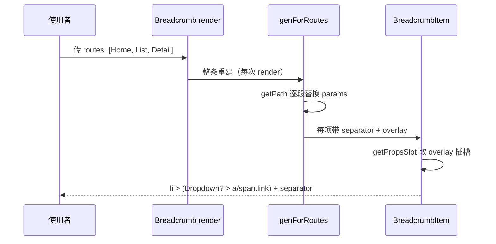

# C03-04 Breadcrumb 面包屑

> **本篇解决**：`Breadcrumb` 的两条渲染通路（`routes` 数据驱动 / 默认插槽手写）为什么行为不等价；`defaultItemRender` 写死的 `#/` 前缀把路由模式钉在了哪里；三级 `itemRender` 优先级的判定顺序；以及为了「一个可展开的父级」这一件事，本组件把 `Menu` 与 `Dropdown` 两棵子树整个拖了进来，代价落在哪一行。
> **前置**：C03-00《类横写：menu / tabs / steps / breadcrumb 的选中态模型》、A05《ConfigProvider 注入链》、C03-12《BackTop》（同为「无内核包装的自包含组件」样本）。

## 一、职责与边界

`Breadcrumb` 只做一件事：把一串层级渲染成 `<nav><ol><li>…`，并在需要时给某个 `<li>` 套一个下拉。它**不参与路由**——没有 `useRouter`、没有 `<router-link>`、没有任何导航 API。全仓检索可证：

```bash
grep -rn "useRouter\|router-link\|vue-router" packages/xiaoye-ui/src/breadcrumb
```

命中为空。唯一的「跳转」来自 `defaultItemRender` 里手写的一个锚点字符串（`breadcrumb/Breadcrumb.tsx:53`），它把链接钉成 `#/${paths.join('/')}`，也就是 **hash 路由**的形态。这一点决定了组件的边界：它给的是「一个可点的 href」，不是「一次路由跳转」；history 模式的应用要么自己传 `itemRender`，要么在 `<Breadcrumb.Item>` 上写 `href`/`onClick`（`breadcrumb/BreadcrumbItem.tsx:63-68`）。

它也不维护「当前层级」的概念。层级完全由调用方给出的 `routes` 数组顺序或插槽顺序决定，组件内没有任何 active 判定——这与同一类的 `Menu`（选中态由 `activeKey` 驱动）、`Tabs`（`activeKey`）形成对照，共性结论归 C03-00，本篇不重复论证。

三条对外形态并存，必须分开对待：

1. **`routes` 数据驱动**：`breadcrumb/Breadcrumb.tsx:19-31` 的 props 里 `routes: { type: Array as PropType<Route[]> }`，`Route` 形状定义在 `:16-20`（`path` / `breadcrumbName` / `children?`）。
2. **默认插槽手写**：直接放 `<breadcrumb-item>`，由 `:133` 的 `flattenChildren(getPropsSlot(slots, props))` 收集。
3. **`Breadcrumb.Item = BreadcrumbItem` / `Breadcrumb.Separator = BreadcrumbSeparator` 的静态挂载**：`breadcrumb/index.ts:12-13`，为的是 JSX/模板里以 `Breadcrumb.Item` 使用，但三条注册都走 `registerComponent`（`breadcrumb/index.ts:17-19`），因此全局标签同时存在 `xy-breadcrumb-item` 这类平铺名。

「同一件事的三条入口」是本组件最大的结构性风险：这三条路径产出的 DOM 并不等价，见论点 1。

## 二、源码地图

```
packages/xiaoye-ui/src/breadcrumb/
├── index.ts                    27   三条注册与两个静态挂载
├── Breadcrumb.tsx             171   容器：两条通路 + 类名合成
├── BreadcrumbItem.tsx          89   单项：Dropdown 包裹 + href 判定
├── BreadcrumbSeparator.tsx     32   独立分隔符组件
├── style/index.ts                  CSS-in-JS（token 化，无硬编码颜色）
└── Breadcrumb.test.js              6 个用例
```

本组件**没有 `vc-*` 下层**，是「自包含 + 直接复用别的公开组件」的形态：`Breadcrumb.tsx:8` 导入 `Menu`，`BreadcrumbItem.tsx:6` 导入 `Dropdown`，`BreadcrumbItem.tsx:7` 导入 `@xiaoye-ui/icons` 的 `DownOutlined`。

props 面很小。容器五个（`Breadcrumb.tsx:19-31`）：`prefixCls`、`routes`、`params`、`separator`、`itemRender`。条目六个（`BreadcrumbItem.tsx:14-19`）：`href`、`dropdownProps`、`overlay`、`onClick`，另加 `prefixCls`（`:14`）与 `separator`（`breadcrumb/BreadcrumbSeparator.tsx:16`）。分隔符组件只有一个 `separator`（`breadcrumb/BreadcrumbSeparatorProps`，见 `BreadcrumbSeparator.tsx:18`）。

样式侧全部走 token：`style/index.ts:23` 的 `color: token.breadcrumbBaseColor`、`:39` 的 `breadcrumbLinkColor`、`:48-49` 的 hover 双色、`:55-56` 的 `li:last-child { color: token.breadcrumbLastItemColor }`、`:64-65` 的 `breadcrumbSeparatorColor`、`:63` 的 `marginInline: token.breadcrumbSeparatorMargin`——这与 C12-07《FocusTrap》里「样式层丢弃 token」的退化族形成对比，Breadcrumb 是正例。

## 三、架构与数据流

```mermaid
graph TD
  P["props.routes<br/>Breadcrumb.tsx:143"] -->|"routes.length > 0"| G["genForRoutes<br/>:86-130"]
  G --> GP["getPath 替换 :param<br/>:69-75"]
  GP --> ACC["paths 累加 / tempPaths 快照<br/>:92、:99"]
  ACC --> OV{"route.children?"}
  OV -->|是| MENU["&#60;Menu items=…&#62;&#60;br/&#62;Breadcrumb.tsx:104-113"]
  OV -->|否| NOOV["overlay = null<br/>:101"]
  MENU --> BI["&#60;BreadcrumbItem overlay=…&#62;<br/>:121-127"]
  NOOV --> BI
  P -->|"routes 为空"| CH["默认插槽 children<br/>:133"]
  CH --> CLONE["cloneVNode(el,{separator,key})<br/>:153"]
  CLONE --> BI2["用户手写的 &#60;breadcrumb-item&#62;"]
  BI --> DR{"overlay 存在?"}
  DR -->|是| DD["&#60;Dropdown placement=#quot;bottom#quot;&#62;<br/>BreadcrumbItem.tsx:45-51"]
  DR -->|否| LI["&#60;li&#62; 直接落 DOM"]
  DD --> LI
```



两条通路在一个渲染函数体内分岔（`Breadcrumb.tsx:143` 判 `routes`，`:145` 走 `genForRoutes`，否则 `:146-154` 走插槽映射），**没有第三条混合通路**：`routes` 非空时插槽默认内容被完全忽略。



关键点：`genForRoutes`（`:86`）定义在 `setup` 内但在渲染函数**外**，而它内部第 92 行的 `const paths = []` 在每次调用时新建——所以累加状态不会跨渲染残留。这是这份实现做对的一件事，也是它与常见「把累加器提到 setup 顶层」写法之间的分界。

## 四、核心机制精读

### 论点 1：两条通路产出的 DOM 不等价，差异点在分隔符的归属

`routes` 通路里，分隔符是**由父组件统一算好再传下去的**：`Breadcrumb.tsx:134` 取 `separator = getPropsSlot(slots, props, 'separator') ?? '/'`，然后在 `:117` 把它塞进 `itemProps`，条目再用 `BreadcrumbItem.tsx:59` 的 `getPropsSlot(slots, props, 'separator') ?? '/'` 渲染到 `<li>` 内的 `-separator` span（`breadcrumb/BreadcrumbItem.tsx:82`）。

插槽通路里，分隔符同样由父组件算出（`breadcrumb/Breadcrumb.tsx:134` 同一段代码），但它是通过 `cloneVNode(element, { separator, key: index })`（`breadcrumb/Breadcrumb.tsx:153`）**注入到用户手写的子节点 props 上**。这条注入有前提：子节点必须是声明了 `separator` prop 的组件，也就是 `__XY_BREADCRUMB_ITEM`（`BreadcrumbItem.tsx:27`）或 `__XY_BREADCRUMB_SEPARATOR`（`BreadcrumbSeparator.tsx:16`）。校验就写在 `:147-152` 的 `warning` 里，文案是 `"Only accepts Breadcrumb.Item and Breadcrumb.Separator as it's children"`。

于是两条通路的差异不是「写法不同」而是**能力不同**：

- 插槽通路的非法子节点（例如直接写 `<span>`）只得到一条 dev warning，`cloneVNode` 仍会执行，`separator` 被写进一个不会读它的元素（测试 `Breadcrumb.test.js:16-31` 钉住的正是这条 warning 行为，断言 `errorSpy.mock.calls` 长度为 1）。
- 分隔符组件（`BreadcrumbSeparator.tsx:23-27`）的做法是把 `attrs.separator` 解构出来再单独渲染 span——它读的是 **attrs**，而不是 `props.separator`。所以当插槽通路给它注入 `separator` 时，值走的是 prop；而用户直接写 `<xy-breadcrumb-separator separator="›">` 时，因为 `BreadcrumbSeparatorProps` 里确有 `separator`（`breadcrumb/BreadcrumbSeparator.tsx:18`），两种来源不会冲突。真正的后果是 `BreadcrumbSeparator.tsx:23` 那个解构里的 `separator` 永远取不到值（它已被 Vue 归入 props 而非 attrs），只能靠 `:26` 的 `props.separator` 路径生效。

### 论点 2：三级 `itemRender` 优先级，且默认实现把 hash 路由写死

```ts
// Breadcrumb.tsx:136
const itemRender = props.itemRender || slots.itemRender || defaultItemRender;
```

优先级是 prop > 插槽 > 默认，用的是 `||`，所以传入「假值型」的 `itemRender`（例如 `undefined` 之外的空函数不会发生，但 `props.itemRender = null`）会落到下一级——这与库内其它组件的 `??` 语义族不同（对照 C12-07 记录的 `??` 对空串短路的同类问题）。

默认实现里真正的硬约束在这一行：

```tsx
// Breadcrumb.tsx:51-53
  const isLastItem = routes.indexOf(route) === routes.length - 1;
  const name = getBreadcrumbName(route, params);
  return isLastItem ? <span>{name}</span> : <a href={`#/${paths.join('/')}`}>{name}</a>;
```

三点值得记录：

1. `href` 前缀是 `#/`，即 hash 路由；history 模式下这条链接需要用户接管。
2. `isLastItem` 用 `routes.indexOf(route)` 判定，**比较的是对象引用**。若同一份 `routes` 数组里存在两个引用相等的项（常见于把同一个对象 `push` 两次或在 computed 里复用了对象），`indexOf` 返回第一个下标，于是末项被判成「非末项」而渲染成 `<a>`。
3. 末项渲染 `<span>` 而非 `<a>`，这是「当前页不该自链」的正确语义选择；`style/index.ts:55-56` 的 `li:last-child` 配色与它独立成立——也就是说末项的「不可点」由 JS 决定、末项的「看起来是终点」由 CSS 决定，两条不互相校验。

### 论点 3：`params` 的两种替换算法，一个是正则一个不是

`:param` 式占位在两份代码里被替换两次，实现不同：

```ts
// Breadcrumb.tsx:33-43（名字用正则）
  const paramsKeys = Object.keys(params).join('|');
  const name = route.breadcrumbName.replace(
    new RegExp(`:(${paramsKeys})`, 'g'),
    (replacement, key) => params[key] || replacement,
  );

// Breadcrumb.tsx:69-75（路径用逐键 replace）
      path = path.replace(`:${key}`, params[key]);
```

差异有三层：

- **名称**侧把所有 key 拼成一条 `(a|b|c)` 交替正则，一次遍历；**路径**侧按 key 顺序反复 `String.replace`，每轮只替换**第一个**命中（`replace` 传字符串字面量时不带 `g`），所以路径里同名占位出现两次时只换一个。
- 名称侧的回退是 `params[key] || replacement`，即缺参时保留原文字 `:key`；路径侧缺参时 `params[key]` 为 `undefined`，`replace` 会把占位替换成字符串 `"undefined"`。这是同一份 `params` 在两个位置得到不同结果的具体机制。
- 名称侧把 `params` 的键拼进正则源码（`` new RegExp(`:(${paramsKeys})`) ``）。键来自调用方对象，若某个键含正则元字符（如 `'a.b'` 或 `'a)'`），交替式会失配或直接抛 `SyntaxError`。`breadcrumbName` 与 `params` 都是外部输入，本篇未见任何转义或校验。

另外 `getBreadcrumbName` 的首行守卫（`:34-36`）在 `breadcrumbName` 为空时返回 `null`，此时 `defaultItemRender` 会渲染出 `<span>` 或 `<a>` 包裹 `null`——空内容项仍然占一个 `<li>` 并带分隔符。

### 论点 4：为了一个可展开层级，Breadcrumb 把 Menu 与 Dropdown 两棵子树整个引了进来

`route.children` 存在时，父层给条目传一个 `overlay`，而 `overlay` 是**直接渲染出来的 `Menu` 元素**：

```tsx
// Breadcrumb.tsx:103-114
        if (route.children && route.children.length) {
          overlay = (
            <Menu
              items={route.children.map(child => ({
                key: child.path || child.breadcrumbName,
                label: itemRender({
                  route: child,
                  params,
                  routes,
                  paths: addChildPath(tempPaths, child.path, params),
                }),
              }))}
            ></Menu>
          );
        }
```

注意这里给 `Menu` 的 props 只有 `items`——没有 `onClick`、没有 `selectedKeys`。也就是说面包屑的下拉里**点击菜单项不会导航**，它只是把子层级的名字列出来。真正的链接在 `label` 里（由 `itemRender` 产出 `<a>`），点击的是 label 内的锚点。这解释了为什么这里不需要给 `Menu` 接线。

而条目侧的包裹条件是 `getPropsSlot(slots, props, 'overlay')` 非空（`BreadcrumbItem.tsx:42-43`），命中就渲染：

```tsx
// BreadcrumbItem.tsx:45-50
          <Dropdown {...props.dropdownProps} overlay={overlay} placement="bottom">
            <span class={`${prefixCls}-overlay-link`}>
              {breadcrumbItem}
              <DownOutlined />
            </span>
          </Dropdown>
```

三点后果：

1. **`placement` 被钉死为 `bottom`**（`:45`），且传在 `{...props.dropdownProps}` **之后**，所以用户即便通过 `dropdownProps` 传 `placement` 也会被覆盖（与 C07-06《Message》里 `placement: 'top'` 排在展开之后是同一类键序问题）。
2. **箭头是写死追加的** `<DownOutlined />`（`:48`），无法关闭；`-overlay-link`（`:46`）与 `style/index.ts:77-85` 的负 `marginInline` 配套，靠样式把它「挤」回视觉基线。
3. **依赖面**：`Breadcrumb.tsx:8`（Menu）与 `BreadcrumbItem.tsx:6`（Dropdown）是两条值 import。Menu 自身依赖 vc-menu/trigger/align 一整套（见 I02、C03-01），Dropdown 依赖同一族浮层件。因此**只要用了 `<xy-breadcrumb>`，即使不传 `routes.children`，`Menu` 与 `Dropdown` 也进入构建图**——`Breadcrumb.tsx:104` 的 `<Menu>` 是顶层 import 的直接使用点，静态可分析，打包器无法证明它不可达。这与 A05/A08 记录的「按需导入 / tree-shaking」目标构成一处真实张力；本篇只证 import 关系与「无条件可达」的静态事实，未做产物体积测量。

### 论点 5：`href` 决定 `<a>` 还是 `<span>`，而两者都挂 `onClick`

```tsx
// BreadcrumbItem.tsx:63-75
      if (props.href !== undefined) {
        link = (
          <a class={`${prefixCls.value}-link`} onClick={handleClick} {...restAttrs}>
            {children}
          </a>
        );
      } else {
        link = (
          <span class={`${prefixCls.value}-link`} onClick={handleClick} {...restAttrs}>
            {children}
          </span>
        );
      }
```

`handleClick` 只做一件事：`emit('click', e)`（`breadcrumb/BreadcrumbItem.tsx:55-57`）。这里有两个契约细节：

- `onClick` **同时**出现在 props 声明（`breadcrumb/BreadcrumbItem.tsx:19` 的 `eventType<MouseEventHandler>()`）与 `emits`（`breadcrumb/BreadcrumbItem.tsx:29`）里，因此父级写 `@click` 时由 emit 通道决议；这与 C07-06 记的「props 与 emits 双声明」是同一族写法。
- 无 `href` 时渲染的是 `<span class="-link">` 并带 `onClick`，但它没有 `role`、没有 `tabindex`，因此**键盘不可达**。对照同目录的 `Breadcrumb.tsx:165` 至少用了语义化的 `<nav>` 容器与 `<ol>`（`breadcrumb/Breadcrumb.tsx:166`）——无障碍处理在本组件里是不完整的：容器语义做对了，交互元素没做。`style/index.ts:68-73` 给 `-link` 加了 hover 背景，进一步强化了「看起来可点、键盘点不到」的错觉。

还有一点容易看漏：`{...restAttrs}`（`breadcrumb/BreadcrumbItem.tsx:65`、`:71`）是把 attrs 摊到**内层** link 上，而 `<li>` 只接 `class` 与 `style`（`breadcrumb/BreadcrumbItem.tsx:80`），attrs 的 class/style 是在 `:61` 被解构出去的。因此「在 `<Breadcrumb.Item>` 上写 `data-x`」会落在 `<a>`/`<span>` 上，而不是 `<li>` 上；测试 `Breadcrumb.test.js:92-101` 用的正是「custom attribute」这一例。

### 论点 6：容器语义做对了一半——`nav` + `ol` 有，`aria-current` 与 RTL 只到类名

`breadcrumb/Breadcrumb.tsx:165-166` 产出的是 `<nav>` 里套一个 `<ol>`，条目自己是 `<li>`（`breadcrumb/BreadcrumbItem.tsx:80`）。这个组合符合「有顺序的导航路径」这一 WAI 模式：列表提供序号语义，`nav` 提供地标区域。做对的是结构，缺的是**当前项标记**：全目录检索 `aria-current` 零命中——

```bash
grep -rn "aria-current\|aria-label" packages/xiaoye-ui/src/breadcrumb
```

也就是说「哪一段是当前页」只由 `breadcrumb/Breadcrumb.tsx:51-53` 的 `<span>`/`<a>` 之差与 `breadcrumb/style/index.ts:55-56` 的颜色差来表达，辅助技术读不到语义级终点。对照它自己已经做对的部分（`nav`/`ol`），这是一个「结构合规、状态缺标」的典型形态。

RTL 方向的口径同样停在类名层：`breadcrumb/Breadcrumb.tsx:159` 生成 `-rtl` 类，间距与方向性属性则交给 token 化的逻辑属性——`breadcrumb/style/index.ts:45` 与 `:82` 的 `marginInline`、`:64` 的 `marginInline: token.breadcrumbSeparatorMargin`、`:73` 与 `:85` 的 `marginInlineStart`。这些在镜像方向下自动翻转，所以方向本身没问题；问题是**没有测试覆盖它**：`breadcrumb/Breadcrumb.test.js` 的 6 条用例（`:16`、`:32`、`:47`、`:60`、`:92`、`:105`）全部只覆盖 warning 行为、空条目、菜单渲染与自定义属性，没有一条断言 rtl 或分隔符位置。方向语义因此处于「实现合理但无人守」的状态。

## 五、对外契约如何生效

容器的 props 解析：`props: breadcrumbProps()`（`breadcrumb/Breadcrumb.tsx:60`）直接传函数结果，未走 `initDefaultProps`，因此 `params`/`separator` 的默认值实际在**渲染函数内部**兜底（`params = {}` 在 `:132`、`separator` 在 `:134` 的 `?? '/'`）。这与 AGENTS.md 推荐的 `initDefaultProps(...)` 模式不同，属于「默认值散落在 render」的形态——后果是默认值只在 render 期生效，`watch(props.separator)` 这类外部观察看不到统一来源。

attrs 侧：`inheritAttrs: false`（`breadcrumb/Breadcrumb.tsx:59`）加显式 `{...attrs}` 展开（`breadcrumb/Breadcrumb.tsx:165`），同时 `breadcrumb/Breadcrumb.tsx:160` 又把 `attrs.class` 作为一个 key 再塞进 `breadcrumbClassName`。于是 class 有两条生效路径（attrs 展开、对象 key），后者因排在 JSX 属性表更靠后而生效；但 `attrs.class` 是**字符串**（如 `"a b"`）时被当成对象 key 使用，多类名靠 `classNames` 对 key 的原样拼接才成立。这是一个可工作但依赖实现的写法。

类名面：`prefixCls`（`breadcrumb/Breadcrumb.tsx:158`）、`-rtl`（`breadcrumb/Breadcrumb.tsx:159`）、`attrs.class`（`:160`）、`hashId`（`breadcrumb/Breadcrumb.tsx:161`）四项合成，样式侧对应 `style/index.ts:21` 起的 `[componentCls]` 块。

条目契约：`overlay` 存在与否决定要不要 Dropdown（`BreadcrumbItem.tsx:43`），`href` 决定 `<a>`/`<span>`（`breadcrumb/BreadcrumbItem.tsx:63`），`separator` 决定 `<li>` 末尾那段 span（`breadcrumb/BreadcrumbItem.tsx:82`），`children` 为空时整条 `<li>` 返回 `null`（`breadcrumb/BreadcrumbItem.tsx:78-86`），测试 `Breadcrumb.test.js:47-58` 钉住了这条「空条目不渲染」。

注册契约：`index.ts:17-19` 三次 `registerComponent`，标签名由注册工具按 `XYXxx` → `xy-xxx` 推导（见 A06 与 AGENTS.md 的组件注册硬约束），本组件因此同时暴露 `xy-breadcrumb`、`xy-breadcrumb-item`、`xy-breadcrumb-separator` 三个全局标签。

## 六、设计取舍

**取舍一：`routes` 与插槽两条通路都保留，而不是收敛成一条。** 保留插槽通路让「不想构造 routes 数组」的用法能直接写模板（`Breadcrumb.test.js:33-44` 用的正是这种写法，并断言它不该报警告），代价是两条通路在分隔符归属、overlay 能力上不等价（论点 1）。合并成一条会破坏公开 API，因此这处不等价是被接受的负债。

**取舍二：`label` 复用 `itemRender` 而不是给子层级单设渲染器。** `:105-113` 里下拉菜单的 label 直接调用同一个 `itemRender`，好处是自定义渲染器一次写完全生效，代价是子层级也走「非末项即 `<a href="#/…">`」这条 hash 逻辑——下拉里的每一项都被强制成 hash 链接，而不是普通菜单项。

**取舍三：直接引用同族公开组件（Menu / Dropdown）而不是下沉到 `vc-*`。** 这样实现最短（`BreadcrumbItem.tsx` 只有 89 行就得到一个带箭头的下拉），代价是依赖变重、`placement` 等参数被外层钉死（论点 4）。仓库对「组件间避免相互引用」有明确约束（AGENTS.md 注意事项第 1 条），本组件是这条约束的一处例外，值得后续篇目作为反例引用。

**取舍四：末项语义由 JS 判定，末项外观由 CSS 判定。** `:51` 的 `isLastItem` 与 `style/index.ts:55-56` 的 `li:last-child` 各算一次，两条都不报错但可能不一致——一旦调用方传入 `itemRender` 覆盖了 JS 判定，CSS 仍会把最后一条染成终点色。

## 七、坑与改动指南

**坑 1：`defaultItemRender` 生成的链接是 hash 形式，history 模式下不可用。**
触发：不传 `itemRender`，在 history 路由的应用里直接用 `routes`。
症状：点击跳到 `#/xxx`，路由不变或整页刷新。
原因：`href={`#/${paths.join('/')}`}` 写死在 `Breadcrumb.tsx:53`。
定位：`breadcrumb/Breadcrumb.tsx:53`。改法：传自己的 `itemRender` 或改在插槽里写 `<router-link>`。

**坑 2：`params` 缺键时，名称保留 `:key` 而路径变成 `undefined`。**
触发：`routes` 里有 `path: 'user/:id'`，但 `params` 没给 `id`。
症状：面包屑文字显示 `:id`，链接里出现字面 `undefined`。
原因：名称侧回退是 `params[key] || replacement`（`Breadcrumb.tsx:40`），路径侧是裸 `path.replace(`:${key}`, params[key])`（`:72`）。
定位：`breadcrumb/Breadcrumb.tsx:38-42`、`:69-75`。

**坑 3：`params` 的键名含正则元字符会让名称替换失配或抛错。**
触发：`params` 里出现 `{'a.b': …}` 这类键。
原因：键被直接拼进 `new RegExp(`:(${paramsKeys})`, 'g')`（`Breadcrumb.tsx:37-39`），无转义。
定位：`breadcrumb/Breadcrumb.tsx:36-42`。

**坑 4：末项判定用对象引用，重复引用会误判。**
触发：`routes` 数组里同一对象出现两次。
症状：最后一项渲染成 `<a>`，且样式上仍被 CSS 当作末项染色。
原因：`routes.indexOf(route) === routes.length - 1`（`Breadcrumb.tsx:51`）。
定位：`breadcrumb/Breadcrumb.tsx:51`、`style/index.ts:55-56`。

**坑 5：下拉项的 `placement` 无法通过 `dropdownProps` 改。**
触发：`<Breadcrumb.Item :dropdown-props="{ placement: 'topLeft' }" :overlay="menu">`。
症状：仍然从下方弹出。
原因：`placement="bottom"` 排在 `{...props.dropdownProps}` 之后（`BreadcrumbItem.tsx:45`）。
定位：`breadcrumb/BreadcrumbItem.tsx:45`。

**坑 6：无 `href` 的可点条目键盘不可达。**
触发：只给 `<Breadcrumb.Item @click="…">`，不给 `href`。
症状：Tab 跳不过去，Enter 无反应，屏幕阅读器只读到普通文本。
原因：走 `<span class="-link" onClick>` 分支（`BreadcrumbItem.tsx:70-74`），没有 `role`/`tabindex`。
定位：`breadcrumb/BreadcrumbItem.tsx:63-75`、`style/index.ts:68-73`。

**坑 7：用了面包屑就带上 Menu 与 Dropdown 两棵子树。**
触发：任何 `<xy-breadcrumb>` 用法，即使不传 `routes.children`。
症状：包体积里出现 `menu`、`dropdown`、`vc-trigger`/`vc-align` 相关代码。
原因：`Breadcrumb.tsx:8` 与 `BreadcrumbItem.tsx:6` 是无条件值 import，`<Menu>` 出现在 `:104` 的静态 JSX 里，不可被证明为死代码。
定位：`breadcrumb/Breadcrumb.tsx:8`、`:104`、`breadcrumb/BreadcrumbItem.tsx:6`、`:45`。说明：本坑的体积后果未做产物测量，可证的只有 import 关系与静态可达性。

**坑 8：`routes` 非空时默认插槽被静默忽略。**
触发：同时写 `:routes` 和插槽内容。
症状：插槽内容不出现，也不报警。
原因：渲染里 `if (routes && routes.length > 0)` 先进 `genForRoutes`（`Breadcrumb.tsx:143-144`），插槽分支只在 `else if (children.length)`（`:146`）里被读。
定位：`breadcrumb/Breadcrumb.tsx:133`、`:143-155`。

**改动安全边界**：`defaultItemRender`（`Breadcrumb.tsx:45-53`）与 `genForRoutes`（`:86-130`）是 `routes` 通路的唯一实现，任何 href/占位改动都直接改变公开行为，属破坏性变更；把 `Menu`/`Dropdown` 换成 `vc-*` 下沉能解掉坑 7，但会改变 overlay 的样式继承（`-overlay-link` 依赖 `style/index.ts:77-85` 的负 margin），需一并核对。

## 附：本篇可证伪的三个检查点

**检查点 1：Breadcrumb 不依赖 vue-router，链接形态是硬编码 hash。**

```bash
grep -rn "vue-router\|useRouter\|router-link" packages/xiaoye-ui/src/breadcrumb ; echo "exit=$?"
grep -n "#/" packages/xiaoye-ui/src/breadcrumb/Breadcrumb.tsx
```

预期第一条零命中、`exit=1`；第二条命中 `Breadcrumb.tsx:53`。一旦第一条出现命中，论点 2 与坑 1 需删改。

**检查点 2：容器与条目各引一棵同族公开组件，且都是值 import。**

```bash
grep -n "^import Menu\|^import Dropdown\|from '../dropdown" packages/xiaoye-ui/src/breadcrumb/Breadcrumb.tsx packages/xiaoye-ui/src/breadcrumb/BreadcrumbItem.tsx
```

预期共 3 行：`Breadcrumb.tsx:8` 一条（`import Menu`），`BreadcrumbItem.tsx` 两条（`:5` 的 `import type { DropdownProps }` 与 `:6` 的 `import Dropdown`）。区分这两条很关键——只有 `:6` 是值 import、会进构建图，`:5` 是纯类型。若被改成 `vc-menu`/`vc-dropdown` 或改为动态 import，坑 7 与 §六 取舍三需重写。

**检查点 3：`placement="bottom"` 仍排在展开之后，且条目无 `href` 时是 `<span>`。**

```bash
grep -n "placement=\"bottom\"" packages/xiaoye-ui/src/breadcrumb/BreadcrumbItem.tsx
grep -n "role=\|tabindex=" packages/xiaoye-ui/src/breadcrumb/BreadcrumbItem.tsx
```

预期第一条命中 `:45`；第二条零命中。一旦第二条出现 `role`/`tabindex`，坑 6 已修复。
