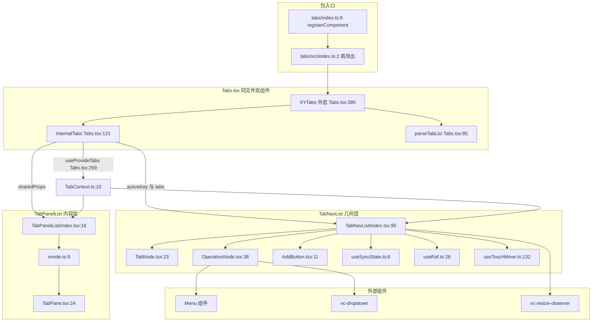
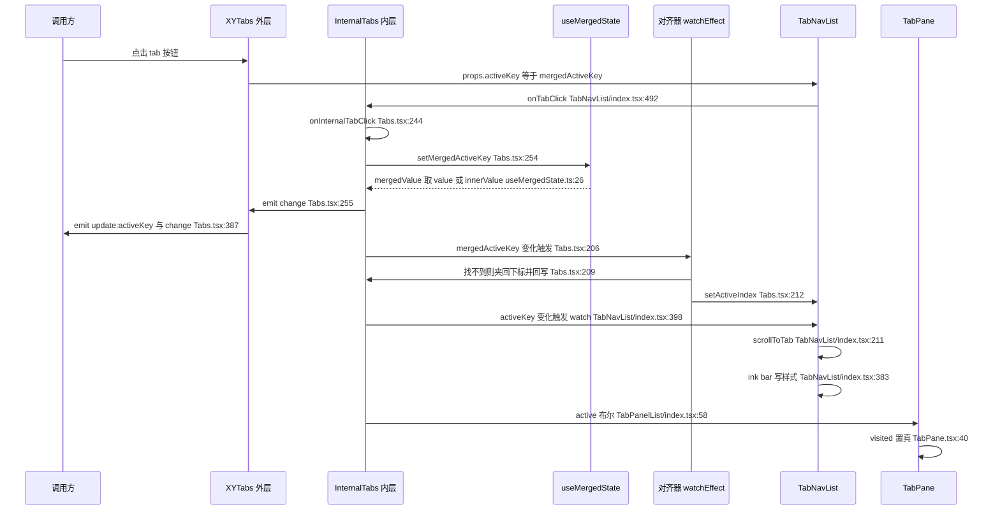
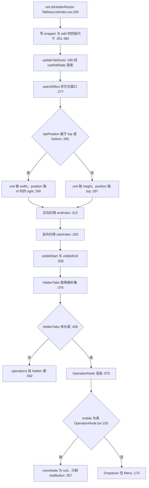
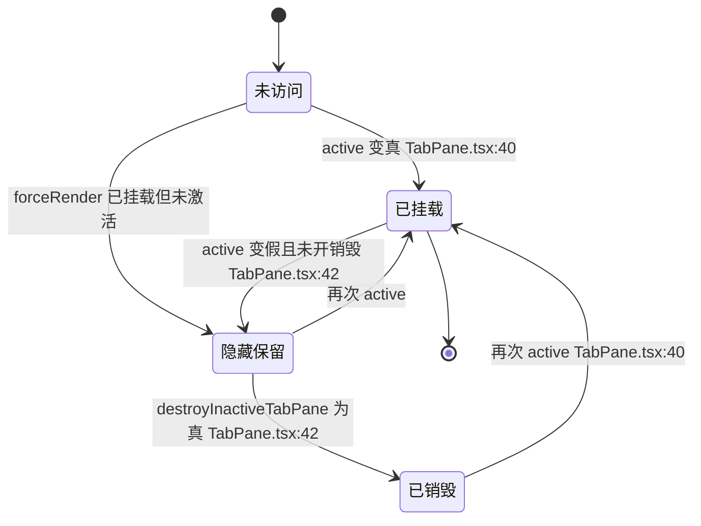

# C03-05 Tabs 标签页

> **本篇解决**：`xy-tabs` 里「哪个标签是活的」这件事在哪个实例被裁决、裁决结果如何变成 ink bar 与位移、面板内容何时挂载与销毁、溢出后「更多」下拉怎么装配出来，以及滚动与键盘导航的实现路径。
> **前置**：C03-00 类横写：menu/tabs/steps/breadcrumb 的选中态模型　I13 响应式内核 hooks　I09 弹出动效与共享 transitionName　A07 交互基础设施总览　I02 vc-trigger 弹出时序与事件穿透　**读者坐标**：`03-components/03-navigation` 第 5 篇

## 一、职责与边界

`xy-tabs` 负责三件事：**持有活动键**（`packages/xiaoye-ui/src/tabs/src/Tabs.tsx:204`）、**把活动键翻成导航条几何**（ink bar 位移与滚动窗口，`packages/xiaoye-ui/src/tabs/src/TabNavList/index.tsx:366`）、**把活动键透传给面板列表决定谁渲染内容**（`packages/xiaoye-ui/src/tabs/src/TabPanelList/index.tsx:51`）。

明确不负责：受控/非受控判定谓词本身与 `useMergedState`/`useState` 的实现及横向比较，归 I13；「key 是选中身份」这条约定及其四组件对照，归 C03-00 论点 1；「选中 vs 激活」两条状态轴归 C03-00 论点 3；几何通道引入的一帧延迟与量表过期归 C03-00 论点 5；`moreTransitionName` 与共享 slide 动效的复用关系归 I09，本篇只在装配点引用；浮层 trigger 的时序归 A07 与 I02；`vc-overflow` 自身的算法只作为**对照物**出现，其完整机制归 C03-01。

依赖清单（被谁依赖 / 依赖谁）：

- 向下依赖：`packages/xiaoye-ui/src/menu`（溢出下拉内嵌，`packages/xiaoye-ui/src/tabs/src/TabNavList/OperationNode.tsx:1`）、`vc-dropdown`（`OperationNode.tsx:2`）、`vc-resize-observer`（`packages/xiaoye-ui/src/tabs/src/TabNavList/index.tsx:28`）、`vc-util/isMobile`（`Tabs.tsx:23`）、`_util/hooks/useMergedState`（`Tabs.tsx:24`）、`_util/hooks/useState`（`Tabs.tsx:22`）、`_util/raf`（`TabNavList/index.tsx:26`）、`_util/vnode` 的 `cloneElement`（`TabPanelList/index.tsx:6`）、`_util/props-util` 的 `flattenChildren`/`isValidElement`/`camelize`（`Tabs.tsx:15-20`）、`useConfigInject`（`Tabs.tsx:21`）、`../style`（`Tabs.tsx:44`）。
- 被谁依赖：包级入口 `packages/xiaoye-ui/src/tabs/index.ts:9` 通过 `registerComponent` 注册 `XYTabs` 与 `XYTabPane`；聚合出口由生成物 `packages/xiaoye-ui/src/components.ts` 承载。内部数据结构的唯一权威定义在 `packages/xiaoye-ui/src/tabs/src/interface.ts:17`。

## 二、源码地图

| 文件 | 行数 | 职责 | 关键导出 |
| --- | --- | --- | --- |
| `packages/xiaoye-ui/src/tabs/index.ts` | 20 | 包入口，把 `TabPane` 挂成静态属性并注册 | `default Tabs`、`TabPane` |
| `packages/xiaoye-ui/src/tabs/src/index.ts` | 11 | 再导出，首行注明 `base rc-tabs 11.12.0` | `Tabs`、`TabPane` |
| `packages/xiaoye-ui/src/tabs/src/Tabs.tsx` | 412 | **主实现**：外层 slot 解析 + 内层状态持有 | `tabsProps`（`:51`）、默认导出 |
| `packages/xiaoye-ui/src/tabs/src/interface.ts` | 48 | `Tab` / `TabOffset` / `EditableConfig` 等形状 | `Tab`（`:17`） |
| `packages/xiaoye-ui/src/tabs/src/TabContext.ts` | 34 | `tabs` 与 `prefixCls` 的注入键 | `useProvideTabs`、`useInjectTabs` |
| `packages/xiaoye-ui/src/tabs/src/TabNavList/index.tsx` | 580 | 测量、滚动窗口、ink bar、more 装配 | `tabNavListProps`（`:34`） |
| `packages/xiaoye-ui/src/tabs/src/TabNavList/TabNode.tsx` | 139 | 单个标签按钮与移除按钮 | 默认导出 |
| `packages/xiaoye-ui/src/tabs/src/TabNavList/OperationNode.tsx` | 252 | 溢出「更多」下拉与游标 | `operationNodeProps`（`:16`） |
| `packages/xiaoye-ui/src/tabs/src/TabNavList/AddButton.tsx` | 49 | editable-card 的新增按钮 | 默认导出 |
| `packages/xiaoye-ui/src/tabs/src/TabPanelList/index.tsx` | 67 | 用 `cloneElement` 把状态注回面板 VNode | 默认导出 |
| `packages/xiaoye-ui/src/tabs/src/TabPanelList/TabPane.tsx` | 80 | 面板挂载/保活/销毁三态与隐藏方式 | `TabPaneProps`（`:22`） |
| `packages/xiaoye-ui/src/tabs/src/hooks/useSyncState.ts` | 21 | 位移写入同帧回调，用于 `tabScroll` | 默认导出 |
| `packages/xiaoye-ui/src/tabs/src/hooks/useOffsets.ts` | 40 | key → 矩形偏移表（C03-00 论点 5 已展开） | 默认导出 |
| `packages/xiaoye-ui/src/tabs/src/hooks/useRaf.ts` | 52 | 批处理式 rAF 状态 | `useRafState`（`:28`） |
| `packages/xiaoye-ui/src/tabs/src/hooks/useTouchMove.ts` | 148 | 移动端手势平移与 wheel 代理 | 默认导出 |
| `packages/xiaoye-ui/src/tabs/style/index.ts` | 906 | Component Token 与全部导航条样式 | `default useStyle` |
| `packages/xiaoye-ui/src/tabs/index.test.js` | 50 | 3 个用例，只覆盖 editable-card 的 `onEdit` 参数 | 2 条 `expect` |
| `packages/xiaoye-ui/src/tabs/event-dedupe.test.tsx` | 81 | 2026-09-29 新增：四个事件每次交互各只投递一次 | 4 个用例 / 9 条 `expect` |

主实现入口的两个落点：内层 `InternalTabs` 的 setup 在 `packages/xiaoye-ui/src/tabs/src/Tabs.tsx:146`，外层 `XYTabs` 的 setup 在 `Tabs.tsx:385`；导航条渲染主体在 `TabNavList/index.tsx:425`。测试现状：`packages/xiaoye-ui/src/tabs/index.test.js` 会被 `packages/xiaoye-ui/vitest.config.mts:33` 的 `src/**/*.test.{js,ts,jsx,tsx}` glob 命中，因此**确实在跑**，但它只断言 `onEdit` 的参数（`packages/xiaoye-ui/src/tabs/index.test.js:26`、`packages/xiaoye-ui/src/tabs/index.test.js:31`），从不数调用次数；`event-dedupe.test.tsx` 补上了「一次交互投递几次」这一维（论点 6 与坑 2），测量、滚动、溢出、键盘四条路径仍然无测试保护。另外 `packages/xiaoye-ui/src/_util/__tests__/injection-and-attrs.regression.test.tsx` 里有两条禁用上下文下的 Tabs 用例（不切换、加号与关闭图标都不发 `edit`）。

## 三、架构与数据流

**图 1：静态结构（模块与注入关系）**



说明：`XYTabs` 与 `InternalTabs` 是**同一文件里的两个组件**（`Tabs.tsx:121` 与 `Tabs.tsx:363`），外层只做 slot 解析与事件转发（`Tabs.tsx:391-408`），内层才持有状态。`tabs` 数组通过 `useProvideTabs`（`Tabs.tsx:259`）注入，`TabNavList` 与 `TabPanelList` 各自 `useInjectTabs` 取用（`TabNavList/index.tsx:109`、`TabPanelList/index.tsx:29`），因此这两棵子树之间**没有直接通信**——它们只共享「同一个 key 字符串」这一个事实。面板不是内层渲染的，而是 `cloneElement` 把用户写的 `XYTabPane` VNode 重新赋 props 后交回它自己渲染（`TabPanelList/index.tsx:52`、`_util/vnode.ts:25`）。`useOffsets` 在图 1 中省略，其机制与结论归 C03-00 论点 5。

**图 2：活动键的闭环（受控与非受控同图）**



说明：闭环里唯一的**仲裁动作**是 `Tabs.tsx:254` 的 `setMergedActiveKey`，它无条件写入内部值；但写入是否可见由 `useMergedState.ts:26` 决定。非受控时 `mergedActiveKey` 立刻变；受控时 `value` ref（`Tabs.tsx:199`）始终覆盖 `innerValue`，视图不动，直到调用方把新的 `activeKey` 传回来。`Tabs.tsx:206-213` 是 key 与下标之间唯一的对齐器，`activeIndex` 只服务于「找不到 key 时夹到哪个位置」（`Tabs.tsx:209`）。

**图 3：溢出窗口与 more 下拉的装配分支**



说明：`hiddenTabs` 是**两端补集**而不是「尾部若干项」（`TabNavList/index.tsx:359-360`），因为位移会把整个窗口平移，左端同样会产生不可见项。`mobile` 分支砍掉 more 下拉（`OperationNode.tsx:155`），改由手势平移承接（`TabNavList/index.tsx:179`）。`operations-hidden` 只靠样式隐藏而不卸载（`packages/xiaoye-ui/src/tabs/style/index.ts:753`），这样它的宽度仍能被测量到。

**图 4：面板内容的生命周期**



说明：`visited` 是单调棘轮——一旦访问过就保持 `true`，除非 `destroyInactiveTabPane` 把它拉回 `false`（`TabPane.tsx:37-47`）。渲染条件是三目并或：`active || visited || forceRender`（`TabPane.tsx:75`）。「隐藏保留」态下 DOM 仍在，视觉隐藏方式由 `animated` 决定：开启动画用 `visibility: hidden` 加 `height: 0`，否则 `display: none`（`TabPane.tsx:48-61`）。

## 四、核心机制精读

### 论点 1：面板不是由 Tabs 渲染的，而是把用户写的 `XYTabPane` VNode 当作数据载荷跨树传递；`cloneElement` 的默认覆盖语义让组件级开关无条件压掉面板级同名开关

`packages/xiaoye-ui/src/tabs/src/Tabs.tsx:102-114`（`parseTabList` 的返回结构）：

```tsx
// packages/xiaoye-ui/src/tabs/src/Tabs.tsx:102
        return {
          key,
          ...props,
          node,
          closeIcon: slots.closeIcon,
          tab,
          disabled: disabled === '' || disabled,
          forceRender: forceRender === '' || forceRender,
          closable: closable === '' || closable,
          animated: animated === '' || animated,
          active: active === '' || active,
          destroyInactiveTabPane: destroyInactiveTabPane === '' || destroyInactiveTabPane,
        };
```

`packages/xiaoye-ui/src/tabs/src/TabPanelList/index.tsx:51-61`：

```tsx
// packages/xiaoye-ui/src/tabs/src/TabPanelList/index.tsx:51
            {tabs.value.map(tab => {
              return cloneElement(tab.node, {
                key: tab.key,
                prefixCls: pre,
                tabKey: tab.key,
                id,
                animated: tabPaneAnimated,
                active: tab.key === activeKey,
                destroyInactiveTabPane,
              });
            })}
```

`packages/xiaoye-ui/src/_util/vnode.ts:9-28`：

```ts
// packages/xiaoye-ui/src/_util/vnode.ts:9
export function cloneElement<T, U>(
  vnode: VNode<T, U> | VNode<T, U>[],
  nodeProps: NodeProps = {},
  override = true,
  mergeRef = false,
): VNode<T, U> {
  let ele = vnode;
  if (Array.isArray(vnode)) {
    ele = filterEmpty(vnode)[0];
  }
  if (!ele) {
    return null;
  }
  const node = cloneVNode(ele as VNode<T, U>, nodeProps as any, mergeRef);

  // cloneVNode内部是合并属性，这里改成覆盖属性
  node.props = (override ? { ...node.props, ...nodeProps } : node.props) as any;
```

逐段解释：`Tabs.tsx:108` 把原始 VNode 本身塞进 `Tab` 结构体的 `node` 字段（类型在 `packages/xiaoye-ui/src/tabs/src/interface.ts:19` 声明为 `node: VueNode`），此后 `TabNavList` 只读 `tab.tab` 渲染标题（`packages/xiaoye-ui/src/tabs/src/TabNavList/TabNode.tsx:108`），`TabPanelList` 才把这个 VNode  clone 出来并注入 `active`/`prefixCls`/`tabKey`/`id`/`animated`/`destroyInactiveTabPane` 六个受控 prop 后交给 Vue 渲染。也就是说**面板组件实例由调用方创建、由 Tabs 赋语义**：谁挂载、谁销毁、隐藏方式，全都由注入进去的这几个 prop 决定，而 `cloneElement` 的第三个形参默认 `true`（`_util/vnode.ts:12`），覆盖发生在 `{ ...node.props, ...nodeProps }` 这一步（`_util/vnode.ts:25`）。

后果是：`nodeProps` 里的 `destroyInactiveTabPane` 是**简写自组件级 prop**（`TabPanelList/index.tsx:31` 解构、`:59` 写出）。当调用方没在 `xy-tabs` 上设置它时，该值是 `undefined`——而对象展开**照样会带上这个键**，于是面板 VNode 上原本由用户写的 `destroy-inactive-tab-pane` 被 `undefined` 覆盖。面板级 prop 确实声明在 `packages/xiaoye-ui/src/tabs/src/TabPanelList/TabPane.tsx:13`，也确实被 `parseTabList` 解析进 `Tab` 结构体（`Tabs.tsx:100`、`Tabs.tsx:113`），但用第二种方法交叉验证消费方：`grep -rn "destroyInactiveTabPane" packages/xiaoye-ui/src/tabs` 的命中只有声明、解析、组件级透传三处，**没有任何一处读 `tab.destroyInactiveTabPane`**。同一形状下 `forceRender` 也是解析后无人消费（`Tabs.tsx:99`、`Tabs.tsx:109` 之后只剩 `TabPane.tsx:9`/`:64`/`:75` 从自己的 props 读）。结论回扣：面板的开关只有一个真源——`xy-tabs` 上的组件级 prop；写成面板级是**静默失效**，而文档只把它列在 Tabs 名下（`apps/docs/components/tabs.md:128`），所以这不是文档承诺的能力。

### 论点 2：面板的挂载策略是「单调棘轮 + 两个互斥开关」，而隐藏方式的选择权不在面板手里，在 `animated` 的三值归一里

`packages/xiaoye-ui/src/tabs/src/TabPanelList/TabPane.tsx:36-61`：

```tsx
// packages/xiaoye-ui/src/tabs/src/TabPanelList/TabPane.tsx:36
    const visited = ref(props.forceRender);
    watch(
      [() => props.active, () => props.destroyInactiveTabPane],
      () => {
        if (props.active) {
          visited.value = true;
        } else if (props.destroyInactiveTabPane) {
          visited.value = false;
        }
      },
      { immediate: true },
    );
    const mergedStyle = computed<CSSProperties>(() => {
      if (!props.active) {
        if (props.animated) {
          return {
            visibility: 'hidden',
            height: 0,
            overflowY: 'hidden',
          };
        } else {
          return { display: 'none' };
        }
      }
      return {};
    });
```

`packages/xiaoye-ui/src/tabs/src/TabPanelList/TabPane.tsx:73-76`：

```tsx
// packages/xiaoye-ui/src/tabs/src/TabPanelList/TabPane.tsx:73
          class={[`${prefixCls}-tabpane`, active && `${prefixCls}-tabpane-active`, attrs.class]}
        >
          {(active || visited.value || forceRender) && slots.default?.()}
        </div>
```

`packages/xiaoye-ui/src/tabs/src/Tabs.tsx:175-194`：

```tsx
// packages/xiaoye-ui/src/tabs/src/Tabs.tsx:175
    const mergedAnimated = computed<AnimatedConfig>(() => {
      const { animated, tabPosition } = props;
      if (animated === false || ['left', 'right'].includes(tabPosition)) {
        return {
          inkBar: false,
          tabPane: false,
        };
      } else if (animated === true) {
        return {
          inkBar: true,
          tabPane: true,
        };
      } else {
        return {
          inkBar: true,
          tabPane: false,
          ...(typeof animated === 'object' ? animated : {}),
        };
      }
    });
```

逐段解释：`visited` 的初值取 `forceRender`（`TabPane.tsx:36`），此后只有两条路能改变它：`active` 变真就永久置真（`TabPane.tsx:40-41`），`destroyInactiveTabPane` 为真才拉回假（`TabPane.tsx:42-43`）。这意味着**默认配置下面板一旦渲染过就永不卸载**，切走的 panel 只是被 `display: none` 藏起来（`TabPane.tsx:57`）；开启销毁后每次切回都重新执行 `slots.default?.()`（`TabPane.tsx:75`），面板内的组件实例被重建。`watch` 依赖里放 `() => props.destroyInactiveTabPane`（`TabPane.tsx:38`）而不是只观察 `active`，是为了让「运行中才打开销毁开关」这种改动能立刻清掉已保活的兄弟面板。

隐藏方式为什么分两路：`tabPane` 动画走的是**整行平移**，`TabPanelList` 给内容容器写 `marginLeft: -{activeIndex}00%`（`packages/xiaoye-ui/src/tabs/src/TabPanelList/index.tsx:45-49`），此时所有面板必须**同时在场且各占 100% 宽**（`packages/xiaoye-ui/src/tabs/style/index.ts:851` 给 `${componentCls}-tabpane` 定死 `flex: none; width: 100%`），因此非活动面板不能用 `display: none` 移除盒子，只能用 `visibility: hidden` + `height: 0`（`TabPane.tsx:50-56`）。反过来说，`tabPane: false` 时才有资格用 `display: none`。

三值归一的实际约束：`tabPosition` 为 `left`/`right` 时**强制关掉两个动画**（`Tabs.tsx:177-181`），即纵向 tabs 拿不到面板平移；`animated` 传对象时默认 `tabPane: false` 再展开覆盖（`Tabs.tsx:182-185`），所以 `:animated="{ inkBar: true }"` 与不传等价，而 `:animated="true"` 才会打开面板平移。默认值在 `Tabs.tsx:129-135` 与 `Tabs.tsx:367-373` 各写了一遍（内外层重复声明默认值是生成物之外的手工冗余）。

结论回扣：面板的生命周期**不由面板决定**，由 `xy-tabs` 的两个 prop（`destroyInactiveTabPane`、`animated.tabPane`）与一个内部棘轮 ref 三者共同决定；`visited` 是「曾看过」的位，`active` 是「现在看」的位，两者都真才显示、只有一个真时才是保活态。

### 论点 3：溢出折叠不走 `vc-overflow`，而是 Tabs 自研的一套「双向扫描可见窗口」；两者算出来的东西形状不同，因此没有复用

`packages/xiaoye-ui/src/tabs/src/TabNavList/index.tsx:268-320`（窗口计算，节选）：

```tsx
// packages/xiaoye-ui/src/tabs/src/TabNavList/index.tsx:268
    watchEffect(() => {
      let unit: 'width' | 'height';
      let position: 'left' | 'top' | 'right';
      let transformSize: number;
      let basicSize: number;
      let tabContentSize: number;
      let addSize: number;
      const tabOffsetsValue = tabOffsets.value;
      if (['top', 'bottom'].includes(props.tabPosition)) {
        unit = 'width';
        basicSize = wrapperWidth.value;
        tabContentSize = wrapperScrollWidth.value;
        addSize = addWidth.value;
        position = props.rtl ? 'right' : 'left';
        transformSize = Math.abs(transformLeft.value);
      } else {
        unit = 'height';
        basicSize = wrapperHeight.value;
        tabContentSize = wrapperScrollWidth.value;
        addSize = addHeight.value;
        position = 'top';
        transformSize = -transformTop.value;
      }
      let mergedBasicSize = basicSize;
      if (tabContentSize + addSize > basicSize && tabContentSize < basicSize) {
        mergedBasicSize = basicSize - addSize;
      }
```

```tsx
// packages/xiaoye-ui/src/tabs/src/TabNavList/index.tsx:292
      const len = tabsVal.length;
      let endIndex = len;
      for (let i = 0; i < len; i += 1) {
        const offset = tabOffsetsValue.get(tabsVal[i].key) || DEFAULT_SIZE;
        if (offset[position] + offset[unit] > transformSize + mergedBasicSize) {
          endIndex = i - 1;
          break;
        }
      }
      let startIndex = 0;
      for (let i = len - 1; i >= 0; i -= 1) {
        const offset = tabOffsetsValue.get(tabsVal[i].key) || DEFAULT_SIZE;
        if (offset[position] < transformSize) {
          startIndex = i + 1;
          break;
        }
      }

      return ([visibleStart.value, visibleEnd.value] = [startIndex, endIndex]);
```

`packages/xiaoye-ui/src/tabs/src/TabNavList/index.tsx:367-370`：

```tsx
// packages/xiaoye-ui/src/tabs/src/TabNavList/index.tsx:367
    const hiddenTabs = computed(() => [
      ...tabs.value.slice(0, visibleStart.value),
      ...tabs.value.slice(visibleEnd.value + 1),
    ]);
```

`packages/xiaoye-ui/src/vc-overflow/Overflow.tsx:183-212`（对照物，节选）：

```tsx
// packages/xiaoye-ui/src/vc-overflow/Overflow.tsx:183
          for (let i = 0; i < len; i += 1) {
            const currentItemWidth = getItemWidth(i);

            // Break since data not ready
            if (currentItemWidth === undefined) {
              updateDisplayCount(i - 1, true);
              break;
            }

            // Find best match
            totalWidth += currentItemWidth;
```

```tsx
// packages/xiaoye-ui/src/vc-overflow/Overflow.tsx:206
            } else if (totalWidth + mergedRestWidth.value > mergedContainerWidth.value) {
              // Can not hold all the content to show rest
              updateDisplayCount(i - 1);
              suffixFixedStart.value =
                totalWidth - currentItemWidth - suffixWidth.value + restWidth.value;
              break;
            }
```

逐段解释：这两套算法的**输出形状不同**。`vc-overflow` 只有一个游标 `displayCount`（`Overflow.tsx:62`），它假设「显示的项是数组前缀」，尾部溢出（`Overflow.tsx:111-116` 的 `omittedItems = data.slice(mergedDisplayCount + 1)`），并且需要把 `restWidth` 预留出来才能判定（`Overflow.tsx:206`）。Tabs 的窗口是**区间** `[visibleStart, visibleEnd]`（`TabNavList/index.tsx:310`），因为导航条是**可平移**的：`transformSize` 直接取当前位移的绝对值（`:282`），位移为正时左端同样会出现不可见项（`:313` 的反向扫描），所以隐藏集是两端补集（`:368-369`）。把 Tabs 塞进 `vc-overflow` 意味着放弃「已经滚出左边的项也要进更多菜单」这一行为，或者给 `vc-overflow` 加区间语义——后者会破坏它作为 Menu 溢出容器的既有契约。

负面结论按第二种方法交叉验证：`grep -rn "vc-overflow" packages/xiaoye-ui/src/tabs` 命中 0 处；再用 `grep -rn "Overflow" packages/xiaoye-ui/src/tabs` 复核，命中只有样式令牌名 `boxShadowTabsOverflowLeft` 等四条（`packages/xiaoye-ui/src/tabs/style/index.ts:273`、`:281`、`:361`、`:366`），无组件引用。反向确认引用方：`grep -rln "vc-overflow" packages/xiaoye-ui/src` 只列出 `menu/src/Menu.tsx`、`menu/src/SubMenu.tsx`、`menu/src/MenuItem.tsx`、`vc-select/Selector/MultipleSelector.tsx`。**C03-00 的源码地图把 `vc-overflow` 标注为「Menu 与 Tabs 的溢出容器」，与本节实测不符，Tabs 侧应更正为「不使用」**；该篇其余结论不受影响，本篇不重复论证溢出与选中态的交互（归 C03-00 论点 4）。

还有两处算法细节值得登记。其一，纵向分支的 `tabContentSize` 取的是 `wrapperScrollWidth`（`:295`）而不是 `wrapperScrollHeight`，与 `basicSize = wrapperHeight`（`:294`）不同轴——而 `transformSize` 用的却是 `-transformTop`（`:298`）。其二，`:301-303` 的 `mergedBasicSize` 只在「内容加按钮超过容器、但内容本身还没超过」这一窄区间里给 AddButton 让出宽度，配合 `:561` 的 `visibility: hasDropdown ? 'hidden' : null`——新增按钮在导航条里被**隐藏而非移除**，正是为了让 `:365-366` 量出的 `newWrapperScrollWidth` 仍把它扣掉（`tabListRef.offsetWidth - newAddWidth`）。

### 论点 4：位移是真源、滚动是推导量；`useSyncState` 存在的唯一理由是 `tabScroll` 必须在写入的同一帧发出

`packages/xiaoye-ui/src/tabs/src/hooks/useSyncState.ts:6-21`：

```ts
// packages/xiaoye-ui/src/tabs/src/hooks/useSyncState.ts:6
export default function useSyncState<T>(
  defaultState: T,
  onChange: (newValue: T, prevValue: T) => void,
): [Ref<T>, (updater: T | Updater<T>) => void] {
  const stateRef = ref(defaultState);

  function setState(updater: any) {
    const newValue = typeof updater === 'function' ? updater(stateRef.value) : updater;
    if (newValue !== stateRef.value) {
      onChange(newValue, stateRef.value as T);
    }
    stateRef.value = newValue;
  }

  return [stateRef as Ref<T>, setState];
}
```

`packages/xiaoye-ui/src/tabs/src/TabNavList/index.tsx:119-130`：

```tsx
// packages/xiaoye-ui/src/tabs/src/TabNavList/index.tsx:112
    const [transformLeft, setTransformLeft] = useSyncState(0, (next, prev) => {
      if (tabPositionTopOrBottom.value) {
        const direction = next > prev ? 'left' : 'right';
        emit('tabScroll', { direction });
      }
    });
    const [transformTop, setTransformTop] = useSyncState(0, (next, prev) => {
      if (!tabPositionTopOrBottom.value) {
        const direction = next > prev ? 'top' : 'bottom';
        emit('tabScroll', { direction });
      }
    });
```

`packages/xiaoye-ui/src/tabs/src/TabNavList/index.tsx:144-168`：

```tsx
// packages/xiaoye-ui/src/tabs/src/TabNavList/index.tsx:135
    const transformMin = shallowRef(0);
    const transformMax = shallowRef(0);

    watchEffect(() => {
      if (!tabPositionTopOrBottom.value) {
        transformMin.value = Math.min(0, wrapperHeight.value - wrapperScrollHeight.value);
        transformMax.value = 0;
      } else if (props.rtl) {
        transformMin.value = 0;
        transformMax.value = Math.max(0, wrapperScrollWidth.value - wrapperWidth.value);
      } else {
        transformMin.value = Math.min(0, wrapperWidth.value - wrapperScrollWidth.value);
        transformMax.value = 0;
      }
    });

    const alignInRange = (value: number): number => {
      if (value < transformMin.value) {
        return transformMin.value;
      }
      if (value > transformMax.value) {
        return transformMax.value;
      }
      return value;
    };
```

`packages/xiaoye-ui/src/tabs/src/TabNavList/index.tsx:240-262`（`scrollToTab` 的 LTR 与纵向分支）：

```tsx
// packages/xiaoye-ui/src/tabs/src/TabNavList/index.tsx:231
        // LTR
        else if (tabOffset.left < -transformLeft.value) {
          newTransform = -tabOffset.left;
        } else if (tabOffset.left + tabOffset.width > -transformLeft.value + wrapperWidth.value) {
          newTransform = -(tabOffset.left + tabOffset.width - wrapperWidth.value);
        }

        setTransformTop(0);
        setTransformLeft(alignInRange(newTransform));
      } else {
        // ============ Align with left & right ============
        let newTransform = transformTop.value;

        if (tabOffset.top < -transformTop.value) {
          newTransform = -tabOffset.top;
        } else if (tabOffset.top + tabOffset.height > -transformTop.value + wrapperHeight.value) {
          newTransform = -(tabOffset.top + tabOffset.height - wrapperHeight.value);
        }

        setTransformLeft(0);
        setTransformTop(alignInRange(newTransform));
      }
```

逐段解释：导航条**没有用原生滚动**。容器的 `overflow` 由样式控制，真正移动内容的是 `transform: translate(...)`（`TabNavList/index.tsx:518`），所以「滚到哪了」这件事只能由 `transformLeft`/`transformTop` 两个 ref 记录，它们是唯一真源；`scrollToTab` 不是 `scrollIntoView`，而是「解出目标位移 → `alignInRange` 夹紧 → 写 ref」（`:249`、`:261`）。夹紧边界由 `:147-158` 的 `watchEffect` 按三种坐标系分别算出：LTR 横向是 `[width-scrollWidth, 0]` 的负区间，RTL 横向是 `[0, scrollWidth-width]` 的正区间，纵向恒为 `[height-scrollHeight, 0]`。

`useSyncState` 的价值只在 `:14-16`：状态写入**之前**同步调用 `onChange`，且带 `newValue !== stateRef.value` 的去重。若换成 `watch(transformLeft, ...)`，`tabScroll` 会被推迟到 pre-flush 队列，同一 tick 内多次 `setTransformLeft`（`scrollToTab` 每次都写两次 ref，`:257-258` 与 `:269-270`）会合并成一次事件，方向信息丢失；手势连续平移时（`TabNavList/index.tsx:186`）事件还会整体滞后一帧。代价是这个 hook 把「通知」嵌进了 setter，任何调用 `setTransformLeft` 的路径都会**顺带触发对外事件**——包括 `scrollToTab` 里那些只为清轴而写的 `setTransformTop(0)`。

`direction` 的语义按位移符号反推（`:128`：`next > prev` 记作 `'left'`），也就是「内容向左移动 = 视野向右推进」。而 `:133-139` 的纵向回调与 `:126-132` 的横向回调互斥于 `tabPositionTopOrBottom`，所以一次 `scrollToTab` 里的双轴写入只会有一条轴发出事件——另一轴的清零是静默的。

`ping*` 四个方向阴影是同一组量的另一种读法（`TabNavList/index.tsx:436-447`），LTR 用 `transformLeft < 0` 判左溢出、RTL 用 `transformLeft > 0` 判右溢出，纵向用 `transformTop < 0`；它们只进类名，样式侧再以 `nav-wrap-ping-left::before` 挂阴影（`packages/xiaoye-ui/src/tabs/style/index.ts:275`、`:278`）。

### 论点 5：「更多」不是列表的延续，而是一个内嵌 `Menu` 实例的 Dropdown；它靠 `useProvideOverride({})` 与外部菜单隔离，且自带一套与 `activeKey` 无关的游标

`packages/xiaoye-ui/src/tabs/src/TabNavList/OperationNode.tsx:1-14`：

```tsx
// packages/xiaoye-ui/src/tabs/src/TabNavList/OperationNode.tsx:1
import Menu, { MenuItem } from '../../../menu';
import Dropdown from '../../../vc-dropdown';
import type { Tab, TabsLocale, EditableConfig } from '../interface';
import AddButton from './AddButton';
import type { CustomSlotsType, Key } from '../../../_util/type';
import { functionType } from '../../../_util/type';
import KeyCode from '../../../_util/KeyCode';
import type { CSSProperties, ExtractPropTypes, PropType } from 'vue';
import classNames from '../../../_util/classNames';
import { defineComponent, watch, computed, onMounted } from 'vue';
import PropTypes from '../../../_util/vue-types';
import useState from '../../../_util/hooks/useState';
import { EllipsisOutlined } from '@xiaoye-ui/icons';
import { useProvideOverride } from '../../../menu/src/OverrideContext';
```

`packages/xiaoye-ui/src/tabs/src/TabNavList/OperationNode.tsx:118-123`：

```tsx
// packages/xiaoye-ui/src/tabs/src/TabNavList/OperationNode.tsx:118
    watch(open, () => {
      if (!open.value) {
        setSelectedKey(null);
      }
    });
    useProvideOverride({});
```

`packages/xiaoye-ui/src/menu/src/OverrideContext.ts:19-28`：

```ts
// packages/xiaoye-ui/src/menu/src/OverrideContext.ts:19
export const useProvideOverride = (props: OverrideContextProps) => {
  const { prefixCls, mode, selectable, validator, onClick, expandIcon } = useInjectOverride() || {};
  provide(OverrideContextKey, {
    prefixCls: computed(() => (props.prefixCls?.value ?? prefixCls?.value) as string),
    mode: computed(() => props.mode?.value ?? mode?.value),
    selectable: computed(() => (props.selectable?.value ?? selectable?.value) as boolean),
    validator: props.validator ?? validator,
    onClick: props.onClick ?? onClick,
    expandIcon: props.expandIcon ?? expandIcon?.value,
  });
};
```

`packages/xiaoye-ui/src/tabs/src/TabNavList/OperationNode.tsx:50-65`：

```tsx
// packages/xiaoye-ui/src/tabs/src/TabNavList/OperationNode.tsx:50
    const [open, setOpen] = useState(false);
    const [selectedKey, setSelectedKey] = useState<Key>(null);
    const selectOffset = (offset: -1 | 1) => {
      const enabledTabs = props.tabs.filter(tab => !tab.disabled);
      let selectedIndex = enabledTabs.findIndex(tab => tab.key === selectedKey.value) || 0;
      const len = enabledTabs.length;

      for (let i = 0; i < len; i += 1) {
        selectedIndex = (selectedIndex + offset + len) % len;
        const tab = enabledTabs[selectedIndex];
        if (!tab.disabled) {
          setSelectedKey(tab.key);
          return;
        }
      }
    };
```

`packages/xiaoye-ui/src/tabs/src/TabNavList/OperationNode.tsx:168-180`：

```tsx
// packages/xiaoye-ui/src/tabs/src/TabNavList/OperationNode.tsx:168
              <Menu
                onClick={({ key, domEvent }) => {
                  emit('tabClick', key, domEvent);
                  setOpen(false);
                }}
                id={popupId.value}
                tabindex={-1}
                role="listbox"
                aria-activedescendant={selectedItemId.value}
                selectedKeys={[selectedKey.value]}
                aria-label={
                  dropdownAriaLabel !== undefined ? dropdownAriaLabel : 'expanded dropdown'
                }
              >
```

逐段解释：装配链是 `Dropdown`（`OperationNode.tsx:156`）包一个 `overlay` 插槽里的 `Menu`（`:177`），`Menu` 的每项是 `MenuItem`（`:194`），项内再手工塞一个移除按钮（`:203-214`）。`OperationNode` 在 setup 里调 `useProvideOverride({})`（`:131`），传的是**空对象**——按 `OverrideContext.ts:22-27` 的 `?? ` 链，空对象等于「我下面的 `Menu` 不要继承任何外层覆盖」，同时也不新增强制项。被隔离的效果在 `Menu` 侧看得见：`packages/xiaoye-ui/src/menu/src/Menu.tsx:107` 注入 override，`:108` 用它参与 `getPrefixCls`，`:113` 用 `!override` 决定是否注入 Menu 的完整样式，`:287-288` 用它覆盖 `mode`，`:371` 转发 `onClick`。Tabs 在下拉里放 Menu 却不想被外层（例如页面本身就在一个 Menu 里）改写这些行为，就必须自己 provide 一层。

游标与选中是两回事。`selectedKey`（`:58`）只活在溢出下拉内部，`open` 一变假就被清空（`:134-138`），它通过 `selectedKeys={[selectedKey.value]}`（`:196`）喂给 Menu 做高亮，通过 `aria-activedescendant`（`:195`）喂给读屏；只有 `onKeyDown` 命中 SPACE/ENTER（`:97-103`）或 Menu 自己 `onClick`（`:187-191`）时，才 `emit('tabClick', …)` 把它升级成真正的活动键。**下拉里没有 ink bar 概念**：溢出项不在导航条上占位，`tabOffsets` 里有它们的矩形，但 `activeTabOffset`（`TabNavList/index.tsx:366`）画出来的 bar 落在看不见的地方，靠 `scrollToTab`（`:407-413` 的 watch 触发）把视野移过去。

`trigger={['hover']}` 与 `mouseEnterDelay={0.1}`/`mouseLeaveDelay={0.1}`（`OperationNode.tsx:158`、`:172-173`）意味着浮层由悬停驱动，但 `visible={open.value}`（`:168`）与 `onVisibleChange={setOpen}`（`:170`）又把它做成受控——这是为了 `onKeyDown` 里 `setOpen(true)` 能纯键盘打开（`:70-74`）。`transitionName={moreTransitionName}`（`:169`）的值来自 `Tabs.tsx:308` 的 `${rootPrefixCls}-slide-up`，该名字与共享 slide 动效的复用关系见 I09，本篇不重复。`getPopupContainer` 从 `useConfigInject` 取出后逐层透传（`Tabs.tsx:315`）。

`mobile` 为真时整个 `moreNode` 变成 `null`（`OperationNode.tsx:155`），但外层容器仍渲染 `AddButton`（`:247`）；而 `TabNavList` 用 `!hasDropdown` 给容器挂 `nav-operations-hidden`（`:572`），该类的定义是 `position: absolute; visibility: hidden; pointer-events: none`（`packages/xiaoye-ui/src/tabs/style/index.ts:754`）——注意 `OperationNode.tsx:138` 与 `:155-158` 各写了一次「没有溢出项就返回 null / 把按钮设为隐藏」，后一处永远走不到，因为前一处已经提前返回。

键盘面按两种方法交叉验证过的**缺口**：`grep -rn "KeyCode\." packages/xiaoye-ui/src/tabs` 只命中 `OperationNode.tsx:64/86/90/94/97/98` 与 `TabNode.tsx:101`；再用 `grep -rn "Arrow\|which" packages/xiaoye-ui/src/tabs` 复核，除上述 `which` 外无命中。也就是说 tablist（`TabNavList/index.tsx:493` 的 `role="tablist"`）**不响应方向键**，`TabNode` 只把 SPACE/ENTER 当点击（`TabNode.tsx:100-105`），项间移动完全依赖原生 Tab 键逐个聚焦（`TabNode.tsx:95` 的 `tabindex`），而聚焦会顺带触发 `scrollToTab` 与位移锁定（`TabNavList/index.tsx:476-486`）——这是「焦点驱动视野」而非「方向键驱动视野」。

### 论点 6：同一条事件在每一层都被投递两次，因为 `emit('x')` 与 `callEvent(props.onX)` 指向的是同一个函数引用

> **2026-09-29 已修**：四个文件里所有「`emit('x')` 紧接 `callEvent(props.onX)`」的双投改成只留 `emit`，随之删掉四份形状完全相同的局部 `callEvent` helper（`Tabs.tsx`、`TabNavList/index.tsx`、`TabNode.tsx`、`OperationNode.tsx` 各一份，属 `DISPATCH` 说的机械副本族）；外层 `XYTabs` 也不再把手工处理器随 props 一起转给内层（`Tabs.tsx:394-400` 的 omit 清单从 1 个键扩到 5 个），只保留 `:402-405` 的桥接 arrow。**实测**：修前在真实组件树里点一次加号 `onEdit` 被调 **4** 次、点一次标签 `onTabClick` 与 `onChange` 各被调 **16** 次；修后各 **1** 次（回归 `packages/xiaoye-ui/src/tabs/event-dedupe.test.tsx`，4 个用例 9 条断言全数确切次数；退回 HEAD 基线实测 4 条全红，报 `expected 4 to be 1` 与 `expected 16 to be 1`）。下面的取证描述的是修复前状态。

`packages/xiaoye-ui/src/tabs/src/Tabs.tsx`（修前的 `onInternalTabClick`，现同一函数在 `:244-257`，两条 `callEvent` 已删、改由两行注释说明）：

```tsx
// 修复前快照 · 内层 onInternalTabClick
    const onInternalTabClick = (key: Key, e: MouseEvent | KeyboardEvent) => {
      emit('tabClick', key, e);
      callEvent(props.onTabClick, key, e);
      const isActiveChanged = key !== mergedActiveKey.value;
      setMergedActiveKey(key);
      if (isActiveChanged) {
        emit('change', key);
        callEvent(props.onChange, key);
      }
    };
```

外层 `XYTabs` 的转发（`Tabs.tsx:386-410`，修前的 omit 只有 `'onUpdate:activeKey'` 一个键，所以 `props.onChange` 与显式的 `onChange={handleChange}` 会经 `mergeProps` 并成数组——这正是真树 16 次比最小复现 8 次多出一倍的那一层）：

```tsx
// packages/xiaoye-ui/src/tabs/src/Tabs.tsx:386
    const handleChange = (key: string) => {
      emit('update:activeKey', key);
      emit('change', key);
    };
    return () => {
      const tabs = parseTabList(flattenChildren(slots.default?.()));
      return (
        <InternalTabs
          {...omit(props, [
            'onUpdate:activeKey',
            'onChange',
            'onTabClick',
            'onEdit',
            'onTabScroll',
          ])}
          {...attrs}
          onChange={handleChange}
          onTabClick={(key, e) => emit('tabClick', key, e)}
          onEdit={(e, action) => emit('edit', e, action)}
          onTabScroll={info => emit('tabScroll', info)}
          tabs={tabs}
          v-slots={slots}
        />
      );
    };
```

修前的另外两处双投（`TabNavList/index.tsx:492-494` 与 `TabNode.tsx:47-52`，两处的 `callEvent` 行现已删除，函数与标注行号不变）：

```tsx
// 修复前快照 · TabNavList 给每个 TabNode 挂的 onClick
            onClick={e => {
              emit('tabClick', key, e);
              callEvent(onTabClick, key, e);
            }}
```

```tsx
// 修复前快照 · TabNode 自己的点击出口
    function onInternalClick(e: MouseEvent | KeyboardEvent) {
      if (props.tab?.disabled) {
        return;
      }
      emit('click', e);
      callEvent(props.onClick, e);
    }
```

逐段解释：组件声明了 `emits`（如 `Tabs.tsx:148`、`TabNode.tsx:44`）**并不妨碍** Vue 去 vnode props 里找 `onXxx` 并调用它；而修前的每一层都把手工调用 `props.onXxx` 写在 `emit` 旁边（`callEvent` 当时在四个文件里各有一份，`Tabs.tsx` 那份定义在修前 `:153-159`）。由于父层传下来的 `onTabClick` 本身就是子层 `emit` 的目标，两者是同一次调用的两个入口。`TabNode` 每被点一次 → 父级 arrow 跑 2 次（修前 `TabNode.tsx:58-59`）→ arrow 里再各跑一次 `onInternalTabClick`（修前 `TabNavList/index.tsx:503-504`）→ 共 4 次；每次 `onInternalTabClick` 又对 `props.onChange` 投 2 次（修前 `Tabs.tsx:254-255`）→ 外层 `handleChange` 跑 8 次 → 调用方的 `@change` 与 `v-model:activeKey` 各被触发 8 次。

按上述转发形状复刻四级最小复现（`TabNode → TabNavList → InternalTabs → XYTabs → 调用方`，脚本不入库，用仓库内 `vue@3.5.40` 与 `jsdom@24.1.3` 跑通），一次 DOM 点击的实测计数是 `tabClick=8 change=8 update:activeKey=8`；本轮在真实组件上直接数的结果是 **16**（`Tabs.tsx:394-400` 修前只 omit 一个键，`props.onChange` 与桥接 arrow 被 `mergeProps` 并成数组，比最小复现再翻一倍），点一次加号是 **4**。两个数都记在这里：8 是「四层双投」这一机制的下界，16 是真树的实际值。

为什么没被当成事故：`setMergedActiveKey` 是幂等写（`Tabs.tsx:254` → `useMergedState.ts:33-39`），多次写同一个 key 结果不变；`isActiveChanged` 在重入里都为真，因为 `mergedActiveKey` 是 `mergedValue`，只在 `watchEffect` 里更新（`useMergedState.ts:25-31`），而同步重入期间它还是旧值——`Tabs.tsx:253` 的判定因此每次都成立，16 次 change 全部发出去。`disabled` 只挡在 `TabNode.tsx:48-50`，溢出下拉的 `Menu` `onClick`（`OperationNode.tsx:168-172`）修前同样双投；`configDisabled` 那条早退只在 `onInternalTabClick`（`Tabs.tsx:245-248`）与新的 `onEdit`（`Tabs.tsx:291-294`）两处生效。

结论回扣：`callEvent` 这套写法把「事件是 prop 还是 emit」这件事在源码里模糊掉了——读代码时以为 `props.onTabClick` 是调用方直传的回调（`Tabs.tsx:69` 确实声明了它），运行时它却是外层为 `emit` 生成的 arrow。**副作用型 `@change` 处理函数（埋点、请求、往数组里 push）会按层级数成倍执行**，而修前的用例只断言 `onEdit` 的调用参数（`packages/xiaoye-ui/src/tabs/index.test.js:26`、`packages/xiaoye-ui/src/tabs/index.test.js:31`），从不数次数，所以这条路径当时无测试保护。修法只有一个方向：让**每层只留一个投递入口**，且外层不要把用户处理器与自己的桥接 arrow 同时传进内层。补一句本轮收尾后的全景：这一族在本仓其实有三种形态（`emit` + `callEvent` 直调 / `emit` + `props.onX?.()` 直调 / 整包 spread 撞显式 arrow 被 `mergeProps` 并数组），Tabs 是第三种叠加四层的极端值，另一端的极端值是 `C04-02 坑 7` 的 InputNumber（一次 focus 6 次、一次输入 4 次）；三形态与全库清理结果统一记在总导览的「事件双投递」那条，本篇不重复。

## 五、对外契约如何生效

**props 的两段旅程。** 调用方写下的 props 先进 `XYTabs`（props 定义 `Tabs.tsx:48-81`，默认值在 `Tabs.tsx:367-373`），再被 `{...omit(props, [...])}` 摊给 `InternalTabs`（`Tabs.tsx:394-400`）。这份 omit 清单在 2026-09-29 之前只有 `'onUpdate:activeKey'` 一个键，现在是五个（再加 `onChange`、`onTabClick`、`onEdit`、`onTabScroll`）：外层自己已经绑了桥接 arrow（`Tabs.tsx:402-405`），把调用方的同名处理器也透传下去就会让 `mergeProps` 并出数组，一次 `emit` 打两遍（论点 6）。`omit` 掉 `onUpdate:activeKey` 的原因和以前一样直白——若透传，内层 `emit` 时会出现两个写入者。内层另有一份默认值声明（`Tabs.tsx:129-135`），与外层逐字重复——这两处是**手工同步**的，改一处忘另一处会让「直接引用 `InternalTabs`」的路径拿到不同默认值。

从 `InternalTabs` 出来时分两路：`sharedProps`（`Tabs.tsx:278-285`）同时喂给导航条与面板列表，装的是 `id`、`activeKey`、`animated`、`tabPosition`、`rtl`、`mobile` 六个已归一化的值；其余只给导航条（`Tabs.tsx:309-320`），包括 `moreTransitionName`、`editable`、`tabBarGutter`、`onTabClick`、`getPopupContainer`、`popupClassName`。注意 `activeKey` 一路是**已仲裁的 `mergedActiveKey.value`**（`Tabs.tsx:280`），下游拿不到 `defaultActiveKey`，也不需要知道受控与否。

**slots 的三处出口。** `slots.default` 只在渲染期被解析一次成 `tabs` 数组（`Tabs.tsx:391`）；`pick(slots, ['moreIcon','leftExtra','rightExtra','tabBarExtraContent'])`（`Tabs.tsx:325`）把四个插槽原样交给导航条，由 `TabNavList` 在渲染时取用——`leftExtra` 与 `rightExtra` 各渲染一次（`TabNavList/index.tsx:521`、`:574`），而 `tabBarExtraContent` 也走 right 位置（`:575`），这是为兼容旧 prop 名保留的第三出口，其废弃声明在 `Tabs.tsx:160-164`；`moreIcon` 再往下只挑一个（`:587`），`OperationNode.tsx:131` 用它覆盖默认 `EllipsisOutlined`。`addIcon` 与 `removeIcon` 不走 `pick`，而是在构造 `editable` 时被包成函数（`Tabs.tsx:298-299`），最终由 `AddButton.tsx:44` 与 `TabNode.tsx:123` 调用。面板的 `tab` 与 `closeIcon` 插槽属于每个面板自己，由 `parseTabList` 从子 VNode 的 `children` 里取出（`Tabs.tsx:91`、`:97`、`:109`）。

**attrs 与样式哈希。** 两个组件都声明 `inheritAttrs: false`（`Tabs.tsx:366`、`Tabs.tsx:124`），`attrs` 只被挂到根节点（`Tabs.tsx:336`），并且 `attrs.class` 被显式并入类名数组末尾（`Tabs.tsx:351`），保证调用方类名能覆盖同权重的内部类名。CSS-in-JS 的 `hashId` 同时进根类名（`Tabs.tsx:342`）与浮层类名（`Tabs.tsx:319` 的 `classNames(props.popupClassName, hashId.value)`）——后者是必需的，因为下拉被 portal 移出根节点，不在 `wrapSSR` 的子树里，不带 hash 就命中不到样式。

**暴露面与告警。** `Tabs` 没有 `expose`，`TabNode` 只暴露 `domRef`（`TabNode.tsx:46-48`）供测量取元素；真正的「命令式接口」不存在，全部状态由 `v-model:activeKey` 或 `defaultActiveKey` 驱动。无障碍 id 链是契约的一部分：`id` 缺省时在挂载后生成 `rc-tabs-${getCurrentInstance()?.uid}`（`Tabs.tsx:228-235`）——2026-09-29 之前这里用的是模块级 `let uuid`，跨请求会累积计数且服务端与客户端取值不一致，现已改成本实例 uid（不再有独立计数器行）；随后拼出 `${id}-tab-${key}`（`TabNode.tsx:91`）、`${id}-panel-${key}`（`TabPane.tsx:67`、`OperationNode.tsx:188`）、`${id}-more`（`OperationNode.tsx:220`）三组关系；`process.env.NODE_ENV === 'test'` 让测试环境固定成 `rc-tabs-test` 以稳住快照。已移除的 API 只留 `devWarning`：`onPrevClick`/`onNextClick`（`Tabs.tsx:150-154`）与 `tabBarExtraContent` prop（`Tabs.tsx:155-159`）。属性清单见 `apps/docs/components/tabs.md`。

## 六、设计取舍

**溢出用自研测量，不用 `vc-overflow`。** 换来的是区间语义：导航条可平移，隐藏集天然落在两端（`TabNavList/index.tsx:359-360`），而 `vc-overflow` 的输出是单个前缀游标 `displayCount`（`Overflow.tsx:62`、`:111-116`），要它必须先把「左端隐藏」编码进去。赔上的是**同一仓库里并存两套溢出算法**，且 Tabs 这套没有任何测试保护，已经留下一处轴错位（纵向分支的 `tabContentSize` 取 `wrapperScrollWidth`，`TabNavList/index.tsx:277`）。C03-01 讲 `vc-overflow`，本篇讲 Tabs 这套，两者不交叉展开。

**位移用 `transform`，不用原生 `scrollLeft`。** 原生滚动本可以免费拿到 `scroll` 事件与惯性滚动，但过渡动画、RTL 对称、以及「把 more 按钮钉在容器右侧不跟着滚」这些需求要靠 `transform: translate(...)`（`TabNavList/index.tsx:518`）与 `alignInRange` 夹紧（`:160-168`）才能精确控制，触摸平移还需要在移动时关掉 transition（`:539` 的 `transition: lockAnimation ? 'none' : undefined`）。代价是必须自己维护尺寸真源（`:344-364`）、必须手工复位浏览器因聚焦产生的滚动（`:502-505`），以及 `tabScroll` 只能靠 `useSyncState` 的同步回调产生（`:119-130`）。

**面板用 `cloneElement` 传 VNode，而不是 Tabs 自己渲染内容。** 好处是面板实例的创建权留在调用方：`XYTabPane` 的 slot 语义、局部样式、组件树归属都不变，且不显示的面板不会被强制实例化（`TabPane.tsx:75` 的三目并或）。代价已经写在论点 1：面板级开关被组件级值覆盖、`Tab` 结构体里多出两个无人消费字段（`Tabs.tsx:109`、`:116`），并且面板必须存在于 `tabs` 数组的索引空间里——这让「面板懒加载」只能靠 `destroyInactiveTabPane` 一刀切，没有按 key 精确控制的入口。

**溢出下拉复用 `Menu`，而不是自绘 `listbox`。** `OperationNode.tsx:168` 直接用 `Menu` + `MenuItem`，换来选中样式与键盘 `role` 语义的一致性，代价是要用 `useProvideOverride({})`（`:131`）切断外层覆盖链，并接受 `Menu` 在 override 存在时会**少注入一份自身样式**（`menu/src/Menu.tsx:110-115`）——下拉外观因此由 Tabs 自己的 `${componentCls}-dropdown` 规则提供（`packages/xiaoye-ui/src/tabs/style/index.ts:142`、`:158`），形成「用 A 组件的行为、B 组件的样式」的耦合。

**双层组件切分。** 把 slot 解析（`Tabs.tsx:391`）与状态持有（`Tabs.tsx:204`）分开的直接收益是 `InternalTabs` 可以脱离 VNode 语法被复用或测试；赔上的是事件链翻倍（论点 6，**2026-09-29 已修**——修法正是把「外层 arrow + 内层手工再调一次」这层乘法拆掉，代价是 omit 清单从 1 个键变成 5 个，新增事件键时必须同步这一行）与默认值双写（`Tabs.tsx:129-135` 与 `:367-373`）。SSR 是这条链上另一个隐性成本：`isMobile()` 只在 `onMounted` 里判定（`Tabs.tsx:198-201`），首帧服务端与客户端水合前的 `mobile` 恒为 `false`，若设备真是移动端，水合后类名 `-mobile` 才补上（`Tabs.tsx:344`），伴随一次布局跳变。

## 七、坑与改动指南

**坑 1：把 `destroy-inactive-tab-pane` 或 `force-render` 写在面板上。** 触发：`<XYTabPane destroy-inactive-tab-pane>`。症状：面板照样保活，切走后 DOM 与内部状态都还在。原因：`cloneElement` 的 `override` 默认为真（`packages/xiaoye-ui/src/_util/vnode.ts:12`），`TabPanelList` 用组件级值覆盖面板 VNode（`packages/xiaoye-ui/src/tabs/src/TabPanelList/index.tsx:59`），组件级未设时是 `undefined`，展开仍会盖掉原值（`_util/vnode.ts:25`）；解析出来的 `tab.destroyInactiveTabPane` 与 `tab.forceRender` 无人消费（`Tabs.tsx:109`、`Tabs.tsx:113`）。定位：`packages/xiaoye-ui/src/tabs/src/TabPanelList/index.tsx:51-61`。该分支无测试保护。

**坑 2：`@change` / `@tabClick` 处理函数被重复执行。** 触发：在 `@change` 里做埋点、发请求、往数组 push。症状：一次点击执行多次；按转发形状复刻实测为 8 次，本轮在真实组件树上直接数是 **16**（`onEdit` 每次点加号 4 次）。原因：每层都同时做 `emit('x')` 与 `callEvent(props.onX)`，而父层传下来的 `onX` 正是该 `emit` 的目标，再叠上外层把用户处理器与自己的桥接 arrow 一起透传（`mergeProps` 并数组）。

> **2026-09-29 已修**：四层双投全部改成只 `emit`，四份局部 `callEvent` helper 随之删除；外层 omit 清单扩到五键（`packages/xiaoye-ui/src/tabs/src/Tabs.tsx:394-400`），现在**每层只有一个投递入口**。当前计数：加号 1 次 `edit`、标签点击 1 次 `tabClick` + 1 次 `change` + 1 次 `update:activeKey`。回归是 `packages/xiaoye-ui/src/tabs/event-dedupe.test.tsx`（断言确切次数；退回 HEAD 基线实测 4 条全红）。**改这里的纪律**：新增事件键必须同时加进 `Tabs.tsx:394-400` 的 omit 清单，否则翻倍立刻回来，而现有断言只覆盖 `edit/tabClick/change/update:activeKey` 四个键，新键不会被测出。定位（修前）：`Tabs.tsx` 的 `onInternalTabClick`（现 `:244-257`）、`TabNavList/index.tsx:502-505`、`TabNode.tsx:51`。

**坑 3：受控模式下删掉当前活动标签，视图停在无面板状态。** 触发：`v-model:activeKey` 绑定的项被从 `tabs` 里移除。症状：ink bar 消失、没有面板高亮，而 `@change` 在修前会因事件链翻倍被连发多次（现每层单投，只剩 1 次，见坑 2 的修复说明）。原因：夹回逻辑写的是 `innerValue`（`packages/xiaoye-ui/src/tabs/src/Tabs.tsx:215-216` → `packages/xiaoye-ui/src/_util/hooks/useMergedState.ts:35`），受控时 `mergedValue` 只跟 `props.activeKey`（`useMergedState.ts:26`），于是 `activeTabOffset` 取到 `undefined`（`TabNavList/index.tsx:366`），`inkStyle` 被清成空对象（`TabNavList/index.tsx:375-390`）。定位：`Tabs.tsx:206-213`。C03-00 的坑 3 是本问题的类级别表述，组件级修复要在**调用方**同步 `activeKey`，组件内部没有出口。

**坑 4：溢出下拉里首次按方向键跳到的不是第一项。** 触发：悬停打开 more 下拉后直接按 ArrowDown。症状：游标落在末项附近而非首项。原因：`findIndex` 未命中返回 `-1`，而 `-1 || 0` 仍是 `-1`（`OperationNode.tsx:54`），`(-1 + 1 + len) % len` 得 `len - 1`（`OperationNode.tsx:51`）。定位：`packages/xiaoye-ui/src/tabs/src/TabNavList/OperationNode.tsx:52-65`。该函数体里的 `if (!tab.disabled)`（`:60`）也是冗余的——集合已经过滤过（`:53`）。

**坑 5：期望 tablist 支持方向键切换。** 触发：按 WAI-ARIA Tabs 模式实现键盘导航的无障碍整改需求。症状：左右键无任何反应。原因：源码里只有 SPACE/ENTER（`TabNode.tsx:100-105`）与下拉内的 UP/DOWN/ESC（`OperationNode.tsx:60-90`），`role="tablist"` 容器只有一个 `onKeydown` 用来关掉动画（`TabNavList/index.tsx:496-499`）。定位：`grep -rn "KeyCode\." packages/xiaoye-ui/src/tabs` 的 7 处命中即为全部键盘面。要加方向键必须先决定它作用在「显示项」还是「溢出游标」两条不同的轴上（轴的定义见 C03-00 论点 3）。

**坑 6：字体或外层样式变化后 ink bar 宽度不对、more 集合算错。** 触发：异步字体加载、`tabBarGutter` 之外的 CSS 变量改动、面板内动态改标签宽度。症状：ink bar 与标签错位；该折叠的没折叠。原因：量表只在两个来源更新——`ResizeObserver` 回调（`TabNavList/index.tsx:523`、`:533`）与标签 key 列表变化（`TabNavList/index.tsx:328-334` 的 `join('%%')` 比较），尺寸写入还额外经过一层 rAF 批处理（`packages/xiaoye-ui/src/tabs/src/hooks/useRaf.ts:36-49`）。定位：`packages/xiaoye-ui/src/tabs/src/TabNavList/index.tsx:312-334`。C03-00 论点 5 已论证「首帧走邻居兜底」的成因，此处只登记触发面。

**坑 7：给 `tabPosition="left"` 的导航条调窗口逻辑。** 触发：修改 `:292-299` 或 `:263-267`。症状：纵向溢出集合数量与视觉不符。原因：该分支的 `tabContentSize` 读的是 `wrapperScrollWidth`（`:295`）而 `basicSize` 读 `wrapperHeight`（`:294`），两者不同轴；判定式 `tabContentSize + addSize > basicSize && tabContentSize < basicSize`（`:301`）因此在纵向下恒由宽度决定。定位：`packages/xiaoye-ui/src/tabs/src/TabNavList/index.tsx:274-285`。**改动前请先补一条 left 位置 + 溢出 + 滚动位置的用例**，当前 50 行测试文件（`packages/xiaoye-ui/src/tabs/index.test.js`）覆盖不到。

改动安全边界：只碰 `TabPanelList`/`TabPane` 的挂载条件（`TabPane.tsx:37-47`、`:75`）风险最低，但它直接决定保活语义，回归要看 `visited` 是否仍单调；碰 `TabNavList` 的窗口计算（`:277-329`）必须同时验证四种 `tabPosition` 与 `rtl`，且没有测试兜底；碰 `OperationNode` 的 `useProvideOverride({})`（`:139`）会让内嵌 `Menu` 重新继承外层覆盖，页面里同时存在 `xy-menu` 时才会暴露。验证命令：

```bash
pnpm --filter xiaoye-ui test:unit -- tabs
node docs/column/tools/verify-refs.mjs --excerpt docs/column/03-components/03-navigation/C03-05-tabs-标签页.md
```

## 附：本篇可证伪的三个检查点

1. **Tabs 不依赖 `vc-overflow`。** 跑 `grep -rn "vc-overflow" packages/xiaoye-ui/src/tabs | wc -l`，期望输出 `0`；再跑 `grep -rln "vc-overflow" packages/xiaoye-ui/src | grep -v dist`，期望只列出 `menu/src/Menu.tsx`、`menu/src/SubMenu.tsx`、`menu/src/MenuItem.tsx`、`vc-select/Selector/MultipleSelector.tsx` 四个文件。若出现 `tabs/`，则论点 3 的「两套算法并存」结论作废。
2. **面板级 `destroyInactiveTabPane` 没有消费方。** 跑 `grep -rn "destroyInactiveTabPane" packages/xiaoye-ui/src/tabs | wc -l`，期望 `12`，且按文件分布为 `Tabs.tsx` 5 处（`:64`、`:103`、`:116`、`:271`、`:353`）、`TabPanelList/index.tsx` 4 处（`:14`、`:26`、`:31`、`:59`）、`TabPane.tsx` 3 处（`:13`、`:38`、`:42`），其中**不存在** `tab.destroyInactiveTabPane` 形式的读取（`grep -rn "tab\.destroyInactiveTabPane" packages/xiaoye-ui/src/tabs` 期望空）。若出现该读取，论点 1 的「静默失效」结论作废。
3. **键盘面只有 7 处 `KeyCode` 命中，且不含方向键。** 跑 `grep -rn "KeyCode\." packages/xiaoye-ui/src/tabs`，期望恰好 7 行，且出现的常量只有 `DOWN`、`UP`、`ESC`、`SPACE`、`ENTER`（`OperationNode.tsx:64`、`:79`、`:83`、`:87`、`:90`、`:91` 与 `TabNode.tsx:101`）。若出现 `LEFT`/`RIGHT`，坑 5 作废。
