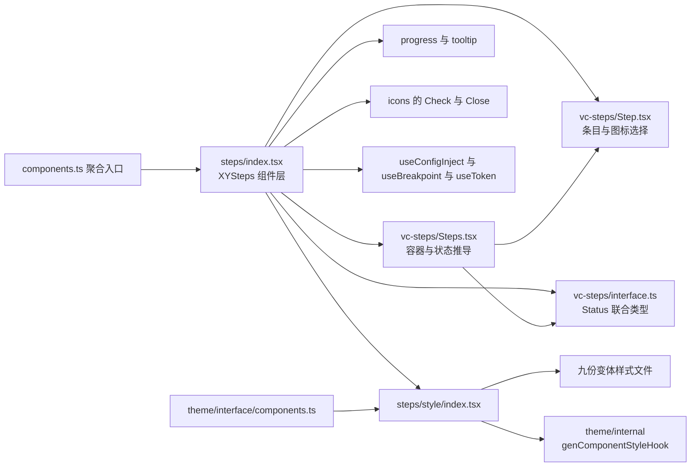
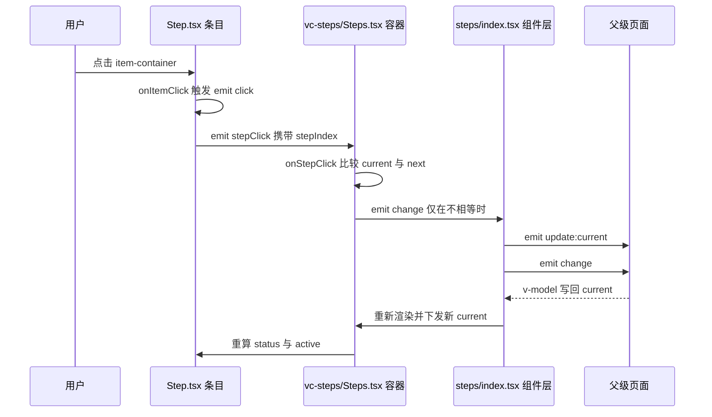
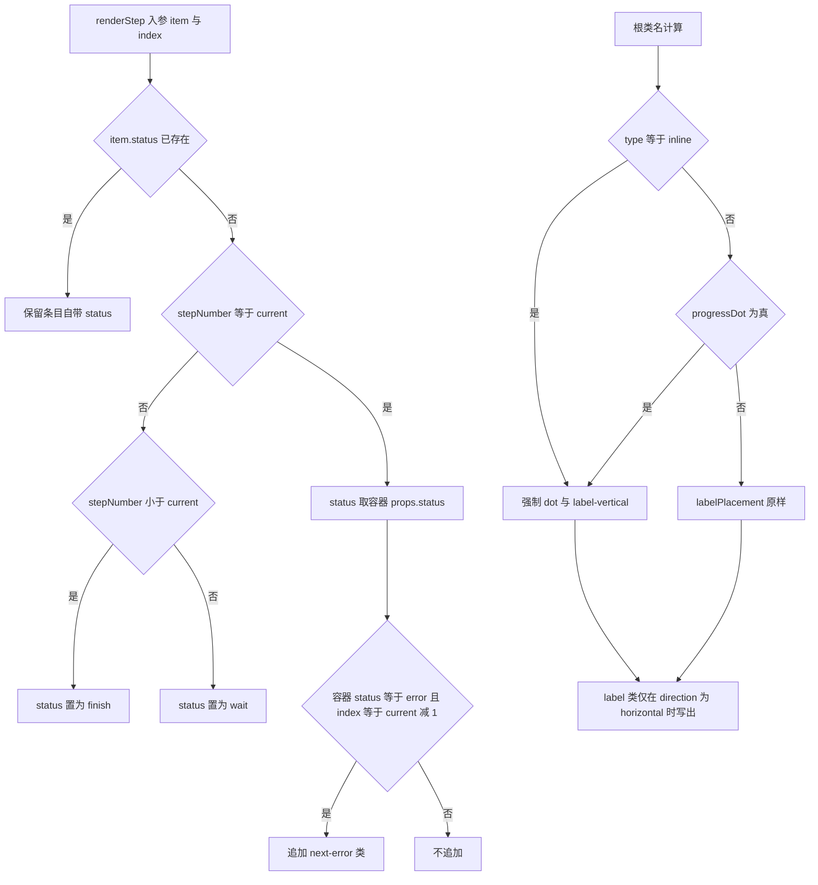

# C03-06 Steps 步骤条

> **本篇解决**：`current` 与 `status` 如何被折算成每个条目的四态，点与连接线在 `direction` × `labelPlacement` × `type` 的类名乘积下由哪个元素承担，以及子项集合如何在下标层面与父级同步。
> **前置**：C03-00《类横写：menu/tabs/steps/breadcrumb 的选中态模型》　**读者坐标**：`03-components/03-navigation`（C03-00 为本类横写，本篇是组件篇第 6 号）

## 一、职责与边界

Steps 负责把「一条有序流程 + 一个游标」渲染成带状态的步骤序列。它在源码层只做三件事：把两路子项折算成带 `stepNumber` 的条目（`packages/xiaoye-ui/src/vc-steps/Steps.tsx:58` 的 `const stepNumber = initial + index`）、按游标为每个条目推导 `status`（同文件 `:76-84`）、把条目点击收敛成一次 `change`（同文件 `:37-42`）。除此之外的一切——图标长什么样、点与线怎么排、状态用什么颜色——都在样式层与组件层的注入代码里。

明确**不负责**的部分，边界要划清：

- **不做跳转语义**。Steps 没有任何 `href` / 路由渲染路径，条目容器恒为 `<div>`（`packages/xiaoye-ui/src/vc-steps/Step.tsx:171`），点击只发事件。这一点与同为导航件的 Breadcrumb 相反——Breadcrumb 的 `itemRender` 三级优先级与 `<a>`/`<span>` 二选一由 C03-04 论点 2 与论点 5 论证，本篇不重复。
- **不持有进度数值语义**。`percent` 的全部作用是「在 `process` 条目的图标位叠一个圆环」，实现是把 `xy-progress` 的 circle 形态塞进 `stepIcon` 通道（`packages/xiaoye-ui/src/steps/index.tsx:103-114`），进度算法本身归 C11-02《Progress》。
- **不维护可选项集合**。Steps 没有注册表，`items` 与默认插槽两路各自渲染、不合并也不查重。这个判定在 C03-00 论点 6 已经给出并附证据（`packages/xiaoye-ui/src/vc-steps/Steps.tsx:139-140`），本篇只在论点 5 补它的一个后果：两路 key 直接相撞。

依赖清单（全部由 `grep` 交叉验证，见本篇附检查点 3 的命令）：

| 方向 | 依赖 | 证据 |
| --- | --- | --- |
| 组件层向上 | `progress`、`tooltip`、`@xiaoye-ui/icons` | `packages/xiaoye-ui/src/steps/index.tsx:11`、`:13`、`:3` |
| 组件层向上 | `useConfigInject`、`useBreakpoint`、`useToken`、`registerComponent` | `:71`、`:76`、`:74`、`:165` |
| 组件层向下 | `vc-steps`（唯一实现载体） | `:7`、`:14`、`:15` |
| 样式层 | `genComponentStyleHook`、`mergeToken`、`resetComponent` | `packages/xiaoye-ui/src/steps/style/index.tsx:3`、`:13` |
| 被谁引用 | 仅聚合入口 `components.ts` | `packages/xiaoye-ui/src/components.ts:330-332` |

`vc-steps` 的消费者只有 `steps/index.tsx`（`packages/xiaoye-ui/src/steps/index.tsx:7`），没有任何其他组件 import 这两个目录；按包入口引用 `xiaoye-ui/steps` 的写法在 `packages` 与 `apps` 源码内为零命中。也就是说 Steps 是一个**纯叶子组件**，改它不会波及其他组件的实现，只会波及快照与文档。

## 二、源码地图

| 文件 | 行数 | 职责 | 关键导出 / 主实现入口 |
| --- | --- | --- | --- |
| `packages/xiaoye-ui/src/steps/index.tsx` | 169 | 组件层：props、响应式方向、图标注入、`percent` 包装 | `stepsProps()` `:23`、`Steps` `:55`、`Step` `:156` |
| `packages/xiaoye-ui/src/vc-steps/Steps.tsx` | 145 | 容器层：索引计算、状态推导、`change` 去重 | `renderStep` `:43`、`onStepClick` `:37` |
| `packages/xiaoye-ui/src/vc-steps/Step.tsx` | 199 | 条目层：DOM 骨架、图标优先级、可访问性属性 | `VcStepProps()` `:15`、`renderIconNode` `:60` |
| `packages/xiaoye-ui/src/vc-steps/interface.ts` | 16 | `Status` 联合类型与两个 render 函数签名 | `Status` `:1`、`StepIconRender` `:2`、`ProgressDotRender` `:10` |
| `packages/xiaoye-ui/src/vc-steps/index.ts` | 6 | vendor 层入口 | `:2-6` |
| `packages/xiaoye-ui/src/steps/style/index.tsx` | 421 | 主样式与 `StepsToken` | `genStepsItemStyle` `:118`、`genComponentStyleHook` `:339` |
| `packages/xiaoye-ui/src/steps/style/{vertical,small,nav,inline,progress,progress-dot,label-placement,custom-icon,rtl}.ts` | 72/68/146/124/60/132/56/36/47 | 九份变体样式，按修饰类分文件（`index.tsx:4-12` 逐个 import） | 见论点 3、论点 4 |
| `packages/xiaoye-ui/src/steps/index.test.js` | 6 | 唯一测试：仅挂载 | `mountTest(Steps)` `:5` |

四处需要预先声明的事实，避免后文误读：

1. **分层是两层而不是三层**。`steps/` 只有 `index.tsx` 与 `style/`，没有 `Steps.tsx`；容器与条目的实现全部住在 `vc-steps/`。组件层与 vendor 层的名字关系是 `XYSteps`（`packages/xiaoye-ui/src/steps/index.tsx:57`）包裹 `Steps`（`packages/xiaoye-ui/src/vc-steps/Steps.tsx:14`），后者 `name` 就叫 `Steps`、条目就叫 `Step`（`packages/xiaoye-ui/src/vc-steps/Step.tsx:45`），都没有 `XY` 前缀。
2. **vendor 层因此不可全局注册**。`registerComponent` 只用 `comp.name` 反推标签（`packages/xiaoye-ui/src/_util/registerComponent.ts:18`），而 `toXYTagName` 的第一步是 `replace(/^XY/, 'xy-')`（`:6-11`）：`XYSteps` 得到 `xy-steps`，`Steps` 只能得到裸的 `steps`，违反 AGENTS.md 的 `xy-` 前缀硬约束。现状是 install 里只有组件层的两个（`packages/xiaoye-ui/src/steps/index.tsx:165-166`），vendor 层从未被注册。
3. **`vc-steps` 是上游实现的移植**。`packages/xiaoye-ui/src/vc-steps/index.ts:1` 保留着 `// base rc-steps 4.1.3` 这行注释，指的是上游 React 库的版本锚点，不是本库现状；移植后 props 定义已被改写成本仓库的 `PropTypes`/`stringType` 风格（`packages/xiaoye-ui/src/vc-steps/Steps.tsx:15-34`）。
4. **`Step` 子组件是「借来的」**。组件层导出的 `Step` 不是独立实现，而是把 `VcStep` 的选项对象摊平后仅覆盖 `name` 与 `props`（`packages/xiaoye-ui/src/steps/index.tsx:156-161`），`setup` 完全沿用 vendor 层那份。所以下文所有条目行为都只有一份实现。

主实现入口的锚点：容器渲染 `packages/xiaoye-ui/src/vc-steps/Steps.tsx:137-142`，条目渲染 `packages/xiaoye-ui/src/vc-steps/Step.tsx:165-192`，样式聚合 `packages/xiaoye-ui/src/steps/style/index.tsx:416`。

## 三、架构与数据流

图 1 是本篇的静态结构底图：Steps 只有一个组件层文件、两个 vendor 层实现文件，样式层由一个主文件加九份变体拼成。箭头的方向就是 import 的方向，全部由 `packages/xiaoye-ui/src/steps/index.tsx:3-21` 与 `packages/xiaoye-ui/src/steps/style/index.tsx:1-13` 这两段 import 清单逐一核对得出。



图 1 里有三条线值得单独说明。第一，`steps/index.tsx` 同时 import 了 `vc-steps/Steps` 与 `vc-steps/Step`（`packages/xiaoye-ui/src/steps/index.tsx:7`），但只有前者被渲染；`VcStep` 仅用于摊平出组件层 `Step` 的选项对象（`:158` 的 `...(VcStep as any)`），真正的条目渲染永远由容器发起（`packages/xiaoye-ui/src/vc-steps/Steps.tsx:97`）。第二，样式层不进这条依赖链的运行时部分：`useStyle(prefixCls)`（`packages/xiaoye-ui/src/steps/index.tsx:73`）返回的 `wrapSSR` 只被用于包裹根节点（`:135`），而 `useToken()`（`:74`）返回的 `token` 只服务于 `percent` 那条分支的圆环尺寸计算（`:101`），这是 Steps 里唯一一处「组件读取 Token 数值」的地方，其余 Token 全部留在样式层。第三，`theme/interface/components.ts:135` 的 `Steps?: StepsComponentToken` 让 `ConfigProvider` 能覆盖 Component Token，而那个接口的可覆盖面只有一个字段 `descriptionWidth`（`packages/xiaoye-ui/src/steps/style/index.tsx:15-17`）。

图 2 是一次点击的完整闭环，注意它跨了三次 `emit` 才回到调用方。



这条链上有三个容易被忽略的收口。`stepIndex` 传的是 `initial + index` 而不是 `index`（`packages/xiaoye-ui/src/vc-steps/Steps.tsx:58` 与 `:62`），所以开了 `initial` 之后，`v-model:current` 回写的值是绝对序号；`onStepClick` 的 `current !== next` 判断（`:39`）是整条链上唯一的去重点，组件层的 `handleChange`（`packages/xiaoye-ui/src/steps/index.tsx:81-84`）不做任何判断，无条件同时发 `update:current` 与 `change` 两个事件；禁用条目根本不会进入这条链——`onStepClick` 只在 `!disabled` 时才绑到容器上（`packages/xiaoye-ui/src/vc-steps/Step.tsx:160-164`）。

图 3 是渲染期的一次性推导，它是本篇论点 1 与论点 3 的合图：左边算状态，右边算类名，两条路互不影响。



图 3 右侧那条分支解释了本篇最容易踩的一个坑：类名里的方向后缀和排版后缀来自两个不同的变量。`${prefixCls}-${direction}` 用的是解构出来的原始 `direction`（`packages/xiaoye-ui/src/vc-steps/Steps.tsx:129`），而 `-label-*` 后缀用的是 `mergedDirection`（`:131`），后者在 inline 模式已被改写成 `'horizontal'`（`:125`）。`mergedDirection` 在整个文件里只出现两次（定义处 `:125` 与判定点 `:131`），这个事实由 `grep -rn mergedDirection packages/xiaoye-ui/src` 的命中数佐证——也就是说 inline 对方向的「强制」只影响 label 类，不影响 `-vertical` 类。

## 四、核心机制精读

### 论点 1：`status` 是渲染期的纯比较结果，不存在状态迁移；而唯一的跨条目副作用 `next-error` 用错了序号基准、也接错了选择器层级

`packages/xiaoye-ui/src/vc-steps/Steps.tsx:56-84`（`renderStep` 的主体）：

```tsx
// packages/xiaoye-ui/src/vc-steps/Steps.tsx:56
      const mergedProgressDot = isInline || progressDot;
      const mergedItem = { ...item, class: '' };
      const stepNumber = initial + index;
      const commonProps = {
        active: stepNumber === current,
        stepNumber: stepNumber + 1,
        stepIndex: stepNumber,
        key: stepNumber,
        prefixCls,
        iconPrefix,
        progressDot: mergedProgressDot,
        stepIcon,
        icons,
        onStepClick,
      };
      // fix tail color
      if (status === 'error' && index === current - 1) {
        mergedItem.class = `${prefixCls}-next-error`;
      }

      if (!mergedItem.status) {
        if (stepNumber === current) {
          mergedItem.status = status;
        } else if (stepNumber < current) {
          mergedItem.status = 'finish';
        } else {
          mergedItem.status = 'wait';
        }
      }
```

逐段解释。

**第一个事实：状态值域只有四个。** `Status` 在 vendor 层定义为 `'error' | 'process' | 'finish' | 'wait'`（`packages/xiaoye-ui/src/vc-steps/interface.ts:1`），组件层的 `stepsProps().status` 直接复用这个联合类型而不另外收窄（`packages/xiaoye-ui/src/steps/index.tsx:32`），样式层则用一份 `enum StepItemStatusEnum` 把这四个值重述了一遍（`packages/xiaoye-ui/src/steps/style/index.tsx:70-75`）——三份定义靠字面量对齐，没有任何机制保证同步。条目侧还有第五处兜底：解构时 `status = 'wait'`（`packages/xiaoye-ui/src/vc-steps/Step.tsx:127`）再叠一次 `const mergedStatus = status || 'wait'`（`:138`），后者只在调用方显式传入空串时才起作用。

**第二个事实：判定是每次渲染重算的纯函数。** 上面这段里没有 `ref`、没有 `watch`、没有 `onMounted`，输入只有 `initial`、`index`、`current`、容器 `status` 与条目自带 `status` 五个值，输出直接写进 `mergedItem`。这一点 C03-00 论点 6 已把它归为「Steps 靠每次重算、key 概念不存在」的那一类，本篇不重复论证，只补它的可观测后果：**因为不存在状态迁移，Steps 不使用本库的进出场协议**——`motionName` 在 `steps/` 与 `vc-steps/` 两个目录内零命中（`grep -rn motionName packages/xiaoye-ui/src/steps packages/xiaoye-ui/src/vc-steps` 无输出，另以全文读两文件复核），所有视觉过渡都是 CSS 自身的 `transition`：图标底色与边框（`packages/xiaoye-ui/src/steps/style/index.tsx:157`）、尾线颜色（`:190`）、可点击态的文字颜色（`:251`）。动画体系归 I09《动画与 motion 体系》，本篇只声明这一步差异的存在。

**第三个事实：优先级是「条目 > 容器 > 比较结果」。** 判定包在 `if (!mergedItem.status)` 里（`Steps.tsx:76`），而 `mergedItem` 是 `{ ...item, class: '' }`（`:57`），所以只要 `items[i].status` 有值，`current` 与它的大小关系就被完全跳过。这带来一个可用来做「未来步骤已完成」效果的能力，也带来一个风险：条目级 `status` 传空串以外的假值（例如 `undefined`）才会被重算，传了非法字符串（如 `'done'`）则会原样落到类名 `${prefixCls}-item-${mergedStatus}`（`Step.tsx:139`）上，产出一个没有样式定义的状态类——`Step.tsx` 侧没有任何白名单校验，因为它的 `status: stringType<Status>()`（`Step.tsx:20`）只是类型层面的约束，运行时不做检查。

**第四个事实：三条分支里没有 `error`。** 容器推导只会产出 `status`（游标位）、`finish`、`wait` 三种值（`Steps.tsx:77-83`），`error` 只能从两个入口进来：调用方把容器 `status` 设成 `'error'`，或条目自带。也就是说 `<xy-steps status="error">` 的语义是「当前这一步失败」，而它的**视觉尾巴**（前一条步骤指向失败点的那段线）需要额外处理——这就是 `// fix tail color` 的动机。

**第五个事实，也是本篇发现的缺陷：这个补丁有两处错位。**

错位一是序号基准。整段代码的其它判定一律用 `stepNumber = initial + index`（`:58`、`:60`、`:77`、`:79`），唯独这一条用裸 `index === current - 1`（`:72`）。而 `current` 在本库是绝对序号——`onStepClick` 回传的就是 `stepIndex = stepNumber`（`:62`），`v-model:current` 写回的也是它（`packages/xiaoye-ui/src/steps/index.tsx:82`）。于是 `initial` 非零时补丁会落到错误的条目上：设 `initial = 2`、`current = 3`（即绝对序号 3 这步失败，前一步是绝对序号 2、也就是 `index = 0`），条件 `index === current - 1` 要求 `index === 2`，命中的是 `stepNumber = 4` 那条——它按推导属于 `wait`（`:81-83`），被平白加了一个 `-next-error` 类，而真正该被染色的那条线没有类。`initial` 的默认值是 `0`（`Steps.tsx:24` 与 `packages/xiaoye-ui/src/steps/index.tsx:27` 都不给它默认值，靠 vendor 层 `PropTypes.number.def(0)`），所以默认配置下两种基准恰好等价，这就是缺陷长期不被发现的原因。

错位二是选择器层级。类被写进 `mergedItem.class`（`:73`），经 `<Step {...mergedItem} {...commonProps} />`（`:97`）传给条目；`Step` 声明了 `inheritAttrs: false`（`Step.tsx:46`）且没有 `class` prop，于是它进入 `attrs.class` 并与内部算出的 `classString` 并列挂到**条目根 div**（`Step.tsx:167-169`）。而样式侧对应的唯一规则是：

```tsx
// packages/xiaoye-ui/src/steps/style/index.tsx:231
    [`${stepsItemCls}${componentCls}-next-error > ${componentCls}-item-title::after`]: {
      background: token.colorError,
    },
```

展开后是 `.xy-steps-item.xy-steps-next-error > .xy-steps-item-title::after`，要求标题是条目根的**直接子节点**。但 DOM 是四层：`item > item-container > item-content > item-title`（`packages/xiaoye-ui/src/vc-steps/Step.tsx:171`、`:176`、`:177`）。同一个文件里对同一个伪元素另有两条写法正确的规则——`:131` 的 `> ${stepsItemCls}-container >  ${stepsItemCls}-content > ${stepsItemCls}-title::after` 与 `genStepsItemStatusStyle` 里的 `:102` 与 `:105-107`——它们的存在说明作者知道完整链，因此 `:231` 是一条不可能命中的规则，`-next-error` 这个类在默认横排下不产生任何视觉效果。紧邻的 `:226`（`-process` 标题加粗）犯了同样的错，它写 `> ${stepsItemCls}-container > ${stepsItemCls}-title` 却漏了 `-content` 这一层，对照 `:102` 即可看出。

结论回扣：Steps 的状态模型是「无状态」的——每次渲染从零算起，这是它的优点（改 `current` 不需要任何清理逻辑，也不会有中间态残留）；代价是**所有跨条目的视觉耦合都只能靠渲染期的额外类名来表达**，而本库里唯一一次这样的耦合（`error` 的前置尾线）在序号基准与选择器层级上同时失配。要修它，两处都得改：`Steps.tsx:72` 换成 `stepNumber === current - 1`，`style/index.tsx:231` 补全 `-container > -content`。

### 论点 2：图标位是一条七级互斥链，`progressDot` 最高、数字兜底；链末还有一个可被组件层整体劫持的出口

`packages/xiaoye-ui/src/vc-steps/Step.tsx:79-108`（`renderIconNode` 的分支主体）：

```tsx
// packages/xiaoye-ui/src/vc-steps/Step.tsx:79
      const iconDot = <span class={`${prefixCls}-icon-dot`} />;
      // `progressDot` enjoy the highest priority
      if (progressDot) {
        if (typeof progressDot === 'function') {
          iconNode = (
            <span class={`${prefixCls}-icon`}>
              {progressDot({
                iconDot,
                index: stepNumber - 1,
                status,
                title,
                description,
                prefixCls,
              })}
            </span>
          );
        } else {
          iconNode = <span class={`${prefixCls}-icon`}>{iconDot}</span>;
        }
      } else if (icon && !isString(icon)) {
        iconNode = <span class={`${prefixCls}-icon`}>{icon}</span>;
      } else if (icons && icons.finish && status === 'finish') {
        iconNode = <span class={`${prefixCls}-icon`}>{icons.finish}</span>;
      } else if (icons && icons.error && status === 'error') {
        iconNode = <span class={`${prefixCls}-icon`}>{icons.error}</span>;
      } else if (icon || status === 'finish' || status === 'error') {
        iconNode = <span class={iconClassName} />;
      } else {
        iconNode = <span class={`${prefixCls}-icon`}>{stepNumber}</span>;
      }
```

**分支顺序就是优先级**，`Step.tsx:80` 那句上游注释 `// progressDot enjoy the highest priority` 是作者自己的声明：只要 `progressDot` 为真值，无论它是布尔还是函数，自定义 `icon` 都被跳过——因为前两个分支都不检查 `icon`。而 `progressDot` 的值来自容器：`mergedProgressDot = isInline || progressDot`（`packages/xiaoye-ui/src/vc-steps/Steps.tsx:56`），再经 `commonProps.progressDot`（`:66`）下发。因此 `type="inline"` 是**隐式**的 progressDot 模式，即使用户没写 `progress-dot`。更狠的是容器还提前把 icon 抹掉了：`if (isInline) { mergedItem.icon = undefined; mergedItem.subTitle = undefined }`（`Steps.tsx:86-89`），于是 inline 下 icon 走不进第三分支，属于双保险。

**第四、五级把 `icons` 对象当成状态图标来源。** 组件层永远提供一个：`icons = computed(() => ({ finish: <CheckOutlined .../>, error: <CloseOutlined .../> }))`（`packages/xiaoye-ui/src/steps/index.tsx:119-122`，两个图标来自 `@xiaoye-ui/icons` 的命名导入 `:3`）。由此得到一个可以用两种方式交叉验证的负面结论：`Step.tsx:72-78` 那串 `iconClassName` 里的 `${iconPrefix}icon-check` 与 `${iconPrefix}icon-cross` 两个类在本库公开路径下不会出现在 DOM 里。理由：这两个类的条件都带 `!icon &&`（`:74`、`:76`），而能进入第五分支且 `icon` 为空的路径只有 `status === 'finish'` 或 `'error'`；这两条又各自被第四分支（`:100`、`:102`）先截断，除非 `icons.finish`/`icons.error` 缺失——而组件层恒传。反证命令与结果：`grep -n icons packages/xiaoye-ui/src/steps/index.tsx` 只有三行命中（`:3` 的 import、`:119` 的定义、`:137` 的下发），`icons` 的传入没有任何条件；全文读 `Step.tsx` 复核第四分支的 `icons &&` 守卫。第二种验证法给出更强的结论：`grep -rn "icon-check\|icon-cross" .`（排除 `node_modules` 与 `dist`）在本库源码里只剩 `Step.tsx:74`、`:76` 两处——**没有任何样式表定义过这两个类**（`apps/docs/examples/table/edit-cell.vue:12` 的命中是 `editable-cell-icon-check`，同名子串、与此无关）。也就是说它们不只是不可达，即使命中也无视觉：这是上游字体图标方案（靠 `icon-check` 这种 CSS 类画勾）被替换成 `@xiaoye-ui/icons` 组件后留下的空壳。

**第六级是数字兜底，但它显示的是一基化的序号。** `iconNode = <span class={...}>{stepNumber}</span>`（`Step.tsx:107`）里的 `stepNumber` 是 **prop**，其值为 `initial + index + 1`（`packages/xiaoye-ui/src/vc-steps/Steps.tsx:61`）。同一段 `commonProps` 里还并存另外三个同源不同基准的值：`stepIndex: stepNumber`（`:62`，0 基绝对序号，也是点击回传值）、`key: stepNumber`（`:63`，同样 0 基）、`active: stepNumber === current`（`:60`）。而回调参数又换算回去：`index: stepNumber - 1`（`Step.tsx:87` 与 `:112`）。把这条链写成一张表就是「显示 1 基 / 点击 0 基 / key 0 基 / 回调 0 基」四个基准、两次加减一，`initial` 默认 0 时看不出问题，`initial` 非零时任何按 `index` 对齐外部数组的 `progressDot` 回调都会偏移一格。

**链末的劫持口是 `stepIcon`。** `Step.tsx:110-118`：

```tsx
// packages/xiaoye-ui/src/vc-steps/Step.tsx:110
      if (stepIcon) {
        iconNode = stepIcon({
          index: stepNumber - 1,
          status,
          title,
          description,
          node: iconNode,
        });
      }

      return iconNode;
```

它拿到的 `node` 正是上面七级链算出的结果，返回值**整体替换** `iconNode`，因此劫持发生在最后、优先级实际上高于链内任何分支。`stepIcon` 有两个来源，容器侧写成 `stepIcon = slots.stepIcon`（`Steps.tsx:51`）——组件层就是用这句把进度圆环塞进来的：`v-slots={{ stepIcon: stepIconRender, ...slots }}`（`packages/xiaoye-ui/src/steps/index.tsx:148`），而 `stepIconRender`（`:87-118`）在 `status === 'process' && props.percent !== undefined` 时把 `node` 包进 `<div class="{prefixCls}-progress-icon">` 并在其前面放一个 `<Progress type="circle" format={() => null} strokeWidth={4}>`（`:103-114`）。这里埋着论点 4 要展开的那个缺陷，也埋着一个命名耦合：图标容器上的类名是 `${iconPrefix}icon`（`Step.tsx:72`），而 `iconPrefix` 由组件层用根前缀算出——`configProvider.getPrefixCls('', props.iconPrefix)`（`packages/xiaoye-ui/src/steps/index.tsx:80`），默认得到 `xy`，拼出 `xyicon`；样式层对此是**硬编码**的（`packages/xiaoye-ui/src/steps/style/index.tsx:163` 的 `` `& .xyicon` ``），而本库的图标前缀默认值另有出处（`packages/xiaoye-ui/src/config-provider/context.ts:14` 的 `defaultIconPrefixCls = 'xyicon'`，Steps 没有使用 `useConfigInject` 暴露的那个 `iconPrefixCls`）。于是 `<ConfigProvider prefixCls="acme">` 会把条目图标类换成 `acmeicon`，而 `.xyicon` 那组尺寸规则（`style/index.tsx:163-175`，把内部 svg 锁成 `1em`）当场失效，图标尺寸退化到继承值。

结论回扣：图标位不是「一个可配置项」，而是一条**顺序即语义**的互斥链加一个链末劫持口。链的每个入口（`progressDot`、`icons`、`stepIcon`）都由容器或组件层注入，条目侧用户能控制的只有 `icon`、`status` 与 `title`——这解释了为什么自定义图标必须走 `items[i].icon` 而不是自己拼类名。

### 论点 3：一条连接线有三个不同的承载元素，切换它们只看根节点的修饰类；末项判定 100% 落在 CSS，JS 里没有「最后一条」这个概念

先看条目渲染出的骨架。`packages/xiaoye-ui/src/vc-steps/Step.tsx:171-177`：

```tsx
// packages/xiaoye-ui/src/vc-steps/Step.tsx:171
          <div {...accessibilityProps} class={`${prefixCls}-item-container`}>
            <div class={`${prefixCls}-item-tail`}>{tailContent}</div>
            <div class={`${prefixCls}-item-icon`}>
              {renderIconNode({ icon, title, description })}
            </div>
            <div class={`${prefixCls}-item-content`}>
              <div class={`${prefixCls}-item-title`}>
```

`-item-tail` 这个 div 对**每一个**条目都渲染，没有 `if`、没有 `index === length - 1` 之类的判断，`items` 路径甚至不给 `tailContent`（容器的 `commonProps` 里没有它，`packages/xiaoye-ui/src/vc-steps/Steps.tsx:59-70`），于是它是个空 div。末项判定唯一的一次实现是 CSS：

```tsx
// packages/xiaoye-ui/src/steps/style/index.tsx:129
      '&:last-child': {
        flex: 'none',
        [`> ${stepsItemCls}-container > ${stepsItemCls}-tail, > ${stepsItemCls}-container >  ${stepsItemCls}-content > ${stepsItemCls}-title::after`]:
          {
            display: 'none',
          },
      },
```

（注意 `> ${stepsItemCls}-container >  ${stepsItemCls}-content` 里那两个连续空格，它在展开后仍是一个合法选择器；这行同时关掉 tail 元素与标题伪线，说明作者知道这两者是同一视觉物的两个载体。）这与 C03-04 论点 1 描述的 Breadcrumb 情形形成第三种答案：Breadcrumb 的两条通路差异在**分隔符由谁算出**（`routes` 通路父算好下发 vs 插槽通路 `cloneVNode` 注入 props），Steps 的差异在**连线由哪个元素承担**，而归属判定（前项持有自己的出线）在两条通路上完全一致、且交给 CSS。

**承载体一是 `-item-tail` 元素**，横排几何在 `packages/xiaoye-ui/src/steps/style/index.tsx:178-193`：

```tsx
// packages/xiaoye-ui/src/steps/style/index.tsx:178
    [`${stepsItemCls}-tail`]: {
      position: 'absolute',
      top: token.stepsIconSize / 2 - token.paddingXXS,
      insetInlineStart: 0,
      width: '100%',

      '&::after': {
        display: 'inline-block',
        width: '100%',
        height: token.lineWidth,
        background: token.colorSplit,
        borderRadius: token.lineWidth,
        transition: `background ${motionDurationSlow}`,
        content: '""',
      },
    },
```

`width: '100%'` 加上条目自身的 `position: relative`（`:124`）意味着这条线从本条目左边缘一直铺到右边缘；`top` 用 `stepsIconSize / 2 - paddingXXS` 对齐图标竖直中心（`stepsIconSize = controlHeight`，`:362`）。但要读准一点：**基础规则本身不给线留任何起止偏移**（既无 `padding` 也无 `marginInlineStart`），而它是绝对定位元素——按 CSS 绘制顺序，绝对定位后代画在文档流内块级后代之上，所以它不可能靠「下一个图标的背景盖住」来收口，只能由各模式自己把起止点算出来：`label-vertical` 用 `marginInlineStart: stepsIconSize / 2 + controlHeightLG` 加左右 `padding`（`packages/xiaoye-ui/src/steps/style/label-placement.ts:14-15`），`dot` 用 `marginInline: ${descriptionWidth / 2}px 0` 加 `padding: 0`（`packages/xiaoye-ui/src/steps/style/progress-dot.ts:22-28`），`inline` 用首末剪半（`packages/xiaoye-ui/src/steps/style/inline.ts:76-83`）。状态色由 `genStepsItemStatusStyle` 的 `:112-114` 覆盖（`background` 换成 `${status}TailColor`）。

**承载体二是 `-item-title::after`，而它在默认模式下才是真正可见的那条线。** 关键是把 `genStepsClickableStyle` 的后半段读进来（`packages/xiaoye-ui/src/steps/style/index.tsx:279-298`）：

```tsx
// packages/xiaoye-ui/src/steps/style/index.tsx:279
    [`&${componentCls}-horizontal:not(${componentCls}-label-vertical)`]: {
      [`${componentCls}-item`]: {
        paddingInlineStart: token.padding,
        whiteSpace: 'nowrap',

        '&:first-child': {
          paddingInlineStart: 0,
        },
        [`&:last-child ${componentCls}-item-title`]: {
          paddingInlineEnd: 0,
        },
        '&-tail': {
          display: 'none',
        },
        '&-description': {
          maxWidth: token.descriptionWidth,
          whiteSpace: 'normal',
        },
      },
    },
```

`-horizontal:not(-label-vertical)` 正是组件的默认状态：`labelPlacement` 默认 `'horizontal'`（`packages/xiaoye-ui/src/steps/index.tsx:62`），而容器只在 `mergedDirection === 'horizontal'` 时写出 `-label-${adjustedLabelPlacement}` 类（`packages/xiaoye-ui/src/vc-steps/Steps.tsx:131`）。于是**默认的横向步骤条里，DOM 上的 `-item-tail` 是死元素**，连接线换成标题右侧的伪线：

```tsx
// packages/xiaoye-ui/src/steps/style/index.tsx:202
      '&::after': {
        position: 'absolute',
        top: token.stepsTitleLineHeight / 2,
        insetInlineStart: '100%',
        display: 'block',
        width: 9999,
        height: token.lineWidth,
        background: token.processTailColor,
        content: '""',
      },
```

`insetInlineStart: '100%'` 从标题文字右端起画，`width: 9999` 是一条「无限长线」，它不外溢的唯一防线是条目的 `overflow: 'hidden'`（`packages/xiaoye-ui/src/steps/style/index.tsx:127`）。这条依赖在改动时是隐性的：任何把 `-vertical` 的 `overflow: 'visible'`（`packages/xiaoye-ui/src/steps/style/vertical.ts:17`）带进横排模式的做法，都会让 9999px 伪线撑出横向滚动条。

**切换开关就是 `-label-vertical` 类**，而它有两个来源：用户显式 `labelPlacement="vertical"`，或 `progressDot`/`inline` 被容器强制——`const adjustedLabelPlacement = mergedProgressDot ? 'vertical' : labelPlacement`（`packages/xiaoye-ui/src/vc-steps/Steps.tsx:128`）。一旦类存在，`:279` 的 `:not()` 失效，tail 元素复活，同时 `packages/xiaoye-ui/src/steps/style/label-placement.ts:30-37` 反过来关掉伪线并给 tail 让位：

```ts
// packages/xiaoye-ui/src/steps/style/label-placement.ts:30
        '&-title': {
          paddingInlineEnd: 0,
          paddingInlineStart: 0,

          '&::after': {
            display: 'none',
          },
        },
```

同一文件还给 tail 加了 `marginInlineStart: stepsIconSize / 2 + token.controlHeightLG`（`:14`）与左右 `padding`（`:15`），并把 `-item-content` 定宽为 `(stepsIconSize / 2 + controlHeightLG) * 2`（`:20`）。注意这一档的几何**只消费 Alias Token**（`stepsIconSize`、`controlHeightLG`、`paddingLG`），没有用 Component Token。本组件唯一的 Component Token `descriptionWidth`（`packages/xiaoye-ui/src/steps/style/index.tsx:16`，默认值 `:419`）的实际消费点是 5 处：`packages/xiaoye-ui/src/steps/style/index.tsx:294`（横排非换行模式下 `-description` 的 `maxWidth`）与 `packages/xiaoye-ui/src/steps/style/progress-dot.ts:27`、`:39`、`:67`、`:76`（dot 模式的尾线起点右移半格、圆点在定宽内容里居中、内容定宽、当前圆点的居中补偿）。所以「改 `theme.components.Steps.descriptionWidth` 就能改标题换行的列宽」这个直觉是错的——换行列宽来自 `label-placement.ts:20` 的 `controlHeightLG` 公式，`descriptionWidth` 只管描述文字截断与 dot 模式。

**竖排（`direction="vertical"`）时承载体一变回 tail，并整体旋转几何。** `packages/xiaoye-ui/src/steps/style/vertical.ts:35-51`：

```ts
// packages/xiaoye-ui/src/steps/style/vertical.ts:35
      [`> ${componentCls}-item > ${componentCls}-item-container > ${componentCls}-item-tail`]: {
        position: 'absolute',
        top: 0,
        insetInlineStart: token.stepsIconSize / 2 - token.lineWidth,
        width: token.lineWidth,
        height: '100%',
        padding: `${stepsIconSize + token.marginXXS * 1.5}px 0 ${token.marginXXS * 1.5}px`,

        '&::after': {
          width: token.lineWidth,
          height: '100%',
        },
      },
      [`> ${componentCls}-item:not(:last-child) > ${componentCls}-item-container > ${componentCls}-item-tail`]:
        {
          display: 'block',
        },
```

`insetInlineStart = 图标直径 / 2 - lineWidth` 把线压到图标正中线上，`height: 100%` + `padding-top = stepsIconSize + ...` 是让 `::after`（它的 `height: 100%` 是含 padding 的盒高）从图标下沿开始而不是从条目顶端开始——竖排不做「线压住图标」的遮挡，而是用 padding 把线截短。第二段的 `:not(:last-child) { display: block }`（`:48-51`）与主样式的 `:last-child { display: none }`（`index.tsx:129-135`）是一对显式互补：竖排条目是 `display: block`（`vertical.ts:14`）而非横排的 `inline-block`（`index.tsx:125`），作者在这里重新声明了非末项可见，避免依赖继承来的默认值。竖排同时把标题伪线关掉（`:52-57`），所以四方向里竖排只有 tail 一个承载体。`small` 尺寸下这条竖线的起点要按 `stepsSmallIconSize` 重算（`:58-64`），偏移量与横排的小尺寸修正是两套独立代码（`packages/xiaoye-ui/src/steps/style/small.ts:49-51` 只改横排 tail 的 `top`）。

**承载体三：`nav` 型把前两者一起作废。** `type="navigation"` 时容器写 `-navigation` 类（`packages/xiaoye-ui/src/vc-steps/Steps.tsx:133`），样式里连线被换成条目自己的 `::after` 箭头，tail 元素改为 `visibility: hidden` 而不是 `display: none`（`packages/xiaoye-ui/src/steps/style/nav.ts:139-143`）：

```ts
// packages/xiaoye-ui/src/steps/style/nav.ts:139
    [`&${componentCls}-navigation${componentCls}-horizontal`]: {
      [`> ${componentCls}-item > ${componentCls}-item-container > ${componentCls}-item-tail`]: {
        visibility: 'hidden',
      },
    },
```

用 `visibility` 是为了保住它占的那份几何（绝对定位元素本就不参与布局，但它内部的 `::after` 在竖排 nav 里被重用作圆点：`nav.ts:123-132`）。竖排 nav 走的是另一条规则（`nav.ts:133-135`），横竖两版各自隐藏一次，说明 `-navigation` 的连线语义与前两者彻底无关。

**inline 是四方向之外唯一把连线语义翻转型的模式。** `packages/xiaoye-ui/src/steps/style/inline.ts:63-83`：

```ts
// packages/xiaoye-ui/src/steps/style/inline.ts:63
        '&-tail': {
          marginInlineStart: 0,
          top: containerPaddingTop + inlineDotSize / 2,
          transform: `translateY(-50%)`,
          '&:after': {
            width: '100%',
            height: token.lineWidth,
            borderRadius: 0,
            marginInlineStart: 0,
            background: inlineTailColor,
          },
        },

        [`&:first-child ${componentCls}-item-tail`]: {
          width: '50%',
          marginInlineStart: '50%',
        },
        [`&:last-child ${componentCls}-item-tail`]: {
          display: 'block',
          width: '50%',
        },
```

`&:after`（冒号单写，与主样式的 `::after` 双写不一致，CSS 里等价）的含义要配合圆点位置读：inline 把圆点放到条目水平中心（`marginInlineStart: calc(50% - ${inlineDotSize / 2}px)`，`packages/xiaoye-ui/src/steps/style/inline.ts:39`），而 tail 仍继承主样式的 `insetInlineStart: 0` 加 `width: 100%`（`:178-182`，inline 只把 `marginInlineStart` 显式写回 0，见 `:64`），于是每个条目画的是一条**穿过自己圆心、左右各悬空半格**的贯穿线。两条首末规则就是用来剪掉悬空段的：首项只留右半（`:76-79`，`width: 50%` + `marginInlineStart: 50%`），末项只留左半（`:80-83`，`width: 50%` 且不偏移）。其中 `display: 'block'`（`:81`）是对主样式 `:129-135` 那条 `:last-child { display: none }` 的**覆写**——末项在别的模式下整条线不可见，在 inline 下必须可见，只差左半。覆写能成立是因为 inline 规则的选择器多带一层 `&${componentCls}-inline`（类权重高于 `.xy-steps .xy-steps-item:last-child > ...`），并且 inline 样式在聚合对象里最后展开（`packages/xiaoye-ui/src/steps/style/index.tsx:333`，位于 item `:313` 之后）。同一份语义差也出现在 dot 模式：`packages/xiaoye-ui/src/steps/style/progress-dot.ts:22-35` 给 tail 写 `marginInline: ${descriptionWidth / 2}px 0` 与 `padding: 0`，把线的起点推到本条目圆心、长度收成一个 `calc(100% - marginSM * 2)`——那是**出线**画法；inline 是全宽穿过再剪两端，dot 是起点即圆心，两种几何不共享代码。

结论回扣：`direction` 只有两个取值（`packages/xiaoye-ui/src/steps/index.tsx:34`），加上 `labelPlacement` 两个取值（`:31`）与 `type` 三个取值（`:36`），实际视觉布局是 2×2×3 的组合空间；样式层为其中五组写了几何（横排同行、横排换行、竖排、nav、inline），其余组合靠级联碰运气。这就是论点 6 要处理的错位来源。

### 论点 4：`percent` 是一条只在组件层存在的私有通道，它靠 `stepIcon` 劫持注入圆环，并且用两个不同的变量做同一件事的判定

`packages/xiaoye-ui/src/steps/index.tsx:86-114`：

```tsx
// packages/xiaoye-ui/src/steps/index.tsx:86
    const mergedPercent = computed(() => (isInline.value ? undefined : props.percent));
    const stepIconRender = ({
      node,
      status,
    }: {
      node: any;
      index: number;
      status: string;
      title: any;
      description: any;
    }) => {
      if (status === 'process' && props.percent !== undefined) {
        // currently it's hard-coded, since we can't easily read the actually width of icon

        const progressWidth =
          props.size === 'small' ? token.value.controlHeight : token.value.controlHeightLG;

        const iconWithProgress = (
          <div class={`${prefixCls.value}-progress-icon`}>
            <Progress
              type="circle"
              percent={mergedPercent.value}
              size={progressWidth}
              strokeWidth={4}
              format={() => null}
            />
            {node}
          </div>
        );
        return iconWithProgress;
      }
      return node;
    };
```

**第一条断言：`percent` 与 `responsive` 是组件层私有语义，不进 vendor 层。** 渲染时写的是 `{...omit(props, ['percent', 'responsive'])}`（`packages/xiaoye-ui/src/steps/index.tsx:139`），显式把两个键摘掉；对照 `vc-steps` 的 props 声明表（`packages/xiaoye-ui/src/vc-steps/Steps.tsx:15-34`）也确实没有 `percent`。这意味着 `percent` 在 vendor 层的几何里毫无地位——`Step.tsx` 的图标位始终按普通图标渲染（`Step.tsx:173-175`），圆环是外面套的。这是它和 `progressDot` 的本质区别：后者是 vendor 层一等公民（`Steps.tsx:23`、`Step.tsx:81-97`），前者是组件层的包装。

**第二条断言：判定与赋值用了两个不同的变量，于是 `type="inline"` 加 `percent` 会产出半成品。** 进入圆环分支的条件读 `props.percent !== undefined`（`:97`），而真正传给 `<Progress>` 的是 `mergedPercent.value`（`:104`），后者在 inline 下被强制为 `undefined`（`:86`）。inline 同时是隐式 progressDot（`packages/xiaoye-ui/src/vc-steps/Steps.tsx:56`），`stepIcon` 又位于图标链的最后（`Step.tsx:110-118`），所以这条分支在 inline 下照样触发：会渲染一个 `percent` 为 `undefined` 的圆环 `<Progress>`，并且**包裹它的定位类拿不到**——`-with-progress` 类的条件读的是 `mergedPercent.value !== undefined`（`packages/xiaoye-ui/src/steps/index.tsx:127`），inline 下恒为假。而 `progress.ts` 的全部几何都挂在 `&${componentCls}-with-progress` 之下（`packages/xiaoye-ui/src/steps/style/progress.ts:9`），包括把圆环绝对定位到图标中心的这两行：`insetBlockStart` 与 `insetInlineStart` 各等于 `(stepsIconSize - stepsProgressSize - lineWidth * 2) / 2`（`:50-53`）。结论：`<xy-steps type="inline" :percent="40">` 下圆环会渲染但没有定位，退化成流内元素把图标挤偏。`mergedPercent` 存在的目的就是「inline 不显示进度」（`:85` 的 `isInline` 定义 + `:86`），但作者只在赋值处实现了这个意图，判定处漏了。

**第三条断言：圆环尺寸是 Steps 里唯一「组件读 Token 数值」的地方，而且是跨文件的手工同步点。** `progressWidth` 取 `token.value.controlHeight` 或 `token.value.controlHeightLG`（`packages/xiaoye-ui/src/steps/index.tsx:100-101`），来自 `useToken()`（`:74`）；这两个名字分属不同层——`controlHeight` 是 Seed Token（`packages/xiaoye-ui/src/theme/interface/seeds.ts:143`），`controlHeightLG` 是 Map Token（`packages/xiaoye-ui/src/theme/interface/maps/size.ts:67`）。样式层另有一份 `stepsProgressSize: controlHeightLG`（`packages/xiaoye-ui/src/steps/style/index.tsx:409`），非 `small` 时两侧同源（都是 `controlHeightLG`），`small` 时组件侧降到 Seed 的 `controlHeight`、样式侧仍用 `controlHeightLG`。同一份数值一份在运行时算成 `<Progress size>` 的行内几何，一份在样式生成时算成绝对定位偏移。`small` 分支的对应关系是**反的**：样式侧 `progress.ts:27-32` 与 `:34-37` 分别对 `-small` 修正条目 padding 与 tail 偏移，但没有一处按 `controlHeight` 重算 `stepsProgressSize`——`stepsProgressSize` 全程恒为 `controlHeightLG`（`packages/xiaoye-ui/src/steps/style/index.tsx:409`），所以 small 模式的圆环尺寸与其定位公式 `(stepsIconSize - stepsProgressSize - lineWidth * 2) / 2` 里的 `stepsIconSize`（也是 `controlHeight`，`:362`）会出现负偏移：`stepsIconSize = controlHeight` 而 `stepsProgressSize = controlHeightLG`，`(controlHeight - controlHeightLG - 2*lineWidth)/2 < 0`，圆环被推条目上沿之外，靠 `padding-top: paddingXXS`（`packages/xiaoye-ui/src/steps/style/progress.ts:11`）与 `progress.ts:19-25` 那组竖排补偿拉回来。这段是纯几何推断，本篇未做运行时像素核对。

**第四条断言：硬编码不止 `strokeWidth`。** 上游注释 `// currently it's hard-coded, since we can't easily read the actually width of icon`（`:98`）解释的是 `progressWidth`，但同一段里还有两个数字没有 Token 对应：`strokeWidth={4}`（`:110`）与 `format={() => null}`（`:111`，把环内百分比文字清空，因为图标位本身要显示数字或图标）。对照 `StepsToken` 的完整字段表（`packages/xiaoye-ui/src/steps/style/index.tsx:19-68`，用 `awk 'NR>=19 && NR<=68' packages/xiaoye-ui/src/steps/style/index.tsx | grep -c ';$'` 数得 45 个字段）里没有任何 `progressStrokeWidth` 之类的项，可以确认这两个值在 Token 体系外。按 A03《Design Token 四层体系》的分层语言说：`percent` 圆环是**第四层 Component Token 覆盖不到的一条支路**，它绕开 `genComponentStyleHook` 直接用 `useToken()` 取靠前的层——`controlHeight` 在 Seed 层（`packages/xiaoye-ui/src/theme/interface/seeds.ts:143`）、`controlHeightLG` 在 Map 层（`packages/xiaoye-ui/src/theme/interface/maps/size.ts:67`），因此 `ConfigProvider` 的 Steps Component Token 面板（唯一可覆面是 `descriptionWidth`，`packages/xiaoye-ui/src/steps/style/index.tsx:15-17`）对这个特性零控制力，想调环的粗细或直径只能改全局尺寸 Token，或在 `:110` 那种字面量上动刀。

**第五条断言：`-progress-icon` 这个类在本库没有任何样式定义。** 组件侧写出 `${prefixCls}-progress-icon`（`:104`），而 `grep -rn "progress-icon" packages/xiaoye-ui/src/steps` 只命中 `index.tsx:104` 一处，样式层没有任何规则以它为选择器——它只是一个语义容器（把 `<Progress>` 与图标 `node` 并排包住），实际定位由 `-with-progress` 下的 `-item-icon` 规则承担（`progress.ts:45-55`）。两种方法复核：全文读 `progress.ts` 与 `index.tsx` 的样式片段（`:144-177`）都无 `progress-icon`；`grep` 全库无命中（`packages/xiaoye-ui/src/steps/style/` 内零命中）。也就是说这一层的 DOM 结构（`div.-progress-icon` 插在 `div.-item-icon` 里）在 CSS 上是**未声明**的，改动它不会触发任何样式失效，但也意味着它的盒模型完全由继承决定。

结论回扣：`percent` 展示了 Steps 的扩展方式——不加 vendor 层 props，而是劫持图标链末的 `stepIcon`。换来的是「进度与步骤条解耦、可复用 Progress 的全部能力」，赔上的是三处手工同步（组件层两处 `percent` 判定、`progressWidth` 与 `stepsProgressSize`）以及一个只在特定 `type` 下才成立的语义。

### 论点 5：子项「注册」就是渲染期的一次下标映射，没有 inject、没有登记表；因此两路子项的下标各自从 0 起、key 必然相撞

`packages/xiaoye-ui/src/vc-steps/Steps.tsx:99-142`（含中段省略）：

```tsx
// packages/xiaoye-ui/src/vc-steps/Steps.tsx:99
    const renderStepWithNode = (node: any, index: number) => {
      return renderStep({ ...node.props }, index, stepProps => {
        const stepNode = cloneElement(node, stepProps);
        return stepNode;
      });
    };
    return () => {
      const {
        // ...（此处解构 13 个 props，见 :106-122）
        ...restProps
      } = props;
      const isNav = type === 'navigation';
      const mergedProgressDot = isInline || progressDot;
      const mergedDirection = isInline ? 'horizontal' : direction;
      const mergedSize = isInline ? undefined : size;

      const adjustedLabelPlacement = mergedProgressDot ? 'vertical' : labelPlacement;
      const classString = classNames(prefixCls, `${prefixCls}-${direction}`, {
        // ...
      });

      return (
        <div class={classString} {...restProps}>
          {items.filter(item => item).map((item, index) => renderStep(item, index))}
          {filterEmpty(slots.default?.()).map(renderStepWithNode)}
        </div>
      );
```

**断言一：整套件里没有任何形式的父子注册。** `vc-steps` 两个文件里没有 `provide`、没有 `inject`、没有 `useXxxContext`（`grep -rn "provide\|inject\|Context" packages/xiaoye-ui/src/vc-steps` 零命中；两个文件共 344 行已全文读过，作为第二种复核）。父级知道的唯一事实是「本次渲染我 map 了几个元素」，下标由 `.map((item, index) => ...)`（`Steps.tsx:139`）与 `.map(renderStepWithNode)`（`:140`）的回调参数给出，再折算成 `stepNumber = initial + index`（`:58`）。C03-00 论点 6 已把这一条与 Menu 的注册表对照过并给出结论「Steps 与 Breadcrumb 更弱：两路各自渲染、不合并也不查重」，本篇不重复论证，只展开它的四个后果。

**后果一：两路的下标都从 0 开始，`key` 直接重复。** `commonProps.key = stepNumber`（`Steps.tsx:63`），而两个 `.map` 是两次独立迭代、`initial` 对它们相同。于是同时写 `:items="list"` 与默认插槽时，`items[0]` 与第一个插槽子节点拿到同一个 key（`initial + 0`）。两个 `.map` 的结果被并列放进同一个 `<div>`（`:138-141`），属于同一父节点的兄弟，Vue 的 diff 会给出重复 key 告警并把两处渲染搅在一起。这条通路没有任何防护——既不像 Breadcrumb 那样在插槽口写 `warning`（C03-04 论点 1 提到的 `Breadcrumb.tsx:147-152`），也不像 Tabs 那样用 `findIndex === -1` 兜底（C03-00 论点 6 引的 `Tabs.tsx:213`）。

**后果二：`items` 的过滤会重排序号。** `items.filter(item => item)`（`:139`）在 `map` **之前**执行，所以传 `[a, null, b]` 时 `b` 拿到的 `index` 是 1 而不是 2，`stepNumber`、`key`、点击回传的 `stepIndex` 全部前移一位。想在 `items` 里用 `null` 做占位或条件跳过一步的做法不可能对齐外部状态，唯一的补偿是手工调 `initial`（`packages/xiaoye-ui/src/steps/index.tsx:27`）——但那是全局偏移，救不了中间挖洞。

**后果三：`items` 项上的 `class` 被无条件擦掉。** `const mergedItem = { ...item, class: '' }`（`Steps.tsx:57`）把用户可能在条目对象里写的 `class` 归零，随后只在 error 补丁需要时写成 `-next-error`（`:73`）；而组件层的条目类型 `stepProps()`（`packages/xiaoye-ui/src/steps/index.tsx:41-49`）本来就没有 `class` 字段，所以这不违反类型契约，只违反直觉。插槽路径不受影响：`renderStepWithNode` 走 `cloneElement(node, stepProps)`（`:101`），`cloneElement` 默认 `override = true` 会把 `nodeProps` 覆盖到 `node.props` 上（`packages/xiaoye-ui/src/_util/vnode.ts:22-26`），但它同时保留原 vnode 的其它属性，且 `Step.tsx:167-169` 会把 `attrs.class` 与内部 `classString` 并列，所以子节点自己写的 `class` 仍在。

**后果四：插槽路径只读子节点的 props，不读它的内容。** `renderStep({ ...node.props }, index, ...)`（`:100`）的入参是 vnode 的 **props**；条目侧要拿到标题，只能走 `title = slots.title?.()` 这条**具名插槽**默认值路径或 prop 路径：

```tsx
// packages/xiaoye-ui/src/vc-steps/Step.tsx:128
        tailContent,
        adjustMarginRight,
        disabled,
        title = slots.title?.(),
        description = slots.description?.(),
        subTitle = slots.subTitle?.(),
        icon = slots.icon?.(),
        onClick,
        onStepClick,
      } = props;
```

`Step.tsx` 里 `slots.` 一共出现 6 次（`:67`、`:68`、`:131-134`），**没有 `slots.default`**——`grep -rn "slots.default" packages/xiaoye-ui/src/vc-steps` 的唯一命中是容器 `Steps.tsx:140`。这意味着 `<xy-step>填写标题</xy-step>` 这种「文本即标题」的直觉写法会渲染出一个空的 `-item-title`（文本被静默丢弃，因为容器把子 vnode 的 children 原样保留、而条目从不渲染默认插槽）。同时注意 `props.title` 的解构默认值只在 prop 为 `undefined` 时才求值具名插槽，所以 prop 传空串 `''` 会得到空标题而不是插槽内容。

结论回扣：Steps 的「子项集合」是一个**渲染期局部变量**，生命周期只到本次 `.map` 结束。它换来的是零注册开销与零清理逻辑（这是 C03-00 论点 6 里 Menu 那套 `shallowRef(new Map())` 反面的极简方案），代价是所有边界情况（越界 `current`、混写两路、数组挖洞）都没有可查证的表可依，只能靠下标算术式的钳位或放任。这里补一个可推导的越界行为：`current` 大于条目数时，`:79` 的 `stepNumber < current` 对所有条目成立，于是全部条目变成 `finish`、没有任何一条是 `process`；若同时 `status="error"`，`:72` 的 `index === current - 1` 会命中最后一条（`current = length + 1` 时 `index = length - 1`），给它挂上 `-next-error`。整个过程中没有 `warning`、没有钳位。

### 论点 6：`direction` 有三个来源，覆盖顺序是「断点 > props > inline 强制」，但第三级只改了一半

`packages/xiaoye-ui/src/steps/index.tsx:76-79`：

```tsx
// packages/xiaoye-ui/src/steps/index.tsx:76
    const screens = useBreakpoint();
    const direction = computed(() =>
      props.responsive && screens.value.xs ? 'vertical' : props.direction,
    );
```

**第一级覆盖来自断点，且它只在挂载之后才可能生效。** `useBreakpoint()` 返回的 `screens` 初值是 `shallowRef<ScreenMap>({})`（`packages/xiaoye-ui/src/_util/hooks/useBreakpoint.ts:7`），订阅发生在 `onMounted` 回调里（`:11-15`），卸载时 `unsubscribe`（`:17-19`）。因此首帧 `screens.value.xs` 是 `undefined`，`direction` 恒等于 `props.direction`；这一步同时保证了 SSR 输出与首屏一致（服务端不猜断点）。代价是窄屏下必然多一次渲染，且 `responsive` 默认 `true`（`packages/xiaoye-ui/src/steps/index.tsx:61`），绝大多数用法都走这条链路。覆盖还是**单向的**：`:77` 的三元式里 `props.direction` 只出现在 false 分支，所以 `direction="horizontal"` 拦不住 xs 下的竖排；要拦只能 `:responsive="false"`，而这个开关不进 vendor 层（被 `omit` 摘掉，`:139`）。

**第二级是 vendor 层的 props 默认。** 组件层把 `props.direction`（可能为 `undefined`，`:34` 的 `stringType<'horizontal' | 'vertical'>()` 没有默认值）原样下发（`:141`），由 `direction: PropTypes.string.def('horizontal')`（`packages/xiaoye-ui/src/vc-steps/Steps.tsx:19`）补齐。**第三级是 inline 的强制**，但它只改一个变量：

```tsx
// packages/xiaoye-ui/src/vc-steps/Steps.tsx:123
      const isNav = type === 'navigation';
      const mergedProgressDot = isInline || progressDot;
      const mergedDirection = isInline ? 'horizontal' : direction;
      const mergedSize = isInline ? undefined : size;

      const adjustedLabelPlacement = mergedProgressDot ? 'vertical' : labelPlacement;
      const classString = classNames(prefixCls, `${prefixCls}-${direction}`, {
        [`${prefixCls}-${mergedSize}`]: mergedSize,
        [`${prefixCls}-label-${adjustedLabelPlacement}`]: mergedDirection === 'horizontal',
        [`${prefixCls}-dot`]: !!mergedProgressDot,
        [`${prefixCls}-navigation`]: isNav,
        [`${prefixCls}-inline`]: isInline,
      });
```

`mergedDirection` 只被 `:131` 这一个判断消费（全文件两处命中：`:125` 定义与 `:131` 使用），而决定根节点方向类的仍是裸 `direction`（`:129`）。于是 `<xy-steps type="inline" direction="vertical">` 的类名是 `xy-steps xy-steps-vertical xy-steps-label-vertical xy-steps-dot xy-steps-inline` 五个：`-vertical` 来自真实 props，`-label-vertical` 来自被强制过的 `mergedDirection` 与 `adjustedLabelPlacement`（`:128`），`-dot` 来自 `mergedProgressDot`。后果是两套几何同时命中同一批元素——`packages/xiaoye-ui/src/steps/style/vertical.ts:9-11` 要 `display: flex; flexDirection: column`，`packages/xiaoye-ui/src/steps/style/inline.ts:15-17` 要 `display: inline-flex`，两条规则类权重相同，由展开顺序裁决（inline 在 `packages/xiaoye-ui/src/steps/style/index.tsx:333`，晚于 vertical 的 `:321`）；而竖排的 tail 定位（`vertical.ts:35-47`）与 inline 的剪半（`inline.ts:63-83`）声明的属性集不同、互不覆写，最终几何是两者叠加。这条组合没有测试覆盖（`packages/xiaoye-ui/src/steps/index.test.js:4-6` 只有 `mountTest(Steps)`），也不是文档示例中的组合（`apps/docs/examples/steps/inline.vue` 与 `apps/docs/examples/steps/vertical.vue` 各测其一）。

顺带澄清 `:131` 造成的隐式语义：`labelPlacement` 在 `direction="vertical"` 且非 inline 时**完全不生效**——`mergedDirection === 'horizontal'` 为假，`-label-*` 类根本不写，`packages/xiaoye-ui/src/steps/style/label-placement.ts:9` 的规则失去选择器。实现方式不是忽略参数，而是不产生类名；将来若要竖排也支持标题排位，改动点在 `:131` 的条件而非 `label-placement.ts`。

**所谓四种 direction 其实是三个参数在类名层的乘积。** `direction` 本身只有二值（`packages/xiaoye-ui/src/steps/index.tsx:34`），`responsive` 只是把它切成 `vertical`（`:78`）；`type` 的三个取值还会反向锁死其它参数——`inline` 锁 `size`（`:126`）与方向的一半（`:125`），`navigation` 不锁参数但只对横竖各写一份规则（`packages/xiaoye-ui/src/steps/style/nav.ts:107` 与 `:139`），`default` 无副作用。RTL 是第四个正交轴，它自己也有一条空转分支：`packages/xiaoye-ui/src/steps/style/rtl.ts:26-35` 在 `-rtl.-vertical` 下把 `item::after` 转到 225 度、图标 `float: right`，但 `-item::after` 的内容与尺寸只在 nav 里被定义（`nav.ts:72-85`、`:123-132` 都在 `-navigation` 之内），所以那句 `rotate(225deg)` 实际只对 nav 竖排起作用，非 nav 的竖排 RTL 完全依赖逻辑属性（`insetInlineStart`）自动翻转。

### 论点 7：可点击性只由 `onStepClick` 是否存在决定，`disabled` 挡不住用户自己的 `onClick`；键盘可达但不可操作

`packages/xiaoye-ui/src/vc-steps/Step.tsx:152-164`：

```tsx
// packages/xiaoye-ui/src/vc-steps/Step.tsx:152
      const accessibilityProps: {
        role?: string;
        tabindex?: number;
        onClick?: EventHandler;
      } = {
        onClick: onClick || noop,
      };

      if (onStepClick && !disabled) {
        accessibilityProps.role = 'button';
        accessibilityProps.tabindex = 0;
        accessibilityProps.onClick = onItemClick;
      }
```

**`onClick` 有两条生效路径，禁用态落在意外的那条上。** 条目声明了 `onClick: functionType()`（`Step.tsx:35`），所以它是 prop 而非 attr，Vue 不会自动给 DOM 挂监听；再加上 `inheritAttrs: false`（`:46`），条目容器上没有任何自动绑定的事件。`:157` 因此手工把 prop 里的 `onClick` 接到容器 div，缺省时用 `noop`（定义在 `:13`）占位。当 `onStepClick` 存在且未禁用时，`:163` 把它换成 `onItemClick`，而后者先 `emit('click', e)`（`:50`）再 `emit('stepClick', props.stepIndex)`（`:51`），`emit('click')` 命中的仍是同一个 prop `onClick`——所以用户回调照旧触发、参数仍是同一个 DOM 事件。两条路径的实质差别只出现在禁用态：`:160` 的 `!disabled` 使禁用条目跳过 `onItemClick`，容器上的 `onClick` 保持为**用户自己写的那个**，于是 `disabled` 只挡住了 `change` 通道，没挡住 `onClick` 通道；`Step.tsx` 全文没有把 `disabled` 传给回调或提前返回的语句。类名侧只多一个 `-item-disabled`（`:142`），样式侧对应 `cursor: 'not-allowed'`（`packages/xiaoye-ui/src/steps/style/index.tsx:234-236`），没有 `pointer-events: none`。净效果是禁用条目视觉被标记、`change` 被屏蔽、`onClick` 仍会跑。

**`role`/`tabindex` 只在可点时出现，但没有键盘处理。** `grep -rn "aria-\|keydown\|keyup\|Enter" packages/xiaoye-ui/src/vc-steps packages/xiaoye-ui/src/steps` 的命中全部在样式文件的选择器里（`[role='button']`：`packages/xiaoye-ui/src/steps/style/index.tsx:247`、`:265`，`packages/xiaoye-ui/src/steps/style/inline.ts:31`、`:113`，`packages/xiaoye-ui/src/steps/style/nav.ts:55`），组件代码只有 `Step.tsx:161-162` 写这两个属性。也就是说容器可聚焦（`tabindex=0`）但按回车不会触发点击（无 `keydown` 监听），与 AGENTS.md「遵循 WCAG 规范，提供键盘导航」的自述不符；而 `role="button"` 还兼作**样式钩子**（上述五处属性选择器），所以改 `:160` 的条件（例如让禁用条目也带 role）会直接把 hover 样式（`:255-261`）漏到禁用项上。

**容器没有列表语义。** 根是 `<div>`（`packages/xiaoye-ui/src/vc-steps/Steps.tsx:138`），条目也是 `<div>`（`Step.tsx:166-170`），没有 `nav`/`ol`/`li`，没有 `aria-current="step"`。对照 C03-04 论点 6 对 Breadcrumb 的评估（有 `nav` + `ol`、缺 `aria-current`），Steps 的容器语义更弱一档：辅助技术只能读出一串 `role="button"` 的条目，无从得知游标位置——游标只存在于类名 `-item-process`（`Step.tsx:139`）与 `role` 的有无上。

## 五、对外契约如何生效

Steps 的对外面一共四条通道：props、slots、事件、样式与类型生成物。逐条走一遍路径，不列属性清单（清单见 `apps/docs/components/steps.md`）。

**props 的下发是「先全量摊平、再定点覆盖」。** 组件层把 `stepsProps()` 声明的 15 个键（`packages/xiaoye-ui/src/steps/index.tsx:23-39`）中除 `percent`、`responsive` 之外的全部用 `{...omit(props, ['percent', 'responsive'])}`（`:139`）摊给 `VcSteps`，随后在 JSX 上又显式重写 `items`、`direction`、`prefixCls`、`iconPrefix`（`:140-143`）——后写的生效，因为 JSX 展开是对象合并、后者覆盖前者。`prefixCls` 之所以必须重写，是因为组件层从 `useConfigInject('steps', props)` 拿到的是带前缀的完整类名 `xy-steps`（`:71`），而用户直接传进来的 `props.prefixCls` 只是裸片段；vendor 层自己的默认值 `vc-steps`（`packages/xiaoye-ui/src/vc-steps/Steps.tsx:17`）因此在公开路径下永远不出现，只有绕过组件层直接用 `vc-steps` 时才会。默认值分三处补齐：`initDefaultProps` 只给 `current: 0`、`responsive: true`、`labelPlacement: 'horizontal'`（`packages/xiaoye-ui/src/steps/index.tsx:59-63`），`status` 与 `direction`、`initial`、`type` 的默认全部依赖 vendor 层的 `PropTypes...def(...)`（`Steps.tsx:16-26`），而 `percent` 没有默认（`:28`），这正是 `:97` 与 `:127` 用 `!== undefined` 而非真值判断的原因。

**slots 的优先级被一处展开顺序决定。** 组件层声明了 `progressDot` 与 `default` 两个插槽（`:64-67`），下发时写的是 `v-slots={{ stepIcon: stepIconRender, ...slots }}`（`:148`）：`stepIcon` 在前、用户 slots 在后，所以**用户提供名为 `stepIcon` 的插槽会覆盖组件层的进度圆环**，`percent` 特性可被整体接管。容器侧的读取顺序与之相反——`stepIcon = slots.stepIcon`（`packages/xiaoye-ui/src/vc-steps/Steps.tsx:51`）是「props.stepIcon 缺省时才取插槽」，即 props 优先于插槽；而 `default` 只在 `:140` 被消费一次。条目侧另有一套插槽兜底（`Step.tsx:131-134` 的 `slots.title?.()` 等），它只在对应 prop 为 `undefined` 时求值，且**条目从不读 `slots.default`**（论点 5 后果四）。

**事件是三层接力，且 `emits` 声明只在 vendor 层存在。** `VcSteps` 写了 `emits: ['change']`（`packages/xiaoye-ui/src/vc-steps/Steps.tsx:35`），组件层的 `emits` 那行是注释状态（`packages/xiaoye-ui/src/steps/index.tsx:69` 的 `// emits: ['update:current', 'change'],`）。这不是笔误造成的失效：`update:current` 与 `change` 都被当成 prop 显式声明（`:37-38`），Vue 的 `emit` 在 vnode props 上查找 `onUpdate:current` / `onChange` 处理器即可命中，v-model 与 `@change` 都工作。代价是这两个键同时存在于摊平下发的那份 props 里（`:139` 的 `omit` 没摘它们），而 vendor 层的 props 表（`Steps.tsx:15-34`）不含它们，于是它们变成 `VcSteps` 的 attrs；`VcSteps` 没有声明 `inheritAttrs: false`（其选项列表 `Steps.tsx:12-35` 内无此项），按 Vue 的规则 `on` 前缀的 attr 会在根元素上被绑成原生事件监听器——**这一步本篇没有做运行时验证**，但结构上确实形成了「用户 `onChange` 同时是 XYSteps 的 prop、VcSteps 的 attrs、根 div 的候选原生监听」三重身份。同理，用户在 `XYSteps` 上写的任意 `data-*`、`style` 都靠 `{...attrs}`（`:138`）落到 vendor 根 div；`class` 则走两条路：先被读进 `stepsClassName`（`:124-131` 的 `attrs.class`），又随 `{...attrs}` 再传一次，由 Vue 的 attrs 继承合并到同一个元素。

**条目级事件 `stepClick` 是 prop 而非 emit。** `onItemClick` 里 `emit('stepClick', props.stepIndex)`（`Step.tsx:51`），而 `Step` 没有 `emits` 选项（`Step.tsx:43-48`），处理器来自容器的 `commonProps.onStepClick`（`Steps.tsx:69`）——它被声明为 prop（`Step.tsx:36`）。这条链不对用户开放：`XYStep` 复用了 `VcStepProps()`（`packages/xiaoye-ui/src/steps/index.tsx:160`），用户即便写 `@step-click` 也只会得到一个未被消费的 attr，因为 `onStepClick` 每次渲染都被容器的 `commonProps` 覆盖（`Steps.tsx:97` 的 `{...mergedItem} {...commonProps}` 顺序在后者）。

**类型与样式生成物这条通道有个缺口。** `packages/xiaoye-ui/src/steps/index.tsx:162-168` 用 `Object.assign` 把 `Step` 挂成 `Steps.Step` 并在 install 里注册两个组件，标签名由 `registerComponent` 按 `XYXxx` 反推（`packages/xiaoye-ui/src/_util/registerComponent.ts:18-24`）得到 `xy-steps` 与 `xy-step`。但全局类型声明是**按目录**生成的：`packages/xiaoye-ui/scripts/entry-generator.mjs:455` 每个模块只产一条 `XY${mod.pascalName}`，所以 `packages/xiaoye-ui/typings/global.d.ts:84` 只有 `XYSteps` 一行、没有 `XYStep`（`grep -n XYStep packages/xiaoye-ui/typings/global.d.ts` 唯一命中就是 92 行）。结果是运行时 `<xy-step>` 可解析（已注册），模板里却没有 `GlobalComponents` 类型与补全——这是生成器的规则使然，不是 Steps 的配置错误，且该文件属于禁止手工编辑的生成物，只能通过 `pnpm gen:entries` 的生成器扩展来解决。样式侧的按需通道是 `package.json` 的双入口：`./steps` 指向 `src/steps/index.tsx`、`./steps/style` 指向 `src/steps/style/index.tsx`（`packages/xiaoye-ui/package.json:509-513`），并由聚合入口以副作用形式导入样式（`packages/xiaoye-ui/src/components.ts:332`）。主题侧的覆盖面就是 `genComponentStyleHook('Steps', ...)`（`packages/xiaoye-ui/src/steps/style/index.tsx:339-340`）配合 `theme/interface/components.ts:135` 的 `Steps?: StepsComponentToken`，可用字段仅 `descriptionWidth`（`:15-17`、默认值 `:419`）。

## 六、设计取舍

**取舍一：双层结构（`steps/` 薄壳 + `vc-steps/` 实现）换来分层惯例，赔上默认值与 props 表的三份分裂。** `vc-steps` 存在的理由是 vendor 分层惯例（本库 28 个 `vc-*` 目录之一），但它的实际消费者只有一个文件（`packages/xiaoye-ui/src/steps/index.tsx:7`，全库 `grep` 复核见本篇附检查点 2）。被放弃的另一条路是把实现直接写进 `steps/`（`breadcrumb/` 就是单层写法）。代价具体落在三处：props 表两份（`steps/index.tsx:23-39` 与 `vc-steps/Steps.tsx:15-34`，键集不同）、默认值三份（`initDefaultProps` 的 3 项 `steps/index.tsx:59-63`、vendor 层 `def()` 的 11 项 `Steps.tsx:16-26`、条目解构里的 `status = 'wait'` `Step.tsx:127`）、类型面两份（`stepProps()` 用于 `items` 元素类型 `steps/index.tsx:30`、`VcStepProps()` 才是实际生效的条目 props `:160`）。三层任何一层加默认值都会改变可见行为，而 `typecheck` 挡不住这种分裂——它们各自都是合法类型。

**取舍二：子项集合用「渲染期下标」而不是注册表。** C03-00 论点 6 已经论证过 Menu 的注册表是为了让选中态可回查，并给出「Steps 与 Breadcrumb 更弱」的结论。本篇补 Steps 为什么**可以**接受这个弱点：它没有嵌套（不像 Menu）、没有溢出折叠（不像 Menu 与 Tabs，本库 `vc-overflow` 的消费者里没有 `vc-steps`）、不需要键盘在集合内移动（论点 7 已证明它根本没有键盘处理）。集合知识对这三件事才是必需的，Steps 一件都不需要，所以省掉注册表是净赚。赔上的是所有边界情况没有校验点（越界 `current`、两路混写、数组挖洞），见坑 4、5、8。

**取舍三：连线几何交给 CSS，不做任何 JS 测量。** 与 Tabs 那条「几何通道」（C03-00 论点 5 指出它会引入一帧延迟与一张可能过期的量表）相反，Steps 全程不读 DOM 尺寸：连线长度用 `width: '100%'`（`packages/xiaoye-ui/src/steps/style/index.tsx:182`）和 `width: 9999`（`:207`）表达，末项判定用 `:last-child`（`:129-135`）。换来的是零布局测量、零 `ResizeObserver`、SSR 首帧即最终态。赔上是三份互不相认的载体实现（坑 3 的失效正是这个复杂度的直接产物）以及一个隐性依赖：`width: 9999` 不外溢全靠 `-item` 上的 `overflow: 'hidden'`（`:127`），而竖排把 `overflow` 改回 `visible`（`packages/xiaoye-ui/src/steps/style/vertical.ts:17`），因此它必须同时显式关掉 `-title::after`（`vertical.ts:52-57`）——否则那条 9999px 的伪线在竖排下会直接外溢；这两处是**配对**出现的，代码里没有任何注释说明这层依赖。

**取舍四：`items` 与 `<xy-step>` 两路并存，是一次没有走完的迁移。** `Step.tsx:53-59` 留着一段被注释掉的 `warning`，文案是 `Step is deprecated, and not support inline type. Please use items directly.`：作者曾打算把子组件写法标记为废弃，最终把告警关掉、只把 `__legacy` 这个开关位留在管道里（`Steps.tsx:97` 写入 `__legacy={false}`，`Step.tsx:39` 声明、`:167` 用 `omit(attrs, ['__legacy'])` 防止它漏到 DOM 上）。也就是说**废弃意图明确、废弃动作未执行**，两路都得继续维护。被放弃的方案是「只留 `items`、删掉 `Step`」——那会破坏向后兼容（`index.tsx:162-168` 至今把 `Step` 挂成 `Steps.Step` 并注册 `xy-step`）。赔上的就是坑 4 与坑 6：两路语义不等价（一路读 props、一路还多一套具名插槽），而且没有 `Breadcrumb` 那种非法子节点告警。

**取舍五：进度圆环复用 `Progress` 而不是自己画。** 组件层选择 `<Progress type="circle">`（`packages/xiaoye-ui/src/steps/index.tsx:105-111`），因此 `steps` 依赖 `progress`（`:11`），按需导入面变大（`components.ts:362-364` 只声明 steps 自身，`progress` 的样式需由 `Progress` 组件的样式入口负责）。被放弃的方案是用 CSS `conic-gradient` 在 Steps 内部画环——那可以避免跨组件依赖，但会绕开 `Progress` 已有的动画与 `format` 能力，也要自己处理 Token。代价落在数值同步上：环的直径要在 JS 里算（`:100-101`），CSS 里再算一次定位（`progress.ts:50-53`），注释直接承认 `currently it's hard-coded`（`:98`）。

## 七、坑与改动指南

**坑 1：`initial` 非零时 `error` 的前置尾线挂错条目**

- 触发：`<xy-steps :initial="2" :current="3" status="error">`（或任何 `initial ≠ 0` 且 `status="error"` 的组合）。
- 症状：期望「失败步之前那段线变红」没有发生，反而游标之后的一条 `wait` 条目被挂上了 `-next-error` 类。
- 原因：`-next-error` 的判定用裸下标 `index === current - 1`，而同一段里其余判定都用绝对序号 `stepNumber = initial + index`；`current` 在本库是绝对序号（点击回传的就是它）。
- 定位：`packages/xiaoye-ui/src/vc-steps/Steps.tsx:72`（判据定义在 `packages/xiaoye-ui/src/vc-steps/Steps.tsx:58`）。**该分支无测试保护**（`packages/xiaoye-ui/src/steps/index.test.js:4-6` 只有 `mountTest`）。

**坑 2：`-next-error` 类即使挂对也没有视觉效果**

- 触发：任意 `status="error"` 的场景，检查失败步前一条的连线颜色。
- 症状：DOM 上有 `xy-steps-item xy-steps-next-error`，连线上仍是 `processTailColor`。
- 原因：唯一消费该类的规则用了一层子代选择器 `item.next-error > item-title::after`，而标题实际在 `container > content > title` 三层之下。
- 定位：`packages/xiaoye-ui/src/steps/style/index.tsx:231`；同一文件里写法正确的对照证据是 `packages/xiaoye-ui/src/steps/style/index.tsx:102`（三层层级）与 `packages/xiaoye-ui/src/steps/style/index.tsx:131`（同一个 `-title::after`）。同一种错误还出现在 `packages/xiaoye-ui/src/steps/style/index.tsx:226`（`-process` 标题加粗漏了 `-content` 一层），所以当前 `process` 步的标题**也没有**加粗，尽管 `StepsToken` 里备好了 `fontWeightStrong`。

**坑 3：`type="inline"` 与 `percent` 同时使用时渲染出无定位的圆环**

- 触发：`<xy-steps type="inline" :percent="40">`。
- 症状：图标位里出现一个 `<Progress>` 圆环，但它没被摆到图标中心，把圆点挤偏；环内百分比为空（`format={() => null}` 是刻意的，见 `packages/xiaoye-ui/src/steps/index.tsx:111`）。
- 原因：进入圆环分支的判断读原始 `props.percent`，而下发给 `Progress` 的值读 `mergedPercent`（inline 下为 `undefined`），根节点的 `-with-progress` 类同样读 `mergedPercent`，于是几何规则整组失去选择器。
- 定位：`packages/xiaoye-ui/src/steps/index.tsx:86`（`mergedPercent`）、`:97`（判断）、`:127`（类名）；样式侧 `packages/xiaoye-ui/src/steps/style/progress.ts:9`。安全改法是把 `:97` 的条件改成 `mergedPercent.value !== undefined`。

**坑 4：`items` 与默认插槽混写必然重复 `key`**

- 触发：同时传 `:items` 数组并写 `<xy-step>` 子节点（例如从旧写法迁移到新写法时漏删一处）。
- 症状：控制台出现 Vue 的重复 key 告警；条目数量或顺序与预期不符，`v-model:current` 回传的序号出现两套。
- 原因：两路各自 `map`、各自从 0 计数，`key` 都是 `initial + index`，且渲染结果被并列塞进同一个 `<div>`。
- 定位：`packages/xiaoye-ui/src/vc-steps/Steps.tsx:63`（`key`）、`packages/xiaoye-ui/src/vc-steps/Steps.tsx:139-140`（两路并列）。这里没有 Breadcrumb 那样的非法子节点告警（C03-04 论点 1 记录了它的告警位置），迁移期只能自查。

**坑 5：`items` 里的空位会重排所有后续序号**

- 触发：`items` 传 `[a, null, b]`，或用 `items.map(x => cond(x) ? x : null)` 做条件跳过。
- 症状：`b` 显示为第 2 步而不是第 3 步；`@change` 回传值与外部数组下标差 1。
- 原因：`filter(item => item)` 在 `map` 之前执行，下标取自过滤后的数组。
- 定位：`packages/xiaoye-ui/src/vc-steps/Steps.tsx:139`。`initial`（`packages/xiaoye-ui/src/steps/index.tsx:27`）只能整体平移，救不了中间挖洞。

**坑 6：`<xy-step>文本</xy-step>` 的文本被静默丢弃**

- 触发：沿用子组件写法，把标题写在标签内容里而不是 `title` prop 或 `#title` 插槽。
- 症状：`-item-title` 渲染成空 div，步骤条只剩圆点与连线。
- 原因：容器只读子 vnode 的 `props`（`renderStep({ ...node.props }, ...)`），而条目侧 `title` 的兜底只查具名插槽 `slots.title`，全文没有任何 `slots.default` 消费点。
- 定位：`packages/xiaoye-ui/src/vc-steps/Steps.tsx:100`、`packages/xiaoye-ui/src/vc-steps/Step.tsx:131-134`。同一段被注释掉的 `warning`（`packages/xiaoye-ui/src/vc-steps/Step.tsx:53-59`）说明这条路本应被标记废弃。

**坑 7：`disabled` 挡不住条目自己的 `onClick`**

- 触发：`items: [{ title: 'A', disabled: true, onClick: fn }]` 且容器带 `onChange`（即 `onStepClick` 存在）。
- 症状：条目视觉上禁用（`cursor: not-allowed`）、`change` 不触发，但 `fn` 照样被调用。
- 原因：容器 `onClick` 的初值就是用户的 `onClick`，只有「有 `onStepClick` 且未禁用」时才替换成 `onItemClick`；替换后 `emit('click')` 仍会命中同一个 prop，所以禁用态反而保留了直连路径。
- 定位：`packages/xiaoye-ui/src/vc-steps/Step.tsx:157`（初值）、`:160`（条件）、`:142`（仅类名）、`packages/xiaoye-ui/src/steps/style/index.tsx:234-236`（只有 `cursor`，没有 `pointer-events`）。

**坑 8：改根前缀会让状态图标尺寸规则失效**

- 触发：`<ConfigProvider prefixCls="acme">` 包住步骤条（或全局配置改了前缀）。
- 症状：`finish`/`error` 的勾与叉不再居中、尺寸回退到继承字号，圆环与图标错位。
- 原因：图标类名由根前缀拼成（`iconPrefix = getPrefixCls('')` → `xy`，再拼 `${iconPrefix}icon`），而样式层把该名字硬编码成 `.xyicon`。
- 定位：`packages/xiaoye-ui/src/steps/index.tsx:80`、`packages/xiaoye-ui/src/vc-steps/Step.tsx:72`、`packages/xiaoye-ui/src/steps/style/index.tsx:163`；对照本库图标前缀的权威默认值 `packages/xiaoye-ui/src/config-provider/context.ts:14`（Steps 没有使用 `useConfigInject` 暴露的 `iconPrefixCls`）。

**坑 9：xs 断点下无法强制横排**

- 触发：窄视口 + `<xy-steps direction="horizontal">`。
- 症状：仍然渲染成竖排，`direction` 被无视。
- 原因：断点覆盖写在三元式的 true 分支，`props.direction` 只在 false 分支被读；`responsive` 默认为 `true`。
- 定位：`packages/xiaoye-ui/src/steps/index.tsx:77-79`、默认值 `:61`。解法是显式 `:responsive="false"`；注意 `screens` 首帧为空对象（`packages/xiaoye-ui/src/_util/hooks/useBreakpoint.ts:7`、`:11-15`），所以窄屏会出现「先横后竖」的一次重排。

**坑 10：一次点击把 `@change` 投两遍（2026-09-30 已修）——以及本篇初稿在这里写下的一条假缺陷**

- 触发：`<xy-steps :current="0" :items="[...]" @change="fn">`，点第 2 个及之后的步骤条容器（`.xy-steps-item-container`，它带 `role="button"`、`tabindex="0"`）。
- 修前实测：一次点击 `fn` 被调用 **2** 次，`update:current` 只 1 次；修后各 **1** 次。回归 `packages/xiaoye-ui/src/_util/__tests__/event-dispatch-count.test.tsx:414`（判据 `toHaveBeenCalledTimes(1)`；把 `steps/index.tsx` 退回基线复跑，`@change` 得到 2 次、用例红）。
- 原因：形态三。公开层把整包 `props` 摊给 `VcSteps`（`packages/xiaoye-ui/src/steps/index.tsx:139`），同一元素又显式绑 `onChange={handleChange}`（`:145`），`mergeProps` 把两个 `onChange` 并成数组；厂商层的 `emit('change', next)`（`packages/xiaoye-ui/src/vc-steps/Steps.tsx:40`）于是同时打到「用户的 fn」与「公开层的 handleChange」，而 `handleChange`（`steps/index.tsx:81-84`）自己又 `emit('change')`。修法就是把这两个键从摊布里剥掉（现在 `:139` 的 omit 名单含 `onChange`、`onUpdate:current`）。
- **同一条短路要记住**：`Steps.tsx:39` 有 `if (current !== next)`，所以**点当前项得到 0 次不是缺陷**，是同值不重发。本篇初稿正是踩了这一点——探针点的是 `.xy-steps-item-container` 的**第一个**（也就是当前项），量到 0 次，于是写下「`@change` 与 `v-model:current` 根本没有投递路径」，并顺手把机制说成「`onItemClick` 从不调用 `props.onStepClick`、`stepClick` 无人监听」。两处都不成立：`onItemClick` 走的是 `emit('click', e)` 与 `emit('stepClick', props.stepIndex)`（`packages/xiaoye-ui/src/vc-steps/Step.tsx:49-52`），而 Vue 的 `emit` 从 `instance.vnode.props` 取处理函数，事件名 `stepClick` 拼出来的键正是 `onStepClick`——**也就是容器传下来的那个函数本身**（`onStepClick` 同时是声明 prop，`Step.tsx:36`，`Steps.tsx:69` 把它放进 `commonProps`）。所以这条链是通的，只是通得绕：读代码找不到任何一处 `props.onStepClick(...)`，得靠 emit 的键名规则才能看出「`stepClick` 这个事件名是被当成 prop 名消费的」。`grep -rn "stepClick" packages/xiaoye-ui/src` 现在仍只有 `Step.tsx:51` 一处命中，这一点没变，变的是我对它的解释。
- 留一条可复跑判据（别再靠读代码下结论）：`npx vitest run src/_util/__tests__/event-dispatch-count.test.tsx -t "Steps"`，并且**永远点非当前项**；要验证短路本身，就把 `current` 设成要点的那一项，得到 0 次才对。

**测试现状**：`packages/xiaoye-ui/src/steps/index.test.js:1-6` 只 import 了 `mountTest`，全库与 steps 相关的测试文件只有这一个（按 `packages/xiaoye-ui/vitest.config.mts:33` 的 `src/**/*.test.{js,ts,jsx,tsx}` glob 计算，`steps` 与 `vc-steps` 两个目录合计 1 个测试文件、6 行）。也就是说上面 10 条里，只有坑 10 的投递次数被 `packages/xiaoye-ui/src/_util/__tests__/event-dispatch-count.test.tsx` 钉住（2026-09-30 补），其余 9 条**仍然没有测试保护**；本篇论点 1 至论点 7 描述的行为改动后不会有测试失败作为反馈。

**安全边界与验证命令**：改状态推导（`Steps.tsx:58-84`）与改渲染结构（`Step.tsx:165-192`）是两种风险等级——后者会同时影响九份变体样式里的选择器层级（这些样式对 `container > content` 的层级写法本身就不一致，见坑 2），前者只影响类名。动 DOM 结构前，先把 `packages/xiaoye-ui/src/steps/style/` 里所有三层层级选择器列出来：`grep -rn "container" packages/xiaoye-ui/src/steps/style | head -40`。提交前至少跑：

```bash
pnpm --filter xiaoye-ui test:unit src/steps
pnpm typecheck
node docs/column/tools/verify-refs.mjs --excerpt docs/column/03-components/03-navigation/C03-06-steps-步骤条.md
```

新增/改名条目级 props 时，要同时改两份表（`packages/xiaoye-ui/src/steps/index.tsx:41-49` 的类型面与 `packages/xiaoye-ui/src/vc-steps/Step.tsx:15-40` 的实现面），并跑 `pnpm gen:entries` 检查生成物是否漂移——若新名字与别的组件重名，会同时改动 `packages/xiaoye-ui/src/components.ts:330-332` 与快照文件。

## 附：本篇可证伪的三个检查点

1. **「`-next-error` 只有一条消费规则，且层级与 DOM 不符」**——跑 `grep -n "next-error" packages/xiaoye-ui/src/steps/style/index.tsx packages/xiaoye-ui/src/vc-steps/Steps.tsx`，应恰好 2 行命中（`packages/xiaoye-ui/src/vc-steps/Steps.tsx:73` 写类、`packages/xiaoye-ui/src/steps/style/index.tsx:231` 消费）；再跑 `grep -n "item-container\|item-content\|item-title" packages/xiaoye-ui/src/vc-steps/Step.tsx`，应看到 `:171`、`:176`、`:177` 三层嵌套。两条合起来即可判定 `> item-title::after` 无法命中。若你找到第三条 `-next-error` 规则，坑 2 即被证伪。
2. **「`vc-steps` 没有任何父子注册机制，且消费者只有 Steps」**——跑 `grep -rn "provide\|inject\|Context" packages/xiaoye-ui/src/vc-steps | wc -l`，应为 `0`；再跑 `grep -rn "from '.*vc-steps'" packages/xiaoye-ui/src`，应只输出 1 行，即 `packages/xiaoye-ui/src/steps/index.tsx:7`（另有两条子路径 import `:14`、`:15` 指向 `vc-steps/Step` 与 `vc-steps/interface`，它们不被该 pattern 命中，属同一消费者）。若出现第二个目录引用 `vc-steps`，论点 5 的「纯叶子组件」结论需要修正。
3. **「`<xy-step>` 已注册但没有全局类型」**——跑 `grep -c "XYStep" packages/xiaoye-ui/typings/global.d.ts`，应为 `1`（唯一那行是 `XYSteps`，见 `packages/xiaoye-ui/typings/global.d.ts:84`）；对照 `grep -n "XY.*mod.pascalName" packages/xiaoye-ui/scripts/entry-generator.mjs` 定位到 `packages/xiaoye-ui/scripts/entry-generator.mjs:455` 的按目录生成规则，以及运行时注册点 `packages/xiaoye-ui/src/steps/index.tsx:166`。若该计数变成 2，说明生成器已支持子组件，第五节末尾那段「类型缺口」需要删除。
