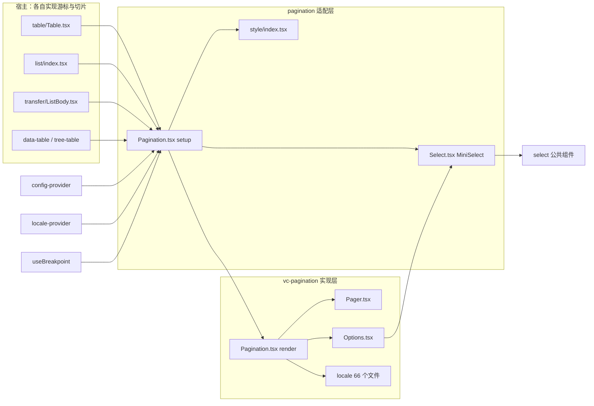
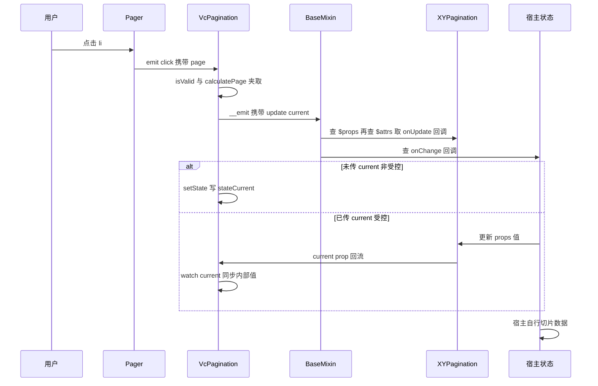
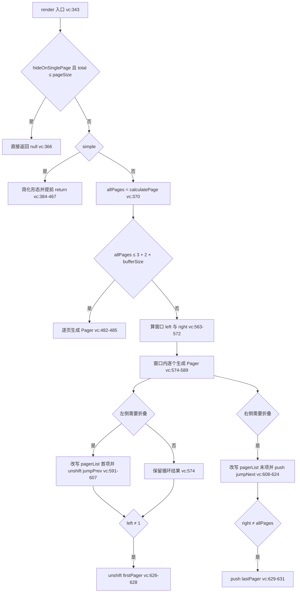

# C03-07 Pagination 分页

> **本篇解决**：`<xy-pagination>` 的公开组件只有一百七十五行、真正的分页状态机全部住在 `vc-pagination` 里——这条分层让哪些 prop 变成死 API、事件为什么不走 Vue 的 `emit`、页码窗口算法动一行会出什么事故。
> **前置**：I11 多语言体系、C03-00 导航类横写篇、C04-00 受控/非受控横写篇、I13 响应式内核 hooks　**读者坐标**：`03-components/03-navigation` 第 7/14 篇

## 一、职责与边界

`packages/xiaoye-ui/src/pagination/` 是一个**纯适配层**：它把公共组件的 prop 名、前缀类名、语言包、响应式断点、图标 VNode 与每页条数选择器组件拼成一个对象，整包交给 `packages/xiaoye-ui/src/vc-pagination/Pagination.tsx:28` 定义的底座组件渲染，自己在 `setup` 里没有维护任何分页状态（`packages/xiaoye-ui/src/pagination/Pagination.tsx:86-173`）。全部状态——当前页 `stateCurrent`、输入框暂存值 `stateCurrentInputValue`、每页条数 `statePageSize`——都在底座组件的 `data()` 里，见 `packages/xiaoye-ui/src/vc-pagination/Pagination.tsx:62-75`。

它负责的事：文本方向与 `rtl` 类名（`packages/xiaoye-ui/src/pagination/Pagination.tsx:106-112`、`packages/xiaoye-ui/src/pagination/Pagination.tsx:164`）、四组导航图标的默认实现（`packages/xiaoye-ui/src/pagination/Pagination.tsx:97-139`）、mini 尺寸判定（`packages/xiaoye-ui/src/pagination/Pagination.tsx:150-151`）、前缀类名与 `hashId` 的合并（`packages/xiaoye-ui/src/pagination/Pagination.tsx:161-168`）、语言包接收（`packages/xiaoye-ui/src/pagination/Pagination.tsx:96`）。

它明确**不负责**的事，也是本篇最容易踩空的地方：**数据切片**。分页游标改变后，「取哪一段数组」由每个宿主自己算，仓库里至少有四套独立实现：`packages/xiaoye-ui/src/table/hooks/usePagination.ts:40-73`（Table）、`packages/xiaoye-ui/src/list/index.tsx:119-126`（List）、`packages/xiaoye-ui/src/transfer/ListBody.tsx:24-43`（Transfer）、`packages/xiaoye-ui/src/data-table/DataTable.tsx:2209-2219`（DataTable），外加 `packages/xiaoye-ui/src/tree-table/TreeTable.tsx:795` 一个直接传 props 的使用点。分页组件也不负责总数一致性校验，Table 只用一条 `devWarning` 提醒（`packages/xiaoye-ui/src/table/Table.tsx:428`、`:451`）。

依赖清单（按文件计数，均已核对）：`../vc-pagination`（`packages/xiaoye-ui/src/pagination/Pagination.tsx:11`）、`../locale-provider/LocaleReceiver`（`:10`，该文件只做转发，见 `packages/xiaoye-ui/src/locale-provider/LocaleReceiver.tsx:3`）、`../config-provider/hooks/useConfigInject`（`:14`）、`../_util/hooks/useBreakpoint`（`:15`）、`./Select`（`:9`，内部再 `import VcSelect from '../select'`，见 `packages/xiaoye-ui/src/pagination/Select.tsx:2`）、`@xiaoye-ui/icons` 四个图标（`:3-8`）、`./style`（`:19`）、`../_util/classNames`（`:13`）、`../_util/type` 的 prop 辅助函数（`:16`）。底座侧另有 `../_util/BaseMixin`（`packages/xiaoye-ui/src/vc-pagination/Pagination.tsx:2`）、`../_util/props-util`（`:3`）、`./locale/zh_CN` 与 `./KeyCode`（`:6-7`）。

## 二、源码地图

| 文件 | 行数 | 职责 | 关键导出 / 入口 |
| --- | --- | --- | --- |
| `packages/xiaoye-ui/src/pagination/index.ts` | 7 | 安装与导出 | `withInstall(Pagination)`（`packages/xiaoye-ui/src/pagination/index.ts:7`） |
| `packages/xiaoye-ui/src/pagination/Pagination.tsx` | 175 | 适配层：props、图标、断点、语言、类名 | `paginationProps`（`:21`）、`paginationConfig`（`:59`）、组件定义（`:80`） |
| `packages/xiaoye-ui/src/pagination/Select.tsx` | 37 | 两个内联的尺寸选择器包装 | `MiniSelect`（`:4`）、`MiddleSelect`（`:22`） |
| `packages/xiaoye-ui/src/pagination/style/index.tsx` | 723 | CSS-in-JS 样式 | `genComponentStyleHook('Pagination', …)`（`:693`） |
| `packages/xiaoye-ui/src/pagination/index.test.js` | 6 | 仅挂载测试 | `mountTest(Pagination)`（`packages/xiaoye-ui/src/pagination/index.test.js:5`） |
| `packages/xiaoye-ui/src/vc-pagination/Pagination.tsx` | 706 | **主实现**：状态机 + 页码窗口 + 两种形态 | 组件定义 `:28`，`render` 起于 `:343` |
| `packages/xiaoye-ui/src/vc-pagination/Options.tsx` | 180 | 尺寸选择器与快速跳转 | `pageSizeOptions` 兜底默认值（`:15`） |
| `packages/xiaoye-ui/src/vc-pagination/Pager.tsx` | 78 | 单个页码 `li` | 组件定义（`:6`） |
| `packages/xiaoye-ui/src/vc-pagination/KeyCode.ts` | 14 | 键码表 | 默认导出对象（`:1`） |
| `packages/xiaoye-ui/src/vc-pagination/locale/*.ts` | 66 个文件，各 14-15 行 | 分页文案，被 `src/locale/xx_TS.ts` 逐个挂进语言包 | 例如 `zh_CN.ts:2` 的 `items_per_page` |
| `packages/xiaoye-ui/src/vc-pagination/index.ts` | 2 | 转发 + 上游出处注释 | `// based on rc-pagination 3.1.9`（`packages/xiaoye-ui/src/vc-pagination/index.ts:1`） |

主实现入口是 `packages/xiaoye-ui/src/vc-pagination/Pagination.tsx:28` 的 `defineComponent`，渲染函数 `packages/xiaoye-ui/src/vc-pagination/Pagination.tsx:343`；适配层入口是 `packages/xiaoye-ui/src/pagination/Pagination.tsx:80`。底座文件头那行 `// based on rc-pagination 3.1.9`（`packages/xiaoye-ui/src/vc-pagination/index.ts:1`）说明这一层是上游实现的移植，本篇涉及 `rc-pagination` 默认值时均按「上游遗留」标注，不作为本库现状描述。

## 三、架构与数据流

### 图 1：静态结构——适配层只有一个下游，宿主却各自造了游标



这张图要看的不是「有多少框」，而是两条不对称。**第一条**：三个宿主（`packages/xiaoye-ui/src/table/Table.tsx:6`、`packages/xiaoye-ui/src/list/index.tsx:9`、`packages/xiaoye-ui/src/transfer/ListBody.tsx:5`）都只指向同一个适配层文件，但没有任何一条边表达「谁持有游标」——因为游标同时存在于宿主（`packages/xiaoye-ui/src/table/hooks/usePagination.ts:40-47` 的 `useState`、`packages/xiaoye-ui/src/list/index.tsx:119-120` 的两个 `ref`）和底座（`packages/xiaoye-ui/src/vc-pagination/Pagination.tsx:70-74` 的 `data()`）两侧，谁生效取决于外部有没有传 `current`。这一对实现的取舍与判定写法归 C04-00 横写篇，本篇只标出分页的具体位置。**第二条**：`SEL → PUB` 这条边——为了一个每页条数下拉框，分页把公共 `select` 组件整包拖进依赖（`packages/xiaoye-ui/src/pagination/Select.tsx:2`），而 `select` 自己又带 `vc-select`/`vc-trigger`/虚拟列表。`LOC` 只连底座而不连适配层，因为适配层只拿一个文件当兜底：`packages/xiaoye-ui/src/pagination/Pagination.tsx:12` 导入 `en_US`，其余 65 个语言文件是通过 `packages/xiaoye-ui/src/locale/zh_CN.ts:2` 这类语言包聚合的，取用路径归 I11。

### 图 2：一次点击页码的完整闭环



`emit click 携带 page` 这一步依赖 Vue 的 `emit` 直接读 vnode props，`packages/xiaoye-ui/src/vc-pagination/Pager.tsx:31` 只 `emit('click', props.page)`，处理函数却是以 prop 形式传进来的（`packages/xiaoye-ui/src/vc-pagination/Pagination.tsx:474`、`:540`、`:553`）。`BaseMixin` 那一步是本篇论点 2 的主体：`packages/xiaoye-ui/src/_util/BaseMixin.ts:27-42` 的 `__emit` 完全不碰 `$emit`，只按 `onXxx` 名字去 `$props`、`$attrs` 里找函数再调用。`alt` 分支的条件判定来自 `packages/xiaoye-ui/src/vc-pagination/Pagination.tsx:240` 的 `hasProp(this, 'current')`，而 `hasProp` 的真实语义是「不等于 `undefined`」（`packages/xiaoye-ui/src/_util/props-util/index.ts:45-47`），名实差异由 C04-00 论点 1 展开，本篇不重复推导。最后一格「宿主自行切片」说明闭环并没有闭合在分页组件里：`packages/xiaoye-ui/src/table/Table.tsx:433`、`:438` 才是真正决定渲染哪几行的地方。

### 图 3：渲染分支与页码窗口裁剪



三个提前出口决定了后续所有逻辑的可见性：`packages/xiaoye-ui/src/vc-pagination/Pagination.tsx:366-368` 的 `hideOnSinglePage` 用 `total ≤ pageSize` 判定，`total` 为 `0` 时同样命中；`packages/xiaoye-ui/src/vc-pagination/Pagination.tsx:384-467` 的 `simple` 分支自带一整套 `<ul>` 并在 `:466` 直接 `return`，**根本不走 `Pager`、也不走 `Options`**，所以 `showSizeChanger`、`showQuickJumper` 的对象形式（`:377` 只在 `simple` 分支里用 `goButton` 造按钮）和 jump 按钮在简单形态下语义完全不同。中间那道 `allPages ≤ 3 + 2 × bufferSize`（`:468`，`bufferSize` 在 `:378` 由 `showLessItems` 取 `1` 或 `2`）是分水岭：小数据量走「全量列页码」，大数据量走「窗口 + 两个补丁」。两个补丁（`:591-607`、`:608-624`）不是追加节点而是**先覆盖窗口首/末项再插入 jump 节点**，这就是它们必须写成 `pagerList[0] = <Pager …/>` 的原因；`firstPager`/`lastPager`（`:535-561`）又是另一对独立节点，靠 `:626`、`:629` 两个不等式决定要不要补上。四个常量 `3`、`2`、`pageBufferSize * 2`、`1 + 2`/`allPages - 2` 互相咬合，论点 4 逐个拆。

## 四、核心机制精读

### 论点 1：适配层不写逻辑，只写「展开顺序」——对象字面量里谁在后面，谁的优先级就更高

断言：`XYPagination` 对外的可覆盖性不是由 props 声明决定的，而是由 `packages/xiaoye-ui/src/pagination/Pagination.tsx:152-170` 这个对象字面量里六个展开项的**先后位置**决定的；`...attrs` 夹在中间，导致「用户传的能盖掉适配层的默认图标，但盖不掉 `class` 和 `itemRender`」。

```tsx
// packages/xiaoye-ui/src/pagination/Pagination.tsx:142
      const {
        itemRender = slots.itemRender,
        buildOptionText = slots.buildOptionText,
        selectComponentClass,
        responsive,
        ...restProps
      } = props;

      const isSmall =
        size.value === 'small' || !!(breakpoint.value?.xs && !size.value && responsive);
      const paginationProps = {
        ...restProps,
        ...getIconsProps(prefixCls.value),
        prefixCls: prefixCls.value,
        selectPrefixCls: selectPrefixCls.value,
        selectComponentClass: selectComponentClass || (isSmall ? MiniSelect : MiddleSelect),
        locale: locale.value,
        buildOptionText,
        ...attrs,
        class: classNames(
          {
            [`${prefixCls.value}-mini`]: isSmall,
            [`${prefixCls.value}-rtl`]: direction.value === 'rtl',
          },
          attrs.class,
          hashId.value,
        ),
        itemRender,
      };
```

逐段看。`:142-148` 的解构有四件事：`itemRender` 与 `buildOptionText` 用「props 优先、slot 兜底」的写法把插槽伪装成渲染函数（因此底座里那两路 `this.$slots.buildOptionText` 兜底对公共组件用户是拿不到的，见 `packages/xiaoye-ui/src/vc-pagination/Pagination.tsx:648`，它只能拿到适配层传下来的函数）；`responsive` 被解构出来后就**再没进过** `paginationProps`——它在 `:150-151` 只参与一次布尔判断，底座压根不知道自己处于响应式模式；其余全部进 `restProps`。

`:153` 的 `...restProps` 打头，意味着后面任何同名键都会覆盖用户显式传入的 prop 值：`:155` 的 `prefixCls` 覆盖了 `paginationProps` 里声明的同名 prop（`packages/xiaoye-ui/src/pagination/Pagination.tsx:37`），所以「给分页传 `prefix-cls` 换前缀」这条路在公共层是**部分失效**的——`useConfigInject` 里确实消费了它（`packages/xiaoye-ui/src/pagination/Pagination.tsx:87`），最终值仍由 `getPrefixCls` 决定；而 `:157` 的 `selectComponentClass` 用 `||` 兜底，用户传了就用用户的，这条是真活的。

`:154` 造图标、`:160` 摊开 `attrs`，这个顺序是**有意为之的开放点**：底座声明了 `prevIcon`、`nextIcon`、`jumpPrevIcon`、`jumpNextIcon` 四个 `PropTypes.any`（`packages/xiaoye-ui/src/vc-pagination/Pagination.tsx:56-59`），但它们**没有**出现在适配层的 props 声明里，于是用户写的 `:prev-icon="myNode"` 落到 `attrs`，被 `:160` 摊在 `:154` 之后——成功覆盖适配层的默认图标。反过来，`:161` 的 `class` 写在 `...attrs` 之后，靠 `:166` 手工把 `attrs.class` 收进 `classNames` 才不会丢；`:169` 的 `itemRender` 写在最末，即使有人把 `itemRender` 当成 attr 传（例如通过 `v-bind` 对象展开一个未声明该 prop 的透传组件），也会被 `:143` 的 props/slot 值覆盖。

结论：这套顺序同时是「兼容上游 props 名单」和「开放图标自定义」两条需求的产物。它的代价是覆盖关系只能靠读行号判断，没有任何类型或运行时约束保护它；改这个字面量时必须逐键确认自己在往 `restProps` 前面还是后面插。

### 论点 2：分页的所有事件都不走 Vue 的 `emit`，`emits` 选项被注释掉了

断言：`XYPagination` 与底座之间**不存在任何一条 Vue 事件通道**，`change`、`showSizeChange`、`update:current`、`update:pageSize` 四个事件全部由 `BaseMixin.__emit` 以「按 `onXxx` 名字去 `$props` 或 `$attrs` 里捞函数并直接调用」的方式实现，因此 `wrapper.emitted('change')` 这类基于 Vue 事件系统的断言对本组件恒为空。交叉验证：`grep -rn '$emit' packages/xiaoye-ui/src/pagination packages/xiaoye-ui/src/vc-pagination` 命中 0 行；`grep -rn "emitted(" packages/xiaoye-ui/src/table/*.test.js` 也命中 0 行——仓库里唯一覆盖分页行为的测试正是用「把 `onChange` 塞进 pagination 配置对象」的方式断言的（`packages/xiaoye-ui/src/table/Table.pagination.test.js:95`、`:104`），而不是断言 Vue 事件。

```ts
// packages/xiaoye-ui/src/_util/BaseMixin.ts:27
    __emit() {
      // 直接调用事件，底层组件不需要vueTool记录events
      // eslint-disable-next-line prefer-rest-params
      const args = [].slice.call(arguments, 0);
      let eventName = args[0];
      eventName = `on${eventName[0].toUpperCase()}${eventName.substring(1)}`;
      const event = this.$props[eventName] || this.$attrs[eventName];
      if (args.length && event) {
        if (Array.isArray(event)) {
          for (let i = 0, l = event.length; i < l; i++) {
            event[i](...args.slice(1));
          }
        } else {
          event(...args.slice(1));
        }
      }
    },
```

底座侧一共七次调用它，集中在两个方法里：

```tsx
// packages/xiaoye-ui/src/vc-pagination/Pagination.tsx:223
      this.__emit('update:pageSize', size);
      if (current !== preCurrent) {
        this.__emit('update:current', current);
      }
      this.__emit('showSizeChange', current, size);
      this.__emit('change', current, size);
```

```tsx
// packages/xiaoye-ui/src/vc-pagination/Pagination.tsx:246
        // this.__emit('input', page)
        this.__emit('update:current', page);
        this.__emit('change', page, this.statePageSize);
```

前者属于 `changePageSize`（`packages/xiaoye-ui/src/vc-pagination/Pagination.tsx:200-229`），后者属于 `handleChange`（`packages/xiaoye-ui/src/vc-pagination/Pagination.tsx:230-252`）；`packages/xiaoye-ui/src/vc-pagination/Pagination.tsx:246` 那行被注释掉的 `input` 说明上游曾用过 Vue 2 的 `v-model` 事件形态，本库改成了 `update:current`。

关键在 `:33` 这一行：`this.$props[eventName] || this.$attrs[eventName]`。适配层把四个事件**全部声明成 props**（`packages/xiaoye-ui/src/pagination/Pagination.tsx:52-55`，其中 `'onUpdate:current'` 用的是带冒号的键名，正是为了接 `v-model:current`），底座组件自己没有声明它们，所以从底座视角它们出现在 `$attrs` 里，走的是 `||` 的右半边。这条链路也解释了 `packages/xiaoye-ui/src/pagination/Pagination.tsx:85` 那行为什么整行注释掉：

```tsx
// packages/xiaoye-ui/src/pagination/Pagination.tsx:84
  props: paginationProps(),
  // emits: ['change', 'showSizeChange', 'update:current', 'update:pageSize'],
  setup(props, { slots, attrs }) {
```

如果补上 `emits` 声明，对本组件当下不会有任何可见变化——但这行注释标记的是一条真实约束：**四个回调必须继续留在 props 名单里**。链路成立的前提是它们出现在适配层传给底座的那份对象中（`packages/xiaoye-ui/src/pagination/Pagination.tsx:153` 的 `...restProps`），底座再用 `packages/xiaoye-ui/src/_util/BaseMixin.ts:33` 的两级查找拿到它们；一旦把它们改成真正的 `emits` 并从 `paginationProps()` 移除，`...restProps` 就带不上它们，`__emit` 的两次查找同时落空，四条事件全部静默失效且没有任何报错。反向证据也可以自查：`grep -rn '\$emit' packages/xiaoye-ui/src/pagination packages/xiaoye-ui/src/vc-pagination` 命中 0 行，即整个分页目录里**没有一处调用 Vue 的事件发射接口**，`packages/xiaoye-ui/src/pagination/Pagination.tsx:85` 的注释因此不是「被禁用的功能」，而是「从未存在过的功能」。至于 Vue 运行时对 `emits` 与同名 prop 声明的优先级，本篇未在仓库源码中取证，不作断言。

副作用有三个，都需要写进维护预期：其一，`__emit` 用 `eventName[0].toUpperCase()` 手工拼 `onXxx`（`packages/xiaoye-ui/src/_util/BaseMixin.ts:32`），对 `update:pageSize` 拼出的是 `onUpdate:pageSize`，键名必须逐字符对上 props 声明（`packages/xiaoye-ui/src/pagination/Pagination.tsx:55` 正是这个拼法），改任何一侧的大小写都会静默失联；其二，`changePageSize` 在同一次操作里连发 `showSizeChange` 与 `change`（`packages/xiaoye-ui/src/vc-pagination/Pagination.tsx:227-228`），宿主若两者都监听会各收到一次，Table 因此在自己的 `onChange` 上又叠了一层 `onInternalChange`（`packages/xiaoye-ui/src/table/hooks/usePagination.ts:75-81`、`:87`）；其三，`Array.isArray(event)` 分支（`packages/xiaoye-ui/src/_util/BaseMixin.ts:35-38`）说明同一事件传数组会被逐个调用，这是从 Vue 2 `$listeners` 归一化时代留下的形状，当前源码里没有任何调用方依赖它。

### 论点 3：分页状态机是 Options API 的 `data()` + 四个 `watch`，适配层一行状态都没有，但同一个「夹取到合法页」的算式被写了四遍

断言：`stateCurrent` 的唯一真源是 `packages/xiaoye-ui/src/vc-pagination/Pagination.tsx:62-75` 的 `data()`，`current`/`pageSize`/`total` 三个 prop 各配一个 `watch` 把外部值搬进去，而「把 current 夹到最后一页」这条算式在同一个文件里出现了四次、在宿主侧又出现了两次。

```ts
// packages/xiaoye-ui/src/vc-pagination/Pagination.tsx:62
  data() {
    const props = this.$props;
    let current = firstNotUndefined([this.current, this.defaultCurrent]);

    const pageSize = firstNotUndefined([this.pageSize, this.defaultPageSize]);

    current = Math.min(current, calculatePage(pageSize, undefined, props));

    return {
      stateCurrent: current,
      stateCurrentInputValue: current,
      statePageSize: pageSize,
    };
  },
```

```ts
// packages/xiaoye-ui/src/vc-pagination/Pagination.tsx:23
function calculatePage(p, state, props) {
  const pageSize = typeof p === 'undefined' ? state.statePageSize : p;
  return Math.floor((props.total - 1) / pageSize) + 1;
}
```

先看 `packages/xiaoye-ui/src/vc-pagination/Pagination.tsx:64` 与 `:66`：`firstNotUndefined`（`packages/xiaoye-ui/src/_util/firstNotUndefined.ts:1-8`）只比 `undefined`，而 `current` 与 `pageSize` 在 props 表里没有默认值（`packages/xiaoye-ui/src/vc-pagination/Pagination.tsx:37`、`:40`），`defaultCurrent`/`defaultPageSize` 却带了 `1` 和 `10`（`packages/xiaoye-ui/src/vc-pagination/Pagination.tsx:38`、`:41`）。这个组合的实际含义是：**「不传 `current`」与「传 `current=undefined`」在初始化时等价**，但后续所有写入判定用的是同一个语义（`packages/xiaoye-ui/src/vc-pagination/Pagination.tsx:88`、`:211`、`:216`、`:240` 四处 `hasProp`）。

再看 `packages/xiaoye-ui/src/vc-pagination/Pagination.tsx:68` 这行夹取：它调用 `calculatePage(pageSize, undefined, props)`，第二个参数直接给 `undefined`——因为 `calculatePage` 只在 `p` 为 `undefined` 时才去读 `state.statePageSize`（`packages/xiaoye-ui/src/vc-pagination/Pagination.tsx:24`）。也就是说这个函数靠「传参就绝不碰 state、不传参就必须有 state」的隐含约定工作，而 `packages/xiaoye-ui/src/vc-pagination/Pagination.tsx:110` 的 `calculatePage(this.pageSize, this.$data, this.$props)` 恰好走的是「传了 `undefined` 又给出 `$data`」的组合。四个调用点（`:68`、`:110`、`:133`、`:146`、`:234`、`:273`、`:370`）传参形式各不相同，是全文件最难读的一段。

`watch.total` 是这条链上语义最绕的一个：

```ts
// packages/xiaoye-ui/src/vc-pagination/Pagination.tsx:108
    total() {
      const newState: any = {};
      const newCurrent = calculatePage(this.pageSize, this.$data, this.$props);
      if (hasProp(this, 'current')) {
        const current = Math.min(this.current, newCurrent);
        newState.stateCurrent = current;
        newState.stateCurrentInputValue = current;
      } else {
        let current = this.stateCurrent;
        if (current === 0 && newCurrent > 0) {
          current = 1;
        } else {
          current = Math.min(this.stateCurrent, newCurrent);
        }
        newState.stateCurrent = current;
      }
      this.setState(newState);
    },
```

注意 `:111-114`：受控模式下 `total` 变化时**写的仍是内部值** `stateCurrent`，而不发任何事件。外部若把 `current` 钉在 `5`、然后把 `total` 缩到只剩 3 页，分页会渲染第 3 页的高亮，但调用方的 `current` 仍然是 `5`，`change` 也不会补发一次——状态在这里就分叉了。非受控分支的 `:117-119` 则专门处理「旧 `total` 为 0 导致 `stateCurrent` 被算成 0」的回正，这是 `calculatePage` 在 `total=0` 时返回 `Math.floor(-1 / pageSize) + 1 = 0`（`packages/xiaoye-ui/src/vc-pagination/Pagination.tsx:25`）的直接后果。

同一算式的其它副本：`packages/xiaoye-ui/src/table/hooks/usePagination.ts:59` 用 `Math.ceil(total / pageSize)` 再 `:60-62` 夹取，形状与 `calculatePage` 不同（`ceil` 对 `total=0` 得 `0`，因此那里额外写了 `maxPage || 1`）；`packages/xiaoye-ui/src/list/index.tsx:119-126` 与 `packages/xiaoye-ui/src/transfer/ListBody.tsx:24-43` 各自又用 `ref` 和 `parsePagination` 维护一份游标。三套实现都不共享 `calculatePage`，改分页数语义时**必须逐处改**，这是本篇论点级风险最高的地方。

### 论点 4：页码窗口靠「窗口 + 覆盖首末项 + 两个硬编码 `2` 的邻接排除」，那两个 `2` 对默认密度是死条件、对 `showLessItems` 是承重墙

断言：`packages/xiaoye-ui/src/vc-pagination/Pagination.tsx:591` 的 `stateCurrent !== 1 + 2` 与 `:608` 的 `stateCurrent !== allPages - 2` 里的 `2` 没有写成同文件 `:378` 的 `pageBufferSize`，导致它们在 `showLessItems` 为 `false`（缓冲 `2`）时恒为真、在 `showLessItems` 为 `true`（缓冲 `1`）时才是唯一阻止重复页码的条件。

```ts
// packages/xiaoye-ui/src/vc-pagination/Pagination.tsx:563
      let left = Math.max(1, stateCurrent - pageBufferSize);
      let right = Math.min(stateCurrent + pageBufferSize, allPages);

      if (stateCurrent - 1 <= pageBufferSize) {
        right = 1 + pageBufferSize * 2;
      }

      if (allPages - stateCurrent <= pageBufferSize) {
        left = allPages - pageBufferSize * 2;
      }
```

```tsx
// packages/xiaoye-ui/src/vc-pagination/Pagination.tsx:591
      if (stateCurrent - 1 >= pageBufferSize * 2 && stateCurrent !== 1 + 2) {
        pagerList[0] = (
          <Pager
            locale={locale}
            rootPrefixCls={prefixCls}
            onClick={this.handleChange}
            onKeypress={this.runIfActivate}
            key={left}
            page={left}
            class={`${prefixCls}-item-after-jump-prev`}
            active={false}
            showTitle={this.showTitle}
            itemRender={itemRender}
          />
        );
        pagerList.unshift(jumpPrev);
      }
```

`:563-564` 先给出以当前页为中心、半径 `pageBufferSize` 的窗口；`:566-568` 与 `:570-572` 是两条「贴边就把窗口整体撑到 5 项」的补偿——注意它们改的是**宽度而不是中心**，所以当前页在首屏时会偏左、在末屏时偏右，这是刻意的视觉稳定性，不是 off-by-one。真正让 `:591` 的补丁必须存在的原因是：窗口左沿 `left` 可能大于 `1 + 1`，此时页码序列会留下空洞，于是补丁做两件事——把已经渲染好的 `pagerList[0]` **原地替换**成带 `-item-after-jump-prev` 类的同一个页码（`:592-605`），再 `unshift(jumpPrev)`（`:606`），最后由 `:626-628` 补上 `firstPager`。

`active={false}`（`packages/xiaoye-ui/src/vc-pagination/Pagination.tsx:601`、`:618`）是硬编码的，它成立的唯一理由是 `:591`/`:608` 的前半条件保证了被替换项不是当前页：`stateCurrent - 1 >= pageBufferSize * 2` 意味着 `left = stateCurrent - pageBufferSize >= 1 + pageBufferSize`，与当前页至少隔一项。**把 `pageBufferSize * 2` 改成 `pageBufferSize`（很像是「简化条件」）会让 `left` 恰好等于当前页，而该项被强制 `active={false}`，表现为点了第 5 页却没有任何高亮。**

回到那两个 `2`。以 `showLessItems`（`pageBufferSize = 1`）为例：当前页 `3`、总页 `20` 时，`stateCurrent - 1 = 2 >= 2` 成立，窗口是 `[2,4]`，若没有 `stateCurrent !== 1 + 2` 这条排除，序列会变成 `firstPager(1)`、`jumpPrev`、`2`、`3`、`4`——省略号出现在 `1` 与 `2` 之间，跳过了一个不存在的页。这条排除正是为缓冲 `1` 写的。而在默认 `pageBufferSize = 2` 时，进入补丁要求 `stateCurrent >= 5`，`stateCurrent !== 3` 恒真，于是它看起来像死代码。同一行的两种身份使得「按默认路径跑一遍再把死条件删掉」这种清理动作必然引入 bug；`:608` 的右侧对称条件同理（进入要求 `stateCurrent <= allPages - 4`，故 `!== allPages - 2` 在默认密度下恒真）。

### 论点 5：一个「每页条数」下拉框把公共 `select` 整包拖进分页数，而它的子组件靠组件选项对象上的裸属性存活

断言：`pagination/Select.tsx` 不是薄封装，它把 `../select` 的完整 props 表复制了一遍（`packages/xiaoye-ui/src/pagination/Select.tsx:8`），并把 `Option` 作为**未知选项键**挂在选项对象上（`:9`、`:26`）；`Options.tsx` 之后用 `<Select.Option>` 的属性访问方式渲染选项，而不是注册名，这条约定一旦被「规范化成 `components: { Option }`」就会立刻崩。

```tsx
// packages/xiaoye-ui/src/pagination/Select.tsx:4
export default defineComponent({
  name: 'MiniSelect',
  compatConfig: { MODE: 3 },
  inheritAttrs: false,
  props: selectProps(),
  Option: VcSelect.Option,
  setup(props, { attrs, slots }) {
    return () => {
      const selelctProps: any = {
        ...props,
        size: 'small',
        ...attrs,
      };
      return <VcSelect {...selelctProps} v-slots={slots}></VcSelect>;
    };
  },
});
```

```tsx
// packages/xiaoye-ui/src/vc-pagination/Options.tsx:104
      if (changeSize && Select) {
        const buildOptionText = props.buildOptionText || defaultBuildOptionText;
        const options = pageSizeOptions.value.map((opt, i) => (
          <Select.Option key={i} value={opt}>
            {buildOptionText({ value: opt })}
          </Select.Option>
        ));

        changeSelect = (
          <Select
            disabled={disabled}
            prefixCls={selectPrefixCls}
            showSearch={false}
            class={`${prefixCls}-size-changer`}
            optionLabelProp="children"
            value={(pageSize || pageSizeOptions.value[0]).toString()}
            onChange={value => changeSize(Number(value))}
            getPopupContainer={triggerNode => triggerNode.parentNode}
          >
            {options}
          </Select>
        );
      }
```

`packages/xiaoye-ui/src/pagination/Select.tsx:2` 导入的是 `../select`——公共 `XYSelect`，不是某个轻量底座，于是 `import { Pagination } from 'xiaoye-ui'` 的传递依赖里必然出现 `select`（`select/index.tsx:5` 又继续引 `../vc-select`）。`Option: VcSelect.Option` 这一行有两个细节：其一，`defineComponent` 会把未知键当普通自身属性保留，因此 `MiniSelect.Option` 在 JS 层面拿得到，而公共 `select` 自己也是用同样的手法把 `Option` 挂上去的（`packages/xiaoye-ui/src/select/index.tsx:75`、`:330`）；其二，因为它是自身属性而不是 `components` 注册，模板写法 `<template #buildOptionText>` 之类的插槽能透传（`:17` 的 `v-slots={slots}`），但**任何按注册名解析 `Option` 的用法都拿不到**——只有 JSX 的属性访问（`Options.tsx:107`）能工作。这也解释了为什么 `selectComponentClass` 必须是「带 `.Option` 属性的组件对象」：换一个没有该属性的组件，崩溃点在 `packages/xiaoye-ui/src/vc-pagination/Options.tsx:107` 而不是校验阶段。

`packages/xiaoye-ui/src/pagination/Select.tsx:12-16` 的展开顺序是 `...props` → `size: 'small'` → `...attrs`：attr 能盖掉 `size`，这是 MiniSelect 唯一的定制口；而 `MiddleSelect`（`:22-37`）与它除了 `size` 字面量之外完全同构，是同一逻辑的两份拷贝。

第三条证据在样式里：

```tsx
// packages/xiaoye-ui/src/pagination/style/index.tsx:446
    [`${componentCls}-options`]: {
      display: 'inline-block',
      marginInlineStart: token.margin,
      verticalAlign: 'middle',

      '&-size-changer.-select': {
        display: 'inline-block',
        width: 'auto',
      },
```

`packages/xiaoye-ui/src/pagination/style/index.tsx:451` 展开后的完整选择器是 `.xy-pagination-options-size-changer.-select`，它要求同一个元素上存在一个字面名为 `-select` 的类。而该元素上的 select 类名全部来自 `getPrefixCls('select', props.selectPrefixCls)`（`packages/xiaoye-ui/src/pagination/Pagination.tsx:92-94`），产出形态恒为 `xy-select`；用 `grep -rn "'-select'" packages/xiaoye-ui/src --include='*.ts' --include='*.tsx'` 复查，命中 0 行。所以这条规则**永远不命中**，`:452-453` 的 `display: inline-block; width: auto` 实际由别处的样式或 select 自身提供。同文件 `packages/xiaoye-ui/src/pagination/style/index.tsx:205-207` 还有一条 mini 密度下的 `&-size-changer { top: … }`，其取值来自 `packages/xiaoye-ui/src/pagination/style/index.tsx:721` 的 `paginationMiniOptionsSizeChangerTop: 0`——展开后恒等于 `top: 0`，是一次空写；而分页样式表里仅有两条 `position` 声明（`packages/xiaoye-ui/src/pagination/style/index.tsx:314`、`:316`），都落在 jump 图标的容器上，与尺寸选择器无关，这条 `top` 因此没有任何可依赖的定位上下文。两处都是「类名生成了但规则落空」，属于上游 less 到 CSS-in-JS 移植期的遗留形状（本篇按遗留标注，不作为本库现状设计）。

### 论点 6：全局配置对分页是断的——`ConfigProvider.pagination` 是死键，`ConfigProvider.disabled` 也没有接入点

断言：`ConfigProvider` 声明并注入了 `pagination.showSizeChanger`，但 `useConfigInject` 的返回对象里没有 `pagination` 这一项，分页组件也从不解构 `disabled`，于是两个「看起来是全局开关」的配置对本组件完全无效。

```ts
// packages/xiaoye-ui/src/config-provider/hooks/useConfigInject.ts:50
  return {
    configProvider,
    prefixCls,
    direction,
    size,
    getTargetContainer,
    getPopupContainer,
    space,
    pageHeader,
    form,
    autoInsertSpaceInButton,
    renderEmpty,
    virtual,
    dropdownMatchSelectWidth,
    rootPrefixCls,
    getPrefixCls: configProvider.getPrefixCls,
    autocomplete,
    csp,
    iconPrefixCls,
    disabled,
    select: configProvider.select,
    wave,
    ripple,
  };
```

```tsx
// packages/xiaoye-ui/src/pagination/Pagination.tsx:86
  setup(props, { slots, attrs }) {
    const { prefixCls, configProvider, direction, size } = useConfigInject('pagination', props);

    // style
    const [wrapSSR, hashId] = useStyle(prefixCls);

    const selectPrefixCls = computed(() =>
      configProvider.getPrefixCls('select', props.selectPrefixCls),
    );
    const breakpoint = useBreakpoint();
    const [locale] = useLocaleReceiver('Pagination', enUS, toRef(props, 'locale'));
```

上游链路是通的：props 声明在 `packages/xiaoye-ui/src/config-provider/context.ts:101-103`，内部类型在 `packages/xiaoye-ui/src/config-provider/context.ts:139-141`，`ConfigProvider` 自己也在 `packages/xiaoye-ui/src/config-provider/index.tsx:128-129` 做了「本级优先、父级兜底」的合并，并在 `packages/xiaoye-ui/src/config-provider/index.tsx:172` 放进 provide 的上下文对象。断点只在最后一跳：上面的 `useConfigInject` 返回块逐个列出了被消费的键（`form`、`select`、`space`、`pageHeader`、`autocomplete`、`csp`、`wave`、`ripple` 等），**`pagination` 不在其中**，因此没有任何组件能从 `useConfigInject` 拿到它；而 `grep -rn "showSizeChanger" packages/xiaoye-ui/src --include='*.ts' --include='*.tsx'` 显示，除 `packages/xiaoye-ui/src/vc-pagination/Pagination.tsx:276-278` 的 prop 读取外，其余命中全是宿主显式传 props（`packages/xiaoye-ui/src/transfer/ListBody.tsx:32`、`packages/xiaoye-ui/src/tree-table/TreeTable.tsx:795`、`packages/xiaoye-ui/src/data-table/DataTable.tsx:2633`）。

同一个 `setup` 的第二处断点是 `disabled`：`packages/xiaoye-ui/src/pagination/Pagination.tsx:86` 只解构四个键，`disabled` 被丢弃，分页组件也不在 `DisabledContext` 的消费者名单里（对照 `packages/xiaoye-ui/src/config-provider/DisabledContext.ts` 的引用面，`radio`、`checkbox`、`input`、`select`、`switch`、`button` 等十数个组件都引了它，`pagination` 与 `vc-pagination` 两个目录合计 0 处）。因此 `<ConfigProvider :disabled="true">` 包住的表单控件会齐刷刷变灰，只有分页——包括它内嵌的那个 select——仍可点击。底座里真正生效的禁用只有一条来源：`packages/xiaoye-ui/src/vc-pagination/Pagination.tsx:231` 的 `const { disabled } = this.$props;` 与 `packages/xiaoye-ui/src/vc-pagination/Pagination.tsx:233` 的 `&& !disabled` 判定，以及渲染期拼的 `${prefixCls}-disabled` 类（`packages/xiaoye-ui/src/vc-pagination/Pagination.tsx:655`）。

还有一处默认值不来自全局配置：`showSizeChanger` 的默认开关由 `total > totalBoundaryShowSizeChanger` 硬阈值决定——`packages/xiaoye-ui/src/vc-pagination/Pagination.tsx:275-281`，阈值默认 `50` 来自 `packages/xiaoye-ui/src/vc-pagination/Pagination.tsx:60`，适配层把它作为透传 prop 暴露（`packages/xiaoye-ui/src/pagination/Pagination.tsx:39`）但没有列进文档属性表。

### 论点 7：适配层与底座之间的 props 名单不等长，差集要么退化成 DOM attribute，要么靠 `$attrs` 撞进底座的 props

断言：`paginationProps()` 声明的 `size`、`role` 两个键在底座的 props 表里不存在，它们会穿过 `splitAttrs` 落进 `extraAttrs` 并被摊到 `<ul>` 上成为真实 DOM attribute；反过来，底座声明的 `showTitle`、`showPrevNextJumpers` 不在适配层名单里，只能通过 attrs 一路透传，既没有类型也没有校验。

```ts
// packages/xiaoye-ui/src/_util/props-util/index.ts:12
const splitAttrs = (attrs: any) => {
  const allAttrs = Object.keys(attrs);
  const eventAttrs: Record<string, any> = {};
  const onEvents: Record<string, any> = {};
  const extraAttrs: Record<string, any> = {};
  for (let i = 0, l = allAttrs.length; i < l; i++) {
    const key = allAttrs[i];
    if (isOn(key)) {
      eventAttrs[key[2].toLowerCase() + key.slice(3)] = attrs[key];
      onEvents[key] = attrs[key];
    } else {
      extraAttrs[key] = attrs[key];
    }
  }
  return { onEvents, events: eventAttrs, extraAttrs };
};
```

```tsx
// packages/xiaoye-ui/src/vc-pagination/Pagination.tsx:363
    const { stateCurrent, statePageSize } = this;
    const { class: className, ...restAttrs } = splitAttrs(this.$attrs).extraAttrs;
    // When hideOnSinglePage is true and there is only 1 page, hide the pager
    if (hideOnSinglePage === true && this.total <= statePageSize) {
      return null;
    }
```

分流规则取决于 `isOn`，而 `isOn` 的实现是 `const onRE = /^on[^a-z]/;`（`packages/xiaoye-ui/src/_util/util.ts:9`、`:10`）——**只有 `on` 后接非小写字母的键才算事件**。于是 `onChange`、`onShowSizeChange`、`onUpdate:current` 被剔出 `extraAttrs`（`packages/xiaoye-ui/src/_util/props-util/index.ts:19-21`），不会变成 `<ul>` 上的原生监听器；而 `size`、`role` 走 `else` 分支进 `extraAttrs`（`packages/xiaoye-ui/src/_util/props-util/index.ts:22-24`），在 `packages/xiaoye-ui/src/vc-pagination/Pagination.tsx:653` 的 `{...restAttrs}` 处被写进 `<ul>`。`size` 是适配层文档化的公开 prop（`packages/xiaoye-ui/src/pagination/Pagination.tsx:34`），因此这条 DOM 泄漏出现在默认路径上：`<xy-pagination size="small">` 渲染出 `<ul class="xy-pagination xy-pagination-mini …" size="small">`。`<ul>` 上没有合法的 `size` 属性，它不会报错，但会出现在 `outerHTML`、快照与 `styleChecker` 类断言之类的校验产物里。`role` 反而歪打正着——它本来就是 ARIA 属性，摊到 `<ul>` 上正是调用方想要的效果。

底座 props 表（`packages/xiaoye-ui/src/vc-pagination/Pagination.tsx:33-61`）与适配层表（`packages/xiaoye-ui/src/pagination/Pagination.tsx:21-56`）的差集是三份不同的名单：只在下层存在的 `showTitle`（`packages/xiaoye-ui/src/vc-pagination/Pagination.tsx:49`）、`showPrevNextJumpers`（`packages/xiaoye-ui/src/vc-pagination/Pagination.tsx:47`）、四个图标（`:56-59`），只在上层存在的 `size`、`role`、`responsive`（`packages/xiaoye-ui/src/pagination/Pagination.tsx:34`、`:49`、`:50`）与四个事件回调（`:52-55`）。`showPrevNextJumpers` 全仓仅 3 处命中（声明 `:47`、解构 `:356`、判定 `:489`），公共文档里没有任何一行提到它（`apps/docs/components/pagination.md` 的属性表只列了 15 个属性与 2 个事件），它今天能不能被外部关掉，完全取决于 Vue 对未声明 attr 的键名归一化行为，而不取决于任何声明。结论：这套两层结构的公开 API 面**不是 props 声明决定的，而是「声明 ∪ attrs 可达」决定的**，任何只做「声明即 API」审计的工具都会得到错误名单。

## 五、对外契约如何生效

**props 的入口只有一处**。`packages/xiaoye-ui/src/pagination/Pagination.tsx:84` 用 `props: paginationProps()` 声明，注意它**没有**包 `initDefaultProps`（对照根目录 `AGENTS.md` 的模板），全部默认值都靠底座 `packages/xiaoye-ui/src/vc-pagination/Pagination.tsx:33-61` 自己给。渲染期每次都不缓存：`packages/xiaoye-ui/src/pagination/Pagination.tsx:141` 返回的函数体里同时做了 props 解构（`:142-148`）、mini 判定（`:150-151`）、图标 VNode 构造（`:154` 调 `:97-139`）与对象拼装，所以父组件任意一次重渲染都会重建四个图标子树——包括 `simple` 形态根本不会渲染 jump 图标的场景（`packages/xiaoye-ui/src/vc-pagination/Pagination.tsx:384-467` 的分支里只用了 `prevIcon`/`nextIcon`，见 `:430`、`:462`）。

**slots 走的是「伪装成 prop」**。组件既没有 `slots: Object` 声明，也没有 `expose`：`packages/xiaoye-ui/src/pagination/Pagination.tsx:86` 的 setup 形参只取了 `props, { slots, attrs }`，`slots` 唯一用途是 `:143-144` 的两次兜底解构。因此 `#itemRender`、`#buildOptionText` 两个插槽没有开发期名字校验，写错插槽名不会有任何提示；底座侧 `packages/xiaoye-ui/src/vc-pagination/Pagination.tsx:648` 的 `this.$slots.buildOptionText` 分支对本组件恒为假，因为插槽挂在适配层实例上、底座拿不到。

**class 与样式**。`packages/xiaoye-ui/src/pagination/Pagination.tsx:83` 与 `packages/xiaoye-ui/src/vc-pagination/Pagination.tsx:32` 都写了 `inheritAttrs: false`，前者靠 `:161-168` 手工合并 `attrs.class` 与 `hashId`（`:167`），后者靠 `:364` 的 `splitAttrs` 把 `class` 摘出来再在 `:654-657` 拼回。真正给 `<ul>` 的状态类名只有四种：`xy-pagination`、`xy-pagination-disabled`（`packages/xiaoye-ui/src/vc-pagination/Pagination.tsx:655`）、`xy-pagination-mini`、`xy-pagination-rtl`（`packages/xiaoye-ui/src/pagination/Pagination.tsx:162-165`），再加上 `hashId` 与来自 attrs 的 `className`（`packages/xiaoye-ui/src/vc-pagination/Pagination.tsx:654-657`）；`simple` 分支另有一套，多拼一个 `-simple`（`packages/xiaoye-ui/src/vc-pagination/Pagination.tsx:411-415`），但同样带 `-disabled`。其中 `-rtl` 对应的样式只有一条 `direction: rtl`（`packages/xiaoye-ui/src/pagination/style/index.tsx:606-608`），其余方向差异全靠逻辑属性（例如 `packages/xiaoye-ui/src/pagination/style/index.tsx:424-427` 的 `marginInlineStart/End`）。图标方向翻转则在 JS 里做（`packages/xiaoye-ui/src/pagination/Pagination.tsx:106`、`:111`、`:117-121`）。

**无障碍契约是这套分层里唯一「上下两层都写了一遍」的部分**，且两边的口径互相引用：适配层把图标标成装饰（`aria-hidden` 与 `tabindex={-1}`，见 `packages/xiaoye-ui/src/pagination/Pagination.tsx:100`、`:105`、`:115`），底座把 `<li>` 声明为 `role="button"` 并给出 `aria-label`/`aria-disabled`（`packages/xiaoye-ui/src/vc-pagination/Pagination.tsx:426-428`、`:500-502`、`:668-670`），`Pager` 再补 `aria-current="page"`（`packages/xiaoye-ui/src/vc-pagination/Pager.tsx:60`）。键盘激活集中在 `runIfActivate`（`packages/xiaoye-ui/src/vc-pagination/Pagination.tsx:287-297`），它同时接受 `Enter`、`' '`、`'Spacebar'` 与 `charCode === 13` 四种判据，并显式 `preventDefault()` 阻止空格滚页；跳页输入框那条路用的是另一套 `keyCode` 判定（`packages/xiaoye-ui/src/vc-pagination/Pagination.tsx:177-199`，键码表在 `packages/xiaoye-ui/src/vc-pagination/KeyCode.ts:1-14`）。

**对外暴露的 ref 面为空**。适配层没有 `expose`（`packages/xiaoye-ui/src/pagination/Pagination.tsx:86` 的形参里就没有 `expose`），底座也没有；四个宿主全都通过 props 驱动而不是命令式调用，例如 `packages/xiaoye-ui/src/table/Table.tsx:546-554` 只传 props。这意味着想「程序化跳到第 N 页」的唯一写法是把 `current` 变成受控值（`packages/xiaoye-ui/src/pagination/Pagination.tsx:26`），配合 `packages/xiaoye-ui/src/table/hooks/usePagination.ts:67-73` 那类 `refreshPagination`。

## 六、设计取舍

**取舍一：底座保留 Options API + `data()` + `setState`，不接入 `useMergedState`。** 底座文件头写着上游出处（`packages/xiaoye-ui/src/vc-pagination/index.ts:1`），整套 `mixins: [BaseMixin]`（`packages/xiaoye-ui/src/vc-pagination/Pagination.tsx:31`）把 React 的 `setState` 语义搬了过来：`packages/xiaoye-ui/src/_util/BaseMixin.ts:19-22` 直接 `Object.assign(this.$data, newState)` 并在已挂载时 `$forceUpdate()`。换来的是「上游行为逐行对齐、移植成本近零」，赔上的是：状态既不由 `ref` 也不由 `reactive` 驱动，任何依赖 props 响应式追踪的工具（含 I13 里那套受控 hook）都看不见它；同时 `getDerivedStateFromProps` 的挂钩（`packages/xiaoye-ui/src/_util/BaseMixin.ts:8-18`）在本仓库没有任何分页侧实现，是一条空转分支。同层其它 `vc-*` 也已有的这套 mixin 机制不属本篇主题。

**取舍二：事件用 `onXxx` prop 而不是 `emit`。** 见论点 2。换来的是底座与适配层之间不需要任何桥接代码（`packages/xiaoye-ui/src/vc-pagination/Pagination.tsx:223-228` 直接调 props），赔上的是 `emits` 声明变成负债（`packages/xiaoye-ui/src/pagination/Pagination.tsx:85` 只能注释）、`change` 与 `showSizeChange` 在同一次操作里各发一次、宿主必须像 Table 那样自己叠加内部回调（`packages/xiaoye-ui/src/table/hooks/usePagination.ts:83-88`）。

**取舍三：图标默认实现在适配层用 VNode 硬造，而不是在底座留插槽。** 换来「一次注入四个图标」（`packages/xiaoye-ui/src/pagination/Pagination.tsx:97-139`，含 rtl 两套方向），赔上「每次渲染重建 VNode + 与底座默认按钮重复一套」（底座在无图标时会自己造 `<button class="${prefixCls}-item-link" />`，见 `packages/xiaoye-ui/src/vc-pagination/Pagination.tsx:139-142`）。

**取舍四：不给 Pagination 开 Component Token。** `packages/xiaoye-ui/src/theme/interface/components.ts:111` 里这一项是 `Pagination?: {};`——空对象；组件专属值全部在 `packages/xiaoye-ui/src/pagination/style/index.tsx:710-735` 用 `mergeToken` 就地派生（例如 `paginationItemSize: token.controlHeight`、`paginationMiniQuickJumperInputWidth: token.controlHeightLG * 1.1`），且 `PaginationToken` 接口本身没有 `export`（`packages/xiaoye-ui/src/pagination/style/index.tsx:12`）。换来的是零个需要维护的公开组件 token，赔上的是用户无法通过 `ConfigProvider` 的 `theme.components.Pagination` 改页码尺寸——只能改全局 `controlHeight`，而那会同时改动按钮、输入框、选择器的高度。同一个文件还 `import { genBasicInputStyle, genInputSmallStyle, initInputToken } from '../../input/style'`（`packages/xiaoye-ui/src/pagination/style/index.tsx:3-4`、`:717`），把跳页输入框的基础样式在分页的样式表里再展开一遍（`:447`、`:214`）——一份 DOM（`packages/xiaoye-ui/src/vc-pagination/Options.tsx:156-165` 的裸 `BaseInput`，不是 `XYInput`），两份 CSS。

**取舍五：语言包放在 `vc-pagination/locale/` 而不是 `locale/`。** 66 个文件（`packages/xiaoye-ui/src/vc-pagination/locale/` 目录实测计数）保持上游目录形状，公共语言包再逐个引回去（`packages/xiaoye-ui/src/locale/zh_CN.ts:2`）。代价之一是兜底语言不一致：底座默认 `zh_CN`（`packages/xiaoye-ui/src/vc-pagination/Pagination.tsx:6`、`:54`），适配层默认 `en_US`（`packages/xiaoye-ui/src/pagination/Pagination.tsx:12`、`:96`），只有绕过适配层直接用底座时才会踩到中文兜底。装配路径与语言包优先级归 I11 多语言体系，本篇不重复。

## 七、坑与改动指南

**坑 1：`Pager` 的 `emits` 声明拼成了 `eimt`，按「事件声明」审计会得到空名单。**
触发：想确认 `click`/`keypress` 是否已被声明为组件事件，或据此判断它们会不会随 attrs 落到 `<li>` 上。症状：`grep -n "emits" packages/xiaoye-ui/src/vc-pagination/Pager.tsx` 命中 0 行——那份名单写成了 `eimt: ['click', 'keypress']`，键名拼错，`Pager` 实际上没有任何事件声明面，只有 `props.onClick`/`props.onKeypress` 两个函数 prop（`packages/xiaoye-ui/src/vc-pagination/Pager.tsx:21-26`）。今天不出事靠的是三件事叠加：`inheritAttrs: false`（`packages/xiaoye-ui/src/vc-pagination/Pager.tsx:9`）、只从 attrs 里取 `class`/`style`（`:38`），以及处理函数本来就声明成了 prop。原因：拼写错误，且 `vc-pagination` 目录没有任何测试文件，这条错误不会被任何检查拦住。定位：`packages/xiaoye-ui/src/vc-pagination/Pager.tsx:28`。同文件的另一个隐性约定是 `itemRender` 的默认值写成 `() => {}`（`packages/xiaoye-ui/src/vc-pagination/Pager.tsx:17-20`）——绕过底座直接渲染 `<Pager>` 时页码内容会整个消失，因为渲染函数无条件调用它（`:64-73`）。

**坑 2：`pageSize` 或 `defaultPageSize` 传 `0`，页码数量变成 `Infinity`。**
触发：宿主的分页配置来自接口，`pageSize` 可能是 `0`。症状：不报错、不崩溃，但最后一个页码渲染成 `Infinity`，`hasNext()` 恒真，跳页输入框的上限也变成 `Infinity`。原因：`calculatePage` 直接做 `Math.floor((total - 1) / pageSize) + 1`，没有任何 `pageSize > 0` 校验，而 `defaultPageSize` 的默认值只在 `undefined` 时兜底。定位：`packages/xiaoye-ui/src/vc-pagination/Pagination.tsx:23-26`，消费点 `packages/xiaoye-ui/src/vc-pagination/Pagination.tsx:468`、`:535-547`。

**坑 3：`selectComponentClass` 的类型声明与用法相反。**
触发：按类型提示给 `selectComponentClass` 传组件对象（想换掉每页条数下拉框）。症状：TS 报错（声明是 `String`），运行时 Vue 还会打一条 prop 类型不匹配告警；反过来传字符串一定崩，因为底座会把它当组件渲染并要求它有 `.Option` 属性。原因：适配层声明 `selectComponentClass: String`（`packages/xiaoye-ui/src/pagination/Pagination.tsx:40`），而 `:157` 实际写入 `MiniSelect`/`MiddleSelect` 组件对象，底座与 `Options` 都按 `PropTypes.any` 收（`packages/xiaoye-ui/src/vc-pagination/Pagination.tsx:46`、`packages/xiaoye-ui/src/vc-pagination/Options.tsx:13`）。定位：`packages/xiaoye-ui/src/pagination/Pagination.tsx:40` 与 `packages/xiaoye-ui/src/vc-pagination/Options.tsx:107`。

**坑 4：想用 `ConfigProvider` 统一控制分页。**
触发：`<ConfigProvider :pagination="{ showSizeChanger: true }">` 或 `<ConfigProvider :disabled="true">`。症状：两种写法都没有任何效果，且不报错、不产生类名变化。原因：`pagination` 键在注入链最后一步断了（`packages/xiaoye-ui/src/config-provider/hooks/useConfigInject.ts:50-73` 的返回对象里没有它），`disabled` 虽然被 `useConfigInject` 导出但分页组件没有解构（`packages/xiaoye-ui/src/pagination/Pagination.tsx:86-87`）。定位：论点 6 全篇，声明处 `packages/xiaoye-ui/src/config-provider/context.ts:101-103`，provide 处 `packages/xiaoye-ui/src/config-provider/index.tsx:172`。

**坑 5：受控 `current` 与缩小的 `total` 分叉。**
触发：`current` 绑死在 `5`，异步把 `total` 改成只剩 3 页。症状：分页高亮落在第 3 页，`change`/`update:current` 一条都不发，调用方状态仍写着 `5`；下一次点击别的页码时底座算出的 `current` 又是从内部值出发。原因：`watch.total` 在受控分支只写 `stateCurrent`（`packages/xiaoye-ui/src/vc-pagination/Pagination.tsx:111-114`）而不回发事件。定位：`packages/xiaoye-ui/src/vc-pagination/Pagination.tsx:108-125`。

**坑 6：把「死条件」当死代码删掉。**
触发：清理 `stateCurrent !== 1 + 2` 与 `stateCurrent !== allPages - 2`（默认密度下恒真）。症状：只在 `showLessItems` 下复现——省略号出现在相邻两个页码之间，看起来像「`1 … 2 3 4`」。原因与完整推演见论点 4。定位：`packages/xiaoye-ui/src/vc-pagination/Pagination.tsx:591`、`:608`，缓冲值定义 `packages/xiaoye-ui/src/vc-pagination/Pagination.tsx:378`。

**坑 7：改 `Pagination` 的 `attrs` 展开位置。**
触发：想「规范化」`packages/xiaoye-ui/src/pagination/Pagination.tsx:152-170`，把 `...attrs` 挪到最前或最后。症状：把 `...attrs` 挪到 `:154` 之前会立刻失去「用 `:prev-icon` 等 attr 自定义图标」的能力（底座四个图标 prop 是公开可达面，见 `packages/xiaoye-ui/src/vc-pagination/Pagination.tsx:56-59`）；挪到最末则 `class` 与 `itemRender` 会被 attrs 覆盖，`hashId` 丢失导致样式整块失效（`packages/xiaoye-ui/src/pagination/Pagination.tsx:167`）。定位：论点 1。

**坑 8：`size` 出现在渲染产物里。**
触发：为分页写 DOM 断言或快照（例如 `packages/xiaoye-ui/src/table/Table.pagination.test.js:144` 那类 `xy-pagination-item-active` 查询旁边再断言属性）。症状：`<ul>` 上多出一个非法的 `size="small"` attribute，`role` 同理。原因与判定链见论点 7。定位：`packages/xiaoye-ui/src/_util/props-util/index.ts:12-27` 与 `packages/xiaoye-ui/src/vc-pagination/Pagination.tsx:653`。

**测试现状**：`packages/xiaoye-ui/src/pagination/` 目录只有 `index.test.js`（6 行，内容是 `mountTest(Pagination)`，见 `packages/xiaoye-ui/src/pagination/index.test.js:5`），`vc-pagination` 目录实测没有任何 `*.test.*` 文件。也就是说：`simple` 形态、`hideOnSinglePage` 的 `total=0` 边界、跳页输入框的键盘链、`changePageSize` 的双事件、页码窗口的四个补丁条件，**全部没有针对组件本体的测试**。唯一的行为保护来自 Table 侧的集成测试：`packages/xiaoye-ui/src/table/Table.pagination.test.js`（214 行，含 `hideOnSinglePage`、`change` 事件、active 类名、位置数组等断言，见 `:42`、`:47`、`:95`、`:144`、`:188`），它按 `packages/xiaoye-ui/vitest.config.mts:33` 的 include glob 会被执行。

**安全边界与验证命令**：改适配层（`packages/xiaoye-ui/src/pagination/**`）风险最高的是论点 1 的展开顺序与论点 6 的解构列表；改底座（`packages/xiaoye-ui/src/vc-pagination/**`）的页码窗口与状态机时，必须同时验证 `showLessItems` 两条密度，且把 `packages/xiaoye-ui/src/table/hooks/usePagination.ts`、`packages/xiaoye-ui/src/list/index.tsx`、`packages/xiaoye-ui/src/transfer/ListBody.tsx`、`packages/xiaoye-ui/src/data-table/DataTable.tsx` 四个宿主一起跑一遍。基线命令：

```bash
pnpm --filter xiaoye-ui test:unit src/pagination src/table/Table.pagination.test.js
pnpm typecheck
```

## 附：本篇可证伪的三个检查点

1. **`ConfigProvider.pagination` 没有任何消费者。** 跑 `grep -n "pagination" packages/xiaoye-ui/src/config-provider/hooks/useConfigInject.ts`，预期命中 0 行；同文件返回块在 `packages/xiaoye-ui/src/config-provider/hooks/useConfigInject.ts:50-73`，逐键检查可确认 `pagination` 不在其中。若某天这条 grep 有了命中，论点 6 的第一半作废。
2. **两个邻接排除条件里的 `2` 确实不等于 `pageBufferSize`。** 跑 `grep -n "!== 1 + 2\|!== allPages - 2" packages/xiaoye-ui/src/vc-pagination/Pagination.tsx`，预期 2 行命中（`packages/xiaoye-ui/src/vc-pagination/Pagination.tsx:591`、`:608`）。再用 `node -e 'const buf=1,cur=3,all=20;const left=Math.max(1,cur-buf),right=Math.min(cur+buf,all);console.log(left,right,(cur-1>=buf*2)&&(cur!==1+2))'` 复算 `showLessItems` 密度下的窗口：输出 `2 4 false`——前两项证明窗口与 `firstPager` 相邻，第三项证明那条排除正在阻止一次错误的折叠，论点 4 的推演成立。
3. **`-size-changer.-select` 是永不命中的选择器。** 跑 `grep -rn "'-select'" packages/xiaoye-ui/src --include='*.ts' --include='*.tsx'`，预期命中 0 行（没有任何代码产出裸 `-select` 类名）；再看规则本体 `packages/xiaoye-ui/src/pagination/style/index.tsx:451` 与类名来源 `packages/xiaoye-ui/src/vc-pagination/Options.tsx:117`、`packages/xiaoye-ui/src/pagination/Pagination.tsx:92-94`。若有人把前缀方案改成能产出 `-select` 的形态，论点 5 的第三条结论需要重开。
