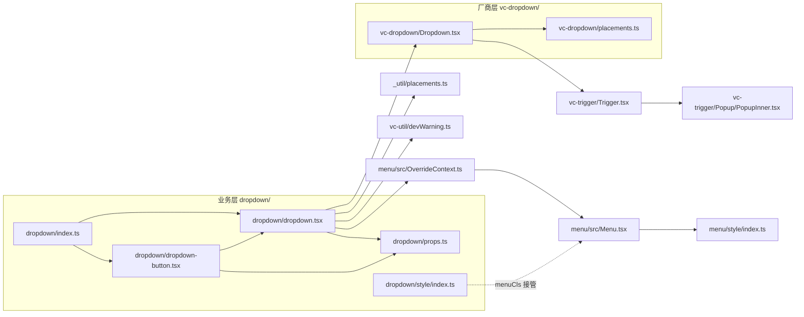
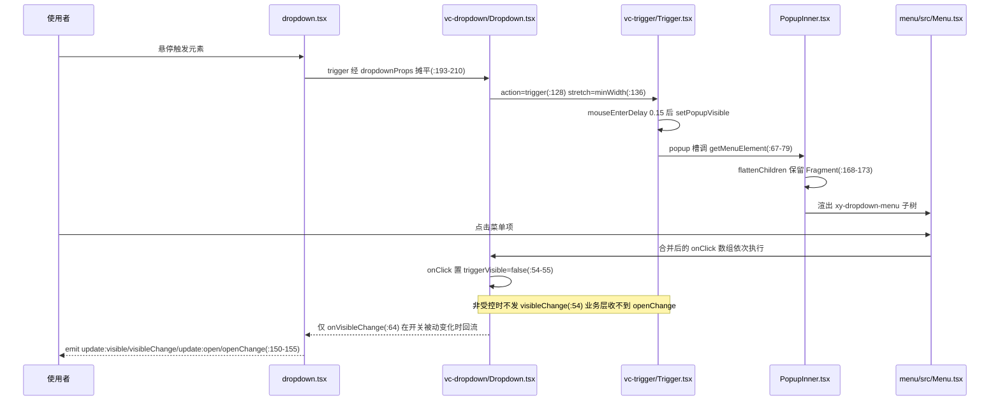
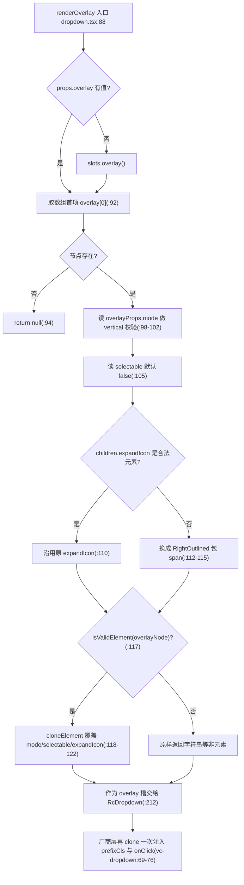

# C03-08 Dropdown 下拉菜单

> **本篇解决**：`overlay` 插槽里的那棵 `Menu` 到底被改写了几次、被谁改写；`arrow`、`trigger`、`placement`、`menu`、`size` 这几个写在类型上的开关，各自的写入点与死亡点在哪一行；为什么浮层里的菜单不再有自己的样式；点菜单项把浮层关掉时为什么一个事件都不发。
> **前置**：A07《交互基础设施总览》、I02《vc-trigger 弹出时序与事件穿透》、C03-00《导航类横写：选中态模型》　**读者坐标**：`03-components/03-navigation` 第 8/14 篇

## 一、职责与边界

Dropdown 只负责一件事：**把「一个触发元素」和「一份菜单内容」接成一个浮层**，并在接的过程中把菜单钉死成竖排、不可选中的命令列表形态。它不求解坐标（`vc-align`，见 I01），不管理弹出时序、延迟与外部点击（`vc-trigger`，见 I02），不实现菜单本体（`menu`，见 C03-01），也不定义选中态模型（见 C03-00）。浮层怎么拼装、`builtinPlacements` 与 `alignPoint` 在全库的共性形态，A07 已经讲完，本篇不重复展开，只讲 Dropdown 这一层特有的三件事：**overlay 的双通道改写**（论点 1）、**厂商层与业务层的 prop 面差异**（论点 2、论点 4）、**菜单样式的让渡**（论点 3）。

它明确不负责：

- **定位与翻转**。六个 `placement` 键的表在 `packages/xiaoye-ui/src/vc-dropdown/placements.ts:8-45`，业务层另算一张表（`packages/xiaoye-ui/src/dropdown/dropdown.tsx:189-192`），两者关系与失效后果由 A07 坑 1、坑 2 定性，本篇只登记第三个事实（见论点 5）。
- **动画本体**。`transitionName` 只负责按 `placement` 字符串挑一个已注册的运动名（`packages/xiaoye-ui/src/dropdown/dropdown.tsx:57-66`），关键帧在 `packages/xiaoye-ui/src/style/motion/slide.ts:7`、`:35`，注册在 `packages/xiaoye-ui/src/style/motion/slide.ts:139`，机制归 I09。
- **层级**。`zIndexPopup = zIndexPopupBase + 50` 写在组件 token 预置钩子里（`packages/xiaoye-ui/src/dropdown/style/index.ts:455`），编排机制归 I10。
- **键盘与焦点**。Dropdown 自身没有键盘导航实现，方向键与 Enter 全部由浮层里的 `Menu` 承担；触发元素只被写了两个 a11y 属性（`packages/xiaoye-ui/src/dropdown/dropdown.tsx:172-173`）。

依赖清单（`packages/xiaoye-ui/src/dropdown/dropdown.tsx:3-16` 与 `packages/xiaoye-ui/src/dropdown/dropdown-button.tsx:3-11` 的 import 顺序）：`vc-dropdown`、`./dropdown-button`（反向，见下）、`_util/vnode` 的 `cloneElement`、`_util/classNames`、`_util/props-util` 的 `isValidElement` 与 `initDefaultProps`、`./props`、`@xiaoye-ui/icons` 的 `RightOutlined` / `EllipsisOutlined`、`config-provider/hooks/useConfigInject`、`vc-util/devWarning`、`_util/omit`、`_util/placements`、`_util/warning`、`./style`、`menu/src/OverrideContext`、`button`。

被谁依赖（两处组件级复用 + 一处绕过业务层）：

```bash
grep -rn "from '\.\./dropdown'\|from '\./dropdown'\|vc-dropdown'" packages apps \
  --include='*.ts' --include='*.tsx' --include='*.vue' --include='*.js' \
  | grep -v "/dist/" | grep -v node_modules | grep -v "src/dropdown/"
```

`packages/xiaoye-ui/src/split-button/SplitButton.tsx:4` 与 `packages/xiaoye-ui/src/transfer/list.tsx:7` 用的是业务层 `Dropdown`；`packages/xiaoye-ui/src/tabs/src/TabNavList/OperationNode.tsx:2` 直接引厂商层 `vc-dropdown`，并因此在 `packages/xiaoye-ui/src/tabs/src/TabNavList/OperationNode.tsx:14` 反引了一次 `menu/src/OverrideContext`——也就是说 Dropdown 与 Tabs 的溢出菜单是同一张厂商底座的两个宿主，两条链的 prop 面差异不同（本篇只覆盖 Dropdown 这条）。`packages/xiaoye-ui/src/select/style/dropdown.ts:45` 那处命中是同名文件，与 Dropdown 无关。聚合入口与双导出见 `packages/xiaoye-ui/src/components.ts:128-130`、`packages/xiaoye-ui/package.json:256-260`，两者都是 `pnpm gen:entries` 的生成物。

## 二、源码地图

| 文件 | 行数 | 职责 | 关键导出 / 主入口 |
| --- | --- | --- | --- |
| `packages/xiaoye-ui/src/dropdown/index.ts` | 23 | 组装 `Dropdown.Button` 静态属性、全局注册、类型再导出 | 默认导出 `Dropdown`（`packages/xiaoye-ui/src/dropdown/index.ts:20`），`:9` 挂 `Button`，`:12-16` 的 `install` |
| `packages/xiaoye-ui/src/dropdown/props.ts` | 95 | 两张 props 工厂：`dropdownProps` 与 `dropdownButtonProps` | `packages/xiaoye-ui/src/dropdown/props.ts:27`、`:79`；默认导出 `:95` |
| `packages/xiaoye-ui/src/dropdown/dropdown.tsx` | 220 | **主实现入口**：配置注入、overlay 改写、placement 归一、事件炸开 | `packages/xiaoye-ui/src/dropdown/dropdown.tsx:21`（`defineComponent`，`:157` 起 render） |
| `packages/xiaoye-ui/src/dropdown/dropdown-button.tsx` | 120 | 分裂按钮：`ButtonGroup` + 左按钮 + 把右按钮当触发元素的 Dropdown | `packages/xiaoye-ui/src/dropdown/dropdown-button.tsx:18`，白名单在 `:75-89` |
| `packages/xiaoye-ui/src/dropdown/dropdown-button.test.js` | 58 | 本目录唯一测试文件，3 个 `it`，**只测 DropdownButton** | `packages/xiaoye-ui/src/dropdown/dropdown-button.test.js:5` |
| `packages/xiaoye-ui/src/dropdown/style/index.ts` | 457 | CSS-in-JS 主体：浮层本体、箭头、菜单让渡样式 | `packages/xiaoye-ui/src/dropdown/style/index.ts:418`（`genComponentStyleHook('Dropdown', …)`） |
| `packages/xiaoye-ui/src/dropdown/style/button.ts` | 26 | `-button` 组的 loading 屏蔽与末位内边距 | `packages/xiaoye-ui/src/dropdown/style/button.ts:8` |
| `packages/xiaoye-ui/src/dropdown/style/status.ts` | 25 | 菜单项 danger 态配色 | `packages/xiaoye-ui/src/dropdown/style/status.ts:10` |
| `packages/xiaoye-ui/src/vc-dropdown/index.ts` | 3 | 厂商层入口，注释标了血统 | `packages/xiaoye-ui/src/vc-dropdown/index.ts:1`（`// base in 3.2.0`） |
| `packages/xiaoye-ui/src/vc-dropdown/Dropdown.tsx` | 144 | Trigger 的 Dropdown 适配器：开关态、arrow 节点、stretch、contextmenu 收起 | `packages/xiaoye-ui/src/vc-dropdown/Dropdown.tsx:10`，渲染在 `:118-141` |
| `packages/xiaoye-ui/src/vc-dropdown/placements.ts` | 47 | 六键对齐表（A07 坑 1 的主题） | `packages/xiaoye-ui/src/vc-dropdown/placements.ts:8`，键位 `:9/:15/:21/:27/:33/:39` |
| `packages/xiaoye-ui/src/menu/src/OverrideContext.ts` | 29 | Dropdown 专用（注释原话 `// Used for Dropdown only`，`:5`）的样式/行为让渡通道 | `:15` `useInjectOverride`、`:19` `useProvideOverride` |
| `packages/xiaoye-ui/src/menu/src/Menu.tsx` | 531 | 让渡通道的唯一读取方 | `:106` 注入、`:107-115` 前缀与样式开关、`:287-288` 模式、`:371` 点击、`:402` 展开图标 |
| `packages/xiaoye-ui/src/vc-trigger/Popup/PopupInner.tsx` | 228 | 浮层内容节点的单子节点优化与 `-content` 包裹 | `packages/xiaoye-ui/src/vc-trigger/Popup/PopupInner.tsx:168-173` |
| `packages/xiaoye-ui/src/_util/vnode.ts` | 82 | `cloneElement` 的覆盖/合并语义开关 | `packages/xiaoye-ui/src/_util/vnode.ts:9-28`，关键行 `:22`、`:25` |
| `packages/xiaoye-ui/src/_util/props-util/index.ts` | 285 | `flattenChildren` 与 `skipFlattenKey` | `:49` 符号、`:50-73` 扁平化 |
| `packages/xiaoye-ui/src/_util/placements.ts` | 111 | 十二键通用表 + `arrowPointAtCenter` 分支 | `:38` `getPlacements`、`:96-109` 分支、`:108` `ignoreShake` |
| `packages/xiaoye-ui/src/vc-trigger/utils/alignUtil.ts` | 40 | `points` 反查 placement 类名 | `:10-20`、`:22-40` |
| `packages/xiaoye-ui/src/vc-util/devWarning.ts` | 5 | 开发期告警的一次性通道（机制归 I03） | `packages/xiaoye-ui/src/vc-util/devWarning.ts:5` |

组件目录没有 `demo/`、没有 `__tests__/` 子目录、没有 `*Types.ts`（props 全在 `props.ts`）；用法手册在 `apps/docs/components/dropdown.md`，示例在 `apps/docs/examples/dropdown/`（12 个 `.vue`）。属性清单见手册，本篇不复述。

## 三、架构与数据流

### 3.1 模块静态关系



三点结构性事实藏在图里。**其一**，`dropdown.tsx → dropdown-button.tsx → dropdown.tsx` 是一个真实的导入环（`packages/xiaoye-ui/src/dropdown/dropdown.tsx:4` 与 `packages/xiaoye-ui/src/dropdown/dropdown-button.tsx:4` 互指），靠 `index.ts:9` 与 `dropdown.tsx:219` 两处重复挂载 `Dropdown.Button` 才把静态属性补齐。**其二**，`builtinPlacements` 有两个生产者：厂商层的常量表（`packages/xiaoye-ui/src/vc-dropdown/Dropdown.tsx:127` 直引 `packages/xiaoye-ui/src/vc-dropdown/placements.ts:8`）与业务层按 `arrow` 现算的表（`packages/xiaoye-ui/src/dropdown/dropdown.tsx:189-192` → `packages/xiaoye-ui/src/_util/placements.ts:38`），同名 prop 被写两次。**其三**，菜单样式的所有权不在 `menu/style/index.ts`，而是由 Dropdown 通过 `OverrideContext`（`packages/xiaoye-ui/src/dropdown/dropdown.tsx:16`）反向接管，详见论点 3。

### 3.2 一次悬停的完整闭环



图里最关键的是**两条下行与一条回流的不对称**。下行是 `props → mergedVisible(:146-148) → RcDropdown visible(:197) → triggerVisible(:38-46) → popupVisible(:135)`；回流只有一条 `onVisibleChange`。而「点菜单项关闭」这条路径在 `packages/xiaoye-ui/src/vc-dropdown/Dropdown.tsx:54-55` **直接写了本地状态、绕开了回流**，所以业务层 `packages/xiaoye-ui/src/dropdown/dropdown.tsx:150-155` 的四个 emit 一个都不会响——这正是手册在 `apps/docs/components/dropdown.md:136` 写的「点击菜单按钮导致的消失不会触发」的实现出处。受控模式下更彻底：`:54` 的条件 `props.visible === undefined` 不成立，点菜单项**既关不掉也不发事件**。

### 3.3 overlay 归一化的分支



`flowchart` 里的两处 `cloneElement` 语义不同，是本篇论点 1 的核心：业务层那次用了默认 `override = true`（`packages/xiaoye-ui/src/_util/vnode.ts:25`），厂商层那次显式传了 `false`（`packages/xiaoye-ui/src/vc-dropdown/Dropdown.tsx:76`），于是一边是覆盖、一边是合并。最后一行「原样返回字符串等非元素」是真实分支：`isValidElement` 为假时（`packages/xiaoye-ui/src/dropdown/dropdown.tsx:117`）不注入任何东西，`packages/xiaoye-ui/src/vc-dropdown/Dropdown.tsx:76` 的 `cloneElement` 收到非 VNode 会走 `_util/vnode.ts:19-21` 的空返回分支，菜单只剩 `<div class="xy-dropdown-arrow">` 和裸文本。

## 四、核心机制精读

### 论点 1：overlay 里的 `Menu` 被 clone 两次，两次用的是**相反的合并语义**，因此「强制竖排」成立而「强制关闭回调」不成立

`dropdown.tsx` 先把用户的菜单节点改写成 Dropdown 需要的形态，`vc-dropdown` 再改一次。两次都调用同一个 `cloneElement`，但第三次参数不同——这一个参数决定了菜单的 `onClick` 是否还能被用户保住。

```tsx
// packages/xiaoye-ui/src/dropdown/dropdown.tsx:91
      const overlay = props.overlay || slots.overlay?.();
      const overlayNode = Array.isArray(overlay) ? overlay[0] : overlay;

      if (!overlayNode) return null;
      const overlayProps = overlayNode.props || {};

      // Warning if use other mode
      devWarning(
        !overlayProps.mode || overlayProps.mode === 'vertical',
        'Dropdown',
        `mode="${overlayProps.mode}" is not supported for Dropdown's Menu.`,
      );

      // menu cannot be selectable in dropdown defaultly
      const { selectable = false, expandIcon = (overlayNode.children as any)?.expandIcon?.() } =
        overlayProps;
      // ...
      const fixedModeOverlay = isValidElement(overlayNode)
        ? cloneElement(overlayNode, {
            mode: 'vertical',
            selectable,
            expandIcon: () => overlayNodeExpandIcon,
          })
        : overlayNode;
```

```tsx
// packages/xiaoye-ui/src/vc-dropdown/Dropdown.tsx:67
    const getMenuElement = () => {
      const overlayElement = slots.overlay?.();
      const extraOverlayProps = {
        prefixCls: `${props.prefixCls}-menu`,
        onClick,
      };
      return (
        <Fragment key={skipFlattenKey}>
          {props.arrow && <div class={`${props.prefixCls}-arrow`} />}
          {cloneElement(overlayElement, extraOverlayProps, false)}
        </Fragment>
      );
    };
```

```ts
// packages/xiaoye-ui/src/_util/vnode.ts:9
export function cloneElement<T, U>(
  vnode: VNode<T, U> | VNode<T, U>[],
  nodeProps: NodeProps = {},
  override = true,
  mergeRef = false,
): VNode<T, U> {
  let ele = vnode;
  if (Array.isArray(vnode)) {
    ele = filterEmpty(vnode)[0];
  }
  if (!ele) {
    return null;
  }
  const node = cloneVNode(ele as VNode<T, U>, nodeProps as any, mergeRef);

  // cloneVNode内部是合并属性，这里改成覆盖属性
  node.props = (override ? { ...node.props, ...nodeProps } : node.props) as any;
  warning(typeof node.props.class !== 'object', 'class must be string');
  return node;
}
```

逐段看。`:91` 一行决定了 prop 优先于插槽：`props.overlay || slots.overlay?.()`，两者都给时插槽被无视；`:92` 只取数组首项，多节点数组的其余项**静默丢弃**，没有任何告警。`:95` 读 `overlayNode.props` 而不是运行时 props——在 Vue 里 `vnode.props` 是**原始传入值**，模板上直写的 `mode="horizontal"` 与 `v-bind` 展开的 `mode` 都在里面（`:98-102` 的 `devWarning` 依赖这一点）；但把 `Menu` 包进自己的封装组件（`<MyMenu>` 内部的 `Menu` 才是横排的那个）时，外层 vnode 的 `props` 里没有 `mode`，`devWarning` 就不响——它看的是外层节点的原始 props，不是 `Menu` 实例的运行时 props。

`:105` 的解构带两个默认值，`selectable = false` 是「菜单在 Dropdown 里默认不可选中」的实现点，`expandIcon = (overlayNode.children as any)?.expandIcon?.()` 则把**插槽**里的 `expandIcon` 提升成 **prop**——因为下游 `Menu` 的读取顺序是 `props.expandIcon || slots.expandIcon || override?.expandIcon?.value`（`packages/xiaoye-ui/src/menu/src/Menu.tsx:408`），把插槽值搬到 prop 位就等于抢到最高优先级，这也解释了 `:109-115` 为什么要再包一层带 `-menu-submenu-arrow` 类名的 `span`：类名由 Dropdown 的样式表管（`packages/xiaoye-ui/src/dropdown/style/index.ts:364-375`）。

`:118-122` 是第一次 clone，没传第三个参数 → `override` 取默认 `true` → `_util/vnode.ts:25` 那行 `{ ...node.props, ...nodeProps }` 把 `mode`/`selectable`/`expandIcon` **整体覆盖**。这就是「强制竖排」的落地点：即使 `devWarning` 不响（上一条说的读取盲区），`mode` 也会被改写掉。

`:76` 是第二次 clone，显式 `false` → 跳过 `:25`，只保留 `:22` `cloneVNode` 内部的**合并**结果。`_util/vnode.ts:24` 的中文注释「cloneVNode内部是合并属性」就是这条语义的仓内自证。合并的后果分两叉：`prefixCls` 这类普通键后写覆盖先写，厂商层的 `xy-dropdown-menu`（`:70`）赢；而 `onClick` 是以 `on` 开头的处理器键，Vue 的合并会把它拉成数组先旧后新——于是用户在 overlay 菜单上写的 `onClick` **不会被吃掉，而是排在厂商层的关闭回调之前执行**。这就是 `flowchart` 最后一条边的落点：业务层覆盖的三个键是命令，厂商层合并的 `onClick` 是钩子。

`:74` 的 `skipFlattenKey` 属于第三个机制，别误读成装饰：`flattenChildren` 见到 `Fragment` 默认会把子节点摊平（`packages/xiaoye-ui/src/_util/props-util/index.ts:56-61`），而摊平后要穿过 `packages/xiaoye-ui/src/vc-trigger/Popup/PopupInner.tsx:171-172` 的「多于一颗就套一层 `-content` div」判定。带 key 的 Fragment 在 `:57` 被整块保留，浮层里就是 `[arrow div, Menu]` 两个**直接子节点**而不是被再包一层——箭头的 `position: absolute` 定位（`packages/xiaoye-ui/src/dropdown/style/index.ts:124`）正是相对浮层根节点算的，中间多一个 div 就会整体偏一位。`skipFlattenKey` 全仓只有这一处使用（`grep -rn "skipFlattenKey" packages/xiaoye-ui/src` 命中 4 行，定义 + 读取 + 本文件 import 与使用）。

**回扣**：`Menu` 在 Dropdown 里被改写两次，`mode`/`selectable`/`expandIcon` 走覆盖通道所以改不动，`onClick` 走合并通道所以保得住。想知道某个 prop 能不能被用户保住，只看第二、三次 clone 的 `override` 参数，不看名字。

### 论点 2：厂商层是一张**闭合的 prop 面**，业务层有 3 个 prop 声明即终点，剩下的键全靠属性透传越过厂商层

业务层把整个 props 对象摊给 `RcDropdown`，但 `vc-dropdown` 只声明了自己认识的那 20 个键，于是每个业务 prop 都必须回答一个问题：它在厂商层被声明了吗？没被声明的靠 Vue 的属性透传往下走，透传走不到的地方就是终点。

```tsx
// packages/xiaoye-ui/src/dropdown/dropdown.tsx:193
      const dropdownProps = omit(
        {
          ...props,
          ...attrs,
          visible: mergedVisible.value,
          builtinPlacements,
          overlayClassName: overlayClassNameCustomized,
          arrow: !!arrow,
          alignPoint,
          prefixCls: prefixCls.value,
          getPopupContainer: getPopupContainer?.value,
          transitionName: transitionName.value,
          trigger: triggerActions,
          onVisibleChange: handleVisibleChange,
          placement: placement.value,
        },
        ['overlay', 'onUpdate:visible'],
      );
      return wrapSSR(
        <RcDropdown {...dropdownProps} v-slots={{ overlay: renderOverlay }}>
          {dropdownTrigger}
        </RcDropdown>,
      );
```

```tsx
// packages/xiaoye-ui/src/vc-dropdown/Dropdown.tsx:12
  props: {
    minOverlayWidthMatchTrigger: { type: Boolean, default: undefined },
    arrow: { type: Boolean, default: false },
    prefixCls: PropTypes.string.def('rc-dropdown'),
    transitionName: String,
    overlayClassName: PropTypes.string.def(''),
    openClassName: String,
    animation: PropTypes.any,
    align: PropTypes.object,
    overlayStyle: { type: Object as PropType<CSSProperties>, default: undefined as CSSProperties },
    placement: PropTypes.string.def('bottomLeft'),
    overlay: PropTypes.any,
    trigger: PropTypes.oneOfType([PropTypes.string, PropTypes.arrayOf(PropTypes.string)]).def(
      'hover',
    ),
    alignPoint: { type: Boolean, default: undefined },
    showAction: PropTypes.array,
    hideAction: PropTypes.array,
    getPopupContainer: Function,
    visible: { type: Boolean, default: undefined },
    defaultVisible: { type: Boolean, default: false },
    mouseEnterDelay: PropTypes.number.def(0.15),
    mouseLeaveDelay: PropTypes.number.def(0.1),
  },
```

对照 `packages/xiaoye-ui/src/dropdown/props.ts:27-76` 的 26 个键，可以做出三档划分。

**第一档：在厂商层被声明，正常生效**——`arrow`、`trigger`、`overlay`（仅插槽形态）、`visible`、`align`、`getPopupContainer`、`prefixCls`、`transitionName`、`placement`、`overlayClassName`、`overlayStyle`、`openClassName`、`minOverlayWidthMatchTrigger`、`mouseEnterDelay`、`mouseLeaveDelay`。注意 `:15` 与 `:22` 的默认值是 `rc-dropdown` / `bottomLeft`，直接渲染 `vc-dropdown` 会拿到对不上 CSS 的类名前缀（同一条红线在 A07 里已就 Tooltip/Select 定性，本篇不重复）。

**第二档：厂商层没声明、业务层也没读，声明即终点**——`menu`（`packages/xiaoye-ui/src/dropdown/props.ts:32`）、`danger`（`:38`）、`autofocus`（`:39`）。`menu` 的可验证性最强，两条独立口径都为空：`grep -rn "props\.menu" packages/xiaoye-ui/src/dropdown` 零行，`grep -rn "\.menu\b" packages/xiaoye-ui/src/dropdown --include='*.ts*'` 也零行（即不存在任何属性访问形态）；`dropdown.tsx` 里剩下的 `menu` 字样全部是类名字符串、`aria-haspopup` 值和 `../menu/src/OverrideContext` 这条 import（`:16`）。它偏偏出现在 `DropdownProps` 类型里（`packages/xiaoye-ui/src/dropdown/dropdown.tsx:19` 由 `ExtractPropTypes` 全量派生），所以使用者写 `:menu="{ items: [...] }"` 不报类型错、不告警、不渲染，菜单是空的（空的原因见 `packages/xiaoye-ui/src/dropdown/dropdown.tsx:94` 的 `return null`）。手册没写 `menu`，只在 `apps/docs/components/dropdown.md:119` 给了 `overlay(v-slot)`——**类型面比文档面宽**，这是本篇能给出的最直接的越界风险点。`danger` 只有 `dropdown-button.tsx:51`、`:93`、`:105` 三处消费者，对普通 `Dropdown` 无效；`status.ts:12` 那条 `-danger` 规则吃的是菜单项类名，和 `danger` prop 无关。

**第三档：靠属性透传穿过厂商层**。`vc-dropdown` 没有 `inheritAttrs: false`（`:10-11` 的 `defineComponent` 参数里只有 `compatConfig`），所以未声明的键会跟着透传合并进 `:119` 那颗 `<Trigger>` 的 props；`Trigger` 自己写了 `inheritAttrs: false`（`packages/xiaoye-ui/src/vc-trigger/Trigger.tsx:38`），到它这里停住，只把 `$attrs.class` 手动并回触发元素（`Trigger.tsx:688`）。`destroyPopupOnHide` 就是这条透传的受益者：它在 `:116` 的解构剩余里（`:104-117` 解构出的 11 个键之外），进 `otherProps` → `<Trigger {...otherProps}>` → 命中 `packages/xiaoye-ui/src/vc-trigger/interface.ts:130` 的声明 → 最终被 `packages/xiaoye-ui/src/vc-trigger/Popup/PopupInner.tsx:191` 消费。同一条透传上还有 `forceRender`（`packages/xiaoye-ui/src/dropdown/props.ts:56`）：它同样命中声明（`packages/xiaoye-ui/src/vc-trigger/interface.ts:129`），但那条链在 trigger 内部就断了——五跳链路与「不可观察」的定性见 I02 论点 6，本篇不再展开。也就是说 **`destroyPopupOnHide` 生效、`forceRender` 不生效，而两者都不在厂商层的 props 里**——判断依据不是「厂商层有没有声明」，而是「透传链下游有没有声明并且真的读」。

`packages/xiaoye-ui/src/dropdown/dropdown.tsx:209` 那一行 `omit(..., ['overlay', 'onUpdate:visible'])` 是这一层唯一显式做的减法。`overlay` 被减是因为它改走插槽（`:212`），而厂商层的 `overlay: PropTypes.any`（`packages/xiaoye-ui/src/vc-dropdown/Dropdown.tsx:23`）本来就没人读——只读 `slots.overlay?.()`（`:68`），这是一个**双重保险**：传了也被无视。`onUpdate:visible` 被减掉才是真正有意思的一处：`packages/xiaoye-ui/src/dropdown/props.ts:67` 把它声明成 prop，于是它进的是 `props` 而不是 `attrs`，`:195` 的 `...props` 会原样带上；如果不减，这个废弃的双向绑定键就会继续沿透传链往下被 Vue 当成事件监听器合并一次，而业务层在 `:151` 已经手动 `emit('update:visible')` 一次。减掉它，废弃别名就只在 `XYDropdown` 这一层响，不再渗进厂商层。

**回扣**：这个组件的 prop 面是**三张纸叠出来的**——`props.ts` 的 26 键、`vc-dropdown` 的 20 键、`Trigger` 的 interface 键。任何「Dropdown 支不支持 X」的问题都要问成「X 在哪张纸上、有没有人读」，问成「文档里有没有」会得出错误答案。

### 论点 3：浮层里的菜单**主动放弃了自己的样式**，让渡开关是一个 `Ref<boolean>`，而让渡通道里一半字段没人读

Dropdown 不复制菜单样式，而是让 `Menu` 在 Dropdown 语境下**不生成自己的样式表**，自己用 `menuCls` 前缀重写一份。开关藏在样式 hook 的第二个参数上，这是全组件最容易读漏的一处接线。

```tsx
// packages/xiaoye-ui/src/dropdown/dropdown.tsx:67
    useProvideOverride({
      prefixCls: computed(() => `${prefixCls.value}-menu`),
      expandIcon: computed(() => {
        return (
          <span class={`${prefixCls.value}-menu-submenu-arrow`}>
            <RightOutlined class={`${prefixCls.value}-menu-submenu-arrow-icon`} />
          </span>
        );
      }),
      mode: computed(() => 'vertical'),
      selectable: computed(() => false),
      onClick: () => {},
      validator: ({ mode }) => {
        // Warning if use other mode
        warning(
          !mode || mode === 'vertical',
          'Dropdown',
          `mode="${mode}" is not supported for Dropdown's Menu.`,
        );
      },
    });
```

```ts
// packages/xiaoye-ui/src/menu/src/OverrideContext.ts:19
export const useProvideOverride = (props: OverrideContextProps) => {
  const { prefixCls, mode, selectable, validator, onClick, expandIcon } = useInjectOverride() || {};
  provide(OverrideContextKey, {
    prefixCls: computed(() => (props.prefixCls?.value ?? prefixCls?.value) as string),
    mode: computed(() => props.mode?.value ?? mode?.value),
    selectable: computed(() => (props.selectable?.value ?? selectable?.value) as boolean),
    validator: props.validator ?? validator,
    onClick: props.onClick ?? onClick,
    expandIcon: props.expandIcon ?? expandIcon?.value,
  });
};
```

```tsx
// packages/xiaoye-ui/src/menu/src/Menu.tsx:109
    const override = useInjectOverride();
    const prefixCls = computed(() => {
      return getPrefixCls('menu', props.prefixCls || override?.prefixCls?.value);
    });
    const [wrapSSR, hashId] = useStyle(
      prefixCls,
      computed(() => {
        return !override;
      }),
    );
```

```ts
// packages/xiaoye-ui/src/menu/style/index.ts:430
export default (prefixCls: Ref<string>, injectStyle?: Ref<boolean>): UseComponentStyleResult => {
  const useOriginHook = genComponentStyleHook(
    'Menu',
    (token, { overrideComponentToken }) => {
      // Dropdown will handle menu style self. We do not need to handle this.
      if (injectStyle?.value === false) {
        return [];
      }
      // ...
```

四段代码是一条完整的双向约定。`Menu.tsx:113-118` 把「有没有 override」取反后当第二个实参传进 `useStyle`；这个实参能生效，前提是 `menu/style/index.ts:430` 那个**手写包装**——`genComponentStyleHook` 返回的 hook 本身只吃一个 `Ref<string>`（`packages/xiaoye-ui/src/theme/util/genComponentStyleHook.ts:47`），所以第二个参数必须靠包装层接收并在 `:435` 判 `=== false` 时 `return []`。注释 `:434` 把意图写在明面上：「Dropdown will handle menu style self」。

于是浮层里的菜单样式全部来自 Dropdown 的样式表：`:441` 把 `menuCls` 定成 `${componentCls}-menu`（即 `xy-dropdown-menu`），`:244` 用 `${componentCls} ${menuCls}` 的后代选择器接管菜单本体，`:249` 单列一条 `${menuCls}-submenu-popup`，`:265` 再用 `${componentCls}, ${componentCls}-menu-submenu` 的双选择器把规则复制一份。**为什么要双选择器**：子菜单的浮层被 teleport 到别处，DOM 上不在 `.xy-dropdown` 里面，`status.ts:10` 那条把 `componentCls` 与 `componentCls-menu-submenu` 并列的写法就是为同一个目的——让「一级浮层内」和「逃逸出去的子浮层」共享一套规则。前缀则由两路同时给出：`OverrideContext` 的 `prefixCls`（`dropdown.tsx:68`）负责让 `Menu` 自己算出 `xy-dropdown-menu`（`Menu.tsx:111`），厂商层的 `cloneElement` 负责在 vnode 上再钉一次（`packages/xiaoye-ui/src/vc-dropdown/Dropdown.tsx:70`）；两路值相同，所以看不出重复，但删掉任一路都会让另一路单独决定类名。

再看让渡通道的六个字段，只有四个有读者。`prefixCls`/`mode`/`onClick`/`expandIcon` 分别被 `Menu.tsx:111`、`Menu.tsx:291-292`、`Menu.tsx:373`、`Menu.tsx:408` 读取；而 `selectable`（`dropdown.tsx:77`）与 `validator`（`dropdown.tsx:79-86`）**在全仓没有任何读取方**——`grep -rn "override\?\.\|override\." packages/xiaoye-ui/src --include='*.ts*'` 只给出 4 行读取，`grep -rn "validator" packages/xiaoye-ui/src/menu` 只命中 `OverrideContext.ts:10`、`:20`、`:25` 三行，全是类型与透传，没有调用点。后果是 `dropdown.tsx:79-86` 那段「用了别的 mode 就告警」的逻辑**永远不会执行**，真正会响的是 `:98-102` 的 `devWarning`；两条告警文案几乎逐字相同，只有第二条活着。而 `selectable: false` 的让渡同样是死代码，真正生效的是 `:105` 的解构默认值经 `:120` 覆盖回 prop。`OverrideContext.ts:20-28` 的逐键 `??` 组合（子 provider 覆盖父 provider）本身是好的，问题在于 `:5` 的注释 `// Used for Dropdown only` 已经不成立——`packages/xiaoye-ui/src/tabs/src/TabNavList/OperationNode.tsx:14` 与 `packages/xiaoye-ui/src/mentions/index.tsx:16` 也在 provide，`mentions/index.tsx:136` 同样写了一个 `validator`，同样没人调。

**回扣**：样式让渡是「关 Menu 的表 + 开 Dropdown 的表」两个动作，缺一不可；行为让渡（`selectable`、`validator`）只做了一半，另一半靠 `renderOverlay` 里的 prop 覆盖兜住。读这段代码时，把 `OverrideContext` 当**样式通道**读是对的，当**行为通道**读会被两个死键骗到。

### 论点 4：开关状态有**两处存、一条回流**，「点菜单项关闭」直接写本地状态所以一个事件都不发

受控与非受控的分歧点落在厂商层的一个 `if` 上，而这个 `if` 同时决定了「关闭要不要通知」。业务层完全不知道自己的四个 emit 会被跳过。

```tsx
// packages/xiaoye-ui/src/vc-dropdown/Dropdown.tsx:38
    const triggerVisible = ref(!!props.visible);
    watch(
      () => props.visible,
      val => {
        if (val !== undefined) {
          triggerVisible.value = val;
        }
      },
    );
    const triggerRef = ref();

    expose({
      triggerRef,
    });

    const onClick = (e: MouseEvent) => {
      if (props.visible === undefined) {
        triggerVisible.value = false;
      }
      emit('overlayClick', e);
    };

    const onVisibleChange = (visible: boolean) => {
      if (props.visible === undefined) {
        triggerVisible.value = visible;
      }
      emit('visibleChange', visible);
    };
```

```tsx
// packages/xiaoye-ui/src/dropdown/dropdown.tsx:146
    const mergedVisible = computed(() => {
      return typeof props.visible === 'boolean' ? props.visible : props.open;
    });

    const handleVisibleChange = (val: boolean) => {
      emit('update:visible', val);
      emit('visibleChange', val);
      emit('update:open', val);
      emit('openChange', val);
    };
```

先钉受控判定。`mergedVisible`（`:146-148`）的口径是「`visible` 是布尔就用它，否则用 `open`」，注意 `visible` 走的是 `typeof === 'boolean'` 而 `open` 没有做类型判定——`open` 传字符串 `"false"` 时会被当真值一路带下去。判定结果写进厂商层的 `visible`（`:197`），厂商层再用 `watch` 的 `val !== undefined` 做第二重判定（`:41-44`）：**业务层没传 `open` 也没传 `visible` 时两者都是 `undefined`**，厂商层保留自有状态 `triggerVisible`；传了则每次同步。所以「受控」这件事在两处各判一次，口径还不完全一样——A07 数出「同一个 prop 在四个族里有四种落地节奏」，本篇这一族是其中最简的一种（两跳），但它有一个别族没有的出口。

那个出口就是 `onClick`（`:53-58`）。它被 `:69-72` 当 `extraOverlayProps.onClick` 注入 overlay（合并语义见论点 1），所以**点菜单里任意一项都会进这里**。进来之后的第一件事是「只在非受控时关」：`props.visible === undefined` 才写 `triggerVisible = false`；第二件事是 `emit('overlayClick', e)`。这里有两个后果，都是源码层面可查的：

- **非受控模式**：状态被直接改写，但**没有走 `onVisibleChange`**（`:60-65` 才是唯一会 `emit('visibleChange')` 的函数），于是业务层的 `handleVisibleChange` 不执行，`:151-154` 的四个 emit 全部静默。用户看到的现象是「浮层关了，`@open-change` 没响」，而手册把这条当成既定行为写在 `apps/docs/components/dropdown.md:136`。如果业务靠 `openChange` 做埋点或清理，这个洞必须自己补。
- **受控模式**：`props.visible` 是布尔，`onClick` 既不写状态也不发事件，**点菜单项完全不会关浮层**。关掉它只能由父组件在菜单项的 `onClick` 里把 `open` 置假，或靠文档外的 `onOverlayClick`——而后者不存在：`grep -rn "overlayClick" packages apps --include='*.ts*' --include='*.tsx' --include='*.vue' --include='*.js' --include='*.md' | grep -v "/dist/" | grep -v node_modules` 只有 `packages/xiaoye-ui/src/vc-dropdown/Dropdown.tsx:36` 的 emits 声明与 `:57` 的 emit 两处命中，**全仓零监听方**；厂商层暴露的唯一句柄是 `expose({ triggerRef })`（`:49-51`），它是触发元素的 ref，不是开关句柄。

`disabled` 是第三个开关维度，且它只砍了一半。`:183` 的 `const triggerActions = disabled ? [] : trigger;` 把触发行为清空，于是 hover/click/contextmenu 都不再响应；`:175` 同时给触发元素补 `{ disabled, 'aria-disabled': true }`。但 `disabled` **不影响 `mergedVisible`**：受控模式下写 `:disabled="true" :open="true"`，浮层照样打开——因为 `:197` 传下去的是 `mergedVisible.value`，而 `:38-46` 的 watch 只看 `val !== undefined`。这条分支没有测试（本目录唯一测试文件只测 `Dropdown.Button`，见论点 6）。

**回扣**：Dropdown 的开关模型是「业务层单点归一（`visible` 优先于 `open`）+ 厂商层双主存 + 一条回流 + 一条旁路写入」。旁路就是 `onClick`，它是这个组件里唯一一个**会改状态但不发事件**的函数，也是「点了菜单项为什么没回调」这类问题的唯一答案。

### 论点 5：`placement`、`transitionName`、`arrow` 三个开关全靠**对字符串做子串判断**派生，其中一个 RTL 分支永远不可达

这一层没有集中的映射表，三个派生各自 `includes`。副作用是默认值把分支堵死、废弃写法被自己绕开。

```tsx
// packages/xiaoye-ui/src/dropdown/dropdown.tsx:57
    const transitionName = computed(() => {
      const { placement = '', transitionName } = props;
      if (transitionName !== undefined) {
        return transitionName;
      }
      if (placement.includes('top')) {
        return `${rootPrefixCls.value}-slide-down`;
      }
      return `${rootPrefixCls.value}-slide-up`;
    });
```

```tsx
// packages/xiaoye-ui/src/dropdown/dropdown.tsx:128
    const placement = computed(() => {
      const placement = props.placement;
      if (!placement) {
        return direction.value === 'rtl' ? 'bottomRight' : 'bottomLeft';
      }

      if (placement.includes('Center')) {
        const newPlacement = placement.slice(0, placement.indexOf('Center'));
        devWarning(
          !placement.includes('Center'),
          'Dropdown',
          `You are using '${placement}' placement in Dropdown, which is deprecated. Try to use '${newPlacement}' instead.`,
        );
        return newPlacement;
      }
      return placement;
    });
```

```ts
// packages/xiaoye-ui/src/_util/props-util/initDefaultProps.ts:16
  const propTypes: T = { ...types };
  Object.keys(defaultProps).forEach(k => {
    const prop = propTypes[k] as VueTypeValidableDef;
    if (prop) {
      if (prop.type || prop.default) {
        prop.default = defaultProps[k];
      } else if (prop.def) {
        prop.def(defaultProps[k]);
      } else {
        propTypes[k] = { type: prop, default: defaultProps[k] };
      }
    } else {
      throw new Error(`not have ${k} prop`);
    }
  });
  return propTypes;
};
```

**不可达的 RTL 分支。** `packages/xiaoye-ui/src/dropdown/dropdown.tsx:25-30` 用 `initDefaultProps(dropdownProps(), { …, placement: 'bottomLeft', … })` 给 `placement` 挂了默认值，`placement` 在 `props.ts:44` 的形式是 `{ type: String as PropType<…> }`，于是走 `initDefaultProps.ts:20-21` 那条 `prop.default = defaultProps[k]` 分支——`props.placement` **恒为真值**。因此 `dropdown.tsx:130-132` 的 `if (!placement)` 与里面的 `direction.value === 'rtl' ? 'bottomRight' : 'bottomLeft'` 永远不会执行。`Dropdown.Button` 同病：`packages/xiaoye-ui/src/dropdown/dropdown-button.tsx:23-27` 把默认值设成 `bottomRight`，`:61` 的解构默认 `placement = direction.value === 'rtl' ? 'bottomLeft' : 'bottomRight'` 同样因为 prop 恒有值而不可达。结论是 **Dropdown 的 RTL 只反映在类名上**（`:167`、`:180` 两处 `${prefixCls}-rtl`），弹出方向不会自动镜像；`direction` 在 `placement` 计算里的全部用处就是一段死码。

**废弃写法的自我绕开。** `:134-141` 把 `topCenter`/`bottomCenter` 用 `indexOf('Center')` 截成 `top`/`bottom`，同时 `devWarning` 劝用户迁移到这两个裸名。但厂商层的表只有六个键 `topLeft/topCenter/topRight/bottomLeft/bottomCenter/bottomRight`（`packages/xiaoye-ui/src/vc-dropdown/placements.ts:9/:15/:21/:27/:33/:39`），**没有 `top`、也没有 `bottom`**——也就是说迁移目标恰好是查不到键的两个值，而表里现成的 `*Center` 反而被截掉了。这条不一致的定性、以及它导致的 `alignDisabled` 后果，A07 坑 1 已经完整论证，本篇不重复；本篇只补两个 A07 没登记的**同向证据**：其一是样式表也按裸名写规则，`packages/xiaoye-ui/src/dropdown/style/index.ts:146-152` 专门给 `&-placement-top > ${componentCls}-arrow` 写了 `left: 50%` + `translateX(-50%)`，`:177` 起有 `&-placement-bottom` 的对称规则，即**箭头居中在设计上依赖 `top`/`bottom` 这两个 placement 键存在**；其二是本仓文档的箭头居中示例真的这么用——`apps/docs/examples/dropdown/arrow-center.vue:24` 的数组是 `['topLeft', 'top', 'topRight', 'bottomLeft', 'bottom', 'bottomRight']`，`:4` 同时写了 `:arrow="{ pointAtCenter: true }"`。类名本身由 `points` 反查得来（`packages/xiaoye-ui/src/vc-trigger/utils/alignUtil.ts:22-40`，命中即返 `:35`），而 `_util` 表里 `top` 的 points 与厂商层 `topCenter` 的 points 完全相同（`packages/xiaoye-ui/src/_util/placements.ts:55-58` 与 `packages/xiaoye-ui/src/vc-dropdown/placements.ts:15-20` 都是 `['bc','tc']`）。**这张表选哪一张的问题已经有了确定答案，本篇原先留的悬念在此关闭**：厂商层用的是自己的六键表（`packages/xiaoye-ui/src/vc-dropdown/Dropdown.tsx:127` 在 `...otherProps` 之后硬设，见 A07 坑 2），业务层那张带裸 `top`/`bottom` 的十二键表（`packages/xiaoye-ui/src/_util/placements.ts:55`、`:59`）在 Dropdown 这一族从未生效。于是链条是完整闭环的：查不到键 → `points` 为空 → `alignDisabled` 为真（`packages/xiaoye-ui/src/vc-trigger/Popup/PopupInner.tsx:137-141`，判据是 `props.align?.points`；`:198` 把它交给 `Align`）→ `getClassNameFromAlign` 根本不被调用（它只在 `packages/xiaoye-ui/src/vc-trigger/Popup/PopupInner.tsx:79` 的 `onInternalAlign` 里跑）→ 弹层拿不到任何 `-placement-*` 类名。也就是说 `packages/xiaoye-ui/src/dropdown/style/index.ts:146-152` 与 `:177-183` 那两条针对 `&-placement-top`/`&-placement-bottom` 的箭头居中规则，在 Dropdown 上**是永远命中不了的死 CSS**，`apps/docs/examples/dropdown/arrow-center.vue:24` 里 `'top'`、`'bottom'` 两个档位展示的既不是居中箭头、也不是正确方向的浮层，而是一个不定位的弹层。

> ⚠️ 未在源码中找到「用户可见后果」的直接证据：上面这条链的每一环都能落在具体行号上（属性覆盖顺序是 `packages/xiaoye-ui/src/vc-dropdown/Dropdown.tsx:120` 与 `:127` 的字面顺序，不是运行时猜测），但「弹层因此停在角落、箭头不居中」是靠链条推出来的结论，本仓没有测试覆盖它：`dropdown` 目录只有一个 `packages/xiaoye-ui/src/dropdown/dropdown-button.test.js`，3 个 `it` 里全文只出现 2 次 `expect(`，测的是 `Dropdown.Button` 向 `Dropdown` 透传 props，不涉及 placement；另一处沾边的是 `packages/xiaoye-ui/src/split-button/__tests__/split-button.test.tsx:116-121`，它断言的也只是 `placement: 'topLeft'` 被原样转发（`:121`）。**没有任何测试用过裸 `top`/`bottom`，也没有测试读过 `builtinPlacements` 或箭头类名**（`find` 与 `grep -rl Dropdown --include="*.test.*"` 两种方法交叉核过，注意测试文件在本仓有 `.js` 与 `.tsx` 两种后缀，只数 `.tsx` 会漏）。改动这一族时请用 A07 检查点里那条 placement 键位清点命令作为回归基线。

**`arrow` 被折成布尔。** `:200` 的 `arrow: !!arrow` 把 `boolean | { pointAtCenter }` 压平，厂商层因此只认三件事：`props.arrow` 真值时多渲一颗 `<div class="xy-dropdown-arrow">`（`packages/xiaoye-ui/src/vc-dropdown/Dropdown.tsx:75`）、popup 类名加 `-show-arrow`（`:124`，与样式表 `:107-117` 的 `paddingTop/paddingBottom` 规则配对）。对象里的 `pointAtCenter` 在厂商层彻底消失，它唯一的读者是 `:190`——把 `arrowPointAtCenter` 交给 `getPlacements`（`packages/xiaoye-ui/src/_util/placements.ts:38`、分支在 `:96-106`）。也就是说 `pointAtCenter` 的全部作用域就是那张**确定被 `:127` 丢弃**的表（上一段已把这条链走完）：`arrow={{ pointAtCenter: true }}` 在 Dropdown 这一族是一个**类型面、文档面都活着、实现面完全死亡**的开关——它既改不动对齐表，也改不动箭头类名，用户能观察到的唯一差别是 `arrow` 从假变真时多出那颗 `<div>`。而 `trigger: ['contextmenu']` 那条路径上 `alignPoint` 为真（`:184-187`）、`minOverlayWidthMatchTrigger` 退化为假（`packages/xiaoye-ui/src/vc-dropdown/Dropdown.tsx:81-84`）从而不 `stretch`，机制归 A07 与 I02，本篇只登记行号。

**`transitionName` 的子串判定。** `:62` 用 `placement.includes('top')` 选 `slide-down`，`else` 选 `slide-up`。因为判定发生在 `props.placement` 的**原始值**上而不是归一后的 computed 上，`topCenter` 与 `top` 都会走 `slide-down`，而 `bottom`/`bottomCenter` 走 `slide-up`——动画方向是对的。真正的坑在**顺序**：`transitionName` 的 computed（`:57`）读的是 `props.placement`，`placement` 的归一（`:128`）读的是同一个 prop，两者互不依赖；用户显式传 `transition-name` 时 `:59-61` 直接短路，Dropdown 层不再兜底，运动名不存在就静默无动画。

**回扣**：这三个派生都是「拿字符串当枚举用又只用子串」。要改 placement 支持面，必须同时动四处：`props.ts:44-53` 的类型、`dropdown.tsx:134-141` 的截断、`vc-dropdown/placements.ts` 的键、`style/index.ts:107-195` 的类名规则——少动一处就得到「类名对但没规则」或「有规则但查不到键」。

### 论点 6：`Dropdown.Button` 是一张**13 键白名单**，手册文档化的 `size` 在这张纸上根本不存在

`.Button` 不是 `Dropdown` 的语法糖，它把 props 重新筛了一遍再交给内层 `Dropdown`，于是业务层 `dropdownProps` 的绝大多数键在这里被丢弃；被丢掉的键里包含一个手册明写的 `size`。

```tsx
// packages/xiaoye-ui/src/dropdown/dropdown-button.tsx:75
      const dropdownProps = {
        align,
        disabled,
        trigger: disabled ? [] : trigger,
        placement,
        getPopupContainer: getPopupContainer?.value,
        onOpenChange: handleVisibleChange,
        mouseEnterDelay,
        mouseLeaveDelay,
        open: open ?? visible,
        visible,
        overlayClassName,
        overlayStyle,
        destroyPopupOnHide,
      };
```

`:75-89` 一共 13 个键（外加 `:73` 的 `{ ...props, ...attrs }` 合并口径），是 `Dropdown` 全部能力的**真子集**。对比 `packages/xiaoye-ui/src/dropdown/props.ts:27-76` 可以列出被丢的键：`arrow`、`transitionName`、`openClassName`、`forceRender`、`minOverlayWidthMatchTrigger`、`autofocus`、`danger`（`danger` 只用于两颗按钮，不下沉到浮层）、`onVisibleChange`/`onUpdate:open`（在 `:60`、`:71` 被解构成下划线前缀变量，防止随 `:72` 的 `...restProps` 落到 `ButtonGroup` 的 DOM 上）。这些丢弃**不报错也不告警**，表现为「`.Button` 上写 `arrow` 没有箭头」。另外 `:81` 只把回调挂成 `onOpenChange`，`:84` 的 `open: open ?? visible` 与 `:85` 的原样 `visible` 同时传下去，正好喂给论点 4 里 `mergedVisible` 的「`visible` 优先」判定——也就是说在 `.Button` 上，**废弃的 `visible` 比新的 `open` 权重更高**：两者同时传且值不一致时，生效的是 `visible`。

`size` 是这张图上唯一「文档有、类型有、实现无」的键：`packages/xiaoye-ui/src/dropdown/props.ts:82` 声明 `size: String as PropType<'small' | 'large'>`，手册 `apps/docs/components/dropdown.md:147` 写着「按钮大小，和 Button 一致，默认 `default`」，而 `grep -n "size" packages/xiaoye-ui/src/dropdown/dropdown-button.tsx` **零命中**——`:48-73` 的解构里没有 `size`，`:92-102` 与 `:105` 两颗 `Button` 也都没收到 `size`。更糟的是 `:72` 的 `...restProps` 会把 `size` 连同 `class` 之外的剩余键摊到 `ButtonGroup`（`:109`）上，而 `Button.Group` 不吃 `size`，所以既不会报错也不会有任何尺寸变化。类型面还和文档面矛盾：类型只允许 `small | large`，文档默认值写 `default`，两处都不是实现（实现是无视）。`apps/docs/examples/dropdown/loading.vue:11` 正在用 `<xy-dropdown-button type="primary" size="small" loading>`，即**官方示例里就有一个静默失效的 prop**。这里也要登记一个反向事实：`loading` 是活的（`:52` 解构、`:96` 传给左按钮），`href` 也是活的（`:62` 解构、`:99` 传给左按钮）。

触发元素只有一颗的约束在这里也有体现。`packages/xiaoye-ui/src/dropdown/dropdown.tsx:159` 的 `const child = slots.default?.()[0];` 只取 default 插槽首项，`.Button` 传进去的是单颗 `rightButton`（`dropdown-button.tsx:114`）所以正常；但普通 `Dropdown` 写多根触发节点时，第二根起会被丢掉且**没有告警**——`cloneElement` 面对 `undefined` 走 `_util/vnode.ts:19-21` 返回 `null`，于是 `<RcDropdown>` 收到空子节点，触发元素消失而浮层仍挂在透传链上。

测试现状必须如实写：`packages/xiaoye-ui/src/dropdown/dropdown-button.test.js` 是本目录唯一的测试文件，按 `packages/xiaoye-ui/vitest.config.mts:33` 的 glob 它会被执行，但它只覆盖 `.Button` 的 props 转发——`:6-23` 断言 `align/disabled/trigger/visible` 四项到达 `XYDropdown`，`:25-38` 断言不传 `visible` 时它是 `undefined`，`:40-57` 那个名字为「should support href like Button」的 `it` **没有任何断言**（只 mount 一次），`href` 的实际效果并未被验证。`dropdown.tsx` 的 220 行（overlay 改写、placement 归一、事件炸开、arrow 折叠、a11y 属性）**一行都不在这张测试网里**，本篇论点 1 到论点 5 涉及的每条分支都无测试保护。

## 五、对外契约如何生效

**插槽是唯一的菜单入口，两条插槽的收敛点不同。** `default` 在 `packages/xiaoye-ui/src/dropdown/dropdown.tsx:32-35` 与 `overlay` 一起声明（`CustomSlotsType`），前者只取第一颗（`:159`），随后被 `cloneElement` 以覆盖语义改写：类名要把子节点原本 `props.class` 手工并回来（`:164-170`，因为 `_util/vnode.ts:25` 的覆盖会抹掉它），再追加 `${prefixCls}-trigger`；此外写两条 a11y 属性 `aria-haspopup` / `aria-expanded`（`:172-173`），`disabled` 为真时追加 `disabled` 与 `aria-disabled`（`:175`）。这里有一个跨组件的隐式契约：`xy-dropdown-trigger` 在 Dropdown 自己的样式表里**没有任何规则**（`packages/xiaoye-ui/src/dropdown/style/index.ts` 内无匹配），它唯一的读者是 Modal 的页脚按钮间距规则——`packages/xiaoye-ui/src/modal/style/index.ts:234` 用 `${rootCls}-btn:not(${rootCls}-dropdown-trigger)` 把 Dropdown 的触发按钮从相邻间距里排除掉。删掉 `dropdown.tsx:169` 那行类名不会让 Dropdown 变样，只会让 Modal 页脚里紧邻的按钮间距错位。`overlay` 走 `renderOverlay`（`:88-126`）→ 以插槽形式交给厂商（`:212`）→ 厂商层 `slots.overlay?.()`（`packages/xiaoye-ui/src/vc-dropdown/Dropdown.tsx:68`）→ 与箭头节点一起包进带 `skipFlattenKey` 的 Fragment（`:74`）→ 由 `Trigger` 的 popup 槽渲出，穿过 `packages/xiaoye-ui/src/vc-trigger/Popup/PopupInner.tsx:168-173` 的单子节点判定。

**props 有三条下行线，线宽不同。** 开关线：`props.visible`/`props.open` → `mergedVisible`（`:146-148`）→ `visible:`（`:197`）→ 厂商层 `triggerVisible`（`packages/xiaoye-ui/src/vc-dropdown/Dropdown.tsx:38-46`）→ `popupVisible`（`:135`）。定位与外观线：一次算好后集中塞进 `dropdownProps`（`:193-210`），其中 `prefixCls`（`:202`）与 `getPopupContainer`（`:203`）**不直接读用户 props，而是读 `useConfigInject` 的结果**——但这不等于用户覆盖失效：`useConfigInject` 内部是 `getPrefixCls(name, props.prefixCls)`（`packages/xiaoye-ui/src/config-provider/hooks/useConfigInject.ts:14`）与 `props.getContainer ?? props.getPopupContainer ?? configProvider.getPopupContainer?.value`（`:26-27`），prop 仍在链条里，只是多了 `getContainer` 这个优先级更高的别名与 ConfigProvider 兜底。类名线：`overlayClassName` 被并成「用户类名 + `hashId` + rtl」三合一（`:179-181`）再作为 `popupClassName` 落到浮层根（`packages/xiaoye-ui/src/vc-dropdown/Dropdown.tsx:123`）——`hashId` 必须挂在浮层而不是触发元素上，因为 popup 已被 teleport 出子树，这是 `wrapSSR`（`packages/xiaoye-ui/src/dropdown/dropdown.tsx:211`）与抽样式链路配合的结果（机制归 A04）。

**context 是双向的。** 上行吃 `useConfigInject('dropdown', props)` 的四个量（`:37-40`）：`prefixCls`、`rootPrefixCls`（`transitionName` 的拼接基座，`:63`/`:65`）、`direction`、`getPopupContainer`，注入机制归 A05。下行是 Dropdown 独有的一个动作：`useProvideOverride`（`:67-87`）反过来向**自己的子树**提供一份 Menu 配置，`Menu` 在 `packages/xiaoye-ui/src/menu/src/Menu.tsx:109` 收下。所以「配置注入」在 Dropdown 里既是被注入者也是注入者，两个方向用不同的 context（`ConfigContext` 与 `OverrideContextKey`，后者是 `Symbol`：`packages/xiaoye-ui/src/menu/src/OverrideContext.ts:14`）。

**事件面没有 `emits` 声明，全靠 prop 名字。** `packages/xiaoye-ui/src/dropdown/dropdown.tsx:31` 的 `emits` 是注释掉的，`props.ts:63-75` 把四个回调声明成函数 prop；`:150-155` 一次 `handleVisibleChange` 里 emit 四个名字，于是 `@update:open`（`v-model:open`）、`@open-change`、`@update:visible`（`v-model:visible`）、`@visible-change` 四种写法都能收到同一个布尔。厂商层到业务层只有一条通道：`packages/xiaoye-ui/src/vc-dropdown/Dropdown.tsx:36` 声明了 `emits: ['visibleChange', 'overlayClick']`，声明过的 emit 只按 vnode prop 名字回找接收器，不会被当成属性继续透传。`visibleChange` 有人接——业务层在 `dropdown.tsx:206` 把 `onVisibleChange` 绑成 `handleVisibleChange`，厂商层在 `:64` emit；`overlayClick` 没人接（论点 4），于是它永远是静默的。

**用户挂在组件上的其他监听器走的是属性透传 + 显式回放。** `:196` 的 `...attrs` 把未声明的监听器带进厂商层，厂商层不声明它们而由 Vue 的透传合并写进 `<Trigger>` 的 vnode props（`packages/xiaoye-ui/src/vc-dropdown/Dropdown.tsx:120` 之后没有 `inheritAttrs: false`），`Trigger` 再在 `fireEvents` 里用 `this.$props[type] || this.$attrs[type]` 把它们捞出来调（`packages/xiaoye-ui/src/vc-trigger/Trigger.tsx:619-627`，先调子节点原始处理器 `:620-621` 再调 `$props/$attrs` `:623`）。**这条路只对 `ALL_HANDLERS` 里的那组名字成立**（`Trigger.tsx:24` 定义的 `onMousedown`/`onClick`/`onMouseenter`/`onMouseleave`/`onTouchstart`/`onFocus`/`onBlur`/`onContextmenu` 等），其余键到了 `Trigger`（`inheritAttrs: false`，`Trigger.tsx:38`）就停住，只有 `class` 被手工合并（`Trigger.tsx:688-691`）。同理 `@popup-align` 之所以有效，是因为 `Trigger` 显式读了 `$attrs.onPopupAlign`（`Trigger.tsx:434`），不是通用能力。

**expose 面为空。** `XYDropdown` 的 setup 解构只有 `{ slots, attrs, emit }`（`packages/xiaoye-ui/src/dropdown/dropdown.tsx:36`），没有 `expose`，也没有 `focus`/`open` 之类的方法；厂商层 expose 的 `triggerRef`（`packages/xiaoye-ui/src/vc-dropdown/Dropdown.tsx:49-51`）在业务层没有被接住（`:212-214` 的 JSX 上没有 `ref`）。因此模板 ref 指向 `XYDropdown` 实例时拿不到任何受控句柄，开关只能靠 `open` prop。对照同仓 feedback 族的做法：`packages/xiaoye-ui/src/modal/useModal/HookModal.tsx:53` 用 `expose({ destroy: close })` 把一个关闭句柄交给调用方，Dropdown 没有给出任何等价物（这也是坑 4 需要业务侧自己关浮层的根因）。

## 六、设计取舍

**克隆改写 vs. 数据化的 `menu` 入参。** 这个组件同时留下了两条路：`packages/xiaoye-ui/src/dropdown/props.ts:32` 的 `menu: objectType<MenuProps>()` 是数据路的痕迹，`renderOverlay` 的克隆改写（`packages/xiaoye-ui/src/dropdown/dropdown.tsx:88-126`）是节点路的实现，而**数据路一行代码都没有**。选节点路的收益是真实的：插槽里的 `Menu` 可以带子菜单、分组、自定义 `onClick`、`items` 数组（`Menu` 自己的数据入口）、任意 `Menu.Item` 子类，Dropdown 一行不用懂菜单语义；代价是它必须靠读 `vnode.props` 来判断菜单的形态（`:95`、`:105`），于是「强制竖排」这类约束的强度取决于外层节点长什么样（论点 1 的封装组件盲区），而 `menu` 这个 prop 留在类型面上，成了「看起来支持」的来源。取舍本身没错，**没有把 `menu` 从 `dropdownProps` 里删掉才是**——它不影响运行时，只影响类型面宽度。

**厂商层自带定位表 vs. 复用通用定位表。** `packages/xiaoye-ui/src/vc-dropdown/placements.ts:8-45` 是一张写死六键的常量表，全库通用的那张在 `packages/xiaoye-ui/src/_util/placements.ts:38`，有十二键并支持 `arrowPointAtCenter` 与 `autoAdjustOverflow`。让厂商层依赖通用表就要求厂商层认识业务的 `arrow` 语义，`packages/xiaoye-ui/src/vc-dropdown/index.ts:1` 那句 `// base in 3.2.0` 说明这一层是按上游版本整体搬进来的、刻意保持不带业务依赖。换来的独立性与赔上的代价是同一件事：六键与十二键的键名集合不同，业务层 `:134-141` 的截断把用户往厂商层没有的键上推，后果由 A07 坑 1 与坑 2 承担，本篇只补上样式表也在依赖裸名键（`packages/xiaoye-ui/src/dropdown/style/index.ts:146-152`）这条同向证据。

**样式让渡用 context 开关 vs. 复制一份菜单样式。** Dropdown 若把菜单样式抄进自己的样式表（更直白的做法），两个组件就会各自演化、选中态与 danger 态配色很快分叉。现在这条路（`packages/xiaoye-ui/src/menu/src/Menu.tsx:113-118` → `packages/xiaoye-ui/src/menu/style/index.ts:430-437`）保住了单一事实源，赔上有两条隐式约束：其一，`genComponentStyleHook` 返回的 hook 本身不接受第二个实参（`packages/xiaoye-ui/src/theme/util/genComponentStyleHook.ts:47`），「关掉本组件样式」的能力完全靠 `menu/style/index.ts:430` 那个手写包装提供，别的组件想照抄 `useStyle(prefixCls, someRef)` 会**静默无效**；其二，样式让渡只覆盖 `Menu` 一层，`OverrideContext` 的行为字段 `selectable`/`validator` 无人读取（论点 3），于是「让渡」这个通道对样式是真、对行为是半真半假，读代码的人很容易按字面理解成全真。

**手写双主存 vs. 复用 `useMergedState`。** 全库受控/非受控的常规做法是把 `value`/`defaultValue` 交给响应式 hook（机制归 I13），厂商层这里用的是 `ref` + `watch`（`packages/xiaoye-ui/src/vc-dropdown/Dropdown.tsx:38-46`），换来的是这一层不依赖任何业务 hook、可以直接被 Tabs 的溢出菜单复用（`packages/xiaoye-ui/src/tabs/src/TabNavList/OperationNode.tsx:2`）；赔上的是「关闭」出现了两条语义不同的路径：走 `onVisibleChange` 的会通知（`:60-65`），走 `onClick` 的不会（`:53-58`）。如果要收敛，最小改动是在 `:55` 之后补一次 `emit('visibleChange', false)`，但这一行会让 `openChange` 的公开语义变化（手册 `apps/docs/components/dropdown.md:136` 现在把「点菜单项不触发」写在文档里），属于破坏性改动，需要版本策略先表态。

**SSR 与 tree-shaking。** 每个 render 都过 `wrapSSR`（`packages/xiaoye-ui/src/dropdown/dropdown.tsx:211`、`packages/xiaoye-ui/src/dropdown/dropdown-button.tsx:107`），样式副作用以独立入口暴露（`packages/xiaoye-ui/package.json:260` 的 `./dropdown/style`），聚合入口把 re-export 与样式导入分开写（`packages/xiaoye-ui/src/components.ts:128-130`），这三件事是生成物与 `genComponentStyleHook` 的约定，不是 Dropdown 的特例，本篇不展开。

## 七、坑与改动指南

1. **`menu` prop 写了没有任何反应，且不报错。**
   触发：`<xy-dropdown :menu="{ items: [...] }">` 而不写 `#overlay`。
   症状：浮层能弹出、内容区空白（有 `arrow` 时只剩一颗箭头 div），控制台无告警。
   原因：`menu` 只在 `packages/xiaoye-ui/src/dropdown/props.ts:32` 被声明，组件里没有任何读取点；内容一律走 `renderOverlay`，而它在拿不到节点时返回 `null`（`packages/xiaoye-ui/src/dropdown/dropdown.tsx:94`）。
   定位：`grep -rn "props.menu" packages/xiaoye-ui/src/dropdown` → 0 行；对照 `packages/xiaoye-ui/src/dropdown/dropdown.tsx:19`（`DropdownProps` 由 `ExtractPropTypes` 全量派生，所以类型检查放行）。**该路径无测试保护**（本目录测试只测 `.Button`）。修法二选一：在 `renderOverlay` 前补一个「有 `menu` 就构造 `Menu` 节点」的分支，或把 `menu` 从 `props.ts` 删掉、让类型面不再承诺。

2. **`Dropdown.Button` 的 `size` 是静默失效的，而手册与官方示例都在用它。**
   触发：`<xy-dropdown-button size="small">`。
   症状：左右两颗按钮都是默认尺寸，不报错；`size` 还会随 `...restProps`（`packages/xiaoye-ui/src/dropdown/dropdown-button.tsx:72`）被摊到 `ButtonGroup` 上（`:109`）。
   原因：`dropdown-button.tsx:48-73` 的解构里没有 `size`，两颗 `Button`（`:92-102`、`:105`）都没收到它；`packages/xiaoye-ui/src/dropdown/props.ts:82` 的类型 `'small' | 'large'` 与手册 `apps/docs/components/dropdown.md:147` 的默认值 `default` 互相矛盾，两处都不是实现。
   定位：`grep -n "size" packages/xiaoye-ui/src/dropdown/dropdown-button.tsx` → 0 行；正在受影响的示例是 `apps/docs/examples/dropdown/loading.vue:11`。修法是 `:92`、`:105` 各补一个 `size={size}`，并同步 `props.ts:82` 的类型到库内 `SizeType`。

3. **展开态类名与样式表对不上，触发元素上的下拉图标不会旋转。**
   触发：按样式表的意图给触发按钮放一个向下图标（`packages/xiaoye-ui/src/dropdown/style/index.ts:78-84` 专门写了 `${rootCls}-btn > ${iconCls}-down` 的字号规则）。
   症状：浮层打开后图标角度不变；`-wrap-open` 这个类在 DOM 上永远找不到。
   原因：运行时写到触发元素上的打开类是 `xy-dropdown-open`（`packages/xiaoye-ui/src/vc-dropdown/Dropdown.tsx:91`，`openClassName` 未传时的兜底），而样式表里旋转规则挂在 `xy-dropdown-wrap-open` 上（`packages/xiaoye-ui/src/dropdown/style/index.ts:88-92`）。两个名字互不存在：`grep -rn "wrap-open" packages apps --include='*.ts*' --include='*.tsx' --include='*.vue' | grep -v "/dist/"` 只命中样式文件自己那一行。
   定位：改一侧名字即可（改 `:91` 的兜底会破坏已发布出去的 `xy-dropdown-open` 类名，改 `style/index.ts:88` 只影响一条从未生效的规则）；用户侧临时自救是显式传 `open-class-name="xy-dropdown-wrap-open"`。

4. **受控模式下点菜单项不会关闭浮层。**
   触发：`:open="open"` 配 `@click` 里不改 `open`。
   症状：菜单项点了、命令执行了，浮层还挂着，只有鼠标移出（hover 触发）或再点触发元素（click 触发）才关。
   原因：注入到 overlay 的 `onClick` 只在非受控时写状态（`packages/xiaoye-ui/src/vc-dropdown/Dropdown.tsx:54-56`），厂商层 expose 的只有 `triggerRef`（`:49-51`），也没有可被业务层使用的关闭句柄（见五）。
   定位：`packages/xiaoye-ui/src/vc-dropdown/Dropdown.tsx:53-58`；`grep -rn "overlayClick" packages apps --include='*.ts*' | grep -v "/dist/" | grep -v node_modules` 只有声明与 emit 两行，无监听方，所以也不存在「换个事件名接一下」的出路。业务侧必须在菜单项的 `onClick` 里自己把 `open` 置假。

5. **非受控模式下点菜单项会关闭，但 `openChange` / `onUpdate:open` 一个都不响。**
   触发：不传 `open`，用 `@open-change` 做埋点、关闭时清理或复位状态。
   症状：浮层关掉了，回调没执行，`openChange` 只在 hover 进出与点外部时响。
   原因：`onClick` 绕过 `onVisibleChange` 直接写 `triggerVisible`（`packages/xiaoye-ui/src/vc-dropdown/Dropdown.tsx:55`），而四个 emit 只挂在 `handleVisibleChange` 上（`packages/xiaoye-ui/src/dropdown/dropdown.tsx:150-155`）。
   定位：同上第 4 条的 `:53-58`；文档侧把这条当成契约写在 `apps/docs/components/dropdown.md:136`，改动前要先决定是否接受公开语义变化（见六）。

6. **`Dropdown.Button` 丢掉了大半个 Dropdown 的能力面，且 `visible` 的优先级压过 `open`。**
   触发：在 `.Button` 上写 `arrow`、`transition-name`、`open-class-name`、`force-render`、`min-overlay-width-match-trigger`。
   症状：全部无效果、无告警；`arrow` 在 `.Button` 上尤其容易被误认为支持，因为 `dropdownButtonProps` 继承了整张 `dropdownProps`（`packages/xiaoye-ui/src/dropdown/props.ts:80`）。
   原因：`.Button` 重新组了一张 13 键白名单（`packages/xiaoye-ui/src/dropdown/dropdown-button.tsx:75-89`），不在表里的键不会到达内层 `Dropdown`。另外 `:84` 的 `open: open ?? visible` 与 `:85` 的原样 `visible` 同时下发，而内层的归一是「`visible` 是布尔就优先」（`packages/xiaoye-ui/src/dropdown/dropdown.tsx:147`）——两个都传且不一致时生效的是废弃的那个。
   定位：白名单在 `dropdown-button.tsx:75-89`；想扩就在此处加键，别去改厂商层。

7. **`disabled` 只关掉触发行为，关不掉受控展开。**
   触发：`:disabled="true"` 同时 `:open="true"`（或先 `open=true` 再置 disabled）。
   症状：菜单禁用样式（`:175` 的 `aria-disabled` 与 `disabled` 属性）出现了，浮层却显示着。
   原因：`disabled` 只作用于 `triggerActions`（`packages/xiaoye-ui/src/dropdown/dropdown.tsx:183`），不参与 `mergedVisible`（`:146-148`）的计算。
   定位：`packages/xiaoye-ui/src/dropdown/dropdown.tsx:183` 与 `:146-148` 两处；修法是让 `mergedVisible` 在 `disabled` 时返回 `false`。**该分支无测试保护。**

8. **`placement` 的 RTL 自动镜像是死码，方向永远由默认值决定。**
   触发：在 `direction="rtl"` 的 `ConfigProvider` 里不写 `placement`，期望镜像到 `bottomRight`。
   症状：仍然 `bottomLeft`；只有类名带 `-rtl`。
   原因：`packages/xiaoye-ui/src/dropdown/dropdown.tsx:28` 的 `initDefaultProps` 给 `placement` 设了默认值，而 `initDefaultProps.ts:20-21` 走的是 `prop.default = …` 分支，于是 prop 恒有真值，`:130` 的 `if (!placement)` 永不成立；`.Button` 同理（`packages/xiaoye-ui/src/dropdown/dropdown-button.tsx:25` 设默认值、`:61` 的解构默认不可达）。
   定位：`packages/xiaoye-ui/src/dropdown/dropdown.tsx:128-144`；改法是去掉 `initDefaultProps` 里的 `placement` 默认值、把兜底留在 computed 里，但这样每个读取点都要能容忍 `undefined`。

9. **多节点插槽静默截断。**
   触发：`#overlay` 里并列写两个节点，或 default 插槽里包一个 `<div>` 加一个 `<span>`。
   症状：只有第一个生效，其余消失；没有 Vue 的 fragment 告警，因为业务层先取走了 `[0]`。
   原因：`packages/xiaoye-ui/src/dropdown/dropdown.tsx:92`（`Array.isArray(overlay) ? overlay[0] : overlay`）与 `:159`（`slots.default?.()[0]`）；厂商层 `cloneElement` 对数组也取 `filterEmpty(vnode)[0]`（`packages/xiaoye-ui/src/_util/vnode.ts:16-18`），`Trigger` 同样取 `children[0]`（`packages/xiaoye-ui/src/vc-trigger/Trigger.tsx:638`）。
   定位：三处取首项，任意一处都不会告诉你丢东西；要排这类问题，先在 `:159` 与 `:92` 打日志看长度，而不是怀疑样式。

10. **把 `Menu` 包进封装组件后，Dropdown 的菜单约束全部失效。**
    触发：`#overlay` 里放 `<MyMenu />`（内部才是 `Menu`）。
    症状：`mode` 不再被强制成 `vertical`（横排菜单进浮层）、子菜单箭头不替换、`prefixCls` 被写成 `xy-dropdown-menu` 却传不进内层 `Menu`，样式与行为同时错位。
    原因：两次 clone 都只作用在**外层 vnode 的 props** 上（`packages/xiaoye-ui/src/dropdown/dropdown.tsx:118-122`、`packages/xiaoye-ui/src/vc-dropdown/Dropdown.tsx:76`），封装组件不转发的话内层收不到；`OverrideContext` 那条路能穿透（`provide`/`inject` 跨层，`packages/xiaoye-ui/src/menu/src/OverrideContext.ts:15-16`），但 `prefixCls` 与 `onClick` 的注入是 prop 形态，穿不过封装组件（`packages/xiaoye-ui/src/menu/src/Menu.tsx:111` 的 `props.prefixCls ||` 优先读 prop，内层 `Menu` 自己的 `prefixCls` 会先命中）。
    定位：`packages/xiaoye-ui/src/dropdown/dropdown.tsx:95`（`devWarning` 同样看不见内层 `mode`）。约束：**overlay 的直接子节点必须是真正的 `Menu`**。

改动这块代码的安全边界：`renderOverlay`（`packages/xiaoye-ui/src/dropdown/dropdown.tsx:88-126`）与 `getMenuElement`（`packages/xiaoye-ui/src/vc-dropdown/Dropdown.tsx:67-79`）是两次 clone 的边界，动任何一次都要重新确认 `_util/vnode.ts:25` 的覆盖/合并语义；`placements.ts` 的键集合、`props.ts` 的类型联合、`style/index.ts:107-195` 的类名规则是同一件事的三个投影，必须同批改。验证命令按顺序跑：

```bash
pnpm --filter xiaoye-ui test:unit -- src/dropdown
pnpm typecheck
grep -rn "rc-dropdown" packages/xiaoye-ui/src --include='*.ts*' | grep -v "/dist/"
```

第一条只会跑到本目录那一个测试文件（3 个 `it`、2 处 `expect`），所以它对 `dropdown.tsx` 的回归**保护力接近于零**；第三条是防止把厂商层默认前缀（`packages/xiaoye-ui/src/vc-dropdown/Dropdown.tsx:15`）当成可见类名留下，与 A07、C07-01 登记的同一条红线一致。

## 附：本篇可证伪的三个检查点

1. **`menu` prop 没有任何读取点**（论点 2、坑 1）。跑 `grep -rn "props.menu" packages/xiaoye-ui/src/dropdown | wc -l`，期望输出 `0`；若某天输出非 0，说明数据化入参已经补上，本篇「类型面比文档面宽」的结论作废。
2. **展开态类名与样式表互不存在**（坑 3）。跑 `grep -rn "wrap-open" packages/xiaoye-ui/src | grep -v "/dist/"`，期望只有 `packages/xiaoye-ui/src/dropdown/style/index.ts:88` 一行（样式自己写的，没人渲）；再跑 `grep -rn "xy-dropdown-open" packages apps | grep -v "/dist/" | wc -l`，期望 `0`。两个期望同时成立时，图标旋转规则必然是死的。
3. **`Dropdown.Button` 不读 `size`，而文档与示例都在用**（论点 6、坑 2）。跑 `grep -n "size" packages/xiaoye-ui/src/dropdown/dropdown-button.tsx | wc -l`，期望 `0`；对照 `apps/docs/components/dropdown.md:147`（手册写了 `size`）与 `apps/docs/examples/dropdown/loading.vue:11`（示例用了 `size="small"`）。若实现里出现 `size`，本篇的「白名单之外即静默丢弃」需要重新核对。
